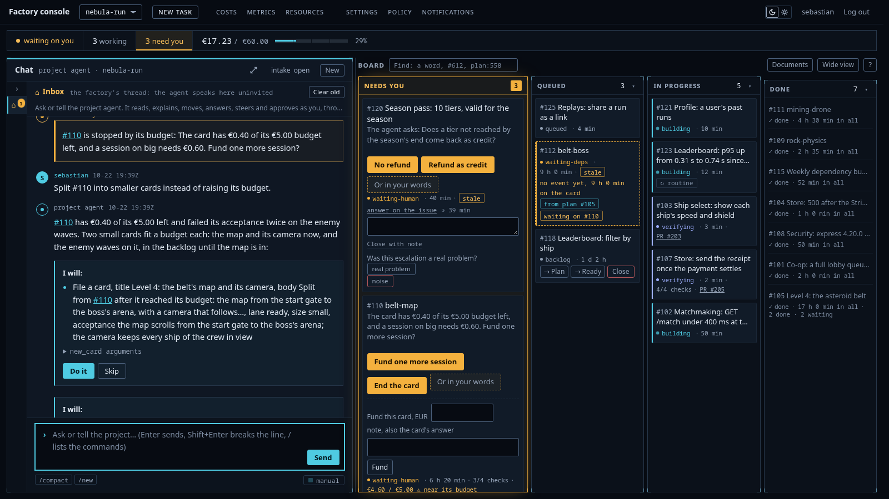

# AI software factory

**The worst an agent can do is wreck its own sandbox.**

Write a roadmap. Agents build it card by card, each in its own sandbox on your servers. Nothing merges until the checks pass. Use hosted models or your own.

The landing page, with a three-minute film and a short clip per feature, is in [launch/site/](launch/site/index.html).

## How a card runs

1. **Roadmap:** linked Markdown in your repository.
2. **Spec:** each criterion names its test before the code exists. You confirm the spec.
3. **Cards:** the planner files them in dependency order.
4. **Sandbox:** the agent works in a throwaway gVisor pod with no credentials and no internet.
5. **Pull request:** the factory pushes, not the agent.
6. **Gates:** tests, policy, review, reproduction and audit.
7. **Merge:** at manual you approve it. At full auto it merges once the gates pass.
8. **Live:** a card is done when its change runs in production.
9. **Telemetry:** alerts, issues and reports file the next card.

You steer it from one chat with the project agent. The project agent writes no code. It reads the board and the roadmap, files and moves cards, and passes your line to the session that builds a card. You set how much it decides alone, from manual to full auto. Money beyond a pool you set always reaches you.

## The three repositories

| Repository | What it holds |
|---|---|
| ai-software-factory, this one | The design docs, the evidence, the demo scenes and the landing page |
| [ai-software-factory-code](https://github.com/sebastianrueckerai/ai-software-factory-code) | The Go code: factoryd, the control plane; factory-gateway, the model gateway; agent-worker, the sandbox side |
| [ai-software-factory-infra](https://github.com/sebastianrueckerai/ai-software-factory-infra) | OpenTofu for the servers, the Talos machine configs and the Flux manifests |

## What runs today

The reference cluster runs on three Hetzner Cloud servers with S3 storage. On it:

- a planted regression went from its alert to a fix in production in 31 minutes, with no human;
- the factory fixed five of its own open defects;
- one spec card became ten planned cards and a deployed link shortener.

[docs/evidence.md](docs/evidence.md) lists every guarantee with the code that holds it, the test that exercises it and the run that shows it. Nine of the 43 guarantees still wait for a recorded run.

## Run it

There is no installer yet. The reference cluster is rebuilt with the [Rebuild](https://github.com/sebastianrueckerai/ai-software-factory-infra#rebuild) section of the infra repository, and the [build plan](docs/plans/2026-09-24-build-plan.md) holds the commands of its first stages. You need servers, S3-compatible storage, a domain and a model API key, or a model of your own behind the gateway.

Everything you configure is a file in your repository: the process, the prompts and the caps. A project may only tighten the process. Four gate stages stay in every process, and no file can remove them.

## Read more

- [Architecture](docs/architecture.md): the five planes and the three layers.
- [How the spec-driven process works](docs/spec-driven.md).
- [Threat model](docs/threat-model.md): what the sandbox stops, what it does not stop, and the known holes.
- [Comparison](docs/comparison.md): eight guarantees against six tools.

## Known limits

The hosted model APIs see diffs and briefs. The Go module proxy is a covert channel of a few hundred bytes per request. gVisor is not a microVM. The model can write code that passes the checks, and the review, the hold-out tests and the audit make that hard, not impossible.

Built by Sebastian Rücker.
