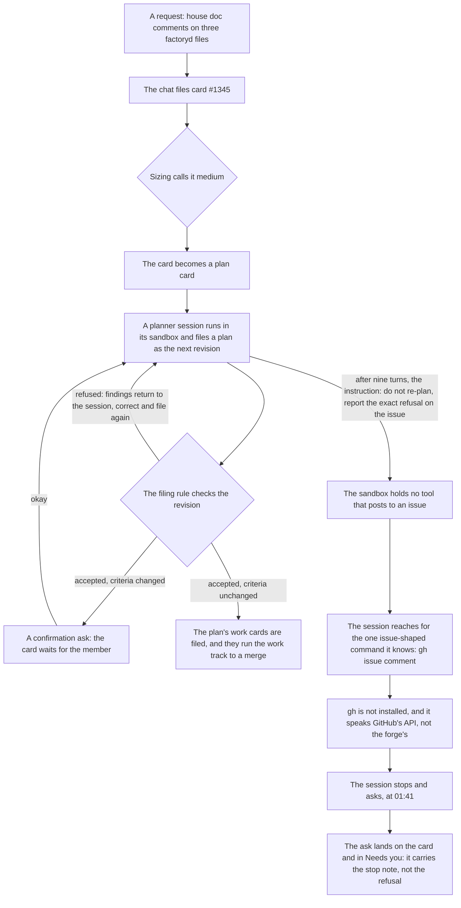

# Concept: how an agent reports a blocker

Written 2026-10-31, from the escalation at the end of card #1345's revision loop (see the revision-loop concept). Status: concept, waiting for Sebastian's go. The primer below explains every part of the factory the incident runs through, so the document reads on its own.

## What you need to know first

Nine things, in plain words:

1. **The forge and the issue.** The factory's code and work record live in a forge: a Forgejo instance, a self-hosted git host with an issue tracker. GitHub is a different service of the same shape, and gh is its client. Every card is tracked by an issue in the forge, and comments on that issue are the durable record of what happened to the card. An instruction that says report on the issue means: post a comment on the card's issue.
2. **Cards, money and the board.** The factory turns a request into a card: one unit of work with its own budget in euros and a small cap on how many agent sessions it may use. The board shows the project's cards. A card that waits for a human shows in the Needs you list.
3. **Sessions and sandboxes.** A card runs agent sessions: short work runs by an AI agent inside a sealed sandbox. The sandbox holds a clone of the repository, and the session writes files, runs commands and spends the card's budget. It has no tool that talks to the forge. While it lives, the whole session, prompts, tool calls and findings, streams to factoryd, the controller, so everything a session sees is recorded outside the sandbox.
4. **The plan track.** Sizing sends a small card straight to the work track: sessions build, a pull request passes the gates, the merge goes live. A medium or large card becomes a plan card. A planner session reads the request and writes a plan: the work cards to create, plus criteria, the named checks that decide at the end that the whole feature counts as good. Filing the plan creates a revision, one numbered version, and the filing rule checks it before anything is stored. A refused filing stores nothing: the findings return to the session with the advice to correct the plan and file it again in the same session. An accepted filing whose criteria changed asks the member to confirm before any work runs. When nothing is left to ask, the plan's work cards are filed and the plan ends done.
5. **Asks.** A session that cannot go on stops and asks. The ask lands on the card, the card waits for a human, and the ask shows in Needs you. Stopping and asking is the one designed way out of a sandbox.
6. **The chat.** Beside the board sits a chat with the project agent. It runs outside the sandboxes, with factory-served tools: it reads and writes files in the project's document repository, files cards and answers asks for Sebastian, the one human the factory calls the member. It is the main channel between the two.
7. **Tool cards.** A tool card is the card that adds a program to a sandbox image: it edits `factory/images.yaml`, the image rebuilds, and every session from then on finds the program installed. Card #1235 added chromium that way.
8. **The credential rule.** An agent session never holds a forge credential while it lives. For every session factoryd mints two Forgejo tokens: one reads the upstream repository, one writes only to a fork owned by the `factory-agent` account. The worker, the container around the agent, clones with the read token before the agent starts, keeps both tokens out of the agent's reach, and pushes with the write token only after the agent process is dead, once, and both tokens are revoked at the session's end. That push is the one write path out of a sandbox: the worker commits the session's tree, and factoryd opens the pull request. The rule exists because a token inside the agent's reach leaks through git hooks and lingering processes.
9. **Who may write to an issue.** Only the factory. A report session, an analysis run with a read token only, has its last message posted as an issue comment by the factory. An escalation's comment comes from factoryd. In every case the factory holds the credential and does the posting, and an agent hands over text and holds nothing.

## The process of the night, end to end

The two arrows back to the planner, refused and okay, are the circle the card ran for nine turns, revisions 5 to 13. Why the circle could not end is a defect in the filing machinery, told in the revision-loop concept. The exit from the circle was the instruction to report the refusal on the issue, and that exit is the subject of this concept: the sandbox has no tool that posts to an issue, the command the session reached for cannot speak to this forge and is not installed, and the designed way out then takes over, a stop and an ask that reach the human without the refusal the session was told to report. Every rule the diagram leans on, the filing rule, the ask, the credential rule, is explained in the primer above.

## Who wanted gh, and for what

gh is GitHub's command-line client: it talks to GitHub's API with a stored login. It came up twice in the incident, both times for the same purpose: to post a comment on the issue, which is a write.

1. **The card session reached for it at 01:41.** Sebastian's instruction to the card said: if the gate refuses the metadata again, do not re-plan, report the exact refusal on the issue. The gate refused again (the revision loop's defect, see the revision-loop concept). The session had the refusal text in hand, in its own findings, and lacked one thing: a tool that posts text to an issue. No such tool exists in a sandbox, so it reached for the one issue-shaped command agents know from training, `gh issue comment`. gh is not installed in the sandbox image, so the command did not run. The instruction had asked for a destination the sandbox cannot reach. The session's last move was the designed one: stop and ask. The last four steps of the diagram trace exactly this: no road to an issue, the reach for gh, the dead end, the stop and ask.
2. **The chat proposed the tool card.** After the night, the project agent proposed a tool card that puts gh into the project image, so future sessions could run that comment command. Same purpose, asked at install time instead of at run time.

Neither actor wanted to read. Nothing in the incident needed a read: the refusal sat in the session's own findings, one query away in the controller's database, and every input the session worked from had been fed to it. The wanted access was a standing write credential for the forge, held inside the sandbox.

If a read is ever wanted, it needs no gh either. The repository is already in the sandbox as the worker's clone, the card's context carries the request and its background, and anything else a session needs goes through an ask, which reaches the member. A read-grade gh login would still be a stored credential in the sandbox, and it still speaks to the wrong service.

## Why a write can never be the answer

Adding gh to the sandbox image would build the wrong thing twice over:

1. It speaks to the wrong service. The factory's forge is Forgejo, a different API. Even installed, gh reaches no Forgejo.
2. It breaks the credential rule. A gh login in the sandbox is a standing credential in the agent's reach while it lives, exactly the credential the architecture refuses to give it. It would sit outside the one write path out of a sandbox, the worker's push after the agent is dead, and it would leak through git hooks and lingering processes (primer, the credential rule).

So the tool card the project agent proposed (gh in the project image) is refused, and no image change is needed.

## How a blocker reaches you today

A session that cannot go on stops and asks. The ask lands on the card, the card waits for a human, the ask shows in Needs you and the board, and the answer can come through the main chat ("answer card 1345: go on") or the card page. That path is the last step of the diagram, and it worked: the planner stopped rather than thrash, and the ask reached Sebastian at 01:41 with the session's reason for stopping.

What the ask did not carry was the blocker itself. The session's stop note said "I was told to report the exact refusal and cannot"; the exact refusal sat one query away in the session's findings, and only the controller's database read surfaced it. That gap is the real defect.

## The fix by construction

1. **The ask quotes the refusal.** When a session stops right after a tool refusal, the ask's info block carries the refusal verbatim from the session's findings. The human then sees "the plan was refused: criterion v11 replaces v10, an id the previous revision does not hold" on the card, not only "this card stopped and needs your decision". No new credential, no new channel; factoryd composes the ask and already holds the findings.
2. **Plan cards get plan wording.** A plan card's stop ask says what its choices do: go on starts another planner session, leave it waiting holds the plan, end the card closes the plan and its cards with it. The current text talks about pull requests and re-verification, which fits no plan card.

With the refusal in the ask, no instruction needs to send a session to the issue again: the ask is the report.

## The report tool, named and declined for now

A factory-served tool (the session calls `report(text)`, factoryd posts the comment on the issue as the member, rate-limited to one per stop) would give the issue a durable record without any credential reaching the agent. It is declined for now: with the refusal quoted in the ask, it duplicates a channel, and no case has appeared where a record must reach the issue and no human ask is involved. Revisit when one does. It would follow the one pattern the factory already uses for issue comments: the factory posts, the agent supplies text (primer, who may write to an issue).

## What the chat can already write

The project agent needs no new tool to create concept files like this one. `write_doc` commits a new file with `content` to the document roots (docs/roadmap.md, docs/plans/, docs/board/ or docs/<name>.md), straight to master of the project's document repository, and edits a single passage of an existing file with `old` and `new`. It refuses empty documents, documents over the size cap, deletions, and roadmap edits that break that file's structure. A card session inside its sandbox has no document access at all, by design: its output is a pull request. Concept files, incident records and designs are the chat's to write, in one file per subject, which is the shape Sebastian asked for.
