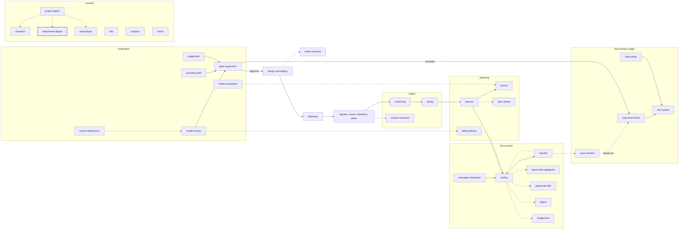

<!-- agentdoc: id=attachment-digest family=B -->

# attachment-digest

Summarises a document the human attached · runs: console, behind the chat's summarize_attachment tool

Summarises a document the human attached, for the project agent. One cheap call, and no system prompt.

Regenerated by `go run ./cmd/agentdoc`; no LLM runs. Code SHA `0b0b049c3d8156cbfe82aadaf4c997006dc56128`, policy `090da06f7c4b`.

**Fixture task, not live data.** The capture runs the real assembly on a fixed task against a fake gateway; nothing on this page is a live card's content.

| model alias | max tokens | stream | response format | purpose | task | tools | request bytes |
|---|---|---|---|---|---|---|---|
| `small` | 2048 | true | — | `digest` | `t-chat-fixture-2026-11` | 0 | 220 |

## Where this agent sits



## The first request

Verbatim, part by part, top to bottom as it crossed the wire. Sizes are bytes of the decoded part.

### user message

#### the digest's message — builder

[`factoryd.DigestMessage`](https://github.com/sebastianrueckerai/ai-software-factory-code/blob/0b0b049c3d8156cbfe82aadaf4c997006dc56128/internal/factoryd/operator.go#L188) · internal/factoryd/operator.go:188 · 125 bytes

```text
Summarise this document.

Staging budget: 40 EUR a month, raised from 30 on 2026-11-02.
The deploy waits on the budget's OK.

```

Contains: the document — [`(*turn).summarizeAttachment`](https://github.com/sebastianrueckerai/ai-software-factory-code/blob/0b0b049c3d8156cbfe82aadaf4c997006dc56128/internal/console/chat.go#L2491) · internal/console/chat.go:2491 · 99 bytes; the default ask — [`documentDigestAsk`](https://github.com/sebastianrueckerai/ai-software-factory-code/blob/0b0b049c3d8156cbfe82aadaf4c997006dc56128/internal/console/chat.go#L2484) · internal/console/chat.go:2484 · 24 bytes

The literal wire body sits in [`raw/attachment-digest.json`](raw/attachment-digest.json), byte for byte.
