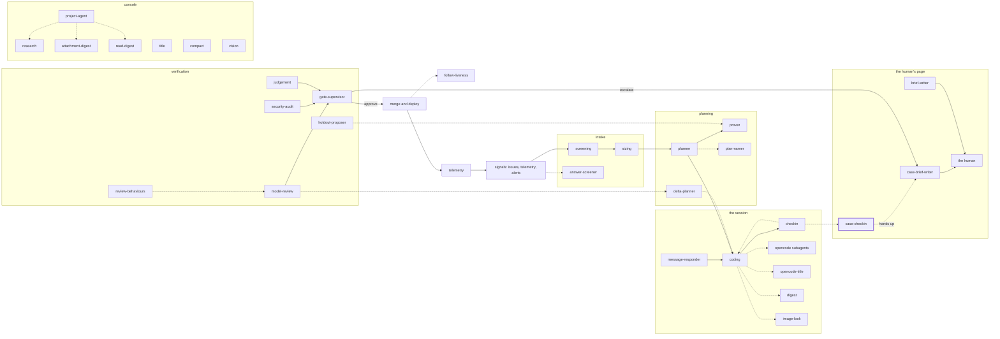

<!-- agentdoc: id=case-checkin family=B -->

# case-checkin

Judges a case at rung 1: acts on it, or hands it up with a recommendation · runs: factoryd, in-process loop on the project's chat task, tools read by factoryd

Judges a case the factory's code could not settle, on the card's facts and the evidence it reads itself, and acts on it or hands it up with a recommendation.

Regenerated by `go run ./cmd/agentdoc`; no LLM runs. Code SHA `9e84a5260c9ad70e15572ee79bcf9d3bcf0f6ce1`, policy `090da06f7c4b`.

**Fixture task, not live data.** The capture runs the real assembly on a fixed task against a fake gateway; nothing on this page is a live card's content.

| model alias | max tokens | stream | response format | purpose | task | tools | request bytes |
|---|---|---|---|---|---|---|---|
| `big` | 0 | false | — | `checkin` | `agentdoc-fixture` | 9 | 9638 |

## Where this agent sits



## The first request

Verbatim, part by part, top to bottom as it crossed the wire. Sizes are bytes of the decoded part.

### system message

#### the case check-in prompt — builder

[`factoryd.rungPrompt`](https://github.com/sebastianrueckerai/ai-software-factory-code/blob/9e84a5260c9ad70e15572ee79bcf9d3bcf0f6ce1/internal/factoryd/rung1.go#L372) · internal/factoryd/rung1.go:372 · 2283 bytes

<details><summary>the verbatim text, 2283 bytes, collapsed</summary>

```text
You are the factory's check-in, judging one case on a card: a stop the factory's code could not settle. Read what you need through your tools, then answer once through the answer tool with one of the decisions it lists, or hand_up when only a rung above you can decide, and recommend the action that rung should take. Judge every finding on evidence you read yourself, never on the say-so of a finding or of the session before it. You never edit anything. Your tools: transcript_search (search the newest session's record), transcript_read (read a span of it), card_facts (the card's digest and facts), card_step (one step of the digest in full), gates (the gates' newest results), read_file (a file of the repository at the head, or at main when the case has no head, under a first line naming the path and the commit it read), grep (git grep at head or main for a fixed string as a whole word, under a first line naming the commit of each ref it searched), cluster_facts (what the cluster did to a session of the card, the newest by default, or the platform's incidents of a window).

This text is one short line or one short paragraph that a human reads on a card. Write for a reader who dropped in cold. This reader did not follow the work and forgot how the process runs. Say the fact in plain, common words, and say it once. Give the number where there is one. Name what happened to the work, not the mechanism of the factory that did it.

# Why line

The why line stands under the title. It gives the reason for the work in one short sentence: who needs it, or which problem it removes. A reader who stops after the title and this line must know why the card exists, and a builder who lacks the reason builds with the wrong emphasis. On a card that asks, the line says why the question came up and what waiting costs, for example "Until all 5 are settled, the plan stays open and holds production deploys."

The line does not repeat the title, and it gives no instruction to the agent. Explain a term or a reference at its first use. Write the number, never "significantly" or "much".

Good: So a plan with no criteria closes without a waiver.

Bad: The case is the human card.

(A template wrote this when no writer gave a reason. It tells the reader nothing about the work.)
```

</details>

Contains: the guide's forms — [`writingguide.For`](https://github.com/sebastianrueckerai/ai-software-factory-code/blob/9e84a5260c9ad70e15572ee79bcf9d3bcf0f6ce1/internal/writingguide/forms.go#L50) · internal/writingguide/forms.go:50 · 1196 bytes; the tools line — [`factoryd.rungToolsLine`](https://github.com/sebastianrueckerai/ai-software-factory-code/blob/9e84a5260c9ad70e15572ee79bcf9d3bcf0f6ce1/internal/factoryd/rung1.go#L368) · internal/factoryd/rung1.go:368 · 629 bytes; the check-in's role — [`factoryd.rungSystem`](https://github.com/sebastianrueckerai/ai-software-factory-code/blob/9e84a5260c9ad70e15572ee79bcf9d3bcf0f6ce1/internal/factoryd/rung1.go#L366) · internal/factoryd/rung1.go:366 · 455 bytes

### user message

#### the statement — builder

[`factoryd.(*Runner).rungStatement`](https://github.com/sebastianrueckerai/ai-software-factory-code/blob/9e84a5260c9ad70e15572ee79bcf9d3bcf0f6ce1/internal/factoryd/rung1.go#L62) · internal/factoryd/rung1.go:62 · 1583 bytes

<details><summary>the verbatim text, 1583 bytes, collapsed</summary>

```text
The review keeps raising findings on this card. How should it go on?
Money: budget 5.00, spent 1.00, left 4.00 EUR, ceiling 7.00 EUR; card draw left 2 sessions, 1 hour of agent time and 4.00 EUR; pool left 30 sessions, 30 hours of agent time and 60.00 EUR; the project has 40.00 EUR left this month; a session's worth is about 5 minutes and 1.00 EUR.
#42 · budget 3.00 spent 0.41 holds 0.00 EUR · in-review, approval
   1 +0:00   filed by fixture-author → direct card
   2 +0:05   session 1 small        → pushed a1b2c3d
   3 +0:30   review                 → changes_requested
flags: none

Findings on the head:
- 3f2a1c9b0e44: New returns 1 where the counter needs the skipped rows counted
This card is in no plan.
- resume
- continue
- handover
- route_approval: not offered: the newest review of the head did not approve it
- reverify
- rerun_checks: not offered: the checks on the head are green, so there is nothing to run again
- wait_checks: not offered: `wait_checks` runs a stopped checks wait again, and this ask is no checks wait's stop
- extend
- successor
- retry: not offered: no failed dependency is open to a retry, and no provider freeze holds the card: retry files a failed dependency again or ends a freeze, so pick the action the card's wait needs
- replan
- settle: not offered: settle ends a monitor flag's ask alone, a held plan's ask, or the ask a park settles, and this ask is none of them
- withdraw: not offered: A withdrawal (`withdraw`) ends a monitor flag's ask alone: the card's run waits on this ask, so the check-in answers it or hands it up

```

</details>

Contains: the card's life — [`factoryd.CardDigest.Render`](https://github.com/sebastianrueckerai/ai-software-factory-code/blob/9e84a5260c9ad70e15572ee79bcf9d3bcf0f6ce1/internal/factoryd/carddigest_render.go#L45) · internal/factoryd/carddigest_render.go:45 · 246 bytes

#### the calls left and the answer's due time — builder

[`factoryd.dueOwnLine`](https://github.com/sebastianrueckerai/ai-software-factory-code/blob/9e84a5260c9ad70e15572ee79bcf9d3bcf0f6ce1/internal/factoryd/checkin.go#L1166) · internal/factoryd/checkin.go:1166 · 48 bytes

```text

Calls left 20; your answer is due within 8m30s.
```

## The offered tools

9 tools. Names and descriptions in the open; each schema's full JSON collapsed under it.

### transcript_search

[`factoryd.CaseEvidence`](https://github.com/sebastianrueckerai/ai-software-factory-code/blob/9e84a5260c9ad70e15572ee79bcf9d3bcf0f6ce1/internal/factoryd/rung1.go#L376) · internal/factoryd/rung1.go:376 · 287 bytes

search the parent session's record for lines holding a text, exact and case-sensitive

<details><summary>full schema JSON</summary>

```json
{"function":{"description":"search the parent session's record for lines holding a text, exact and case-sensitive","name":"transcript_search","parameters":{"properties":{"query":{"description":"the text to find","type":"string"}},"required":["query"],"type":"object"}},"type":"function"}
```

</details>

### transcript_read

[`factoryd.CaseEvidence`](https://github.com/sebastianrueckerai/ai-software-factory-code/blob/9e84a5260c9ad70e15572ee79bcf9d3bcf0f6ce1/internal/factoryd/rung1.go#L376) · internal/factoryd/rung1.go:376 · 253 bytes

read a span of the parent session's record by event number

<details><summary>full schema JSON</summary>

```json
{"function":{"description":"read a span of the parent session's record by event number","name":"transcript_read","parameters":{"properties":{"from":{"type":"integer"},"to":{"type":"integer"}},"required":["from","to"],"type":"object"}},"type":"function"}
```

</details>

### card_facts

[`factoryd.CaseEvidence`](https://github.com/sebastianrueckerai/ai-software-factory-code/blob/9e84a5260c9ad70e15572ee79bcf9d3bcf0f6ce1/internal/factoryd/rung1.go#L376) · internal/factoryd/rung1.go:376 · 229 bytes

the card's digest, its steps and flags, then its budget, spend, attempt and sessions, and the interim push's head when one landed

<details><summary>full schema JSON</summary>

```json
{"function":{"description":"the card's digest, its steps and flags, then its budget, spend, attempt and sessions, and the interim push's head when one landed","name":"card_facts","parameters":{"type":"object"}},"type":"function"}
```

</details>

### card_step

[`factoryd.CaseEvidence`](https://github.com/sebastianrueckerai/ai-software-factory-code/blob/9e84a5260c9ad70e15572ee79bcf9d3bcf0f6ce1/internal/factoryd/rung1.go#L376) · internal/factoryd/rung1.go:376 · 279 bytes

one step of the card's digest in full, by the number its line starts with

<details><summary>full schema JSON</summary>

```json
{"function":{"description":"one step of the card's digest in full, by the number its line starts with","name":"card_step","parameters":{"properties":{"step":{"description":"the step's number","minimum":1,"type":"integer"}},"required":["step"],"type":"object"}},"type":"function"}
```

</details>

### gates

[`factoryd.CaseEvidence`](https://github.com/sebastianrueckerai/ai-software-factory-code/blob/9e84a5260c9ad70e15572ee79bcf9d3bcf0f6ce1/internal/factoryd/rung1.go#L376) · internal/factoryd/rung1.go:376 · 132 bytes

the gates' full results for the round

<details><summary>full schema JSON</summary>

```json
{"function":{"description":"the gates' full results for the round","name":"gates","parameters":{"type":"object"}},"type":"function"}
```

</details>

### read_file

[`factoryd.CaseEvidence`](https://github.com/sebastianrueckerai/ai-software-factory-code/blob/9e84a5260c9ad70e15572ee79bcf9d3bcf0f6ce1/internal/factoryd/rung1.go#L376) · internal/factoryd/rung1.go:376 · 299 bytes

read a file of the repository by its path, as grep prints it

<details><summary>full schema JSON</summary>

```json
{"function":{"description":"read a file of the repository by its path, as grep prints it","name":"read_file","parameters":{"properties":{"path":{"description":"the file's path in the repository, or absolute under /workspace","type":"string"}},"required":["path"],"type":"object"}},"type":"function"}
```

</details>

### grep

[`factoryd.CaseEvidence`](https://github.com/sebastianrueckerai/ai-software-factory-code/blob/9e84a5260c9ad70e15572ee79bcf9d3bcf0f6ce1/internal/factoryd/rung1.go#L376) · internal/factoryd/rung1.go:376 · 440 bytes

git grep the repository at a ref for a fixed string as a whole word, no regex, under a first line naming the commit of each ref it searched

<details><summary>full schema JSON</summary>

```json
{"function":{"description":"git grep the repository at a ref for a fixed string as a whole word, no regex, under a first line naming the commit of each ref it searched","name":"grep","parameters":{"properties":{"path":{"description":"a path prefix","type":"string"},"pattern":{"description":"the fixed string","type":"string"},"ref":{"description":"head or main","type":"string"}},"required":["pattern"],"type":"object"}},"type":"function"}
```

</details>

### cluster_facts

[`factoryd.CaseEvidence`](https://github.com/sebastianrueckerai/ai-software-factory-code/blob/9e84a5260c9ad70e15572ee79bcf9d3bcf0f6ce1/internal/factoryd/rung1.go#L376) · internal/factoryd/rung1.go:376 · 496 bytes

what the cluster did to a session of this card (session, default the one you check) or the platform's incidents of a window (since, until, RFC 3339, at most 24 hours)

<details><summary>full schema JSON</summary>

```json
{"function":{"description":"what the cluster did to a session of this card (session, default the one you check) or the platform's incidents of a window (since, until, RFC 3339, at most 24 hours)","name":"cluster_facts","parameters":{"properties":{"session":{"description":"a session's ID of this card","type":"string"},"since":{"description":"the window's start, RFC 3339","type":"string"},"until":{"description":"the window's end, RFC 3339","type":"string"}},"type":"object"}},"type":"function"}
```

</details>

### answer

[`factoryd.rungAnswerTool`](https://github.com/sebastianrueckerai/ai-software-factory-code/blob/9e84a5260c9ad70e15572ee79bcf9d3bcf0f6ce1/internal/factoryd/rungconv.go#L89) · internal/factoryd/rungconv.go:89 · 3142 bytes

the rung's answer, one JSON object as this tool's arguments

<details><summary>full schema JSON</summary>

```json
{"function":{"description":"the rung's answer, one JSON object as this tool's arguments","name":"answer","parameters":{"additionalProperties":false,"properties":{"decision":{"description":"the action this rung takes, one of the offered actions, or hand_up when the rung cannot resolve","enum":["resume","continue","handover","reverify","extend","successor","replan","hand_up"],"type":"string"},"draw":{"additionalProperties":false,"description":"more room for the card in sessions' worth of its own time and money, which the factory works out from its sessions: the room the decision extend gives, or the room that rides beside another decision","properties":{"money":{"description":"true to give the money with the time and the starts, false to give the time and the starts alone","type":"boolean"},"sessions":{"description":"how many sessions' worth","maximum":5,"minimum":1,"type":"integer"}},"required":["sessions","money"],"type":"object"},"model":{"description":"the model of the next session, required with the decision handover","enum":["same","stronger","cheaper"],"type":"string"},"note":{"description":"the note the answer hands the card","type":"string"},"reason_kind":{"description":"the kind of reason the answer answers","enum":["session_cap","agent_time_cap","budget_floor","day_cap","month_cap","factory_month_cap","project_cap","checkin_human","checkin_share","checkin_failed","gate_stop","findings_repeated","dependency_closed","dependency_failed","wait_expired","pod_never_started","provider_refused","no_answer","content_filter","image_wait","screening_suspect","agent_escalate","agent_request_info","plan_question","plan_confirmation","merge_approval","human_card","other","monitor_flag","judgment_budget","policy_class","red_main","roll_held","config_refused","plan_criteria","plan_held","provider_freeze","platform_fault","platform_deaths","goal_conflict","spend_above_policy","access_factory_lacks"],"type":"string"},"recommendation":{"additionalProperties":false,"properties":{"action":{"description":"the action the answer recommends: one of the offered actions, or on hand_up one the rungs above can take","enum":["resume","continue","handover","reverify","extend","successor","replan","close","note"],"type":"string"},"grounds":{"description":"why, in plain words","type":"string"}},"required":["action","grounds"],"type":"object"},"verdicts":{"additionalProperties":false,"description":"the verdict on every finding the statement lists, keyed by the finding's id: each value is one object with verdict and evidence, never a string","properties":{"3f2a1c9b0e44":{"additionalProperties":false,"description":"one of the three verdicts and the evidence it stands on, both as strings, in one object","properties":{"evidence":{"description":"what the verdict stands on: a file and line at a ref, or a command and its output","type":"string"},"verdict":{"enum":["confirmed","dropped","remark"],"type":"string"}},"required":["verdict","evidence"],"type":"object"}},"required":["3f2a1c9b0e44"],"type":"object"}},"required":["decision","reason_kind","verdicts","note","recommendation"],"type":"object"}},"type":"function"}
```

</details>

The literal wire body sits in [`raw/case-checkin.json`](raw/case-checkin.json), byte for byte.
