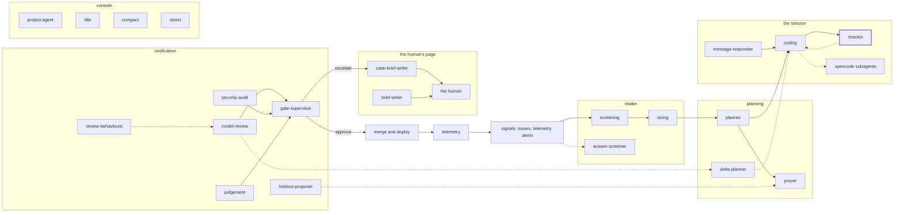

<!-- agentdoc: id=checkin family=B -->

# checkin

Decides continue, message, handover, human or replan on a session trip · runs: factoryd, in-process loop, tools executed in the sandbox

Reads a session that stopped at a checkpoint short of done and answers one of continue, message, handover, human or replan.

Regenerated by `go run ./cmd/agentdoc`; no LLM runs. Code SHA `2af2e0ed2bd13ad93168599df570844cbe6edcb6`, policy `090da06f7c4b`.

**Fixture task, not live data.** The capture runs the real assembly on a fixed task against a fake gateway; nothing on this page is a live card's content.

| model alias | max tokens | stream | response format | purpose | task | tools | request bytes |
|---|---|---|---|---|---|---|---|
| `big` | 0 | false | — | `checkin` | `agentdoc-fixture` | 10 | 6718 |

## Where this agent sits



## The first request

Verbatim, part by part, top to bottom as it crossed the wire. Sizes are bytes of the decoded part.

### system message

#### session persona — builder

[`factoryd.checkinSystemFor`](https://github.com/sebastianrueckerai/ai-software-factory-code/blob/2af2e0ed2bd13ad93168599df570844cbe6edcb6/internal/factoryd/checkin.go#L530) · internal/factoryd/checkin.go:530 · 836 bytes

```text
You are the factory's check-in inside a running session: its detectors tripped and you decide what happens next, on evidence you gather yourself from the live workspace and the session's record. You never edit anything. Your final answer is one JSON object and nothing else: {"decision":"continue|handover|hand_up","guidance":"...","reason_kind":"...","reason":"...","handover":"..."}. A continue may carry guidance: the exact instruction the agent should take next. Keep the guidance inside what the agent's shell tool can run: no timeout past its 600000 ms maximum, and where nothing in the workspace changed, name bash check static, not bash check changed. "handover" stops the session: write the note the next session starts from. When only a human can act, name the reason kind and why, in one sentence, with the state of the work.
```

### user message

#### the statement — builder

[`factoryd.checkinStatement`](https://github.com/sebastianrueckerai/ai-software-factory-code/blob/2af2e0ed2bd13ad93168599df570844cbe6edcb6/internal/factoryd/checkin.go#L292) · internal/factoryd/checkin.go:292 · 2424 bytes

<details><summary>the verbatim text, 2424 bytes, collapsed</summary>

```text
You are the factory's check-in inside session s-fixture-01: the detector size tripped (the card's remaining work against its bounds), and you decide what happens before the session continues. You never edit anything; you gather evidence and answer.

This text is one short line or one short paragraph that a human reads on a card. Write for a reader who dropped in cold. This reader did not follow the work and forgot how the process runs. Say the fact in plain, common words, and say it once. Give the number where there is one. Name what happened to the work, not the mechanism of the factory that did it.

# Why line

The why line stands under the title. It gives the reason for the work in one short sentence: who needs it, or which problem it removes. A reader who stops after the title and this line must know why the card exists, and a builder who lacks the reason builds with the wrong emphasis. On a card that asks, the line says why the question came up and what waiting costs, for example "Until all 5 are settled, the plan stays open and holds production deploys."

The line does not repeat the title, and it gives no instruction to the agent. Explain a term or a reference at its first use. Write the number, never "significantly" or "much".

Good: So a plan with no criteria closes without a waiver.

Bad: The case is the human card.

(A template wrote this when no writer gave a reason. It tells the reader nothing about the work.)

Rules:
- continue: the session runs on, and may carry guidance: the exact instruction the agent should take next.
- handover: the session stops; the note to the next session is at most 800 characters.
- hand_up: if only a human can act — a goal conflict, spend above policy, a policy class, access the factory lacks — stop and say which, with why.
Guidance delivered to the agent this session:
- Wrap the change up; the session's budget is thin.
The size trip asks one question: will the rest of the card fit in its bound, its budget and its time? Answer continue if it will, with the guidance if the agent should wrap up.
The agent's report per finding is the last message in its record: what it fixed, disputed or left open. Verify it; never take it on trust.

The live session's record so far, its tail:
<<<SESSION-TAIL>>>
2026-10-31T12:00:00Z agent message: the fix is half done

SESSION-TAIL>>>

calls left 3, 1.00 EUR left in the project's judgment budget this month
```

</details>

Contains: the guide's forms — [`factoryd.checkinForms`](https://github.com/sebastianrueckerai/ai-software-factory-code/blob/2af2e0ed2bd13ad93168599df570844cbe6edcb6/internal/factoryd/checkin.go#L285) · internal/factoryd/checkin.go:285 · 1198 bytes; the parent session's tail — [`factoryd.agentDocCheckin`](https://github.com/sebastianrueckerai/ai-software-factory-code/blob/2af2e0ed2bd13ad93168599df570844cbe6edcb6/internal/factoryd/agentdoc.go#L134) · internal/factoryd/agentdoc.go:134 · 57 bytes

#### the answer deadline — builder

[`factoryd.checkinDueLine`](https://github.com/sebastianrueckerai/ai-software-factory-code/blob/2af2e0ed2bd13ad93168599df570844cbe6edcb6/internal/factoryd/checkin.go#L1165) · internal/factoryd/checkin.go:1165 · 29 bytes

```text
, your answer due within 3m0s
```

## The offered tools

10 tools. Names and descriptions in the open; each schema's full JSON collapsed under it.

### transcript_search

[`factoryd.checkinTools`](https://github.com/sebastianrueckerai/ai-software-factory-code/blob/2af2e0ed2bd13ad93168599df570844cbe6edcb6/internal/factoryd/checkin.go#L660) · internal/factoryd/checkin.go:660 · 287 bytes

search the parent session's record for lines holding a text, exact and case-sensitive

<details><summary>full schema JSON</summary>

```json
{"function":{"description":"search the parent session's record for lines holding a text, exact and case-sensitive","name":"transcript_search","parameters":{"properties":{"query":{"description":"the text to find","type":"string"}},"required":["query"],"type":"object"}},"type":"function"}
```

</details>

### transcript_read

[`factoryd.checkinTools`](https://github.com/sebastianrueckerai/ai-software-factory-code/blob/2af2e0ed2bd13ad93168599df570844cbe6edcb6/internal/factoryd/checkin.go#L660) · internal/factoryd/checkin.go:660 · 253 bytes

read a span of the parent session's record by event number

<details><summary>full schema JSON</summary>

```json
{"function":{"description":"read a span of the parent session's record by event number","name":"transcript_read","parameters":{"properties":{"from":{"type":"integer"},"to":{"type":"integer"}},"required":["from","to"],"type":"object"}},"type":"function"}
```

</details>

### card_facts

[`factoryd.checkinTools`](https://github.com/sebastianrueckerai/ai-software-factory-code/blob/2af2e0ed2bd13ad93168599df570844cbe6edcb6/internal/factoryd/checkin.go#L660) · internal/factoryd/checkin.go:660 · 229 bytes

the card's digest, its steps and flags, then its budget, spend, attempt and sessions, and the interim push's head when one landed

<details><summary>full schema JSON</summary>

```json
{"function":{"description":"the card's digest, its steps and flags, then its budget, spend, attempt and sessions, and the interim push's head when one landed","name":"card_facts","parameters":{"type":"object"}},"type":"function"}
```

</details>

### card_step

[`factoryd.checkinTools`](https://github.com/sebastianrueckerai/ai-software-factory-code/blob/2af2e0ed2bd13ad93168599df570844cbe6edcb6/internal/factoryd/checkin.go#L660) · internal/factoryd/checkin.go:660 · 279 bytes

one step of the card's digest in full, by the number its line starts with

<details><summary>full schema JSON</summary>

```json
{"function":{"description":"one step of the card's digest in full, by the number its line starts with","name":"card_step","parameters":{"properties":{"step":{"description":"the step's number","minimum":1,"type":"integer"}},"required":["step"],"type":"object"}},"type":"function"}
```

</details>

### gates

[`factoryd.checkinTools`](https://github.com/sebastianrueckerai/ai-software-factory-code/blob/2af2e0ed2bd13ad93168599df570844cbe6edcb6/internal/factoryd/checkin.go#L660) · internal/factoryd/checkin.go:660 · 132 bytes

the gates' full results for the round

<details><summary>full schema JSON</summary>

```json
{"function":{"description":"the gates' full results for the round","name":"gates","parameters":{"type":"object"}},"type":"function"}
```

</details>

### read_file

[`factoryd.checkinTools`](https://github.com/sebastianrueckerai/ai-software-factory-code/blob/2af2e0ed2bd13ad93168599df570844cbe6edcb6/internal/factoryd/checkin.go#L660) · internal/factoryd/checkin.go:660 · 299 bytes

read a file of the repository by its path, as grep prints it

<details><summary>full schema JSON</summary>

```json
{"function":{"description":"read a file of the repository by its path, as grep prints it","name":"read_file","parameters":{"properties":{"path":{"description":"the file's path in the repository, or absolute under /workspace","type":"string"}},"required":["path"],"type":"object"}},"type":"function"}
```

</details>

### grep

[`factoryd.checkinTools`](https://github.com/sebastianrueckerai/ai-software-factory-code/blob/2af2e0ed2bd13ad93168599df570844cbe6edcb6/internal/factoryd/checkin.go#L660) · internal/factoryd/checkin.go:660 · 440 bytes

git grep the repository at a ref for a fixed string as a whole word, no regex, under a first line naming the commit of each ref it searched

<details><summary>full schema JSON</summary>

```json
{"function":{"description":"git grep the repository at a ref for a fixed string as a whole word, no regex, under a first line naming the commit of each ref it searched","name":"grep","parameters":{"properties":{"path":{"description":"a path prefix","type":"string"},"pattern":{"description":"the fixed string","type":"string"},"ref":{"description":"head or main","type":"string"}},"required":["pattern"],"type":"object"}},"type":"function"}
```

</details>

### git_log

[`factoryd.checkinTools`](https://github.com/sebastianrueckerai/ai-software-factory-code/blob/2af2e0ed2bd13ad93168599df570844cbe6edcb6/internal/factoryd/checkin.go#L660) · internal/factoryd/checkin.go:660 · 280 bytes

the workspace's history; only -n, --oneline and -- <path> are allowed

<details><summary>full schema JSON</summary>

```json
{"function":{"description":"the workspace's history; only -n, --oneline and -- \u003cpath\u003e are allowed","name":"git_log","parameters":{"properties":{"args":{"description":"the arguments as one string","type":"string"}},"required":["args"],"type":"object"}},"type":"function"}
```

</details>

### cluster_facts

[`factoryd.checkinTools`](https://github.com/sebastianrueckerai/ai-software-factory-code/blob/2af2e0ed2bd13ad93168599df570844cbe6edcb6/internal/factoryd/checkin.go#L660) · internal/factoryd/checkin.go:660 · 496 bytes

what the cluster did to a session of this card (session, default the one you check) or the platform's incidents of a window (since, until, RFC 3339, at most 24 hours)

<details><summary>full schema JSON</summary>

```json
{"function":{"description":"what the cluster did to a session of this card (session, default the one you check) or the platform's incidents of a window (since, until, RFC 3339, at most 24 hours)","name":"cluster_facts","parameters":{"properties":{"session":{"description":"a session's ID of this card","type":"string"},"since":{"description":"the window's start, RFC 3339","type":"string"},"until":{"description":"the window's end, RFC 3339","type":"string"}},"type":"object"}},"type":"function"}
```

</details>

### answer

[`factoryd.momentAnswerTool`](https://github.com/sebastianrueckerai/ai-software-factory-code/blob/2af2e0ed2bd13ad93168599df570844cbe6edcb6/internal/factoryd/checkin.go#L653) · internal/factoryd/checkin.go:653 · 507 bytes

the check-in's final answer, one JSON object as this tool's arguments

<details><summary>full schema JSON</summary>

```json
{"function":{"description":"the check-in's final answer, one JSON object as this tool's arguments","name":"answer","parameters":{"additionalProperties":false,"properties":{"decision":{"enum":["continue","handover","hand_up"],"type":"string"},"guidance":{"type":"string"},"handover":{"type":"string"},"reason":{"type":"string"},"reason_kind":{"enum":["","goal_conflict","spend_above_policy","policy_class","access_factory_lacks"],"type":"string"}},"required":["decision"],"type":"object"}},"type":"function"}
```

</details>

The literal wire body sits in [`raw/checkin.json`](raw/checkin.json), byte for byte.
