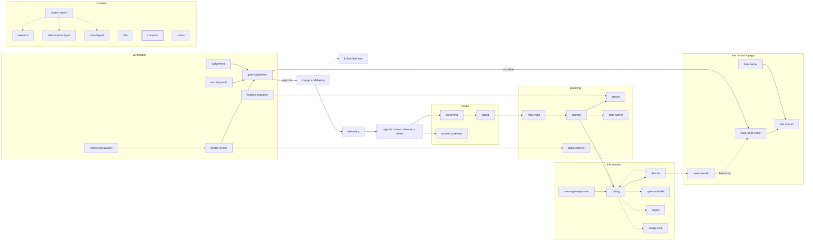

<!-- agentdoc: id=compact family=B -->

# compact

Summarises a chat thread's older turns · runs: console

Summarises a chat thread's older turns when the thread grows long. One cheap call.

Regenerated by `go run ./cmd/agentdoc`; no LLM runs. Code SHA `5b2dce616e5008006b1c98e0cd17ede8cc01ace0`, policy `249822ac88a1`.

**Fixture task, not live data.** The capture runs the real assembly on a fixed task against a fake gateway; nothing on this page is a live card's content.

| model alias | max tokens | stream | response format | purpose | task | tools | request bytes |
|---|---|---|---|---|---|---|---|
| `small` | 2048 | true | — | `compact` | `t-chat-fixture-2026-11` | 0 | 1074 |

## Where this agent sits



## The first request

Verbatim, part by part, top to bottom as it crossed the wire. Sizes are bytes of the decoded part.

### system message

#### the profile's texts — builder

[`prompts.Build`](https://github.com/sebastianrueckerai/ai-software-factory-code/blob/5b2dce616e5008006b1c98e0cd17ede8cc01ace0/internal/prompts/build.go#L25) · internal/prompts/build.go:25 · 768 bytes

```text
This text is one short line or one short paragraph that a human reads on a card. Write for a reader who dropped in cold. This reader did not follow the work and forgot how the process runs. Say the fact in plain, common words, and say it once. Give the number where there is one. Name what happened to the work, not the mechanism of the factory that did it.

You keep the running summary of a human's thread with the project agent. Write the new summary from the summary so far and the turns after it: what the human asked for and decided, what the agent did with its issue numbers, what is open, and what a later turn needs. The human sees the summary as a turn, and the agent reads it in place of the turns it folds. Answer with the summary alone, at most 400 words.
```

### user message

#### the compaction frame — builder

[`(*turn).compact`](https://github.com/sebastianrueckerai/ai-software-factory-code/blob/5b2dce616e5008006b1c98e0cd17ede8cc01ace0/internal/console/compact.go#L158) · internal/console/compact.go:158 · 52 bytes

```text
The summary so far:
(none yet)

The turns after it:

```

#### the folded turns — fixture

[`transcript`](https://github.com/sebastianrueckerai/ai-software-factory-code/blob/5b2dce616e5008006b1c98e0cd17ede8cc01ace0/internal/console/compact.go#L109) · internal/console/compact.go:109 · 124 bytes

```text
the human: Set the staging budget to 40 euros.
the agent: I set the staging budget to 40 euros; the card waits for your OK.

```

The literal wire body sits in [`raw/compact.json`](raw/compact.json), byte for byte.
