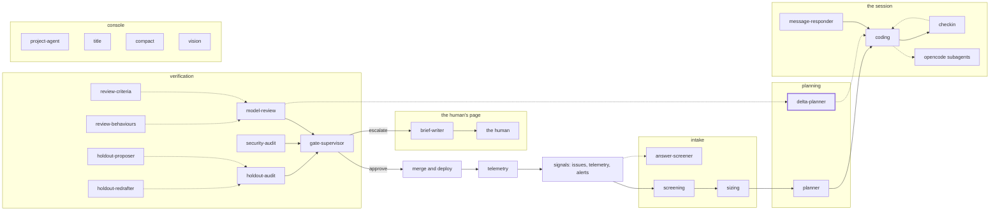

<!-- agentdoc: id=delta-planner family=B -->

# delta-planner

Plans delta work between reviews · runs: factoryd direct

Plans the delta work between one review and the next.

Regenerated by `go run ./cmd/agentdoc`; no LLM runs. Code SHA `0dbb13c4cb2e4bbc2a54a9d20878b8a94842886d`, policy `3a8a734a860e`.

**Fixture task, not live data.** The capture runs the real assembly on a fixed task against a fake gateway; nothing on this page is a live card's content.

| model alias | max tokens | stream | response format | purpose | task | tools | request bytes |
|---|---|---|---|---|---|---|---|
| `premium` | 18432 | false | json_object | `review` | `agentdoc-fixture` | 0 | 1704 |

## Where this agent sits



## The first request

Verbatim, part by part, top to bottom as it crossed the wire. Sizes are bytes of the decoded part.

### system message

#### the delta prompt — builder

[`factoryd.deltaPrompt`](https://github.com/sebastianrueckerai/ai-software-factory-code/blob/0dbb13c4cb2e4bbc2a54a9d20878b8a94842886d/internal/factoryd/verdict.go#L566) · internal/factoryd/verdict.go:566 · 842 bytes

```text
You are the planner of a software factory. A plan's criteria are not met after its cards ran. You draft one more bounded card — a delta card — under the open plan, which closes the gap the criteria name. Answer with one JSON object and nothing else: {"card": {"key": "...", "role": "feature", "title": "...", "brief": "...", "directories": ["..."], "depends_on": ["keys of the plan's existing cards"], "acceptance": [{"criterion": "the criterion id", "text": "the command and its expected result"}], "size": "small|medium|large", "rung": "cheap|frontier", "rung_reason": "..."}}. The card's key is new. directories are the directories the card may change. depends_on names only keys the plan holds. acceptance carries every criterion the card closes, its command the criterion's test. Keep the card small: it closes the gap, nothing else.
```

### user message

#### the delta call's facts — builder

[`factoryd.deltaInput`](https://github.com/sebastianrueckerai/ai-software-factory-code/blob/0dbb13c4cb2e4bbc2a54a9d20878b8a94842886d/internal/factoryd/verdict.go#L571) · internal/factoryd/verdict.go:571 · 594 bytes

```text
{"spec":{"outcome":"The counter counts every row the query returns, skipped ones included."},"summary":"One card fixes the counter; one criterion proves it.","criteria":[{"id":"c1","kind":"test","test":"go test ./internal/foo/ -run TestCounter","inputs":"the fixture table with one skipped row","expected":"the count includes the skipped row","evidence":"the diff shows no test of the skipped row"}],"verdicts":null,"cards":[{"key":"f1","role":"feature","title":"Fix the counter","brief":"Count skipped rows.","directories":["internal/foo"],"depends_on":null,"acceptance":null,"size":"small"}]}
```

Contains: the spec — [`factoryd.Spec`](https://github.com/sebastianrueckerai/ai-software-factory-code/blob/0dbb13c4cb2e4bbc2a54a9d20878b8a94842886d/internal/factoryd/plan.go#L108) · internal/factoryd/plan.go:108 · 84 bytes

The literal wire body sits in [`raw/delta-planner.json`](raw/delta-planner.json), byte for byte.
