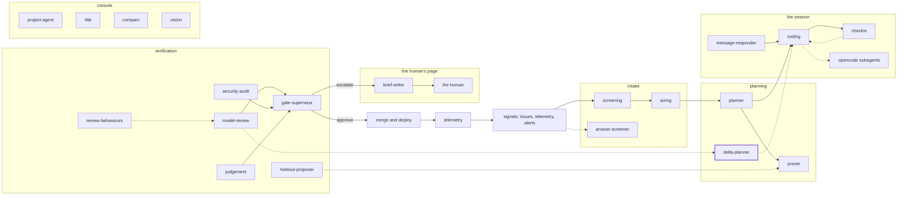

<!-- agentdoc: id=delta-planner family=B -->

# delta-planner

Plans delta work between reviews · runs: factoryd direct

Plans the delta work between one review and the next.

Regenerated by `go run ./cmd/agentdoc`; no LLM runs. Code SHA `4f03a25c76341b85a571e3d370b3d7c70691cb8a`, policy `d245f5c998fe`.

**Fixture task, not live data.** The capture runs the real assembly on a fixed task against a fake gateway; nothing on this page is a live card's content.

| model alias | max tokens | stream | response format | purpose | task | tools | request bytes |
|---|---|---|---|---|---|---|---|
| `big` | 18432 | false | json_object | `review` | `agentdoc-fixture` | 0 | 1879 |

## Where this agent sits



## The first request

Verbatim, part by part, top to bottom as it crossed the wire. Sizes are bytes of the decoded part.

### system message

#### the delta prompt — builder

[`factoryd.deltaPrompt`](https://github.com/sebastianrueckerai/ai-software-factory-code/blob/4f03a25c76341b85a571e3d370b3d7c70691cb8a/internal/factoryd/verdict.go#L583) · internal/factoryd/verdict.go:583 · 1025 bytes

<details><summary>the verbatim text, 1025 bytes, collapsed</summary>

```text
You are the planner of a software factory. A plan's criteria are not met after its cards ran. You draft one more bounded card — a delta card — under the open plan, which closes the gap the criteria name. Answer with one JSON object and nothing else: {"card": {"key": "...", "title": "...", "brief": "...", "directories": ["..."], "depends_on": ["keys of the plan's existing cards"], "acceptance": [{"criterion": "the criterion id", "text": "what the card's tests prove, with the inputs and the numbers they expect"}], "size": "small|medium|large", "rung": "cheap|frontier", "rung_reason": "..."}}. The card's key is new. directories are the directories the card may change. depends_on names only keys the plan holds. acceptance carries every criterion the card closes, its text the criterion's claim, inputs and expected numbers. Keep the card small: it closes the gap, nothing else. refused, when set, holds your earlier answers of this round and the plan rule each broke: answer again with a card that keeps every rule.
```

</details>

### user message

#### the input heading — builder

[`factoryd.chatInputLead`](https://github.com/sebastianrueckerai/ai-software-factory-code/blob/4f03a25c76341b85a571e3d370b3d7c70691cb8a/internal/factoryd/supervisor.go#L246) · internal/factoryd/supervisor.go:246 · 20 bytes

```text
The input, as JSON:

```

#### the delta call's facts — builder

[`factoryd.deltaInput`](https://github.com/sebastianrueckerai/ai-software-factory-code/blob/4f03a25c76341b85a571e3d370b3d7c70691cb8a/internal/factoryd/verdict.go#L588) · internal/factoryd/verdict.go:588 · 573 bytes

```text
{"spec":{"outcome":"The counter counts every row the query returns, skipped ones included."},"summary":"One card fixes the counter; one criterion proves it.","criteria":[{"id":"c1","kind":"test","claim":"the counter counts a row the query skips","inputs":"the fixture table with one skipped row","expected":"a count of 1","evidence":"the diff shows no test of the skipped row"}],"verdicts":null,"cards":[{"key":"f1","role":"feature","title":"Fix the counter","brief":"Count skipped rows.","directories":["internal/foo"],"depends_on":null,"acceptance":null,"size":"small"}]}
```

Contains: the spec — [`factoryd.Spec`](https://github.com/sebastianrueckerai/ai-software-factory-code/blob/4f03a25c76341b85a571e3d370b3d7c70691cb8a/internal/factoryd/plan.go#L110) · internal/factoryd/plan.go:110 · 84 bytes

The literal wire body sits in [`raw/delta-planner.json`](raw/delta-planner.json), byte for byte.
