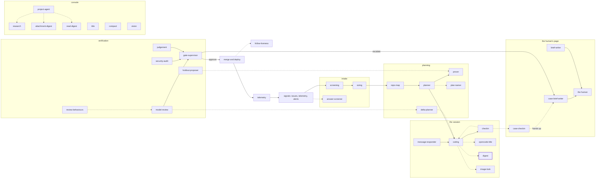

<!-- agentdoc: id=digest family=B -->

# digest

Summarises one big read under an ask · runs: factoryd direct, behind a session's digest tool

Summarises one file a session names under the session's ask, for its digest tool. One cheap call, and no system prompt.

Regenerated by `go run ./cmd/agentdoc`; no LLM runs. Code SHA `7afdbe69cc2686777d807fb3bd06efb4311b4acd`, policy `249822ac88a1`.

**Fixture task, not live data.** The capture runs the real assembly on a fixed task against a fake gateway; nothing on this page is a live card's content.

| model alias | max tokens | stream | response format | purpose | task | tools | request bytes |
|---|---|---|---|---|---|---|---|
| `small` | 2048 | true | — | `digest` | `agentdoc-fixture` | 0 | 287 |

## Where this agent sits



## The first request

Verbatim, part by part, top to bottom as it crossed the wire. Sizes are bytes of the decoded part.

### user message

#### the digest's message — builder

[`factoryd.DigestMessage`](https://github.com/sebastianrueckerai/ai-software-factory-code/blob/7afdbe69cc2686777d807fb3bd06efb4311b4acd/internal/factoryd/operator.go#L188) · internal/factoryd/operator.go:188 · 190 bytes

```text
Summarise this file.

# The nightly job

The job counts the day's rows and writes the report at 02:00 UTC.
A batch that fails is requeued once, and a second failure pages the human on call.

```

Contains: the file's text — [`factoryd.agentDocDigest`](https://github.com/sebastianrueckerai/ai-software-factory-code/blob/7afdbe69cc2686777d807fb3bd06efb4311b4acd/internal/factoryd/agentdoc.go#L744) · internal/factoryd/agentdoc.go:744 · 168 bytes; the default ask — [`factoryd.fileDigestAsk`](https://github.com/sebastianrueckerai/ai-software-factory-code/blob/7afdbe69cc2686777d807fb3bd06efb4311b4acd/internal/factoryd/digest.go#L38) · internal/factoryd/digest.go:38 · 20 bytes

The literal wire body sits in [`raw/digest.json`](raw/digest.json), byte for byte.
