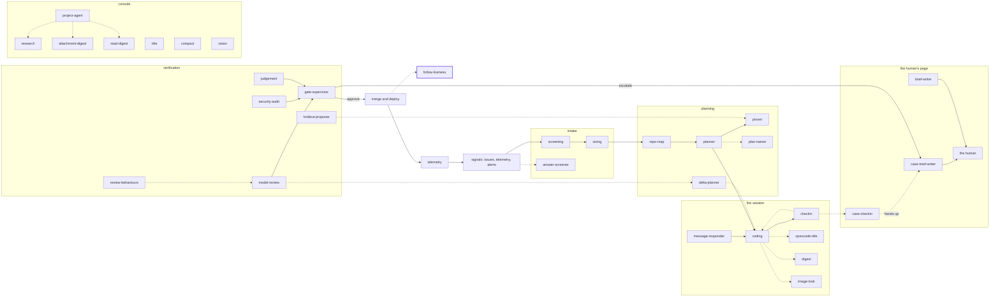

<!-- agentdoc: id=follow-liveness family=B -->

# follow-liveness

Asks the small model for one word after a move rolls out · runs: factoryd direct, in the follow judgment

Asks the small model for one word after a move rolls out, to prove the model route still answers. No one reads the answer.

Regenerated by `go run ./cmd/agentdoc`; no LLM runs. Code SHA `7afdbe69cc2686777d807fb3bd06efb4311b4acd`, policy `249822ac88a1`.

**Fixture task, not live data.** The capture runs the real assembly on a fixed task against a fake gateway; nothing on this page is a live card's content.

| model alias | max tokens | stream | response format | purpose | task | tools | request bytes |
|---|---|---|---|---|---|---|---|
| `small` | 18432 | false | — | `digest` | `agentdoc-fixture` | 1 | 485 |

## Where this agent sits



## The first request

Verbatim, part by part, top to bottom as it crossed the wire. Sizes are bytes of the decoded part.

### system message

#### the liveness ask — builder

[`factoryd.followModelSystem`](https://github.com/sebastianrueckerai/ai-software-factory-code/blob/7afdbe69cc2686777d807fb3bd06efb4311b4acd/internal/factoryd/followmove.go#L307) · internal/factoryd/followmove.go:307 · 29 bytes

```text
Answer ok, as the input says.
```

### user message

#### the liveness input — builder

[`factoryd.followModelInput`](https://github.com/sebastianrueckerai/ai-software-factory-code/blob/7afdbe69cc2686777d807fb3bd06efb4311b4acd/internal/factoryd/followmove.go#L310) · internal/factoryd/followmove.go:310 · 12 bytes

```text
{"say":"ok"}
```

## The offered tools

1 tools. Names and descriptions in the open; each schema's full JSON collapsed under it.

### answer

[`prompts.AnswerTool`](https://github.com/sebastianrueckerai/ai-software-factory-code/blob/7afdbe69cc2686777d807fb3bd06efb4311b4acd/internal/prompts/answer.go#L74) · internal/prompts/answer.go:74 · the step's own schema · 257 bytes

Your answer: one JSON object as this tool's arguments.

<details><summary>full schema JSON</summary>

```json
{"function":{"description":"Your answer: one JSON object as this tool's arguments.","name":"answer","parameters":{"additionalProperties":false,"properties":{"ok":{"description":"true","type":"boolean"}},"required":["ok"],"type":"object"}},"type":"function"}
```

</details>

The literal wire body sits in [`raw/follow-liveness.json`](raw/follow-liveness.json), byte for byte.
