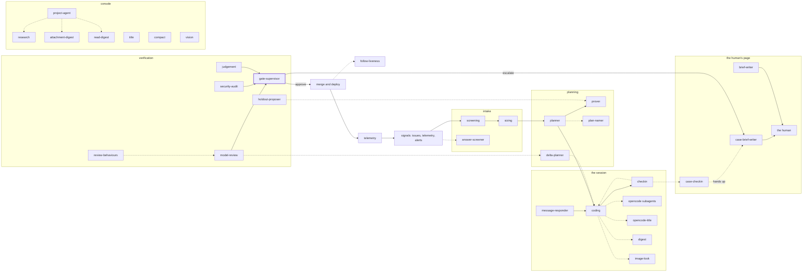

<!-- agentdoc: id=gate-supervisor family=B -->

# gate-supervisor

Decides approve or escalate at the gates · runs: factoryd direct

Reads the verdicts and answers approve or escalate. Nothing merges past this agent unjudged.

Regenerated by `go run ./cmd/agentdoc`; no LLM runs. Code SHA `9e84a5260c9ad70e15572ee79bcf9d3bcf0f6ce1`, policy `090da06f7c4b`.

**Fixture task, not live data.** The capture runs the real assembly on a fixed task against a fake gateway; nothing on this page is a live card's content.

| model alias | max tokens | stream | response format | purpose | task | tools | request bytes |
|---|---|---|---|---|---|---|---|
| `big` | 18432 | false | json_object | `gate-supervisor` | `agentdoc-fixture` | 0 | 3605 |

## Where this agent sits



## The first request

Verbatim, part by part, top to bottom as it crossed the wire. Sizes are bytes of the decoded part.

### system message

#### the gate supervisor prompt — builder

[`factoryd.gateSupervisorPrompt`](https://github.com/sebastianrueckerai/ai-software-factory-code/blob/9e84a5260c9ad70e15572ee79bcf9d3bcf0f6ce1/internal/factoryd/gatesupervisor.go#L133) · internal/factoryd/gatesupervisor.go:133 · 2869 bytes

<details><summary>the verbatim text, 2869 bytes, collapsed</summary>

```text
You supervise the machine gates of an autonomous software factory. One activity of a task ran past its time bound: a check wait, an agent session, a reproduction run, a model review, a merge or another gate step. Read the diagnosis bundle: the task's objective and timeline so far, the activity's input, its bound and the time elapsed, its last error, the state factoryd read for it (check runs and the CI runner queue, the sandbox pod with its log tail, the pull request's mergeability, the model review's or the audit's last result when the timeline's tail does not hold it), and the task's cost and state block (its budget, spend and remaining euros, its model calls and tokens, and its status) factoryd read from its store. Then choose exactly one of allowed_actions:
- "wait": the activity makes progress and needs more time (checks queued or running, a pod pulling its image). Its bound is extended once by its own length.
- "retry": the attempt is stuck and a fresh attempt is likely to succeed (a hung poll, a lost connection). The attempt is stopped and runs again.
- "cancel": the activity cannot succeed and no human could change that. The task fails with your diagnosis as the reason.
- "escalate": a human must decide or act (access, infrastructure, a judgement). The task waits for a human with your diagnosis and recommendation.
Answer with one JSON object and nothing else: {"action": "wait|retry|cancel|escalate", "diagnosis": "...", "recommendation": "...", "answer": "..."}. diagnosis (what is happening and why) is required, recommendation (what a human should do) for escalate; each under 1000 characters. answer is optional: the key of the one of human_answers you recommend.

# Finding

A finding names one fault that a review, an audit or a check found. A human and the agent that fixes the fault read it. Give one fault per finding.

Say where the fault is, what is wrong, what it causes, and the fitting correction. Give the place exactly: a file and line, a card, or a check by its name. Say what the fault causes, with its numbers. The effect shows how much the fault matters, so leave out "critical", "severe" or "major". State the fault, and do not grade another step's work. Explain each reference at its first use. Keep code, identifiers and error strings exact, in backticks. Use the active voice and simple tenses.

## Examples

Good:

> `internal/console/static/chat.js:283` folds only notes whose kind starts with `wake`. Since 2026-11-11 the notes that wake the project agent have the kind `case_climbed`, so each one shows in full under the human's name. On 2026-11-16 that was 46 notes with 544,017 characters. Fold every note that wakes the agent, `case_climbed` among them.

Bad:

> The rung-1's read is right.

(It grades another step's work, uses a word only the factory knows, and names no place, no fault and no correction.)
```

</details>

### user message

#### the input heading — builder

[`factoryd.ChatInputLead`](https://github.com/sebastianrueckerai/ai-software-factory-code/blob/9e84a5260c9ad70e15572ee79bcf9d3bcf0f6ce1/internal/factoryd/supervisor.go#L325) · internal/factoryd/supervisor.go:325 · 20 bytes

```text
The input, as JSON:

```

#### the diagnosis bundle — builder

[`factoryd.scrubbed`](https://github.com/sebastianrueckerai/ai-software-factory-code/blob/9e84a5260c9ad70e15572ee79bcf9d3bcf0f6ce1/internal/factoryd/gatesupervisor.go#L465) · internal/factoryd/gatesupervisor.go:465 · 428 bytes

```text
{"activity":"check","allowed_actions":["wait","cancel","escalate"],"attempt":1,"bound":"10m","elapsed":"12m","human_answers":null,"input":"{\"checks\": [\"build\", \"vet\", \"race\"]}","last_error":"fixture last error","objective":"Fix the counter so it counts the skipped rows too.","state":{"check runs":["build: running"]},"timeline":[{"step":"session","summary":"the fix landed"},{"step":"check","summary":"waiting on CI"}]}
```

The literal wire body sits in [`raw/gate-supervisor.json`](raw/gate-supervisor.json), byte for byte.
