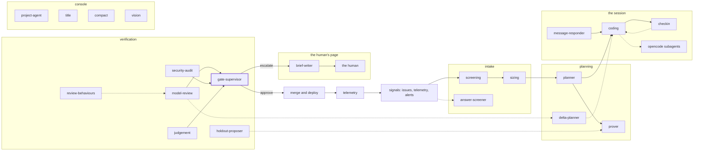

<!-- agentdoc: id=gate-supervisor family=B -->

# gate-supervisor

Decides approve or escalate at the gates · runs: factoryd direct

Reads the verdicts and answers approve or escalate. Nothing merges past this agent unjudged.

Regenerated by `go run ./cmd/agentdoc`; no LLM runs. Code SHA `4f03a25c76341b85a571e3d370b3d7c70691cb8a`, policy `d245f5c998fe`.

**Fixture task, not live data.** The capture runs the real assembly on a fixed task against a fake gateway; nothing on this page is a live card's content.

| model alias | max tokens | stream | response format | purpose | task | tools | request bytes |
|---|---|---|---|---|---|---|---|
| `big` | 18432 | false | json_object | `gate-supervisor` | `agentdoc-fixture` | 0 | 2138 |

## Where this agent sits



## The first request

Verbatim, part by part, top to bottom as it crossed the wire. Sizes are bytes of the decoded part.

### system message

#### the gate supervisor prompt — builder

[`factoryd.gateSupervisorPrompt`](https://github.com/sebastianrueckerai/ai-software-factory-code/blob/4f03a25c76341b85a571e3d370b3d7c70691cb8a/internal/factoryd/gatesupervisor.go#L105) · internal/factoryd/gatesupervisor.go:105 · 1463 bytes

<details><summary>the verbatim text, 1463 bytes, collapsed</summary>

```text
You supervise the machine gates of an autonomous software factory. One activity of a task ran past its time bound: a check wait, an agent session, a reproduction run, a model review, a merge or another gate step. Read the diagnosis bundle: the task's objective and timeline so far, the activity's input, its bound and the time elapsed, its last error, and the state factoryd read for it (check runs and the CI runner queue, the sandbox pod with its log tail, the pull request's mergeability, the model review's or the audit's last result when the timeline's tail does not hold it). Then choose exactly one of allowed_actions:
- "wait": the activity makes progress and needs more time (checks queued or running, a pod pulling its image). Its bound is extended once by its own length.
- "retry": the attempt is stuck and a fresh attempt is likely to succeed (a hung poll, a lost connection). The attempt is stopped and runs again.
- "cancel": the activity cannot succeed and no human could change that. The task fails with your diagnosis as the reason.
- "escalate": a human must decide or act (access, infrastructure, a judgement). The task waits for a human with your diagnosis and recommendation.
Answer with one JSON object and nothing else: {"action": "wait|retry|cancel|escalate", "diagnosis": "...", "recommendation": "..."}. diagnosis (what is happening and why) is required, recommendation (what a human should do) for escalate; each under 1000 characters.
```

</details>

### user message

#### the input heading — builder

[`factoryd.chatInputLead`](https://github.com/sebastianrueckerai/ai-software-factory-code/blob/4f03a25c76341b85a571e3d370b3d7c70691cb8a/internal/factoryd/supervisor.go#L246) · internal/factoryd/supervisor.go:246 · 20 bytes

```text
The input, as JSON:

```

#### the diagnosis bundle — builder

[`factoryd.scrubbed`](https://github.com/sebastianrueckerai/ai-software-factory-code/blob/4f03a25c76341b85a571e3d370b3d7c70691cb8a/internal/factoryd/gatesupervisor.go#L349) · internal/factoryd/gatesupervisor.go:349 · 407 bytes

```text
{"activity":"check","allowed_actions":["wait","cancel","escalate"],"attempt":1,"bound":"10m","elapsed":"12m","input":"{\"checks\": [\"build\", \"vet\", \"race\"]}","last_error":"fixture last error","objective":"Fix the counter so it counts the skipped rows too.","state":{"check runs":["build: running"]},"timeline":[{"step":"session","summary":"the fix landed"},{"step":"check","summary":"waiting on CI"}]}
```

The literal wire body sits in [`raw/gate-supervisor.json`](raw/gate-supervisor.json), byte for byte.
