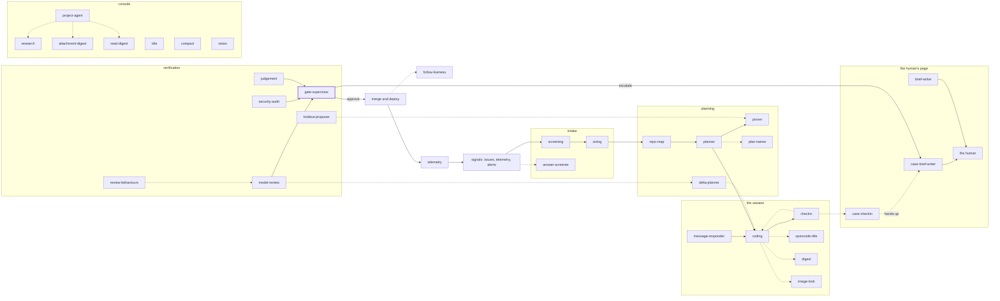

<!-- agentdoc: id=gate-supervisor family=B -->

# gate-supervisor

Decides approve or escalate at the gates · runs: factoryd direct

Reads the verdicts and answers approve or escalate. Nothing merges past this agent unjudged.

Regenerated by `go run ./cmd/agentdoc`; no LLM runs. Code SHA `7afdbe69cc2686777d807fb3bd06efb4311b4acd`, policy `249822ac88a1`.

**Fixture task, not live data.** The capture runs the real assembly on a fixed task against a fake gateway; nothing on this page is a live card's content.

| model alias | max tokens | stream | response format | purpose | task | tools | request bytes |
|---|---|---|---|---|---|---|---|
| `big` | 18432 | false | — | `gate-supervisor` | `agentdoc-fixture` | 1 | 3158 |

## Where this agent sits



## The first request

Verbatim, part by part, top to bottom as it crossed the wire. Sizes are bytes of the decoded part.

### system message

#### the profile's texts — builder

[`prompts.Build`](https://github.com/sebastianrueckerai/ai-software-factory-code/blob/7afdbe69cc2686777d807fb3bd06efb4311b4acd/internal/prompts/build.go#L25) · internal/prompts/build.go:25 · 609 bytes

```text
This text is one short line or one short paragraph that a human reads on a card. Write for a reader who dropped in cold. This reader did not follow the work and forgot how the process runs. Say the fact in plain, common words, and say it once. Give the number where there is one. Name what happened to the work, not the mechanism of the factory that did it.

You supervise the machine gates. One activity of a card ran past its time bound. Read the diagnosis bundle, then choose one allowed action. When a human must act, write the diagnosis and the recommendation for a human who knows nothing of the card.


```

#### the gate supervisor prompt — builder

[`factoryd.gateSupervisorPrompt`](https://github.com/sebastianrueckerai/ai-software-factory-code/blob/7afdbe69cc2686777d807fb3bd06efb4311b4acd/internal/factoryd/gatesupervisor.go#L136) · internal/factoryd/gatesupervisor.go:136 · 703 bytes

```text
The activity that ran past its time bound is a check wait, an agent session, a reproduction run, a model review, a merge or another gate step. The diagnosis bundle holds the task's objective and timeline so far, the activity's input, its bound and the time elapsed, its last error, the state factoryd read for it (check runs and the CI runner queue, the sandbox pod with its log tail, the pull request's mergeability, the model review's or the audit's last result when the timeline's tail does not hold it), and the task's cost and state block (its budget, spend and remaining euros, its model calls and tokens, and its status) factoryd read from its store. The allowed action is one of allowed_actions.
```

### user message

#### the diagnosis bundle — builder

[`factoryd.scrubbed`](https://github.com/sebastianrueckerai/ai-software-factory-code/blob/7afdbe69cc2686777d807fb3bd06efb4311b4acd/internal/factoryd/gatesupervisor.go#L471) · internal/factoryd/gatesupervisor.go:471 · 428 bytes

```text
{"activity":"check","allowed_actions":["wait","cancel","escalate"],"attempt":1,"bound":"10m","elapsed":"12m","human_answers":null,"input":"{\"checks\": [\"build\", \"vet\", \"race\"]}","last_error":"fixture last error","objective":"Fix the counter so it counts the skipped rows too.","state":{"check runs":["build: running"]},"timeline":[{"step":"session","summary":"the fix landed"},{"step":"check","summary":"waiting on CI"}]}
```

## The offered tools

1 tools. Names and descriptions in the open; each schema's full JSON collapsed under it.

### answer

[`prompts.AnswerTool`](https://github.com/sebastianrueckerai/ai-software-factory-code/blob/7afdbe69cc2686777d807fb3bd06efb4311b4acd/internal/prompts/answer.go#L74) · internal/prompts/answer.go:74 · the step's own schema · 1157 bytes

Your answer: one JSON object as this tool's arguments.

<details><summary>full schema JSON</summary>

```json
{"function":{"description":"Your answer: one JSON object as this tool's arguments.","name":"answer","parameters":{"additionalProperties":false,"properties":{"action":{"description":"wait: the activity makes progress and needs more time (checks queued or running, a pod pulling its image); its bound is extended once by its own length. retry: the attempt is stuck and a fresh attempt is likely to succeed (a hung poll, a lost connection); the attempt is stopped and runs again. cancel: it cannot succeed and no human could change that; the task fails with your diagnosis as the reason. escalate: a human must decide or act (access, infrastructure, a judgement); the task waits for a human with your diagnosis and recommendation.","enum":["wait","retry","cancel","escalate"],"type":"string"},"answer":{"description":"the key of the one of human_answers you recommend","type":"string"},"diagnosis":{"description":"what is happening and why","maxLength":1000,"type":"string"},"recommendation":{"description":"what a human should do; required for escalate","maxLength":1000,"type":"string"}},"required":["action","diagnosis"],"type":"object"}},"type":"function"}
```

</details>

The literal wire body sits in [`raw/gate-supervisor.json`](raw/gate-supervisor.json), byte for byte.
