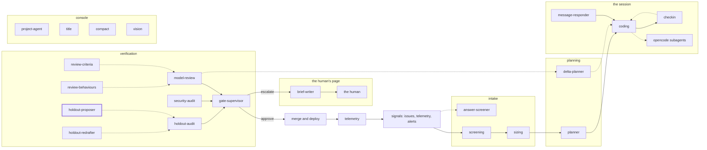

<!-- agentdoc: id=holdout-proposer family=B -->

# holdout-proposer

Proposes hold-out criteria · runs: factoryd direct

Proposes the hold-out criteria the finished work is judged by. The session that writes the work does not see them.

Regenerated by `go run ./cmd/agentdoc`; no LLM runs. Code SHA `ecce4ee23e0bdf34e8397dab293690ae4fbbf6bc`, policy `b80f515e2165`.

**Fixture task, not live data.** The capture runs the real assembly on a fixed task against a fake gateway; nothing on this page is a live card's content.

| model alias | max tokens | stream | response format | purpose | task | tools | request bytes |
|---|---|---|---|---|---|---|---|
| `big` | 18432 | false | json_object | `review` | `agentdoc-fixture` | 0 | 1419 |

## Where this agent sits



## The first request

Verbatim, part by part, top to bottom as it crossed the wire. Sizes are bytes of the decoded part.

### system message

#### the proposer prompt — builder

[`factoryd.holdoutSystem`](https://github.com/sebastianrueckerai/ai-software-factory-code/blob/ecce4ee23e0bdf34e8397dab293690ae4fbbf6bc/internal/factoryd/holdout.go#L414) · internal/factoryd/holdout.go:414 · 867 bytes

```text
You propose hold-out criteria for a software feature's spec: criteria its named proof does not cover, each with a Go test that fails on the repository's current main head and passes once the feature is built.
Rules:
- Propose at most the max named in the input; prefer none over a weak one.
- Each hold-out: an id (lowercase letters, digits, underscores), the criterion as one sentence in the spec's words, a test name (TestXxx), and the test's complete Go code (package holdout, standard library only, no network, no environment).
- The test must compile against the repository as it is on main and must fail there for the feature's absence.
- A hold-out may name one of the project's past failures (the from field cites it); a gap in the spec itself is drafted from the spec.
Answer one JSON object: {"holdouts":[{"id","criterion","test_name","test_code","from"}]}.
```

### user message

#### the input heading — builder

[`factoryd.chatInputLead`](https://github.com/sebastianrueckerai/ai-software-factory-code/blob/ecce4ee23e0bdf34e8397dab293690ae4fbbf6bc/internal/factoryd/supervisor.go#L246) · internal/factoryd/supervisor.go:246 · 20 bytes

```text
The input, as JSON:

```

#### the hold-out call's facts — builder

[`factoryd.(*Runner).proposeHoldouts`](https://github.com/sebastianrueckerai/ai-software-factory-code/blob/ecce4ee23e0bdf34e8397dab293690ae4fbbf6bc/internal/factoryd/holdout.go#L291) · internal/factoryd/holdout.go:291 · 331 bytes

```text
{"spec":{"outcome":"The counter counts every row the query returns, skipped ones included."},"criteria":[{"id":"c1","kind":"test","test":"go test ./internal/foo/ -run TestCounter","inputs":"the fixture table with one skipped row","expected":"the count includes the skipped row"}],"past_failures":["a past fixture failure"],"max":5}
```

Contains: the spec — [`factoryd.Spec`](https://github.com/sebastianrueckerai/ai-software-factory-code/blob/ecce4ee23e0bdf34e8397dab293690ae4fbbf6bc/internal/factoryd/plan.go#L110) · internal/factoryd/plan.go:110 · 84 bytes

The literal wire body sits in [`raw/holdout-proposer.json`](raw/holdout-proposer.json), byte for byte.
