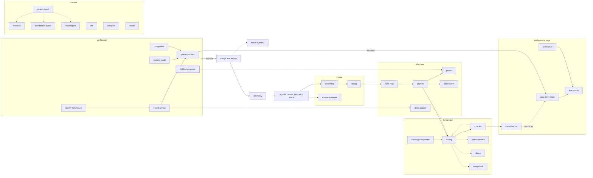

<!-- agentdoc: id=holdout-proposer family=B -->

# holdout-proposer

Proposes hold-out criteria · runs: factoryd direct

Proposes the hold-out criteria the finished work is judged by. The session that writes the work does not see them.

Regenerated by `go run ./cmd/agentdoc`; no LLM runs. Code SHA `5b2dce616e5008006b1c98e0cd17ede8cc01ace0`, policy `249822ac88a1`.

**Fixture task, not live data.** The capture runs the real assembly on a fixed task against a fake gateway; nothing on this page is a live card's content.

| model alias | max tokens | stream | response format | purpose | task | tools | request bytes |
|---|---|---|---|---|---|---|---|
| `big` | 18432 | false | — | `review` | `agentdoc-fixture` | 1 | 2364 |

## Where this agent sits



## The first request

Verbatim, part by part, top to bottom as it crossed the wire. Sizes are bytes of the decoded part.

### system message

#### the profile's texts — builder

[`prompts.Build`](https://github.com/sebastianrueckerai/ai-software-factory-code/blob/5b2dce616e5008006b1c98e0cd17ede8cc01ace0/internal/prompts/build.go#L25) · internal/prompts/build.go:25 · 587 bytes

```text
This text is one short line or one short paragraph that a human reads on a card. Write for a reader who dropped in cold. This reader did not follow the work and forgot how the process runs. Say the fact in plain, common words, and say it once. Give the number where there is one. Name what happened to the work, not the mechanism of the factory that did it.

You propose hold-out criteria for a feature: claims its criteria do not cover. A separate session writes a test for each claim later. A human okays or drops each claim, so write each for a human who can judge it true or false.


```

#### the proposer prompt — builder

[`factoryd.holdoutSystem`](https://github.com/sebastianrueckerai/ai-software-factory-code/blob/5b2dce616e5008006b1c98e0cd17ede8cc01ace0/internal/factoryd/holdout.go#L260) · internal/factoryd/holdout.go:260 · 428 bytes

```text
Rules:
- Prefer none over a weak one.
- The claim is a plain statement a human can judge true or false at the feature's surface. State the behaviour, not why it matters.
- State each claim at the feature's surface: what it does for a caller through its HTTP API, its command line, its store or the files it writes.
- A hold-out may come from one of the project's past failures; a gap in the spec itself is drafted from the spec.
```

### user message

#### the hold-out call's facts — builder

[`factoryd.(*Runner).proposeHoldouts`](https://github.com/sebastianrueckerai/ai-software-factory-code/blob/5b2dce616e5008006b1c98e0cd17ede8cc01ace0/internal/factoryd/holdout.go#L191) · internal/factoryd/holdout.go:191 · 310 bytes

```text
{"spec":{"outcome":"The counter counts every row the query returns, skipped ones included."},"criteria":[{"id":"c1","kind":"test","claim":"the counter counts a row the query skips","inputs":"the fixture table with one skipped row","expected":"a count of 1"}],"past_failures":["a past fixture failure"],"max":5}
```

Contains: the spec — [`factoryd.Spec`](https://github.com/sebastianrueckerai/ai-software-factory-code/blob/5b2dce616e5008006b1c98e0cd17ede8cc01ace0/internal/factoryd/plan.go#L116) · internal/factoryd/plan.go:116 · 84 bytes

## The offered tools

1 tools. Names and descriptions in the open; each schema's full JSON collapsed under it.

### answer

[`prompts.AnswerTool`](https://github.com/sebastianrueckerai/ai-software-factory-code/blob/5b2dce616e5008006b1c98e0cd17ede8cc01ace0/internal/prompts/answer.go#L74) · internal/prompts/answer.go:74 · the step's own schema · 816 bytes

Your answer: one JSON object as this tool's arguments.

<details><summary>full schema JSON</summary>

```json
{"function":{"description":"Your answer: one JSON object as this tool's arguments.","name":"answer","parameters":{"additionalProperties":false,"properties":{"holdouts":{"description":"none when no claim is worth a test","items":{"additionalProperties":false,"properties":{"claim":{"description":"one plain sentence in the spec's words, no code","maxLength":200,"type":"string"},"expected":{"description":"the numbers it expects","maxLength":200,"type":"string"},"from":{"description":"the past failure the claim comes from","type":"string"},"id":{"description":"lowercase letters, digits, underscores","type":"string"},"inputs":{"maxLength":200,"type":"string"}},"required":["id","claim","inputs","expected"],"type":"object"},"maxItems":5,"type":"array"}},"required":["holdouts"],"type":"object"}},"type":"function"}
```

</details>

The literal wire body sits in [`raw/holdout-proposer.json`](raw/holdout-proposer.json), byte for byte.
