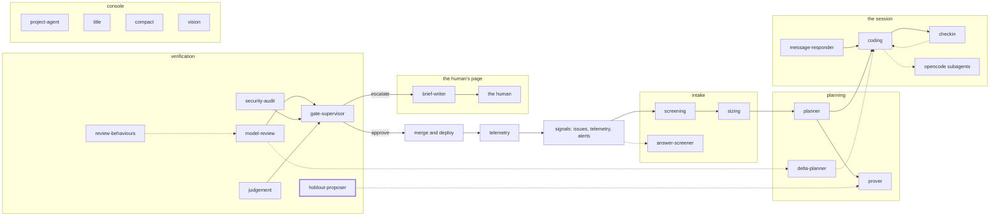

<!-- agentdoc: id=holdout-proposer family=B -->

# holdout-proposer

Proposes hold-out criteria · runs: factoryd direct

Proposes the hold-out criteria the finished work is judged by. The session that writes the work does not see them.

Regenerated by `go run ./cmd/agentdoc`; no LLM runs. Code SHA `e48c3516f59d47b72708ea33bc31eb61bfdfcdcf`, policy `d245f5c998fe`.

**Fixture task, not live data.** The capture runs the real assembly on a fixed task against a fake gateway; nothing on this page is a live card's content.

| model alias | max tokens | stream | response format | purpose | task | tools | request bytes |
|---|---|---|---|---|---|---|---|
| `big` | 18432 | false | json_object | `review` | `agentdoc-fixture` | 0 | 1278 |

## Where this agent sits



## The first request

Verbatim, part by part, top to bottom as it crossed the wire. Sizes are bytes of the decoded part.

### system message

#### the proposer prompt — builder

[`factoryd.holdoutSystem`](https://github.com/sebastianrueckerai/ai-software-factory-code/blob/e48c3516f59d47b72708ea33bc31eb61bfdfcdcf/internal/factoryd/holdout.go#L255) · internal/factoryd/holdout.go:255 · 749 bytes

```text
You propose hold-out criteria for a software feature's spec: claims its criteria do not cover, each proven later by a test a separate session writes against the repository.
Rules:
- Propose at most the max named in the input; prefer none over a weak one.
- Each hold-out: an id (lowercase letters, digits, underscores), the claim as one sentence in the spec's words, its inputs, and the numbers it expects. No code.
- State each claim at the feature's surface: what it does for a caller through its HTTP API, its command line, its store or the files it writes.
- A hold-out may come from one of the project's past failures; a gap in the spec itself is drafted from the spec.
Answer one JSON object: {"holdouts":[{"id","claim","inputs","expected"}]}.
```

### user message

#### the input heading — builder

[`factoryd.chatInputLead`](https://github.com/sebastianrueckerai/ai-software-factory-code/blob/e48c3516f59d47b72708ea33bc31eb61bfdfcdcf/internal/factoryd/supervisor.go#L246) · internal/factoryd/supervisor.go:246 · 20 bytes

```text
The input, as JSON:

```

#### the hold-out call's facts — builder

[`factoryd.(*Runner).proposeHoldouts`](https://github.com/sebastianrueckerai/ai-software-factory-code/blob/e48c3516f59d47b72708ea33bc31eb61bfdfcdcf/internal/factoryd/holdout.go#L186) · internal/factoryd/holdout.go:186 · 310 bytes

```text
{"spec":{"outcome":"The counter counts every row the query returns, skipped ones included."},"criteria":[{"id":"c1","kind":"test","claim":"the counter counts a row the query skips","inputs":"the fixture table with one skipped row","expected":"a count of 1"}],"past_failures":["a past fixture failure"],"max":5}
```

Contains: the spec — [`factoryd.Spec`](https://github.com/sebastianrueckerai/ai-software-factory-code/blob/e48c3516f59d47b72708ea33bc31eb61bfdfcdcf/internal/factoryd/plan.go#L110) · internal/factoryd/plan.go:110 · 84 bytes

The literal wire body sits in [`raw/holdout-proposer.json`](raw/holdout-proposer.json), byte for byte.
