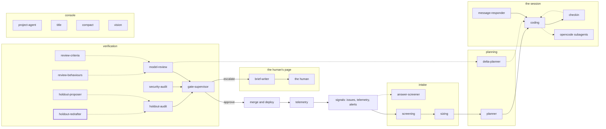

<!-- agentdoc: id=holdout-redrafter family=B -->

# holdout-redrafter

Rewrites a dropped hold-out criterion · runs: factoryd direct

Rewrites one hold-out criterion after the gates dropped it.

Regenerated by `go run ./cmd/agentdoc`; no LLM runs. Code SHA `84c154daec93be6b1f7ce5a4e4df702eefc81cc1`, policy `e9fb3036fc2e`.

**Fixture task, not live data.** The capture runs the real assembly on a fixed task against a fake gateway; nothing on this page is a live card's content.

| model alias | max tokens | stream | response format | purpose | task | tools | request bytes |
|---|---|---|---|---|---|---|---|
| `big` | 18432 | false | json_object | `review` | `agentdoc-fixture` | 0 | 726 |

## Where this agent sits



## The first request

Verbatim, part by part, top to bottom as it crossed the wire. Sizes are bytes of the decoded part.

### system message

#### the redrafter prompt — builder

[`factoryd.holdoutFixSystem`](https://github.com/sebastianrueckerai/ai-software-factory-code/blob/84c154daec93be6b1f7ce5a4e4df702eefc81cc1/internal/factoryd/holdout.go#L467) · internal/factoryd/holdout.go:467 · 267 bytes

```text
These drafted Go tests could not run on the repository's main head; each carries its output. Rewrite each test so it compiles there and still fails for the feature's absence, keeping its id and its test name. Answer one JSON object: {"holdouts":[{"id","test_code"}]}.
```

### user message

#### the input heading — builder

[`factoryd.chatInputLead`](https://github.com/sebastianrueckerai/ai-software-factory-code/blob/84c154daec93be6b1f7ce5a4e4df702eefc81cc1/internal/factoryd/supervisor.go#L246) · internal/factoryd/supervisor.go:246 · 20 bytes

```text
The input, as JSON:

```

#### the hold-out call's facts — builder

[`factoryd.(*Runner).redraftHoldouts`](https://github.com/sebastianrueckerai/ai-software-factory-code/blob/84c154daec93be6b1f7ce5a4e4df702eefc81cc1/internal/factoryd/holdout.go#L412) · internal/factoryd/holdout.go:412 · 260 bytes

```text
{"spec":{"outcome":"The counter counts every row the query returns, skipped ones included."},"failed":[{"id":"h1","test_name":"TestCounterSkips","test_code":"func TestCounterSkips(t *testing.T) {}","output":"fixture dry-run output: the test did not compile"}]}
```

Contains: the spec — [`factoryd.Spec`](https://github.com/sebastianrueckerai/ai-software-factory-code/blob/84c154daec93be6b1f7ce5a4e4df702eefc81cc1/internal/factoryd/plan.go#L110) · internal/factoryd/plan.go:110 · 84 bytes

The literal wire body sits in [`raw/holdout-redrafter.json`](raw/holdout-redrafter.json), byte for byte.
