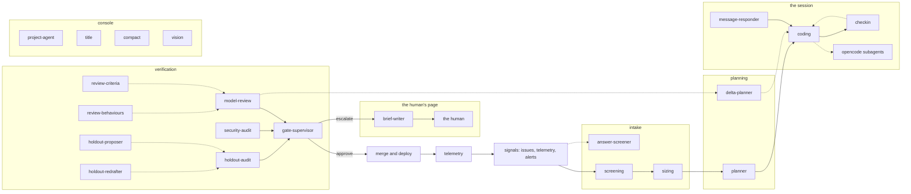

# The agent context map

One page per agent: the first model request verbatim, every part pinned to the builder that wrote it, the offered tools under their server's provenance. This index is computed from the same captures as the pages — sizes, hashes and counts, no verdicts.

## The self-check

- code SHA `84c154daec93be6b1f7ce5a4e4df702eefc81cc1`; every permalink points there.
- policy `e9fb3036fc2e`, the tree the captures read.
- harness `opencode 1.18.32`, the pinned opencode the loop captures drove.
- unlabelled spans: 0 — the tool exits non-zero on any unlabelled byte, so an index that shipped means none.
- 22 pages. Regenerate: `go run ./cmd/agentdoc -out docs/agents -policy <factory tree> -opencode <pinned binary>`; no LLM runs.

Fixture ids: `agentdoc-fixture` (coding, screening, sizing, planner, holdout-audit, message-responder, checkin, model-review, security-audit, gate-supervisor, review-criteria, review-behaviours, delta-planner, holdout-proposer, holdout-redrafter, answer-screener, brief-writer, title); `t-chat-fixture-2026-11` (project-agent, compact, vision). Every capture is a fixture task, not live data.

## The inventory

| agent | family | job | model | purpose | runs | tools | request bytes |
|---|---|---|---|---|---|---|---|
| [coding](coding.md) | A | Implements the card: reads repo, edits, commits in sandbox | `small` | `session` | agent-worker, the opencode loop in a gVisor pod | 28 | 48909 |
| [screening](screening.md) | A | Reads an issue pre-code, answers clear/suspect JSON | `big` | `session` | agent-worker, report mode | 16 | 44984 |
| [sizing](sizing.md) | A | Sizes a card small/medium/large before first session | `small` | `session` | agent-worker, report mode | 16 | 44847 |
| [planner](planner.md) | A | Reads repo, files a plan via the file_plan MCP tool | `premium` | `session` | agent-worker, report mode | 16 | 44098 |
| [holdout-audit](holdout-audit.md) | A | Judges one hold-out criterion, files file_verdict | `small` | `session` | agent-worker, report mode | 28 | 48175 |
| [message-responder](message-responder.md) | A | Answers POST /message pushes mid-session | `small` | `session` | agent-worker, the session's next turn in the sandbox | 28 | 49842 |
| [opencode-subagents](opencode-subagents.md) | A | opencode-internal task and explore delegation | `—` | `config` | inside opencode, under the session config's agent block | 0 | — |
| [checkin](checkin.md) | B | Decides continue, message, handover, human or replan on a session trip | `big` | `checkin` | factoryd, in-process loop, tools executed in the sandbox | 8 | 9497 |
| [model-review](model-review.md) | B | Reviews a diff for one criterion or one behaviour | `big` | `review` | factoryd direct | 0 | 4730 |
| [security-audit](security-audit.md) | B | Audits changes against the security checklist | `big` | `audit` | factoryd direct | 0 | 2662 |
| [gate-supervisor](gate-supervisor.md) | B | Decides approve or escalate at the gates | `big` | `gate-supervisor` | factoryd direct | 0 | 2138 |
| [review-criteria](review-criteria.md) | B | Drafts the review criteria text | `big` | `review` | factoryd direct | 0 | 2476 |
| [review-behaviours](review-behaviours.md) | B | Drafts the review behaviours text | `big` | `review` | factoryd direct | 0 | 1436 |
| [delta-planner](delta-planner.md) | B | Plans delta work between reviews | `big` | `review` | factoryd direct | 0 | 1836 |
| [holdout-proposer](holdout-proposer.md) | B | Proposes hold-out criteria | `big` | `review` | factoryd direct | 0 | 1419 |
| [holdout-redrafter](holdout-redrafter.md) | B | Rewrites a dropped hold-out criterion | `big` | `review` | factoryd direct | 0 | 726 |
| [answer-screener](answer-screener.md) | B | Screens a late answer of the issue author | `big` | `review` | factoryd direct | 0 | 1261 |
| [brief-writer](brief-writer.md) | B | Writes the human approval brief | `big` | `brief` | factoryd direct | 0 | 2454 |
| [title](title.md) | B | Names a chat thread from its first message | `small` | `title` | the console's naming call, a factoryd direct client | 0 | 348 |
| [project-agent](project-agent.md) | B | The always-on repo chat agent; also answers escalations | `premium` | `operator` | console, own tool loop | 57 | 27570 |
| [compact](compact.md) | B | Summarises a chat thread's older turns | `small` | `compact` | console | 0 | 921 |
| [vision](vision.md) | B | Describes an image the human attached | `vision` | `vision` | console | 0 | 315 |

## The agents in one line each

- [coding](coding.md): Writes the card's code in the sandbox and commits it. No other agent in the factory writes code.
- [screening](screening.md): Reads a fresh issue before any code exists and answers clear or suspect as JSON. Only work it understands becomes a card.
- [sizing](sizing.md): Reads a clear issue and sizes the card small, medium or large before the first session starts.
- [planner](planner.md): Reads the repository and files a plan through the file_plan tool before the session writes code.
- [holdout-audit](holdout-audit.md): Reads one hold-out criterion against the finished work and files a verdict the gates read.
- [message-responder](message-responder.md): Answers a writer's message pushed into a running session. The message becomes the loop's next turn.
- [opencode-subagents](opencode-subagents.md): opencode's own general and explore subagents, set by the agent block in our session config. Their prompts live inside the pinned binary; the config sets their model and step cap.
- [checkin](checkin.md): Reads a session that stopped at a checkpoint short of done and answers one of continue, message, handover, human or replan.
- [model-review](model-review.md): Judges the change against one review criterion or behaviour, the texts the criteria and behaviours agents draft.
- [security-audit](security-audit.md): Checks the change against the security checklist. No other agent makes this reading.
- [gate-supervisor](gate-supervisor.md): Reads the verdicts and answers approve or escalate. Nothing merges past this agent unjudged.
- [review-criteria](review-criteria.md): Drafts the criteria text the model reviews judge by.
- [review-behaviours](review-behaviours.md): Drafts the behaviours text the model reviews watch for.
- [delta-planner](delta-planner.md): Plans the delta work between one review and the next.
- [holdout-proposer](holdout-proposer.md): Proposes the hold-out criteria the finished work is judged by. The session that writes the work does not see them.
- [holdout-redrafter](holdout-redrafter.md): Rewrites one hold-out criterion after the gates dropped it.
- [answer-screener](answer-screener.md): Screens a late answer from the issue's author before it changes the card.
- [brief-writer](brief-writer.md): Writes the approval brief a human reads to decide.
- [title](title.md): Names a chat thread from its first message. One cheap call.
- [project-agent](project-agent.md): The always-on chat about the repository, with the project's tools. Its escalations file cards the factory then works.
- [compact](compact.md): Summarises a chat thread's older turns when the thread grows long. One cheap call.
- [vision](vision.md): Describes an image a human attached, in words the text-only agents read.

## The one loop

The 6 loop pages are one session shape on the same trunk: the harness system prompt around the repository's AGENTS.md, the brief builders, the offered tools. What every page carries byte for byte, sized from the first loop page's capture:

- AGENTS.md — 245 bytes
- the author's answers — 2692 bytes
- the author's standing — 532 bytes
- the harness tail — 702 bytes
- the issue link — 47 bytes
- the issue's text — 89 bytes
- the poster heading — 36 bytes
- the repository line — 43 bytes
- the tools line — 77 bytes
- tool bash — 5275 bytes
- tool edit — 1958 bytes
- tool factory-tools_analyze_image — 953 bytes
- tool factory-tools_escalate — 887 bytes
- tool factory-tools_manual — 259 bytes
- tool factory-tools_web_scrape — 337 bytes
- tool factory-tools_web_search — 441 bytes
- tool glob — 1114 bytes
- tool grep — 1183 bytes
- tool read — 1734 bytes
- tool skill — 676 bytes
- tool task — 3856 bytes
- tool todowrite — 2686 bytes
- tool webfetch — 1293 bytes
- tool write — 1026 bytes
- what the bounds left out — 146 bytes

What the pages do not share, each carries as its own: the mode's guide, the class's sandbox facts and tool list, the harness preamble's model line and sandbox path.

## The duplication matrix

Blocks several agents carry byte for byte, by content hash:

| block | bytes | carried by |
|---|---|---|
| `013651f42d38` · `gateway.Server.toolServer` | 259 | [coding](coding.md) — tool factory-tools_manual; [screening](screening.md) — tool factory-tools_manual; [sizing](sizing.md) — tool factory-tools_manual; [planner](planner.md) — tool factory-tools_manual; [holdout-audit](holdout-audit.md) — tool factory-tools_manual; [message-responder](message-responder.md) — tool factory-tools_manual |
| `013abd8cfd2f` · `factoryd.chatInputLead` | 20 | [model-review](model-review.md) — the input heading; [security-audit](security-audit.md) — the input heading; [gate-supervisor](gate-supervisor.md) — the input heading; [review-criteria](review-criteria.md) — the input heading; [review-behaviours](review-behaviours.md) — the input heading; [delta-planner](delta-planner.md) — the input heading; [holdout-proposer](holdout-proposer.md) — the input heading; [holdout-redrafter](holdout-redrafter.md) — the input heading; [answer-screener](answer-screener.md) — the input heading; [brief-writer](brief-writer.md) — the input heading |
| `060879eeeae2` · `gateway.Server.toolServer` | 594 | [coding](coding.md) — tool factory-tools_replicate_predict; [holdout-audit](holdout-audit.md) — tool factory-tools_replicate_predict; [message-responder](message-responder.md) — tool factory-tools_replicate_predict |
| `06325398a0c9` · `opencode 1.18.32` | 1293 | [coding](coding.md) — tool webfetch; [screening](screening.md) — tool webfetch; [sizing](sizing.md) — tool webfetch; [planner](planner.md) — tool webfetch; [holdout-audit](holdout-audit.md) — tool webfetch; [message-responder](message-responder.md) — tool webfetch |
| `06c79377dbb1` · `gateway.Server.toolServer` | 722 | [coding](coding.md) — tool factory-tools_request_info; [screening](screening.md) — tool factory-tools_request_info; [sizing](sizing.md) — tool factory-tools_request_info; [holdout-audit](holdout-audit.md) — tool factory-tools_request_info; [message-responder](message-responder.md) — tool factory-tools_request_info |
| `06f4764a6e6f` · `factoryd.joinFiles` | 206 | [model-review](model-review.md) — the diff; [security-audit](security-audit.md) — the diff; [review-criteria](review-criteria.md) — the diff |
| `114ca728f473` · `opencode 1.18.32` | 5275 | [coding](coding.md) — tool bash; [screening](screening.md) — tool bash; [sizing](sizing.md) — tool bash; [planner](planner.md) — tool bash; [holdout-audit](holdout-audit.md) — tool bash; [message-responder](message-responder.md) — tool bash |
| `12def14de5d4` · `gateway.Server.toolServer` | 795 | [coding](coding.md) — tool factory-tools_delegate; [holdout-audit](holdout-audit.md) — tool factory-tools_delegate; [message-responder](message-responder.md) — tool factory-tools_delegate |
| `133d92f687e5` · `opencode 1.18.32` | 1734 | [coding](coding.md) — tool read; [screening](screening.md) — tool read; [sizing](sizing.md) — tool read; [planner](planner.md) — tool read; [holdout-audit](holdout-audit.md) — tool read; [message-responder](message-responder.md) — tool read |
| `174633074158` · `gateway.Server.toolServer` | 1357 | [coding](coding.md) — tool factory-tools_commission_server; [holdout-audit](holdout-audit.md) — tool factory-tools_commission_server; [message-responder](message-responder.md) — tool factory-tools_commission_server |
| `1b6554d12714` · `briefText` | 36 | [coding](coding.md) — the poster heading; [screening](screening.md) — the poster heading; [sizing](sizing.md) — the poster heading; [planner](planner.md) — the poster heading; [holdout-audit](holdout-audit.md) — the poster heading; [message-responder](message-responder.md) — the poster heading |
| `1bc7989a269a` · `gateway.Server.toolServer` | 887 | [coding](coding.md) — tool factory-tools_escalate; [screening](screening.md) — tool factory-tools_escalate; [sizing](sizing.md) — tool factory-tools_escalate; [planner](planner.md) — tool factory-tools_escalate; [holdout-audit](holdout-audit.md) — tool factory-tools_escalate; [message-responder](message-responder.md) — tool factory-tools_escalate |
| `223220ca36ce` · `briefText` | 47 | [coding](coding.md) — the issue link; [screening](screening.md) — the issue link; [sizing](sizing.md) — the issue link; [planner](planner.md) — the issue link; [holdout-audit](holdout-audit.md) — the issue link; [message-responder](message-responder.md) — the issue link |
| `280892ed6d59` · `briefText` | 43 | [coding](coding.md) — the repository line; [screening](screening.md) — the repository line; [sizing](sizing.md) — the repository line; [planner](planner.md) — the repository line; [holdout-audit](holdout-audit.md) — the repository line; [message-responder](message-responder.md) — the repository line |
| `30a0924a3360` · `factoryd.concurrencyBlock` | 6 | [model-review](model-review.md) — the concurrency summary; [security-audit](security-audit.md) — the concurrency summary |
| `35c1e0318eca` · `opencode 1.18.32` | 2686 | [coding](coding.md) — tool todowrite; [screening](screening.md) — tool todowrite; [sizing](sizing.md) — tool todowrite; [planner](planner.md) — tool todowrite; [holdout-audit](holdout-audit.md) — tool todowrite; [message-responder](message-responder.md) — tool todowrite |
| `3d2434857657` · `factoryd.Spec` | 84 | [delta-planner](delta-planner.md) — the spec; [holdout-proposer](holdout-proposer.md) — the spec; [holdout-redrafter](holdout-redrafter.md) — the spec |
| `43bd6a507812` · `opencode 1.18.32` | 676 | [coding](coding.md) — tool skill; [screening](screening.md) — tool skill; [sizing](sizing.md) — tool skill; [planner](planner.md) — tool skill; [holdout-audit](holdout-audit.md) — tool skill; [message-responder](message-responder.md) — tool skill |
| `49d4a82f97ec` | 89 | [coding](coding.md) — the issue's text; [screening](screening.md) — the issue's text; [sizing](sizing.md) — the issue's text; [planner](planner.md) — the issue's text; [holdout-audit](holdout-audit.md) — the issue's text; [message-responder](message-responder.md) — the issue's text |
| `4bca0d63c48b` · `SessionFacts.Line` | 96 | [screening](screening.md) — the session's facts; [sizing](sizing.md) — the session's facts; [planner](planner.md) — the session's facts; [holdout-audit](holdout-audit.md) — the session's facts |
| `524d58e4f64e` · `factoryd.InboundBrief` | 52 | [review-criteria](review-criteria.md) — the objective; [review-behaviours](review-behaviours.md) — the objective |
| `5b3a489dc91a` · `briefText` | 532 | [coding](coding.md) — the author's standing; [screening](screening.md) — the author's standing; [sizing](sizing.md) — the author's standing; [planner](planner.md) — the author's standing; [holdout-audit](holdout-audit.md) — the author's standing; [message-responder](message-responder.md) — the author's standing |
| `6a0b20546895` · `opencode 1.18.32` | 3856 | [coding](coding.md) — tool task; [screening](screening.md) — tool task; [sizing](sizing.md) — tool task; [planner](planner.md) — tool task; [holdout-audit](holdout-audit.md) — tool task; [message-responder](message-responder.md) — tool task |
| `77678017d76d` · `gateway.Server.toolServer` | 731 | [coding](coding.md) — tool factory-tools_request_cut; [holdout-audit](holdout-audit.md) — tool factory-tools_request_cut; [message-responder](message-responder.md) — tool factory-tools_request_cut |
| `7f324fa86796` | 2692 | [coding](coding.md) — the author's answers; [screening](screening.md) — the author's answers; [sizing](sizing.md) — the author's answers; [planner](planner.md) — the author's answers; [holdout-audit](holdout-audit.md) — the author's answers; [message-responder](message-responder.md) — the author's answers |
| `810c3ae894eb` · `briefText` | 146 | [coding](coding.md) — what the bounds left out; [screening](screening.md) — what the bounds left out; [sizing](sizing.md) — what the bounds left out; [planner](planner.md) — what the bounds left out; [holdout-audit](holdout-audit.md) — what the bounds left out; [message-responder](message-responder.md) — what the bounds left out |
| `84ef7cfa1276` · `opencode 1.18.32` | 1026 | [coding](coding.md) — tool write; [screening](screening.md) — tool write; [sizing](sizing.md) — tool write; [planner](planner.md) — tool write; [holdout-audit](holdout-audit.md) — tool write; [message-responder](message-responder.md) — tool write |
| `98ba4d7ffc9d` · `gateway.Server.toolServer` | 1169 | [coding](coding.md) — tool factory-tools_file_verdict; [holdout-audit](holdout-audit.md) — tool factory-tools_file_verdict; [message-responder](message-responder.md) — tool factory-tools_file_verdict |
| `9ac4732efa53` · `gateway.Server.toolServer` | 344 | [coding](coding.md) — tool factory-tools_cloud_prices; [holdout-audit](holdout-audit.md) — tool factory-tools_cloud_prices; [message-responder](message-responder.md) — tool factory-tools_cloud_prices |
| `9f8cd08df48a` · `gateway.Server.toolServer` | 478 | [coding](coding.md) — tool factory-tools_fal_run; [holdout-audit](holdout-audit.md) — tool factory-tools_fal_run; [message-responder](message-responder.md) — tool factory-tools_fal_run |
| `a4aa66e1de25` · `gateway.Server.toolServer` | 262 | [coding](coding.md) — tool factory-tools_list_resources; [holdout-audit](holdout-audit.md) — tool factory-tools_list_resources; [message-responder](message-responder.md) — tool factory-tools_list_resources |
| `b08a8bb42600` · `AGENTS.md` | 245 | [coding](coding.md) — AGENTS.md; [screening](screening.md) — AGENTS.md; [sizing](sizing.md) — AGENTS.md; [planner](planner.md) — AGENTS.md; [holdout-audit](holdout-audit.md) — AGENTS.md; [message-responder](message-responder.md) — AGENTS.md |
| `b2b628459017` · `SandboxFacts` | 523 | [coding](coding.md) — the sandbox facts; [holdout-audit](holdout-audit.md) — the sandbox facts; [message-responder](message-responder.md) — the sandbox facts |
| `b76c74cc2034` · `opencode 1.18.32` | 1183 | [coding](coding.md) — tool grep; [screening](screening.md) — tool grep; [sizing](sizing.md) — tool grep; [planner](planner.md) — tool grep; [holdout-audit](holdout-audit.md) — tool grep; [message-responder](message-responder.md) — tool grep |
| `b8c19126a68b` · `workGuide` | 1833 | [coding](coding.md) — the guide; [message-responder](message-responder.md) — the guide |
| `bb1776e0f232` · `gateway.Server.toolServer` | 797 | [coding](coding.md) — tool factory-tools_request_tool; [holdout-audit](holdout-audit.md) — tool factory-tools_request_tool; [message-responder](message-responder.md) — tool factory-tools_request_tool |
| `bf5a30b64649` · `opencode 1.18.32` | 1114 | [coding](coding.md) — tool glob; [screening](screening.md) — tool glob; [sizing](sizing.md) — tool glob; [planner](planner.md) — tool glob; [holdout-audit](holdout-audit.md) — tool glob; [message-responder](message-responder.md) — tool glob |
| `c6655a98c002` · `SandboxFacts` | 414 | [screening](screening.md) — the sandbox facts; [sizing](sizing.md) — the sandbox facts; [planner](planner.md) — the sandbox facts |
| `c6d729beb1e6` · `SessionFacts.Line` | 228 | [coding](coding.md) — the session's facts; [message-responder](message-responder.md) — the session's facts |
| `c990802944e9` · `gateway.Server.toolServer` | 433 | [coding](coding.md) — tool factory-tools_resource_request_status; [holdout-audit](holdout-audit.md) — tool factory-tools_resource_request_status; [message-responder](message-responder.md) — tool factory-tools_resource_request_status |
| `ce141358da3a` · `gateway.Server.toolServer` | 626 | [coding](coding.md) — tool factory-tools_ssh_certificate; [holdout-audit](holdout-audit.md) — tool factory-tools_ssh_certificate; [message-responder](message-responder.md) — tool factory-tools_ssh_certificate |
| `ced72aaaba4a` · `gateway.Server.toolServer` | 953 | [coding](coding.md) — tool factory-tools_analyze_image; [screening](screening.md) — tool factory-tools_analyze_image; [sizing](sizing.md) — tool factory-tools_analyze_image; [planner](planner.md) — tool factory-tools_analyze_image; [holdout-audit](holdout-audit.md) — tool factory-tools_analyze_image; [message-responder](message-responder.md) — tool factory-tools_analyze_image |
| `d1931a294d76` · `opencode 1.18.32` | 1958 | [coding](coding.md) — tool edit; [screening](screening.md) — tool edit; [sizing](sizing.md) — tool edit; [planner](planner.md) — tool edit; [holdout-audit](holdout-audit.md) — tool edit; [message-responder](message-responder.md) — tool edit |
| `dca87542f5b0` · `gateway.Server.toolServer` | 387 | [coding](coding.md) — tool factory-tools_release_resource; [holdout-audit](holdout-audit.md) — tool factory-tools_release_resource; [message-responder](message-responder.md) — tool factory-tools_release_resource |
| `e056c7eea798` · `opencode 1.18.32` | 702 | [coding](coding.md) — the harness tail; [screening](screening.md) — the harness tail; [sizing](sizing.md) — the harness tail; [planner](planner.md) — the harness tail; [holdout-audit](holdout-audit.md) — the harness tail; [message-responder](message-responder.md) — the harness tail |
| `e32e47cfb17a` · `toolsLine` | 77 | [coding](coding.md) — the tools line; [screening](screening.md) — the tools line; [sizing](sizing.md) — the tools line; [planner](planner.md) — the tools line; [holdout-audit](holdout-audit.md) — the tools line; [message-responder](message-responder.md) — the tools line |
| `e3d1ce595400` · `gateway.Server.toolServer` | 337 | [coding](coding.md) — tool factory-tools_web_scrape; [screening](screening.md) — tool factory-tools_web_scrape; [sizing](sizing.md) — tool factory-tools_web_scrape; [planner](planner.md) — tool factory-tools_web_scrape; [holdout-audit](holdout-audit.md) — tool factory-tools_web_scrape; [message-responder](message-responder.md) — tool factory-tools_web_scrape |
| `e3f0b8d6902d` · `gateway.Server.toolServer` | 441 | [coding](coding.md) — tool factory-tools_web_search; [screening](screening.md) — tool factory-tools_web_search; [sizing](sizing.md) — tool factory-tools_web_search; [planner](planner.md) — tool factory-tools_web_search; [holdout-audit](holdout-audit.md) — tool factory-tools_web_search; [message-responder](message-responder.md) — tool factory-tools_web_search |
| `f38fce964f73` | 31 | [project-agent](project-agent.md) — the human's message; [vision](vision.md) — the ask |

## The factory at a glance

