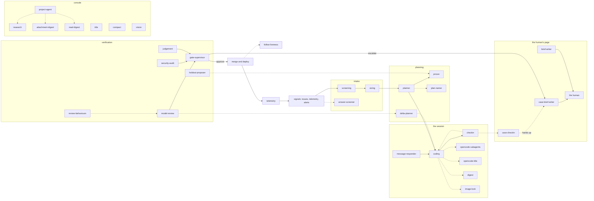

# The agent context map

One page per agent: the first model request verbatim, every part pinned to the builder that wrote it, the offered tools under their server's provenance. This index is computed from the same captures as the pages — sizes, hashes and counts, no verdicts.

## The self-check

- code SHA `0b0b049c3d8156cbfe82aadaf4c997006dc56128`; every permalink points there.
- policy `090da06f7c4b`, the tree the captures read.
- harness `opencode 1.19.6`, the pinned opencode the loop captures drove.
- unlabelled spans: 0 — the tool exits non-zero on any unlabelled byte, so an index that shipped means none.
- 31 pages. Regenerate: `go run ./cmd/agentdoc -out docs/agents -policy <factory tree> -opencode <pinned binary>`; no LLM runs.

Fixture ids: `agentdoc-fixture` (coding, screening, sizing, planner, prover, message-responder, opencode-title, checkin, case-checkin, model-review, security-audit, gate-supervisor, judgement, review-behaviours, delta-planner, holdout-proposer, answer-screener, brief-writer, case-brief-writer, plan-namer, digest, image-look, follow-liveness); `t-chat-fixture-2026-11` (project-agent, research, compact, title, attachment-digest, read-digest, vision). Every capture is a fixture task, not live data.

## The inventory

| agent | family | job | model | purpose | runs | tools | request bytes |
|---|---|---|---|---|---|---|---|
| [coding](coding.md) | A | Implements the card: reads repo, edits, commits in sandbox | `small` | `session` | agent-worker, the opencode loop in a gVisor pod | 28 | 56068 |
| [screening](screening.md) | A | Reads an issue pre-code, answers clear/suspect JSON | `small` | `session` | agent-worker, report mode | 17 | 41115 |
| [sizing](sizing.md) | A | Sizes a card small/medium/large before first session | `small` | `session` | agent-worker, report mode | 17 | 40970 |
| [planner](planner.md) | A | Reads repo, files a plan via the file_plan MCP tool | `big` | `session` | agent-worker, report mode | 17 | 53632 |
| [prover](prover.md) | A | Writes one blind test per criterion on main, files them via file_proofs | `big` | `session` | agent-worker, report mode | 12 | 38979 |
| [message-responder](message-responder.md) | A | Answers POST /message pushes mid-session | `small` | `session` | agent-worker, the session's next turn in the sandbox | 28 | 64455 |
| [opencode-title](opencode-title.md) | A | opencode's own call that titles a session from its first prompt | `small` | `session` | inside opencode, at every session's first prompt, through the gateway | 0 | 15929 |
| [opencode-subagents](opencode-subagents.md) | A | opencode-internal task and explore delegation | `—` | `config` | inside opencode, under the session config's agent block | 0 | — |
| [checkin](checkin.md) | B | Decides continue, message, handover, human or replan on a session trip | `big` | `checkin` | factoryd, in-process loop, tools executed in the sandbox | 10 | 6718 |
| [case-checkin](case-checkin.md) | B | Judges a case at rung 1: acts on it, or hands it up with a recommendation | `big` | `checkin` | factoryd, in-process loop on the project's chat task, tools read by factoryd | 9 | 9638 |
| [model-review](model-review.md) | B | Reviews a diff part against the card's objective | `big` | `review` | factoryd direct | 0 | 6892 |
| [security-audit](security-audit.md) | B | Audits changes against the security checklist | `big` | `audit` | factoryd direct | 0 | 3890 |
| [gate-supervisor](gate-supervisor.md) | B | Decides approve or escalate at the gates | `big` | `gate-supervisor` | factoryd direct | 0 | 3605 |
| [judgement](judgement.md) | B | Judges a judgement criterion's artifact with its pinned prompt | `big` | `review` | factoryd direct | 0 | 962 |
| [review-behaviours](review-behaviours.md) | B | Drafts the review behaviours text | `big` | `review` | factoryd direct | 0 | 1890 |
| [delta-planner](delta-planner.md) | B | Plans delta work between reviews | `big` | `review` | factoryd direct | 0 | 6414 |
| [holdout-proposer](holdout-proposer.md) | B | Proposes hold-out criteria | `big` | `review` | factoryd direct | 0 | 1852 |
| [answer-screener](answer-screener.md) | B | Screens a late answer of the issue author | `big` | `review` | factoryd direct | 0 | 1626 |
| [brief-writer](brief-writer.md) | B | Writes the brief of a resource request or a plan approval | `big` | `brief` | factoryd direct | 0 | 4473 |
| [case-brief-writer](case-brief-writer.md) | B | Writes parts 3 and 4 of a Needs-you case | `big` | `brief` | factoryd direct | 0 | 4606 |
| [plan-namer](plan-namer.md) | B | Names a plan from its first revision | `small` | `title` | factoryd direct | 0 | 1003 |
| [digest](digest.md) | B | Summarises one big read under an ask | `small` | `digest` | factoryd direct, behind a session's digest tool | 0 | 287 |
| [image-look](image-look.md) | B | Looks at one image a session names | `vision` | `vision` | factoryd direct, behind a session's analyze_image tool | 0 | 304 |
| [follow-liveness](follow-liveness.md) | B | Asks the small model for one word after a move rolls out | `small` | `digest` | factoryd direct, in the follow judgment | 0 | 228 |
| [project-agent](project-agent.md) | B | The always-on repo chat agent; also answers escalations | `premium` | `operator` | console, own tool loop | 69 | 49758 |
| [research](research.md) | B | Researches one question for the project agent | `big` | `research` | console, own tool loop behind the chat's research tool | 6 | 3539 |
| [compact](compact.md) | B | Summarises a chat thread's older turns | `small` | `compact` | console | 0 | 1282 |
| [title](title.md) | B | Names a chat thread from its first message | `small` | `title` | console, the naming call | 0 | 748 |
| [attachment-digest](attachment-digest.md) | B | Summarises a document the human attached | `small` | `digest` | console, behind the chat's summarize_attachment tool | 0 | 220 |
| [read-digest](read-digest.md) | B | Summarises one big read of the chat under an ask | `small` | `digest` | console, behind the chat's reads that take an ask | 0 | 204 |
| [vision](vision.md) | B | Describes an image the human attached | `vision` | `vision` | console | 0 | 315 |

## The agents in one line each

- [coding](coding.md): Writes the card's code in the sandbox and commits it. No other agent in the factory writes code.
- [screening](screening.md): Reads a fresh issue before any code exists and answers clear or suspect as JSON. Only work it understands becomes a card.
- [sizing](sizing.md): Reads a clear issue and sizes the card small, medium or large before the first session starts.
- [planner](planner.md): Reads the repository and files a plan through the file_plan tool before the session writes code.
- [prover](prover.md): Writes one test per criterion on main before the cards build the feature, and files them through the file_proofs tool. The builder sees a test only after it has run once at the gate.
- [message-responder](message-responder.md): Answers a writer's message pushed into a running session. The message becomes the loop's next turn.
- [opencode-title](opencode-title.md): opencode's own call that names a session from its first prompt, made at the start of every session. Its prompt lives inside the pinned binary, and the whole brief rides it.
- [opencode-subagents](opencode-subagents.md): opencode's own general and explore subagents, set by the agent block in our session config. Their prompts live inside the pinned binary; the config sets their model and step cap.
- [checkin](checkin.md): Reads a session that stopped at a checkpoint short of done and answers one of continue, message, handover, human or replan.
- [case-checkin](case-checkin.md): Judges a case the factory's code could not settle, on the card's facts and the evidence it reads itself, and acts on it or hands it up with a recommendation.
- [model-review](model-review.md): Reads the change's diff with the card's objective and the opened proofs' original code, and answers a verdict with findings.
- [security-audit](security-audit.md): Checks the change against the security checklist. No other agent makes this reading.
- [gate-supervisor](gate-supervisor.md): Reads the verdicts and answers approve or escalate. Nothing merges past this agent unjudged.
- [judgement](judgement.md): Reads the artifact a blind test wrote and answers met or unmet with the criterion's pinned prompt. It never sees the diff.
- [review-behaviours](review-behaviours.md): Drafts the behaviours text the model reviews watch for.
- [delta-planner](delta-planner.md): Plans the delta work between one review and the next.
- [holdout-proposer](holdout-proposer.md): Proposes the hold-out criteria the finished work is judged by. The session that writes the work does not see them.
- [answer-screener](answer-screener.md): Screens a late answer from the issue's author before it changes the card.
- [brief-writer](brief-writer.md): Writes the brief of a resource request or a plan approval, the requests no case carries.
- [case-brief-writer](case-brief-writer.md): Reads a Needs-you case from its record and writes the background and the grounds of the recommendation for a human who opens it cold.
- [plan-namer](plan-namer.md): Names a plan in a few words when its first revision files. One cheap call, asked again while the name does not hold.
- [digest](digest.md): Summarises one file a session names under the session's ask, for its digest tool. One cheap call, and no system prompt.
- [image-look](image-look.md): Looks at one image a session names, a workspace file or an image on the card, and answers the session's ask in words.
- [follow-liveness](follow-liveness.md): Asks the small model for one word after a move rolls out, to prove the model route still answers. No one reads the answer.
- [project-agent](project-agent.md): The always-on chat about the repository, with the project's tools. Its escalations file cards the factory then works.
- [research](research.md): Researches one question for the project agent through the chat's reads and the web, and hands back a report with its sources.
- [compact](compact.md): Summarises a chat thread's older turns when the thread grows long. One cheap call.
- [title](title.md): Names a chat thread from its first message. One cheap call.
- [attachment-digest](attachment-digest.md): Summarises a document the human attached, for the project agent. One cheap call, and no system prompt.
- [read-digest](read-digest.md): Summarises one big read of the chat, a file, a document or a web page, under the project agent's ask. One cheap call, and no system prompt.
- [vision](vision.md): Describes an image a human attached, in words the text-only agents read.

## The one loop

The 6 loop pages are one session shape on the same trunk: the harness system prompt around the repository's AGENTS.md, the brief builders, the offered tools. What every page carries byte for byte, sized from the first loop page's capture:

- AGENTS.md — 245 bytes
- the author's answers — 2692 bytes
- the author's standing — 532 bytes
- the brief's closing marker — 19 bytes
- the brief's opening marker — 20 bytes
- the card's brief — 108 bytes
- the harness tail — 702 bytes
- the issue link — 47 bytes
- the poster heading — 36 bytes
- the repository line — 43 bytes
- the tools line — 77 bytes
- tool bash — 5275 bytes
- tool edit — 1958 bytes
- tool factory-tools_manual — 259 bytes
- tool glob — 1114 bytes
- tool grep — 1183 bytes
- tool read — 1734 bytes
- tool skill — 676 bytes
- tool task — 3856 bytes
- tool todowrite — 2686 bytes
- tool webfetch — 1293 bytes
- tool write — 1026 bytes
- what the bounds left out — 146 bytes

What the pages do not share, each carries as its own: the mode's guide, the class's sandbox facts and tool list, the harness preamble's model line and sandbox path.

## The duplication matrix

Blocks several agents carry byte for byte, by content hash:

| block | bytes | carried by |
|---|---|---|
| `013651f42d38` · `gateway.Server.toolServer` | 259 | [coding](coding.md) — tool factory-tools_manual; [screening](screening.md) — tool factory-tools_manual; [sizing](sizing.md) — tool factory-tools_manual; [planner](planner.md) — tool factory-tools_manual; [prover](prover.md) — tool factory-tools_manual; [message-responder](message-responder.md) — tool factory-tools_manual |
| `013abd8cfd2f` · `factoryd.ChatInputLead` | 20 | [model-review](model-review.md) — the input heading; [security-audit](security-audit.md) — the input heading; [gate-supervisor](gate-supervisor.md) — the input heading; [judgement](judgement.md) — the input heading; [review-behaviours](review-behaviours.md) — the input heading; [delta-planner](delta-planner.md) — the input heading; [holdout-proposer](holdout-proposer.md) — the input heading; [answer-screener](answer-screener.md) — the input heading; [brief-writer](brief-writer.md) — the input heading; [case-brief-writer](case-brief-writer.md) — the input heading; [plan-namer](plan-namer.md) — the input heading; [follow-liveness](follow-liveness.md) — the input heading |
| `060879eeeae2` · `gateway.Server.toolServer` | 594 | [coding](coding.md) — tool factory-tools_replicate_predict; [message-responder](message-responder.md) — tool factory-tools_replicate_predict |
| `06325398a0c9` · `opencode 1.19.6` | 1293 | [coding](coding.md) — tool webfetch; [screening](screening.md) — tool webfetch; [sizing](sizing.md) — tool webfetch; [planner](planner.md) — tool webfetch; [prover](prover.md) — tool webfetch; [message-responder](message-responder.md) — tool webfetch |
| `06c79377dbb1` · `gateway.Server.toolServer` | 722 | [coding](coding.md) — tool factory-tools_request_info; [screening](screening.md) — tool factory-tools_request_info; [sizing](sizing.md) — tool factory-tools_request_info; [message-responder](message-responder.md) — tool factory-tools_request_info |
| `06f4764a6e6f` · `factoryd.joinFiles` | 206 | [model-review](model-review.md) — the diff; [security-audit](security-audit.md) — the diff |
| `07e2fe92853e` | 700 | [project-agent](project-agent.md) — tool read_doc; [research](research.md) — tool read_doc |
| `08d9d8e33a87` | 122 | [image-look](image-look.md) — the image; [vision](vision.md) — the image |
| `0cd58ce091be` | 440 | [checkin](checkin.md) — tool grep; [case-checkin](case-checkin.md) — tool grep |
| `0f76b0419b8d` · `briefText` | 339 | [coding](coding.md) — the findings; [opencode-title](opencode-title.md) — the findings |
| `114ca728f473` · `opencode 1.19.6` | 5275 | [coding](coding.md) — tool bash; [screening](screening.md) — tool bash; [sizing](sizing.md) — tool bash; [planner](planner.md) — tool bash; [prover](prover.md) — tool bash; [message-responder](message-responder.md) — tool bash |
| `11c16d62f117` · `opencode 1.19.6` | 8872 | [planner](planner.md) — the harness preamble; [prover](prover.md) — the harness preamble |
| `133d92f687e5` · `opencode 1.19.6` | 1734 | [coding](coding.md) — tool read; [screening](screening.md) — tool read; [sizing](sizing.md) — tool read; [planner](planner.md) — tool read; [prover](prover.md) — tool read; [message-responder](message-responder.md) — tool read |
| `15aaac9e7a92` | 378 | [project-agent](project-agent.md) — tool web_search; [research](research.md) — tool web_search |
| `174633074158` · `gateway.Server.toolServer` | 1357 | [coding](coding.md) — tool factory-tools_commission_server; [message-responder](message-responder.md) — tool factory-tools_commission_server |
| `1b6554d12714` · `briefText` | 36 | [coding](coding.md) — the poster heading; [screening](screening.md) — the poster heading; [sizing](sizing.md) — the poster heading; [planner](planner.md) — the poster heading; [prover](prover.md) — the poster heading; [message-responder](message-responder.md) — the poster heading; [opencode-title](opencode-title.md) — the poster heading |
| `1e04c1269968` · `opencode 1.19.6` | 8876 | [coding](coding.md) — the harness preamble; [screening](screening.md) — the harness preamble; [sizing](sizing.md) — the harness preamble; [message-responder](message-responder.md) — the harness preamble |
| `223220ca36ce` · `briefText` | 47 | [coding](coding.md) — the issue link; [screening](screening.md) — the issue link; [sizing](sizing.md) — the issue link; [planner](planner.md) — the issue link; [prover](prover.md) — the issue link; [message-responder](message-responder.md) — the issue link; [opencode-title](opencode-title.md) — the issue link |
| `2727e60e944f` · `briefText` | 19 | [coding](coding.md) — the brief's closing marker; [screening](screening.md) — the brief's closing marker; [sizing](sizing.md) — the brief's closing marker; [planner](planner.md) — the brief's closing marker; [prover](prover.md) — the brief's closing marker; [message-responder](message-responder.md) — the brief's closing marker; [opencode-title](opencode-title.md) — the brief's closing marker |
| `280892ed6d59` · `briefText` | 43 | [coding](coding.md) — the repository line; [screening](screening.md) — the repository line; [sizing](sizing.md) — the repository line; [planner](planner.md) — the repository line; [prover](prover.md) — the repository line; [message-responder](message-responder.md) — the repository line; [opencode-title](opencode-title.md) — the repository line |
| `2830c46d1803` · `SessionFacts.Line` | 167 | [screening](screening.md) — the session's facts; [sizing](sizing.md) — the session's facts; [planner](planner.md) — the session's facts; [prover](prover.md) — the session's facts |
| `2c5dec4a86d8` · `SessionFacts.Line` | 299 | [coding](coding.md) — the session's facts; [message-responder](message-responder.md) — the session's facts; [opencode-title](opencode-title.md) — the session's facts |
| `30a0924a3360` · `factoryd.concurrencyBlock` | 6 | [model-review](model-review.md) — the concurrency summary; [security-audit](security-audit.md) — the concurrency summary |
| `35c1e0318eca` · `opencode 1.19.6` | 2686 | [coding](coding.md) — tool todowrite; [screening](screening.md) — tool todowrite; [sizing](sizing.md) — tool todowrite; [planner](planner.md) — tool todowrite; [prover](prover.md) — tool todowrite; [message-responder](message-responder.md) — tool todowrite |
| `3c395791f026` | 279 | [checkin](checkin.md) — tool card_step; [case-checkin](case-checkin.md) — tool card_step |
| `3d2434857657` · `factoryd.Spec` | 84 | [delta-planner](delta-planner.md) — the spec; [holdout-proposer](holdout-proposer.md) — the spec |
| `407357975c6b` · `GateLines` | 204 | [coding](coding.md) — the line on how the session before ended; [opencode-title](opencode-title.md) — the line on how the session before ended |
| `43bd6a507812` · `opencode 1.19.6` | 676 | [coding](coding.md) — tool skill; [screening](screening.md) — tool skill; [sizing](sizing.md) — tool skill; [planner](planner.md) — tool skill; [prover](prover.md) — tool skill; [message-responder](message-responder.md) — tool skill |
| `4ac520860ef0` | 351 | [project-agent](project-agent.md) — tool web_scrape; [research](research.md) — tool web_scrape |
| `52cd0edef707` | 299 | [checkin](checkin.md) — tool read_file; [case-checkin](case-checkin.md) — tool read_file |
| `5b3a489dc91a` · `briefText` | 532 | [coding](coding.md) — the author's standing; [screening](screening.md) — the author's standing; [sizing](sizing.md) — the author's standing; [planner](planner.md) — the author's standing; [prover](prover.md) — the author's standing; [message-responder](message-responder.md) — the author's standing; [opencode-title](opencode-title.md) — the author's standing |
| `5de95b2f2074` · `gateway.Server.toolServer` | 807 | [coding](coding.md) — tool factory-tools_digest; [screening](screening.md) — tool factory-tools_digest; [sizing](sizing.md) — tool factory-tools_digest; [planner](planner.md) — tool factory-tools_digest; [message-responder](message-responder.md) — tool factory-tools_digest |
| `6635423d8d8b` · `factoryd.CardDigest.Render` | 253 | [brief-writer](brief-writer.md) — the card's life; [case-brief-writer](case-brief-writer.md) — the card's life |
| `6a0b20546895` · `opencode 1.19.6` | 3856 | [coding](coding.md) — tool task; [screening](screening.md) — tool task; [sizing](sizing.md) — tool task; [planner](planner.md) — tool task; [prover](prover.md) — tool task; [message-responder](message-responder.md) — tool task |
| `6aca1a80015a` | 287 | [checkin](checkin.md) — tool transcript_search; [case-checkin](case-checkin.md) — tool transcript_search |
| `6edbc64a5dee` · `CardBrief.AgentText` | 108 | [coding](coding.md) — the card's brief; [screening](screening.md) — the card's brief; [sizing](sizing.md) — the card's brief; [planner](planner.md) — the card's brief; [prover](prover.md) — the card's brief; [message-responder](message-responder.md) — the card's brief; [opencode-title](opencode-title.md) — the card's brief |
| `77678017d76d` · `gateway.Server.toolServer` | 731 | [coding](coding.md) — tool factory-tools_request_cut; [message-responder](message-responder.md) — tool factory-tools_request_cut |
| `7f324fa86796` | 2692 | [coding](coding.md) — the author's answers; [screening](screening.md) — the author's answers; [sizing](sizing.md) — the author's answers; [planner](planner.md) — the author's answers; [prover](prover.md) — the author's answers; [message-responder](message-responder.md) — the author's answers; [opencode-title](opencode-title.md) — the author's answers |
| `810c3ae894eb` · `briefText` | 146 | [coding](coding.md) — what the bounds left out; [screening](screening.md) — what the bounds left out; [sizing](sizing.md) — what the bounds left out; [planner](planner.md) — what the bounds left out; [prover](prover.md) — what the bounds left out; [message-responder](message-responder.md) — what the bounds left out; [opencode-title](opencode-title.md) — what the bounds left out |
| `84ef7cfa1276` · `opencode 1.19.6` | 1026 | [coding](coding.md) — tool write; [screening](screening.md) — tool write; [sizing](sizing.md) — tool write; [planner](planner.md) — tool write; [prover](prover.md) — tool write; [message-responder](message-responder.md) — tool write |
| `8b43b9d9c7ee` | 449 | [project-agent](project-agent.md) — tool grep; [research](research.md) — tool grep |
| `8c5908dab8fd` · `workGuide` | 8207 | [coding](coding.md) — the guide; [message-responder](message-responder.md) — the guide; [opencode-title](opencode-title.md) — the guide |
| `9334deccfab1` | 496 | [checkin](checkin.md) — tool cluster_facts; [case-checkin](case-checkin.md) — tool cluster_facts |
| `9ac4732efa53` · `gateway.Server.toolServer` | 344 | [coding](coding.md) — tool factory-tools_cloud_prices; [message-responder](message-responder.md) — tool factory-tools_cloud_prices |
| `9f8cd08df48a` · `gateway.Server.toolServer` | 478 | [coding](coding.md) — tool factory-tools_fal_run; [message-responder](message-responder.md) — tool factory-tools_fal_run |
| `a08fbc9d3fbd` · `briefText` | 20 | [coding](coding.md) — the brief's opening marker; [screening](screening.md) — the brief's opening marker; [sizing](sizing.md) — the brief's opening marker; [planner](planner.md) — the brief's opening marker; [prover](prover.md) — the brief's opening marker; [message-responder](message-responder.md) — the brief's opening marker; [opencode-title](opencode-title.md) — the brief's opening marker |
| `a4aa66e1de25` · `gateway.Server.toolServer` | 262 | [coding](coding.md) — tool factory-tools_list_resources; [message-responder](message-responder.md) — tool factory-tools_list_resources |
| `a709ea32df7f` | 229 | [checkin](checkin.md) — tool card_facts; [case-checkin](case-checkin.md) — tool card_facts |
| `b08a8bb42600` · `AGENTS.md` | 245 | [coding](coding.md) — AGENTS.md; [screening](screening.md) — AGENTS.md; [sizing](sizing.md) — AGENTS.md; [planner](planner.md) — AGENTS.md; [prover](prover.md) — AGENTS.md; [message-responder](message-responder.md) — AGENTS.md |
| `b4c61a4e5ada` | 253 | [checkin](checkin.md) — tool transcript_read; [case-checkin](case-checkin.md) — tool transcript_read |
| `b6136b83c4c9` · `gateway.Server.toolServer` | 1038 | [coding](coding.md) — tool factory-tools_escalate; [screening](screening.md) — tool factory-tools_escalate; [sizing](sizing.md) — tool factory-tools_escalate; [planner](planner.md) — tool factory-tools_escalate; [message-responder](message-responder.md) — tool factory-tools_escalate |
| `b76c74cc2034` · `opencode 1.19.6` | 1183 | [coding](coding.md) — tool grep; [screening](screening.md) — tool grep; [sizing](sizing.md) — tool grep; [planner](planner.md) — tool grep; [prover](prover.md) — tool grep; [message-responder](message-responder.md) — tool grep |
| `bb1776e0f232` · `gateway.Server.toolServer` | 797 | [coding](coding.md) — tool factory-tools_request_tool; [message-responder](message-responder.md) — tool factory-tools_request_tool |
| `bd98d65e6df0` · `SandboxFacts` | 651 | [coding](coding.md) — the sandbox facts; [message-responder](message-responder.md) — the sandbox facts; [opencode-title](opencode-title.md) — the sandbox facts |
| `bf5a30b64649` · `opencode 1.19.6` | 1114 | [coding](coding.md) — tool glob; [screening](screening.md) — tool glob; [sizing](sizing.md) — tool glob; [planner](planner.md) — tool glob; [prover](prover.md) — tool glob; [message-responder](message-responder.md) — tool glob |
| `c6655a98c002` · `SandboxFacts` | 414 | [screening](screening.md) — the sandbox facts; [sizing](sizing.md) — the sandbox facts; [planner](planner.md) — the sandbox facts; [prover](prover.md) — the sandbox facts |
| `c990802944e9` · `gateway.Server.toolServer` | 433 | [coding](coding.md) — tool factory-tools_resource_request_status; [message-responder](message-responder.md) — tool factory-tools_resource_request_status |
| `cc970982c6e9` · `gateway.Server.toolServer` | 1056 | [coding](coding.md) — tool factory-tools_delegate; [message-responder](message-responder.md) — tool factory-tools_delegate |
| `ce141358da3a` · `gateway.Server.toolServer` | 626 | [coding](coding.md) — tool factory-tools_ssh_certificate; [message-responder](message-responder.md) — tool factory-tools_ssh_certificate |
| `ced72aaaba4a` · `gateway.Server.toolServer` | 953 | [coding](coding.md) — tool factory-tools_analyze_image; [screening](screening.md) — tool factory-tools_analyze_image; [sizing](sizing.md) — tool factory-tools_analyze_image; [planner](planner.md) — tool factory-tools_analyze_image; [message-responder](message-responder.md) — tool factory-tools_analyze_image |
| `d1931a294d76` · `opencode 1.19.6` | 1958 | [coding](coding.md) — tool edit; [screening](screening.md) — tool edit; [sizing](sizing.md) — tool edit; [planner](planner.md) — tool edit; [prover](prover.md) — tool edit; [message-responder](message-responder.md) — tool edit |
| `dca87542f5b0` · `gateway.Server.toolServer` | 387 | [coding](coding.md) — tool factory-tools_release_resource; [message-responder](message-responder.md) — tool factory-tools_release_resource |
| `e04299b358fb` | 132 | [checkin](checkin.md) — tool gates; [case-checkin](case-checkin.md) — tool gates |
| `e056c7eea798` · `opencode 1.19.6` | 702 | [coding](coding.md) — the harness tail; [screening](screening.md) — the harness tail; [sizing](sizing.md) — the harness tail; [planner](planner.md) — the harness tail; [prover](prover.md) — the harness tail; [message-responder](message-responder.md) — the harness tail |
| `e32e47cfb17a` · `toolsLine` | 77 | [coding](coding.md) — the tools line; [screening](screening.md) — the tools line; [sizing](sizing.md) — the tools line; [planner](planner.md) — the tools line; [prover](prover.md) — the tools line; [message-responder](message-responder.md) — the tools line; [opencode-title](opencode-title.md) — the tools line |
| `e3d1ce595400` · `gateway.Server.toolServer` | 337 | [coding](coding.md) — tool factory-tools_web_scrape; [screening](screening.md) — tool factory-tools_web_scrape; [sizing](sizing.md) — tool factory-tools_web_scrape; [planner](planner.md) — tool factory-tools_web_scrape; [message-responder](message-responder.md) — tool factory-tools_web_scrape |
| `e3f0b8d6902d` · `gateway.Server.toolServer` | 441 | [coding](coding.md) — tool factory-tools_web_search; [screening](screening.md) — tool factory-tools_web_search; [sizing](sizing.md) — tool factory-tools_web_search; [planner](planner.md) — tool factory-tools_web_search; [message-responder](message-responder.md) — tool factory-tools_web_search |
| `ea89256503a0` | 580 | [project-agent](project-agent.md) — tool file; [research](research.md) — tool file |
| `f08c1e8dad21` | 328 | [project-agent](project-agent.md) — tool tree; [research](research.md) — tool tree |
| `f38fce964f73` | 31 | [project-agent](project-agent.md) — the human's message; [vision](vision.md) — the agent's ask |

## The factory at a glance

