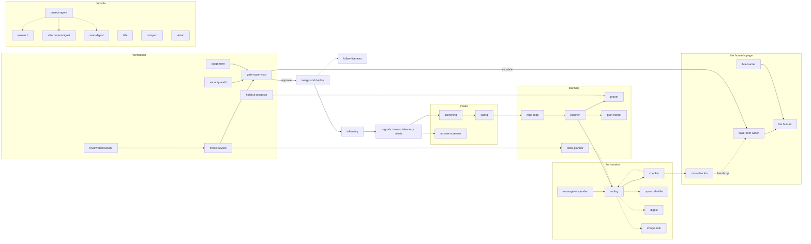

# The agent context map

One page per agent: the first model request verbatim, every part pinned to the builder that wrote it, the offered tools under their server's provenance. This index is computed from the same captures as the pages — sizes, hashes and counts, no verdicts.

## The self-check

- code SHA `7afdbe69cc2686777d807fb3bd06efb4311b4acd`; every permalink points there.
- policy `249822ac88a1`, the tree the captures read.
- harness `opencode 1.19.6`, the pinned opencode the loop captures drove.
- unlabelled spans: 0 — the tool exits non-zero on any unlabelled byte, so an index that shipped means none.
- 29 pages. Regenerate: `go run ./cmd/agentdoc -out docs/agents -policy <factory tree> -opencode <pinned binary>`; no LLM runs.

Fixture ids: `agentdoc-fixture` (coding, screening, sizing, repo-map, planner, prover, message-responder, checkin, case-checkin, model-review, security-audit, gate-supervisor, judgement, delta-planner, holdout-proposer, answer-screener, brief-writer, case-brief-writer, plan-namer, digest, image-look, follow-liveness); `t-chat-fixture-2026-11` (project-agent, research, compact, title, attachment-digest, read-digest, vision). Every capture is a fixture task, not live data.

## The inventory

The table counts each agent's first request: every word the model reads before its first answer. `tools` is the number of tools offered, and for the project agent also the rare tools that come on request through tool_schema. `words` is the total. `harness` is opencode's own text, which a direct call has none of. `guide and forms` is the writing guide and the forms of the job. `job` is the two factory chunks, the step's paragraph and the card's facts. `tool text` is the descriptions of the offered tools. Each agent's page shows every part with the code that wrote it.

| agent | model | tools | words | harness | guide and forms | job | tool text |
|---|---|---|---|---|---|---|---|
| [coding](coding.md) | `small` | 17 | 2925 | 703 | 1182 | 398 | 642 |
| [screening](screening.md) | `small` | 6 | 837 | 300 | 71 | 301 | 165 |
| [sizing](sizing.md) | `small` | 6 | 842 | 300 | 71 | 314 | 157 |
| [repo-map](repo-map.md) | `small` | 5 | 714 | 348 | 0 | 286 | 80 |
| [planner](planner.md) | `big` | 10 | 2647 | 403 | 1253 | 352 | 639 |
| [prover](prover.md) | `big` | 8 | 1080 | 561 | 0 | 386 | 133 |
| [message-responder](message-responder.md) | `small` | 17 | 4115 | 703 | 2358 | 412 | 642 |
| [checkin](checkin.md) | `big` | 10 | 546 | 0 | 157 | 125 | 264 |
| [case-checkin](case-checkin.md) | `big` | 9 | 570 | 0 | 71 | 121 | 378 |
| [model-review](model-review.md) | `big` | 1 | 621 | 0 | 202 | 202 | 217 |
| [security-audit](security-audit.md) | `big` | 1 | 327 | 0 | 71 | 38 | 218 |
| [gate-supervisor](gate-supervisor.md) | `big` | 1 | 363 | 0 | 71 | 167 | 125 |
| [judgement](judgement.md) | `big` | 1 | 134 | 0 | 71 | 47 | 16 |
| [delta-planner](delta-planner.md) | `big` | 1 | 937 | 0 | 748 | 139 | 50 |
| [holdout-proposer](holdout-proposer.md) | `big` | 1 | 239 | 0 | 71 | 127 | 41 |
| [answer-screener](answer-screener.md) | `big` | 1 | 221 | 0 | 71 | 119 | 31 |
| [brief-writer](brief-writer.md) | `big` | 1 | 606 | 0 | 434 | 82 | 90 |
| [case-brief-writer](case-brief-writer.md) | `big` | 1 | 206 | 0 | 71 | 81 | 54 |
| [plan-namer](plan-namer.md) | `small` | 1 | 110 | 0 | 71 | 13 | 26 |
| [digest](digest.md) | `small` | 0 | 0 | 0 | 0 | 0 | 0 |
| [image-look](image-look.md) | `vision` | 0 | 0 | 0 | 0 | 0 | 0 |
| [follow-liveness](follow-liveness.md) | `small` | 1 | 16 | 0 | 0 | 6 | 10 |
| [project-agent](project-agent.md) | `premium` | 44 + 21 on request | 4538 | 0 | 2358 | 190 | 1990 |
| [research](research.md) | `big` | 6 | 263 | 0 | 0 | 54 | 209 |
| [compact](compact.md) | `small` | 0 | 151 | 0 | 71 | 80 | 0 |
| [title](title.md) | `small` | 0 | 105 | 0 | 71 | 34 | 0 |
| [attachment-digest](attachment-digest.md) | `small` | 0 | 0 | 0 | 0 | 0 | 0 |
| [read-digest](read-digest.md) | `small` | 0 | 0 | 0 | 0 | 0 | 0 |
| [vision](vision.md) | `vision` | 0 | 0 | 0 | 0 | 0 | 0 |

## The agents in one line each

- [coding](coding.md): Writes the card's code in the sandbox and commits it. No other agent in the factory writes code.
- [screening](screening.md): Reads a fresh issue before any code exists and answers clear or suspect as JSON. Only work it understands becomes a card.
- [sizing](sizing.md): Reads a clear issue and sizes the card small, medium or large before the first session starts.
- [repo-map](repo-map.md): Reads the repository once per commit on the small alias and files a map of its directories, conventions and check command through the file_map tool. The planner reads that map instead of the repository.
- [planner](planner.md): Files a plan in steps, each through its own tool: a spec, the criteria and the cards of a first plan, the cards of a later round, or a replan with the cards that come off main. The page shows the replan step, the largest.
- [prover](prover.md): Writes one test per criterion on main before the cards build the feature, and files them through the file_proofs tool. The builder sees a test only after it has run once at the gate.
- [message-responder](message-responder.md): Answers a writer's message pushed into a running session. The message becomes the loop's next turn.
- [checkin](checkin.md): Reads a session that stopped at a checkpoint short of done and answers one of continue, message, handover, human or replan.
- [case-checkin](case-checkin.md): Judges a case the factory's code could not settle, on the card's facts and the evidence it reads itself, and acts on it or hands it up with a recommendation.
- [model-review](model-review.md): Reads the change's diff with the card's objective and the opened proofs' original code, and answers a verdict with findings.
- [security-audit](security-audit.md): Checks the change against the security checklist. No other agent makes this reading.
- [gate-supervisor](gate-supervisor.md): Reads the verdicts and answers approve or escalate. Nothing merges past this agent unjudged.
- [judgement](judgement.md): Reads the artifact a blind test wrote and answers met or unmet with the criterion's pinned prompt. It never sees the diff.
- [delta-planner](delta-planner.md): Plans the delta work between one review and the next.
- [holdout-proposer](holdout-proposer.md): Proposes the hold-out criteria the finished work is judged by. The session that writes the work does not see them.
- [answer-screener](answer-screener.md): Screens a late answer from the issue's author before it changes the card.
- [brief-writer](brief-writer.md): Writes the brief of a resource request or a plan approval, the requests no case carries.
- [case-brief-writer](case-brief-writer.md): Reads a Needs-you case from its record and writes the background and the grounds of the recommendation for a human who opens it cold.
- [plan-namer](plan-namer.md): Names a plan in a few words when its first revision files. One cheap call, asked again while the name does not hold.
- [digest](digest.md): Summarises one file a session names under the session's ask, for its digest tool. One cheap call, and no system prompt.
- [image-look](image-look.md): Looks at one image a session names, a workspace file or an image on the card, and answers the session's ask in words.
- [follow-liveness](follow-liveness.md): Asks the small model for one word after a move rolls out, to prove the model route still answers. No one reads the answer.
- [project-agent](project-agent.md): The always-on chat about the repository, with the project's tools. Its escalations file cards the factory then works.
- [research](research.md): Researches one question for the project agent through the chat's reads and the web, and hands back a report with its sources.
- [compact](compact.md): Summarises a chat thread's older turns when the thread grows long. One cheap call.
- [title](title.md): Names a chat thread from its first message. One cheap call.
- [attachment-digest](attachment-digest.md): Summarises a document the human attached, for the project agent. One cheap call, and no system prompt.
- [read-digest](read-digest.md): Summarises one big read of the chat, a file, a document or a web page, under the project agent's ask. One cheap call, and no system prompt.
- [vision](vision.md): Describes an image a human attached, in words the text-only agents read.

## The one loop

The 7 loop pages are one session shape on the same trunk: the harness system prompt around the repository's AGENTS.md, the brief builders, the offered tools. What every page carries byte for byte, sized from the first loop page's capture:

- the author's answers — 2692 bytes
- the author's standing — 532 bytes
- the brief's closing marker — 19 bytes
- the brief's opening marker — 20 bytes
- the card's brief — 108 bytes
- the issue link — 47 bytes
- the poster heading — 36 bytes
- the repository line — 43 bytes
- the sandbox facts — 414 bytes
- tool factory-tools_manual — 259 bytes
- tool glob — 769 bytes
- tool grep — 821 bytes
- tool read — 887 bytes
- what the bounds left out — 146 bytes

What the pages do not share, each carries as its own: the mode's guide, the class's sandbox facts and tool list, the harness preamble's model line and sandbox path.

## The duplication matrix

Blocks several agents carry byte for byte, by content hash:

| block | bytes | carried by |
|---|---|---|
| `013651f42d38` · `gateway.Server.toolServer` | 259 | [coding](coding.md) — tool factory-tools_manual; [screening](screening.md) — tool factory-tools_manual; [sizing](sizing.md) — tool factory-tools_manual; [repo-map](repo-map.md) — tool factory-tools_manual; [planner](planner.md) — tool factory-tools_manual; [prover](prover.md) — tool factory-tools_manual; [message-responder](message-responder.md) — tool factory-tools_manual |
| `06f4764a6e6f` · `factoryd.joinFiles` | 206 | [model-review](model-review.md) — the diff; [security-audit](security-audit.md) — the diff |
| `07e2fe92853e` | 700 | [project-agent](project-agent.md) — tool read_doc; [research](research.md) — tool read_doc |
| `087bcce97f47` · `opencode 1.19.6` | 769 | [coding](coding.md) — tool glob; [screening](screening.md) — tool glob; [sizing](sizing.md) — tool glob; [repo-map](repo-map.md) — tool glob; [planner](planner.md) — tool glob; [prover](prover.md) — tool glob; [message-responder](message-responder.md) — tool glob |
| `08d9d8e33a87` | 122 | [image-look](image-look.md) — the image; [vision](vision.md) — the image |
| `0cd58ce091be` | 440 | [checkin](checkin.md) — tool grep; [case-checkin](case-checkin.md) — tool grep |
| `15aaac9e7a92` | 378 | [project-agent](project-agent.md) — tool web_search; [research](research.md) — tool web_search |
| `19950c3ccebf` · `opencode 1.19.6` | 987 | [coding](coding.md) — tool edit; [prover](prover.md) — tool edit; [message-responder](message-responder.md) — tool edit |
| `1acbfe069861` · `opencode 1.19.6` | 303 | [planner](planner.md) — the harness's environment; [prover](prover.md) — the harness's environment |
| `1b6554d12714` · `briefText` | 36 | [coding](coding.md) — the poster heading; [screening](screening.md) — the poster heading; [sizing](sizing.md) — the poster heading; [repo-map](repo-map.md) — the poster heading; [planner](planner.md) — the poster heading; [prover](prover.md) — the poster heading; [message-responder](message-responder.md) — the poster heading |
| `223220ca36ce` · `briefText` | 47 | [coding](coding.md) — the issue link; [screening](screening.md) — the issue link; [sizing](sizing.md) — the issue link; [repo-map](repo-map.md) — the issue link; [planner](planner.md) — the issue link; [prover](prover.md) — the issue link; [message-responder](message-responder.md) — the issue link |
| `2727e60e944f` · `briefText` | 19 | [coding](coding.md) — the brief's closing marker; [screening](screening.md) — the brief's closing marker; [sizing](sizing.md) — the brief's closing marker; [repo-map](repo-map.md) — the brief's closing marker; [planner](planner.md) — the brief's closing marker; [prover](prover.md) — the brief's closing marker; [message-responder](message-responder.md) — the brief's closing marker |
| `280892ed6d59` · `briefText` | 43 | [coding](coding.md) — the repository line; [screening](screening.md) — the repository line; [sizing](sizing.md) — the repository line; [repo-map](repo-map.md) — the repository line; [planner](planner.md) — the repository line; [prover](prover.md) — the repository line; [message-responder](message-responder.md) — the repository line |
| `2830c46d1803` · `SessionFacts.Line` | 167 | [screening](screening.md) — the session's facts; [sizing](sizing.md) — the session's facts; [repo-map](repo-map.md) — the session's facts; [planner](planner.md) — the session's facts; [prover](prover.md) — the session's facts |
| `295cc931fda8` · `gateway.Server.toolServer` | 680 | [coding](coding.md) — tool factory-tools_request_info; [message-responder](message-responder.md) — tool factory-tools_request_info |
| `2c5dec4a86d8` · `SessionFacts.Line` | 299 | [coding](coding.md) — the session's facts; [message-responder](message-responder.md) — the session's facts |
| `30a0924a3360` · `factoryd.concurrencyBlock` | 6 | [model-review](model-review.md) — the concurrency summary; [security-audit](security-audit.md) — the concurrency summary |
| `32a1838813c8` · `opencode 1.19.6` | 307 | [screening](screening.md) — the harness's environment; [sizing](sizing.md) — the harness's environment |
| `3321e35a82a2` · `opencode 1.19.6` | 348 | [coding](coding.md) — the harness's environment; [repo-map](repo-map.md) — the harness's environment; [message-responder](message-responder.md) — the harness's environment |
| `3c395791f026` | 279 | [checkin](checkin.md) — tool card_step; [case-checkin](case-checkin.md) — tool card_step |
| `3d2434857657` · `factoryd.Spec` | 84 | [delta-planner](delta-planner.md) — the spec; [holdout-proposer](holdout-proposer.md) — the spec |
| `422d4b107167` · `opencode 1.19.6` | 1001 | [coding](coding.md) — tool bash; [planner](planner.md) — tool bash; [prover](prover.md) — tool bash; [message-responder](message-responder.md) — tool bash |
| `4ac520860ef0` | 351 | [project-agent](project-agent.md) — tool web_scrape; [research](research.md) — tool web_scrape |
| `52cd0edef707` | 299 | [checkin](checkin.md) — tool read_file; [case-checkin](case-checkin.md) — tool read_file |
| `5b3a489dc91a` · `briefText` | 532 | [coding](coding.md) — the author's standing; [screening](screening.md) — the author's standing; [sizing](sizing.md) — the author's standing; [repo-map](repo-map.md) — the author's standing; [planner](planner.md) — the author's standing; [prover](prover.md) — the author's standing; [message-responder](message-responder.md) — the author's standing |
| `5bc418043e88` · `opencode 1.19.6` | 887 | [coding](coding.md) — tool read; [screening](screening.md) — tool read; [sizing](sizing.md) — tool read; [repo-map](repo-map.md) — tool read; [planner](planner.md) — tool read; [prover](prover.md) — tool read; [message-responder](message-responder.md) — tool read |
| `6635423d8d8b` · `factoryd.CardDigest.Render` | 253 | [brief-writer](brief-writer.md) — the card's life; [case-brief-writer](case-brief-writer.md) — the card's life |
| `6aca1a80015a` | 287 | [checkin](checkin.md) — tool transcript_search; [case-checkin](case-checkin.md) — tool transcript_search |
| `6edbc64a5dee` · `CardBrief.AgentText` | 108 | [coding](coding.md) — the card's brief; [screening](screening.md) — the card's brief; [sizing](sizing.md) — the card's brief; [repo-map](repo-map.md) — the card's brief; [planner](planner.md) — the card's brief; [prover](prover.md) — the card's brief; [message-responder](message-responder.md) — the card's brief |
| `758bcd72ac9e` · `gateway.Server.toolServer` | 811 | [coding](coding.md) — tool factory-tools_analyze_image; [screening](screening.md) — tool factory-tools_analyze_image; [sizing](sizing.md) — tool factory-tools_analyze_image; [planner](planner.md) — tool factory-tools_analyze_image; [message-responder](message-responder.md) — tool factory-tools_analyze_image |
| `7f324fa86796` | 2692 | [coding](coding.md) — the author's answers; [screening](screening.md) — the author's answers; [sizing](sizing.md) — the author's answers; [repo-map](repo-map.md) — the author's answers; [planner](planner.md) — the author's answers; [prover](prover.md) — the author's answers; [message-responder](message-responder.md) — the author's answers |
| `810c3ae894eb` · `briefText` | 146 | [coding](coding.md) — what the bounds left out; [screening](screening.md) — what the bounds left out; [sizing](sizing.md) — what the bounds left out; [repo-map](repo-map.md) — what the bounds left out; [planner](planner.md) — what the bounds left out; [prover](prover.md) — what the bounds left out; [message-responder](message-responder.md) — what the bounds left out |
| `831a2a24e92c` · `opencode 1.19.6` | 1011 | [coding](coding.md) — tool todowrite; [message-responder](message-responder.md) — tool todowrite |
| `8b43b9d9c7ee` | 449 | [project-agent](project-agent.md) — tool grep; [research](research.md) — tool grep |
| `9334deccfab1` | 496 | [checkin](checkin.md) — tool cluster_facts; [case-checkin](case-checkin.md) — tool cluster_facts |
| `a08fbc9d3fbd` · `briefText` | 20 | [coding](coding.md) — the brief's opening marker; [screening](screening.md) — the brief's opening marker; [sizing](sizing.md) — the brief's opening marker; [repo-map](repo-map.md) — the brief's opening marker; [planner](planner.md) — the brief's opening marker; [prover](prover.md) — the brief's opening marker; [message-responder](message-responder.md) — the brief's opening marker |
| `a6a70007a4cc` · `prompts.Build` | 7881 | [coding](coding.md) — the profile's texts; [message-responder](message-responder.md) — the profile's texts |
| `a709ea32df7f` | 229 | [checkin](checkin.md) — tool card_facts; [case-checkin](case-checkin.md) — tool card_facts |
| `b08a8bb42600` · `AGENTS.md` | 245 | [coding](coding.md) — AGENTS.md; [repo-map](repo-map.md) — AGENTS.md; [message-responder](message-responder.md) — AGENTS.md |
| `b4c61a4e5ada` | 253 | [checkin](checkin.md) — tool transcript_read; [case-checkin](case-checkin.md) — tool transcript_read |
| `b6136b83c4c9` · `gateway.Server.toolServer` | 1038 | [coding](coding.md) — tool factory-tools_escalate; [message-responder](message-responder.md) — tool factory-tools_escalate |
| `b6d577ae5e1c` · `gateway.Server.toolServer` | 935 | [coding](coding.md) — tool factory-tools_delegate; [message-responder](message-responder.md) — tool factory-tools_delegate |
| `c6655a98c002` · `SandboxFacts` | 414 | [coding](coding.md) — the sandbox facts; [screening](screening.md) — the sandbox facts; [sizing](sizing.md) — the sandbox facts; [repo-map](repo-map.md) — the sandbox facts; [planner](planner.md) — the sandbox facts; [prover](prover.md) — the sandbox facts; [message-responder](message-responder.md) — the sandbox facts |
| `c8eb9ac33b5f` · `gateway.Server.toolServer` | 629 | [coding](coding.md) — tool factory-tools_digest; [planner](planner.md) — tool factory-tools_digest; [message-responder](message-responder.md) — tool factory-tools_digest |
| `c96d315fb21e` · `opencode 1.19.6` | 589 | [coding](coding.md) — tool write; [prover](prover.md) — tool write; [message-responder](message-responder.md) — tool write |
| `cb943688b5d4` · `toolsLine` | 76 | [screening](screening.md) — the tools line; [repo-map](repo-map.md) — the tools line |
| `e04299b358fb` | 132 | [checkin](checkin.md) — tool gates; [case-checkin](case-checkin.md) — tool gates |
| `e2c98d410c58` · `codingFacts` | 156 | [coding](coding.md) — the guide; [message-responder](message-responder.md) — the guide |
| `e32e47cfb17a` · `toolsLine` | 77 | [coding](coding.md) — the tools line; [sizing](sizing.md) — the tools line; [planner](planner.md) — the tools line; [prover](prover.md) — the tools line; [message-responder](message-responder.md) — the tools line |
| `e3d1ce595400` · `gateway.Server.toolServer` | 337 | [coding](coding.md) — tool factory-tools_web_scrape; [planner](planner.md) — tool factory-tools_web_scrape; [message-responder](message-responder.md) — tool factory-tools_web_scrape |
| `e3f0b8d6902d` · `gateway.Server.toolServer` | 441 | [coding](coding.md) — tool factory-tools_web_search; [planner](planner.md) — tool factory-tools_web_search; [message-responder](message-responder.md) — tool factory-tools_web_search |
| `ea89256503a0` | 580 | [project-agent](project-agent.md) — tool file; [research](research.md) — tool file |
| `f08c1e8dad21` | 328 | [project-agent](project-agent.md) — tool tree; [research](research.md) — tool tree |
| `f38fce964f73` | 31 | [project-agent](project-agent.md) — the human's message; [vision](vision.md) — the agent's ask |
| `f613dabf2d4b` · `gateway.Server.toolServer` | 612 | [coding](coding.md) — tool factory-tools_request_tool; [message-responder](message-responder.md) — tool factory-tools_request_tool |
| `fd92ef97c4a3` · `gateway.Server.toolServer` | 607 | [coding](coding.md) — tool factory-tools_request_cut; [message-responder](message-responder.md) — tool factory-tools_request_cut |
| `ff00712de815` · `opencode 1.19.6` | 821 | [coding](coding.md) — tool grep; [screening](screening.md) — tool grep; [sizing](sizing.md) — tool grep; [repo-map](repo-map.md) — tool grep; [planner](planner.md) — tool grep; [prover](prover.md) — tool grep; [message-responder](message-responder.md) — tool grep |

## The factory at a glance

