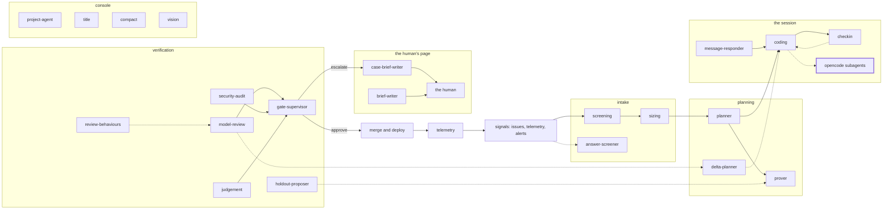

<!-- agentdoc: id=opencode-subagents family=A -->

# opencode-subagents

opencode-internal task and explore delegation · runs: inside opencode, under the session config's agent block

opencode's own general and explore subagents, set by the agent block in our session config. Their prompts live inside the pinned binary; the config sets their model and step cap.

Regenerated by `go run ./cmd/agentdoc`; no LLM runs. Code SHA `c0df7ba24bef245b55976e99dd6967cd10b341fc`, policy `530c35f0c966`.

No first call of ours exists to capture: the subagents' prompts are opencode's own, inside the binary (`opencode 1.18.32`). What our side of their path sets is the `agent` block of the session config, verbatim below.

## Where this agent sits



#### the agent block — builder

[`buildOpencodeConfig`](https://github.com/sebastianrueckerai/ai-software-factory-code/blob/c0df7ba24bef245b55976e99dd6967cd10b341fc/internal/factoryd/opencode.go#L1010) · internal/factoryd/opencode.go:1010 · 122 bytes

```json
{"build":{"steps":1500},"explore":{"model":"factory/small","steps":1500},"general":{"model":"factory/small","steps":1500}}
```

The agent block sits in [`raw/opencode-subagents.json`](raw/opencode-subagents.json), byte for byte.
