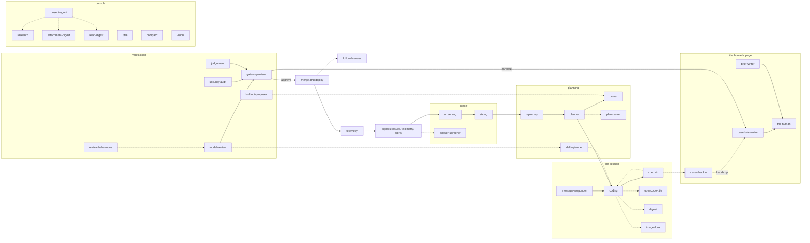

<!-- agentdoc: id=plan-namer family=B -->

# plan-namer

Names a plan from its first revision · runs: factoryd direct

Names a plan in a few words when its first revision files. One cheap call, asked again while the name does not hold.

Regenerated by `go run ./cmd/agentdoc`; no LLM runs. Code SHA `5b2dce616e5008006b1c98e0cd17ede8cc01ace0`, policy `249822ac88a1`.

**Fixture task, not live data.** The capture runs the real assembly on a fixed task against a fake gateway; nothing on this page is a live card's content.

| model alias | max tokens | stream | response format | purpose | task | tools | request bytes |
|---|---|---|---|---|---|---|---|
| `small` | 18432 | false | — | `title` | `agentdoc-fixture` | 1 | 1247 |

## Where this agent sits



## The first request

Verbatim, part by part, top to bottom as it crossed the wire. Sizes are bytes of the decoded part.

### system message

#### the profile's texts — builder

[`prompts.Build`](https://github.com/sebastianrueckerai/ai-software-factory-code/blob/5b2dce616e5008006b1c98e0cd17ede8cc01ace0/internal/prompts/build.go#L25) · internal/prompts/build.go:25 · 451 bytes

```text
# Title

A title names the work, not the outcome, in one short line of plain words with the verb first. A reader who knows the topic stops here. On a card that asks, the title is the ask: one question or one instruction.

Good: Narrow the close refusal to plans that hold criteria
Bad: The doClose refusal narrowed to plans that hold criteria: the review finding answered on branch card/2084

You name a build plan. A human sees the name on the board.
```

### user message

#### the plan's facts — builder

[`factoryd.nameFacts`](https://github.com/sebastianrueckerai/ai-software-factory-code/blob/5b2dce616e5008006b1c98e0cd17ede8cc01ace0/internal/factoryd/namer.go#L148) · internal/factoryd/namer.go:148 · 237 bytes

```text
"Issue title: Count the skipped rows\nSpec outcome: The counter counts every row the query returns, skipped ones included.\nSummary: One card fixes the counter; one criterion proves it.\nAlready taken by other open plans: Nightly report"
```

## The offered tools

1 tools. Names and descriptions in the open; each schema's full JSON collapsed under it.

### answer

[`prompts.AnswerTool`](https://github.com/sebastianrueckerai/ai-software-factory-code/blob/5b2dce616e5008006b1c98e0cd17ede8cc01ace0/internal/prompts/answer.go#L74) · internal/prompts/answer.go:74 · the step's own schema · 364 bytes

Your answer: one JSON object as this tool's arguments.

<details><summary>full schema JSON</summary>

```json
{"function":{"description":"Your answer: one JSON object as this tool's arguments.","name":"answer","parameters":{"additionalProperties":false,"properties":{"name":{"description":"short plain words that say what the plan does, fixes or enables, one line, no trailing period","maxLength":24,"type":"string"}},"required":["name"],"type":"object"}},"type":"function"}
```

</details>

The literal wire body sits in [`raw/plan-namer.json`](raw/plan-namer.json), byte for byte.
