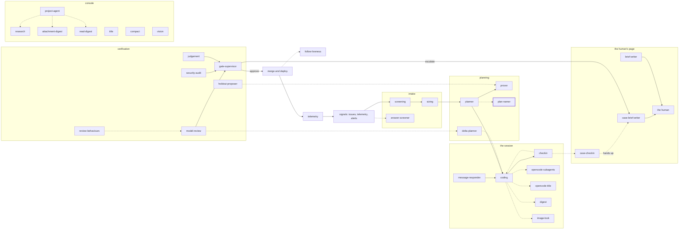

<!-- agentdoc: id=plan-namer family=B -->

# plan-namer

Names a plan from its first revision · runs: factoryd direct

Names a plan in a few words when its first revision files. One cheap call, asked again while the name does not hold.

Regenerated by `go run ./cmd/agentdoc`; no LLM runs. Code SHA `0b0b049c3d8156cbfe82aadaf4c997006dc56128`, policy `090da06f7c4b`.

**Fixture task, not live data.** The capture runs the real assembly on a fixed task against a fake gateway; nothing on this page is a live card's content.

| model alias | max tokens | stream | response format | purpose | task | tools | request bytes |
|---|---|---|---|---|---|---|---|
| `small` | 18432 | false | json_object | `title` | `agentdoc-fixture` | 0 | 1003 |

## Where this agent sits



## The first request

Verbatim, part by part, top to bottom as it crossed the wire. Sizes are bytes of the decoded part.

### system message

#### the naming rules — builder

[`factoryd.namerPrompt`](https://github.com/sebastianrueckerai/ai-software-factory-code/blob/0b0b049c3d8156cbfe82aadaf4c997006dc56128/internal/factoryd/namer.go#L47) · internal/factoryd/namer.go:47 · 581 bytes

```text
You name build plans. Answer with a JSON object with one field "name": short plain words that say what the plan does, fixes or enables, at most 24 characters, one line, no trailing period.

# Title

A title names the work, not the outcome, in one short line of plain words with the verb first. A reader who knows the topic stops here. On a card that asks, the title is the ask: one question or one instruction.

Good: Narrow the close refusal to plans that hold criteria
Bad: The doClose refusal narrowed to plans that hold criteria: the review finding answered on branch card/2084
```

### user message

#### the input heading — builder

[`factoryd.ChatInputLead`](https://github.com/sebastianrueckerai/ai-software-factory-code/blob/0b0b049c3d8156cbfe82aadaf4c997006dc56128/internal/factoryd/supervisor.go#L325) · internal/factoryd/supervisor.go:325 · 20 bytes

```text
The input, as JSON:

```

#### the plan's facts — builder

[`factoryd.nameFacts`](https://github.com/sebastianrueckerai/ai-software-factory-code/blob/0b0b049c3d8156cbfe82aadaf4c997006dc56128/internal/factoryd/namer.go#L147) · internal/factoryd/namer.go:147 · 237 bytes

```text
"Issue title: Count the skipped rows\nSpec outcome: The counter counts every row the query returns, skipped ones included.\nSummary: One card fixes the counter; one criterion proves it.\nAlready taken by other open plans: Nightly report"
```

The literal wire body sits in [`raw/plan-namer.json`](raw/plan-namer.json), byte for byte.
