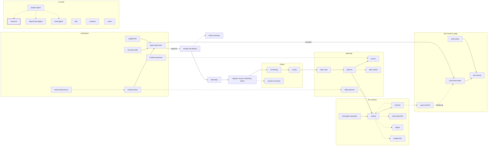

<!-- agentdoc: id=research family=B -->

# research

Researches one question for the project agent · runs: console, own tool loop behind the chat's research tool

Researches one question for the project agent through the chat's reads and the web, and hands back a report with its sources.

Regenerated by `go run ./cmd/agentdoc`; no LLM runs. Code SHA `5b2dce616e5008006b1c98e0cd17ede8cc01ace0`, policy `249822ac88a1`.

**Fixture task, not live data.** The capture runs the real assembly on a fixed task against a fake gateway; nothing on this page is a live card's content.

| model alias | max tokens | stream | response format | purpose | task | tools | request bytes |
|---|---|---|---|---|---|---|---|
| `big` | 2048 | true | — | `research` | `t-chat-fixture-2026-11` | 6 | 3277 |

## Where this agent sits



## The first request

Verbatim, part by part, top to bottom as it crossed the wire. Sizes are bytes of the decoded part.

### system message

#### the profile's texts — builder

[`prompts.Build`](https://github.com/sebastianrueckerai/ai-software-factory-code/blob/5b2dce616e5008006b1c98e0cd17ede8cc01ace0/internal/prompts/build.go#L25) · internal/prompts/build.go:25 · 288 bytes

```text
You research one question for the project agent. Work alone: call a tool, read its answer, decide the next. Stop as soon as the question is answered. Your last answer is the report: findings, then sources (a path at its ref or a url), then open questions. Name no source you did not read.
```

### user message

#### the agent's question — fixture

[`(*turn).researchTool`](https://github.com/sebastianrueckerai/ai-software-factory-code/blob/5b2dce616e5008006b1c98e0cd17ede8cc01ace0/internal/console/research.go#L111) · internal/console/research.go:111 · 67 bytes

```text
Which file sets the staging deploy's budget, and what does it hold?
```

## The offered tools

6 tools. Names and descriptions in the open; each schema's full JSON collapsed under it.

### tree

[`researchTools`](https://github.com/sebastianrueckerai/ai-software-factory-code/blob/5b2dce616e5008006b1c98e0cd17ede8cc01ace0/internal/console/research.go#L43) · internal/console/research.go:43 · a core chat tool · 328 bytes

Every file of the repository at a ref, cut at 500 lines.

<details><summary>full schema JSON</summary>

```json
{"function":{"description":"Every file of the repository at a ref, cut at 500 lines.","name":"tree","parameters":{"properties":{"path":{"description":"a path prefix (default the whole tree)","type":"string"},"ref":{"description":"a branch, tag or commit","type":"string"}},"required":["ref"],"type":"object"}},"type":"function"}
```

</details>

### grep

[`researchTools`](https://github.com/sebastianrueckerai/ai-software-factory-code/blob/5b2dce616e5008006b1c98e0cd17ede8cc01ace0/internal/console/research.go#L43) · internal/console/research.go:43 · a core chat tool · 449 bytes

Files at a ref whose lines match a pattern, at most 50, each as the path file opens.

<details><summary>full schema JSON</summary>

```json
{"function":{"description":"Files at a ref whose lines match a pattern, at most 50, each as the path file opens.","name":"grep","parameters":{"properties":{"path":{"description":"a path prefix (default the whole tree)","type":"string"},"pattern":{"description":"the text to find, a regular expression","type":"string"},"ref":{"description":"a branch, tag or commit","type":"string"}},"required":["pattern","ref"],"type":"object"}},"type":"function"}
```

</details>

### file

[`researchTools`](https://github.com/sebastianrueckerai/ai-software-factory-code/blob/5b2dce616e5008006b1c98e0cd17ede8cc01ace0/internal/console/research.go#L43) · internal/console/research.go:43 · a core chat tool · 580 bytes

A file at a ref, its lines from and to, else its first 64 KiB, near files if none.

<details><summary>full schema JSON</summary>

```json
{"function":{"description":"A file at a ref, its lines from and to, else its first 64 KiB, near files if none.","name":"file","parameters":{"properties":{"ask":{"description":"what a small digest answers (default the raw read)","type":"string"},"from":{"description":"the first line to read","minimum":1,"type":"integer"},"path":{"description":"the file's path","type":"string"},"ref":{"description":"a branch, tag or commit","type":"string"},"to":{"description":"the last line to read","minimum":1,"type":"integer"}},"required":["ref","path"],"type":"object"}},"type":"function"}
```

</details>

### read_doc

[`researchTools`](https://github.com/sebastianrueckerai/ai-software-factory-code/blob/5b2dce616e5008006b1c98e0cd17ede8cc01ace0/internal/console/research.go#L43) · internal/console/research.go:43 · a core chat tool · 700 bytes

Any file of the project's document repository with its base_sha256 and line count.

<details><summary>full schema JSON</summary>

```json
{"function":{"description":"Any file of the project's document repository with its base_sha256 and line count.","name":"read_doc","parameters":{"properties":{"ask":{"description":"what a small digest answers (default the raw read)","type":"string"},"find":{"description":"the lines holding this text, case-insensitive","type":"string"},"from":{"description":"the first line to read","minimum":1,"type":"integer"},"path":{"description":"the file's path in the document repository","type":"string"},"regex":{"description":"find is a regular expression","type":"boolean"},"to":{"description":"the last line to read","minimum":1,"type":"integer"}},"required":["path"],"type":"object"}},"type":"function"}
```

</details>

### web_search

[`researchTools`](https://github.com/sebastianrueckerai/ai-software-factory-code/blob/5b2dce616e5008006b1c98e0cd17ede8cc01ace0/internal/console/research.go#L43) · internal/console/research.go:43 · a core chat tool · 378 bytes

At most ten pages the web search found for a query, each a title, its url and a snippet.

<details><summary>full schema JSON</summary>

```json
{"function":{"description":"At most ten pages the web search found for a query, each a title, its url and a snippet.","name":"web_search","parameters":{"properties":{"limit":{"default":5,"description":"results to show, at most 10","minimum":1,"type":"integer"},"query":{"description":"the search query","type":"string"}},"required":["query"],"type":"object"}},"type":"function"}
```

</details>

### web_scrape

[`researchTools`](https://github.com/sebastianrueckerai/ai-software-factory-code/blob/5b2dce616e5008006b1c98e0cd17ede8cc01ace0/internal/console/research.go#L43) · internal/console/research.go:43 · a core chat tool · 351 bytes

The web page at one address, digested to the ask, never raw.

<details><summary>full schema JSON</summary>

```json
{"function":{"description":"The web page at one address, digested to the ask, never raw.","name":"web_scrape","parameters":{"properties":{"ask":{"description":"what the digest answers (default the page's gist)","type":"string"},"url":{"description":"the page's http(s) address","type":"string"}},"required":["url"],"type":"object"}},"type":"function"}
```

</details>

The literal wire body sits in [`raw/research.json`](raw/research.json), byte for byte.
