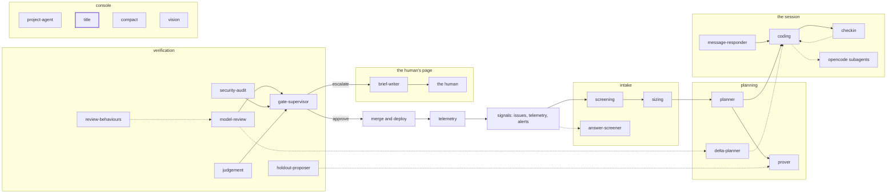

<!-- agentdoc: id=title family=B -->

# title

Names a chat thread from its first message · runs: the console's naming call, a factoryd direct client

Names a chat thread from its first message. One cheap call.

Regenerated by `go run ./cmd/agentdoc`; no LLM runs. Code SHA `e48c3516f59d47b72708ea33bc31eb61bfdfcdcf`, policy `d245f5c998fe`.

**Fixture task, not live data.** The capture runs the real assembly on a fixed task against a fake gateway; nothing on this page is a live card's content.

| model alias | max tokens | stream | response format | purpose | task | tools | request bytes |
|---|---|---|---|---|---|---|---|
| `small` | 200 | true | — | `title` | `agentdoc-fixture` | 0 | 348 |

## Where this agent sits



## The first request

Verbatim, part by part, top to bottom as it crossed the wire. Sizes are bytes of the decoded part.

### system message

#### the naming rules — builder

[`factoryd.titlePrompt`](https://github.com/sebastianrueckerai/ai-software-factory-code/blob/e48c3516f59d47b72708ea33bc31eb61bfdfcdcf/internal/factoryd/operator.go#L192) · internal/factoryd/operator.go:192 · 192 bytes

```text
You name a chat thread from its first message. Answer with the title alone: a name, not a sentence, a few words, at most 60 characters, no surrounding quotes. Answer in the message's language.
```

### user message

#### the thread's first message — fixture

[`(*OperatorModel).Title`](https://github.com/sebastianrueckerai/ai-software-factory-code/blob/e48c3516f59d47b72708ea33bc31eb61bfdfcdcf/internal/factoryd/operator.go#L199) · internal/factoryd/operator.go:199 · 35 bytes

```text
Set the staging budget to 40 euros.
```

The literal wire body sits in [`raw/title.json`](raw/title.json), byte for byte.
