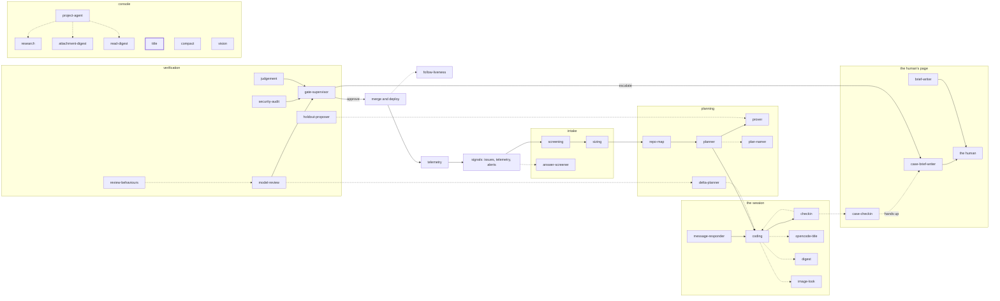

<!-- agentdoc: id=title family=B -->

# title

Names a chat thread from its first message · runs: console, the naming call

Names a chat thread from its first message. One cheap call.

Regenerated by `go run ./cmd/agentdoc`; no LLM runs. Code SHA `7afdbe69cc2686777d807fb3bd06efb4311b4acd`, policy `249822ac88a1`.

**Fixture task, not live data.** The capture runs the real assembly on a fixed task against a fake gateway; nothing on this page is a live card's content.

| model alias | max tokens | stream | response format | purpose | task | tools | request bytes |
|---|---|---|---|---|---|---|---|
| `small` | 200 | true | — | `title` | `t-chat-fixture-2026-11` | 0 | 743 |

## Where this agent sits



## The first request

Verbatim, part by part, top to bottom as it crossed the wire. Sizes are bytes of the decoded part.

### system message

#### the profile's texts — builder

[`prompts.Build`](https://github.com/sebastianrueckerai/ai-software-factory-code/blob/7afdbe69cc2686777d807fb3bd06efb4311b4acd/internal/prompts/build.go#L25) · internal/prompts/build.go:25 · 479 bytes

```text
# Title

A title names the work, not the outcome, in one short line of plain words with the verb first. A reader who knows the topic stops here. On a card that asks, the title is the ask: one question or one instruction.

Good: Narrow the close refusal to plans that hold criteria
Bad: The doClose refusal narrowed to plans that hold criteria: the review finding answered on branch card/2084

You name a chat thread from its first message. The human picks threads by this name.


```

#### the naming rules — builder

[`factoryd.TitlePrompt`](https://github.com/sebastianrueckerai/ai-software-factory-code/blob/7afdbe69cc2686777d807fb3bd06efb4311b4acd/internal/factoryd/operator.go#L222) · internal/factoryd/operator.go:222 · 99 bytes

```text
Answer with the title alone: a name, not a sentence, a few words. Answer in the message's language.
```

### user message

#### the thread's first message — fixture

[`(*Console).nameThread`](https://github.com/sebastianrueckerai/ai-software-factory-code/blob/7afdbe69cc2686777d807fb3bd06efb4311b4acd/internal/console/chat_title.go#L30) · internal/console/chat_title.go:30 · 35 bytes

```text
Set the staging budget to 40 euros.
```

The literal wire body sits in [`raw/title.json`](raw/title.json), byte for byte.
