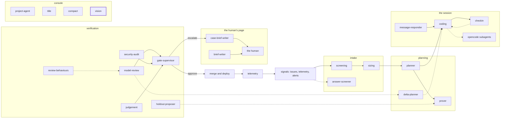

<!-- agentdoc: id=vision family=B -->

# vision

Describes an image the human attached · runs: console

Describes an image a human attached, in words the text-only agents read.

Regenerated by `go run ./cmd/agentdoc`; no LLM runs. Code SHA `c0df7ba24bef245b55976e99dd6967cd10b341fc`, policy `530c35f0c966`.

**Fixture task, not live data.** The capture runs the real assembly on a fixed task against a fake gateway; nothing on this page is a live card's content.

| model alias | max tokens | stream | response format | purpose | task | tools | request bytes |
|---|---|---|---|---|---|---|---|
| `vision` | 16384 | true | — | `vision` | `t-chat-fixture-2026-11` | 0 | 315 |

## Where this agent sits



## The first request

Verbatim, part by part, top to bottom as it crossed the wire. Sizes are bytes of the decoded part.

### user message

#### the ask — fixture

[`(*OperatorModel).Vision`](https://github.com/sebastianrueckerai/ai-software-factory-code/blob/c0df7ba24bef245b55976e99dd6967cd10b341fc/internal/factoryd/operator.go#L181) · internal/factoryd/operator.go:181 · 31 bytes

```text
What blocks the staging deploy?
```

#### the image — fixture

[`(*OperatorModel).Vision`](https://github.com/sebastianrueckerai/ai-software-factory-code/blob/c0df7ba24bef245b55976e99dd6967cd10b341fc/internal/factoryd/operator.go#L181) · internal/factoryd/operator.go:181 · 122 bytes

```text
data:image/png;base64,iVBORw0KGgoAAAANSUhEUgAAAAEAAAABCAIAAACQd1PeAAAAEElEQVR4nGK6VCEHCAAA//8DkAFrOr1fdAAAAABJRU5ErkJggg==
```

The literal wire body sits in [`raw/vision.json`](raw/vision.json), byte for byte.
