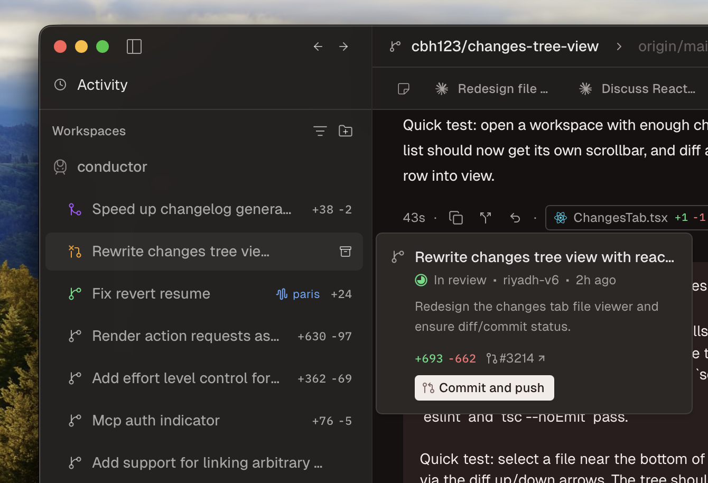
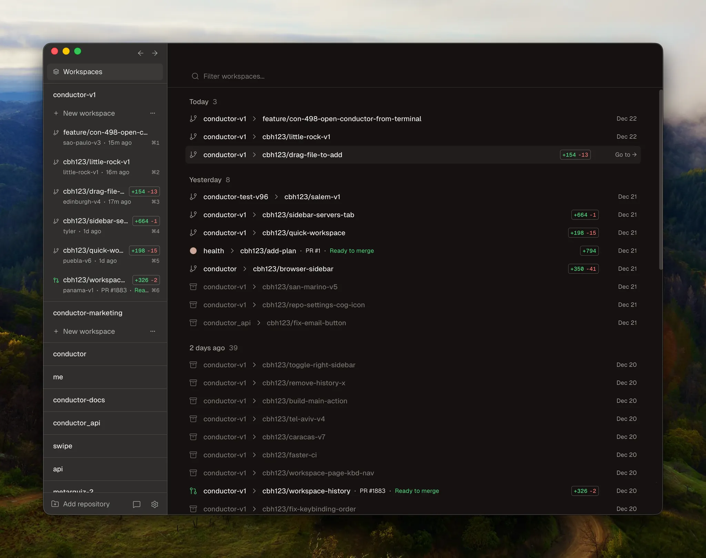
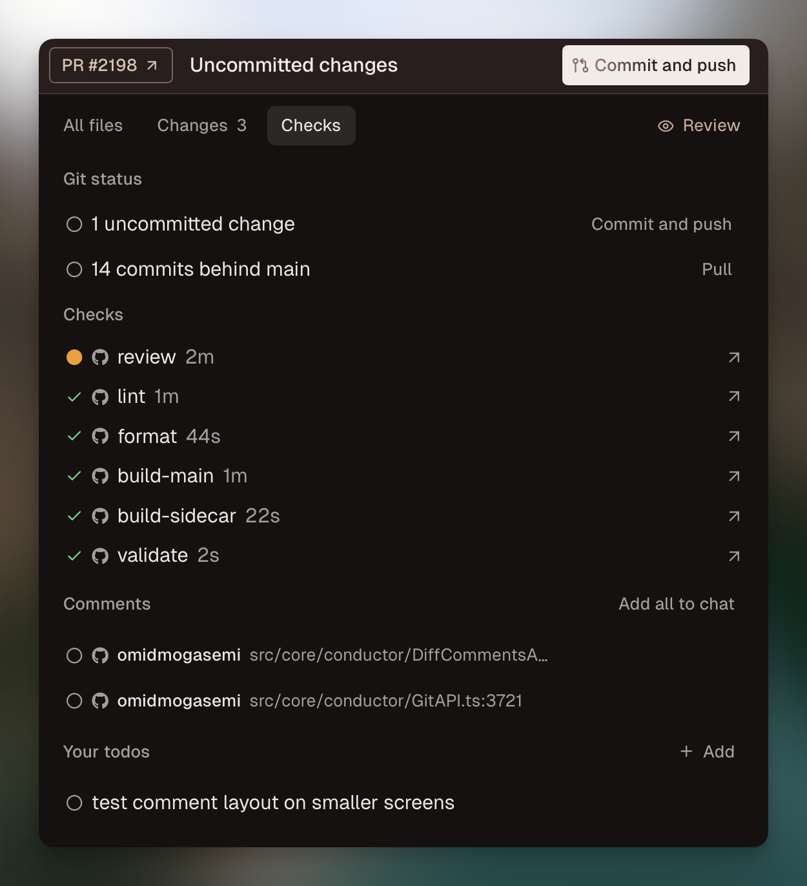
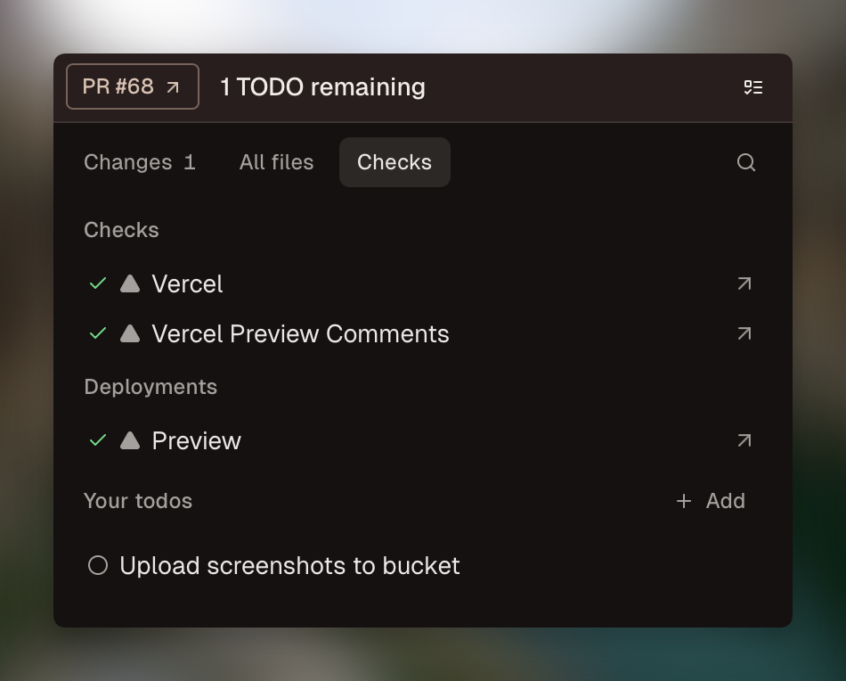
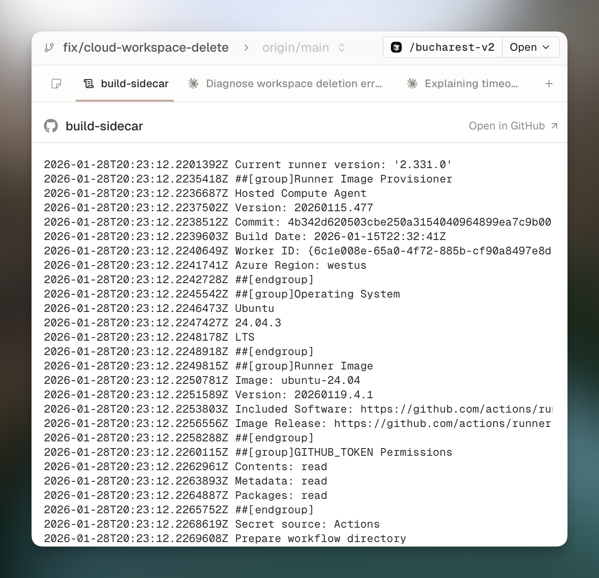

# Conductor

> **URL correction:** the phase-2 brief names `conductor.is`; that domain belongs to an
> unrelated QuickBooks-API product. The product studied here — and the one our side cites
> for the Checks tab — is **[conductor.build](https://www.conductor.build)**.

## Header

- Product and URL: Conductor, https://www.conductor.build (no public repository; native
  macOS app distributed from the site and the Mac App Store).
- License, price, self-hosting: proprietary and closed source. Free tier $0 (local agents
  only, bring-your-own API keys or Claude/OpenAI subscriptions); Pro $50/mo (Conductor
  Cloud sandboxes, multiplayer up to 5, API, mobile companion); Teams $60/user/mo
  (invite-only, admin portal); Enterprise custom (SAML SSO, SCIM, DPA, SLA). No
  self-hosted tier exists; the docs say one is being built. Cloud compute is unmetered
  "for now", with usage-based pricing planned.
- Alive? Very. Changelog at 0.89.1 "GPT-6.1 Sol" (2026-09-29), a public release almost
  every week since July 2025 (300 sitemap changelog URLs, back to 0.0.16). $22M Series A
  led by Matrix and Spark announced 2026-03-30; SOC 2 Type II attested; self-reported
  "grown 10x since January" and "used by engineers at companies like Stripe, Vercel, and
  Notion" (self-reported, unverified). Team of roughly four people.
- Studied how: **assessed from documentation only** (a native macOS app: no clone exists,
  no signup was permitted) on 2026-10-01/02. Sources: conductor.build site, full docs and
  changelog, published UI screenshots from the changelog, the Mac App Store listing, the
  nimbalyst compare page, and user voices from HN, Reddit (recovered via search snippets:
  Reddit blocks this host), and two long third-party reviews.
- One sentence: a native macOS app that runs several coding agents (Claude Code, Codex,
  Cursor, OpenCode) side by side, each in its own git worktree and branch, for one
  developer supervising parallel work on their own machine — a session-and-review
  console, not an orchestrator.

Screenshots used in this report (published shots carry their source URL):

| File | Source |
|---|---|
| `shots/conductor/new-sidebar-0.44.0.png` | changelog 0.44.0, https://conductor-marketing.t3.tigrisfiles.io/uploads/1774395513472-image.png |
| `shots/conductor/workspace-status-0.35.0.png` | changelog 0.35.0, https://conductor-marketing.t3.tigrisfiles.io/uploads/1770849671156-image.png |
| `shots/conductor/checks-tab-0.31.1.png` | changelog 0.31.1, https://conductor-marketing.t3.tigrisfiles.io/uploads/1768607997278-image.png |
| `shots/conductor/pr-checks-0.29.4.png` | changelog 0.29.4, https://conductor-marketing.t3.tigrisfiles.io/uploads/1768232202433-CleanShot_2026-01-12_at_07.34.37_2x.png |
| `shots/conductor/github-actions-0.33.2.png` | changelog 0.33.2, https://conductor-marketing.t3.tigrisfiles.io/uploads/1769636035709-image.png |
| `shots/conductor/workspaces-page-0.28.0.png` | changelog 0.28.0, https://conductor-marketing.t3.tigrisfiles.io/uploads/1766433104288-image.png |
| `shots/conductor/page-home.png`, `page-docs-checks.png`, `page-docs-parallel-agents.png` | captured 2026-10-02 with headless Chrome from conductor.build, /docs/reference/checks, /docs/concepts/parallel-agents |

## 1. The board model

**Columns: there are none.** Conductor is not a kanban. The board is the left sidebar: a
flat list of *workspaces* (one workspace = one git branch = one git worktree = one agent
session), grouped by status in the product's own words: **backlog, in progress, in
review, done** (changelog 0.35.0). Two other groupings exist: by repository (0.35.2) and
user-made "sections" you name yourself (0.85.0). Pinned workspaces sit on top (0.25.3).
Statuses are *derived from git and GitHub truth* — a workspace moves to "in review" when
its PR exists, to done/archived when merged — never hand-moved.

**Card anatomy.** The "card" is a one-line sidebar row. From the published 0.44.0
sidebar screenshot: a status indicator plus a label — the PR title once one exists,
otherwise the branch or prompt — with the per-row diffstat rendered right on the row
(`+38 −2`). A popover shows relative time and identity: `In review · riyadh-v2 · 2h
ago`. Onto that row the app adds: an unread mark when new GitHub comments arrived
(0.25.11), a pencil icon while a drafted message sits unsent, the workspace's git status
(0.17.4), and permission-request indicators when an agent needs approval. Every
workspace also carries a stable generated *city name* (`paris`, `riyadh-v6`) — a neutral,
pronounceable ID that survives retitling. What never appears on the board at all: cost,
tokens, model tier, elapsed-time totals, progress percentage.

*The board: repo-grouped workspace rows labeled by PR title with per-row diffstats
(published changelog screenshot, v0.44.0).*

Behind one click is the whole workspace: chat transcript, terminal, diff viewer, Checks
tab, Notes tab. The main pane shows per-turn metadata in the chat itself — each agent
turn carries its duration (e.g. `43s`), a checkpoint-rewind icon, and file chips with
per-file diffstats.

**Where the human's decisions live.** Inside the workspace, in two places: the **Checks
tab** (see section 2) and, since 0.73.0, a full **PR page** — view PR comments and
checks, edit title and description, and merge in-app. Tool-approval prompts surface both
in the sidebar and inline in the active chat. Clicks from board to an approve/deny:
**two to three** — click the workspace (1), Checks tab or PR page (2), Merge ⌘⇧M (3, or
reject by sending inline diff comments). A single tool-call approval is one click, in
whichever workspace raises it.

**Filters, swimlanes, cross-project views.** No swimlanes. Grouping switches (status /
repo / custom sections) are the only board-level organization. The **Workspaces Page**
(0.28.0) is the history browser: every past workspace, filterable by repo, branch and PR
number. **Passport** (⌘K) is the visited-cities history of your recent workspaces. There
is no cross-project or cross-person view — one developer's repositories, one machine —
until the experimental **Workspace status matrix** (0.85.0): a grid of status indicators
for all workspaces at once, the only multi-agent-overview surface (see the pattern-12
check in section 6).

*The Workspaces Page: history/archive browser with repo, branch and PR filters
(published changelog screenshot, v0.28.0).*

## 2. Agent-task specifics

**Live status while an agent runs.** The sidebar row shows working state (status
indicator); inside, the terminal streams live and the chat transcript is the primary
object. Each turn is annotated with duration, files touched and their diffstats, and a
checkpoint rewind control. There is **no progress percentage, no cost, no token meter,
no step counter** anywhere in the product — distance-to-done is judged by reading the
transcript and the diff.

**What changes when the agent finishes, fails, or asks.** Finished + PR created → the
row slides into "in review". New GitHub comments → unread mark. An agent finishing or
needing attention raises a macOS notification (user reviews describe "notifications when
an agent finishes or needs your attention"). A question arrives in chat as an
AskUserQuestion block (reworked 0.31.3); errors surface in the terminal/chat with a Fix
Errors action (⌘⇧X); a permission request pauses the agent and prompts the human.

**Where the conversation lives.** In the workspace's main pane, full transcript by
default — the chat *is* the workspace's home screen, with terminal and diff as
switchable panes. Multiple chats per workspace run as tabs (Ctrl+Tab, 0.17.0), with
generated summaries for long chats (0.34.2) and a human-only Notes tab (0.27.0).

**Steering mid-run.** Strong. The composer accepts messages while the agent is working
and queues them; queued messages stay editable and deletable until they land (0.54.0).
The Steering release (0.50.0) extended mid-run guidance. Plan Mode has the agent propose
a plan the human approves or sends back with feedback (0.21.0; approve-with-feedback
0.25.5). Checkpoints snapshot every turn — hover a message, rewind, and "permanently
delete all user and AI messages from the selected turn and later"; the docs warn the
agent "will have no knowledge of the changes" and to "exercise caution when using
checkpoints if multiple chats are running in the same workspace" (snapshots live in a
private git ref, separate from the branch).

**Approvals, spend limits, budgets.** Tool-call approval exists but is the underlying
harness's prompt, surfaced by Conductor: shell commands, file changes, MCP tools and web
fetch pause for approval (0.41.0), and 0.44.0 added "permanently allow" for MCP tools,
web search and web fetch. There is no Conductor-owned policy layer, no budget, no spend
limit, no ledger, no audit trail; the docs state plainly that workspace isolation "is
development isolation, not a security boundary" — local agents run with the developer's
full permissions. Cloud compute is unmetered "for now"; the docs FAQ still says "Right
now we don't [make money]" — drift against the live pricing page.

**Parallel handling.** The sidebar *is* the parallel dashboard: every running workspace
one glance away, each with status and diffstat. The **Dispatcher** (⌘N, 0.63.0) submits
one prompt to several new workspaces at once ("create more"), the practical answer to
"start five variants of this task". Model **loadouts** (⌃⌘1–5, 0.85.0) assign per-
workspace model presets, shareable since 0.86.0. Cloud workspaces (Pro) keep running
with the lid closed, sleep after 4h idle, hard-stop at 23h50m; PR comments and
failing-check logs still load while a cloud workspace sleeps (0.85.0).

### The Checks tab (the pattern our side cites)

The Checks tab (0.31.1) is a per-workspace **merge-readiness pane**: everything a human
needs to decide "ship it or send it back", on one screen, without leaving the app.
Sections are **conditional — a section appears only when it has content** (docs:
"Conductor only displays sections that have information"). In order:

1. **Git status** — the workspace's working tree: changed files, staged/unstaged state,
   ahead/behind.
2. **Pull request metadata** — title, description, draft state (editable since 0.34.1);
   since 0.73.0 the PR page also shows and edits these in-app.
3. **Checks** — CI and status checks, GitHub Actions since 0.33.2 (names, durations,
   pass/fail, with logs viewable in-app), Vercel deployments since 0.25.7/0.29.2.
4. **Deployments** (0.29.2) — deployment status, per environment.
5. **Comments** — PR comments and review threads synced from GitHub (0.25.4, 0.25.11);
   threads are resolvable in-app.
6. **Todos** — the agent's own open todo list (0.28.4), i.e. its declared remaining
   work, surfaced as a merge consideration.

**How a human approves or rejects from it.** Approve = merge: the tab (and PR page)
carries the merge action (⌘⇧M), and open todos and failing checks *block or discourage
the merge* — the docs say unresolved todos "may block or discourage merge actions"
(0.73.1 reworked exactly this interaction), so the pane behaves as a soft gate, not a
hard one. Reject = comment: click any line in the diff viewer, write an inline comment,
and the comments collect as attachments on the composer; sending hands them to the agent
as its next instruction — the agent then fixes and pushes, and the Checks tab re-derives.
There is no separate "reject" button and no approval *record*: approval is the merge
itself, recorded in GitHub, not in Conductor.

*The Checks tab at introduction: git status, PR metadata, checks and todos in one
merge-readiness pane (published changelog screenshot, v0.31.1).*

*PR checks with names, durations and status, before the tab existed (published
changelog screenshot, v0.29.4).*

*GitHub Actions runs and their logs rendered in-app (published changelog screenshot,
v0.33.2).*

Lineage, for the aggregate report: 0.12.0 forwarded failing checks to the agent → 0.29.4
surfaced PR checks → 0.31.1 the tab → 0.33.2 GitHub Actions → 0.73.0 the full PR page
with in-app merge. The Checks tab grew out of closing the loop between CI and the agent,
which is worth noting: it exists so a *human* can adjudicate, but its origin is feeding
failures *back to the agent*.

## 3. Interaction model

**Moving work.** No drag and drop, anywhere. Buttons and shortcuts drive real git
operations — Commit and push, Create PR (⌘⇧P), Review (⌘⇧R), Fix Errors (⌘⇧X), Merge
(⌘⇧M), Open in GitHub (⌘⇧G), Pull latest (⌘⇧L) — and the board's statuses are
*consequences* of those operations. Nothing on the board is a lie you can rearrange:
you cannot drag a workspace to "done"; you merge it, and then it is done. This is the
cleanest expression of derived status we have seen in the field.

**Keyboard.** First-class, macOS-native: ⌘N new workspace (Dispatcher), ⌘⇧N new from a
branch, PR, GitHub issue or Linear issue, ⌘⇧D diff viewer, Ctrl+Tab chats, j/k message
navigation, `[` and `]` toggle the sidebars, ⌘K Passport, ⌃⌘1–5 loadouts, ⌘/ a shortcuts
cheatsheet. (The docs' keyboard-shortcuts reference page is currently a stub; this list
is recovered from changelog entries.) Big Terminal Mode (⌘⇧T) is the escape hatch that
drops you into any agent's raw terminal.

**Mobile.** Real, and new: a companion app on the App Store (Conductor Build, v1.0.4,
no ratings yet) whose listing reads "control your agents from your phone, keep them
running, review code, see PR status, merge your changes and more" — phone control of
*cloud* agents (Pro). This resolves our open question ("does a mobile app exist?": yes,
as a cloud companion) and corrects nimbalyst's compare table, which still says "No iOS
companion app".

**Refresh model.** Local sessions are live processes — terminal and chat stream
directly, no polling visible to the user. GitHub state is synced in: comments fetched
(0.25.4/0.25.11), checks and deployments updated, and PR comments plus failing-check
logs load even while a cloud workspace sleeps (0.85.0). Nothing requires a manual
refresh; rows change (unread marks, status groups, diffstats) without reload.

**The click map**, from the sidebar:

| Intent | Clicks | Path |
|---|---|---|
| Read status | 0 | status, diffstat and unread marks are on the row itself |
| Read detail | 1 | workspace opens with chat + terminal; 2 for the Checks tab |
| Decide | 2–3 | workspace → Checks tab / PR page → Merge ⌘⇧M, or reject via inline comments → send |
| Steer | 1 | composer in the open workspace; queues if the agent is mid-run |
| Comment | 0 extra | inline on any diff line; comments auto-attach to the composer and become the agent's next turn (and can post to GitHub review threads) |

## 4. Visual system

**Themes.** Dark mode is the default in every published screenshot; the app follows
native macOS chrome (traffic lights, native panels). Colors are almost entirely
*system-set semantics*: status indicators, red failing / green passing checks, unread
marks. User-settable color is essentially absent — users organize by sections, pins and
notes, not by label colors. A "sounds and colors" release (0.52.0) added completion
sounds and color refinements.

**Typography and density.** Native macOS type, compact rows: fifteen to twenty
workspaces fit the sidebar at once, each readable as a one-liner (label + diffstat +
state). But the main pane shows exactly one workspace — this is a *console*, not a
card grid; no card is "readable as a thumbnail" because there are no thumbnails. The
experimental status matrix is the only surface where many agents are legible at once.

**The status vocabulary**, every state a workspace can be in and how it is
distinguished:

| State | Distinguished by |
|---|---|
| backlog | position in the status group (0.35.0 grouping) |
| in progress | group position + working indicator on the row |
| in review | group position (PR exists) |
| done / archived | group position; archived post-merge (0.33.5), browsable on the Workspaces Page |
| unread | mark on the row (new GitHub comments, 0.25.11) |
| unsent draft | pencil icon on the row |
| needs attention | permission request / question surfaced in sidebar + chat prompt |
| sleeping (cloud) | workspace state after 4h idle; data loads without waking (0.85.0) |
| errored | visible in terminal/chat; Fix Errors action |

Exact colors are not documented and could not be verified from documentation alone;
shape and position (group, icon, mark) carry the distinctions, color reinforces.

## 5. What users say

Complaints (most common three):

1. **Worktree bootstrap overhead.** "Conductor felt slow, re-cloned my repo + made me
   npm install per workspace, didn't copy my `.env` (so agent dev servers crashed), and
   I hit git worktree collisions" — r/ClaudeCode,
   https://www.reddit.com/r/ClaudeCode/comments/1ulblh5/ (quote recovered via search
   snippet; Reddit blocks this host). Corroborated by a competitor comparison:
   "Waiting every time you add a worktree adds up when you're iterating heavily"
   (https://ai-deck.app/blog/conductor-vs-superset-vs-cmux). Conductor's own answer is
   `files-to-copy` and setup/run scripts — the same untracked-files problem our
   worktree-per-task design must solve (stage10 item: Spotlight testing already noted
   this).
2. **Context fragmentation at scale.** "With many workspaces running, it's easy to lose
   track of what each one is doing", and the discipline warning: "it's tempting to just
   merge whatever the agent produces because the diff looks fine. Don't." —
   https://julianastrada.com/blog/conductor-parallel-agents. The status matrix (0.85.0)
   reads as the makers' own response.
3. **macOS-only, desk-bound, and cost.** "+1 for Paseo. Switched over to it a few weeks
   ago from conductor.build then superset.sh. The mobile app plus Hetzner VPS has been
   really enjoyable … not being stuck at my desk" — HN, 2026-08-09; also "kinda
   overkill for small repos" (HN) and "watch the bill" on Opus-tier parallelism
   (julianastrada.com). The new phone companion mitigates the desk-bound half only for
   cloud (paid) workspaces.

Praised (most praised three):

1. **Overall UX.** "There are many alternatives but I feel like Conductor is the one
   that has hit the right spot as far as UX and features" — r/conductorbuild,
   https://www.reddit.com/r/conductorbuild/comments/1sohub0/.
2. **Workflow-shaping.** "Managing many agents, each in their own sandbox, felt like
   indisputably the future after using conductor for a day. We were a cursor company
   before conductor, but we cancelled all our seats" — HN, 2026-04-03; and
   "Conductor is one of those tools that change the shape of your day", with
   multi-workspaces called "the killer feature" (julianastrada.com).
3. **Worktree isolation plus review.** "Uses git worktrees, experimental feature
   (spotlight) allows you to quickly check changes from different agents" — HN,
   2026-02-17; "every workspace is a separate git worktree, so there is zero conflict",
   and the GitHub + Linear integration "stops feeling like a toy" (julianastrada.com).

Context worth carrying into the aggregate: HN commenters place Conductor in the "proto
orchestrator" wave — "There have been a few of these kanban user interfaces over claude
code … No one has discovered/converged on what agent orchestration actually looks like"
and "There's probably a dozen new ones of these per week … Eventually the model
providers will do it." The nimbalyst compare page concedes Conductor "a polished macOS
control plane" with focused orchestration, per-workspace diff/merge flow and cloud
sandboxes, while framing its own breadth (extension SDK, visual editors) as the
differentiator.

## 6. Verdict for us

**Steal** (each with the one-line version for our board):

- **The Checks tab as the shape of our live task page** (stage10 pattern 22): one pane
  per task with conditional sections — git status, PR metadata, CI checks, deployments,
  comments, open todos — where todos and failing checks block merge. Conductor is the
  cited precedent and it holds up; our version adds what it lacks: cost and gate
  durations (pattern 7's elapsed/spend/checks — Conductor ships only the checks third).
- **Batched inline diff comments → one follow-up turn** (pattern 3, near-verbatim):
  click lines, comments collect as composer attachments, send once, the agent receives
  `file:line`-anchored instructions.
- **Derived status, never hand-moved** (patterns 1 and 20): no drag-and-drop because
  columns are consequences of git/PR truth. For us: coarse columns from task state plus
  a live badge — and no drag gesture to implement at all.
- **The message queue** (pattern 5 plus): steering box always present, queued messages
  editable and deletable until they land. Cheap, and it makes mid-run steering feel
  safe.
- **Reason-on-waiting surfaces** (pattern 4, partially): unread marks per card, pencil
  icon for unsent drafts, permission requests surfacing on the board row — each a small
  "this card waits on you, and here is why" device.
- **A status matrix as the second view** (pattern 12): Conductor shipped it
  experimental, which validates the pattern our item already accepts from Factory.
- **City names** for stable, pronounceable task IDs, and **per-turn metadata chips**
  (duration, files, diffstat) on every agent turn in the stream.

**Skip**:

- **Soft gates**: todos and failing checks only "discourage" merge after 0.73.1. Our
  gates must hard-block, and gate verdicts must be records (items 47, 20).
- **"Permanently allow" in a permission prompt** with no policy layer, no budget, no
  audit trail behind it: the opposite of policy-outside-the-model and of our spend
  rails (items 41–43). Per-tool prompts are the harness's, not the product's.
- **Webhook URL as the sole routine credential**, and cloud chat stored on the vendor's
  servers: both already ruled out on our side of the identity argument.
- **No consolidated "needs you" list** across workspaces (pattern 14): decisions are
  scattered inside each workspace; we should not copy the scattering.

**Decision needed** (for the aggregate report):

- **Sidebar list vs kanban grid.** Conductor — and the Mac-native cohort generally —
  proves a status-grouped one-line list fully serves one person supervising parallel
  agents. Our board is cross-project and multi-requester; the aggregate must settle
  whether columns buy anything over grouped lists, or whether the list plus a matrix is
  the converged shape.
- **Where the conversation lives.** Conductor makes the live chat the workspace's home
  screen; our principle is artifacts-not-chat, with progress in one edited issue
  comment (item 24). Conductor is the strongest counter-example in the field — users
  *do* love watching the stream — so the aggregate should decide how much stream we
  surface on the task page, not whether the chat is the object.
- **Notification granularity**: finish + needs-attention only (matches item 24) versus
  Conductor's added sounds/colors ambient layer.

**Cloneability**: none. Proprietary, closed source, macOS-only binary; no Linux build,
no self-hosted tier, no way to run it in our stack. What can be cloned is patterns, via
this report and the cited changelog screenshots.

## Scoring axes

| Axis | Score | Reason |
|---|---|---|
| Card scannability (read ten cards in one glance) | 4 | One-line rows — status, PR-title label, diffstat — fifteen fit a glance; but there is no grid, and only one workspace's detail at a time. |
| State clarity (what is happening, how far, what next) | 3 | Four derived status groups plus unread/pencil/working marks are unambiguous, but nothing says how far: no progress, no elapsed totals, no cost; "2h ago" only in a popover. |
| Human-decision surface (find and make the next decision) | 4 | The Checks tab is the best merge-decision pane in the field — everything needed on one screen with blocking todos and checks; one off because decisions live inside each workspace with no cross-workspace "needs you" list. |
| Agent-activity legibility (is the agent working, waiting, stuck) | 3 | Working / waiting-on-you / needs-attention is visible per workspace and permission requests reach the sidebar, but users report losing track with many running, and there is no cost or step signal. |
| Noise level (5 means quiet: nothing without meaning) | 4 | Conditional sections show only what exists, and the status matrix is opt-in; one off for the ambient sounds/colors layer and per-workspace notifications that stack. |
