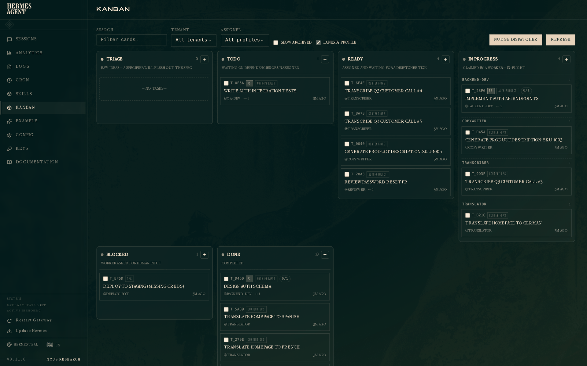
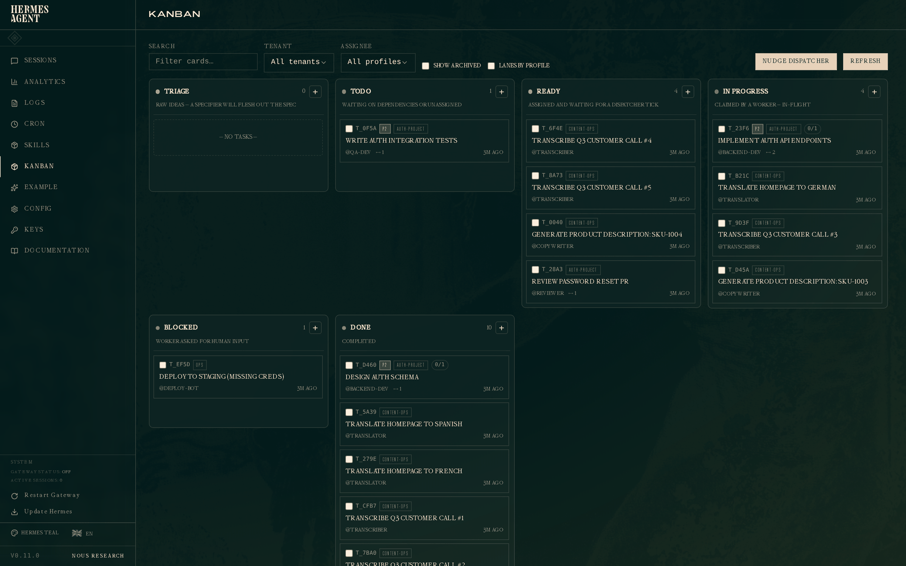
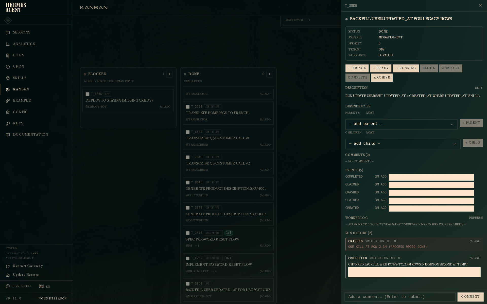
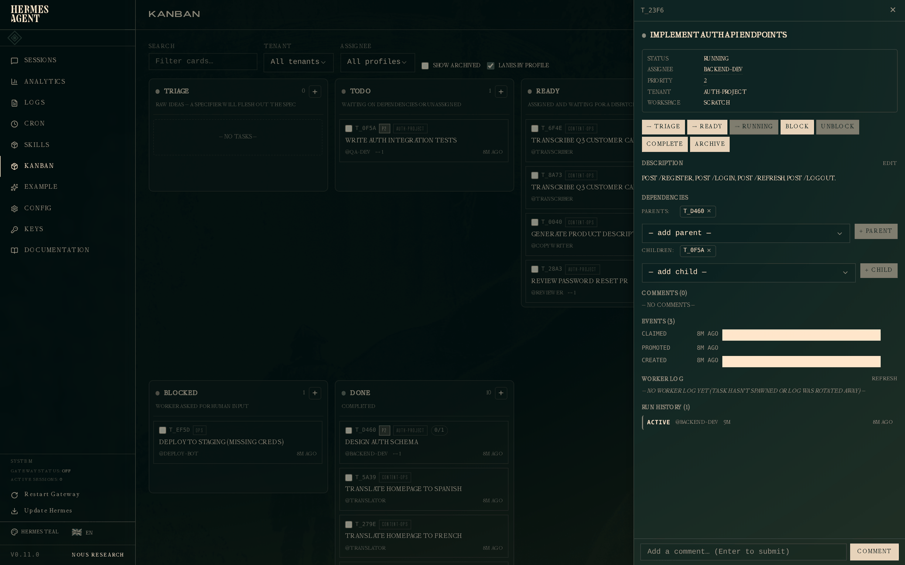
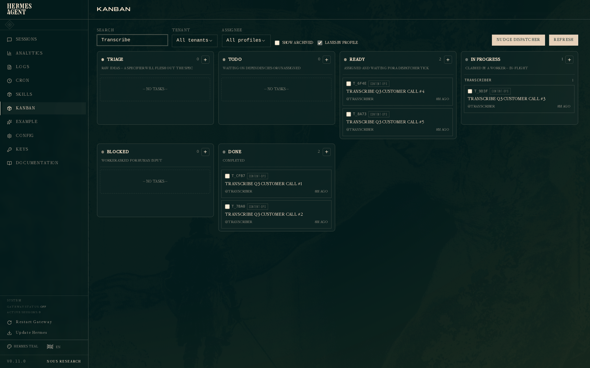
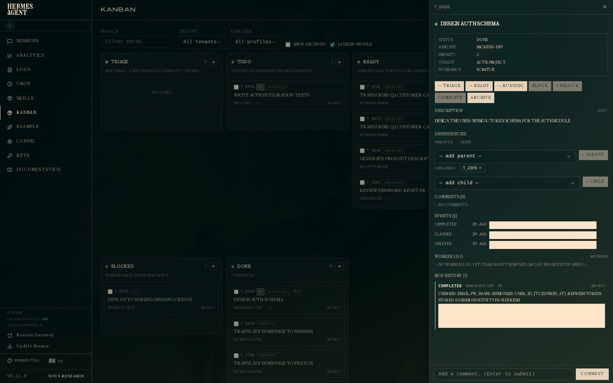
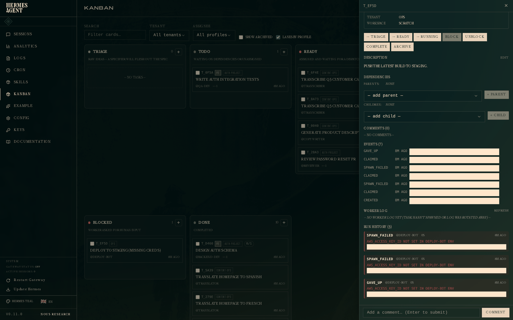

# Hermes Kanban (Hermes Agent, Nous Research)

## Header

- Product and URL / repository: Hermes Kanban, a feature of Hermes Agent —
  https://github.com/NousResearch/hermes-agent; docs at
  https://hermes-agent.nousresearch.com/docs/user-guide/features/kanban (plus
  `kanban-tutorial`, `kanban-worker-lanes`, `kanban-multi-gateway`); design
  history in RFC issue #16102 and PR #16100.
- License, price model, self-hosted: MIT, free, local-first by design. The board
  is a SQLite file (`~/.hermes/kanban.db`) on your own machine; model spend is
  whatever API keys the individual profiles carry. No cloud tier at all.
- Alive? Very. Clone studied at commit `f9f132915fea2adc7ccdde4ce37291c546bae49b`
  (2026-10-02, same-day commits); a steady 2026 stream of kanban-tagged issues
  (#48159, #126190, #127495 and dozens more); the RFC tracks four audit passes
  and a 182-test suite.
- Studied how: **studied from a clone at `f9f1329`** on 2026-10-02 — kanban docs
  and tutorial read in full, the desktop board UI source (`apps/desktop/src/
  plugins/kanban/`) read for exact card anatomy, the storage layer
  (`hermes_cli/kanban_db.py`, 4.5k lines) and dispatcher
  (`hermes_cli/kanban_db_dispatch.py`) read for the durability and rate-limit
  story, RFC #16102, the glukhov.org operator guide, and the third-party
  HermesKanban WebUI surveyed. No local run: the dashboard ships inside the
  gateway process of a 334-package agent stack whose pins target Python 3.14
  (host has 3.12) — not cheap keyless. Screenshots below are the project's own
  tutorial dashboard captures, named by what they show, with source URLs.
- One sentence: a durable SQLite task board where every Hermes profile (agent)
  is an OS-process worker that pulls cards through the same `kanban_*` tools a
  human uses from the CLI — the board is not a view of the work, it *is* the
  coordination substrate.

## 1. The board model

**Columns are fixed, system-owned, and each is a contract.** The set —
`triage | todo | ready | running | blocked | review | done | archived` (plus
`scheduled` in the desktop UI) — is not user-configurable, because it is the
state machine of the dispatcher, not a naming convention. This is the purest
expression in the field of "column = promise":

| Column | What it promises the worker / dispatcher |
|---|---|
| `triage` | "A human has not accepted this yet." Human inbox; nothing automated touches it. |
| `todo` | "Accepted, but gated on parent cards." Promotion `todo → ready` is automatic when all parents are `done` (`dependency_wait` events meanwhile; `kanban_link` answers `gated: true`). |
| `ready` | "The dispatcher will claim this and spawn your assignee within a tick" (default 60 s). Unassigned ready cards park unless `kanban.default_assignee` is set. |
| `running` | "A worker holds an atomic claim." Only the worker's terminal call or a dispatcher reclaim moves it out. |
| `blocked` | "Something outside must change first." Carries `block_kind` and a reason string on the card face; sticky blocks (quota walls, breaker trips) never auto-resume. |
| `review` | "Work is done, awaiting a second pass." If `review_dispatch` is on (default), the dispatcher spawns a reviewer profile force-loaded with the `sdlc-review` skill. |
| `done` / `archived` | Terminal; `archived` is what `gc` may clean (scratch workspaces). |
| `scheduled` | "Not before a wake-up time." A bare status drag into it is refused with a 409; only an agent/CLI call attaches the time. |

The RFC states the rule that makes this safe under concurrency: *only one role
may transition each status* — worker, dispatcher, or human, never ambiguous.
That is the column contract as a permissions model, not just a layout.

**Card anatomy** (from the desktop board source, `board.tsx` / `ui.tsx` /
`types.ts`): a 2 px left border in the column's tone; title clamped to 2
lines; summary — the agent's own `latest_summary` from its last terminal call,
falling back to the card body — clamped to 2 lines; then one dense footer row:
assignee avatar (profile-colored initials) + name chip, a live `working · 34s`
RunClock that re-ticks every 5 s, an amber no-heartbeat marker, the
`block_kind` chip, an amber "won't run" marker, the priority glyph (amber
up-arrow + number when raised, muted bare number at 0), a progress `N/M`,
comment/link/warning counts, created-ago, and the 6-char short id. A
machine-activity arc animates the border **only** when there is machine work to
narrate: green sweep while running, amber crawl when stale (no heartbeat >
120 s); queued states render as the named-agent chip instead — motion means
work, stillness means waiting.

Behind one click, the drawer holds everything else: tabs for Comments
(default) / Activity / Runs / Worker Log, a Diagnostics section, the Result,
latest summary, meta rows (block reason and kind, recurrences, consecutive
failures, `last_failure_error`, workspace, model, worker PID), attachments
(up to 25 MB each), and estimate. What never appears on the board at all: the
conversation itself (the worker's full log is tail-able in the drawer, not on
the face), claim locks and process fingerprints, and memory-pressure telemetry
(daemon log territory).

**Where the human's decisions live**: the `triage` column is the inbox, and
`blocked` cards with reasons are the escalation surface. There is no
approve/deny affordance anywhere — v1 deliberately excludes approval gates
(RFC: "approval gates … all user-space"). Deciding means opening the drawer
(1 click) and acting by comment, unblock, or reassign (1–2 more); the `/kanban`
slash command can do the same from any conversation, deliberately allowed to
mutate the board mid-agent-run because board writes never touch agent state.

**Filters and swimlanes**: multiple boards with a board switcher (tenant
namespaces — one specialist fleet serving many business contexts); `Running`
grouped in per-profile lanes by default (toggleable to a flat list ordered by
claim time); free-text filter (the tutorial filters a whole board down to a
tenant's transcribe tasks). No cross-project view beyond boards/tenants — and
explicitly no multi-host federation: single-host is a stated v1 boundary.

*Source: official tutorial, https://hermes-agent.nousresearch.com/img/kanban-tutorial/01-board-overview.png*

*Source: https://hermes-agent.nousresearch.com/img/kanban-tutorial/02-board-flat.png*

## 2. Agent-task specifics

This is the section the product was built to answer, and the reason our scan
called it "the purest 'board as the agents' shared medium' design in the field."

**The worker is an OS process, not a subagent.** Each attempt is
`hermes -p <assignee> --cli chat -q "work kanban task t_…"`, spawned by the
dispatcher with `HERMES_KANBAN_TASK / WORKSPACE / RUN_ID / BRANCH / CLAIM_LOCK`
in the env, output appended to a per-task log (2 MiB rotate, one backup). The
RFC explicitly rejects in-process SDK swarms (the NanoClaw failure class): no
worker can take the board down with it. Restart-safety is carried to PID
fingerprints — a claim survives a reboot without ever signalling a recycled
PID; an unverifiable spawn is *refused* a kill rather than allowed one.

**The agent's front door is a toolset, not a UI.** Fifteen `kanban_*` tools are
injected into the worker's schema (`kanban_show, list, complete, block,
schedule, request_review, request_changes, heartbeat, comment, attach,
attach_url, attachments, create, unblock, link`), plus a `KANBAN_GUIDANCE`
protocol block in the system prompt. The guidance is the most explicit
worker-contract text I have seen shipped in a product:

1. Orient: `kanban_show()` first — it returns title, body, parent handoffs
   (summary + metadata), prior attempts if this is a retry, the comment thread,
   and a pre-built `worker_context` "you can treat as ground truth".
2. Work inside your workspace only.
3. Heartbeat at least hourly on long tasks — the dispatcher reclaims at
   `dispatch_stale_timeout_seconds` (default 4 h) with no heartbeat in the last
   hour; a reclaim re-queues *without* a failure tick, but the run's progress
   is lost.
4. Block on genuine ambiguity ("missing credentials, UX choice, paywalled
   source, peer output you need first") — don't guess; the human unblocks with
   context and the dispatcher respawns you.
5. Finish with the review model encoded by the graph; the structured handoff
   (`summary`, `metadata`) rides the terminal transition itself; never secrets
   in durable fields.
6. "If follow-up work appears, create it; don't do it" — child card with the
   right assignee.
7. Flag collision hotspots with a `hotspot: <path>` comment instead of piling
   on.

And the enforcement behind it: **a run without a terminal board call counts as
failed no matter what it did** (protocol violation; ~96 % complete on a later
run, so it gets a bounded 3-streak retry with the corrective sentence fed to
the retry worker via `build_worker_context`).

**What changes on the face as the agent works**: nothing but the truth — arc
starts sweeping, RunClock starts ticking, the assignee chip was already there.
Finish: the card's summary line becomes the agent's own `latest_summary`; it
moves to `review` or `done`. Fail: `consecutive_failures` increments,
`last_failure_error` lands in the drawer, and at 2 (default) the breaker parks
it in `blocked` with a `gave_up` event. Ask: `kanban_block(reason=...)` puts the
reason on the face as the `block_kind` chip — the reason-on-every-waiting-card
discipline our pattern list already ranked #4, executed end to end.

**The conversation lives off the board.** The face shows only the 2-line
summary the agent chose to write; the drawer's Worker Log tab tails the raw
process log; the Activity tab is the event stream (attributed per event), Runs
is the attempt history. One row per attempt in `task_runs`, each carrying a
structured `summary` + `metadata` handoff — the crash-recovery tutorial shot
below shows run 1 `crashed` (OOM) and run 2 `completed` with
`"strategy": "chunked with LIMIT + WHERE id > last_id"` in its metadata: the
retry *learned from the crash it could see*.

*Source: https://hermes-agent.nousresearch.com/img/kanban-tutorial/06-drawer-crash-recovery.png*

*Source: https://hermes-agent.nousresearch.com/img/kanban-tutorial/10-drawer-in-flight.png*

**Human steering mid-run**: indirect by design. A comment on the card reaches
the worker on its next run (retry context includes the thread); `/kanban
unblock` or reassignment can act while the agent is mid-conversation; the
dispatcher (not the human) kills a wedged worker via reclaim, guarded so a
surviving worker is never duplicated beside itself. There is no stop button and
no mid-run chat injection into a running worker — a deliberate boundary: the
board is the medium, not the remote control. Sebastian's "I am going in" VM
button is exactly the hole this leaves.

**Approvals, spend, budgets**: none on the board (v1 excludes approval gates).
Spend is managed one level down, as *rate and memory physics* rather than
money: a worker that hits a provider quota wall exits with sentinel code 75 and
is re-queued **without counting a failure** (a long quota window must never
trip the breaker), behind a 300 s cooldown so it doesn't bounce off the same
wall every tick; a terminal provider error (revoked credential, model gone)
exits 78 and sticky-blocks on first occurrence; systemic crashes (≥ 3
identical fingerprints in a tick) trip immediately. Concurrency is
memory-derived — 512 MB assumed per worker, default cap
`clamp(MemTotal/512MB, 2, 8)`, plus a live pressure guard (critical → spawn
nothing, elevated → at most one) — because "an uncapped board once OOM'd a
1 GiB host". This is the code-level answer to the glukhov.org era guide, whose
cron wrapper had to count running tasks by hand and warned "you can easily
ddos your own LLM this way": the current dispatcher daemon (the RFC's own
revision — "cron was burning LLM tokens per tick") owns caps, cooldowns, and a
respawn guard (blocker_auth, recent_success 1 h, active_pr 24 h,
rate_limit_cooldown, infrastructure_cooldown) with the hold reasons surfaced in
one `describe_suppression` line so a zero-spawn tick is never a mystery.

**Multi-agent at once**: `Running` renders one lane per profile; per-profile
caps (`max_in_progress_per_profile`) keep a fan-out from melting one profile's
quota while others idle; one spawn slot is reserved for review work each tick
so a ready backlog cannot starve reviews; dependency-gated children wait in
`todo` with `dependency_wait` events. Claims are atomic —
`UPDATE … WHERE status='ready' AND claim_lock IS NULL` inside `BEGIN
IMMEDIATE` on WAL SQLite, proven by an 8-claimer race test where exactly one
wins.

*Source: https://hermes-agent.nousresearch.com/img/kanban-tutorial/07-fleet-transcribes.png*

## 3. Interaction model

**Moving work**: drag-drop on the dashboard writes through the same
`kanban_db` layer agents use (optimistic UI, react-query reconciliation). The
system-owned columns — `review`, `running`, `scheduled` — are locked targets:
you can drag a card out, never in; a drop is refused before `preventDefault`,
so the OS itself shows the no-drop cursor. The button path is a Jira-style
colored StatusMenu; a done→ready drag is honored as a deliberate re-run (it
lifts the `recent_success` respawn guard because the re-queue event follows the
success). Human and machine mutations are indistinguishable at the storage
layer — one event schema, one CAS discipline.

**Keyboard and mobile**: the desktop app is Electron with palette/keybind
plumbing (a "new task in this lane" command can fire from any keybind and
navigates to the board); the dashboard is plain web and usable from a phone —
a Reddit user reports steering a seven-agent board from one. The third surface
is the CLI (`hermes kanban …`) and the `/kanban` slash command on every
gateway platform.

**Refresh**: live push. The dashboard holds a WebSocket that tails the
append-only `task_events` table, so every actor's writes land on all screens
without polling; the RunClock re-renders every 5 s client-side; the arc
animates continuously while running/stale.

**Click map** (from the board): read status 0 (the face and border say it);
read detail 1; decide 1–2 (drawer, then comment/unblock/reassign — no single
approve/deny exists); steer 1–2 via a comment, or off-board via `/kanban`;
comment 1 (drawer opens on the Comments tab by default).

## 4. Visual system

**Themes and color**: dark default (desktop SDK tokens; the dashboard is a
React SPA). Color is almost entirely system-set semantics — column tones
(`scheduled` #a78bfa violet, `ready` #60a5fa blue, `running` #34d399 green,
`blocked` #f87171 red, `review` #fbbf24 amber), echoed as the card's left
border and in the StatusMenu dots. There are no user-set labels or colors at
all; identity color exists only as the per-profile avatar hue. That is the
opposite pole from Trello/Wekan, and consistent with the whole design: color
encodes machine state, not human preference.

**Typography and density**: title (2 lines) + summary (2 lines) + one footer
row; dozens of cards per screen and a card stays readable as a thumbnail —
border tone, avatar, arc, and short id all survive shrinking.

**The status vocabulary, complete**: the eight columns plus `scheduled`; and
on the face, sub-states that never change column — running (green sweep),
stale (amber arc, no heartbeat > 120 s), queued (agent chip), blocked with
`block_kind` chip and reason, "won't run" amber (guard-held), breaker-tripped
(gave_up in Runs + blocked), rate-limited cooldown (reason in the suppression
line, not the face). Column = where it is; arc/chips = what's happening to it.
That separation is our accepted pattern #1, executed exactly.

*Source: https://hermes-agent.nousresearch.com/img/kanban-tutorial/03-drawer-schema-task.png*

*Source: https://hermes-agent.nousresearch.com/img/kanban-tutorial/11-drawer-gave-up.png*

## 5. What users say

Complaints:

1. **Reliability babysitting on weaker models.** The setups megathread: "I
   don't have a frontier model, just owl alpha, and so far I feel like I need
   to babysit it"
   ([r/hermesagent megathread](https://www.reddit.com/r/hermesagent/comments/1ugkihk/kanban_setups_megathread_hermes_agent_june_2026)),
   echoed by [Do you use Kanban in Hermes? If not, why not?](https://www.reddit.com/r/hermesagent/comments/1vfl4es/do_you_use_kanban_in_hermes_if_not_why_not/)
   and [Do you actually use Kanban/Profiles?](https://www.reddit.com/r/hermesagent/comments/1uf1c49/do_you_actually_use_kanbanprofiles/) —
   the protocol-violation and stuck-card machinery exists because of this class.
2. **Coarse rate-limit cooldown.** Issue #127495: the fixed 300 s cooldown
   held work back longer than users wanted
   ([hermes-agent#127495](https://github.com/NousResearch/hermes-agent/issues/127495)).
3. **Silent holds in `ready`.** #126190, cards ready but never dispatched
   ([#126190](https://github.com/NousResearch/hermes-agent/issues/126190));
   the zero-spawn-tick confusion (#111910) and the pre-guard quota-collapse
   crash loop (#41805) are the same story's earlier chapters.

Praise:

1. **Coordination at scale, from anywhere.** "I gave my Hermes team a shared
   Kanban board" — parallel agents coordinated, monitored from a phone
   ([1ubz5h6](https://www.reddit.com/r/hermesagent/comments/1ubz5h6/)).
2. **Atomic parallel claiming.** The 8-claimer race test is public and
   users cite never-double-taken cards as the reason they trust fan-out
   (RFC #16102 discussion).
3. **Clear boundary vs other delegation modes.** Kanban vs `delegate_task` vs
   bot mode comparisons ([1vy30ve](https://www.reddit.com/r/hermesagent/comments/1vy30ve/))
   and multi-project boards with tenants ([1ukwnzr](https://www.reddit.com/r/hermesagent/comments/1ukwnzr/)) —
   users quote the RFC's one-liner back: a function call vs a durable row
   others can read and edit.

Demand evidence for a board-shaped UX: a third-party WebUI exists
(PriuS2/HermesKanban, Apache-2.0, 37 stars — a thin Trello-like layer over
`hermes_cli.kanban_db` with dependency visualization and a "Global Operations"
panel), kanban requests in nesquena/hermes-webui, and the official issue asking
for a desktop board (#48159). When people build UIs on top of your SQLite
file, the substrate is right even if the first-party surface is young.

## 6. Verdict for us

**Steal**:

- **Columns as a machine contract with role-owned transitions.** Our columns
  must promise something to the scheduler, and exactly one role (worker,
  control plane, human) must own each transition. Hermes's table above is the
  template.
- **Terminal-call protocol.** A run that ends without a terminal board call is
  a failure regardless of what it did; the corrective sentence is fed to the
  retry worker. Enforces artifacts-not-chat at the kernel.
- **One row per attempt with structured `summary`+`metadata` handoff** — the
  retry sees the prior attempt's error and decisions; the drawer shows attempt
  history forever. Our task_runs equivalent.
- **Reason on every waiting card**, including *why the dispatcher is holding
  work back* (the `describe_suppression` one-liner). A silent zero-progress
  tick is a UX bug; Hermes names the guard.
- **Locked columns + human drags through the same CAS layer.** Humans cannot
  drag into machine-owned states; when they drag out, it's a real event in the
  same schema.
- **Exit-code + physics budgets**: 75 requeue-no-failure, 78 sticky-block,
  memory-derived concurrency with live pressure — our spend limits deserve the
  same "conditions, not constants" treatment.
- **Event-sourced card**: append-only attributed `task_events`, WebSocket
  tail. One schema, every surface.

**Skip**:

- **No approval surface at all.** Triage + blocked-with-reason is thinner than
  our control plane needs; approvals-as-cards (our pattern 8) must stay
  first-class for us.
- **No cost/spend on the card.** Fine for bring-your-own-key profiles; wrong
  for a factory with budgets.
- **Heartbeat as the only mid-run legibility.** No per-step progress, no
  steering into a live run, no "I am going in". Our live task page must be
  richer than a log tail.
- **Single-host SQLite and unauthenticated localhost dashboard.** Right for a
  personal fleet; we need Postgres-grade durability and authn at the gateway
  (the WAL + BEGIN IMMEDIATE + CAS discipline itself does transfer).

**Decision needed** (for the aggregate report):

- Fixed system columns vs user-made columns: Hermes is the strongest argument
  that a board agents *pull from* must be fixed vocabulary. Do we offer any
  user columns at all, or lanes/labels only?
- Where the conversation lives: Hermes keeps it off the board (agent-written
  summary on the face, raw log behind a click). Linear/Jira put discourse on
  the card. Our "one good interface" ruling should pick deliberately.
- Review as an auto-dispatched agent lane vs a human approval step — Hermes
  does both (same-card `request_review` and pre-created review children) and
  had to write prompt rules to stop users mixing them.

**Cloneability**: local-first by design — clone, `uv`/pip install (334-package
lock, Python 3.14 pins), `hermes kanban init`, board and dashboard on the
gateway. Moderate to run; *easy to study*: `hermes_cli/kanban_db.py` and
`kanban_db_dispatch.py` are readable, heavily docstringed, and carry a 182-test
suite plus stress tests (multi-process concurrency, ~40k-op property fuzzing,
10k-task scale benchmarks). The design, not the code, is the part to clone.

## Scoring axes

| Axis | Score | Reason |
|---|---|---|
| Card scannability (read ten cards in one glance) | 4 | 2+2-line cards, tone border, avatar, arc; footer dense but everything on it means something. |
| State clarity (what is happening, how far, what next) | 5 | Column = machine state; arc/RunClock/stale/block-kind give the in-between; full attempt history one click down. |
| Human-decision surface (find and make the next decision) | 3 | Triage and blocked cards are findable, but deciding is comment/unblock/reassign — no approve/deny affordance, decisions diffuse across surfaces. |
| Agent-activity legibility (is the agent working, waiting, stuck) | 4 | Arc + heartbeat + worker log + suppression reasons; minus one for no per-step progress or mid-run contact. |
| Noise level (5 means quiet: nothing without meaning) | 4 | Motion only when working; quiet face; the live event feed can churn, and guard reasons live off-face (daemon/tail), not on the card. |
