# Plane

- Product and URL / repository: [plane.so](https://plane.so), source at [github.com/makeplane/plane](https://github.com/makeplane/plane)
- License, price model, self-hosted tier: AGPL-3.0 community edition, self-hosted free; cloud has a free tier and paid plans; some features (notably AI) are cloud-only. Open-core.
- Alive? Very. Frequent releases (v1.x CE line, a recent full frontend migration release), active maintainers engaging in r/selfhosted threads. Studied at clone commit `c7a5afee6afd15f16038ebda1ec1489ebd8af67d`.
- Studied how: **studied live** — full local Docker deployment of the community edition (`deployments/cli/community`), app on port 9146, first-run onboarding walked over their API, seeded with 16 realistic work items (4 sub-items, 4 labels, 1 cycle). All board facts below measured in headless Chrome from the live DOM (computed styles, geometry, network state changes), cross-checked against the clone. Date: 2026-10-02.
- One sentence: an open-source Jira/Linear-style work tracker for product teams — issues, cycles, modules, pages — where the kanban board is one of five layouts over a database-style work-item model.

Screenshots: `shots/plane/` (27). Note on verification: every geometry, colour-token, and interaction claim below is verified from the live DOM or the live API; the PNGs were additionally checked locally by pixel statistics (theme, text bands, chip colours), because this environment's remote image viewer served stale objects.

## 1. The board model

**Columns are groupings, not containers.** The board groups whatever the work-item query returns by a chosen dimension. Group-by options: **States (default), Priority, Cycle, Module, Labels, Assignees, Created by**. States themselves are user-made per project: a fresh project ships five grouped states — Backlog, Todo, In Progress, Done, Cancelled — and any number of custom states can be added, each with its own name, colour, and group. So "columns" default to the five state groups but can become a priority board, a per-person board, or a per-cycle board in two clicks.

Surprise for a "board tool": **the default layout for a project's work items is the list, not the board.** Five layouts live behind five icon buttons top-right — list, board (kanban), spreadsheet, gantt, calendar — and a fresh project opens in list (47px bordered rows). The choice is remembered per user, per project (server-side `user-properties`), so board-first is one click and then sticky.

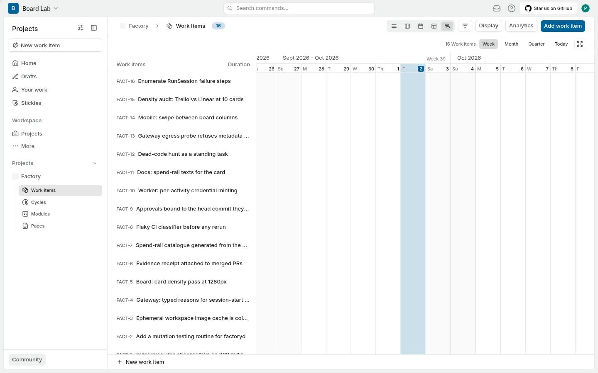

**Card anatomy** (kanban, measured from the DOM; annotated closeup below):

- Row 1 — work item id (`FACT-4`, `text-caption-sm-regular`, tertiary grey) and, on hover only, an ellipsis quick-action menu that slides in at the top-right of the card.
- Row 2 — title, `line-clamp-1 text-body-sm-medium` (13px, primary text). One line, always; long titles clip.
- Row 3 — chips, left to right: **state pill** (custom SVG ring icon rendered in the state's own colour, e.g. amber `#F59E0B` for a custom "In Progress"-group state, plus state name), **priority chip** (icon-only; urgent = filled red `oklch(0.5798 0.1766 26.99)`), then **icon-only chips** for label, start/due dates, links, cycle — a chip is hidden entirely when empty — then sub-work-item count (`2/3` style) and the assignee avatar.
- Card container: `rounded-lg border border-subtle bg-layer-2 p-3 shadow-raised-100` — 8px radius, 12px padding, one-step shadow that deepens on hover (`hover:border-strong hover:shadow-raised-200`). 350px wide (fixed columns), 100px tall with a one-line title, 128px when a sub-issue or cycle row is present.

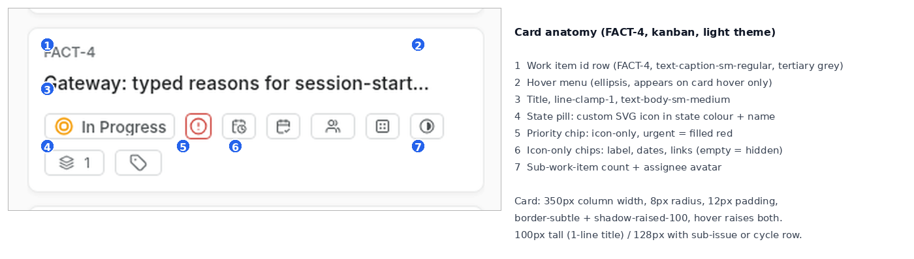

What hides behind a click: everything narrative. The card is a bookmark — description, comments, attachments, links, relations all live on the work-item detail page (`/:workspace/browse/FACT-4/`). Notably, cards on the board open that page in a **new tab** (`target="_blank"`), so reading detail never destroys your board scroll. What never appears on the board at all: comment counts on the card face (comment icon only in list/spreadsheet), description previews, and any WIP-limit or column policy — Plane columns are pure grouping with no constraints.

**Where do the human's decisions live?** There is no inbox and no approval concept. Decisions are triage: state, priority, assignee, cycle membership. Three surfaces, in decreasing speed: drag on the board (0 clicks), the card's hover ellipsis menu (1 click, opens a state/priority/assignee quick-menu), and the command palette (Ctrl+K → find item → contextual action). A notifications/activity page exists per workspace, but it is a feed, not a queue — nothing asks you to decide. For an approve/deny workflow you would repurpose states; nothing in the UI is built for it.

**Filters, swimlanes, cross-project.** The filters popover offers 13 fields: State, State Group, Assignees, Priority, Mentions, Label, Cycle, Module, Start date, Target date, Created at, Updated at, Created by. Filters compose with the display settings into saved per-user views. Swimlanes exist as **Sub-group by** — any of the seven group-by dimensions can become the horizontal lane inside the column grouping (e.g. columns = states, lanes = priority), off (None) by default.

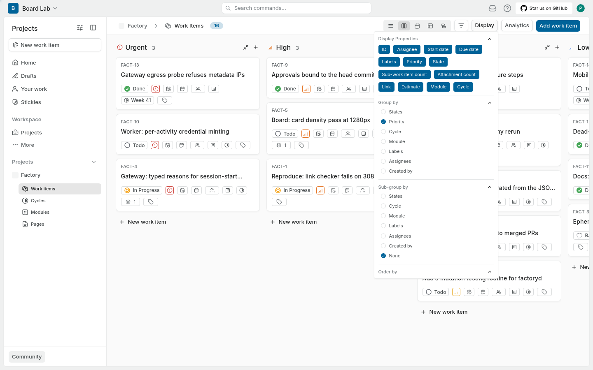 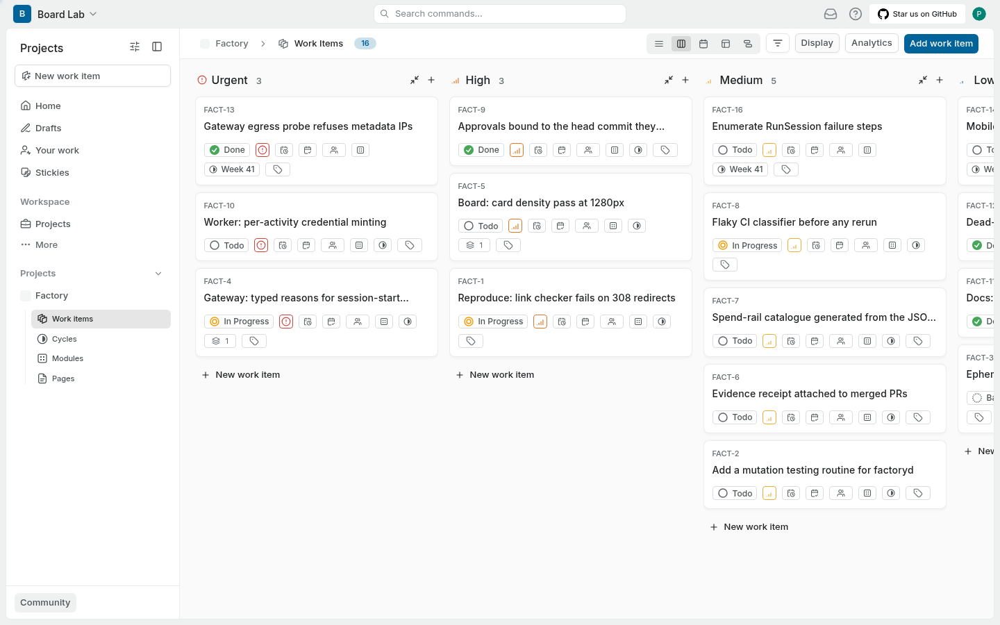

Cross-project views are first-class pages, not a hack: `All issues` across the workspace and `Active cycles` (one screen per team's current sprint) under workspace views.

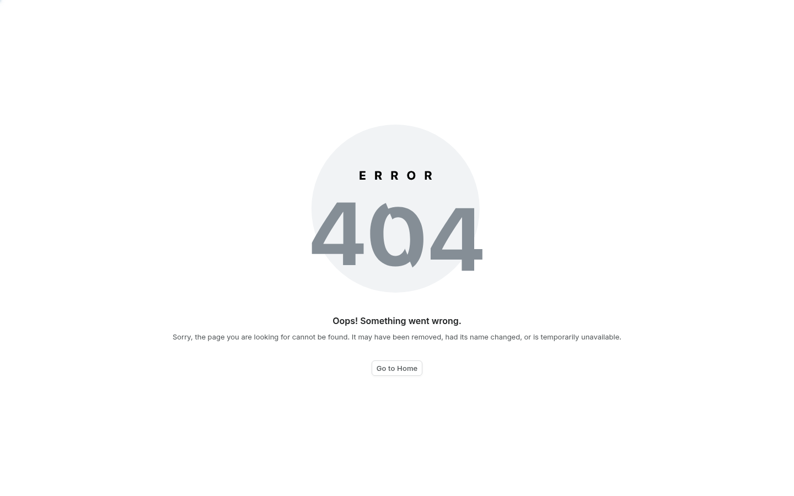 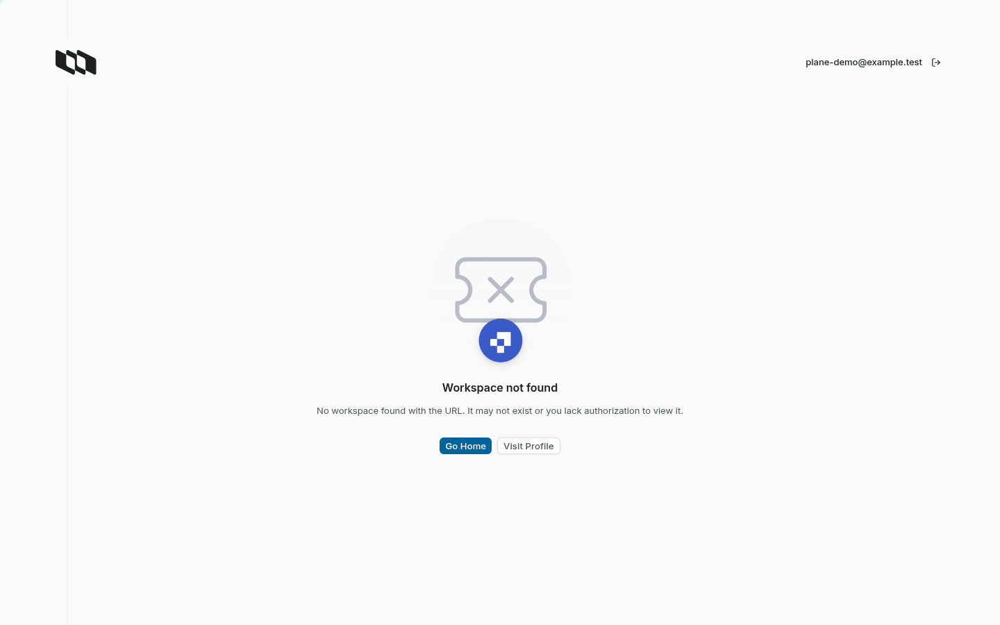

The **Display popover** is the board's control room: 13 toggleable display properties (ID, Assignee, Start/Due date, Labels, Priority, State, Sub-work-item count, Attachment count, Link, Estimate, Module, Cycle) — **all 13 ON by default** — plus group-by, sub-group-by, order-by, show-sub-work-items, show-empty-groups. Order-by default is "Last created" (`-created_at`) even on the kanban; "Manual" is available.

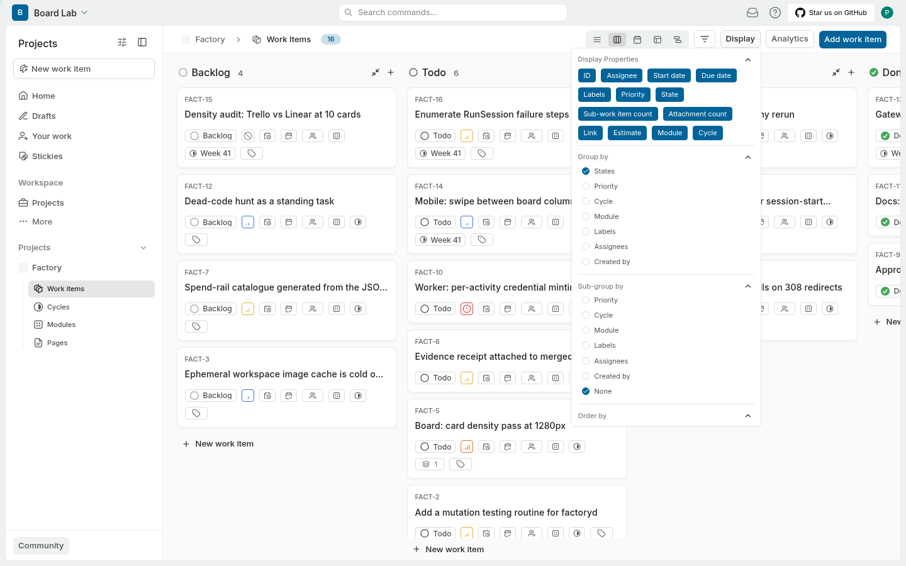 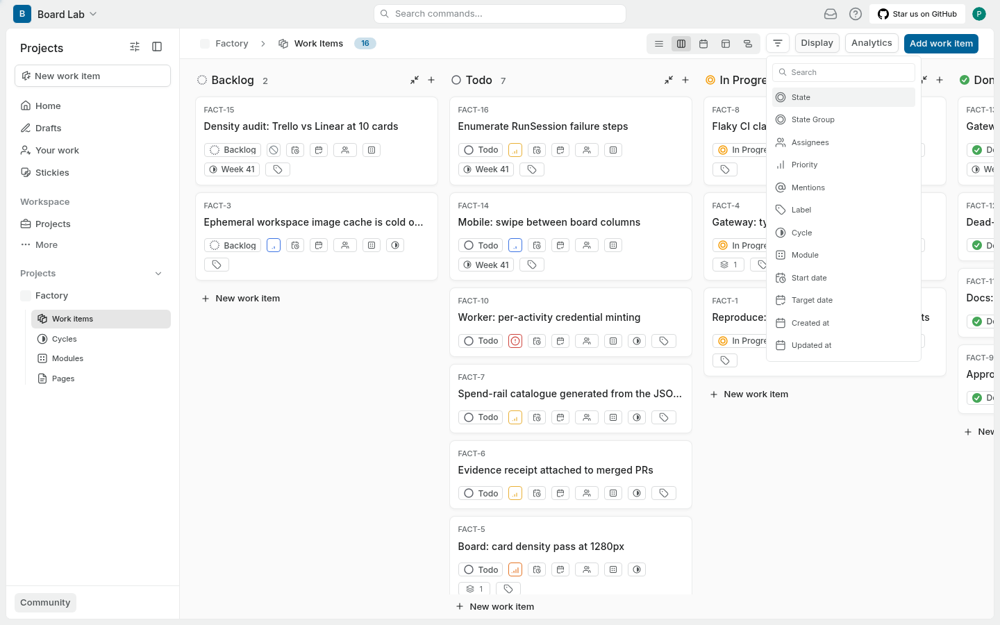

## 2. Agent-task specifics

Not applicable — Plane is a pure human work tracker with no agent/runtime concept (cloud AI features aside); this section's budget goes to the visual system below.

## 3. Interaction model

**Moving work.** HTML5 drag-and-drop, plus buttons/menus everywhere as equals. A drop is a real mutation: I dragged a card and verified the server-side `state_id` changed immediately (no save button, no optimistic-only fakery). While dragging, a **"Drop here to delete the work item"** zone appears — deletion is a drag target, which is the most literal possible reading of "move out of the board."

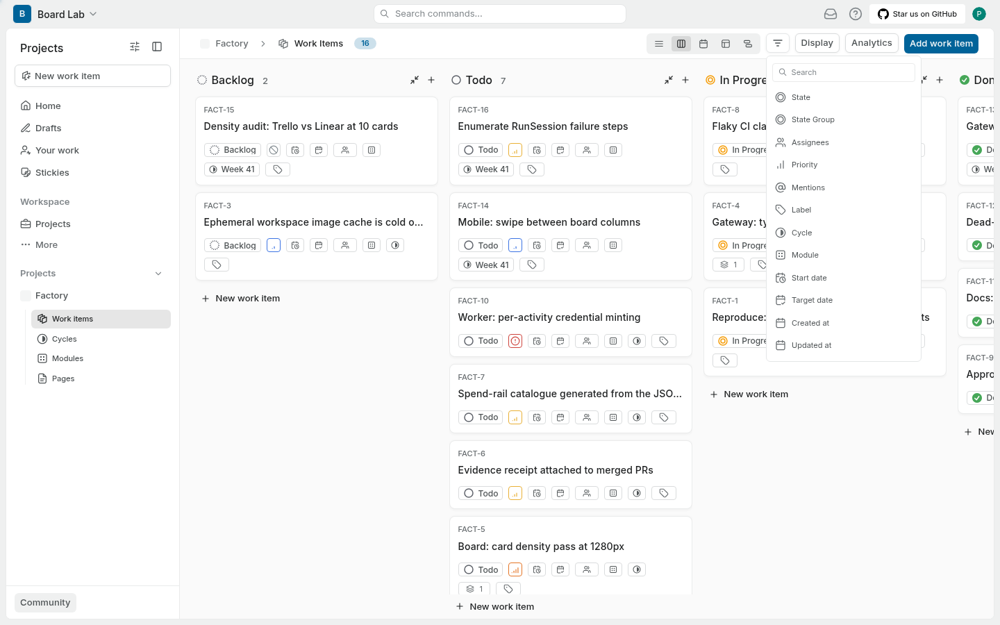

**Keyboard.** The command palette ("power-K", Ctrl/Cmd+K) is the keyboard surface: fuzzy search that finds work items by title instantly, creation actions for every entity type, navigation, and — the craft detail — **per-item contextual actions** (change state, priority, assignees, estimate, add to cycle/modules/labels, subscribe, delete, copy id/title/url) once an item is selected, plus bulk delete. There is no dedicated j/k board-column walking; the palette carries the keyboard load instead.

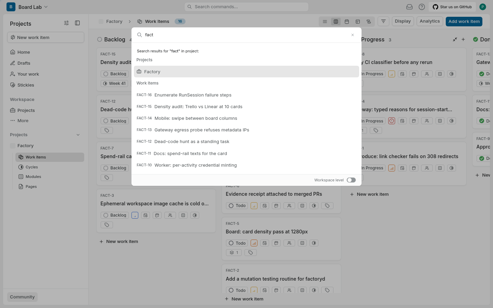

**Mobile web.** At 390x844 the board renders as a usable touch board: columns swipe horizontally, the page itself doesn't overflow, and the work-item detail page is fully functional. Not a native app, but not a broken desktop page either.

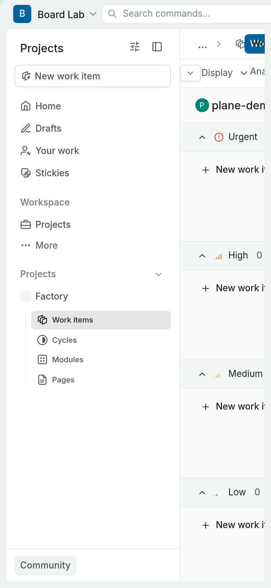 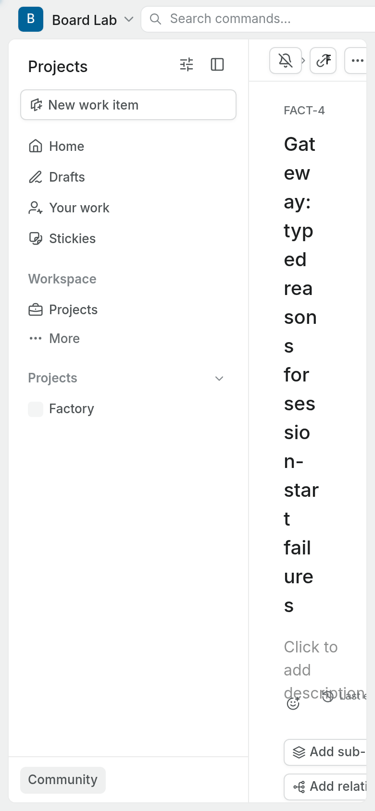

**Refresh model.** **No live push on boards.** I changed an item's state via the API with the board open in the browser: nothing updated in 24 seconds — no polling, no optimistic sync; the board refetches on navigation/refocus. A `plane-live` service runs in the stack but is not wired to the issue board. Users report the same symptom ("work item updates don't show immediately"), so it bites in practice, not just in my lab.

**Click map** (from the board):

- Read status (what state): 0 clicks — the state pill is on the card face.
- Read detail: 1 click (opens new tab; board state preserved).
- Decide (change state/priority/assignee): 0 clicks (drag) or 1 (hover menu).
- Steer (re-plan, re-scope): 1-2 clicks (open detail, edit).
- Comment: 2-3 clicks (open detail, focus comment box).

## 4. Visual system

**Five themes, not two.** Light, Dark, **Light high contrast, Dark high contrast**, and **Custom** (pick primary + background, dark palette) — plus "System preference". Default is system; the choice is persisted **server-side per user** (`updateUserTheme`) and applied with a full page reload; it is also reachable from the command palette. Themes come from `next-themes` with a `themes=["light","dark","light-contrast","dark-contrast","custom"]` allowlist.

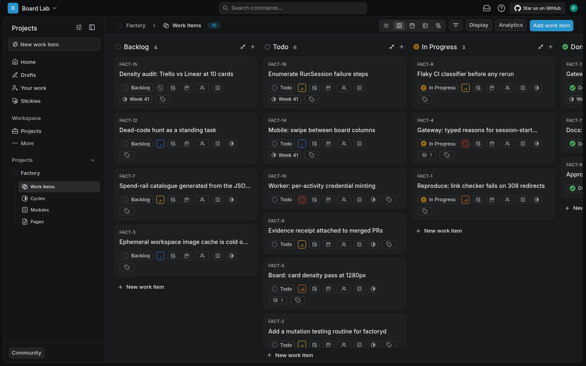 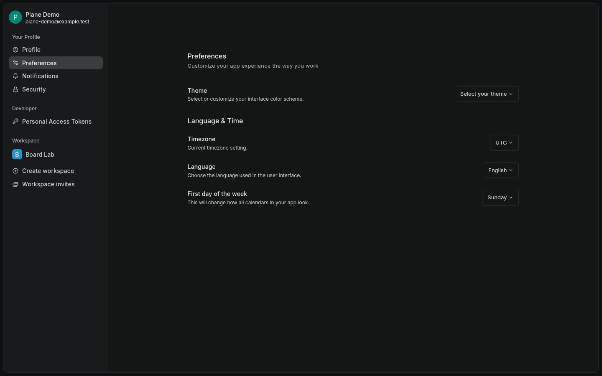

**How they tokenise colour — the most instructive part of Plane.** Cards and chrome never reference a palette directly; they use a semantic token ladder that remaps per theme, and the underlying values are **oklch colours engineered on a single hue axis (~230.7, a blue-grey)**:

| Token | Light | Dark |
|---|---|---|
| canvas/background | `oklch(0.9543 0.001 230.67)` | `oklch(0.1689 0.0021 230.81)` |
| card surface `bg-layer-2` | `oklch(1 0 0)` | `oklch(0.2378 0.0029 230.83)` |
| `border-subtle` | (light step) | `oklch(0.2593 0.0033 230.84)` |
| `text-primary` | `oklch(0.2378 0.0029 230.83)` | `oklch(0.9235 0.0017 230.685)` |

Neutral surfaces carry chroma of only 0.001-0.003 — effectively grey, but every grey sits on the same hue line, so light and dark modes feel like one material photographed at two exposures rather than two palettes. Component-level colour gets its own semantic tokens: `text-priority-urgent` / `border-priority-urgent` = `oklch(0.5798 0.1766 26.99)`, the active state in popovers = `oklch(0.4799 0.1158 242.91)`. Elevation is tokenised too (`shadow-raised-100` → `shadow-raised-200` on hover) rather than ad-hoc.

**System-set vs user-set colour.** This is the clean split: **state colour is system-managed semantics** — each state (a first-class project entity) carries its own colour and a custom ring SVG icon rendered in that colour; the state *group* (backlog/todo/in-progress/done/cancelled) gives the vocabulary while the colour distinguishes within it. **Priority is a fixed semantic scale** (urgent reads as filled red, icons otherwise monochrome). **Labels are the user-set colour channel** — free-form, coloured, and rendered on cards as icon-only chips (colour without text, so user colours never fight the state pill for attention). Assignee avatars add identity colour at the card's right edge. State and label coexist on the card by design: state = where in the workflow, label = what kind of thing.

**Typography and density.** A tight three-step text scale on cards: `text-caption-sm-regular` (id), `text-body-sm-medium` (title, 13px), `text-13` body. Kanban columns are fixed 350px, which at 1440x900 shows only ~3.2 columns (container 1857px, horizontal scroll) with roughly 6 cards per column visible; list rows are 47px and fit ~14 rows. A card **is** readable as a thumbnail: id + one-line title + state pill survive at glance distance; everything else is recognisable-by-shape chips, which is exactly why all-chips-on doesn't collapse the layout — but see noise, below.

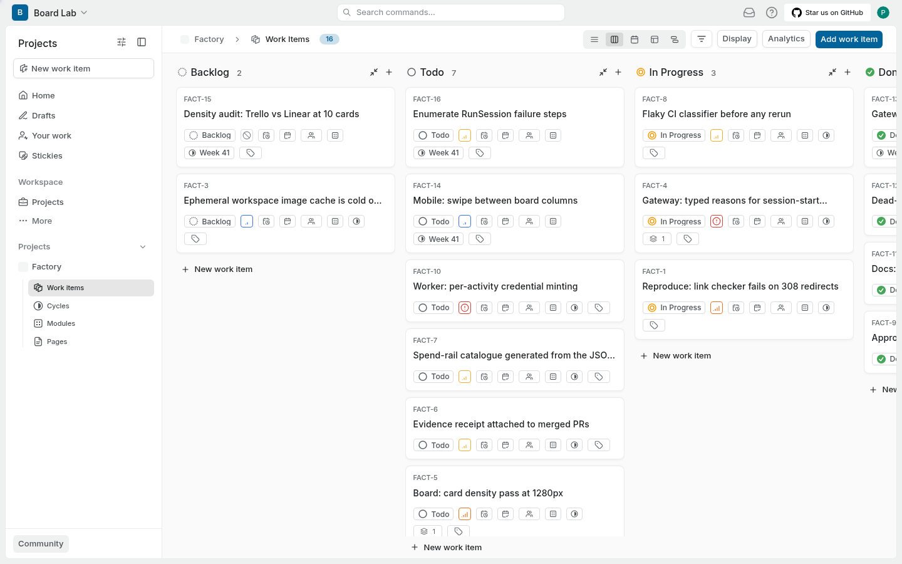 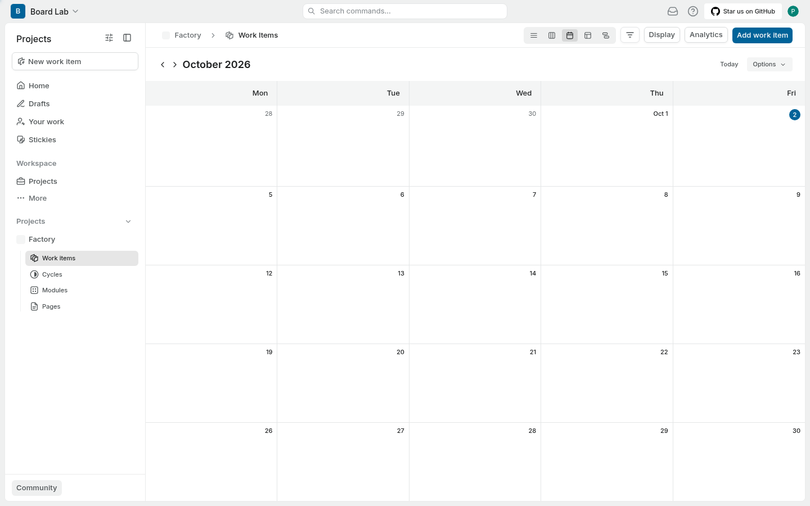 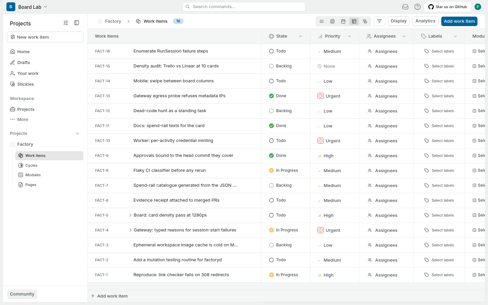

**The status vocabulary** — every state a card can be in, and how each is distinguished:

| State (group) | Colour signal | Icon | Position | Text |
|---|---|---|---|---|
| Backlog | per-state colour (default grey) | custom ring SVG | column 1 when grouped by state | state name on pill |
| Todo | per-state colour | ring SVG | column 2 | pill |
| In Progress | per-state colour (my seed: amber `#F59E0B`) | ring SVG | column 3 | pill |
| Done | per-state colour (green family default) | ring SVG | column 4 | pill |
| Cancelled | per-state colour | ring SVG | column 5 | pill |

Because states are user-made, the real invariant is the *group*, not the five names: colour + icon live on the state entity, position comes from the group-by, and the pill always carries text. Beyond workflow state, a card can signal: priority (icon-only chip, urgent filled), cycle membership (icon chip), sub-work-item progress (count), due date (chip). There is no per-card progress bar, no elapsed-time notion, no "who is working right now" — state is the only axis of "how far."

## 5. What users say

**Three most common complaints:**

1. **Cloud performance.** "It's just so damn slow. It's terrible." — [Hacker News on Plane as a Jira alternative](https://news.ycombinator.com/item?id=36129594). The founders counter with page-speed numbers ("~350ms... trying hard to make it < 100ms") and a "Hyper Mode" release, so this splits by deployment and era, but slowness is the recurring pejorative.
2. **Self-host pain on anything but a standard Linux x86 box.** The installer can't accept a non-default port during installation ([#8123](https://github.com/makeplane/plane/issues/8123), 10 reactions, still open); `setup.sh` breaks deploying latest stable ([#3557](https://github.com/makeplane/plane/issues/3557)); the bundled MinIO dies with a glibc "CPU does not support x86-64-v2" error on older hardware ([#3527](https://github.com/makeplane/plane/issues/3527), [#5816](https://github.com/makeplane/plane/issues/5816)); Windows self-host fails outright ([#8086](https://github.com/makeplane/plane/issues/8086)).
3. **Stale UI — no real-time updates.** "Changes to Issue State require a Page Refresh to Update" ([#3609](https://github.com/makeplane/plane/issues/3609)); real-time updates remain an open, reaction-topped feature request ([#7944](https://github.com/makeplane/plane/issues/7944), 8 reactions), with wiring the live server to boards/lists only now in flight as a PR ([#9779](https://github.com/makeplane/plane/issues/9779), [#9780](https://github.com/makeplane/plane/pull/9780)). My live measurement confirms the mechanism: a state change made via the API does not appear on an open board within 24 seconds — no push, no polling.

**Three most praised:**

1. **Clean, intuitive UI** — the consistent praise axis on [G2 reviews](https://www.g2.com/products/plane-so/reviews) and [Product Hunt](https://www.producthunt.com/products/planehq/reviews): "clean, intuitive," "clean, flexible" — the Linear-style craft is what people cite.
2. **Self-hosting as the value prop** — "The value prop is that you can self-host it at all, which JIRA now discontinued unless you pay ~$50k per year" ([HN thread](https://news.ycombinator.com/item?id=36129594)), echoed by HIPAA-constrained orgs in the same thread.
3. **Promising out-of-the-box local experience** — "I think it's really promising!" after playing with it locally, and "Please build a startup on this... I'll pay you to do it for me" for managed self-hosting ([HN thread](https://news.ycombinator.com/item?id=36129594)) — the same day-one local install this study reproduced.

Worth noting for the aggregate report: the sharpest criticism in the HN thread is that Plane is "a total rip-off of Linear.app. Even the website is a copy-paste" — the field's craft baseline *is* Linear, and Plane is the open-source carrier of that baseline.

## 6. Verdict for us

**Steal:**

- **The oklch single-hue token ladder** (`bg-layer-2`, `border-subtle`→`strong`, `text-primary/secondary/tertiary`, `shadow-raised-100/200`, chroma ~0.002 on hue ~230): one material, two exposures. Our board tokens should be this exact scheme.
- **Swimlanes as "sub-group by any dimension"** — not a special mode; any grouping axis can become the lane. One popover, seven board shapes.
- **Per-user, server-persisted display settings** (layout, group-by, order, property toggles per project): the board is a view over data, and each human keeps their own.
- **Per-item contextual actions in the command palette** — state/priority/assign/estimate/copy-url from Ctrl+K without opening the item.
- **Icon-only chips that vanish when empty** — secondary metadata costs zero pixels when absent, colour without text.
- **Drag-to-delete zone** — deletion as a drop target on the board.
- **State as a first-class user-made entity** (name + colour + icon + group), so workflow vocabulary is data, not code.

**Skip:**

- **All 13 display properties ON by default** — a noisy first-run board; defaults should show id, title, state, assignee and let the rest be opt-in.
- **Fixed 350px columns** — 3.2 columns at 1440 with mandatory horizontal scroll; our board must fit 4-5 columns or degrade gracefully.
- **Cards open in a new tab** — preserves the board but breaks flow and spawns tab sprawl; we want detail as an overlay/side-panel from the board.
- **List as the default layout for a "board" product** — for us the board is the product.
- **Order-by "last created" default on the kanban** — cards reshuffle under you; manual/stable order should be default.
- **No live refresh on boards** — a service (`plane-live`) exists and isn't wired to the one surface that needs it; for an agent-orchestrating board this is disqualifying, we need push.

**Decision needed:**

- **Column width policy**: fixed-card-width-with-scroll (Plane) vs fluid-fill (Trello-classic). Mutually exclusive across the field.
- **Who owns state colour**: per-state user-configurable colour (Plane) vs a fixed semantic scale per state-group. Affects whether agents can introduce new states meaningfully.
- **Where live updates happen**: websocket-per-board vs refetch-on-focus — the aggregate report should pick, because it changes the backend contract.

**Cloneability:** excellent, and the closest to our stack of anything in this round. `setup.sh` from `deployments/cli/community` pulls ~10 containers (web/space/admin/live frontends, api/worker/beat, postgres 15, valkey, rabbitmq, minio, Caddy path-routing everything through **one port**) — one command, one port, no external dependencies, runs on a dev box. First-run needs a CSRF handshake and an instance-admin signup (UI or API). The community's installer complaints are about the managed script's opacity, not the stack's footprint. AGPL-3.0 — fine to study and self-host, not to embed.

## Scoring axes

| Axis | Score | Reason |
|---|---|---|
| Card scannability (read ten cards in one glance) | 4 | Id + one-line title + coloured state pill always legible; icon-only chips keep shape recognition high, but all-properties-on defaults add recognisable-but-unreadable dots. |
| State clarity (what is happening, how far, what next) | 4 | Colour + custom icon + column position + pill text is quadruple redundancy, but state is the only progress notion — nothing shows how far inside a state, or what's next. |
| Human-decision surface (find and make the next decision) | 3 | Triage is one drag or hover away, but there is no inbox/queue: decisions live wherever the work sits, and an approval flow must be improvised out of states. |
| Agent-activity legibility (is the agent working, waiting, stuck) | 1 | No runtime concept at all; the board cannot express working/waiting/stuck beyond a pill some human sets. |
| Noise level (5 means quiet: nothing without meaning) | 3 | Chrome is disciplined and empty chips vanish, but 13-on defaults, new-tab opens, and order-by-created churn keep the board talking when it could be silent. |
