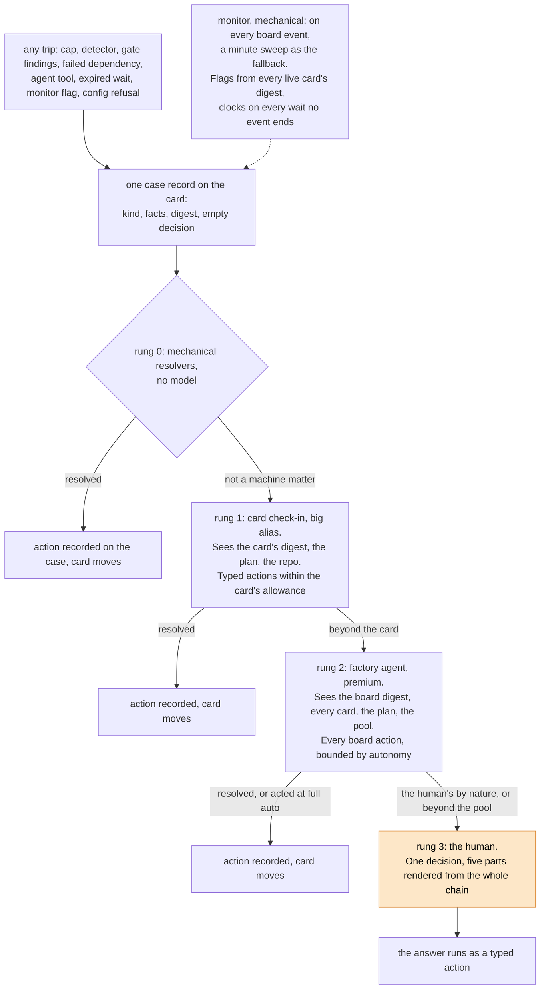

# The card flow redesigned: one case record, a ladder of knowledge, and a factory that unblocks its own board

Design, 2026-11-02. This document is for one decision: how the factory should handle a card that stops going smoothly, so that the board unblocks itself, every problem is judged by AI with the full picture before a human sees it, and a human who does see it gets one decision with everything needed to make it. Section 2 describes today. Sections 4 to 6 describe the target. Section 8 holds the decisions only Sebastian can make. Nothing here is built until he says go.

The facts come from the card-flow map of 2026-11-02 ([card-flow-2026-11-02/README.md](../card-flow-2026-11-02/README.md), 39 stuck points), the incident register of the live run of 2026-10-30 to 2026-11-02 ([card-flow-2026-11-02/incidents.md](../card-flow-2026-11-02/incidents.md), 20 incidents), the needs-you analysis ([needs-you-analysis-2026-11-01.md](../needs-you-analysis-2026-11-01.md)) and the fault register ([needed-fixes.md](needed-fixes.md)). The ladder redesign of 2026-10-15 ([escalation-ladder-redesign-2026-10-15.md](escalation-ladder-redesign-2026-10-15.md)) and the main agent concept of 2026-10-17 ([main-agent-concept-2026-10-17.md](main-agent-concept-2026-10-17.md)) are the two designs this one builds on and in part replaces. Where it reverses a recorded decision, it says so.

## 1. Intent

The factory splits work into cards a cheap model can finish, lets stronger models translate intent into plans, and runs each card through sessions, gates and a merge. When a card stops going smoothly, a ladder of steps takes over. Today that ladder has two faults the live run showed on every night: the step that stops a card is usually a deterministic guard that asks a human before any AI looked, and each step up the ladder throws away what the step below knew. The human then reads "the card has spent €x of its €y share, may it go on?" about a card whose real state is "the review refused twice for the same four concerns, and a main sync broke the compile".

The target: one record per problem that every step appends to and nothing strips, a ladder ordered by how much each step can see and do, a mechanical sweep that gives every wait the AI owns a clock, a tool that shows a card's whole life in a few lines, and a human face that carries the whole chain as one decision with premade options. The guiding thought at every rung is the same: get the needed work done and unblock the board. Ending a failing card is a last option, because it moves the problem onto the cards behind it.

## 2. Where we are today

### 2.1 What exists and works

The spec-driven process is built and live ([spec-driven.md](spec-driven.md)): sizing, the plan track with criteria and hold-outs, rounds of at most 12 cards, the integration card, the criteria gate. The session loop runs a cheap model in a sandbox with detectors in code, a check-in agent on the big alias at three moments, and a stronger model after three returns of one stage. The verification plane runs policy, reproduction, checks, review, audit and the merge queue. The approval card with its brief is the one ask shape that works: the pull request, the risk class, the review summary, a recommendation and one button. Every prompt, tool call and finding of every session is recorded outside the sandbox, so every incident of the live run could be reconstructed from the database.

### 2.2 What breaks, in six groups

The 39 stuck points and the 20 incidents fall into six groups. Each group names its evidence.

**The deterministic stop preempts judgment.** Of about 170 questions ever asked by 2026-10-17, 85 percent were deterministic kinds: 87 session caps, 33 quiet-on-dependency, 13 call caps, 8 month caps. Each skips the ladder's first five rungs and asks a human at once. The spend guard fabricates a stop before the check-in conversation runs (S21, runner.go:1102). The session cap and the time cap ask after `verifyAtCap` with no judgment of why the card needed more. On #1410 the review refused the merge at 03:59:17Z with four named concerns and at 03:59:20Z the card asked for money. On #1462 a main sync broke the compile and the stop asked about money. On #1347 the check-in answered "human" one stage before the approval card would have opened, and the card sat 19 hours on "how should it go on?". The "needs one more go" cards are this group: the cap is reached, nobody asked why, the human grants a session blind.

**Context is stripped on the way up.** The stop reason travels as one string (workflow.go:2081, half fixed by b58d8e86). The check-in gets the session's tail and seven tools and no view of the plan or the board. The project agent's wake carries one line, "the watched card moved". The human face shows the ask line alone, the why and the recommendation sit in the drawer. A money ask replaces the problem ask wholesale (question.go:471). On #1345 the planner's refusal text sat in the findings one query away and the ask said "how should it go on?". On #1380 a review refused for money left no trace on the approval card, and the plan's gap ask said "criteria not met" when the truth was "never judged".

**Escalation agents hold a diagnosis and no tool.** The check-in's decision set is continue, message, handover, human and replan. It cannot extend a card, re-verify a head, route to the approval card, retry, close into a successor or drop a finding on its own. The project agent has no Extend and no Overrule (S19). "Overrule the review" has no handler at all (S18). Retry refuses any failed card outside a plan (S6). On #1347 the check-in could freeze the card or stay silent. On #1345 the chat could not fund ("project sets no pool"). After #1381's resume the gate had no head adoption and threw a green fix away.

**Loops and grants that buy nothing.** #1345 ran 15 planner sessions and nine revisions under a cap of three plus nine grants, 4.60 of 5.60 EUR, because an identical re-file counted as an amendment of itself. Four session openings in the 0.03 to 0.44 EUR window died on 402, one per grant. The repeat guard lives in the run's memory and a restart forgets it (S20). Two check-in conversations of 24 calls each were cut by the 10:54 roll and their finished sessions restarted as attempt 1 with the results unread.

**No wait has a clock, and waits hold resources.** Every wait for a person has no timer, no reminder and no second addressee (S1, S2, S4, S5). An approval wait holds a work slot and the merge queue's head, so every card behind it waits (S1, S15). A dependent in `waiting-deps` behind a failed dependency holds a slot forever (S9). A queued card that admission refuses shows "queued" and no reason (S14). A failed dependency outside a plan stalls its dependents until a human closes it, and nothing asks the human to (S6, S16 of the incidents: five cards waited silent behind #1451).

**The safety net and the configuration deadlock.** One goroutine runs every minute sweep in series, so a hung call stops all of them with no alarm (S26). A deploy that breaks replay blocks a run forever (S27). A rename in the policy tree before its roll made the tree unloadable while the roll waited on plans whose cards waited for spend a cap had stopped (S33, incidents I11, I12, I20). The month cap of 544 lived in a LiteLLM backstop that only a pod restart could move. Budget raises, approvals and answers were made by SQL, by `factory-gate` and by script on 11-01 and 11-02.

### 2.3 Why the small fixes did not end it

Twenty-one fixes landed between 2026-10-31 and 2026-11-02, and each was right in shape (the enforced-spend meter, the stop that carries findings, the repeat guard, the cap waits that end on their own, the impasse replan, the named refusals). They did not change the construction that produces the faults: there is no one record for a problem, so every new stop kind is a new string, a new template and a new place to forget the context. There is no one ladder in code, so every stop decides for itself whether to ask a human. There is no clock on waits, so every wait kind needs its own timer. The fixes patched instances of a shape. This document changes the shape.

## 3. Goals, non-goals, anti-goals

Goals:

1. No problem reaches a human before AI judged it with the full picture, except the kinds a human alone can decide: direction, a policy class, access the factory lacks, money beyond the pool.
2. A problem gains context as it climbs. Every step's reads, findings and actions stay on the record and reach the next step and the human.
3. Every rung has every action the problem can need, bounded by policy, with the autonomy level deciding act or propose.
4. Every wait the AI owns has a clock. Nothing the AI owns waits silent, and nothing holds a resource while it waits for a person.
5. A human gets one decision at a time per card: a headline that names the problem, a summary of the case, the background in plain words for a reader who dropped in cold, the trade-offs of each option, a recommendation with its grounds.
6. Everything that can be decided mechanically is decided in code, with no model call.
7. Every action a human can take on the board, the factory can take through the product, so no fix needs SQL, a script or a hand commit.
8. Funding is mechanical. Every grant and every raise draws from a preallocated pool, travels as a typed call, never as parsed text, and can ride beside any other action on a card.

Non-goals:

- No change to the spec-driven process, the criteria, the hold-outs or the merge gate's proof rules.
- No new channel, no new kind of session, no persistent agent process.
- No change to which decisions are the human's by nature. The risk-class table and the confirm set stay as decided on 2026-10-20.

Anti-goals, which would make this a failure even if it worked:

- A rung that resolves a problem by ending the card with nothing in its place. Ending a card is fine when the rung replaces it: a successor in a new form, a child sent back to its planner, a plan cancelled and restarted in a shape that can succeed (Sebastian, 2026-11-02). "Close" with nothing in its place is an option the human sees, never a rung's default.
- A longer prompt for any agent. Every guarantee here is a record, a rule, a tool or a clock.
- A monitor that runs a model every minute. The sweep is mechanical, and a model runs only on a case.
- A human face that grows a sixth part. The five parts of the question format stay, filled from the case.

## 4. The target in one picture



## 5. The parts

### 5.1 The case: one record per problem

Today a stop is a reason string, an escalation event, an alert row and a `question_asked` event, rebuilt by `Reconcile` after a restart. The target replaces the four with one record, the case, and derives the board, the inbox, the pokes and the brief from it. This is my call, not a question: one way only.

A case has:

| Field | What it holds |
|---|---|
| `kind` | One value of a closed enum. Session cap, agent time cap, budget floor, day cap, month cap, project cap, judgment budget spent, check-in human with its reason enum, gate stop by gate, gate not run, findings repeated, dependency failed, dependency closed, queue blocked by reason, wait expired by wait kind, pod never started, provider refused, agent escalate, agent request_info, plan question, plan confirmation, merge approval, policy class, red main, roll held, config refused, monitor flag by flag name. |
| `facts` | Structured, written by code from the trip: money (budget, spent, holds, headroom, the opening's cost), caps and grants, the head, the pull request, the checks verdict, the last review's verdict and findings by id, the check-in's last verdict per finding, the last answers with dates, the plan and the card's siblings' states, the slot and queue position. |
| `digest` | A reference to the card's lifecycle digest at the moment of the trip (5.3). |
| `steps` | One row per rung that worked the case: rung, actor, started, ended, what it read (tool calls by name and size), what it found (text), what it did (typed actions with results), its decision with grounds, its cost. |
| `problem` | The primary problem in one sentence, written by the kind's template from the facts and amended by the rungs. It never changes kind. |
| `money` | An optional sub-ask: amount, what it buys, who may pay (card, pool, human). It never replaces `problem`. |
| `status` | open, resolved, withdrawn, at human. |
| `resolution` | The action that ended it, who took it, at which rung. |

Rules the record enforces:

- A case's key is the card, the kind and the state key: the head, the cap level and the set of finding ids. A trip that matches an open case on all three appends a step and climbs one rung above the last step, it does not open a second case. This makes the repeat guard durable and replaces the in-memory `lastCheckinStop` (S20). A trip whose head moved opens a new case that names the earlier one in `follows`, so the digest folds the two and `finding_confirmed_twice` reads across them.
- A step appends. No rung edits what an earlier rung wrote.
- A case that reaches the human carries every step. The brief writer reads the case, not a reason string.
- A case closes with its resolution. A card's end closes its open cases as withdrawn with the end as the reason. An alert that belongs to a case closes with it (incident I18).

### 5.2 The ladder: four rungs ordered by what they can see

The ladder is one function in code that every trip calls. No stop calls `awaitHuman` on its own. The rungs are ordered by knowledge, not by model strength: each rung sees more of the factory than the one below and holds more actions.

| Rung | Who | Sees | May do | Runs when |
|---|---|---|---|---|
| 0 | code | the case facts | the resolver table of 5.5 | always, first |
| 1 | the check-in, big alias | the card's digest, the plan and the sibling cards, the repository, the gates, the transcripts | the card actions, every extension and grant drawn from the escalation pool within the per-card draw bound (5.5) | the case kind is not on the human-only list and rung 0 did not resolve it |
| 2 | the factory agent, premium | the board digest, every card's digest, the plan, the pool, the queue, the slots | every board action, bounded by the autonomy level and the pool | rung 1 handed up, or the case kind is board-level |
| 3 | the human | the whole case | every action, and the ones the human alone holds | rung 2 handed up, or the autonomy level makes rung 2 propose |

What each rung receives is built by code from the case: a problem statement from the kind's template, the facts, the digest skeleton, and the earlier steps. Depth comes by tool. Each rung answers in structured form: a decision from the typed action set, a `reason_kind` from a closed enum, findings verdicts by id with evidence, a handover note, a recommendation with grounds, an optional funding draw. The answer is a forced tool call against a JSON schema whose choice fields are enums, and code validates it before anything runs. No free text where a model chooses (incident pattern P9). A library that makes such answers type-safe at the call is a later step, named in section 9.

The human-only kinds skip rungs 1 and 2 for the decision but not for the analysis: a plan confirmation, a policy class the merge gate marks human, access the factory lacks, a goal conflict the check-in names, money beyond the pool. Rung 2 still runs on them once and attaches its analysis and its recommended option, so the human never reads a bare template.

Whether the rungs run below full auto is one policy field per project, `judgment`, with the values `always` and `autonomous_and_above`. The default is `always`, my call for projects below full auto, which Sebastian does not run (his decision of 2026-11-02: configurable and easy to change, and my call for the rest). This replaces the rule of 2026-10-17 that the ask attempt runs only at autonomous and full auto.

A rung's step ends in one of three ways: resolved (an action ran and the card moved), handed up (with its findings and its recommended action), or withdrawn (the card moved on and the case is moot). "Ask the same question again" is not an ending. A rung that cannot resolve and has nothing new to add hands up with "no new facts", and the record shows it.

### 5.3 The card digest: a card's life in a few lines

A deterministic builder, no model, reads a card's rows (status events, sessions, check-in records, gate results, cases and their steps, answers, funding events, dependency edges, plan revisions) and writes a skeleton: one line per step with the time offset, the actor, the outcome and the cost.

```text
#1410  plan #1344 · budget 5.00, spent 4.92, holds 0.00 · slot held · in-review, approval
 +0:00  filed by the planner, revision 2, depends on #1402 (done)
 +0:41  session 1 small  → pushed a1b2c3d, 0.41 EUR, 23 calls
 +0:58  review          → concerns, findings f1 f2 f3 f4
 +1:02  check-in gate   → confirmed f1 f2 f3 f4, handover
 +1:05  session 2 small → pushed d4e5f6a, 0.52 EUR     ┐
 +1:30  review          → concerns, findings f1 f2 f3 f4 │ ×2, same findings, same head family
 +1:33  check-in gate   → confirmed f1 f2 f3 f4, handover ┘
 +2:10  spend guard     → stop: check-in share spent, asked money      ⚑ money_ask_hides_findings
 +9:40  human           → Fund 2.00 "fix the four round-3 items", session 4
 +9:41  session 4 small → no push, main sync broke the compile          ⚑ session_no_push
 +9:55  spend guard     → stop: share spent, asked money again          ⚑ answer_changed_nothing
flags: finding_confirmed_twice(f1..f4), money_ask_hides_findings, answer_changed_nothing, wait_over_bound(human, 7h30)
```

Loops fold: consecutive steps with the same kind, outcome and finding set collapse into one block with a count. Flags are named patterns computed in code, listed in 5.4. A second tool, `card_step`, returns one step in full: the session's steps, the gate's full result, the check-in's transcript, the ask's five parts and its answer. A third, `board_digest`, writes one line per live card with its status, gate, age in that state, slot, queue reason and flags, then the queue with reasons, the slots held, each open plan's state, and the caps with their headroom.

The digest is the one context every rung starts from. The check-in's statement includes the card's digest. The factory agent's wake includes the board digest and the case's card digest. The human's background part is the digest in prose. The chat's `card` tool returns it, so "is something wrong with #1410" is one tool call. A later live monitor reads the same flags, so the digest is built once and read by four consumers. The card digest is not the `digest(path, ask)` file tool of the session menu (fault 3 of the register, on code main since 448048b0). In code the names are `CardDigest`, `card_step` and `board_digest`, never `digest` alone.

### 5.4 The monitor: every wait the AI owns has a clock

The monitor is driven by board events first and by a clock second (Sebastian, 2026-11-02). It reads the event stream behind a cursor, as the waker and the poker do. Every event on a card (a status move, a session end, a gate result, a `dep_ended`, a funding event, an answer, a policy load) recomputes that card's flags and moves its open cases at once, so a case never waits a minute for a fact that already landed. A minute sweep on its own goroutine, with a watchdog that alarms when a pass runs past its bound, is the fallback for the waits no event ends: a queued card nothing frees, a provider backoff, a run that neither moves nor answers, a rung that did not answer (S26 ends here: the heal pass, the stale sweep, the criteria pass and the impasse pass each get their own goroutine too). A flag that is new for its card and state key opens a case of kind `monitor flag` with the flag's name. The case runs the ladder. No model runs in the monitor.

The flags, each a few lines of code:

| Flag | Fires when |
|---|---|
| `wait_over_bound` | a wait the AI owns passed its bound in policy: a queued card, a dependency wait, a gate, a merge retry, a provider backoff, a run that neither moves nor answers, a rung that did not answer. A wait at the human has no clock for now (Sebastian, 2026-11-02). |
| `answer_changed_nothing` | a human answer on a case was followed by a trip on the same state key |
| `grant_bought_nothing` | a grant or a fund was followed by a session that ended without a push or a new commit |
| `finding_confirmed_twice` | the same finding id was confirmed by two check-ins |
| `session_no_push` | N sessions in a row ended without a push, N from policy |
| `checkin_cut` | a check-in conversation ended by a cancel, not a decision |
| `slot_held_by_wait` | a card holds a work slot in a state that waits for a person or a dependency |
| `queued_over_bound` | a queued card passed its bound with its admission reason recorded |
| `dependency_failed` | a dependency ended failed and the dependents did not move |
| `money_ask_hides_findings` | a case's money sub-ask is open while findings or a refused review stand on the head |
| `review_refused_not_run` | a gate was refused for money or a provider and no result row exists |
| `issue_open_after_end` | a card ended and its issue, alerts or cases stay open |
| `budget_moved_no_event` | a task's budget differs from the sum of its funding events |

The clocks replace the stale sweep's blind spots. The stale sweep looked at three statuses and never at a live wait. The monitor looks at every live card and reads each wait's bound from policy. A wait that passes its bound opens a case at the rung above the wait's owner with the wait's facts, so the AI misses nothing that stalls on its side. A wait at the human gets no reminder, no re-read and no second addressee for now: Sebastian decided on 2026-11-02 that the orange cards are hard to miss when he is there and must not page him when he is away. The three human bounds (reminder, re-read by rung 2, escalation to the notify list) are a later step, and the construction takes them as three more rows in the bounds table.

### 5.5 Actions: what each rung may do

The action set is one list in code. Every action is a function that code runs, with its bounds from policy. A model picks an action by name and arguments. The human's buttons are the same functions. The chat's tools are the same functions. The chat's answer tool and the human's send resolve a case by its id, whatever its kind, with one argument shape. A plan question and a stop are answered by the same call, so the fork between the answer and the plan tools that refused the chat twice on 2026-10-31 (fault 4) is gone. This is what makes rung 2 able to do everything a human can (goal 7), and what ends the exits that do not exit (S18, S38).

| Action | Rung 0 | Rung 1 | Rung 2 | Human | Today |
|---|---|---|---|---|---|
| resume: the next attempt, nothing bought | yes, on a pod or provider failure | yes | yes | yes | built as "Go on" |
| continue, message into the session | yes | yes | yes | yes (Steer) | built |
| handover to a fresh session, with the rung (same, stronger, cheaper) | yes, by the climb rules | yes | yes | yes | built, rung choice new |
| re-verify the head, no session | yes, when the review approved the head | yes | yes | yes | built as a branch |
| route to the approval card | yes, when a pull request is open and the matter is a policy class | yes | yes | no | planned (fault 1) |
| confirm, drop or remark a finding, with evidence | no | yes | yes | yes (Overrule with a reason) | built for rung 1, S18 for the human |
| extend: sessions, agent time, lines, drawn from the escalation pool within the per-card draw bound | yes, when the head is one green check from merge | yes | yes | yes | console only, 11-02 |
| extend past the per-card draw bound, within the pool | no | no | yes | yes | no |
| fund from the pool, within the card's ceiling | no | yes, within the per-card draw bound | yes | yes | chat tool, bounded |
| raise a card's ceiling, drawn from the pool | no | no | yes | yes | no |
| fund or raise past the pool | no | no | no | yes | yes |
| successor from main's tip | yes, on a push over the line bound | yes | yes | yes | built |
| retry a failed card, any kind | yes, once, on a failed dependency | yes | yes | yes | plan cards only (S6) |
| remove or set a dependency edge | no | no | yes | yes | console and chat |
| take over a dependency's work: file a card | no | no | yes | yes | no |
| replan a child or a card | yes, when the check-in cut it | yes, hand to the planner | yes | yes | built |
| re-run checks | yes, once per red head | yes | yes | yes | factory pull requests only |
| approve a merge within the merge rule | no | no | yes | yes | built |
| replace: end the card and file it anew in a new form, or cancel a plan and restart it in a new shape | no | yes, as a replan to the planner | yes | yes | replan and successor built, the plan restart new |
| close, end the card with nothing in its place | no | no | yes, proposes below full auto | yes | built |
| withdraw a case the card outgrew | yes | yes | yes | no | `WithdrawQuestion` |
| file a card for a root cause outside this card | no | no | yes | yes | chat `new_card` |
| raise a cap, change policy | no | no | no | yes, by commit | yes |

Every extension and every grant any rung makes draws from the escalation pool of 5.7, a preallocated amount per project and month in policy with three parts: sessions, agent time and money. Rung 0 and rung 1 draw up to a per-card draw bound, also in policy, over the card's whole life, not per case. Rung 2 draws up to the pool. Nothing below the human extends or funds outside the pool (Sebastian, 2026-11-02: every extension and grant comes from a preallocated pool, never blank). When the per-card defaults turn out to open too many cases, the cure is a higher default per size, measured by the cases-per-card figure of section 7, not a looser pool.

Three rules live in the action functions, not in any prompt, and hold for every rung and the human's buttons:

- Every action has an `applies` predicate on the case's facts. Fund applies while a money sub-ask is open. Approve applies while a pull request is open with green checks. Extend applies while the allowance has room. The buttons a human sees, the actions a rung may pick and the chat's tool list are the actions whose predicate holds. No generic "Go on" survives.
- Extend and fund refuse when the last extension bought nothing: no new commit since the previous grant and no new fact on the case (the head, the finding set and the checks verdict unchanged). The rung that asked for it must hand up. This stops the #1345 loop in code instead of after the fact, and `grant_bought_nothing` is then the record of a refusal, not of a loss.
- An approval request opens only on a green head. A head still red after the checks stage's return cap is a cap case, not a request: rung 0 re-runs the checks once per red head, then rung 1 reads the log and picks the next session, whose note carries the checks log. Today `headGreen` sends a red head back to the agent until the cap, then opens the request with its red checks, which a human can only deny (#1381, 2026-10-31). The queue's withdrawal of a head whose checks went red at its merge stays. This is the grant-loop spec's second fix, which that build reached at the queue and not at the approval stage.

### 5.6 The resolvers of rung 0

Rung 0 is a table keyed by case kind and facts. Each row is one rule that needs no model. The list below holds the rules the live run showed, and the builder adds rows as cases teach them. A row records its action as a step like any rung.

| Case | Resolver |
|---|---|
| a cap of any kind, a pull request open, checks green, the last review approved the head | re-verify the head and route to approval. Never ask for a session. |
| a cap, a pull request open, checks red with the checks log | re-run the checks once on this head, and still red, hand to rung 1 with the log in the facts. No approval request opens. |
| check-in share spent | the kind goes. Rung 1 is paid from the judgment budget (5.7), so no card stops for its own check-in money, and the guard that fabricates the stop before judgment goes (S21). |
| day, month or project cap | the clocked wait of `cap-wait`, as on main |
| budget headroom below the opening's cost | a money sub-ask on the case, no session opened (fault 2). The floor that produces this trip runs at every opening, `RunSession` and `reportSession`, and every face shows the enforced money, budget minus spent minus holds. Both are built by the companion plan before phase 2. The ask that fires as the money ask before an attempt is this row. |
| a failed dependency outside a plan | retry the dependency once as a replacement: a successor from main's tip with the failed card's brief, its findings and its branch's patch when one exists, taking over its dependents in one transaction as `ReplaceFailedCard` does for plan cards. One replacement per failed card, by a deterministic id. Only for retryable ends (a session error, a gate timeout, a pod failure, a head that kept moving), never for a terminal end (a forbidden class, a cleared alert, a closed issue). Then rung 1 on the dependency's case. The dependents' slots free (S6, S9, S12). |
| a failed dependency inside a plan | the impasse replan, as built, and the dependents' slots free |
| a closed dependency | the dependent's case goes to rung 2 with the closer's reason, not to the human |
| a queued card admission refuses | the reason written on the card and the clock set (S14) |
| an identical plan re-file | no-op, the confirmation stands (incident I1) |
| a trip on a card whose case is open on the same state key | append a step, hand to the next rung above the last one |
| a trip on a card whose state moved past the case | withdraw |
| a resumed card whose head moved | adopt the head (built) |
| a finished pod after a roll | read its log from the consumed line and take its result (decided 2026-11-02) |
| a wait the AI owns past its bound | a case at the rung above the wait's owner, with the wait's facts and the digest |
| a review refused for money or a provider | hold the merge, mark the review not run, re-run it when money returns (built in part, 11-02) |
| a card ended with its issue, alerts or cases open | close them (built on main for issues) |
| an approval wait or a dependency wait | free the work slot and leave the merge queue (S1, S15). The card re-takes a slot when it resumes, over the bound as parked cards do today. An approved card re-enters the queue at its head, merges main into its branch again and runs the checks again, as a head change does today. Merge order inside a plan's group is unchanged, because a group's cards wait on their dependencies, not on the queue. |

### 5.7 Funding is mechanical and stands beside every decision

A case has one problem and may carry one money fact: the amount the next step needs and what it buys. The board shows the problem as the headline, never the money, and the money fact renders under it. A case whose only matter is money (a card at its budget with a green head and no findings) says what the money buys in the problem line: "#1410 is one green check from merge and 0.49 EUR short of its last session".

Funding is never a decision parsed from text. It is one typed call, `fund`, with an amount and a target, and it may ride beside any other action. A case resolution has three parts, sent together as one typed record: the decision action with its arguments, an optional funding draw, and an optional note. A human answers a question and raises the card's money in one send. Rung 2 fixes a dependency edge, hands the card a note and funds its next session in one step. Rung 1 hands over with a note and draws one session from the pool. The face holds one fund control beside the decision buttons, not a field per kind, and one send applies all three parts (incident I3, a press labelled with money that moved no money, cannot happen: the label is the call).

The money has one hierarchy of preallocated maxima, each in policy, each a hard bound on everything below it:

| Level | Bound | Who raises it |
|---|---|---|
| the factory's month cap | the whole factory | a human, by commit |
| a project's month cap | one project | a human, by commit |
| the escalation pool | the extensions and grants of all rungs in a project per month: sessions, agent time, money | a human, by commit. It replaces the discretionary pool and `raise_max_eur` of 2026-10-20. |
| the per-card draw bound | what rungs 0 and 1 may draw for one card over its life | a human, by commit |
| a card's ceiling | the most one card may cost, by size | rung 2 or a human for one card, and the raise draws from the pool |

The last row is what makes a per-card figure safe to pick: 7 EUR or 8 EUR per card is arbitrary, so a rung or a human may raise one card's ceiling where the work needs it, and because the raise draws from the pool, the project's month stays bounded (Sebastian, 2026-11-02: fund what makes sense, always within preallocated maxima, with a way to raise a limit in one place without losing cost control across all cards). A refused model call anywhere (review, check-in, planner) is a case of its own kind, not a silent skip, and a card whose review was refused cannot merge until the review ran (incident I13).

Judgment and work have separate budgets. The card's budget pays sessions and gates. Rung 1 and rung 2 model calls are paid from the project's monthly judgment budget, which is the chat's monthly task today with its cap raised to cover the check-ins. The check-in share of 10 percent per card goes, and with it the guard that stops a card for its own check-in money (S21). What bounds a rung instead: the call cap of 20 and the time bound of 90 seconds per call, 30 minutes at most, both built (code d7d483fb and 038f26c2), and a per-card count of rung 1 runs from policy, six by default. A judgment budget that is spent opens one factory-level money case for the human, and until it is funded every case goes to the human with its facts and its digest and no model step, marked "not judged, judgment budget spent". That is the one path where a human reads an unjudged case, and the face says so.

### 5.8 The human face: one decision at a time, per card

Each Needs you card shows one open case at a time, as a carousel: the case, a count of the card's other open cases, arrows to move between them (Sebastian, 2026-11-02). The column keeps one row per card, so the board's overview stays. Each plan question is a case of kind plan question, keyed by its text as phase 1 keys every ask, and the confirmation is a case of kind plan confirmation. The carousel shows one, and the forms post one answer per question index as they do today, and each answer resolves its question's case. This reverses the presentation half of issue #506, "Every plan answer in one turn (roadmap 179)": the planner still asks all its questions in one turn, and the human reads and answers them one at a time. The plan card's face shows the five parts of one case and nothing raw. The revision's text, the summary and the hold-outs sit behind `card_step` and the drawer, and the brief writer's prose keeps the approval brief's bounds of 600 and 4000 characters. A question's text is bounded at its writer by the companion plan. The reader is someone who dropped in on a project they forgot about and does not remember how the factory works inside, so every part is written for that reader. Each case renders the five parts from its record:

1. **The ask.** The problem line with the numbers. Never the money unless money is the only matter.
2. **Why.** The kind's template filled from the facts, then the last rung's finding in one or two sentences.
3. **What you need for the call.** The digest in prose, in plain words: what the card set out to do, what it did, what each rung found and tried, the state of the work now, and the trade-off of each option: what it costs, what it risks, what it unblocks. The time of the last processed answer.
4. **Recommendation.** Rung 2's recommended action, its grounds in plain words, and its name as the source. Empty when no rung had grounds.
5. **Premade answers.** One button per action the human may take on this case, each with its effect in one line, the recommended one first. Beside them the one fund control of 5.7 and a note box. One send applies the decision, the draw and the note together. Free text in the note goes with the typed decision, never as the decision.

The brief writer agent, which today writes a brief per card in Needs you, reads the case and writes the prose of parts 3 and 4 for that reader. The five-part contract of 2026-10-17 stands unchanged. The card separation on the face is a design round of its own, run by the companion plan before phase 5 with the carousel's count and arrows among the round's fixed parts, so phase 5 lands inside the chrome the round picked: C44 in [design-decisions.md](../design/design-decisions.md).

### 5.9 Full auto takes the first shot

At full auto, rung 2's recommended action runs when the action is within its bounds, and the case records it as resolved by the factory agent. When the action is beyond its bounds, the case goes to the human with the recommended action preselected, and the human confirms or picks another. At autonomous, the same for everything but merges. At assisted and manual, rung 2 proposes, and the proposal is the preselected option. The recommendation stops being display only (S25, complaint 2).

The planner's questions join this: the planner files its own recommended answer with grounds for each question, and each question's case shows the planner's recommended answer preselected. This changes `PlanQuestion`, which has no field for one.

### 5.10 Splitting for the cheap model

The splitting machinery stays: sizing, the plan track, rounds, the line bound, the replan cut, the successor. Three things change so that a cheap model's card gets rescued by knowledge rather than by a stronger model:

- The next session reads the card's digest after the handover note, so it knows what the earlier sessions tried and what each finding's verdict was. The note stays at 800 characters. The digest is the depth.
- Rung 1 reads the plan and the siblings, so a card blocked by a sibling's failure or by a criterion that turned out wrong goes to the planner, not into a fourth session.
- Rung 1 picks the rung of the next session on evidence (the same model with a sharper note, the stronger model, the planner) besides the mechanical climb after three returns. The climb rules stay as the floor.

A replan's refiled cards inherit the raises of the cards they replace (S36). The size gate's budget move records a funding event (S37).

### 5.11 The configuration and code-version deadlocks

Three constructions end the triple deadlock of 2026-10-31:

- The policy loader accepts a tool name's old and new form across a rename, read from one alias table in code, so the tree never names a tool no factoryd knows (S33, fault 6).
- The month cap is enforced in one place, the gateway's holds, and the LiteLLM backstop follows the policy store or does not exist (incident I12, pattern P8).
- A roll held by open plans files a case of its own at the hold's bound, and that case offers the deploy-now choice to rung 2 and the human with the plans' states in its facts.

A workflow started before a fix rolled keeps its code by design (S35). The case record lives outside the workflow, so a run that cannot replay (S27) still has its case, and the monitor's `wait_over_bound` flag on a run that neither moves nor answers opens a case the human can end with a salvage.

### 5.12 Where the case lives and how it reaches the workflow

The case is a Postgres record driven by factoryd code outside the workflow. The workflow stays the driver of the card's own run: sessions, gates, the merge. At every point where it calls `awaitHuman` or `awaitApproval` today, it calls `awaitCase` under a version gate: it opens the case through the ladder function and waits for one signal, `case_resolved`, which carries the action and its arguments. The ladder, the rungs and the clocks run outside the run, so a case moves while the run sleeps and survives a run that cannot replay.

The case's waits are rows, not Temporal timers: each open case names the rung that owns the next move, the events that end its wait, and a `next_wake_at` as the fallback for a wait no event ends. An event on the case's card moves it through the monitor's cursor at once. The minute sweep reads the due rows. Either path runs rung 0 in place, and starts rung 1 as an activity on the card's queue or rung 2 as a wake turn with the case id as the wake key. A step row is marked in progress while a rung works and carries its bound, so a rung that dies leaves a step the sweep expires and hands up with "the rung did not answer".

Actions reach their target by two paths. An action on the case's own card goes to the run as the `case_resolved` signal or, while the run works, as a column the run reads at its loop top and after every wait, which is how the 2026-11-02 raises already reach a running card. An action on another card or on the board runs as the factoryd function the console's buttons call today. Both paths record the action as a step on the case and an event on the card.

Runs started before the roll keep `awaitHuman` and `awaitAnswer`. Phase 1 writes a case for every open escalation and approval request, so their asks render in the new face and the clocks cover them. Their answers still travel as the old signal. A new run gets the whole ladder. The old records stay readable as derived views of the case until no run from before the roll is open, then they go.

## 6. What stays

- One pod per session with a fresh conversation. The handover note plus the digest carry the knowledge.
- The detectors in code with their thresholds in policy.
- The review as a diff-only judge. Its findings are claims that rung 1 verifies with evidence before they cost a session.
- The merge gate's proof rules and the risk-class table of 2026-10-20.
- The five-part question format of 2026-10-17 and the approval card's brief.
- The wake machinery of the main agent concept: the event cursor, the caps that drop nothing, the heartbeat, the watches and timers. Rung 2 is a wake turn on the case.
- The session cap of three plus grants as a backstop. With rung 0 and 1 in front of it, it is the floor, not the ask.

## 7. Verification

The 20 incidents and the 39 stuck points become replay fixtures, as the ladder redesign of 2026-10-15 proposed for its eight problems and never got. Each fixture is a card's recorded brief, session outcomes, gate verdicts, checks results and answers, exported from the database where they stand today, run through the workflow with every model role stubbed by its recorded answer. The rungs that never ran on the incident are scripted per fixture by hand: the fixture states what rung 1 and rung 2 answer, and the assertion is what the ladder does with that answer. The scripts are authored data and part of phase 5. The assertion is who gets asked and when: which rung resolved the case, which sessions started, whether a human case opened, and what its five parts said. A change to the ladder shows whether #1347, #1410, #1345, #1451 and #1381 go through without a human before it goes live.

The metrics page gains four figures from the case records: cases per card, the share resolved at each rung, the median time a case waits at the human, and the money spent on sessions after a case opened against the money the case's resolution cost. The validation brief of 2026-10-17 ([escalation-ladder-validation-2026-10-17.md](escalation-ladder-validation-2026-10-17.md)) runs again after the first live batch on the new ladder.

## 8. Decisions (Sebastian, 2026-11-02)

The six questions of the first draft, answered, and the four points he added. Each names where the document carries it.

| Decision | Where |
|---|---|
| The AI rungs below full auto: he runs full auto only. The switch is a policy field, easy to change, and the default below full auto is my call: `always`. | 5.2 |
| The check-in may extend a card, but every extension and grant draws from a preallocated pool. No blank allowance. When today's per-card figures open too many cases, raise the per-card defaults, in addition to the pool. | 5.5, 5.7 |
| Money for every rung: fund what makes sense, always within preallocated maxima. A per-card figure is arbitrary (7 or 8 EUR), so one card's ceiling can be raised in place, and the raise draws from the pool, so cost control across all cards stands. | 5.7 |
| No clocks on a wait at the human for now. He does not want to be paged when away, and the orange cards are hard to miss when he is there. Clocks and alarms for the AI are fine where needed, but where a board event can trigger the next step, the event comes first and the clock is the fallback. | 5.4, 5.6, 5.12 |
| One decision at a time per card, as a carousel. Each with the context a reader needs who dropped in cold and does not remember how the factory works, focused on the trade-offs, with an explained recommendation. | 5.8 |
| Funding is its own mechanical thing: a typed call, never parsed from text, allowed beside any other action. A human or an agent answers, adds a note and raises the money in one send. | 5.7, 5.8 |
| Where a model chooses between A, B and C, a typed-output library that gives type safety at the call is worth a look, as a later step. He named needle and Jev as candidates. | 5.2, 9 |
| A rung may end a card when it replaces it: a plan cancelled and restarted when its shape cannot succeed, a card killed and filed anew in a new form. Only an end with nothing in its place stays the human's. | 3, 5.5 |

Open:

- The scope of the first build. My recommendation stands: one plan in five phases (section 9), each live before the next. The alternative builds phases 1 and 2, then waits for a live batch.
- Should full auto merge migrations? Open since 2026-10-20 and 2026-11-01. The risk-class table stays as it is until he decides.

## 9. Build order

Each phase ships on its own and leaves the factory better than before it. The order stops the bleeding first.

1. **The case record and the digest.** The `cases` and `case_steps` tables, the builder of the digest with its flags, `card_step` and `board_digest` as tools for the chat, the check-in and the factory agent. The board, the inbox and the brief read the case. The four old records become derived views. No routing changes yet. Live value: "is something wrong with #X" answers in one call, and every ask carries its whole history.
2. **The ladder in code with rung 0, the clocks and the pool.** Every trip opens a case through one function, and `awaitCase` replaces the two waits under a version gate. The resolver table of 5.6. The monitor with its flags and clocks on every wait the AI owns, on its own goroutine, the other sweeps on their own. Slots freed on waits. The records the flags read, written in the same phase: the queue reason on every refused admission, the funding event of the size gate, the "not run" marker on a refused gate. The escalation pool and the per-card draw bound in policy, the `fund` call as one typed action that rides beside any resolution, the money fact on the case. The durable repeat guard. Live value: no wait the AI owns without a clock, no silent queue, no money ask that hides a problem, half of the 39 stuck points gone.
3. **Rung 1 on the case.** The check-in reads the digest, the plan and the siblings, answers as a forced tool call against the schema, picks from the typed action set and draws from the pool within the per-card bound, writes its step. The share guard's fabricated stop goes. Live value: the "needs one more go" cards end, because a cap opens a case that rung 1 judges with the full card.
4. **Rung 2 on every case and the first shot.** The factory agent wakes on every case that passes rung 1, with the board digest and the full action set, at every autonomy level, acting or proposing by level. The planner's recommended answers. Live value: a human reads only the human-only kinds and the cases beyond the pool, each with a recommended option preselected.
5. **The human face and the replay fixtures.** The per-card carousel, the five parts from the case written for a cold reader, the brief writer on the case, the fund control and the note beside the decision buttons with one send. The 20 incidents as replay fixtures in the test suite. The metrics from the cases. The configuration constructions of 5.11.

Beside the phases, [the companion plan](plans/2026-11-02-card-flow-companion.md) carries what no phase builds: the floor at every session opening and the enforced money on every face (fault 2), the plan question's bound at its writer and the plan card's cap (complaint 4), the Needs-you cards' separation round (complaint 9), the catch-all refusals that name their error (fault 4), and the runner's docker volume (fault 8), which is outside the card flow.

Phases 1 and 2 need no model change and no prompt change. Phase 3 changes the check-in's statement and answer shape. Phase 4 changes the factory agent's wake. Phase 5 changes the console.

Later, after the five phases and a live batch:

- The clocks on a wait at the human: a reminder, a re-read by rung 2, escalation to the notify list. Three rows in the bounds table, no new construction.
- A typed-output library for every place a model chooses between options, so the schema is enforced at the call and not only by the validator behind it. Sebastian named needle and Jev as candidates on 2026-11-02. The builder checks what each is, measures it against the forced tool call of phase 3, and picks or drops it.

## 10. Left to the builder

- The exact enum of case kinds and of `reason_kind`, derived from every `awaitHuman` call site and every stop template in question.go.
- The digest's line format and the fold rule's exact key.
- The flag thresholds' defaults in policy for the waits the AI owns.
- The escalation pool's default size per month and the per-card draw bound's defaults per size.
- The migration of open escalations, alerts and `question_asked` events into cases, and the heal pass's handover to the monitor.
- The order of the resolver table's rows and the tie rule when two match.
- The judgment budget's default cap and the per-card count of rung 1 runs.
- The test fixtures' format and which of the 20 incidents become the first fixtures. #1347, #1410, #1345, #1451 and #1381, the red head after the checks cap, are the five this document names.
- The agent context map's pages for the check-in and the factory agent, regenerated after phases 3 and 4.
