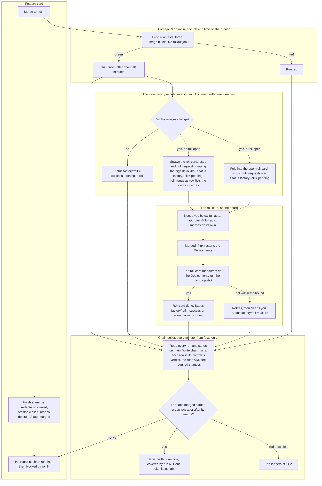
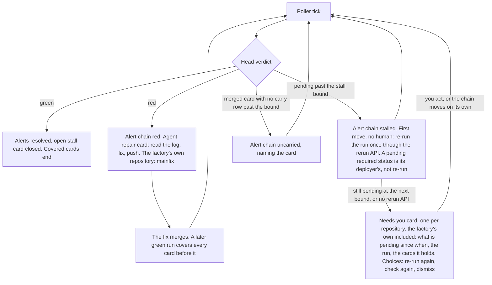
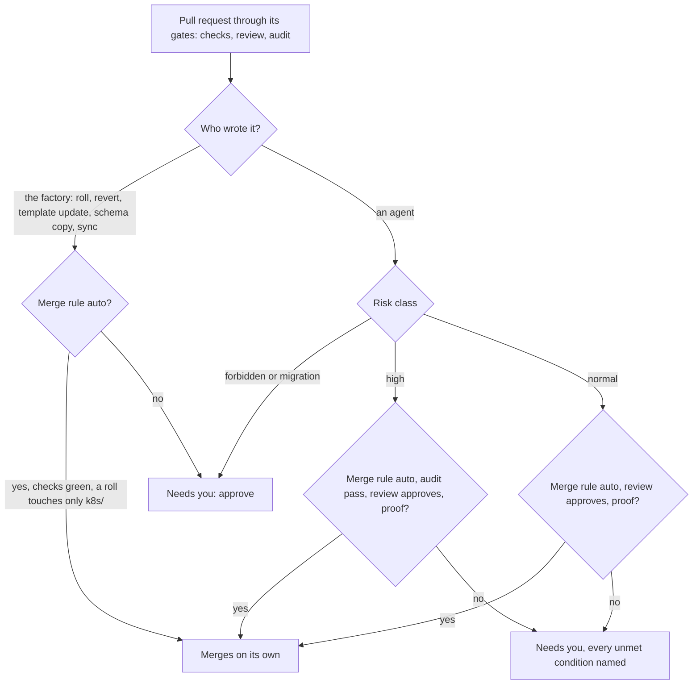
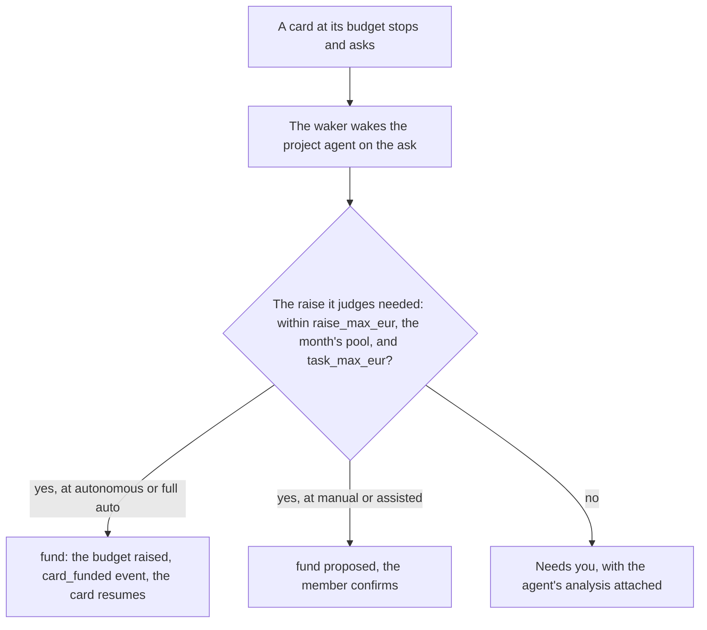

# The chain moves the cards, the slider moves the human

Design, 2026-10-20. It replaces the post-merge half of
[chain-done-design-2026-10-19.md](chain-done-design-2026-10-19.md) and extends
the autonomy model of roadmap 239. Sebastian's rules, in his words: a card is
done only when its CI chain is through, for any project. Every step after
merge that the software needs to run is CI work. The flow of work is visible
on the board, nothing happens behind the scenes. The human sees only the
exceptions the AI cannot handle, and money.

## 1. Intent and why

On 2026-10-20 five cards sat in `merged` for hours although a green chain
covered them. The 10-19 design moved a card from `merged` to `done` through
three mechanisms: the card's Temporal workflow waited for a `chain_covered`
signal or a 30 minute timer, the chain poller signalled every covered card on
the tick where the head went green and then ran a store fallback for cards
whose workflow had ended, and a migration moved `done` cards back to `merged`
on every tick when no green run covered them. Each piece failed on its own:

- The fallback never ran. It asked the poller's Workflows value `Alive`
  through a type assertion, and the value is `BoundedWorkflows`, which has no
  `Alive`. The assertion fails silently (chainpoll.go:782, bounded.go:25,
  main.go:379). No test wires the production composition.
- The workflow read its facts before the card was `merged`, but coverage
  counts only `merged` cards, so "already covered, done at once" never held.
- The poller signalled only on the tick where the head turned green. A card
  merged while the head was already green got no signal and waited for its
  timer: 30 minutes late, with a false `chain_stalled` alert.
- The signal channel was never consumed, so after one signal every later
  wait returned at once.
- The migration had no exception for roll tasks. A roll task finishes `done`
  after its rollout, minutes before its own merge commit's run is green, and
  the migration moved it back to `merged` with no workflow left to move it
  again. Every roll task stuck. When the migration won the race against
  `SettleRollRequests`, the roll request stayed open, the next images folded
  into a dead task, and the 30 minute CI deadline turned `main` red.
- Credentials, the session row, the namespace, the approvals and the queue
  entry were held through the whole wait, because `Finish` ran after it.

The design was edge-triggered: a message had to land in a live program at
the right moment, and a memory of what was signalled had to survive. Every
failure above is a missed or mistimed edge. A card that must never be lost
cannot be built on edges.

Three more facts shaped this design. The factory's CI run ends in a job that
parks the single runner for up to 30 minutes waiting for the roll, and a roll
approved later than that turns `main` red and starts mainfix, which reverts
a good change after 2 hours. The roll task was hidden from the board by the
10-18 ruling "a roll is no card", so four blocked cards showed "chain
running" while the thing blocking them waited for a human in no column. And
the second project, the infra repository, is invisible to the poller: the
factory's token cannot read it, so its chain has no rows, and `config-check`
green would count as live although Flux applies the change after merge and
can fail.

## 2. Goals

- One mechanism moves a card after merge: the chain's recorded facts,
  enforced by one reconciler every minute. No signal, no memory, no
  workflow after merge. A factoryd restart changes nothing.
- The board shows the whole flow. The roll is a card. Merged cards name the
  roll that blocks them. Nothing happens behind the scenes.
- Generic for every project: the project owns its chain and declares it in
  three lines. The factory owns the facts and the moves and holds no project
  specific code. The factory's own repository is one project with an outside
  deployer, which happens to be factoryd's roller.
- Every silence becomes a verdict with a worker: red gets an agent, a stall
  gets one deterministic re-run and then a human card, a card the chain
  never carried raises an alert that names it, a dead poller trips an alert.
- The human sees only exceptions the AI cannot handle, and money above a
  pool the human set once. One slider from less to more, four positions.
- A merged card holds nothing: credentials, session, namespace, approvals
  and queue entry are released at merge.

## 3. Non-goals

- No per-project deploy code in factoryd. A project deploys through CI jobs
  or through a deployer that posts commit statuses.
- No change to lanes, the merge queue, the plan process or the check-in
  conversation beyond the gate rules and the funding tool named here.
- No new infrastructure. Postgres and Forgejo stay the stores of record.
- The drawer's full chain steps list stays with its design round. The
  drawer gains only the words and links this design names.
- No change to what forbidden and migration classes mean: an agent's change
  to CI workflow files or to migrations needs a human at every level.

## 4. Anti-goals

- A second path to `done` kept "as a fallback". One writer or none.
- A roll task that is a card in the store but not on the board.
- A human gate that checks nothing: a click that replaces no control.
- A deadline inside CI that fails on human time.
- A capability discovered at runtime by type assertion in production
  composition.

## 5. Constraints

- Immutable and re-seedable: a fresh seed has no limbo and needs no
  migration. Existing `done` rows stay done.
- Reliability by construction: every wait has a bound, every bound has a
  verdict, every verdict has a worker. No prompt rule where a deterministic
  step carries it.
- The poll is the source of chain facts. This Forgejo (15.0.9) has no
  webhook for runs. Forgejo 17 adds one, and it becomes a nudge, never the
  source.
- Temporal histories of running workflows must replay. Version markers
  already recorded stay consumed.
- The runner is one machine running one job at a time. No CI job may park
  it on a human.

## 6. The chain

### 6.1 The contract

A project declares its chain in its project file:

```yaml
chain:
  mode: run          # run (default) | none
  requires: []       # commit status contexts the head must carry green
  stall: 30m         # pending longer than this is a stall
```

`none`: merge is live, the card ends `done` at merge. `run`: the push runs on
the default branch that carry the merge are the chain, ANDed with every
`requires` context on the head. The tail is whatever the project makes it: a
deploy job, a promote job, a smoke run, or a status posted by an outside
deployer. The factory reads facts and knows nothing else.

The factory's own repository sets `requires: [factory/roll]` and
`stall: 24h`. The infra repository sets `requires` to the status Flux posts.
A template project sets nothing: its staging and promote jobs are the tail.

### 6.2 The facts

The poller stays as built for recording: every minute, per served
repository, the newest push runs on the default branch, one carry row per
pull request a run carried, one head row with the AND verdict, refresh of
concluded runs, the stall watch and the red watch (chainpoll.go `record`,
`headVerdict`, `watch`). Three changes:

- The merge-to-run mapping uses the card's own merge commit. The merge queue
  records `tasks.merge_commit` at merge (gates.go:1432). A run carries every
  card whose merge commit lies in the compare range from the previous run's
  commit to its own. The 50 pull request window and the
  `RecentMergedPullRequests` call go. A card without a recorded merge commit
  gets it from its pull request once, at the card's merge, through the
  existing merge path, so every merged card has one.
- The served check re-reads a repository's workflow list on every tick where
  the cached answer is "none", so a repository that gains a workflow is
  picked up without a restart.
- The poller records its last successful tick per repository as a gauge,
  `factory.chain.poll_age` in seconds, and the platform's alert rules fire
  when it passes three poll intervals. This is the guard against a poller
  that stopped while factoryd lives.

Every row's status is its commit's verdict: the push runs on that commit
ANDed with every `requires` context on that commit, as c8343b74 built it
("rows carry the verdict"). The carry rows of a commit are refreshed with
that verdict, not with the run's own status, so a run that is green before
its required status arrives does not cover anything yet. The poller reads
the combined status of a commit only when the project names `requires`.

Coverage is one SQL predicate, `deployLive` (console_store.go:57), used by
the reconciler, the board and the drawer. A card is live when a green row
sits at or after the run that carried its merge commit, or it has no pull
request, or no chain names it and it finished before recording began.

### 6.3 The card after merge

The workflow ends at merge. `Finish` runs at merge for every card, as it
does today for a card that ends, so cleanup and revocation happen then:
`ClearRollHold`, `DeleteLiveSession`, `forgetNamespace`, branch deletion,
`ResolveApprovals`, `leaveQueue`, the alert verdicts and
`Completion.Complete`, which revokes the Forgejo tokens and blocks the
LiteLLM keys.

The Finish activity decides the state. It is a deterministic step, so the
rule lives there and not in the workflow: a card with a merged pull request
in a project whose chain mode is `run` ends in `merged`. Every other card
ends in `done`, `failed` or `closed` as today. The workflow calls
`Finish("done", reason)` as it does now. The version gate `chain-done`, the
`chainWait` loop, the covered signal, the chain facts and chain stalled
activities, the string prefix test on the reason and the `!t.rolling`
exception are deleted. The `GetVersion` call for `chain-done` at workflow
start stays, its value unused, until no running history carries the marker.
The builder removes it in a later change.

`merged` is not final. `Completion.Complete` moves the card to `merged`
through `closing` as it moves to `done` today. The merged inform poke fires
at merge as built ("#603 merged; the chain is running"). `EventTaskEnded`
fires at live.

The reconciler is one step in the poller's tick, after recording:

```sql
UPDATE tasks SET status = 'done', finished_at = now()
WHERE repository = $1 AND status = 'merged' AND <deployLive>
RETURNING id, pr_number
```

For every covered merged card the poller calls the one function that ends a
task, the Finish activity, with `done` and the reason "live: covered by run
N". Finish on a `merged` card runs its idempotent cleanup, moves the card
to `done` through `Complete`, records the `task_ended` event, fires the done
poke ("#603 is done and live"), sets the issue's state label and counts the
outcome. Finish on a card already `done` is a no-op, so a second tick costs
nothing. A task ends one way.

Deleted with the old mechanism: `cover`, `finishCovered`, `livingWorkflow`,
`MigrateChainLimbo` and `moveLimbo`, the poller's `covered` map, HealPass's
restart of `merged` cards, and the `chainCoveredReader` and
`chainHeadReader` assertions on the store, which become methods of the
store interface the poller takes.

`SettleRollRequests` treats a roll task in `merged` as a merged roll, so a
roll request never stays open behind a merged roll task.

The five cards of 2026-10-20 need no hand: the reconciler's first tick
flips them.

A `merged` card the chain never carries raises `chain_uncarried` for the
card after the project's stall bound: no carry row, no run in sight. The
alert names the card and the repository. It covers a repository the poller
does not serve, a token that cannot read it, and a run that never came.

### 6.4 The roll is a visible card

The 10-18 ruling "a roll is no card" is reversed (Sebastian, 2026-10-20). A
roll task shows on the board as any card: Queued when filed, In progress
while its pull request is written and checked, Needs you while the pull
request waits for a human below full auto, In progress again while the
Deployments take the digests, Done when they run them. Its title stays
"roll <sha>: factoryd, gateway, worker, ci-runner". `boardOf` stops skipping
`SourceRoll`.

The cards a roll carries depend on it. The link exists: `roll_requests.prs`
holds the pull requests each roll carries, and `roll_requests.task_id` the
roll task. The board and the drawer read it from there. No `task_deps` row
is written: `task_deps` carries scheduling and cascade semantics (an
unfinished dependency blocks a start, a failed one cascades), and a merged
card is past both. The board's merged card says "blocked by roll #N" with
the link while a roll request that carries its pull request is open or
unsettled, and the roll card's drawer lists the cards it carries. A merged
card without a roll yet says "chain running".

The dependency is the visible form, not the mechanism. The card goes `done`
when the chain covers it, which for the factory's repository means the run
is green and `factory/roll` is success on the commit, and the roll's end is
what posts that status. The two coincide within a tick.

A roll that fails after its retries changes nothing for the cards it
carries: they stay `merged`, wearing "blocked by roll #N" while the roll
task is open and "chain red" once its `factory/roll` failure is on the
commit, until a later roll's green covers them. That is the 10-19 decision
"a red chain is work, not a verdict" applied to the roll. The roll task
itself goes to Needs you with its retry question, as built.

The roll task is the deployer, and the one card whose live its own program
measures. Its workflow ends after the rollout measurement, not at merge:
merge, then `AwaitRollout` until the Deployments run the digests, bounded
by the task's wall-clock cap with heartbeats, then Finish with `done` and
the status posted. A roll task holds no session, no LiteLLM key and no
namespace, so the minutes between its merge and its end hold nothing a
merged card is not allowed to hold. This is the only source-specific
branch in the merge-time rule, and it is deterministic: source roll ends
after its measurement, every other card ends at merge.

### 6.5 Red and stalled

A red head is code work. As built: the `chain_red` alert, one agent repair
card per repository with the run's log link and the carried cards, mainfix
for the factory's own repository. The repair's merge makes a later run
green, and the reconciler frees every card before it.

A stall is operational. The ladder:

1. The poller records the stall on the head and carry rows and raises
   `chain_stalled`, as built.
2. First move, no human: the poller re-runs the stalled run once through
   Forgejo's rerun API (`POST /repos/{owner}/{repo}/actions/runs/{id}/rerun`,
   Forgejo 17). A pending required status is not re-run: its deployer owns
   it. The stall row remembers the re-run, so it happens once per head.
3. Still pending at the next bound: the poller files a human card in the
   project's human lane, one per repository while the stall stands. It names
   what is pending since when, links the run, lists the cards the stall
   holds, and offers the choices "re-run again", "check again", "dismiss".
   "Re-run again" calls the rerun API, "check again" closes the card and
   lets the watch run on, "dismiss" resolves the alert and closes the card
   until the head changes. The factory's own repository files this card too.
4. A green head resolves the alerts and closes the open stall card, as
   `ResolveChainAlerts` resolves today.

The agent repair card is no longer filed for a stall. The chain alerts stay
on the /alerts page as well.

### 6.6 The factory's own chain

The rollout job in `.forgejo/workflows/ci.yml` is deleted. The run ends with
the three image builds, green after about ten minutes, and the runner is
free. The roll's verdict rides the commit status `factory/roll`, which the
project file requires, so the head is green only when the run is green and
the roll's status is success. The 30 minute deadline against human approval
goes with the job, and with it the mainfix trigger on a slow approval.

Every commit on `main` whose three image builds are green gets a
`factory/roll` status, as the roller judges today: it reads every push run
with green images, skips commits at or below the newest commit a roll
already carries, and judges the newest first. A commit folded into an open
roll gets its own `roll_requests` row and its own status. A commit whose
run was cancelled before its images were green is never judged, stays
pending in its rows, and is covered by a later green commit like any other.
A commit pushed by a human by hand is judged like a merge. A commit the
roller never sees because factoryd is down is judged when it is back.

The status has one writer per outcome. The roller posts `pending` when it
files or folds a roll, `success` at judge time for a commit that changes no
image, `failure` when it refuses. The roll task's rollout measurement posts
`success` on every commit the roll carries when the Deployments run the
digests and `failure` on them when they do not within the bound, through
the settle of their roll requests. The separate RollWatcher write of the
same status goes, so one commit's status is written once per outcome.
Whether the RollWatcher keeps its other duties is the builder's call.

`stall: 24h` for the factory's repository covers human approval time below
full auto. At full auto a roll merges on its own and the bound could be
lower. The builder keeps 24h: the stall card, not the bound, is the human's
moment.

### 6.7 The infra chain

Two facts and one line, no code in factoryd:

1. The factory's projects token (the dedicated user factory-projects) gets
   read access to `sf/ai-software-factory-infra`, so the poller's run list
   answers. The seed carries the grant as it carries the other project
   grants, so a re-seed has it.
2. Flux posts the result of its reconciliations to Forgejo as commit
   statuses. A notification-controller `Provider` of `type: gitea` with
   `address: https://git.aisoftwarefactory.world/sf/ai-software-factory-infra`
   and a secret holding a token with `write:repository` on that repository,
   and an `Alert` with `eventSources` the Kustomizations `flux-system` and
   `platform` in namespace `flux-system`. Flux maps Info to success, Error
   to failure and Progressing to pending. The builder reads the posted
   context strings on the first reconciliation after the manifests land
   and writes them into the project file.
3. The infra project file: `chain: {requires: [<the two contexts>]}`.

Both Kustomizations source the same `GitRepository`, so every commit on
`main` is a new revision for both, and the kustomize-controller reconciles
a new revision and emits its result event whether or not the revision
changed anything under the Kustomization's path. The builder proves this
before the `requires` line lands: a docs-only commit on infra must carry
both contexts green within the bound. If one Kustomization turns out to
post only on change, only the one that posts on every revision is
required. A required status that never arrives is a stall by design, and
the stall ladder names it.

An infra card is then done only when `config-check` is green and Flux
applied the change. Flux's failure posts failure, which the red watch turns
into an alert and a repair card in the infra project's human lane, since
`agents: none`.

The template's projects need nothing: their tail jobs are the deploy.

### 6.8 Forgejo 17

Infra pins Forgejo 15.0.9 by digest in `k8s/platform/forgejo/helmrelease.yaml`.
The upgrade to 17.0 is a task of this plan: a full Forgejo backup first, the
breaking changes of 16 and 17 read, the image and chart mirrored into the
store, the pins bumped, the infra chain run. Forgejo supports the jump from
15 to 17 directly. 17 is a short-support release, supported until
2027-01-28, which the weekly bump routine follows.

What the factory takes from 17:

- The rerun API, for the stall ladder's first move.
- The workflow run webhook. The intake gains one event type: a finished
  workflow run nudges the poller to tick that repository now. The poll
  stays the source and the reconciler stays level-triggered, so a lost hook
  costs at most one minute. The registrar subscribes the project hooks to
  the new event. factoryd uses no deprecated action run event.
- The job logs API, which the repair card's brief links.

### 6.9 The board and the drawer

- `fiveColumn` keeps `merged` in In progress. The stage word reads
  coverage and the dependency, in this order: "blocked by roll #N" when a
  roll dependency is open, "chain red" when the card's carry row is red or
  cancelled, "stalled" when stalled, "waiting for the chain" with no row,
  "chain running" otherwise. `ChainState` as the card's own row status
  stays the source for the last four.
- `FinishedTasks` applies `deployLive` to `done` cards only. Failed and
  closed cards show in the finished columns as before chain-done.
- The drawer shows the roll dependency and, on a roll card, the carried
  cards, through the existing dependency section. The timeline step the
  reconciler writes ("done, live: covered by run N") renders as the task's
  end.
- The wide view's state columns keep Merged.

### 6.10 Tests that pin the construction

- A PG test of the reconciler statement and `endTask`: merged plus covered
  flips, uncovered stays, events and pokes fire once, a second tick is a
  no-op.
- A test that builds the poller and the runner as `cmd/factoryd/main.go`
  does, with `BoundedWorkflows` and the real store interface, and runs one
  tick over fixtures. No optional interface by type assertion remains in
  the post-merge path, so the compiler pins the rest.
- A workflow test: Finish at merge ends the workflow, the state is `merged`,
  the credentials are revoked, no `task_ended` event.
- A roll end to end: filed, dependencies written, merged, rollout measured,
  status posted, reconciler flips the roll card and the carried cards on
  one tick, the roll request settled.
- The stall ladder: one re-run per head, the human card once per repository,
  closed on green.
- The replay test suite of the workflow (ladder_replay_test.go's rig) with a
  history that recorded `chain-done`.

## 7. Autonomy

### 7.1 One slider, four positions

| Position | The agent does on its own | Still asks the member |
|---|---|---|
| manual | nothing: every action is a proposal | everything |
| assisted | files, starts, accepts plans, retries, grants sessions within a card's budget, runs routines | direction, money beyond a card, merges, the confirm set |
| autonomous | direction too, and funding within the pool | merges by the merge rule, the confirm set |
| full auto | merges by the gate rules | the confirm set minus merges |

The positions are the ones built (policy.go:146): the file names
`manual`, `assisted` or `autonomous`, and full auto is `autonomous` with
`merge_rule: auto`, shown as one state and written by the selector as
today. No new field. The merge gate keys on `merge_rule`, as `AutoMerge`
does, and the confirm list on `ConfirmFor(level, mergeRule)`, as built.
A project file with `autonomous` and `merge_rule: human` is the autonomous
position.

The confirm set, confirmed at every position: invite, set_autonomy,
github_export, github_sync, promote_resource, release_resource,
routine_write, routine_delete, and fund below autonomous. `alert_verdict`
and `write_doc` leave the set at full auto, in `ConfirmFor`'s merge-rule
auto branch beside the two merge tools: the screening stage already judges
alerts, and the documents are the project's own. The meaning lines of the
positions say "money beyond a card's budget" where they say "money".

### 7.2 The merge gate: who wrote the change decides

1. **An agent's change.** The risk class decides, in every project. Normal
   merges at full auto on proof: checks green, the stronger-model review
   approves and finds a strict improvement, the security audit passes, and
   the work is proven by a reproduction that failed at the base and passes
   at the head, or by a recorded fault, or by the review's criteria verdicts
   all met for a feature card. High merges at full auto on the same proof
   with the audit pass required, and stays human below full auto. Forbidden
   and migration are human at every position. This reverses rulings 76, 77
   and 109 for the high class at full auto only (Sebastian, 2026-10-20): a
   click without reading is no control, the audit and the pinned mirror are.
2. **The factory's own mechanical change.** No risk class. A pull request
   factoryd wrote (source roll, revert, template update, schema copy,
   GitHub sync) follows the merge rule: checks green, and for a roll also
   signatures verified and only image references under `k8s/` changed. At
   full auto it merges on its own, below full auto it is the human's as
   today.
3. **A project's deploy.** CI jobs, as in the template, where nothing is
   approved, or a factory task, as the roll, which follows rule 2.

`AutoMerge` (gates.go) carries rules 1 and 2. The approval card's "why
human" list keeps naming every unmet condition.

### 7.3 What reaches the human

At full auto the Needs you column holds exactly: the ladder's reasons a
human alone can act on (a goal conflict, a policy class, access the factory
lacks, spend beyond the pool), the stall card, a roll that failed after its
retries, an alert the screening could not settle, a question to the issue's
author when the author is the member, and an agent's change in the forbidden
or migration class. Every entry carries the agent's analysis: what it found
and what it would do (the waker's `attach_analysis`, as built).

Below full auto the merges join that list by the merge rule. Below
autonomous the direction tools join it. At manual everything does.

### 7.4 Money

Two numbers in the project file, set once by the human:

```yaml
budget:
  discretionary_eur: 20   # the project agent's pool per calendar month
  raise_max_eur: 3        # the most it may add to one card per ask
```

A card at its budget asks, as today. The waker wakes the project agent on
the ask. The agent reads the card and decides a raise. Within `raise_max_eur`
and the month's remaining pool it funds the card through the `fund` tool.
The tool runs as every chat tool runs, as the member's session with
`via: chat` (chat.go:150), so the member's rights apply and `doFund`
(actions.go:1123) is reached as it is from the board. The tool checks three
bounds before the call: the amount against `raise_max_eur`, the month's
pool against the sum of the `card_funded` events recorded `via: chat` in
the calendar month, and the card's budget after the raise against the
policy's `task_max_eur`, which `RaiseTaskBudget` does not clamp today and
which the tool therefore enforces. The `card_funded` event is the audit
trail and the pool's ledger. Beyond any bound the ask goes to the member
with the agent's analysis attached. A card that needs more than
`task_max_eur` is a sizing exception and goes to the member with the
analysis.

The pool applies at autonomous and full auto. At manual and assisted `fund`
is confirmed. The month cap and the day cap stay the human's, as a commit to
the policy file.

## 8. Rollout of this design

- The code deploys through the factory's own roll. The first chain-done
  factoryd with this design flips the five cards on its first tick and
  files no migration.
- Two projects exist: the factory's code repository, served today, and the
  infra repository, served once the grant of 6.7 lands in the same roll.
  No template project exists yet. A project added later without a push
  workflow degrades to mode none through the served check, as built, and
  a project whose repository the token cannot read raises the invisible
  repository alert, as built, and `chain_uncarried` for any merged card.
- Running workflows at deploy time: a workflow that recorded `chain-done`
  and has not reached its finish takes the new Finish rule. None is inside
  `chainWait` on 2026-10-20 (verified in Temporal). The builder verifies
  the same before the deploy and, if one is, lets it end first.
- The rollout job's deletion and the project file's `requires` land in one
  roll. Between them a run on the old job and a head on the new rule read
  the same status, so the order inside the roll does not matter.
- Forgejo 17 lands last, after the chain and autonomy work, with the hook
  nudge and the rerun step switched on by its presence: the poller calls
  the rerun API and treats a 404 as "no re-run available", so the stall
  ladder degrades to the human card on 15 and gains the first move on 17.

## 9. Left to the builder

- The reconciler's placement in the tick and the `endTask` factoring.
- The exact Flux commit status context strings, read live.
- The grant mechanism for the projects token on the infra repository within
  the seed.
- The shape of the stall card's choices as a `HumanQuestion`, following the
  roll question's buttons.
- The gauge's name and the alert rule's wording, following
  `factory.activity.open_age`.
- The intake's event type name for the workflow run hook, read from the 17
  release.
- Test fixtures and the replay history.

## 10. Decisions (Sebastian, 2026-10-20)

1. The store's reconciler owns a card after merge. The workflow ends at
   merge with its resources released. Reverses the 10-19 line "at merge,
   the workflow no longer finishes, it waits".
2. The CI rollout job goes. `requires: [factory/roll]` and `stall: 24h`
   carry the roll in the factory's chain.
3. The infra repository gets its chain in this round.
4. Forgejo 17 is a task of this plan.
5. The roll is a visible card and the cards it carries depend on it.
   Reverses "a roll is no card" (2026-10-18).
6. A stall gets one re-run and then a human card, for every repository.
7. One slider, four positions. Full auto means the AI merges. The merge
   gate decides by who wrote the change. The high class merges at full auto
   on the AI's verdict with the audit as a required pass. Reverses rulings
   76, 77 and 109 for that case only.
8. The human sees only exceptions the AI cannot handle, and money. The
   project agent funds cards from a discretionary pool the human sets once.
9. `alert_verdict` and `write_doc` leave the confirm set at full auto.
10. Order: the chain first, then autonomy, then Forgejo 17.

Calls made in this document, not decided in conversation: the dependency
rows as the visible form with coverage as the mechanism (6.4), the roll
task's own `done` at measured live (6.4), the `chain_uncarried` alert (6.3),
the served check's re-read (6.2), the poll age gauge (6.2), the merge commit
mapping (6.2), one writer per status outcome (6.6), the stall ladder's
degradation on Forgejo 15 (8), the pool's ledger as the sum of funded events
(7.4), and `fund` confirmed below autonomous (7.4).

## 11. The processes in charts

### 11.1 From merge to live, and where the roll card is spawned

The factory's own repository. A template project has no roller box: its
staging and promote jobs are the run's tail, and the poller reads the run.



### 11.2 Red and stalled: the ladders



### 11.3 The merge gate: who wrote the change decides

Proof means: a reproduction that failed at the base and passes at the head,
or a recorded fault, or the review's criteria all met.



### 11.4 Money: a card at its budget


