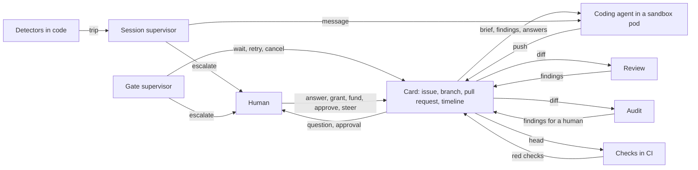
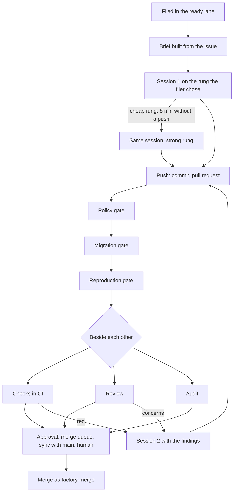
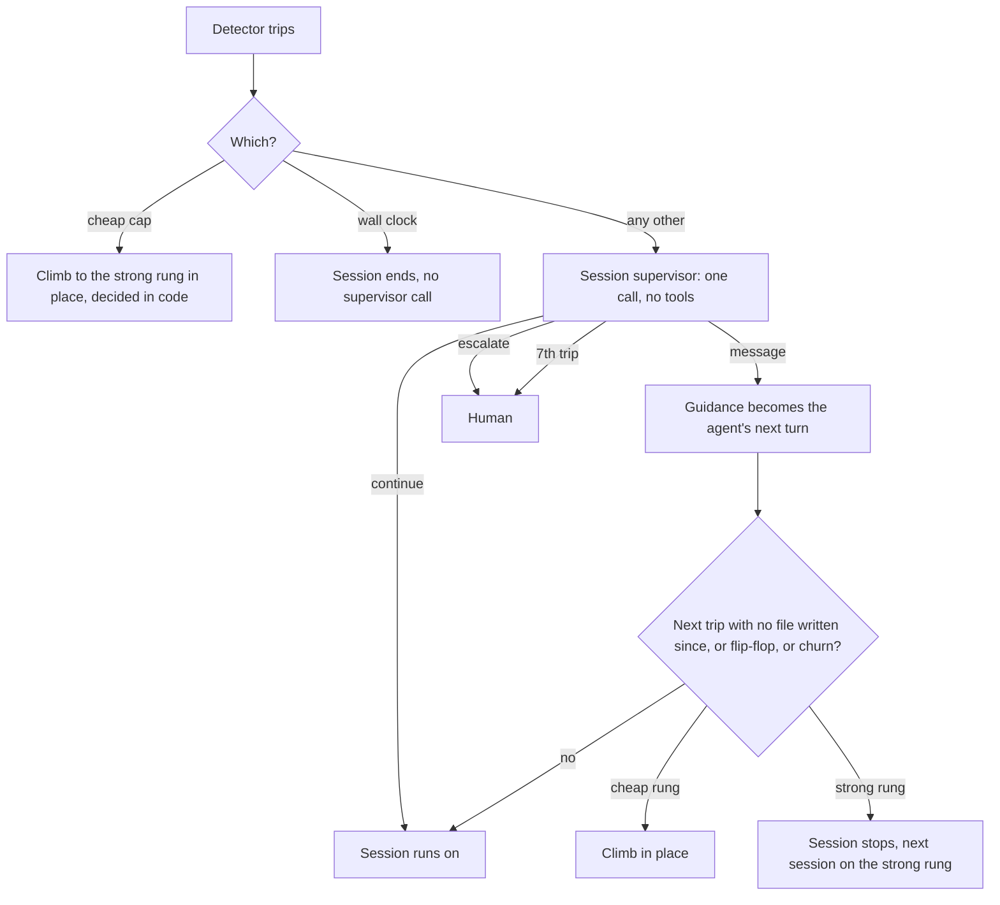
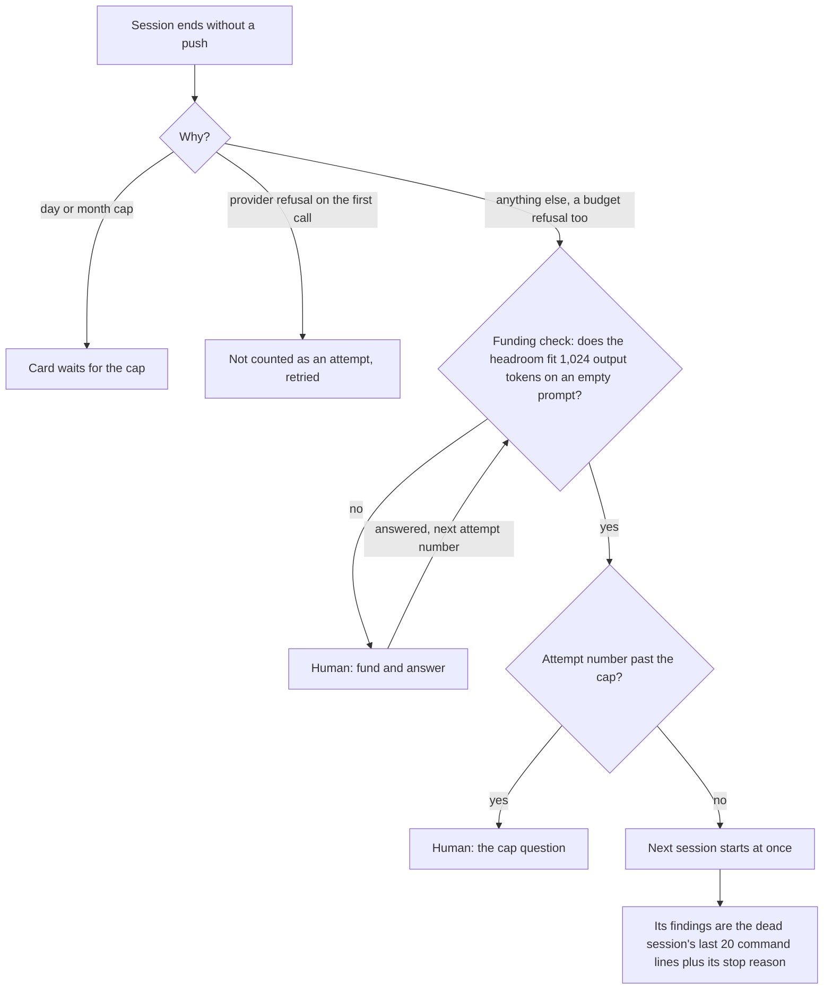
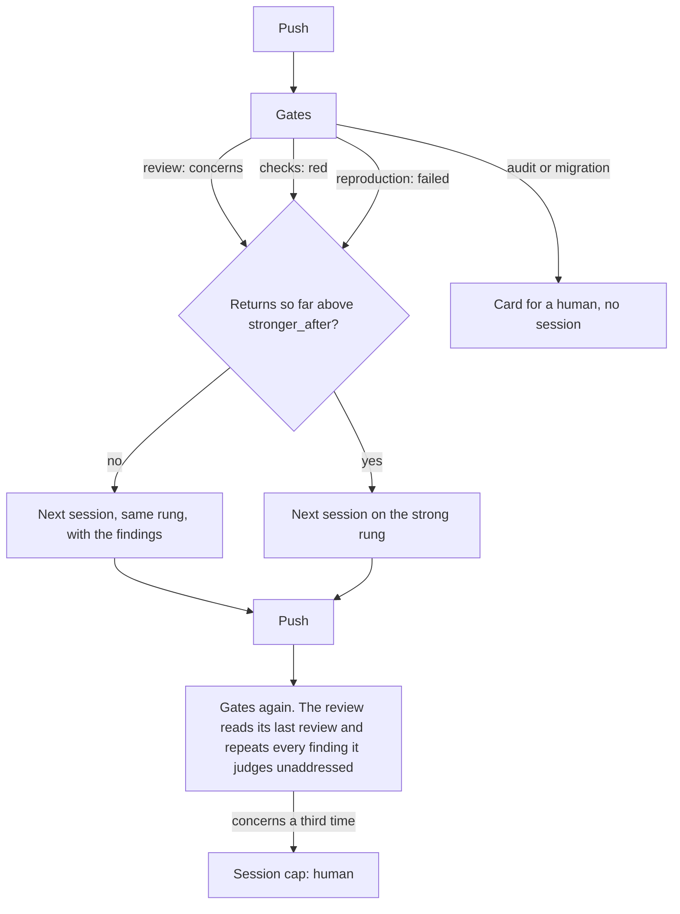
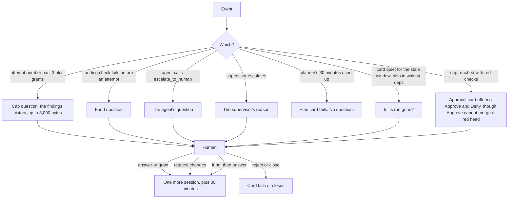
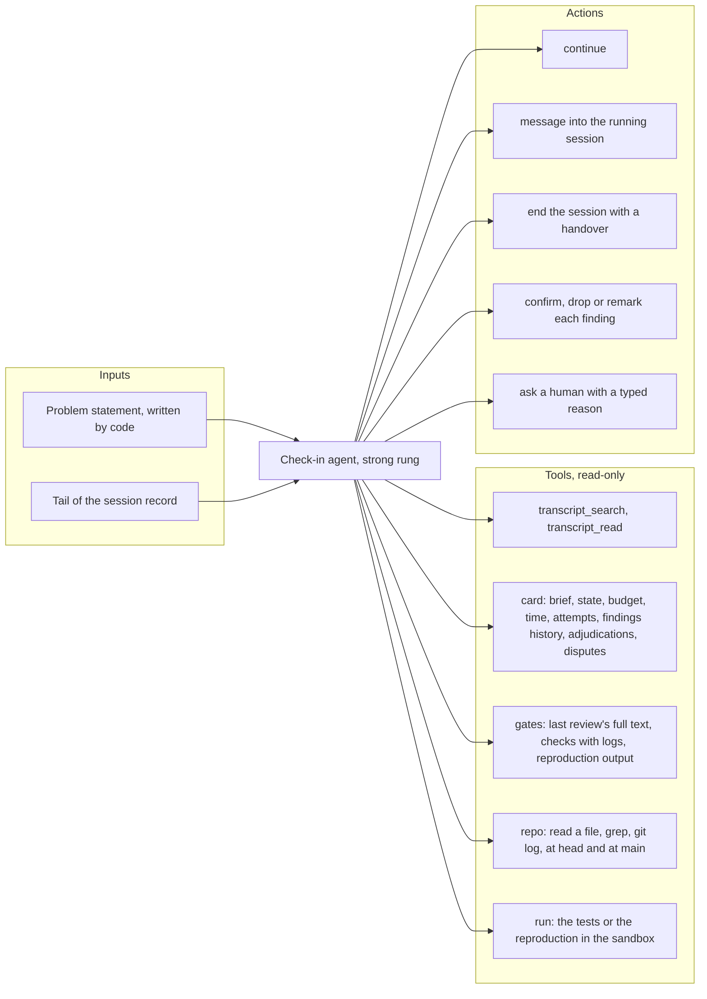
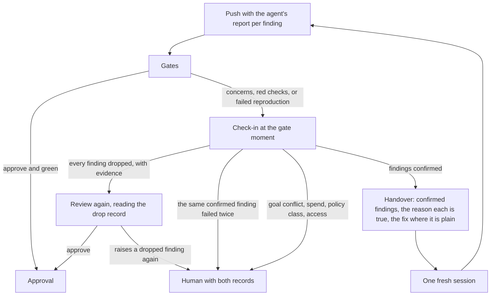
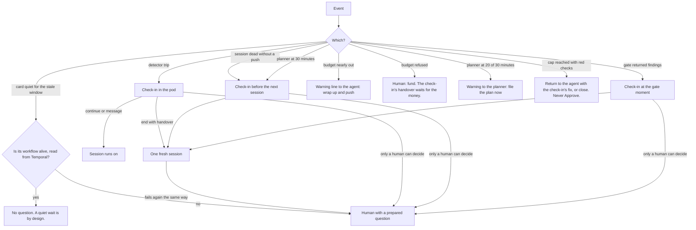

# The escalation ladder: how it works, where it failed on 2026-10-15, and how it should work

This document is for one decision: how the factory should handle a card that goes wrong, so that it heals itself, asks a human only when only a human can decide, and does not waste tokens. It explains the ladder from the ground up, follows the eight problems of 2026-10-15 through it, measures what they cost, and sketches the ladder after the changes.

The facts come from [escalation-ladder-facts-2026-10-15.md](escalation-ladder-facts-2026-10-15.md), which cites the code, and from the gateway's ledger, queried on 2026-10-15 for the six cards of that day. Section 5 is a proposal, not a description.

## 1. The pieces

### Terms

- **Card**: one task, filed as an issue. Its id is `t-<12 hex>`, its issue a number such as #836.
- **Session**: one run of the coding agent in its own sandbox pod with a fresh conversation. A card may take several sessions.
- **Attempt**: the counter of the attempt loop in the card's workflow. Today a refused attempt takes a number too, so #839's sessions ran as attempts 1, 2, 3 and 5, and #854's as 1, 2 and 4.
- **Push**: a session's end that leaves a new commit on the card's branch. A push opens or updates the pull request.
- **Gate**: one check of a pushed change. The gates run in a fixed order after every push.
- **Finding**: one problem a gate reports. A finding goes back to the agent as a new session, or onto the card for a human.
- **Check-in**: any look at a session or a card by something other than the coding agent itself.
- **Escalation**: the card stops and waits for a human.
- **Filer**: whoever files a card: the project agent in the chat, the planner, or a human on the issue.

### Two groups of models, not models

The factory names models by alias. Policy maps each alias to a provider's model. Every alias belongs to one of two groups. This document calls them the cheap rung and the strong rung. The code knows a rung only for coding sessions, and maps the review and supervisor aliases on their own.

| Group | Aliases today | Who uses it |
|---|---|---|
| Cheap | `coding-cheap` | Coding sessions whose filer chose cheap, or that were filed with no rung and are neither large nor in factoryd's package. The coding agent's subagents, always. |
| Strong | `coding-frontier`, `review-frontier`, `supervisor` | Coding sessions whose filer chose frontier, plan cards, and every coding session after a climb. The review, the audit, both supervisors. |

**The filer decides a coding card's rung** (roadmap 222, item 5). A `Rung:` line in the issue body wins. The project agent's `new_card` tool writes it from its `rung` and `rung_reason` arguments, with the guidance: cheap for routine, well specified work, frontier for a large change, a plan or factoryd's own package. The planner writes the same line per card from `file_plan`. A human can type it. Without the line, code derives the rung: frontier for a large card or one that names `internal/factoryd`, else cheap. On 2026-10-15 the controller filed the five cards by hand without the line, so the derivation applied. #837 started strong because its brief named factoryd's package, and the ledger shows #836 and #840 on the strong rung from their first call. #838 and #839 started cheap and climbed at the 8-minute cap.

Which provider backs a group is configuration. On 2026-10-15 the coding aliases ran on the z.ai coding plan, whose calls cost nothing beyond the plan. The review and supervisor aliases ran on a second provider that bills per call. Nothing in the ladder depends on the provider.

### The roles

Eight roles touch a card. Six are models, one is code, one is a human.

| Role | What it is | Rung | What it reads | What it can do |
|---|---|---|---|---|
| Coding agent | opencode in a sandbox pod, one conversation per session | As filed, strong after a climb | Its brief. The repository. The document repository at `/workspace/docs`. | Edit, run commands, ask a human (`escalate_to_human`), ask the issue's author (`request_info`), file a child card (`delegate`). |
| Planner | The coding agent in plan mode: one session of 30 minutes with no check-in, for a plan card | Strong | Its brief, the spec, the repository, the document repository | Read, file up to 12 cards through `file_plan`, ask the issue's author |
| Detectors | Go code inside each session that watches every event and a timer | None | Every harness event | Trip. A trip calls the session supervisor or decides in code. |
| Session supervisor | One chat completion per trip | Strong | The brief, the trip, a digest of the last 40 commands, 40 edited files, 5 errors and the diff, the last 24 KiB of the session record | `continue`, `message` into the running session, `escalate` to a human |
| Gate supervisor | One chat completion when a gate runs past its time bound | Strong | The objective, the last 8 KiB of the card's timeline, the gate's state | `wait`, `retry`, `cancel`, `escalate` |
| Review | One chat completion per push | Strong | The brief, the diff in up to three parts of 48 KiB, the reproduction and audit results, its own last review | `approve`, or `concerns` with up to 10 findings |
| Audit | One chat completion per push, code projects only | Strong | The diff against a checklist of six items | `clear` or findings. Findings go to the card, never to the agent. |
| Human | A member in the console or on the issue | | The card, the pull request, whatever they open | Answer, grant a session, fund, approve, request changes, reject, retry, close, steer a running agent |

No model role but the coding agent and the planner has a tool. Each of the other four model roles is one call that reads a fixed input and answers one JSON object. Only the coding agent and the planner can open a file, run a command or read the repository. Only the human can read everything.

## 2. The happy path

A card that goes as intended runs one or two sessions, passes the gates and gets merged. Every arrow in the diagram is a handover, and each handover carries a fixed set of things.

### Who sees what at each handover

| Handover | What crosses | What does not cross |
|---|---|---|
| Issue to session 1 | The issue text without its size, budget and rung lines. The repository map. The tools. The work guide. The author's standing. | The budget. The time left. The attempt number. |
| Session to gates | The branch head. The agent's last message, 2,000 bytes at most. A `not_reproduced:` line, if any. | The conversation. The agent's commit messages, which the worker replaces. |
| Gates to session 2 | Up to 60 findings, the newest kept, each cut at 1,000 bytes. Red checks with the job log's last 40 lines. Human answers of the whole run. | The review's full text. The earlier conversation. Any supervisor message. Pull request comments other than a trusted human's request for changes. |
| Gates to the human | The approval card with the diff, the checks, the review's findings and the agent's last message as "Recommendation". | |
| Human to a later session | Every answer of the run, newest first, under "do not escalate them again". | |

The brief's sections run in this order: human answers, left-out notes, repository and commit, the author's standing, the issue, the spec, the poster's answers, the findings from earlier attempts, the repository map, the tools, the work guide. The answers stand above the findings.

### An example that went as intended

Card #840 pushed after 26 minutes. Its first review raised a possible data race on a new key field, which was a fair point. The second session fixed it with an atomic pointer and a race test. The second review approved. The supervisor's check-ins answered `continue`. The human read the diff and approved. The card cost 2.57 EUR at list prices for 2 sessions, 2 reviews, 2 audits and 3 supervisor calls.

## 3. The unhappy paths today

Something goes wrong at one of four moments: inside a session, when a session ends without a push, when a gate returns findings, and when a cap is reached. Each moment has its own path, its own watcher or none, and its own way to the human.

### 3.1 Inside a session: a detector trips

The detectors watch every event. The live thresholds:

| Detector | Trips when |
|---|---|
| `no_progress` | No harness event for 5 minutes |
| Reading without writing | 60 steps |
| `no_write` | 900 seconds |
| Repeated identical call | 4 times |
| Repeated same failure | 3 times |
| `churn` | 15 |
| Check-in | Every 45 minutes of the card's agent time, never in a session's first 10 minutes |
| Cheap cap | 8 minutes on the cheap rung without a push, attempt 1 only |
| Wall clock | The card's 2 hours of agent time are used up |

What the supervisor sees: the brief, the trip, the digest, the record's tail, its own earlier messages, and on its first call the carried findings. It sees no review, no CI result, no card timeline, and it cannot open a file. It judges whether the agent is moving, not whether the agent is right.

What it can do: `continue`, `message`, `escalate`. It cannot stop a session without escalating, cannot change the rung, cannot run a test, and cannot tell a gate that a finding is wrong. A message it sends lives and dies with the session.

### 3.2 A session ends without a push

A session ends without a push for eight reasons: the agent finishes with nothing to push, the step cap of 1,500, the wall clock, a loop of three nudges without new content, a budget refusal, a day or month cap, a provider refusal, a content filter.

A budget refusal has no path of its own. The session ends as `no_push`, and the next attempt starts whenever the funding check passes. That check prices 1,024 output tokens on an empty prompt, so a session with 0.15 EUR of headroom passes it and dies on its first real call, which sends the whole context. The human is asked only when the check fails. That is how #839 ran two starved sessions before its fund question, and #854 one. A session-level check that prices a session's opening calls from the ledger exists, `SessionFunded`, but only the console's Fund button uses it. When the check does fail, the attempt it refused still counts against the cap, and the human's answer to the fund question is discarded. The day-cap branch beside it takes the attempt number back and keeps the answer. The funding check runs before the cap check. After a fund the loop moves to the next number and only then meets the cap, which is why #854's fund led straight to the cap question.

Nobody with judgment looks at a dead session. The next session starts at once. Its "findings from earlier attempts" are lines such as `ran sleep 120; ps aux ... (exit 0)` and `changed internal/factoryd/store.go`. They say what was run, not what was wrong. The agent's own understanding of its work is gone with the pod.

### 3.3 A gate returns findings

The review and the checks run beside each other. Red checks cancel the review. Findings of the reproduction, the checks and the review go to a new session. Findings of the audit and the migration gate go to the card for a human.

The review reads the diff and cannot check a claim. The prompt tells it to list again every finding of its last review that the new head did not address. The agent cannot answer a finding in words. Its only way to address one is to change code. A false finding therefore loops until the session cap, and every loop costs one session. A `concerns` verdict without findings becomes the finding "model review: 
" and costs one session too.

When a human approves over findings, each finding is recorded as adjudicated, and a later finding with exactly the same text no longer sends a session back. The review never learns of the adjudication.

### 3.4 The session cap and the other direct paths to a human

### Where the ladder goes to a human today

| Moment | Who looks first | With tools? | Could an agent have tried first? |
|---|---|---|---|
| Detector trip in a session | Session supervisor | No | It does try, by message. It cannot see gate results or the repository. |
| Session dead without a push | Nobody | | Yes. Nobody writes a handover. |
| Gate returns findings | Nobody. The next session starts. | | Yes. Nobody checks whether the finding is true. |
| Session cap | Human | | Yes. The human gets the history and finds the fix in minutes, as on #836, #838 and #839. |
| Funding check fails before an attempt | Human | | The spend is the human's. The agent could have wrapped up before, and the starved attempts before the check failed should not have started. |
| Planner time | Nobody. The card fails. | | Yes. A second planner session with what the first read. |
| Card quiet while waiting on a dependency | Human | | No question is needed. The wait is by design. |
| Approval at the cap with red checks | Human | | Yes. The fix was one line. |

## 4. The eight problems of 2026-10-15

### The run

Five cards filed at 13:19:53 in project `ai-software-factory-code`, all merged between 14:15 and 14:48. Four of the five needed the human for something other than the final approval. Later that day the documents feature added a plan card and four cards, which brought problems 5 to 8.

| Issue | Subject | Sessions | Human did, beyond the approval |
|---|---|---|---|
| #836 | A Forgejo review or comment reaches its card | 3 | Overruled a false review finding, three times repeated |
| #837 | The board reads only its project's open cards | 3 | Overruled a `concerns` that had no finding |
| #838 | A page of finished cards reads only its column | 4 | Denied an approval on red checks and named the one-line fix |
| #839 | A task that ended carries its finish time | 4 run, 2 starved | Funded 3 EUR, named two tests and their fix, answered an audit |
| #840 | A GitHub mirror's token is sealed at rest | 2 | Nothing |
| #851 | Plan card of the documents feature | 1 | Refiled it as #852 after it failed. #852 filed a plan in time. |
| #854 | The documents feature's save endpoint and editor | 2 run, 1 starved, 1 refused | Funded 5 EUR and answered, and the answer was dropped. Answered the cap question with one real finding of eight. Ran the console lab by hand, found one failed check and five gaps against the prototype, and steered the session with them. |

### Why each problem happened

**Problem 1, #837: `concerns` on finished work.** The review's input held the project's merge rule, `human`, and its prompt explained that an approve does not merge under that rule. The answer format says "approve when you would merge it as it is". The model concluded that it would not merge, since a human must, and answered `concerns` with no finding. Code turned that into a finding and started a session that fixed nothing. The cause is a rule in a prompt that belongs to code. Commit `42b608e` removed the merge rule from the review's input the same afternoon.

**Problem 2, #836: a false finding three times.** The review claimed that `TasksByPR` had no implementation and the package would not compile. The method exists on main at `internal/factoryd/store.go:672`, and the checks were green. The reviewer could not open the file. The agent could not say "it exists". The next review re-read its last review and repeated the claim, as its prompt asks. The supervisor ran three times on `no_progress`, read the session's commands, and answered `continue` with "the agent is making solid progress". It never saw the review. Three sessions and a human later, the human opened main and approved. The same claim returned at 17:36 on card #853, about `docRootOK`, which is defined on main at `internal/console/autonomy.go:227`. On #854 seven of the review's eight findings were false. Four named code as missing that sat in another part of the diff, which the reviewing call had not read, since a large diff is reviewed in up to three parts with one call each. Two contradicted the design prototype, which the review does not read. One misread the code.

**Problem 3, #839: a budget burnt waiting, then starved sessions.** The card had 2 EUR, the size "small". Session 1 ran the full test suite in the background and polled it with `sleep 120` and `sleep 420`. Each poll is a model call that resends the conversation. The session made 87 calls, 53 of them on the strong rung for 1.67 EUR. Two new tests failed, because the new database check forbids a row they create on purpose. The agent dropped the check inside the tests instead of stamping the test rows. The 45-minute check-in caught an earlier mistake, a reverted file, and that was useful. Nothing caught the dropped check before the gates. The session died on a budget refusal with 0.15 EUR left. Sessions 2 and 3 started, because the funding check prices a call of 1,024 output tokens and no context, and died on their first real call. Both counted as attempts. Their findings were the dead session's command lines. The human funded, named the tests and the fix, and the fifth attempt pushed in 15 minutes.

**Problem 4, #838: a merge approval on red checks.** Cards #837 and #838 changed the same function in parallel. After #837 merged, #838's new test stand-in no longer matched the interface, and the sync with main turned the checks red. The card was at its cap, so the red checks went onto an approval card that offered Approve, which cannot merge a red head. The human denied with "request changes" and named the one-line fix. Session 4 made it in 9 minutes. Four reviews had also repeated a question about a test's project name that the test rig answers, for the reason in problem 2.

**Problem 5, #851: the planner ran out of time and failed.** The plan card had 30 minutes and no check-in. Its brief pointed at a 171 KB prototype. The planner read for 30 minutes, made 75 calls with 6.0 million prompt tokens, and never called `file_plan`. The plan workflow fails the card at once at the time limit. No warning reached the planner, no one looked at the session, and no question went to a human.

**Problem 6, #854 to #856: waiting cards asked whether their run was gone.** Three cards waited on #853 by design. The stale sweep counts `waiting-deps` as a state that can go stale, found them quiet for an hour, and moved them to `waiting-human` from outside their workflows. The human's answer changed nothing, because the workflows were still waiting on #853 and read no answer during that wait.

**Problem 7, #853: an old answer overrode a newer request.** The human answered a cap question with "change nothing and end the session". That answer stays in every later session of the run, placed above the findings and marked "do not escalate them again". The human then denied the approval with four requested changes, which arrived as a finding. Session 5 read the old answer first and ended after 36 seconds with nothing to push.

**Problem 8, #854: one empty budget took two of three sessions, and the answer to it was lost.** Session 1 made 182 calls for 4.89 EUR of a 5 EUR budget. It read for 60 tool calls before it wrote code, and the supervisor's message at the repetition trip got it writing. It spent calls on installing a browser the sandbox cannot reach, because the brief asked for screenshots of the console lab. The session died on a budget refusal with 0.07 EUR left after pushing 14 files that build and pass their tests. Session 2 passed the funding check, took all the headroom as a hold on its first call, saw its second call refused, and ended with no answer from any model. Attempt 3 was refused by the funding check, and the refused attempt counted. The human funded 5 EUR and answered with the state of the work. The budget branch of the attempt loop discards that answer. The loop went on at attempt 4, past the cap, so the card verified the pushed work, got eight review findings, and asked the human the cap question after two sessions. The human answered it with the one real finding and the seven false ones.

### Where the check-ins were inefficient, and what they cost

The question behind this document was whether the escalation agents read many tokens for nothing. The ledger says they read few tokens, and for nothing.

The five code cards cost this at list prices:

| Role | Calls | Prompt tokens | EUR | Share of the five cards |
|---|---|---|---|---|
| Coding sessions | 578 | 32.5 million | 9.90 | 92 % |
| Session supervisor | 17 | 214,000 | 0.44 | 4 % |
| Review | 14 | 103,000 | 0.19 | 2 % |
| Audit | 14 | 89,000 | 0.26 | 2 % |

A supervisor call reads 9,000 to 16,000 tokens. A review call reads 6,000 to 10,000 tokens. A coding call reads 35,000 to 80,000 tokens, of which 95 % or more come from the provider's cache. The planner on #851 read 6.0 million tokens for 2.53 EUR and filed nothing.

The sessions that produced nothing cost this:

| Card | Sessions that produced nothing | EUR | Why |
|---|---|---|---|
| #836 | 2 and 3 | 0.70 | Answered a false finding |
| #837 | 3 | 0.08 | A `concerns` with no finding |
| #838 | 3 | 0.25 | Changed nothing. Session 4 fixed one line a message could have named. |
| #839 | 2 and 3 | 0.15 | Starved. Part of session 1's 1.67 EUR went to polling. |
| #851 | 1 | 2.53 | No plan filed |
| Total | | 3.70 | |

The check-ins on the five code cards cost 0.89 EUR and prevented none of the 3.70 EUR. The waste is downstream of the check-ins, in sessions they could not stop because they could not see the cause. Reading more, with tools, is cheaper than one wasted session: a check-in that opens three files and reads the review costs about 0.1 EUR at these prices.

## 5. The ladder after the changes

### Principles

1. **No human before an agent tried once.** A failure first gets a check-in with sight, then one fresh session with a handover, then the human. Only decisions that are the human's by nature go to the human at once: spend above policy, a goal that conflicts with another card or became obsolete, a policy class agents may not touch, access the factory does not have.
2. **Facts by code, judgment by model.** Budget left, time left, attempt number, CI state, adjudications: code injects them. No model is asked for a fact a tool can carry. Roadmap 199.
3. **Small default context, depth by tool.** The whole conversation of a failed session goes to no prompt. A check-in gets a problem statement and the record's tail, and fetches the rest with search and read tools. The next session gets a handover note of 2,000 characters and the transcript as a searchable file.
4. **A check-in has actions, not only eyes.** It can end a session with a handover, confirm, drop or remark a finding, run the tests, and ask a human with a prepared question.
5. **The judge of a result stays independent.** The review reads the diff and never the agent's story. Its findings are claims. A step with tools checks the claims before they cost a session.
6. **Knowledge crosses session boundaries as a handover.** A supervisor message, a finding's dispute, a dead session's state: all of it lands in a note the next session reads first.

### The roles after

One role is new, the check-in agent. It replaces the session supervisor's model call and takes two moments that have no watcher today.

| Role | Change |
|---|---|
| Coding agent | Reads its budget, time and attempt in the brief and gets a warning line in its responses near a limit. Waits on a background job through a blocking tool instead of polling. Ends every session with a report per finding: `fixed`, `disputed` with a reason, or `open`. |
| Detectors | Unchanged. Cheap, in code. |
| Check-in agent | New. One conversation on the strong rung with read tools. Called at three moments. Writes the handover from the agent's report and the evidence it gathered. |
| Review | Unchanged as a judge. Its findings become claims that the check-in verifies before they reach a session. Its "repeat" instruction goes. It receives the check-in's verdict on its earlier findings instead. |
| Gate supervisor | Unchanged. |
| Audit | Unchanged. |
| Human | Asked with a prepared question: what happened, what was tried, what the check-in found, the options. |

### The check-in agent

**The three moments and their problem statements.** Code writes the statement from facts it holds. The three below are the shape, not the final text.

| Moment | Trigger | Statement |
|---|---|---|
| In session | A detector trip or the scheduled check-in, as today | "You check on session 2 of 3 of card #836, 'A Forgejo review reaches its card'. This session works on review findings: <list>. No harness event for 5 minutes. Budget left 3.1 of 5 EUR, time left 71 of 120 minutes. Decide: continue, message, or end with a handover." |
| Session ended without a verified push | Budget refusal, time, step cap, loop, no changes | "Session 1 of card #839 ended: the gateway refused a call, 0.15 EUR left. The branch holds commit ddf3ffa, not yet judged. Write the handover for the next session, or ask a human if only a human can decide." |
| Gate returned findings | Review `concerns`, red checks, failed reproduction, a human's request for changes | "Head 9a02364 of card #836: the review answered concerns with 2 findings. The checks are green. The agent's report says finding 1 is disputed: 'TasksByPR exists on main'. Confirm, drop or remark each finding. Then decide: a fresh session with a handover, or a human." |

**Where it runs.** In session, it is a second conversation inside the agent's own pod, with read-only tools on the live workspace. It sees the test log, the git state and the files as they are. At the other two moments the agent's pod is gone, so the check-in runs first in the next session's pod, before the coding conversation starts. It writes the handover, and the coding conversation starts with it. If the check-in decides that a human must act, the pod stops before the agent spends anything. No new pod shape, no new credentials.

**What it costs.** The tail is 24 KiB at most, about 6,000 tokens. Each tool result adds a few thousand. A check-in that reads the review, opens three files and runs one test reads 30,000 to 60,000 tokens over a few calls, about 0.1 EUR at this run's prices. A wasted session costs 0.08 to 0.70 EUR.

**Its model.** The check-in has an alias of its own in the strong group, as the supervisor has today, so policy can point it at a different model than the coding alias. A judge that shares the coder's model shares its blind spots. A different model family is the recommendation where one is available, not a requirement.

**Limits in code.** Calls per card and a budget share, as the supervisor has today. The in-session check-in keeps today's deterministic first response: the cheap cap and the wall clock decide in code without a call.

**The handover note.** The check-in writes it from the agent's report per finding and the evidence it gathered. The agent writes no handover of its own, only the report. The note is at most 2,000 characters, at the top of the next session's brief, above the findings and above the human answers. It names: what the earlier session did, the state of the branch, each finding with its verdict and the reason, what to do first, and what not to repeat. The earlier transcripts lie in the workspace as files, `/workspace/.factory/sessions/<session>.jsonl`, which the agent can grep. They are not in the prompt.

### The findings loop after

The review keeps judging the diff alone. A `concerns` verdict no longer costs a session by itself. The check-in confirms, drops or remarks each finding against the repository, the checks and the agent's report. A confirmed finding goes to one fresh session with the fix named where the check-in found it. A confirmed finding that fails a second time goes to the human, with what both sessions tried.

**Dropping a finding has three guardrails.** A drop removes the only independent signal, so it is the most dangerous new power.

1. Every dropped finding cites evidence that can be checked again: a file and line at a commit, or a command and its output. A drop without evidence is not a drop.
2. The approval card shows every dropped finding with that evidence.
3. A drop never counts as the review's approve. When every finding is dropped, the review runs again and reads the drop record instead of its own last review. Only the review's own approve merges under the auto rule or reaches the approval card as an approve. A finding the review raises again after a drop goes to the human with both records.

**The third verdict, remark.** A finding that is an opinion, on style or on maintenance, can be neither dropped by evidence nor confirmed as a defect. It becomes a remark: it goes onto the card, blocks nothing and starts no session. The "maintenance concern" on #838 is one.

The check-in reads the agent's report, so it is less independent than the review. The evidence rule limits the damage: a drop the human or the next review cannot check again is not allowed.

### The unhappy paths after

### Changes that need no model

These twenty-one changes are bugs or gaps in code, and the check-in agent does not replace them. Nineteen need no model and come first, because they cost nothing per card. Two need the check-in agent and say so in their row.

**Budget and attempts**

| Change | Problem it ends |
|---|---|
| The session cap counts the sessions that started and got a model answer, read from the `session_started` records, not the attempt loop's turns. The record is the coding conversation's, not the pod's, so a pod in which only a check-in ran and asked a human counts as none. A starved session counts as none, like a provider refusal of the first call does today, and no branch of the loop needs its own correction. The control flow changes, so runs in flight need a Temporal version gate. | 3, 8 |
| The check before a session prices a useful session: `SessionFunded` for the opening calls, and above it a floor per rung in policy. A session that cannot fund it does not start. If the floor proves wrong, the refinement is a share of what the card's earlier sessions spent before their first push. | 3, 8 |
| Every wait for a human returns its answer, and one place adds it to the next session's input. Fund takes a note and resumes the card in one step. | 8 |
| A card's budget derives from its rung and its size. A card filed on the strong rung gets at least the medium budget. | 3 |

**Facts and detectors**

| Change | Problem it ends |
|---|---|
| Budget left, time left and the attempt number stand in the brief, and a warning line reaches the agent near a limit. Roadmap 199. | 3, 5, 8 |
| A spend-without-push detector: a card past a share of its budget with no push trips the in-session check-in, or the supervisor until the check-in exists. | 3, 8 |
| A context-size detector: at a token threshold the session ends with a handover, and a fresh session starts on the pushed work. If the worker can trigger opencode's own compaction through the serve API, that comes first and needs no model. Otherwise the handover is the check-in's, with step 3. | 8 |
| A blocking wait tool for background jobs, so a long test run costs one call, not one per poll. | 3 |
| The planner gets a warning at two thirds of its time. At the limit the card gets a fresh planner session, not a fail. The check-in and its handover at that moment come with step 3. | 5 |

**Findings and the review**

| Change | Problem it ends |
|---|---|
| A `concerns` verdict without findings is a remark on the card, not a finding and not a session. | 1 |
| A review finding that claims a name is absent, undefined or never called is grepped at head and at main before it counts. | 2, 8 |
| One review call reads the whole diff up to the review model's context, about 37,000 tokens for today's three parts of 48 KiB. Only a diff beyond that is read in parts, and then each part's call reads the names the other parts add. | 8 |
| A deterministic anti-cheat check flags a diff that skips or removes a test, as a finding for the check-in. Roadmap 64. It catches named shapes only. A check weakened inside a test, as on #839, is the check-in's to see. | 3 |
| A dead session's command lines never pass as findings. The handover replaces them. | 3 |
| Human answers keep, each with its date and the question it answered. A newer answer or a request for changes replaces an older one explicitly, and the findings, a request for changes among them, stand above the answers in the brief. | 7 |
| The approval at the cap with red checks offers "return to the agent" and "close", not Approve, like item 264 does for the factory's own pull requests. | 4 |
| The check-in's dropped, confirmed and remarked findings are records on the card, next to the adjudications. Roadmap 57. With step 2, since the check-in writes them. | 2 |

**Briefs and the sandbox**

| Change | Problem it ends |
|---|---|
| The sandbox's capabilities stand in the planner's and the agent's briefs as a fact: the tools in the image, the egress list, and no browser where there is none. | 8 |

**Records**

| Change | Problem it ends |
|---|---|
| The stale sweep reads from Temporal whether the card's workflow is alive and escalates only a dead run, in any state. A quiet wait on a dependency is no signal. | 6 |
| A session record says `pushed` when the worker pushed the work in progress. The handover and the verify step read that outcome. | 3, 8 |
| A cancelled call is settled from the provider's spend log, not booked at its full hold. | 8 |

Commit `42b608e`, which took the merge rule out of the review's input, stays.

### Beside the ladder: the screen of a UI card

Nothing in the ladder finds the defects of a UI card. On #853 and #854 the real defects came from the human's console lab run compared with the prototype: four gaps on #853, one failed check and five gaps on #854. The review reads the diff, the check-in checks the review's claims, and neither sees the screen. The agent cannot see it either, since the sandbox has no browser, and #854's first session spent calls trying to install one.

This is not the ladder's problem. It is the sandbox image's and the verification plane's, and it holds for every UI card, with or without an escalation. Today only the controller sees the screen, by running the console lab on Sebastian's machine and comparing the screenshots with the prototype. The gap needs two things, as a roadmap item of its own: a pinned Chromium and Playwright in the sandbox image, so a UI card runs the console lab itself and checks its own work, and a lab gate that runs the lab's checks and attaches the screenshots for the human or a vision critic to compare with the prototype. The closest existing item is roadmap 69, post-deploy verification by intent, which records browser sessions as evidence after a deploy, not while the agent builds. Until both parts exist, every UI card needs a human look before its approval, and the replay below counts that look as a human step on #853 and #854. The capability fact in the briefs, listed under the code changes, stops a brief from asking for a screenshot the sandbox cannot take.

### The eight problems replayed

| Problem | Card | What happens after the changes | Human needed? |
|---|---|---|---|
| 1 | #837 | The review no longer reads the merge rule. A `concerns` without findings starts no session. | Approval only |
| 2 | #836 | The agent's report disputes the finding. The check-in greps main, finds the method, drops the finding with the reason. The next review reads the record. | Approval only |
| 3 | #839 | The agent reads "0.4 EUR left" and pushes. The wait tool ends the polling. No starved session starts. The anti-cheat check flags the dropped database check. The check-in reads the two failing tests and names the fix in the handover. | Fund, and the migration's approval |
| 4 | #838 | After the sync with main, the check-in reads the red check's log, names the one-line fix, and one fresh session makes it. | Approval only |
| 5 | #851 | The planner gets "file the plan now" at 20 minutes. If it still runs out, the check-in writes what it read and a fresh planner session files the plan. | None |
| 6 | #854 to #856 | The sweep reads the three workflows as alive and asks nothing. | None |
| 7 | #853 | The request for changes stands above the dated answer and replaces it. | The request itself, which came from the human's lab run. The look at the screen stays human until the lab gate exists. |
| 8 | #854 | The agent reads its budget and pushes before it is gone. No starved session starts, and the refused attempt does not count. The fund answer reaches session 2. The check-in confirms one finding of eight and drops seven with evidence: four by the diff's file list, two by the prototype, one by the code. Session 2 fixes the one. | Fund, and the lab run until the lab gate exists |

On 2026-10-15 four of the five code cards needed the human beyond the approval, and #854 three times: the fund, the cap answer and the lab run. After the changes two cards do: #839 to fund, and #854 to fund and to run the lab, until the lab gate beside the ladder exists. Until the replay scenarios below run, this is a forecast.

### How to test the redesign

The eight problems are recorded in detail, so they become replay scenarios. Each scenario is a fixture: the card's brief, the recorded session outcomes, the recorded review verdicts with their findings, the recorded CI results, and the human's recorded answers. The fixture runs through the workflow with every model role stubbed by its recorded answer and the check-in stubbed by a scripted one. The assertion is who gets asked and when: which sessions start, which findings reach a session, and whether a human question is raised. A change to the ladder then shows whether #836, #838 and #839 go through without a human, before it goes live. The workflow replay tests of Temporal are the shape to build on.

### The cost after

Per failure, the ladder spends one check-in, about 0.1 EUR, to decide whether a session is worth starting. On the five code cards that replaces 3.70 EUR of sessions that produced nothing, and the human's time on four cards. A card that goes as intended, like #840, pays nothing new: no detector trips, no findings, no check-in.

### The order of work

1. **The nineteen code changes that need no model.** They stop the money: the planner's 2.53 EUR, the starved sessions, the polling, the context that grows past 100,000 tokens. They do not stop the day's recurring failure, the false review finding, which cost #836 two sessions and #838 one, and returned on #853.
2. **The check-in at the gate moment, with the evidence rule and the replay scenarios.** This is the step that ends the false finding, and the only one that needs the new role. It also carries the human's request for changes and the cap.
3. **The in-session moment and the dead-session moment.** The in-session check-in replaces the session supervisor's call, with the gate results and the card's facts added to its input. The dead-session check-in writes the handover the next session reads.

### How to tell whether it worked

[escalation-ladder-validation.md](escalation-ladder-validation.md) is the brief for a session that looks at the factory from the outside after one real batch on the new ladder. It asks whether the cards healed without a human, what the check-in agent read, which tools it used and how often, whether its verdicts held, whether the next session used the handover, and what everything cost against the baseline of 2026-10-15.

That document is part of the implementation in one way: it names the records the implementation must write, so that its questions can be answered. Per check-in, the moment, the statement, the tail's size, every tool call with its name, arguments, result size and duration, the decision, the evidence and the cost. Per finding, the verdict with its evidence and what the re-review and the human did with it. Per handover, the text and the session that read it. Per detector trip, the outcome. A record the validation cannot find is its first finding.

## 6. What stays

- One pod per session, with a fresh conversation. The handover carries the knowledge, not the context.
- The detectors in code, with their thresholds in policy.
- The rung at filing by the filer's choice, and the climbs in code: at the cheap cap, after `stronger_after` returns, and by the stuck rule. The check-in may recommend a rung in its handover, and code decides.
- The review as a diff-only judge, independent of the agent's story.
- The session cap of 3, now a backstop that the ladder rarely reaches, since every session after the first arrives with a handover.
- Budget decisions with the human. The ladder makes sure the question comes before the money is gone, not after.

## 7. Decisions for Sebastian

1. **Where the gate-moment check-in verifies findings.** This document puts the tools in the check-in agent and keeps the review diff-only. The alternative is tools in the review itself, as roadmap 191 proposes. One role with tools is leaner, and the review stays independent. The alternative saves one step on a true finding.
2. **How many fresh sessions before the human.** This document says one per distinct confirmed finding or stop reason. Two is the other sensible value.
3. **The check-in's pod.** Inside the agent's pod in session, and in the next session's pod at the other moments. The alternative is a pod of its own, which costs a pod start per check-in and keeps the check-in's tools apart from the agent's workspace.
4. **Parallel cards that touch the same files**, the root of problem 4. It is a scheduling question, not a ladder question, and this document leaves it open. The check-in that fixes a red sync with main treats the symptom, not the cause.
5. **A roadmap item for the screen of a UI card.** The browser in the sandbox image and the lab gate need an item of their own, beside roadmap 69. None is added here, since the roadmap is yours to curate. Until it exists, the plan's forecast for UI cards carries the human look as an open limit.
