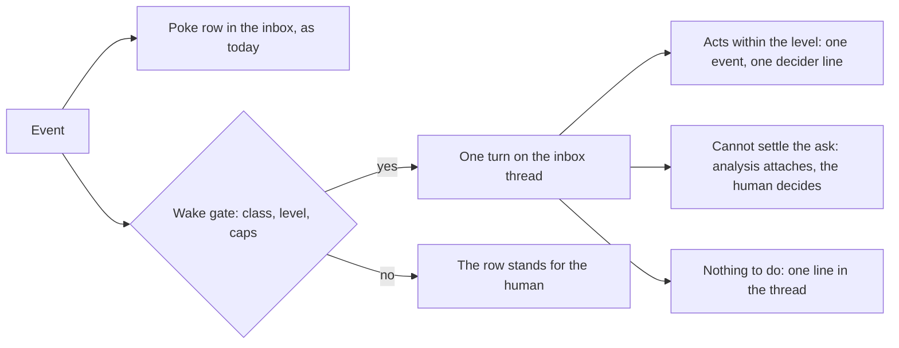

# The main agent: how it wakes, what it may settle, and how a card reaches it

Concept, 2026-10-17, from the session that asked where the main chat stands as the factory's controller. Sebastian decided the open questions in that session. The decisions carry the date where they stand. The build cards for the code repo carry this note.

## The frame

No persistent main agent exists, and none appears here. There is the best model the factory has, called with the right context, when there is something to do. The chat is the human's window onto that model and the record of what it did. Everything below is machinery for two questions: when to call, and what context to carry.

Today the answer to "when" is: only when a human posts a message (`chatPost`, internal/console/chat.go). Between messages the agent does not exist. Every loop around the chat that looks autonomous, the pokes, the pulse, the routines, the check-in, is deterministic factoryd code that never runs the project agent. That is the one large gap this note closes. Two smaller gaps sit beside it: a needs-you card has no door into the chat, and the agent cannot time its own attention.

## What exists today

The chat is a real tool-calling agent. One turn per message, at most 8 model calls, about 50 tools, per-thread turn serialization, compaction, proposals with undo, spend booked on the project's monthly chat task, €5 by default. The autonomy ladder is enforced per tool and recorded per act.

Where an agent act is logged, four records, one per act:

| Record | What it holds | Read where |
|---|---|---|
| Event feed | One event per act: actor, `via: chat`, decider, autonomy level, thread | Card timelines, the events page, the agent's `history` tool |
| The threads | The turns themselves, tool calls and results | The chat page |
| Gateway audit | One row per model call: tokens, cost, thread reference | The gateway's ledger |
| Forgejo | Commits and pull requests carry the chat attribution | The repositories |

The inbox thread is the running commentary: one poke row per state change, a decider line when the agent decided. "The board's state plus a record of recent high-level actions" is the inbox thread plus the pulse. Both are built. The gap is not logging. The gap is that the agent never reads the inbox uninvited, because nothing wakes it.

The rest of the base: five-part asks with buttons, first answer wins, settled state derived from events (internal/factoryd/settle.go). The check-in agent resolves worker failures before a human sees them, live since 2026-10-15. The agent reads worker transcripts (`session`, `session_steps`, `session_search`, 20 hits with 100-character excerpts) and its member's other active threads (`active_threads`). The notification channel is not a second system. It is the inbox thread. Messengers are a fan-out of its rows, outbox only.

## The wakes

Factoryd watches the event stream after a cursor. That is the Poker's own pattern (internal/factoryd/pokes.go). A wake is the same watch with a second effect: for a chosen event class, instead of only writing a row, factoryd starts one turn on the member's inbox thread. The turn is the existing chat loop. Same prompt, same tools, at most 8 model calls, same monthly chat task, events recorded `via: chat` with decider `agent`. No persistent process, no new session kind.

Three rules of the gate, settled in review:

- **One turn per wake, not one per member.** On a project with several members, the turn runs on the first notified member's inbox thread. With project-visible threads every member sees it. Today's projects have one member, so this collapses.
- **The turn runs as that member, like a message turn.** Actor the member, `via: chat`, decider `agent`, the birth kind marking the wake. No new identity in the event feed or the audit.
- **A wake never fires on the agent's own act.** The agent does not wake itself. The poke row still records the act for the human.

The initial classes and their levels:

| Wake class | Fires on | Levels |
|---|---|---|
| An ask is filed | `question_asked`, from any source: worker, deterministic stop, chat escalation | Autonomous and full auto only, decision of 2026-10-17 |
| A watched card moves | A state change of a card the agent subscribed to, section Timers | Assisted and above |
| A timer comes due | The agent's one-shot wake row | Assisted and above |
| The heartbeat | One turn an hour while the pulse sees work open, one a day when it sees the project idle | Assisted and above |

The level column is the initial split. The level review at the end of the build, below, finalises it. Wake turns carry exactly the powers of a message turn at that level. At assisted a wake may propose, and a proposal from a wake raises a poke row, so nothing proposes silently into a thread nobody is reading.

Wake turns are model turns on the chat budget, so they carry the pulse's guards: an event debounce, a rate cap of one wake turn per 10 seconds at most, one wake per card per minute. The exact numbers are settled at build time against the pulse's. The monthly cap stands. When the gateway refuses the chat task's spend, factoryd raises the fund ask in code, once, and no wake runs until it is answered. That is card #1013's lesson: a wake on budget death must ask for money, never spin.

## The ask attempt

Decision of 2026-10-17: at autonomous and full auto, every ask that would reach a human gets one model attempt before the human sees it. Below those levels, asks reach the human as today. "Requesting human help should be the exception, and only after exhausting what the AI can do" becomes the ladder's rule on the chat plane too, where the worker plane already has it.

The attempt is the wake turn on the ask. It reads the five parts and the card's own records: `card`, `card_history`, `session_search`, `ci`, `costs`, `alerts`.

Two rules of the gate, settled in review. An ask the project agent's own turn filed is exempt: that turn already had the context and concluded, so it was the attempt. Every other source gets one, the check-in agent's escalations included, since the check-in judges with fixed inputs and no tools, and the deterministic templates write no judgment at all. And a repeated ask that bumps its existing row does not re-run the attempt. Only a new ask does.

Three outcomes:

1. **It settles the ask within the level's permissions.** Example: a quiet-on-dependency ask where the right answer is to take over the dependency's work.
2. **It cannot settle, because the decision is the human's by nature.** The ask reaches the human with the attempt's analysis attached: what the agent found, and grounds. The grant, the direction call, the policy class stay the human's.
3. **It finds the ask obsolete.** The card moved on. The ask settles as answered no more, the way `WithdrawQuestion` does today.

The boundary, by the question families of the question-format note:

| Ask family | The attempt may settle it? |
|---|---|
| Spend and caps: call cap, check-in share, fund, month cap | No. Analysis and recommendation attach. The money stays the human's. |
| Quiet on a dependency | Yes: keep waiting, take over the work, close. |
| WaitChecks past its cap | Yes: keep waiting or close. |
| A worker's question, the thin tail | Often: the agent answers through the issue from its own reads. |
| Goal conflict, obsolete work | No: direction is the human's. |
| Policy class, access the factory lacks | No. |

The analysis does not add a sixth part to the question format. It folds into the existing five, inside "what you need for the call" and the recommendation, with the attempt named as its source, as the format's source rule already provides. First answer wins unchanged. An attempt that settles records one event and one decider line, like any agent act.

## The card door

Decision of 2026-10-17: every needs-you card gets a thread.

The card drawer and the inbox row get a talk-about-this-card control. It opens a chat thread bound to the card. Code writes the first message from the ask record: the five parts, plus the attempt's analysis if one ran. No model call. One thread per card, not per ask: a later ask on the same card appends to the same thread as a new ask row. Subscriptions and one-shot timers attach to the thread they were set in.

The thread is a normal project thread. The agent answers with the tools it already has. The reads for "why is this card slow": `card_history`, `session_steps`, `session_search`, `ci`, `costs`. The writes for "then do X": `steer`, `tell_card`, `grant_session`, `retry`, `close`. A decision the human types, "just do X and finish it", runs through the answer or grant tool as one act, or as a proposal below the level.

An answer in the thread settles the card through the same machinery as the inbox buttons: first answer wins, from wherever it lands. Buttons stay on the inbox row for the mechanical answers. The door is for everything else: "explain why this needs me", "analyse why it is taking so long", "do X instead".

The drawer links the thread, the thread links the card. The drawer's Chat tab keeps its meaning: the worker session's text and the steer box, the work's transcript rather than the conversation about the card. Its name is settled at build time so the two are not confused.

## Thread sight

Decision of 2026-10-17: threads are visible across the project. This reverses open question 213, should members see each other's threads, and the cross-thread search non-goal of the 2026-10-14 autonomy plan. Both are reversed by this decision, recorded here.

The agent's read tools extend from `active_threads`, the member's own threads today, to all project threads. A `chat_search` tool reads them, the pattern of `session_search`: capped hits, short excerpts, part-by-part reading of old rows. One crew, one memory. Inbox threads are shared commentary. No private threads in the first build.

This also answers the worry that the escalation log grows into a session of its own: the inbox is that log, and the agent now reads and searches it like any thread.

## Timers

Two shapes, both agent-owned and disposable, both distinct from routines, which stay factory-owned config in the tree:

1. **A subscription.** "Wake me when cards #1015 and #1017 change state." Stored against the thread. The wake fires on the matching event class, once per change.
2. **A one-shot.** "Check this in 5 minutes." A wake tool writes a row with a due time. factoryd fires it like a routine's cron, one turn, then the row is gone.

A small count per project caps them, settled at build time. Scheduling attention is not inventing tasks. The routines ruling stands: the agent never invents tasks, and a wake gives it a turn, not licence.

## What this is not

Not a persistent agent process, not a new session kind, not a second channel. The inbox thread is the channel. Messengers stay outbox only, the ruling of 2026-10-17. The agent still runs no code. Work that needs a sandbox becomes a card. The agent still never invents tasks.

## The work, in order

1. The wake caller in factoryd: event cursor, level gate, rate caps, the budget-death rule, and the first test of a turn no human started.
2. Ask attempts at autonomous and full auto: the boundary table against the question families, analysis folded into the five parts.
3. Card-bound threads: the binding, the door in the drawer and the inbox row, settling through the answer machinery, links both ways.
4. Thread visibility and `chat_search`.
5. Timers: subscriptions and the one-shot wake tool.
6. The level review: with wakes in place, revisit what each level guards, manual to full auto. Sebastian's decision of 2026-10-17 to hold this review after the build.
7. The doc pass: architecture.md 5.6 and 5.7 rewritten against this note. The area's open items fold into the build cards where they belong: roadmap 280 show_doc, 276 backlog pull, 205 main-loop pruning, 226 prompt pack and context snapshot, 30 answer chain, 145 notifications phase 3, and card #1013's budget-death handling.

The roadmap is Sebastian's to curate. No items are filed here.

## Decisions of 2026-10-17

| Decision | Source |
|---|---|
| Every ask gets one model attempt before the human sees it, at autonomous and full auto only | Sebastian, this session |
| The level definitions get a review pass after the build, so each level still guards what makes sense with wakes | Sebastian, this session |
| Threads become project-visible. Question 213 and the search non-goal are reversed | Sebastian, this session |
| Every needs-you card gets a bound thread with the ask as its first message | Sebastian, this session |
| Wakes fire on events, with a heartbeat as the failsafe. Intervals and caps settled at build | Recommendation of the session, unopposed |
