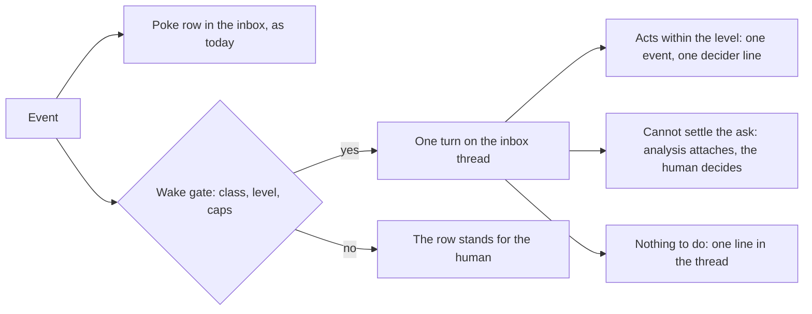

# The main agent: how it wakes, what it may settle, and how a card reaches it

Concept, 2026-10-17, from the session on where the main chat stands as the factory's controller. Sebastian decided the open questions of that session. The build cards for the code repo carry this note.

## The frame

There is no persistent main agent. There is the best model the factory has, called with the right context when there is something to do. The chat is the human's window onto that model and the record of what it did. Everything below answers two questions: when to call the model, and what context to give it.

Today the answer to "when" is: only when a human posts a message (`chatPost`, internal/console/chat.go). Between messages the agent does not exist. Every loop around the chat that looks autonomous, the pokes, the pulse, the routines, the check-in, is deterministic factoryd code that never runs the project agent. This note closes that gap, and two smaller ones: a needs-you card has no door into the chat, and the agent cannot choose when to check again.

## What exists today

The chat is a tool-calling agent. One turn per message, at most 8 model calls per turn, about 50 tools, one turn at a time per thread, compaction, proposals with undo, and spend booked on the project's monthly chat task, €5 by default. The autonomy levels are enforced per tool and recorded per act.

Every agent act lands in four records:

| Record | What it holds | Read where |
|---|---|---|
| Event feed | One event per act: actor, `via: chat`, decider, autonomy level, thread | Card timelines, the events page, the agent's `history` tool |
| The threads | The turns themselves, tool calls and results | The chat page |
| Gateway audit | One row per model call: tokens, cost, thread reference | The gateway's ledger |
| Forgejo | Commits and pull requests carry the chat attribution | The repositories |

The inbox thread is the running commentary: one poke row per state change, and a decider line when the agent decided. "The board's state plus a record of recent high-level actions" is the inbox thread plus the pulse. Both are built. The gap is not logging. The gap is that the agent never reads the inbox unless a human message brings it in, because nothing wakes it.

Also built: five-part asks with buttons, first answer wins, settled state derived from events (internal/factoryd/settle.go). The check-in agent resolves worker failures before a human sees them, live since 2026-10-15. The agent reads worker transcripts (`session`, `session_steps`, `session_search`, 20 hits with 100-character excerpts) and its member's other active threads (`active_threads`). The notification channel is not a second system. It is the inbox thread. Messengers are a fan-out of its rows, outbox only.

## The wakes

Factoryd watches the event stream behind a cursor, the same way the Poker does (internal/factoryd/pokes.go). A wake adds a second effect to that watch: for a chosen event class, besides writing the row, factoryd starts one turn on the member's inbox thread. The turn is the existing chat loop. Same prompt, same tools, at most 8 model calls, same monthly chat task, events recorded `via: chat` with decider `agent`. There is no new process and no new kind of session.

Three rules:

- **One turn per wake, not one per member.** On a project with several members, the turn runs on the first notified member's inbox thread. Every member sees it, since threads are project-wide. Today every project has one member, so this rule matters only when that changes.
- **The turn runs as that member, like a turn the member started.** The event feed records actor the member, `via: chat`, decider `agent`, and the birth kind column marks the wake. No new identity is needed.
- **A wake never fires on an event the agent itself caused.** The agent does not wake itself. The poke row still records the act for the human.

The wake classes and their levels:

| Wake class | Fires on | Levels |
|---|---|---|
| An ask is filed | `question_asked`, from any source: worker, deterministic stop, chat escalation | Autonomous and full auto only, decision of 2026-10-17 |
| A watched card moves | A state change of a card the agent subscribed to, see Timers | Assisted and above |
| A timer comes due | The agent's one-shot wake row | Assisted and above |
| The heartbeat | One turn an hour while the pulse sees work open, one a day when it sees the project idle | Assisted and above |

The level column is a first draft. The level review at the end of the build sets the final levels. A wake turn has exactly the powers of a turn the human started, at the same level. At assisted, a wake can propose, and a proposal from a wake also writes a poke row, so the human hears about it.

### The caps drop nothing

Wake turns cost money from the monthly chat budget, so they have caps, like the pulse. The caps limit how many wake turns run. They never drop an event. Every event is written to the event log and pokes the inbox, whatever the caps do. A cause without its turn waits. It does not expire. The wake machinery reads the same stream as the Poker, behind its own cursor, and moves the cursor only after the cause had its turn.

- Many events in one burst produce one turn, not ten. The turn starts after the burst settles, then reads the board and the card histories, so nothing in the burst is invisible to it.
- Asks queue and batch. Every ask gets exactly one attempt. Three cards that hit their cap in the same minute produce one turn that handles all three. If a turn is already running, further asks wait, like a message the member types while a turn runs.
- Card wakes combine. Two state changes of the same watched card inside the window produce one wake. The turn reads the card's history and sees both.
- Timers never combine. A due timer runs its turn, at once or as soon as a cap allows.

The numbers, set at build time against the pulse's: at most one wake turn per 10 seconds, at most one wake per card per minute. The monthly cap stands. When the gateway refuses the chat task's spend, factoryd asks for money in code, once, and no wake runs until the answer comes. Card #1013 showed why: a wake that finds the budget spent must ask for money, not run in a loop.

## The inbox stays one thread

Decision of 2026-10-17, after weighing a split: notifications and agent acts stay in the one inbox thread. The ask, the attempt's analysis and the answer button belong together, and the value of the record is its order: cause, attempt, question. A second thread for agent activity was rejected. The two streams would meet again at every ask, and the list of open asks never depends on the feed anyway: the needs-you column holds every open ask at any scroll position, and settled rows already fold.

Two rules for the build:

- A wake turn shows as one row with an expand, the same shape as a poke. The full text of the turn sits behind the expand.
- If the volume ever hurts, the tool is a filter on the inbox view: all rows, asks only, agent acts only. Not a second thread.

## The ask attempt

Decision of 2026-10-17: at autonomous and full auto, every ask that would reach a human gets one model attempt before the human sees it. Below those levels, asks reach the human as today. The worker side already has this rule, live since 2026-10-15. Now the chat side has it too.

Two rules about which asks get the attempt:

- The agent does not attempt its own ask. When the chat files an ask, that turn already studied the situation and decided that a human must decide. The attempt already happened.
- Every other ask gets one attempt: worker asks, check-in asks, and the questions the code templates write. The check-in sees fixed inputs and has no tools, and a template writes no judgment at all. The chat agent has the tools.

A repeated ask that only bumps its existing row does not get a second attempt. Only a new ask does.

The attempt is one wake turn on the ask. It reads the five parts and the card's own records: `card`, `card_history`, `session_search`, `ci`, `costs`, `alerts`. Three outcomes:

1. **It settles the ask within the level's permissions.** Example: a quiet-on-dependency ask where the right answer is to take over the dependency's work.
2. **It cannot settle, because the decision is the human's by nature.** The ask reaches the human with the attempt's analysis attached: what the agent found, and grounds. The grant, the direction call, the policy class stay the human's.
3. **It finds the ask obsolete.** The card moved on. The ask settles as answered no more, the way `WithdrawQuestion` does today.

The boundary, by the question families of the question-format note:

| Ask family | The attempt may settle it? |
|---|---|
| Spend and caps: call cap, check-in share, fund, month cap | No. Analysis and recommendation attach. The money stays the human's. |
| Quiet on a dependency | Yes: keep waiting, take over the work, close. |
| WaitChecks past its cap | Yes: keep waiting or close. |
| A worker's question, the thin tail | Often: the agent answers through the issue from its own reads. |
| Goal conflict, obsolete work | No: direction is the human's. |
| Policy class, access the factory lacks | No. |

The analysis does not add a sixth part to the question format. It goes into the five parts that exist, mostly into "what you need for the call" and the recommendation, with the attempt named as the source, as the format's source rule already provides. First answer wins unchanged. An attempt that settles records one event and one decider line, like any agent act.

## The card door

Decision of 2026-10-17: every needs-you card gets a thread.

The card drawer and the inbox row get a talk-about-this-card control. It opens a chat thread bound to the card. Code writes the first message from the ask record: the five parts, plus the attempt's analysis if one ran. No model call. One thread per card, not one per ask: a later ask on the same card appends to the same thread as a new ask row. Subscriptions and one-shot timers are stored on the thread they were set in.

The thread is a normal project thread. The agent answers with the tools it already has. The reads for "why is this card slow": `card_history`, `session_steps`, `session_search`, `ci`, `costs`. The writes for "then do X": `steer`, `tell_card`, `grant_session`, `retry`, `close`. A decision the human types, "just do X and finish it", runs through the answer or grant tool as one act, or becomes a proposal at a level that needs confirmation.

An answer in the thread settles the card through the same machinery as the inbox buttons: first answer wins, from wherever it lands. Buttons stay on the inbox row for the mechanical answers. The door is for everything else: "explain why this needs me", "analyse why it is taking so long", "do X instead".

The drawer links the thread, the thread links the card. The drawer's Chat tab keeps its meaning: the worker session's text and the steer box, the work's transcript rather than the conversation about the card. Its name is chosen at build time, so the two are not confused.

## Threads visible across the project

Decision of 2026-10-17: threads are visible across the project. This reverses open question 213, should members see each other's threads, and the no-search rule of the 2026-10-14 autonomy plan. Both reversals are recorded here.

The agent's read tools grow from `active_threads`, which today reads only the member's own threads, to all threads of the project. A new `chat_search` tool searches them, built like `session_search`: a cap on hits, short excerpts, reading old rows part by part. Every member sees every thread, including every inbox thread. There are no private threads in the first build.

This also answers an earlier worry, that the inbox grows into a record too long to read: the agent now searches it like any thread.

## Timers

Two kinds, both owned by the agent and thrown away after use. Routines stay as they are: factory-owned config in the tree, kept and reviewed.

1. **A subscription.** "Wake me when cards #1015 and #1017 change state." Stored on the thread. The wake fires on the matching event, once per change.
2. **A one-shot.** "Check this in 5 minutes." A wake tool writes a row with a due time. factoryd fires it like a routine's cron, one turn, then the row is gone.

A small count per project caps them, set at build time. A timer schedules attention, not work. The routines ruling stands: the agent never invents tasks.

## What this is not

Not a persistent agent process, not a new kind of session, not a second channel. The inbox thread is the channel. Messengers stay outbox only, the ruling of 2026-10-17. The agent still runs no code. Work that needs a sandbox becomes a card. The agent still never invents tasks.

## The work, in order

1. The wake caller in factoryd: event cursor, level gate, caps, the rule that caps drop nothing, the budget rule, and the first test of a turn no human started.
2. Ask attempts at autonomous and full auto: the boundary table against the question families, analysis inside the five parts.
3. Card-bound threads: the binding, the door in the drawer and the inbox row, settling through the answer machinery, links both ways.
4. Thread visibility and `chat_search`.
5. Timers: subscriptions and the one-shot wake tool.
6. The level review: with wakes in place, revisit what each level guards, manual to full auto. Sebastian's decision of 2026-10-17 to hold this review after the build.
7. The doc pass: architecture.md 5.6 and 5.7 rewritten against this note. The area's open items go into the build cards where they belong: roadmap 280 show_doc, 276 backlog pull, 205 main-loop pruning, 226 prompt pack and context snapshot, 30 answer chain, 145 notifications phase 3, and card #1013's budget handling.

The roadmap is Sebastian's to curate. No items are filed here.

## Decisions of 2026-10-17

| Decision | Source |
|---|---|
| Every ask gets one model attempt before the human sees it, at autonomous and full auto only | Sebastian, this session |
| The level definitions get a review pass after the build, so each level still guards what makes sense with wakes | Sebastian, this session |
| Threads become project-visible. Question 213 and the search non-goal are reversed | Sebastian, this session |
| Every needs-you card gets a bound thread with the ask as its first message | Sebastian, this session |
| Notifications and agent acts stay in the one inbox thread, one row per wake with an expand | Sebastian, this session |
| The caps limit wake turns and never drop an event. Causes queue and batch | Sebastian, this session |
| Wakes fire on events, with a heartbeat as the failsafe. Intervals and caps set at build | Recommendation of the session |
