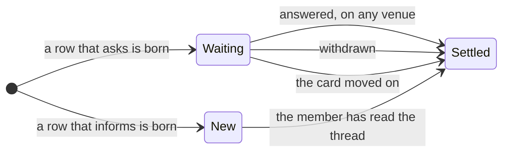

# Notification settling: a concept

Written 2026-10-17. Status: concept, nothing built. This file turns Sebastian's request of 2026-10-17 into a model and a plan: "I just want to be able to glance on these notifications and see which still need me and which I can ignore. And if possible I don't want to have an LLM on a loop checking these manually all the time. I would hope that we can have a deterministic rule for all of them, to not keep them all looking current forever." Sources: the inbox pokes of roadmap 239, [notifications.md](notifications.md), the [messenger plan](plans/2026-10-14-messenger-notifications.md), and the code of `ai-software-factory-code` at `eccff67`.

## 1. The problem in one picture

Every notification the factory has today is a poke: a row the Poker writes into each member's inbox thread, one per state change (`internal/factoryd/pokes.go:14`). Two things go wrong as the thread grows.

A poke that asks, a question that needs a person or a merge that waits for approval, keeps its amber rule and its answer buttons for as long as the row exists, because nothing ever marks the row done. The card behind it may have been answered on the board, in the chat or on the issue hours ago. The row only finds out when someone clicks its stale buttons, and the factory replies "answered already" (`internal/console/answer.go:101`).

A poke that informs, a card failed or done, a level change, a routine run, looks as new as the moment it was written. The only age signal is the unread count of the whole thread, which an inform row consumes as surely as a waiting question.

So a month-old inbox holds yesterday's answered escalation, a question that truly waits and a done notice from last week, all at the same volume. The fix is one rule, applied where the row is read:

## 2. Needs

1. **A glance tells the three apart.** A row that still needs a person, a row that only wants reading, and a row nothing wants any more must look different at one glance, in the inbox today and on the messengers later.
2. **The rule is deterministic.** Every state comes from a fact in Postgres: an event, a seen marker. No model judges a row, no loop re-reads the inbox, and nothing settles by the clock, because the clock is not a fact about the work. A month-old unread inform is still unread, and that is true information.
3. **An answer anywhere settles the row everywhere.** A question answered on the board, in the chat or on the issue settles the inbox row at once, without anyone visiting it.
4. **No second bookkeeping.** The board state is the truth and the event log is the history, the stage 15 principles. A settle is not a new fact, so it is never written, only derived. There is nothing to drift and nothing to backfill.
5. **Future surfaces inherit.** The messengers and Web Push of roadmap 145 take the rule with them: a settled ask is never sent, and a sent ask is edited when it settles.

## 3. The rule

A row's state is derived where the row is read, from three facts that already exist: the event that birthed the row, the card's events after the row, and the thread's seen marker. The state is never stored. One column is added, the birth event's kind on the row itself, because the row's own kind, poke or escalation, cannot tell an approval ask from a failed card's Retry buttons. The Poker writes it at birth. Existing rows get it from one deterministic migration join on task and time. The fallback is safe by family: an escalation-kind row is an ask whatever the join finds, since only `question_asked` births that kind, so no live question can dim; a poke-kind row that joins takes its family from the event; the rest, rows with no task or no match, read as informs. The migration logs every unmatched row that names a task, so a wrong family is visible rather than silent.

The two row families settle differently. Which family a row belongs to follows from its birth event:

| Birth event | Family | Open while | Settled by | Reason word |
|---|---|---|---|---|
| question_asked, the budget stop included | ask | no settling event for its card follows the row, and the card still waits | an answer, a withdrawal, or the card moving on | answered, withdrawn, moved on |
| approval_requested, merge and plan | ask | no settling event for its card follows the row, and the approval still waits | an approval, a rejection, a newer request, or the card moving on | approved, rejected, superseded, moved on |
| task_ended, all_children_done, autonomy_changed, card_filed, card_moved, plan_started, plan_accepted, card_retried, session_granted, routine_ran, question_withdrawn | inform | the member has not read the thread past the row | the seen marker | seen |

Four details carry the rule:

- **The ask rule.** A row that asks is open while both hold: no settling event for its card follows the row, and the card still waits. The settling events extend the list the click path already holds (`answerKinds`, `internal/console/answer.go`): `question_answered`, `session_granted`, `question_withdrawn`, `merge_approved`, `merge_denied`, `plan_accepted`, `plan_changes_requested`, `plan_rejected`, `card_closed`, plus `task_ended` and, for an approval row, a newer `approval_requested`, which supersedes. The wait check is the guard that makes the rule complete: whether a card waits is the same fact that puts it in the board's Needs-you column, the project's one truth for "needs a human", so a transition that ends a wait without an event on the list still settles its rows, with the reason "moved on". The reason word comes from the first settling event, and from the guard when no event names it. The render predicate and the click predicate share one function. A repeat bumps the same row's counter and clock (`pokes.go:300`), and the bumped clock sits after the earlier answer, so a re-asked question reads open again, which is correct.
- **The inform rule.** A row that informs is open until the member has seen it. The seen marker exists per member, repository and conversation (`chat_seen`), and opening a thread reads it up to the newest row (`internal/console/threads.go:220`). Every inform in the thread settles in that one moment.
- **The reason line.** A settled ask names its fact in faint mono, in the pattern of the decider line: "answered by sebastian · 14:02", "withdrawn", "superseded". The event carries the actor and the time. An inform needs no reason line, the dimming is its whole message.
- **Buttons follow the state, not the position.** Today the answer bar appears only when the newest row is an escalation (`static/chat.js:243`), so a routine inform that lands after a live question wrongly retires its buttons. Under the rule the bar shows while the newest ask row is open, whatever came after it.

One requirement makes the rule true rather than mostly true: every answer, whatever its venue, must land one event row. The console paths record theirs, and the issue path does too, intake records `question_answered` for an issue answer under its answer-once dedupe. Phase 1 checks the remaining venues and adds an event where one is silent. The wait guard bounds the damage of a silent venue in the meantime: the card no longer waits, so the row settles as "moved on" instead of lying open.

## 4. The surfaces

**The console inbox, today.** The only live notification surface. Settled rows recede: dimmed, amber rule and buttons gone, the reason line in their place, the pattern of the archived rows in the thread switcher, which already sit dimmer under their rule. The log order of the thread never changes. The exact look, and whether the inbox head names the count of open asks, is one condensed design round under [design/process.md](../design/process.md), not this file. A console with the thread open hears the settling event over the SSE stream it already subscribes to (`internal/console/events.go:313`) and re-renders the row live.

**The messengers, when roadmap 145 builds.** Two deterministic hooks, both on machinery that plan already holds. The send guard: the sender derives the row's state before sending, and an ask already settled sends nothing, so a notification queued for a card that moved on dies in the outbox. The settle edit: a settling event finds the sent message by its stored id, the delivery row keeps it, and edits the text to carry its reason word, "answered · 14:02". Telegram and Discord both let a bot edit its own message. Informs send once and stay as history there, since no per-member seen exists on a messenger and none is added. A pinned message the bot keeps current with the open asks was considered and dropped: it needs a second message held in step with every event, and the settle edits already carry the glance.

**Web Push, later in 145.** The send guard applies unchanged. A pushed message cannot be edited or recalled, the OS centre ages it on its own, and the console stays the place where the state is exact.

**Forgejo's own bell.** Outside the factory's render. The escalation comment on the issue stays as history, and the issue's state label, which factoryd keeps current, is Forgejo's own settle signal. Nothing to build.

## 5. What exists today

- The Poker: a factoryd loop, one pass every 5 seconds over events after a cursor, one row per member of the project's notify list, else its approvers (`internal/factoryd/pokes.go:14`, `cmd/factoryd/main.go:538`). The kinds it pokes on: `internal/factoryd/pokes.go:38`.
- Pokes are chat rows, not a notifications table: kind, choices, decider, task id, repeats (`internal/factoryd/chat.go:33`, migration `20261015130000_chat_pokes.sql`).
- Read state is one seen marker per member and thread, and unread is computed from it (`internal/factoryd/chat.go:189`). No row carries a read or resolved state.
- Rows are never edited, dimmed or deleted. A repeat bumps the row. A withdrawal writes a follow-up row, "needs you no more", instead of settling the first.
- First answer wins, with three replies: answered already, withdrawn, waits no more (`internal/console/answer.go:89`). This is the settling rule for the click path only, discovered by clicking.
- The alerts table carries the full lifecycle this concept wants for pokes: raised, resolved, verdict, resolved_by (`migrations/factoryd/0022_gates_alerts.sql:13`). The board derives its columns from card state at read. The concept applies these two existing patterns to the inbox.
- No external sender exists. The messenger plan's delivery rows, which store the sent message's id, are the hook its phase 1 leaves for settle edits.

## 6. Why there is no loop and no model in it

The settle is a read, not a job. The Poker's loop keeps writing rows on events, as today, and judges nothing new. The console derives each row's state when it renders the thread, and the SSE stream refreshes a thread that is open. The messengers' sender loop gains two hooks, a check before send and an edit after a settling event, both fired by events it already reads. No model call sits anywhere in the path. The pulse stays what it is, awareness written by a cheap model, and never a notification state.

## 7. The plan

Phase 1, the settle predicate and the console, one roadmap item in the code repository:

1. Draw the settling predicate out of `answer.go` into one function both paths call: the row, the task's events and the card's wait state go in, open or settled plus reason, actor and time come out. Table tests walk each row of the table in section 3, with the repeat bump, the re-ask, the superseded approval, the silent venue and the answer on another venue as cases.
2. Add the birth-event column to the row, written by the Poker, backfilled by the migration join of section 3.
3. Check that every answer venue lands its event, and add one where a venue is silent.
4. Derive the state in the chat render, dim the settled, show the reason line, and let the answer bar follow the state. The switcher's unread counts and the tab-title count read the same derived state, not the raw rows past the marker, so a settled ask stops reading as unread one level up. SSE refreshes the open thread.
5. Verify against the live console: answer an escalation on the board and watch its inbox row settle without a visit.

Phase 2, the look: one condensed design round on the inbox, the dim settled row, the reason line, the head count and the badge. Nothing in this concept changes a pixel by itself.

Later, inside 145: the send guard and the settle edit on the outbox and the delivery rows.

Non-goals: no new table, no stored state beyond the birth-event column, no deletion or rewrite of history rows, no per-row read flags, no age rules, no change to the alerts page, no messengers in this concept.

## 8. Rulings and what stays open

Sebastian ruled on 2026-10-17:

1. **Roadmap placement.** A new item, 292, and phase 1 is built next; 145 keeps the messengers and inherits the rule.
2. **The reason line.** Word, actor and time: "answered by sebastian · 14:02".
3. **The badge.** It splits, "1 needs you · 3 new". Phase 1 builds the split's logic in the console's plain styles, and the design round of phase 2 shapes it with the rest of the inbox's look.
