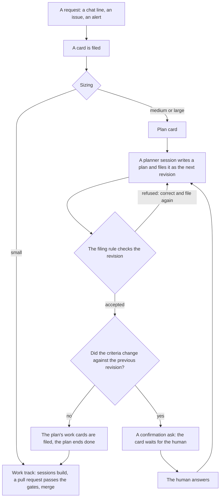

# Concept: the card #1345 incident from the ground up

Written 2026-10-31, from the live incident of the night of 30 to 31 October and the morning after. Status: concept, waiting for Sebastian's go. The plan fixes live in `internal/factoryd/plan.go` of ai-software-factory-code, the ask and carry-over fixes in the console.

## What you need to know first

Four things, in plain words:

1. **Cards.** The factory turns a request into a card: one unit of work with its own budget in euros and a small cap on how many agent runs it may use.
2. **Sessions.** A card runs agent sessions: short work runs by an AI agent inside a sealed sandbox it cannot leave. Every session spends from the card's budget. A session that cannot go on stops and asks, and the card then waits for a human. That question is the ask. It shows on the card and in the Needs you list.
3. **The chat.** Beside the board sits a chat with the project agent. It reads and writes files in the project's document repository, files cards and answers asks for Sebastian, the factory's one human. It is the main channel between the two.
4. **Money.** The factory holds the cost of every model call against the card's budget before the call runs. A card with too little budget runs nothing, not even the delivery of an answer.

## How the factory runs work today

Small work and big work run different paths, and the plan machinery sits between them:



**Plans and revisions.** A medium or large card goes to the plan track and becomes a plan card. A planner session reads the request and writes a plan: the work cards to create, plus criteria. A criterion is a named check: an id, a kind, and the test that proves it. Filing the plan creates a revision: one numbered version of the plan, revision 5, then 6, then 7. The filing rule accepts it, the factory stores it, and it becomes the newest revision, the current plan. Every old revision stays stored, so the history of the promise is never lost. A new revision appears whenever a planner session files a plan: on a first split, on a human's change request, or after an answer it must fold in.

**Two number lines.** The revision number and the criterion versions are two different counts. The revision number counts the filings of the whole plan: every filing, whatever it changes, becomes the next revision, 12, then 13. A criterion version counts the versions of one check: store_function_comments_v10, then v11, and it moves only when that one check changes. A plan holds cards, questions and several criteria together, so the two lines drift apart. One revision may change only cards, then no criterion version moves at all. Another may change two of five criteria, then two versions move and three stay. In the night every stored revision changed both criteria by one step, so revision 12 held v10 and revision 13 held v11.

**The filing rule, step by step.** Filing a plan is a tool call by the planner session. The factory checks the plan before it stores anything, and refuses the whole filing on the first problem. The checks, in their order:

1. The card must be running and on the plan track.
2. The plan must be one clean JSON block the factory can read. Unknown fields are refused, so a plan cannot carry surprises.
3. The factory loads the plan's own record: every revision stored so far, every card filed from those revisions, and which of them merged.
4. Settled cards. Cards of earlier rounds that finished are settled: the planner does not list them again. The factory refuses a plan that reuses a settled card's key, then adds the settled cards back itself and stamps every card with the filing's round number.
5. The shape checks. They run on every filing, the first one included. The round files a number of cards the process allows. Every card key is well formed and no key is used twice. Every card has a known role, and where the process wants them there is exactly one foundation card and exactly one integration card, the integration card last. Dependencies point at cards of the plan, no card depends on itself, nothing depends on the integration card, and the dependencies form no cycle. Each card's brief fits the size limits, and a named sandbox image is one the project has pinned. A spec process wants the plan to carry the spec's outcome before its criteria. The criteria are well formed: at least one, at most a cap, ids well formed and unique, each of a known kind with exactly the fields its kind uses (a test criterion names its test, its inputs and its expected numbers, and carries nothing else). Every card of the round cites its criteria, every citation names a criterion of the plan, and the integration card carries one item per criterion. The plan's questions, at most five, each offer two to five distinct choices. The outline of the rounds still to come is short and small.
6. The lineage checks. They compare the plan with the newest stored revision, so they run from the second filing on. The first plan has no previous revision to compare with, and these checks do not run on it. Two rules: an id the previous revision already holds must arrive with the exact same definition, and a changed criterion files under a new id. And a criterion that carries a `replaces` field must name an id the previous revision actually holds: nothing can succeed something that is not there. Both rules keep the record honest, no id may silently change what it means.
7. The replan checks, about the work cards rather than the criteria. A card is kept by its key, changed by a new card whose `from` names the old key, dropped by leaving the key out. A merged card's work stays on main unless the plan names it in `take_off_main`. A `from` must name a real card of the record, two cards cannot both start from the same old card, and a card that starts from another card's work takes a new key.
8. On any finding: the filing is refused, nothing is stored, the findings return to the session with the advice to correct the plan and file it again in the same session. The refusal of that night was two findings of the lineage checks.
9. With no finding: the factory stores the plan as the next revision number, records what the criteria added, removed and revised, restarts the child cards the change touches, and only then decides the next step: the confirmation ask, or the filing of the work cards.

**Why criteria change.** The criteria are the contract: the checks that decide at the end that the whole feature counts as good. They change for real reasons. The human asks for a different shape, as with the territory split that started this night. A finished card changes what is left to do. The spec moves. Or the filing rule refused the last attempt, and the correction counts as a change. A changed criterion files under a new id, and the new criterion carries a field `replaces` whose value is the old id: store_function_comments_v11 with `replaces: store_function_comments_v10`. The plan text itself names the successor and the predecessor, so the succession is always written down.

**The confirmation.** Because the criteria are the contract, a revision whose criteria changed asks the human to confirm before any work runs: no work runs against criteria the human has not seen. Cards ask nothing: the planner may split a card, add cards or drop cards, and a change in the number of cards alone asks no one, because only the filing rule judges the cards. Today every answer to that ask, including a plain okay, wakes a new planner session that is expected to file the next revision. That arrow, from the answer back to the planner in the diagram, is one half of the night's circle.

**From plan to work.** When nothing is left to ask, the plan's work cards are filed as normal cards and the plan ends done. They run the work track: sessions build in sandboxes, a pull request passes the gates, the merge goes live. The criteria gate then runs the plan's named tests on the assembled result.

## The night, step by step

1. Card #1345 asked for house doc comments on three old files of factoryd. The chat filed it, the sizing called it medium, and a medium card goes to the plan track.
2. Sebastian asked from the console for a split by territory. The planner filed it as a new revision. The split changed two things at once. The cards: one work card became two, one per territory. The criteria: the checks were split to match the cards, one criterion per territory card, and each new criterion was a changed criterion, filed under a fresh id that named its predecessor in `replaces`. The work stayed the same, writing doc comments. The checks that judge that work were re-shaped, and a re-shaped check is a changed criterion.
3. Of those two changes, only the criteria asked. Cards are the planner's craft: a plan may split a card, add cards or drop cards, and no one is asked, because only the filing rule judges cards. A change in the number of cards alone would have asked nothing. The criteria are the contract, and they had changed, so the plan asked Sebastian to confirm before any work ran. He answered okay.
4. The answer woke a planner session. Nothing had changed, so the session filed the plan unchanged: the same revision, word for word. Here the night took the wrong turn. An okay is permission, not input. Nothing was left to ask, so at this point the plan's work cards should have been filed and the work started. The machinery instead sends every answered ask back to a planner session, on the theory that an answer must be folded into the next revision. That is right when a plan question is answered with a choice, and an okay carries nothing to fold in. The session had nothing new to write, so it wrote the plan that was already stored.
5. The filing rule refused that re-file. The refusal was not about a change: the split had been accepted and stored hours before, cards and all. It came from the lineage check. First the check itself, then the night's last turn, one move at a time.

   The check. A criterion that changes files under a new id, and the new criterion carries a field `replaces` with the old id: store_function_comments_v11 with `replaces: store_function_comments_v10`. The rule reads that field and checks it against the newest stored revision: the named old id must be in that revision's list of criteria. The point of the check: a new plan may only replace a criterion that the previous revision still holds. A criterion that does not change keeps its id and must arrive with the exact same definition. That passes.

   A small example, with plan 1 and plan 2. Plan 1 holds the criterion A. A session files plan 2, with the criterion B and `replaces: A`. The rule checks against plan 1, the newest stored plan: A is in plan 1, the field is true, plan 2 is stored. Plan 2's list now holds B, and A stays in plan 1 only. Then plan 2 is filed again, word for word, still saying `replaces: A`. The rule checks against the newest stored plan, which is plan 2 itself, and asks: does plan 2 hold A? No, plan 2 holds B. Refused. The field was written for the moment plan 2 was filed, when plan 1 was still the newest. A re-file reuses it against plan 2 itself.

   The rule has no case for an identical filing. It never asks whether the arriving plan differs from the newest stored one. Every filing is treated as an amendment of the newest, and the `replaces` fields are checked against that newest revision. For a genuinely new plan that is right. For a re-file the check turns on itself, and that is the night.

   The last turn, move by move:
   1. Revision 12 was the newest stored revision. Its list held the criterion under the id v10.
   2. A session filed a new revision: the criterion under the new id v11, with `replaces: v10`. The rule asked whether revision 12's list holds v10. It does. Accepted, and stored as revision 13. Revision 13's list holds v11. Revision 12 stays in the stored history, still holding v10, but it is no longer the newest.
   3. A criterion had changed, so the plan asked for the confirmation. Sebastian answered okay.
   4. The answer woke a session. Nothing had changed, so it filed the plan of revision 13 unchanged. The plan still carried `replaces: v10`.
   5. The rule asked whether the newest stored revision's list holds v10. The newest stored revision was revision 13, the very plan being re-filed. Its list holds v11, not v10.
   6. The field named an id that was no longer in the newest list. The field had been true at move 2, when revision 12 was still the newest. Storing revision 13 moved the newest list from v10 to v11, and the same field, filed again, went stale. The rule assumes every filing is a new plan that amends the newest revision, so it checks each `replaces` field against that revision. This filing was not a new plan: it was the newest revision itself, unchanged. Its fields were checked against the very plan they came from, and that plan holds the successors, not the predecessors. Refused:

```
the plan was refused:
- criterion store_function_comments_v11: replaces store_function_comments_v10, an id the previous revision does not hold
- criterion kube_routine_comments_v11: replaces kube_routine_comments_v10, an id the previous revision does not hold
correct the plan and file it again in this session
```

6. That advice, correct the plan and file it again, demands exactly the one change the rule accepts: fresh ids. The session renumbered. A renumbered criterion is a changed criterion, so the plan asked a new confirmation. Step 3 again. And a filing without any criteria change could not break out either. Criteria that keep their ids and their definitions do pass, and no one is asked. But this plan's criteria carried `replaces` fields from their birth in the split, and a stored revision's `replaces` fields go stale the moment it becomes the newest. Re-filed with the fields, the plan is refused as in step 5. Re-filed without them, the criterion differs from its stored version, and the other lineage rule refuses it: the previous revision holds this id with another definition. Fresh ids are the only pass, and fresh ids ask again.
7. Nine turns ran this way, revisions 5 to 13. Revisions 8 to 13 each renamed both judgement criteria one step (v6 replaces v5, up to v11 replaces v10) inside 34 minutes. Fifteen planner sessions ran on the card between 23:39 and 01:40, all on the strong model, and the card asked and received confirmations for revisions 9 to 13 between 01:15 and 01:40. No work card was ever filed, no comment written, no issue touched.
8. Sebastian's instruction to the card said: if the gate refuses the metadata again, do not re-plan, report the exact refusal on the issue. The gate refused again. The session reached for gh, GitHub's command line client. It is not installed in the sandbox, and it speaks GitHub's API, not the forge's (see the reporting concept). Its last move was to stop and ask, at 01:41.

## The two defects, each harmless alone

1. **A re-file of the newest revision is judged as an amendment of itself.** The comparison in `revisionFindings` asks whether the previous revision holds each replaced id. When the incoming plan is the newest revision, the previous revision is the plan itself, and the ids its criteria name in `replaces` are no longer in that list, by design: a revision holds the successors, not the predecessors. An unchanged re-file is always refused, with advice that forces a renumber. The stored revisions exist throughout: plan_revisions holds every revision 8 to 13. The comparison is against the wrong thing.
2. **An answered confirmation always returns to the planner.** `RequestPlan` sends every fully answered revision to a planner session, on the theory that answers must be folded in. A confirmation answered okay has nothing to fold in. The session re-files (defect 1), the refusal renames, the rename re-asks the confirmation. The circle closes.

No move from the agent side can end it. Filing unchanged hits defect 1. Filing the criteria without the `replaces` markers hits the other refusal, "the previous revision holds this id with another definition". New ids pass, but re-ask the confirmation. The machinery must be fixed. The agents did nothing wrong.

## The ask reached the human, the blocker did not

The stop ask at 01:41 said: "This card stopped and needs your decision: how should it go on?" Its reason carried the session's stop note: told to report the exact refusal, and cannot. The refusal itself, the two criterion lines above, sat in the session's findings one query away. The ask wording also speaks of pull requests and re-verification, which fits no plan card. The fix: the ask quotes the refusal verbatim, and a plan card's ask names what its choices do. The channel question, why gh is refused on both counts, is argued in the reporting concept.

## The money walls

The loop did not only burn time. It starved every way out:

1. **The burn.** The card spent 4.60 EUR of its 5.60 EUR budget and used 12 sessions under a cap of 3 with 9 extras granted, all on planning.
2. **A choice press records, it does not pay.** At 06:35 Sebastian pressed the choice "Fund €1.50, file with fresh criterion ids" on the ask's Needs you card. The press closed that card and kept his words as its note. It moved no money and delivered no answer: card #1345 has had no event since the ask at 01:41. His instruction never reached the card it was about.
3. **The chat's own paths were refused.** The project agent tried to fund the card and got "Refused: This project sets no pool: discretionary_eur is absent or 0". It tried to send the answer directly and got "Refused: the remaining budget cannot fund a call: Raise the budget (Fund on the board) and answer, or close the card. 1.003 EUR of the 5.600 EUR budget remains, and a session's opening on premium needs 1.410645 EUR" (three opening calls on the strong model, quoted trimmed).
4. **What remained.** The Fund control on the card face, pressed by hand, then the answer. Nothing else moved.

With the loop fixed, #1345 needs none of this: the confirmed plan files its cards inside the factory with no session, so no budget and no session grant (see the fixes). The general gaps stay and are open decisions below.

## The dropped question

The same morning, in the chat. At 06:46 Sebastian asked for both concepts as committed text files: "Make a concept for this. But only if you can commit it as a text file into the repo. Can you do that?"

The reply promised three things: raise the card's budget, send the answer, and check where concept files can live. The check was a read of docs/roadmap.md, a read and not a write: nothing was ever added to the roadmap. Then the money walls took the turn, the next message was all fund and board, and the question can you do that was never answered. Every turn after that was a timer or a poke with its own job, and nothing in the chat carries an unanswered question into the next turn. The word concept appears nowhere in the chat after 06:48, and no file write happened at all that day.

The tool was never the gap. `write_doc` commits a new file to the document roots (docs/roadmap.md, docs/plans/, docs/board/ or docs/<name>.md), straight to master. The gap is the carry-over, and it is one of the fixes below.

## The alerts

The supervisor's gate-bound detector fired on every turn of the loop: seven alerts (2815 to 2828) opened and nothing closed them. With the loop gone they stop firing.

Checking them found a second defect: alerts 2292 and 2294 sit open on a card that finished done on 29 October at 10:55. Alerts outlive their cards. They need a resolution pass when their card ends.

## The fixes

1. **A re-file that equals the newest revision is a no-op.** In `FilePlan`, after the plan is normalised exactly as the stored one was (round stamps, settled cards of earlier rounds prepended), compare it with the newest revision by value. Equal: return "this is already revision N", store nothing, ask nothing, run none of the filing bookkeeping (no criteria records, no child restarts). Compare by value, not by hash: a settled card gaining its issue number between filings changes the hash of an otherwise equal plan.
2. **An unchanged criterion is exempt from the replaces check.** `revisionFindings` skips a criterion that the previous revision holds with the exact same definition. Its `replaces` marker is history, not an amendment. This keeps the no-op stable even when the value comparison drifts, and it is the correct reading of the freeze rule: only a criterion that is new or changed needs a `replaces` field.
3. **A confirmed plan files its cards instead of waking a planner.** In `RequestPlan`, when the revision's questions are all answered and every question was a confirmation answered with its offered choice word, the criteria are fixed: file the cards, end the plan done ("revision N filed M cards"). This covers the moment the confirmation is answered and every later pass, such as a plan card's stop ask answered with Go on. An answer that adds words returns to the planner as today, because it may carry a change. Real questions also return to the planner as today.
4. **The ask carries its own facts.** A plan card's stop ask names what its choices do (a planner session, holding the plan, closing the plan), not the generic card-stop wording about pull requests. When a session stops right after a tool refusal, the ask quotes the refusal verbatim in its info block. The blocker then reaches the human without any agent-side reporting; see the reporting concept for the channel question.
5. **An unanswered question carries over.** When a human message holds a question the reply does not address, the console carries the question into the next turn's prompt until a reply answers it, and the chat shows it as open. The morning's dropped question then cannot happen.

## Tests, hand-derived from the live shape

- Re-file the newest revision unchanged: no new revision row, no findings, the answer names the existing revision.
- Re-file after a settled card gains its issue number (values equal, hash different): still a no-op.
- A criterion identical to the previous revision's, stale `replaces` and all: no finding.
- A changed criterion under its old id: the existing "another definition" finding, unchanged.
- A revision whose only question was a confirmation, answered with the choice word: cards file, the plan ends done.
- The same revision answered with extra words ("okay, but drop the third criterion"): back to the planner.
- A revision with a real question answered: back to the planner, unchanged behaviour.
- A plan card's stop ask names planner sessions; the info block quotes the session's last tool refusal.
- A human question the reply does not address reaches the next turn's prompt, and clears when a reply answers it.

## What the fixes retire

The batching instruction. "File everything in one revision, keep confirmations down" was a prompt rule patching this loop. With confirmations filing cards, the tax is gone and the rule goes.

## What card #1345 does once this rolls

Answer "Go on" at its ask. No session starts, so the empty budget and the 12 of 12 sessions stop mattering and no Fund press is needed. factoryd files the two territory cards from the confirmed revision 13 and ends the plan done. If a planner session is already awake when the fix rolls, its re-file is a no-op and harmless.

## Open decisions

1. An answer to a stop ask at the card's budget floor: guaranteed by the project pool, or refused as today? The fixes make the case rare.
2. The alert resolution pass: close a card's open alerts when it ends, or when their subject ends?
3. The press that names money: a choice like "Fund €1.50" either moves the money and carries the instruction to its card, or its wording says it records the decision only.
4. The project pool: give the project a small discretionary pool so the chat can fund a card the human has approved, or keep every fund in the human's hand.

## Sources

The live events and plan_revisions of task t-cdb2a651712a and the chat ledger rows 3173 to 3201 of 31 October, both read from the controller's database. `internal/factoryd/plan.go` (`FilePlan`, `revisionFindings`, `RequestPlan`, `askConfirmation`). The conversations with Sebastian and the project agent's read of the same incident, 31 October.
