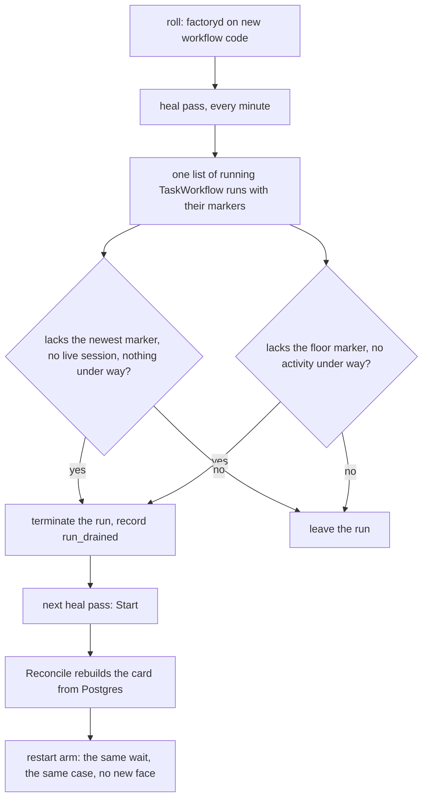
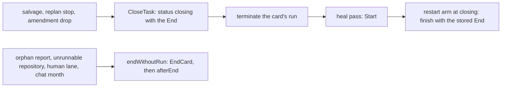

# Collapse the Workflow's History: Implementation Plan

**Status:** decided, not built. It waits for Sebastian's go.

> **For agentic workers:** REQUIRED SUB-SKILL: Use superpowers:subagent-driven-development (recommended) or superpowers:executing-plans to implement this plan task-by-task. Steps use checkbox (`- [ ]`) syntax for tracking.

**Goal:** The task workflow keeps one path per behaviour: 40 of its 41 change ids go with their old branches, a drain in the heal pass keeps every later change id short-lived, and a card's end, the over-bound push and the periodic loops each take one typed and bounded form.

**Architecture:** The factory already rebuilds a run from Postgres when its workflow dies. This plan uses that path on purpose: after a roll, the heal pass ends every run that started on older workflow code and has no live session, a run in review and a frozen run included, and its next pass starts the run again on today's code, so an old branch can go within a day instead of waiting for a human to answer. The same restart path carries the ends a card takes from outside its run, and the store writes every end with a typed kind in one transaction.

**Tech Stack:** Go (factoryd, agent-worker, console), Postgres, Temporal (Go SDK v1.44.0, server 1.32.0), Markdown.

**Spec:** None. The evidence in "The situation today" stands in for it.

## The situation today

All paths are in the code repository at main `c2dddcd67`, under `internal/factoryd/` unless they say otherwise.

### The pieces this plan touches

A card is a row of `tasks` (`store.go:32`). Its status says where it stands: `running` while a session works, `in-review` while its pull request passes the gates or waits for an approval, `waiting-human`, `waiting-poster` (the issue's author), `waiting-image` (a sandbox image) or `waiting-deps` while it waits on someone or something, `closing` while its end is under way, and `done`, `failed` or `closed` once it ended.

The task workflow is `TaskWorkflow` (`workflow.go:628-670`), a Temporal workflow. Each card has one, with the workflow id `task-<card id>`. A run is one execution of it. A run starts when the card starts and ends when the card ends, so a card that waits four days on a human has a run that is four days old.

Temporal keeps each run's history: every command the workflow code issued (an activity scheduled, a timer started, a marker recorded) and every result and signal. When factoryd restarts, or its worker drops a run from its cache, the worker replays the history: it runs the workflow code from its first line and matches each command against the recorded one. The match compares the activity's type and id alone, not its input (SDK v1.44.0, `internal/internal_task_handlers.go:1638-1650`). A command that differs is a nondeterminism error, and the run makes no more progress.

`workflow.GetVersion(ctx, id, min, max)` lets workflow code change without breaking the replay of older runs. The first time a run reaches the call, it records a marker with version `max` and adds `<id>-<max>` to the run's search attribute `TemporalChangeVersion` (SDK v1.44.0, `internal/internal_event_handlers.go:921-960`). On replay the call returns the recorded version, or `DefaultVersion` (-1) when the history holds no marker. The code takes the old branch for -1 and the new branch for 1. This plan calls the id a change id and the branch for -1 the old branch.

A floor is a call whose minimum equals its maximum, such as `workflow.GetVersion(ctx, "checkin-judgment", versionCheckinJudgment, versionCheckinJudgment)` (`workflow.go:655`). A history without that marker fails replay with the version error ("Workflow code removed support of version -1"), so no run older than the floor's change runs on today's code. A floor lets every older change id go: a run that carries the floor's marker started on code that already held every older change, so it recorded version 1 of each, or records it when it reaches the call.

The heal pass (`HealPass`, `temporal.go:339-438`) runs every minute (`cmd/factoryd/main.go:431`). For every open card it calls `Start` (`temporal.go:57-69`), which starts a run only when none runs. The reuse policy `ALLOW_DUPLICATE_FAILED_ONLY` (`temporal.go:304-312`) lets a new run start after one that failed or was terminated. A new run first reads the card back from Postgres and Forgejo (`Reconcile`, `activities.go:2428-2546`) and then takes up the card where it stands: the restart switch in `lifecycle` (`workflow.go:1567-1755`) has one arm per wait. A restarted run that waits on a human waits on the same case with a step and no new face (`healedTrip`, `ladder.go:1492-1500`, and `waitsAtHuman`, `ladder.go:1633`). This is how the factory heals a run that died.

A pass is a periodic job of factoryd. `Passes.Run` (`passes.go:21-29`) runs each pass on its own goroutine under a bound. It logs a run past the bound, sets the gauge `factory.pass.late` (`meters.go:139-150`) and reports each pass's age on `/readyz` (`cmd/factoryd/main.go:1140-1154`).

### How a change to the workflow lands today

The rule sits at `workflow.go:716-720`:

> A running workflow can wait days for its reviewer, so every change to the command sequence TaskWorkflow issues must be gated with workflow.GetVersion: add a version constant, branch on it, and keep the old branch until no workflow started before the change is still running

A change therefore lands as five pieces. The newest, `hold-stop` (commit `c1eca0015`, 2026-11-24), shows them:

1. A constant with a comment that says what the new branch does and what a run from before does (`versionHoldStop`, `workflow.go:1007-1015`). The 40 constants and their comments fill 296 lines (`workflow.go:721-1016`).
2. A call into a `taskRun` field (`workflow.go:665` into `holdStop`, `workflow.go:1227-1229`). 22 calls sit at the start of `Run` (`workflow.go:643-668`). The other 19 sit inline, where the branch is.
3. A branch at each site: `workflow.go:1917`, `2602`, `2610` and `2664`, plus a `HoldStop` flag on the session input whose only job is to carry the old path into the activity (`runner.go:331`, `378`).
4. A test that pins the old branch with `env.OnGetVersion("hold-stop", ...).Return(workflow.DefaultVersion)`. The tests hold 42 such pins for 31 ids.
5. Often a dev-server recording made just before the change, which replays the old branch (`testdata/devserver-human-wait-queue-before.json` and others).

### The 41 change ids

The table answers what each change id costs and when its old branch can go. "Task 1" means the `checkin-judgment` floor already refuses every history that could take the old branch: each of these commits is an ancestor of `566e4715d`, the commit that added `checkin-judgment` (`git merge-base --is-ancestor`), and `33650c96b` (2026-11-11 13:41) made it a floor. "Task 6" means the old branch can go once no open run lacks the newest marker. Old-branch lines are the drift review's count by reading, without the constant's comment, rounded.

| Change id | Added | Commit | Read | Old-branch lines | Pins | Goes |
|---|---|---|---|---|---|---|
| `cases` | 2026-11-03 | `01a992278` | start, floor (`workflow.go:648`) | 3 | 0 | Task 1, a floor `checkin-judgment` covers |
| `blind-proofs` | 2026-11-04 | `a58b9bf00` | start, floor (`668`) | 3 | 0 | Task 1, a floor `checkin-judgment` covers |
| `queue-waits` | 2026-11-04 | `b2667457a` | start (`652`) | 5 | 1 | Task 1 |
| `audit-draw` | 2026-11-09 | `c02228ab2` | start (`649`) | 2 | 1 | Task 1 |
| `case-queue` | 2026-11-09 | `c45b17faa` | start (`651`) | 3 | 1 | Task 1 |
| `checks-wait` | 2026-11-09 | `72b0ab0ed` | start (`653`) | 10 | 3 | Task 1 |
| `upstream-copy` | 2026-11-10 | `6b9b2a2bd` | start (`654`) | 2 | 1 | Task 1 |
| `surge-resume` | 2026-11-10 | `84f937a33` | start (`656`) | 7 | 2 | Task 1 |
| `checkin-clock` | 2026-11-10 | `3fdba20c9` | start (`644`) | 4 | 1 | Task 1 |
| `session-kill` | 2026-11-10 | `7f35c69d4` | start (`645`) | 5 | 1 | Task 1 |
| `wip-start` | 2026-11-10 | `5065b6fc1` | start (`657`) | 9 | 3 | Task 1 |
| `sized-least` | 2026-11-11 | `be1ae8411` | inline (`workflow.go:1328`) | 6 | 1 | Task 1 |
| `trip-model` | 2026-11-11 | `df0ffd3d7` | inline (`4273`) | 1 | 1 | Task 1 |
| `case-verdicts` | 2026-11-11 | `e0504db95` | inline (`4351`) | 1 | 1 | Task 1 |
| `case-faced` | 2026-11-11 | `aea368d9c` | inline (`4326`) | 1 | 0 | Task 1 |
| `checkin-judgment` | 2026-11-11 | `566e4715d` | start, floor (`655`) | 1 | 0 | Task 6, the floor moves to `hold-stop` |
| `case-held` | 2026-11-11 | `175980f4a` | inline (`4532`, through `caseHeld`) | 5 | 0 | Task 6 |
| `plan-case-held` | 2026-11-11 | `3290877a8` | inline (`plan.go:2663`) | 1 | 0 | Task 6 |
| `last-round-findings` | 2026-11-11 | `a485d3157` | start (`643`) | 14 | 1 | Task 6 |
| `checkin-priors` | 2026-11-12 | `cc061c10b` | inline (`2375`) | 10 | 1 | Task 6 |
| `auto-moved-head` | 2026-11-12 | `60030eff7` | start (`658`) | 45 | 3 | Task 6 |
| `closing-intent` | 2026-11-12 | `133faf040` | inline (`1571`) | 1 | 1 | Task 6 |
| `report-escalate` | 2026-11-12 | `522a191cb` | inline (`workflow_stages.go:1652`) | 3 | 1 | Task 6 |
| `ensure-issue-close` | 2026-11-12 | `d05db3978` | inline (`1285`) | 2 | 1 | Task 6 |
| `report-open-stop` | 2026-11-12 | `45e180d03` | inline (`1574`) | 1 | 1 | Task 6 |
| `roll-nothing` | 2026-11-12 | `6f3b6a04b` | inline (`2728`) | 1 | 1 | Task 6 |
| `agent-draw` | 2026-11-12 | `623ef348b` | start (`650`) | 2 | 1 | Task 6 |
| `checkin-mark` | 2026-11-12 | `d541a9152` | inline (`2969`, through `marksKept`) | 4 | 1 | Task 6 |
| `checkin-decision` | 2026-11-13 | `6af119cdb` | start (`659`) | 12 | 0 | Task 6 |
| `provider-freeze` | 2026-11-16 | `3c55aed83` | start (`660`) | 2 | 1 | Task 6 |
| `human-wait-queue` | 2026-11-17 | `c474a67f8` | start (`663`) | 10 | 1 | Task 6 |
| `no-typed-successor` | 2026-11-17 | `7c6d02b31` | start (`661`) | 3 | 1 | Task 6 |
| `session-time` | 2026-11-17 | `224b81932` | inline (`1910`) | 2 | 1 | Task 6 |
| `card-hold` | 2026-11-17 | `15792bf81` | inline (`deps.go:484`) | 1 | 1 | Task 6 |
| `successor-replans-its-plan` | 2026-11-18 | `44a1bbfa5` | inline (`plan.go:2186`) | 1 | 0 | Task 6 |
| `successor-is-its-keys-card` | 2026-11-18 | `046d13b9d` | inline (`1024`, through `keysCard`) | 2 | 2 | Task 6 |
| `plan-answer-grant` | 2026-11-18 | `29d1cbbdb` | inline (`plan.go:2291`) | 1 | 0 | Task 6 |
| `retry-press-drop` | 2026-11-18 | `fb18a1bf4` | start (`662`) | 4 | 1 | Task 6 |
| `asked-again-case` | 2026-11-18 | `f950290a5` | inline (`1033`, through `askedAgainCase`) | 1 | 0 | Task 6 |
| `room-window` | 2026-11-21 | `1cdd05e2b` | start (`664`) | 14 | 4 | Task 6 |
| `hold-stop` | 2026-11-24 | `c1eca0015` | start (`665`) | 10 | 1 | Task 6, its call stays as the one floor |

Totals: 15 ids go in Task 1, with about 185 non-test lines (old branches and gate conditions, 101 lines of constant comments, the fields and the calls) and 17 pins. In Task 6 the old branches of the other 25 ids go, about 365 non-test lines and 25 pins, with the calls of 24 of them and the call of `checkin-judgment`. One call stays: `hold-stop`, as the floor.

### What a restarted run rebuilds and what it loses

The drain in this plan restarts every run with no live session. Each wait has its own restart arm:

| Wait | Card status | Restart arm | Rebuilt from the store |
|---|---|---|---|
| A stop's case at the human | `waiting-human` | `workflow.go:1660-1716`: `awaitHumanAgain` (`4219-4226`), then `healedTrip` waits on the same case | the question, its choices, the answers, the usage, the pull request and its head |
| A cap's wait | `waiting-human` with a cap | `workflow.go:1633-1643`: `awaitCapWait` restored | the cap and the turn of its period |
| The screening's human | `waiting-human` in screening | `workflow.go:1615-1632` | whether a human answered |
| An image park | `waiting-image` | `workflow.go:1644-1659`: `awaitImage` | the park in `image_parks` |
| The issue's author | `waiting-poster` | `workflow.go:1717-1728`: `waitPoster` | the request, its time, the answers |
| Its dependencies | `waiting-deps` | `workflow.go:1540-1547`: `awaitDependencies` (`deps.go:440`) | `task_deps` |
| A report's open stop | `waiting-human` | `workflow.go:1573-1588` | the open case |
| A plan's questions or cap | `waiting-human` | `plan.go:2241-2275` | the plan's revision and the cap |
| A pull request in review | `in-review` | `workflow.go:1740-1748`: the head goes through every stage again | the pull request, its head and the stage memory |

`Reconcile` also rebuilds the stage memory from the timeline (`stageMemoryOf`, `activities.go:2596-2653`) and the mark of the newest check-in stop (`CheckinMarkOf`, `activities.go:2558`). The run keeps the rest in memory alone, in `taskRun` (`workflow.go:1092-1231`) and in `lifecycle`'s locals (`workflow.go:1291-1325`):

- **The session chain.** `parent`, `parentStop`, `parentOutcome`, `parentTrip`, `parentDeadEnd` and `handoverNote` are locals. `gateFindings` and `deadFrom` are fields whose own comments say "not rebuilt by Reconcile" (`workflow.go:1099-1100`). After a restart the next session gets no `ParentSessionID` (`workflow.go:1915`), so its brief carries no parent record and its check-in reads no parent (`runner.go:956-975`). This matters after every wait. Task 2 rebuilds it.
- **Counters of sessions in a row.** `pendingPods` and `platformDeaths` (fields), `refusals` and `unanswered` (locals) start at zero after a restart, so a card gets one more run of tries before the same ask. `holds` and `heldHeads` count moved-head restarts against `maxHeadHolds = 3` (`workflow_stages.go:664`). A restart gives up to three more. These are bounded and accepted, as for any run the heal pass restarts today.
- **Answers held in memory.** `resolvedQueue` holds the answers to cases the run did not wait on (`workflow.go:1190-1193`). `kept` with `inCaseWait` holds replies read before the face was known (`workflow.go:1194-1197`). `planTaken` holds the answer comments the plan loop took (`workflow.go:1170-1173`). Each needs a check before the drain ships: a restarted run must not ask its human again or count an answer twice. Task 4 tests each.
- **The rest.** `screened` (how many of the author's answers the screening read) makes a restarted `waiting-poster` card screen its answers again, which is one more screening call. `death` rides the next stop, and after a parked wait the next stop follows a new session that records its own. `copiedHeads`, `gateRuns`, `lastGates`, `syncedHead`, `checkedHead`, `inTurn`, `turnLost`, `asked` and `askedCard` belong to the review and the merge. A restarted run in review takes its head through every stage again, which costs one review and one audit model call and can give another verdict. A restarted frozen run (status `running`, waiting on a provider limit) starts a session the provider refuses again, and the card freezes again.

### The replay corpus

`TestWorkflowReplaysDevServerHistories` (`workflow_test.go:1843-1876`) replays every `testdata/devserver-*.json` and `testdata/history-*.json`, and checks that each activity's newest recorded input decodes into today's activity. Its comment promises that each history "holds the markers of the changes whose minimum the workflow keeps at their version, so a run that waits in review takes today's end".

No `history-*.json` exists. The 24 live histories went on 2026-11-11 (`e7e95613e`, `aff11a0e6`) because they predated the floor. The 15 dev-server files (34,826 lines, 3.2 MB) are runs under stub activities, added between 2026-11-11 and 2026-11-18. Most were recorded just before one change, to pin that change's old branch. None carries `no-typed-successor`, `retry-press-drop`, `room-window` or `hold-stop`, so every replay takes the old branch of each of them (checked with `jq` over each file's markers). `withDrainedMarker` and `shiftIDs` (`workflow_test.go:1929-2004`) insert a `blind-proofs` marker into a history that lacks one. All 15 files carry it already. `testdata/README.md` still describes `history-*.json` files.

### The over-bound push travels as text

A session whose end push the card's line bound refuses ends with the worker's text in its summary: "push refused: over the card's line bound" (`pushOverBoundMark`, `workflow.go:5034`). Six places read that protocol back from text:

- `workflow.go:2208` closes the card into a successor when the summary contains the mark.
- `activities.go:1443` turns a second over-bound end in one line of successors into a human's case, by the same `strings.Contains`.
- `activities.go:523-527` (`continuesOverBoundWork`) tells such a line by the successor's objective text.
- `activities.go:531-545` (`overBoundAgain`) reads the line counts back from the summary with the regular expression `overBoundMeasure` (`pushrules.go:87-89`).
- `runner.go:1077` points at the session's start when the summary contains the mark.
- `runner.go:1113` matches the worker's push-failed event by its error text.

The path grew in four commits in under three hours: `c043aba90` (2026-11-10 22:34), `e6ece4c40` (23:10), `c16155e39` (2026-11-11 00:35) and `7059f3f95` (01:14). Every other session end has a typed outcome (`OutcomeNoPush`, `OutcomeHeld` and the rest, `workflow.go:307-345`).

The kind of a stop is the same drift: `CaseKindOf` (`cases_events.go:306-340`) parses it from the stop's reason, and the restart switch picks its arm from the stop's question text (`AtSessionCap`, `atGateStop`, `atCheckinSpend` and others, `workflow_stages.go:88-190`). The plan "One close for every card" types it. This plan leaves the predicates as they are and moves the switch into its own function (Task 14), inside which that plan replaces them.

### A card's end

One function runs every status UPDATE: `changeStatusOn` (`store.go:2743-2768`). `TransitionTask` refuses a move to `closed`, so a close goes through `EndClosed`, which stores the reason (`store.go:2546-2569`). The decision and its record are spread out:

- The workflow ends a card at 114 `t.finish(final, reason)` sites: 75 in `workflow.go`, 28 in `plan.go`, 11 in `workflow_stages.go`. 54 pass on a `final, why` pair a wait decided. The 60 others build a free string, 25 of them `"<step>: " + errMessage(err)`. About 205 lines in the workflow files carry such pairs.
- Readers parse the reason back by prefix: `report.go:56` and `report.go:364` (`ReasonCardGone`), `console/faceview.go:443` and `console/chat_tools.go:982` (`"closed "`).
- `changeStatus` writes the `task_status` event after the UPDATE, outside its transaction, and only logs a failed write (`store.go:2732-2737`, `2771-2777`). A status change can stand with no record.
- `EnsureChatTask` closes the chat task of an earlier month with a raw `UPDATE tasks SET status = 'closed'` and no event (`chat.go:164-167`).
- The migration `20261127103000_closing_reason_backfill.sql` rebuilds reasons from events, because an end did not always store one.
- Four routines repeat the work after an end by hand: `Runner.finish` (`activities.go:3322-3429`), `finishHumanTask` (`intake.go:1707-1745`), `AlertIntake.endCard` (`signozwebhook.go:676-687`) and `Completion.Complete` with its `finished` (`completion.go:61-110`). Three ends call `EndClosed` and skip `taskEnded` (`events.go:297`), so they free no queue slot and wake no dependent: `ReleaseKeeper.closeAsk` (`releasekeeper.go:604-617`), the schema copy's close (`schemasync.go:391`) and `finishPlanClose` (`verdict.go:2928-2948`).
- `closedWithoutMerge` returns the constant `"closed"` (`workflow.go:5019-5021`). The comment that documents `finish` sits above `pushOverBoundMark` instead (`workflow.go:5023-5029`).

Eight ends happen outside the card's workflow. The table answers which of them have a reason to.

| End | Where | Does a run of the card live? | Verdict |
|---|---|---|---|
| The orphan report | `temporal.go:607-626` | no: its card is gone, its run completed, died or never ran | legitimate |
| The unrunnable repository | `temporal.go:390-398` | no: no run can start | legitimate |
| The human lane | `intake.go:1707-1745` | no: a `human` card has no workflow (`temporal.go:367-373`) | legitimate |
| The chat task's month | `chat.go:164-167` | no: a chat task has no workflow (`temporal.go:364-366`) | legitimate |
| The salvage | `act.go:1387-1432` | yes, stuck | the decider is outside, the end should run in the card's run |
| The plan's replan stop | `replan.go:572-584` | yes, between sessions | same |
| The plan's amendment drop | `plan.go:3440` | yes or no | same |
| The revert handover | `grouprevert.go:561-598`, from `RequestApproval` (`gates.go:2416`) | yes, it is that run's own activity | the activity should hand the end to its run |

The four ends with a live run call `Runner.Finish` and then terminate the run (salvage, `act.go:1424`) or leave it to `endStrayRuns`, which ends it after the project's `run_quiet` wait (`temporal.go:565-596`).

### The loops

18 passes run through `Passes.Run` or `Passes.RunLive` (`cmd/factoryd/main.go:431-485`). 23 more loops run by hand, with no bound, outside `/readyz` and outside `factory.pass.late`. The drift review counted 13. The count here is every `go` statement in `cmd/factoryd/main.go` that starts a periodic loop:

| Loop | Defined at | Started at `main.go` | Every | Shape |
|---|---|---|---|---|
| `Registrar.ReconcileLoop` | `register.go:266` | 378 | 1 min, a full pass hourly or on a new configuration | own |
| `Imager.Run` | `imager.go:171` | 406 | 1 min | logs an error once until it changes |
| `Routines.Loop` | `routines.go:85` | 425 | 10 s | own, logs an error once |
| `Completion.SettleLoop` | `completion.go:160` | 486 | 1 min | ticker copy |
| `PolicyLoader.Watch` | `policy.go:276` | 491 | 30 s | ticker copy |
| `SweepLoop` | `policy.go:548` | 492 | 1 min | ticker copy |
| `MonthAlarm.Loop` | `monthcap.go:223` | 495 | 1 min | ticker copy |
| `FreezeCard.Loop` | `freezecard.go:308` | 496 | 1 min | ticker copy |
| `ChatBudgetCards.Loop` | `chat_budget_card.go:193` | 497 | 1 min | ticker copy |
| `CIRuns.Run` | `cimetrics.go:114` | 499 | 1 min | logs an error once |
| `RollWatcher.Run` | `roll.go:177` | 502 | 15 s | logs an error once |
| `Roller.Run` | `rolltask.go:549` | 509 | 15 s | logs an error once |
| `ChainPoller.Run` | `chainpoll.go:531` | 516 | 15 s, and at once on a nudge | own, logs an error once |
| `DepProber.Run` | `dephealth.go:124` | 535 | 1 min | logs an error once |
| `RevertPass.Loop` | `revert.go:64` | 537 | 24 h | own |
| `cloudres.Collector.Run` | `internal/cloudres/collector.go:115` | 538 | its interval | own |
| `Runner.LeaseLoop` | `runner.go:3582` | 539 | 10 s | own |
| `Sender.Loop` | `sender.go:50` | 634 | 5 s | ticker copy |
| `Poker.Loop` | `pokes.go:108` | 809 | 5 s | ticker copy |
| `Monitor.Loop` | `monitor.go:45` | 812 | 5 s | ticker copy |
| `Waker.Loop` | `wakes.go:134` | 816 | 5 s | ticker copy |
| `BriefWriter.Loop` | `brief.go:169` | 820 | 5 s | ticker copy |
| `CISpawner.Run` | `ci.go:318` | 842 | its poll | own, the shutdown waits for its end |

Inside the workflow, six waits share one skeleton: a wake list, a `pass` closure that checks `decided()` and a person's replan, a selector, and `awaitBurst` (`workflow.go:4838-4867`) for an answer in parts. They are `awaitAnswer` (`workflow.go:4380`), `awaitApproval` (`workflow.go:3250`), `waitPoster` (`workflow.go:4886`), `awaitPlan` (`plan.go:2746`), `awaitDependencies` (`deps.go:440`) and `turn` (`queue.go:428`). The replan preamble (`takeToPlan`, then `switchFromWait`) repeats in three of them (`workflow.go:3290-3297`, `4401-4405`, `4903-4907`). The plan loop already calls the card loop's shared steps for its cap and its grant (`readRaise`, `capGrant`, `recordGrant`, `sessionCapCard`, `ask`, `plan.go:2283-2306`).

### The long functions

| Function | Defined at | Lines 2026-10-25 | Lines now |
|---|---|---|---|
| `taskRun.lifecycle` | `workflow.go:1282-2267` | 717 | 986 |
| `Runner.runSession` | `runner.go:837-1646` | 403 | 810 |

The first column is the drift review's measurement at `2d71c80aca`. `lifecycle` holds 77 lines under version gates and the 21-arm restart switch. `runSession` holds about 120 lines that take over-bound work (`runner.go:1048-1083`, `1113-1180`, `1285-1298`).

### The design repository describes October

`docs/architecture.md:6058` speaks of "our 18 `GetVersion` calls". The passage at `docs/architecture.md:5556-5578` lists the change ids of Stages 6 to 12, all removed on 2026-11-12 (`054d6bcf8`), and says "A replay test runs every recorded live history in the code repository's testdata", which no longer holds. Twenty lines name a change id that no reader finds in the code once Task 6 lands: 1080, 1230, 1240, 1254, 1323, 1925, 4531, 4665, 4669, 4991, 5041, 5053, 5128, 5234, 5261, 5397, 5412, 5438, 5452 and 5507.

## Why this is drift

**One way only.** Each of the 41 change ids keeps two behaviours of the workflow. Fifteen of the old branches cannot run at all: 13 predate the floor, and two floors refuse nothing the third does not refuse. The other 25 wait on a condition with no bound: "until no workflow started before the change is still running". A card waits on a human for as long as the human takes, and on the issue's author for up to 14 days (`infoWait`, `workflow.go:1069`). The project collapsed by hand twice, on 2026-11-04 (`2c6bdc203`) and on 2026-11-12 (`054d6bcf8`, 85 ids). Between 2026-11-03 and 2026-11-24 it added 41 ids, about two a day. The cost is about 550 non-test lines of old branches, constant comments and fields, 42 test pins, five pre-change replay tests in 344 lines, and 3.2 MB of recordings. A reader of `workflow.go` reads 296 lines of version comments before the struct they explain.

**Reliability by construction.** The replay test promises "a run that waits in review takes today's end". Its corpus holds stubbed runs recorded before 2026-11-18, each pinned to old branches. No recording replays the new branch of the four newest start-of-run changes, so a change that reorders the commands inside one of them passes the test. The over-bound push is a protocol parsed from text in six places, and its four commits in under three hours each patched one reader. A rewording of the worker's message breaks the close into a successor with no compile error and no test that names the coupling.

**Transparency.** A card's end is a free string built at 114 sites. Readers recover its meaning by prefix. A status change records its event outside its transaction, and the chat task's close records none. Three ends skip `taskEnded`, so a dependent waits on a card that ended. 23 loops are invisible to `/readyz` and to `factory.pass.late`: a hung `Monitor.Loop` or `Roller.Run` shows nowhere. `docs/architecture.md` describes a versioning that ended in October.

**Like Kubernetes, no special exceptions.** Every hand loop has its own skeleton, its own error log and its own first-run timing. Six waits each build the same selector and the same replan check.

## The trade-off

**What it costs and risks.**

- The drain ends live runs on purpose. A fault in it ends runs that should go on. It ends only a run with no live session, meaning no pending activity, child workflow or workflow task, with its card read twice, and the heal pass starts the run again within a minute. A run in review and a frozen run are included: each drain costs one review and audit call for every run in review, and a frozen run that freezes again. Each end leaves a `run_drained` step on the card's timeline.
- A restart loses what the run kept in memory. Task 2 rebuilds the session chain. Task 4 tests the three answer fields before the drain ships. The counters and the rest are bounded and accepted above.
- A human's answer can reach a run in the gap between the drain's read and its terminate. The drain skips a run with a workflow task pending, which a delivered signal creates. The gap left is one call to Temporal, the same gap a run that dies has today.
- Deleting the old branches deletes the tests of runs from before. That is the purpose: no run can take them.
- The typed end touches about 205 lines of workflow code and every end outside it. The corpus recorded in Task 6 checks that the commands stay the same.
- Moving the loops into `Passes` changes when each first runs (at once, not after one interval) and cancels a run at its bound. Each bound must sit above the loop's own longest call. Task 12 lists them, inferred, for review.

**What it buys.** About 940 non-test lines go net, 42 pins and 3.2 MB of recordings that guard old paths. An old branch lives about a day after its roll instead of as long as the oldest human wait. One rule with a bound that a test enforces. The over-bound protocol becomes a field the compiler checks. Every end leaves one record with a kind, and every periodic loop shows its age and its lateness.

**What stays, and why.**

- `GetVersion` itself stays. Sessions and runs in review span rolls, so the workflow still needs markers for them.
- The restart from the store is the right shape: Postgres is the record and the run is disposable. The drain is built on it.
- `changeStatusOn` as the one status UPDATE is the right shape. Task 7 keeps it and moves its event into its transaction.
- `Passes` is the right shape. Task 12 gives it three small options and moves the loops in.
- `healedTrip`'s wait on the same case with no new face, and the `case_signals` outbox (`cases.go:609-657`), make a restart invisible to the human.
- `names_test.go` refuses a removed change id. That stays, and grows by 40 names.
- The plan loop's cap and grant already run through the card loop's shared steps. Its loop around them differs in what a session produces (a plan revision, not a push), so only its wait moves into the wait builder.

**Alternatives considered.**

- **Keep the rule and collapse by hand when runs age out.** This is today's practice. It loses because a human wait has no bound, and the corpus decays between collapses.
- **Temporal's Worker Versioning with pinned workflows.** `docs/architecture.md:6058` already rejects it: "a Pinned workflow blocks its deployment from draining while it waits days on a human". It would keep old factoryd builds alive for days.
- **Continue-as-new at each wait on a drain signal.** The run would hand itself to a fresh run. It needs an arm in every wait, and it adds a second restart path beside the heal pass's. It loses on one way only.
- **One change id with a rising version.** One call, `GetVersion(ctx, "epoch", floor, current)`, would replace every name. Two branches developed in parallel would take the same number, as two fixes of Stage 10 both took `v21` (`docs/architecture.md:5567-5568`). Named ids prevent that, and the drain works the same with names.
- **A new outcome `OutcomeOverBound` instead of a field.** The over-bound end runs the `no_push` handling first (`sessionReturn`, `workflow.go:2205`), so a new outcome would copy that arm. A field on the result keeps one arm.
- **A classifier that derives the end's kind from its reason in the store.** It parses text again, the drift this plan removes.

## The proposal

**The target shape.** The workflow reads at most two change ids, both at the start of `Run`: the floor and the newest. Today's 41 become one, `hold-stop` as the floor, and Task 10 adds `over-bound` as the newest. The heal pass drains: every minute it ends a run that lacks the newest marker and has no live session, and every idle run that lacks the floor, and its next pass starts each again on today's code. `Reconcile` rebuilds the session chain, so the first session after a restart continues its parent. A committed recorder records the replay corpus on today's code at each floor raise. The over-bound push is a typed field from the worker to the workflow. A card ends one way: an `End` with a kind from a closed set, one store function in one transaction, one routine after the end, and ends from outside a run go through the heal pass. Every periodic loop runs through `Passes`. The six waits share one builder, and `lifecycle` splits at its restart switch.

**The rule that replaces `workflow.go:716-720` and the Global Constraint on change ids.**

> A change needs a `workflow.GetVersion` change id when a history recorded before it would make today's code issue other commands. A change to an activity's input or options, or to code around the same commands, needs none, and the replay of the corpus proves it. Every change id is read at the start of `Run`, and `Run` reads at most two: the floor and the newest. The pull request that adds a change id first raises the floor to the newest id, once `/readyz` shows `runs_without_<newest> 0`, deletes every older branch and records the corpus again. The heal pass ends every run that lacks the newest marker and has no live session, so that count falls within minutes of the roll for every card that is not in the middle of a session.

**The drain.**



A run has no live session when Temporal shows no pending activity, no pending child workflow and no pending workflow task. The card's status does not matter: a run in review and a frozen run restart like a run in a wait. The drain reads the card again after Temporal's answer and ends the run only if the card is still open and the status still holds. A run that lacks the floor's marker cannot replay on today's code at all. The drain ends it in any open status once no activity is under way, so a floor raised too early costs a restart, not a run stuck on the version error. The heal pass also counts the open runs that lack each marker, and `/readyz` prints `runs_without_<id> <count>` for the floor and the newest. After a drain only runs with a live session hold the count, and they fall out of it at the next pass that finds them idle.

**An end from outside a run.**



A decider outside the card's run stores the end and ends the run. The restart arm at `closing` (`workflow.go:1596-1597`) then finishes the card through `Runner.finish`, the same end every run takes. A card with no workflow ends through `endWithoutRun`. The revert handover hands its end back to its own run as `RequestApproval`'s result.

**Deletions and additions.**

| Part | Tasks | Non-test lines out | Non-test lines in | Tests and data |
|---|---|---|---|---|
| Old paths no history can take | 1 | about 185 | 0 | 17 pins and 76 helper lines out |
| The drain and the session chain | 2 to 4 | 0 | about 120, inferred | 14 tests in |
| One floor | 5, 6 | about 365 | about 10 | 25 pins, five pre-change tests (344 lines) and 15 recordings (3.2 MB) out, a recorder (about 250 lines, inferred) and 11 recordings in |
| One end | 7 to 9 | about 270 | about 155 | the drift review's estimate, not diffed |
| The over-bound field | 10, 11 | about 15 | about 25 | inferred |
| Passes | 12 | about 300 | about 30 | inferred |
| One wait builder and the split | 13, 14 | about 200 | about 60 | inferred |
| `docs/architecture.md` | 15 | about 40 doc lines | about 12 doc lines | |

The net change is about −940 non-test lines. About 550 of them are counted by reading, the rest inferred.

**Seams with the other plans of this review.**

- **"One close for every card"** types the stop's kind (`TripInput.Kind`, the case kind in `RunState`). Task 14 moves the restart switch into `resume` with its question-text predicates as they are, and that plan replaces them there. That plan's end of a human card inside `Act` calls this plan's `EndCard` and `afterEnd` (Tasks 7 and 8). If it lands first, Task 8 moves its end. That plan deletes the closers' loops (`MonthAlarm.Loop`, `FreezeCard.Loop`, `ChatBudgetCards.Loop`) and the passes `cleared_alerts` and `event_alerts`. Task 12 moves only the loops still standing when it starts. If that plan files a new freeze card per episode, `Reopen` (Task 7) loses its caller at `freezecard.go:1752`.
- **"The factory's own repository is a project like any"** deletes the roll's `t.rolling` branches and may delete `RollWatcher.Run` and `Roller.Run`. Task 9 types the roll's ends as they are, and Task 12 moves the two loops only if they still exist.
- **"The config says it once"** owns the process-file entries. Nothing here touches them.

## Decisions

1. **The drain restarts every run with no live session.** It restarts a run in review and a frozen run too, because the factory is in dev mode and keeps no backward compatibility. The cost is one review and audit call for every run in review at each drain, and a frozen run that freezes again. Veto line: the four parked waits only (`waiting-human`, `waiting-poster`, `waiting-image`, `waiting-deps`), as this plan first recommended. A floor then waits for runs in review and frozen runs.
2. **A committed recorder records the replay corpus** on a Temporal dev server under stub activities, one history for each wait and each restart arm, recorded again at each floor raise. Histories exported from live runs would carry card text, human answers and findings into the code repository, which GitHub mirrors in public. The stubs cost real activity results. The activity inputs, which the decode check reads, are real, since the workflow builds them. Tasks 5, 6 and 9 build this.
3. **A test caps the workflow at two change ids,** the floor and the newest. Default: the cap stands. Veto line: none stated, so it stands unless Sebastian vetoes it. The pull request of every workflow change first collapses the change before it, at the cost of a precondition on `/readyz` and a recording of the corpus in that pull request. Task 6 holds the test.

## Global Constraints

- Code work runs in a git worktree off `origin/main` of `~/repos/ai-software-factory-code`. One pull request per task group, from `controller/ai-software-factory-code`, merged as `sebastian` after green CI and an independent review on the most capable model. The groups are A (Task 1), B (Tasks 2 to 4), C (Tasks 5 and 6), D (Tasks 7 to 9), E (Tasks 10 and 11), F (Task 12) and G (Tasks 13 and 14). Task 15 is a commit to `master` of this repository.
- `bash check changed` passes before each commit. Go tests run with `go test -race`. Postgres-backed tests run through `scripts/pg-test.sh`.
- The rule in "The proposal" replaces "a change to workflow code needs a change id". Until Task 6 lands, the 26 ids that stay after Task 1 keep their branches, and no task before Task 6 adds a change id.
- A fix reaches production only through a roll, and a roll needs Sebastian's go. Group C rolls only after group B's roll and `runs_without_hold-stop 0` on `/readyz`.
- No task id in a text a human reads. A human is a human, never a member or an operator. The `run_drained` step's sentence and every text `End.Reason` builds are human-read copy and pass the writing guide in `internal/writingguide`.
- No comments that narrate the change. Tests state hand-derived expectations.

## Review Focus

1. **A human's answer in the drain's gap.** A signal delivered to a run the drain then ends is lost with the run. Pinned by `TestDrainLeavesARunWhoseWorkflowTaskIsPending` (Task 4): a run whose `Pending` reports a workflow task is not terminated.
2. **A drained run that asks its human again.** Pinned by `TestADrainedRunWaitsOnItsCaseWithNoNewFace` (Task 4, Postgres): after the drain, `OpenTrip` with `HealedReason` answers the case at the human, appends one step `asked again after a restart`, and posts no comment.
3. **A first session after a restart that loses its parent.** Pinned by `TestARestartedRunHandsItsFirstSessionTheLastSession` (Task 2).
4. **A floor raised while an older run still runs.** Without the floor arm that run stays stuck on the version error, and a human's answer to its card lands in a history nothing replays. Pinned by `TestDrainEndsAnIdleRunWithoutTheFloor` (Task 4).
5. **An ended card left without a kind.** A reader that compares kinds misreads it. Pinned by the column's CHECK constraint and `TestEveryEndedCardHasAKindAfterTheBackfill` (Task 7, Postgres).

---

### Task 1: The old paths no history can take go

**Files (code repository):**
- Modify: `internal/factoryd/workflow.go:643-668` (drop the reads of `checkin-clock`, `session-kill`, `cases`, `audit-draw`, `case-queue`, `queue-waits`, `checks-wait`, `upstream-copy`, `surge-resume`, `wip-start` and `blind-proofs`), `workflow.go:721-1016` (drop their 11 constants and those of `sized-least`, `trip-model`, `case-verdicts` and `case-faced`, with their comments), `workflow.go:1092-1231` (drop the fields `checkinClock`, `sessionKill`, `upstreamCopy`, `wipStart`, `auditDraw`, `caseQueue`, `checksWait`, `surge`, `queueWaits`), and the branches at `workflow.go:1326-1332`, `1375`, `1507-1515`, `1729`, `1756`, `1884`, `1932`, `1973`, `1999`, `2076`, `2946`, `3132`, `3963`, `4042`, `4069-4079` (`legacyChecksTimeout`), `4091`, `4273`, `4289`, `4326`, `4351`, `4426`
- Modify: `internal/factoryd/plan.go:2152`, `2385`, `internal/factoryd/queue.go:421`, `internal/factoryd/workflow_stages.go:864`
- Modify tests: the 17 pins at `checkin_clock_test.go:19`, `face_drive_test.go:361`, `sessiondeath_test.go:1275`, `surge_test.go:433`, `591`, `workflow_cases_test.go:1409`, `workflow_gatesup_test.go:61`, `workflow_stages_test.go:1432`, `workflow_test.go:484`, `498`, `512`, `5328`, `5359`, `workflow_upstream_copy_test.go:109`, `workflow_wipstart_test.go:44`, `108`, `154`, each with the test or table case that exists only for that pin, and the helpers `beforeAuditDraw`, `beforeQueueWaits` and `beforeCaseQueue` (`workflow_test.go:483-514`)
- Modify: `internal/factoryd/workflow_test.go:1851-2004` (drop `withDrainedMarker` and `shiftIDs` at 1929-2004 and their three calls), `names_test.go:21-38` (add the 15 ids to `removedChangeIDs`), `names_test.go:98-140` (anchor `TestChangeIDsUnique`'s cases on ids that stay, such as `hold-stop` and `room-window`)
- Test: `internal/factoryd/names_test.go`, `internal/factoryd/workflow_test.go:1915-1927`

**Interfaces:**
- Consumes: nothing new.
- Produces: the test helper `func versionCalls(dir string) ([]versionCall, error)` with `type versionCall struct{ ID, Min, Max, Func, Pos string }` in `names_test.go`, taken out of `changeIDFindings`'s AST walk (`names_test.go:40-96`). `Min` and `Max` are the arguments' source text, `Func` the enclosing function.

- [ ] **Step 1: Write the failing tests.** In `names_test.go`:

```go
func TestRunReadsOneFloor(t *testing.T) {
	calls, err := versionCalls(".")
	if err != nil {
		t.Fatal(err)
	}
	var floors []string
	for _, c := range calls {
		if c.Min == c.Max {
			floors = append(floors, c.ID)
		}
	}
	if !slices.Equal(floors, []string{"checkin-judgment"}) {
		t.Fatalf("floors %q, want [checkin-judgment]", floors)
	}
}
```

Rename `TestReplayOfAHistoryWithoutTheCasesMarkerIsRefused` to `TestReplayOfAHistoryWithoutTheFloorMarkerIsRefused`, drop its `withDrainedMarker` call, and expect the text `Workflow code removed support of version -1. for "checkin-judgment" changeID. The oldest supported version is 1`.

- [ ] **Step 2: Run the tests and see them fail.** `go test -race -run 'TestRunReadsOneFloor|TestReplayOfAHistoryWithoutTheFloorMarkerIsRefused' ./internal/factoryd/`. Expected: `floors ["cases" "checkin-judgment" "blind-proofs"], want [checkin-judgment]`, and a replay error that names `"cases"`.
- [ ] **Step 3: Implement.** Delete the 15 calls, constants, fields and old branches listed above, and keep each new branch unconditional. Delete the pins, the helpers and `withDrainedMarker` with `shiftIDs`.
- [ ] **Step 4: Run and see them pass.** `go test -race ./internal/factoryd/` and `bash check changed`. Expected: PASS, with all 15 recordings replaying.
- [ ] **Step 5: Commit.** "The workflow reads one floor, and the old paths no replayable history can take are gone".

### Task 2: Reconcile rebuilds the session chain

**Files (code repository):**
- Modify: `internal/factoryd/workflow.go:499-590` (`RunState` gains `LastSession` and `GateFindings`), `workflow.go:1506-1523` (seed `parent`, `parentStop`, `parentOutcome`, `parentTrip`, `parentDeadEnd`, `t.gateFindings` and `t.deadFrom` from `st` after the reads of `st`), `workflow.go:2096-2112` (the dead-session rule moves into `deadSession`), `workflow.go:1099-1100` (the two comments lose "not rebuilt by Reconcile")
- Modify: `internal/factoryd/activities.go:1447-1465` (the `session_end` step records `trip`, `dead_end` and `unjudged`), `activities.go:2596-2653` (`stageMemoryOf` reads the newest `session_end` step and the `stage_findings` steps after it)
- Create: `internal/factoryd/workflow_restart_test.go`
- Test: `internal/factoryd/workflow_restart_test.go`, the test of `stageMemoryOf` (`git grep -n 'stageMemoryOf(' -- internal/factoryd/*_test.go`)

**Interfaces:**
- Consumes: `SessionResult` (`workflow.go:441`), the `session_end` step.
- Produces:

```go
// LastSession is a card's newest ended session as its session_end step
// keeps it: the parent the next session of a restarted run continues.
type LastSession struct {
	ID, Stop, Trip string
	Outcome        SessionOutcome
	DeadEnd        bool
	// Unjudged: it ended with no push and no check-in, so the next
	// session's check-in judges its end
	Unjudged bool
}

func deadSession(res SessionResult) bool
```

No change id: the seeded values come from the recorded `Reconcile` result, so a replay of a run from before reads the values it read live. The corpus test confirms it.

- [ ] **Step 1: Write the failing tests.** In `workflow_restart_test.go`:

```go
func TestARestartedRunHandsItsFirstSessionTheLastSession(t *testing.T) {
	h := newWorkflowHarness(t)
	h.taskConfig = askTaskConfig()
	h.state = RunState{Status: "waiting-human", Question: "What should the agent do?", PR: PullRequest{Number: 9}, Head: "c1",
		LastSession: &LastSession{ID: "s-1", Stop: "no changes to push", Outcome: OutcomeNoPush, Trip: "tr-1", Unjudged: true}}
	h.onSessions(SessionResult{Outcome: OutcomeEscalate, SessionID: "s-2"})
	h.signalAfter(time.Hour, SignalHumanComment, TaskSignal{Author: "sebastian", Body: "go on", Comment: 602})
	h.signalAfter(24*time.Hour, SignalIssueClosed, TaskSignal{Author: "sebastian"})
	h.run(t)
	if len(h.sessions) == 0 {
		t.Fatal("no session ran after the answer")
	}
	in := h.sessions[0]
	if in.ParentSessionID != "s-1" || in.ParentStop != "no changes to push" || in.ParentOutcome != OutcomeNoPush ||
		in.ParentTrip != "tr-1" || in.CheckInAsk == nil {
		t.Fatalf("first session: parent %q, stop %q, outcome %q, trip %q, check-in %t, want s-1, the stop, no_push, tr-1 and a check-in",
			in.ParentSessionID, in.ParentStop, in.ParentOutcome, in.ParentTrip, in.CheckInAsk != nil)
	}
}
```

In the test of `stageMemoryOf`, a timeline with `session_end` steps for `s-1` and `s-2` and a `stage_findings` step to the agent after `s-2` gives `LastSession.ID == "s-2"` and `GateFindings == true`. The same timeline with the `stage_findings` step before `s-2` gives `GateFindings == false`.

- [ ] **Step 2: Run the tests and see them fail.** `go test -race -run 'TestARestartedRunHandsItsFirstSessionTheLastSession|TestStageMemory' ./internal/factoryd/`. Expected: a compile error on `LastSession` and `GateFindings`.
- [ ] **Step 3: Implement.** Add the type and the fields. `RunSession` writes `trip`, `dead_end` and `unjudged` (`deadSession(res)`) on its `session_end` step. `stageMemoryOf` keeps the newest step's fields and sets `GateFindings` for a later `stage_findings` step with `to: "agent"`. `lifecycle` seeds its chain from `st.LastSession`, and the workflow's live path calls `deadSession` where it sets `t.deadFrom`.
- [ ] **Step 4: Run and see them pass.** `go test -race ./internal/factoryd/` and `bash check changed`. Expected: PASS.
- [ ] **Step 5: Commit.** "A restarted run's first session continues the card's last session, its check-in included".

### Task 3: The run list carries each run's markers, and a run's pending work can be read

**Files (code repository):**
- Modify: `internal/factoryd/temporal.go:27-45` (`Workflows` gains `Pending`), `temporal.go:235-254` (`RunningRun` gains `Changes`, `RunningRuns` decodes each execution's `TemporalChangeVersion`), and a new method `TemporalWorkflows.Pending` beside `LastFailure` (`temporal.go:263`)
- Modify the ten fakes: `cmd/factoryd/main_test.go:777`, `internal/console/realact_test.go:685`, `internal/factoryd/act_pg_shared_test.go:34`, `bounded_test.go:709`, `fixture_replay_test.go:1326`, `gates_test.go:4585`, `imager_test.go:2063`, `intake_test.go:163`, `pg/act_pg_test.go:1356`, `pg/helpers_2d_test.go:114`, and the positional `RunningRun{...}` literals in `salvage_test.go`, which take keyed fields
- Create: `internal/factoryd/temporal_runs_test.go`

**Interfaces:**
- Consumes: `workflowservice.ListWorkflowExecutionsResponse`, `DescribeWorkflowExecutionResponse`.
- Produces:

```go
type RunningRun struct {
	TaskID, RunID string
	// Changes are the run's markers as Temporal keeps them, "<id>-<version>"
	Changes []string
}

func (r RunningRun) Carries(change string) bool

// RunWork is what a run has under way.
type RunWork struct {
	Activities, Children int
	WorkflowTask         bool
}

// in Workflows
Pending(ctx context.Context, taskID, runID string) (RunWork, error)

func runningRunOf(e *workflowpb.WorkflowExecutionInfo) (RunningRun, error)
```

- [ ] **Step 1: Write the failing test.** `TestARunningRunCarriesItsMarkers` builds a `WorkflowExecutionInfo` with workflow id `task-t-a`, run id `r1` and the search attribute `TemporalChangeVersion` as the recordings hold it: metadata `encoding: json/plain`, `type: KeywordList`, data `["checkin-judgment-1","hold-stop-1"]`. `runningRunOf` returns `RunningRun{TaskID: "t-a", RunID: "r1", Changes: []string{"checkin-judgment-1", "hold-stop-1"}}`, `Carries("hold-stop")` is true and `Carries("room-window")` is false. An execution with no attribute gives `Changes == nil`.
- [ ] **Step 2: Run it and see it fail.** `go test -race -run TestARunningRunCarriesItsMarkers ./internal/factoryd/`. Expected: a compile error on `runningRunOf`.
- [ ] **Step 3: Implement.** `runningRunOf` decodes the payload with `converter.GetDefaultDataConverter().FromPayload`. `Pending` calls `DescribeWorkflowExecution` and counts `PendingActivities`, `PendingChildren` and `PendingWorkflowTask`. Each fake answers `RunWork{}`.
- [ ] **Step 4: Run and see it pass.** `go test -race ./internal/factoryd/ ./internal/console/ ./cmd/factoryd/` and `bash check changed`. Expected: PASS.
- [ ] **Step 5: Commit.** "The run list says which change markers each running workflow carries, and a run's pending work can be read".

### Task 4: The heal pass drains runs with no live session

**Files (code repository):**
- Create: `internal/factoryd/drain.go` (`drainRuns`)
- Modify: `internal/factoryd/workflow.go` beside `Run` (the constants `floorChange` and `newestChange`), `temporal.go:339-438` (`HealPass` lists the runs once after its start loop, hands them to `endStrayRuns` and `drainRuns`, and returns the counts), `temporal.go:565-596` (`endStrayRuns` takes the list)
- Modify: `cmd/factoryd/main.go:431-436` (the heal pass keeps the counts), `main.go:1140-1154` (`readyz` prints them)
- Create: `internal/factoryd/drain_test.go`, `internal/factoryd/pg/drain_pg_test.go`
- Test: `internal/factoryd/workflow_restart_test.go` (the three answer fields), `cmd/factoryd/main_test.go` (`readyz`)

**Interfaces:**
- Consumes: `RunningRun`, `Workflows.Pending`, `Workflows.Terminate`, `Store.Task`, `Timeline.Append`.
- Produces:

```go
const (
	floorChange  = "checkin-judgment"
	newestChange = "hold-stop"
)

// drainRuns ends each run that started on older workflow code, so the
// heal pass's next Start runs it on today's: a run without the
// newest marker and with no live session, whatever its card's status, and an idle run of any open card without the floor's,
// which cannot replay. It answers how many open runs lack each marker.
func drainRuns(ctx context.Context, store Store, wf Workflows, tl *Timeline, runs []RunningRun) map[string]int

func HealPass(ctx context.Context, store Store, wf Workflows, in *Intake, completion *Completion,
	completed func(ctx context.Context, taskID string) (bool, error), runner *Runner) map[string]int

func readyz(ping func(context.Context) error, ages func(time.Time) map[string]time.Duration, behind func() map[string]int) http.HandlerFunc
```

The `run_drained` step carries `run` and `change`, and its sentence is human-read copy: "The run started again on the factory's new code. The card waits where it waited."

- [ ] **Step 1: Write the failing tests.** In `drain_test.go`, with `fakeWorkflows` (`intake_test.go:144`) gaining a `pending map[string]RunWork` and a store fake holding the cards:
  - `TestDrainEndsAnIdleRunWithoutTheNewestMarker`: card `t-a` in `waiting-human`, run `{TaskID: "t-a", RunID: "r1", Changes: []string{"checkin-judgment-1"}}`, nothing pending. Want `terminated == []string{"t-a the run started on workflow code older than change hold-stop: the heal pass starts it again on today's code"}` and one `run_drained` step on `t-a`.
  - `TestDrainLeavesARunThatCarriesTheNewestMarker`: the same with `Changes: []string{"checkin-judgment-1", "hold-stop-1"}`. Want no terminate.
  - `TestDrainLeavesARunWhoseWorkflowTaskIsPending`: the first case with `RunWork{WorkflowTask: true}`, and again with `RunWork{Activities: 1}`. Want no terminate.
  - `TestDrainEndsARunInReviewOrFrozen`: the first case with the card in `in-review`, and again with the card in `running` and nothing pending. Want one terminate each, and one `run_drained` step each.
  - `TestDrainEndsAnIdleRunWithoutTheFloor`: a card in `in-review`, `Changes: nil`, `RunWork{WorkflowTask: true}`. Want one terminate.
  - `TestDrainRereadsTheCardBeforeItEndsTheRun`: the store answers `in-review` on the first read and `done` on the second. Want no terminate.
  - `TestDrainCountsTheRunsBehind`: three open runs, one with both markers, one with the floor's alone, one with none. Want `map[string]int{"checkin-judgment": 1, "hold-stop": 2}`.

  In `pg/drain_pg_test.go`, `TestADrainedRunWaitsOnItsCaseWithNoNewFace`: a card in `waiting-human` with one case at the human. After `drainRuns` and `OpenTrip(TripInput{TaskID: card, Reason: HealedReason})`, want the outcome's `CaseID` equal to that case, one new step `asked again after a restart`, and no comment on the Forgejo fake.

  In `workflow_restart_test.go`, one test for each field a restart loses, each building the store as the old run left it and a fresh run:
  - `TestARestartedRunTakesAnAnswerItsOldRunQueued` (`resolvedQueue`): a case the old run did not wait on was answered before the drain. When the restarted run trips that stop again, want no new ask and the answer applied once.
  - `TestARestartedRunKeepsTheRepliesBeforeTheFace` (`kept`): replies on the issue before the face. Want them among the run's answers once.
  - `TestARestartedPlanCountsATakenAnswerOnce` (`planTaken`): the webhook's copy of an answer the old plan run took. Want one answer, not two.
- [ ] **Step 2: Run the tests and see them fail.** `go test -race -run 'TestDrain|TestARestarted' ./internal/factoryd/` and `scripts/pg-test.sh go test -race -run TestADrainedRunWaitsOnItsCaseWithNoNewFace ./internal/factoryd/pg/`. Expected: a compile error on `drainRuns`, then the assertions.
- [ ] **Step 3: Implement.** `drainRuns` reads each run's card, counts the markers it lacks, and for a run that lacks the newest marker on any open card, or the floor's on any open card, reads `Pending`, reads the card again, terminates the run and appends the step. When one of the three restart tests fails, the fix goes into `Reconcile`: it returns the missing answers in `RunState` and the run seeds the field from it, so the drain ships with no exception per wait.
- [ ] **Step 4: Run and see them pass.** `go test -race ./internal/factoryd/ ./cmd/factoryd/`, the Postgres test, and `bash check changed`. Expected: PASS.
- [ ] **Step 5: Commit.** "The heal pass ends a run with no live session that started on older workflow code, and starts it again on today's".
- [ ] **Step 6: Roll with Sebastian's go.** After the roll, watch `/readyz` until `runs_without_hold-stop` stops falling. Record its value and each card that holds it, with its status, in the plan's progress ledger. Check that every drained card shows its `run_drained` step, that a drained card in a wait waits on the same case it waited on before, and note each run in review that took its stages again and each frozen run that froze again.

### Task 5: A committed recorder records the replay corpus

**Files (code repository):**
- Create: `internal/factoryd/record_scenarios_test.go` (the scenario table, no build tag), `internal/factoryd/record_histories_test.go` (build tag `record`, the recorder)
- Modify: `internal/factoryd/workflow_test.go:170-260` (the harness's stub map moves into `harnessActivities(h *workflowHarness) map[string]any`, which `newWorkflowHarness` and the recorder share), `workflow_test.go:1843-1855` (the replay test's comment, and the dead glob of `history-*.json` goes), `workflow_test.go:2006-2013` (the comment of `retyped` names the recorder instead of a live export)
- Modify: `internal/factoryd/testdata/README.md`
- Create: 11 files `internal/factoryd/testdata/devserver-<scenario>.json`, written by the recorder
- Test: `internal/factoryd/record_scenarios_test.go`

**Interfaces:**
- Consumes: `harnessActivities`, `testWorkflowConfig`, `testsuite.StartDevServer`.
- Produces:

```go
type recording struct {
	name    string         // the file is testdata/devserver-<name>.json
	state   RunState       // what Reconcile answers: a parked state starts at its restart arm
	config  *TaskConfig    // nil for testWorkflowConfig's
	stubs   map[string]any // the activities this run replaces in harnessActivities
	signals []timedSignal  // sent in order, each after its delay
	covers  []string       // the waits and restart arms the run passes
}

var recordings []recording

func TestRecordHistories(t *testing.T) // build tag record
```

The eleven scenarios are `merge-at-turn`, `approval-by-human`, `restart-at-stop`, `restart-at-cap`, `restart-at-screening`, `restart-at-image`, `restart-at-poster`, `restart-at-dependencies`, `restart-report-stop`, `restart-plan-questions` and `restart-in-review`.

The README says, in this order: what `devserver-*.json` holds and which scenario table writes it, what the replay test checks with it, what the `unmarked-*` file pins, when to record again (in the pull request that raises the floor, and in one that changes an activity's parameters), the command, and that the recorder replaces the machine's identity with `recorder@devserver`.

- [ ] **Step 1: Write the failing test.**

```go
func TestRecordingScenariosCoverEveryWaitAndRestartArm(t *testing.T) {
	want := []string{"awaitAnswer", "awaitApproval", "waitPoster", "awaitPlan", "awaitDependencies", "turn",
		"resume:waiting-human", "resume:cap", "resume:screening", "resume:waiting-image", "resume:waiting-poster",
		"resume:waiting-deps", "resume:report", "resume:plan", "resume:in-review"}
	covered := map[string]bool{}
	for _, r := range recordings {
		for _, c := range r.covers {
			covered[c] = true
		}
	}
	for _, w := range want {
		if !covered[w] {
			t.Errorf("no recording passes %s", w)
		}
	}
}
```

- [ ] **Step 2: Run it and see it fail.** `go test -race -run TestRecordingScenariosCoverEveryWaitAndRestartArm ./internal/factoryd/`. Expected: a compile error on `recordings`.
- [ ] **Step 3: Implement.** The recorder starts the dev server with `ExistingPath` from `TEMPORAL_CLI`, registers `TaskWorkflow` and `harnessActivities` with each scenario's stubs on task queue `factory`, starts `task-t1` with input `"t1"`, sends the signals, waits for the result, reads `GetWorkflowHistory`, marshals it with `protojson`, replaces the identity and writes the file. Then record: `TEMPORAL_CLI=$(command -v temporal) go test -tags record -run TestRecordHistories ./internal/factoryd/`.
- [ ] **Step 4: Run and see it pass.** `go test -race ./internal/factoryd/` and `bash check changed`. Expected: PASS, the 15 old and the 11 new recordings replaying.
- [ ] **Step 5: Commit.** "A committed recorder takes one history for each wait and each restart arm".

### Task 6: One floor, and the 25 change ids that waited on the drain go

Precondition: `/readyz` shows `runs_without_hold-stop 0`. If it stays above 0 for two days, list the cards that hold it, and Sebastian decides to roll anyway or to wait. Only a run with a live session holds it, so a long hold means a session that has run for two days.

**Files (code repository):**
- Modify: `internal/factoryd/workflow.go:633-670` (`Run` reads one call, `workflow.GetVersion(ctx, "hold-stop", versionHoldStop, versionHoldStop)`), `workflow.go:716-1016` (the rule's comment, below, and the one constant), `workflow.go:1092-1231` (drop the fields `lastRoundFindings`, `agentDraw`, `autoMovedHead`, `checkinDecision`, `providerFreeze`, `noTypedSuccessor`, `retryPressDrop`, `humanWaitQueue`, `roomWindow`, `holdStop`), `workflow.go:1020-1034` (`keysCard` and `askedAgainCase` lose their calls), `workflow.go:2968-2970` (`marksKept`), `workflow.go:4531-4533` (`caseHeld`), and every branch of the 25 ids (`git grep -n 't\.\(lastRoundFindings\|agentDraw\|autoMovedHead\|checkinDecision\|providerFreeze\|noTypedSuccessor\|retryPressDrop\|humanWaitQueue\|roomWindow\|holdStop\) [<>]'` and the inline calls of the table)
- Modify: `internal/factoryd/deps.go:484`, `plan.go:2186`, `2291`, `2663`, `queue.go:711`, `workflow_stages.go:236`, `458`, `558`, `566`, `701`, `740`, `751-773`, `837`, `1155`, `1187`, `1304`, `1369-1379`, `1418`, `1652`, `runner.go:331`, `378` (the session input's `HoldStop` flag goes and the hold always stops the session), and the constants `floorChange` and `newestChange`, both `"hold-stop"`
- Delete: `internal/factoryd/workflow_replay_prechange_test.go`, `internal/factoryd/proof_prechange_history_replays_test.go`, the 15 recordings of 2026-11-11 to 2026-11-18, the 25 pins with their test cases
- Modify: `internal/factoryd/names_test.go` (add the 24 ids and `checkin-judgment` to `removedChangeIDs`, anchor `TestChangeIDsUnique` on `hold-stop`), `workflow_test.go:1915-1927` (the refusal names `hold-stop`)
- Record: the 10 scenarios again, on this task's code
- Test: `internal/factoryd/names_test.go`, `internal/factoryd/record_scenarios_test.go`

The comment that replaces `workflow.go:716-720`:

```go
// Workflow versions. A change needs a change id when a history recorded
// before it would make this code issue other commands: the replay matches
// commands by activity type and id alone, so a change to an activity's
// input or options, or to code around the same commands, needs none, and
// the replay of the corpus (testdata/README.md) proves it. Run reads every
// change id at its start, at most two: the floor, whose minimum is its
// version so a history without its marker is refused, and the newest. The
// pull request that adds a change id first raises the floor to the newest,
// once /readyz shows no open run without the newest's marker, deletes every
// older branch and records the corpus again. The heal pass restarts a
// parked run without the newest marker on today's code (drainRuns).
```

**Interfaces:**
- Consumes: `versionCalls`, `recordings`.
- Produces: no new Go interface. The constants `floorChange` and `newestChange` name the one call.

- [ ] **Step 1: Write the failing tests.** Replace `TestRunReadsOneFloor` with:

```go
func TestRunReadsAtMostTheFloorAndTheNewest(t *testing.T) {
	calls, err := versionCalls(".")
	if err != nil {
		t.Fatal(err)
	}
	for _, c := range calls {
		if c.Func != "TaskWorkflow.Run" {
			t.Errorf("%s: change id %s is read in %s, want at the start of TaskWorkflow.Run", c.Pos, c.ID, c.Func)
		}
	}
	if len(calls) == 0 || len(calls) > 2 {
		t.Fatalf("Run reads %d change ids, want the floor and at most one more", len(calls))
	}
	first, last := calls[0], calls[len(calls)-1]
	if first.ID != floorChange || first.Min != first.Max {
		t.Errorf("the first call reads %s with minimum %s and maximum %s, want the floor %s at its version", first.ID, first.Min, first.Max, floorChange)
	}
	if last.ID != newestChange {
		t.Errorf("the last call reads %s, want the newest %s", last.ID, newestChange)
	}
}
```

In `record_scenarios_test.go`, `TestEveryRecordingHasAScenario` globs `testdata/devserver-*.json` and wants each file to name a scenario of `recordings`, and each scenario to have its file.

- [ ] **Step 2: Run the tests and see them fail.** `go test -race -run 'TestRunReadsAtMostTheFloorAndTheNewest|TestEveryRecordingHasAScenario' ./internal/factoryd/`. Expected: `Run reads 26 change ids` with the inline ones named, and 15 files with no scenario.
- [ ] **Step 3: Implement.** Delete the calls, constants, fields, branches, pins, pre-change tests and old recordings. Keep each new branch unconditional. Record the corpus again with the Task 5 command.
- [ ] **Step 4: Run and see them pass.** `go test -race ./internal/factoryd/` and `bash check changed`. Expected: PASS.
- [ ] **Step 5: Commit.** "The workflow reads one floor and no other change id, and its corpus replays today's paths".
- [ ] **Step 6: Roll with Sebastian's go.** After the roll, check that `/readyz` shows `runs_without_hold-stop 0` and that no run failed its workflow task: `kubectl -n platform exec deploy/temporal-admintools -- temporal workflow count --namespace default --query 'WorkflowType="TaskWorkflow" AND ExecutionStatus="Running"'` against the open cards on the board.

### Task 7: The store ends a card in one transaction, with a typed kind

**Files (code repository):**
- Create: `internal/factoryd/end.go` (`EndKind`, `End`, the kind table), `internal/schema/migrations/factoryd/<UTC after the newest>_closing_kind.sql`
- Modify: `internal/factoryd/store.go:32-190` (`Task` gains `ClosingKind` and `Predecessor`), `store.go:1509` (the scan), `store.go:2520-2584` (`TransitionTask` refuses a final status on either side, `EndClosed` becomes `EndCard`, `CloseTask` takes an `End`, `Reopen` is added), `store.go:2732-2777` (`EndCard` runs `changeStatusOn` on a transaction and records its events in it)
- Modify the callers of `EndClosed` and of a final `TransitionTask`: `alerts.go:279`, `chat.go:164-167`, `completion.go:61-90`, `escalation.go:248-273`, `freezecard.go:1706`, `releasekeeper.go:613`, `schemasync.go:391`, `verdict.go:651`, `2945`, `intake.go:1735-1740`, and the moves to done at `chat_budget_card.go:182`, `platformcard.go:190`, `policy.go:947` and `escalation.go:458`
- Modify the reopen sites: `replan.go:1101`, `report.go:59`, `freezecard.go:1752`
- Modify the readers: `report.go:56`, `report.go:364`, `internal/console/faceview.go:443`, `internal/console/chat_tools.go:982`
- Modify: `activities.go:602` (a successor's row names its predecessor)
- Create: `internal/factoryd/end_test.go`, `internal/factoryd/pg/end_pg_test.go`

**Interfaces:**
- Consumes: `changeStatusOn`, `transitionSet`, `transitionWhere`.
- Produces:

```go
type EndKind string

// End is why a card ended. Its kind fixes its status, and Reason builds
// the text the card stores and a human reads.
type End struct {
	Kind                         EndKind
	Step, Detail, By, Successor  string
}

func (e End) Status() string
func (e End) Reason() string

func (s *PGStore) EndCard(ctx context.Context, id string, from []string, e End) error
func (s *PGStore) CloseTask(ctx context.Context, id string, from []string, e End) error
func (s *PGStore) Reopen(ctx context.Context, id string, from []string, to string) error
```

The kinds start from today's ends, and each keeps its status as it is today: `merged`, `live`, `rolled` and `nothing_to_do` (done), `step_failed`, `capped`, `pr_closed`, `alert_quiet` and `rollout_unconfirmed` (failed), `issue_closed`, `by_human`, `successor`, `over_bound`, `by_plan`, `cause_gone`, `card_gone` and `not_reproduced` (closed). Derive the full table from the 60 literal reasons (`git grep -n 't\.finish("' -- internal/factoryd`) and from `decide` (`workflow.go:4132`). A reason that fits no kind is a missing kind, added with its row in `TestEveryEndKindHasOneStatusAndAReason`. The plan close's moves out of `failed` and `done` (`verdict.go:651`, `2945`) end with `by_plan` through `EndCard` with those statuses in `from`, the one move out of a final status besides `Reopen`.

The migration adds `closing_kind text NOT NULL DEFAULT ''` and `predecessor text NOT NULL DEFAULT ''`, fills `closing_kind` for every ended row from its status and reason prefix, gives `other` to a row it cannot place, and adds `CHECK (status NOT IN ('done', 'failed', 'closed') OR closing_kind <> '')`. `EndCard` refuses `other`, which only rows ended before the column hold. The reason stays stored as `End.Reason` built it, and the text is human-read copy.

- [ ] **Step 1: Write the failing tests.** `TestEveryEndKindHasOneStatusAndAReason` (`end_test.go`) walks the kind table: each kind has one of `done`, `failed` and `closed`, and `End{Kind: k, Step: "reconcile", Detail: "timeout", By: "sebastian", Successor: "#41"}.Reason()` is non-empty and passes `writingguide.Check`. `TestEndCardWritesTheStatusTheKindAndOneEventInOneTransaction` (Postgres) ends a running card with `End{Kind: EndSuccessor, Successor: "#41"}` and reads back status `closed`, kind `successor`, reason `cut into successor #41` and one `task_status` event. With the event insert failing inside the transaction, the card stays `running`. `TestTheStoreRefusesAMoveOutOfAFinalStatus` (Postgres): `TransitionTask` from `failed` to `queued` errs, and `Reopen` makes the same move. `TestEveryEndedCardHasAKindAfterTheBackfill` (Postgres) inserts ended rows with the reasons of today's ends before the migration and finds none with an empty kind after it.
- [ ] **Step 2: Run the tests and see them fail.** `go test -race -run TestEveryEndKindHasOneStatusAndAReason ./internal/factoryd/` and `scripts/pg-test.sh go test -race -run 'TestEndCard|TestTheStoreRefuses|TestEveryEndedCard' ./internal/factoryd/pg/`. Expected: compile errors on `End` and `EndCard`.
- [ ] **Step 3: Implement.** Write the type, the table, the migration and the store functions. Move each caller to `EndCard` or `Reopen`. Readers compare `ClosingKind` and no longer read prefixes.
- [ ] **Step 4: Run and see them pass.** `go test -race ./internal/factoryd/ ./internal/console/`, `scripts/pg-test.sh go test -race ./internal/factoryd/pg/` and `bash check changed`. Expected: PASS.
- [ ] **Step 5: Commit.** "A card ends with a typed kind, written with its status and its event in one transaction".

### Task 8: One routine after every end, and the ends outside a run go through the heal pass

**Files (code repository):**
- Modify: `internal/factoryd/events.go:297-345` (`taskEnded` becomes `afterEnd`, which also counts the outcome and mirrors the state label), `activities.go:3416-3428` (`Runner.finish` calls it), `completion.go:86-110` (`finished`'s count and mirror move into `afterEnd`), `intake.go:1707-1745` (`finishHumanTask` calls `endWithoutRun`), `signozwebhook.go:676-687` (`endCard` calls `endWithoutRun`), `releasekeeper.go:604-617`, `schemasync.go:391`, `verdict.go:2928-2948` (each calls `afterEnd`, which each skips today), `temporal.go:390-398` and `607-626` (`endWithoutRun`)
- Modify: `act.go:1387-1432` (salvage), `replan.go:572-584` (`stopForReplan`), `plan.go:3440` (the amendment drop): each calls `endOutsideRun`
- Test: `internal/factoryd/pg/end_pg_test.go`, `internal/factoryd/salvage_test.go`

**Interfaces:**
- Consumes: `EndCard`, `CloseTask`, `Workflows.Terminate`, the restart arm at `closing` (`workflow.go:1596-1597`).
- Produces:

```go
// endDeps are what an end's after-work needs: the timeline, the store,
// Forgejo, the workflows and the meters.
type endDeps struct {
	Timeline  *Timeline
	Store     Store
	Forgejo   *Forgejo
	Workflows Workflows
	Metrics   *Metrics
}

func afterEnd(ctx context.Context, d endDeps, t Task, e End)
func endWithoutRun(ctx context.Context, d endDeps, t Task, from []string, e End) error
func endOutsideRun(ctx context.Context, store Store, wf Workflows, t Task, e End) error
```

`endOutsideRun` stores the end with `CloseTask` and terminates the run. The heal pass's next `Start` runs the card, whose restart arm at `closing` finishes it through `Runner.finish` and `afterEnd`.

- [ ] **Step 1: Write the failing tests.** `TestEveryEndFreesItsQueueSlotAndWakesItsDependents` (Postgres): for each of the workflow's `Finish`, the human lane, the release keeper's close, the schema copy's close and the plan's close, a card with one dependent and one queued card behind it ends. Want the dependent signalled with `SignalDepEnded` and the queued card pulled. Today the last three fail. `TestAnEndOutsideARunStoresItAndEndsTheRun` (`salvage_test.go`): a salvage leaves the card in `closing` with kind `successor` and terminates its run. A harness run whose `Reconcile` answers that state calls `Finish` once with the stored `End`.
- [ ] **Step 2: Run the tests and see them fail.** `scripts/pg-test.sh go test -race -run TestEveryEndFreesItsQueueSlotAndWakesItsDependents ./internal/factoryd/pg/` and `go test -race -run TestAnEndOutsideARunStoresItAndEndsTheRun ./internal/factoryd/`. Expected: three end paths with no signal, and a compile error on `endOutsideRun`.
- [ ] **Step 3: Implement.** Write the three functions and move each caller.
- [ ] **Step 4: Run and see them pass.** The full `./internal/factoryd/` and Postgres suites, and `bash check changed`. Expected: PASS.
- [ ] **Step 5: Commit.** "Every end runs one after-end routine, and a card whose run lives ends through that run".

### Task 9: The workflow ends a card with an End

**Files (code repository):**
- Modify: `internal/factoryd/workflow.go` (`finish` becomes `end`, every `(final, why string)` pair becomes an `End`, `decided` and `decide` answer an `End`, `closeIntoSuccessor(findings string, kind EndKind) End`, `closedWithoutMerge` at 5019-5021 goes, the comment of `finish` at 5023-5029 moves onto `end`), `plan.go`, `workflow_stages.go`, `queue.go`, `deps.go`, `toolpark.go` (the same pairs, about 205 lines)
- Modify: `internal/factoryd/activities.go:3301-3320` (`Finish(ctx, taskID string, e End) error`, and `EndCovered` and `CloseMerged` build an `End`), `gates.go:2398-2420` (`RequestApproval` answers `(End, error)`), `grouprevert.go:561-598` (`handOverRevert` answers the `End` instead of finishing)
- Record: the 10 scenarios again, so the decode check reads `Finish`'s new input
- Create: `internal/factoryd/workflow_end_test.go`

**Interfaces:**
- Consumes: `End`, `EndKind`.
- Produces:

```go
func (t *taskRun) end(e End) (string, error)
func (r *Runner) Finish(ctx context.Context, taskID string, e End) error
func (r *Runner) RequestApproval(ctx context.Context, taskID string, in ApprovalInput) (End, error)
```

No change id: the activity types and their order stay, and only inputs and results change. `Finish`'s input changes on purpose. A `Finish` attempt in flight at the roll fails to decode, its run fails after a day of retries, and the heal pass restarts the card from the store. Roll while Postgres and Forgejo are healthy, so no `Finish` retries.

- [ ] **Step 1: Write the failing tests.** In `workflow_end_test.go`, `TestARunEndsWithTheKindOfItsEnd` runs four harness runs and reads `Finish`'s `End`: a merged pull request gives `merged`, a refused `TaskConfig` gives `step_failed` with `Step: "task config"`, an issue closed without a merge gives `issue_closed`, and a session over the line bound gives `over_bound` with `Successor: "#41"`. `TestARevertHandoverEndsItsOwnRun`: `RequestApproval` answers `End{Kind: EndSuccessor, Successor: "#52"}`, and the run calls `Finish` with it and waits for no approval.
- [ ] **Step 2: Run the tests and see them fail.** `go test -race -run 'TestARunEndsWithTheKindOfItsEnd|TestARevertHandoverEndsItsOwnRun' ./internal/factoryd/`. Expected: compile errors on `end` and the new `Finish`.
- [ ] **Step 3: Implement.** Change the pairs, the activity and its two callers outside the workflow. Record the corpus again.
- [ ] **Step 4: Run and see them pass.** `go test -race ./internal/factoryd/` and `bash check changed`. Expected: PASS, the corpus replaying.
- [ ] **Step 5: Commit.** "The workflow ends a card with a typed end, and a revert handover ends its own run".

### Task 10: The over-bound push is a typed field

**Files (code repository):**
- Modify: `internal/harness/types.go:183-189` (`Result.OverBound`), `internal/harness/types.go:163` (the comment of `EventPushFailed` names its `over_bound` detail), `cmd/agent-worker/main.go:476-510` (`deliver` sets `OverBound` for `errPushOverBound` and `startOverBound`, and the push-failed event carries `over_bound`)
- Modify: `internal/factoryd/pushrules.go:42-89` (`FitBound` returns `*OverBoundError`, which unwraps to `ErrPushOverBound`, and `overBoundMeasure` goes), `workflow.go:441` (`SessionResult.OverBound`), `workflow.go:633-670` (`Run` reads the change id `over-bound` after the floor, and `newestChange` becomes `"over-bound"`), `workflow.go:2208` (the close reads `res.OverBound` on runs with the marker), `activities.go:519-545` (`continuesOverBoundWork` reads the predecessor's `ClosingKind`, `overBoundAgain` reads the counts from `res.OverBound`), `activities.go:1443`, `runner.go:1077`, `runner.go:1113`
- Test: `cmd/agent-worker/main_test.go`, `internal/factoryd/workflow_overbound_test.go` (create), the existing over-bound tests (`git grep -ln 'OverBound\|overBound' -- '*_test.go'`)

**Interfaces:**
- Consumes: `Task.Predecessor`, `Task.ClosingKind`.
- Produces:

```go
// in package harness
type OverBound struct{ Over, Bound int }

// Result gains
OverBound *OverBound `json:"over_bound,omitempty"`

// in package factoryd
type OverBoundError struct{ Over, Bound int }
func (e *OverBoundError) Error() string
func (e *OverBoundError) Unwrap() error

// SessionResult gains
OverBound *harness.OverBound `json:",omitempty"`
```

The change id `over-bound` is needed: a session result recorded before carries the mark in its summary and no field, so today's code would skip the close into a successor that the run took live. The worker's summary keeps its text for the human. A session on a worker image from before the roll ends with no field and takes the `no_push` path, and its next session reports the bound in the field.

- [ ] **Step 1: Write the failing tests.** In `cmd/agent-worker`, `TestDeliverMarksAnOverBoundPush`: a push that fails with `factoryd.OverBoundError{Over: 40, Bound: 400}` gives `res.OverBound == &harness.OverBound{Over: 40, Bound: 400}` and a push-failed event whose `over_bound` detail holds both numbers. In `workflow_overbound_test.go`, `TestAnOverBoundEndClosesIntoASuccessorByItsField`: a `no_push` result with `OverBound` set and a summary with no mark closes the card into a successor. A result with the mark in its summary and no field does not. `TestAnOverBoundEndWithoutTheFieldIsAPlainNoPush` pins the second case as the accepted behaviour.
- [ ] **Step 2: Run the tests and see them fail.** `go test -race -run TestDeliverMarksAnOverBoundPush ./cmd/agent-worker/` and `go test -race -run 'TestAnOverBoundEnd' ./internal/factoryd/`. Expected: compile errors on `OverBound`.
- [ ] **Step 3: Implement.** Set the field where the worker and the runner detect the refusal, and read it at the six places.
- [ ] **Step 4: Run and see them pass.** `go test -race ./cmd/agent-worker/ ./internal/harness/ ./internal/factoryd/` and `bash check changed`. Expected: PASS, with `TestRunReadsAtMostTheFloorAndTheNewest` reading `hold-stop` and `over-bound`.
- [ ] **Step 5: Commit.** "The worker reports a push over the line bound as a field, and the factory reads no text of it".

### Task 11: runSession's take of over-bound work is its own type

**Files (code repository):**
- Create: `internal/factoryd/overbound.go`
- Modify: `internal/factoryd/runner.go:837-1646` (the `refused` state, the deferred settle at 1048-1083, the push-failed arm at 1113-1180 and the stop's take at 1285-1298 move into `overBoundTake`)
- Test: `internal/factoryd/overbound_test.go` (create), the existing over-bound tests unchanged

**Interfaces:**
- Consumes: `askWip`, `takeStopWork`, `sessionOutcome`.
- Produces:

```go
// overBoundTake takes the work of a session whose end push the line
// bound refused: the worker holds its endpoint until factoryd asks.
type overBoundTake struct{ /* the refused head, the unpushed reason, the running asks */ }

func (o *overBoundTake) onPushFailed(ctx context.Context, r *Runner, t Task, s sessionSpec, ns, pod string, stop <-chan struct{}, stoppedAt time.Time)
func (o *overBoundTake) settle(out *sessionOutcome, s sessionSpec, t Task, bound time.Duration)
```

- [ ] **Step 1: Write the failing test.** `TestOverBoundTakeSettlesOnTheStartWhenThePodHeldNothing`: an `overBoundTake` whose ask landed nothing, for a session whose `startRef` differs from its base, settles `out.wip` to the start and `out.overBound` to `overBoundNote + " factory/t1 at <start>"`.
- [ ] **Step 2: Run it and see it fail.** `go test -race -run TestOverBoundTakeSettlesOnTheStartWhenThePodHeldNothing ./internal/factoryd/`. Expected: a compile error on `overBoundTake`.
- [ ] **Step 3: Implement.** Move the code with no change of behaviour.
- [ ] **Step 4: Run and see it pass.** `go test -race ./internal/factoryd/` and `bash check changed`. Expected: PASS, and `runSession` about 120 lines shorter.
- [ ] **Step 5: Commit.** "A session's over-bound work is taken by one type of its own".

### Task 12: Every periodic loop runs through Passes

**Files (code repository):**
- Modify: `internal/factoryd/passes.go:21-105` (`Run` and `RunLive` answer a channel closed when the loop ends, an error equal to the pass's last is logged once, and `RunWoken` runs a pass at once on a wake)
- Modify: `cmd/factoryd/main.go` at the 23 starts in the loop table
- Delete: the 11 ticker copies (`brief.go:169-182`, `completion.go:160-176`, `chat_budget_card.go:193-206`, `freezecard.go:308-320`, `monitor.go:45-58`, `monthcap.go:223-236`, `pokes.go:108-121`, `policy.go:276-287`, `policy.go:548-564`, `sender.go:50-63`, `wakes.go:134-147`) and the loop parts of the 12 others (`register.go:266-282`, `imager.go:171-186`, `routines.go:85`, `cimetrics.go:114-136`, `roll.go:177-192`, `rolltask.go:549-564`, `chainpoll.go:531-560`, `dephealth.go:124-141`, `revert.go:64-75`, `internal/cloudres/collector.go:115-128`, `runner.go:3582-3596`, `ci.go:318-329`), each keeping its one-pass function
- Test: `internal/factoryd/passes_test.go`, `cmd/factoryd/main_test.go`

**Interfaces:**
- Consumes: each loop's one-pass function (`Pass`, `Check`, `step`, `poll`, `probe`, `Tick`, `Collect`, `AdmitLeases`).
- Produces:

```go
func (p *Passes) Run(ctx context.Context, name string, every, bound time.Duration, fn func(context.Context) error) <-chan struct{}
func (p *Passes) RunLive(ctx context.Context, name string, every time.Duration, bound func() time.Duration, fn func(context.Context) error) <-chan struct{}
func (p *Passes) RunWoken(ctx context.Context, name string, every, bound time.Duration, wake <-chan struct{}, fn func(context.Context) error) <-chan struct{}
```

The bounds, inferred, each above the loop's own longest call, for the reviewer to check: `registrar` and `imager` 10 min, `reverts` 10 min, `routines`, `settle_spend`, `policy`, `sweep_holds`, `month_cap`, `freeze_cards`, `chat_budget`, `dependencies`, `wake` and `ci_spawner` 2 min, `ci_runs`, `roll_watch`, `roller`, `chain`, `ci_cloud` and `briefs` 4 min, `leases`, `sender`, `pokes` and `monitor` 1 min. A pass runs at once at boot, where the ticker copies waited one interval. The CI spawner's shutdown waits on the channel `Run` answers.

- [ ] **Step 1: Write the failing tests.** In `passes_test.go`: `TestAPassLogsARepeatedErrorOnce` (three runs that fail with the same error log one line, a fourth with another error logs a second), `TestAWokenPassRunsAtOnce` (a wake runs the pass before its interval), `TestAPassSaysWhenItsLoopEnded` (the channel closes after the context ends). In `cmd/factoryd/main_test.go`, `TestEveryLoopRunsThroughPasses` parses `main.go` and finds no `go` statement whose call ends in `.Loop`, `.Run`, `.Watch`, `SettleLoop`, `SweepLoop`, `ReconcileLoop` or `LeaseLoop`.
- [ ] **Step 2: Run the tests and see them fail.** `go test -race -run 'TestAPass|TestAWokenPass' ./internal/factoryd/` and `go test -race -run TestEveryLoopRunsThroughPasses ./cmd/factoryd/`. Expected: compile errors, then 23 loops named.
- [ ] **Step 3: Implement.** Add the three options, move each loop, delete the loop functions.
- [ ] **Step 4: Run and see them pass.** `go test -race ./internal/factoryd/ ./internal/cloudres/ ./cmd/factoryd/` and `bash check changed`. Expected: PASS.
- [ ] **Step 5: Commit.** "Every periodic loop of factoryd runs as a bounded pass that /readyz shows".

### Task 13: The six waits share one builder

**Files (code repository):**
- Create: `internal/factoryd/await.go`
- Modify: `internal/factoryd/workflow.go:4380-4521` (`awaitAnswer`), `workflow.go:3250-3399` (`awaitApproval`), `workflow.go:4886-4953` (`waitPoster`), `workflow.go:4838-4867` (`awaitBurst` joins the builder), `plan.go:2746-2793` (`awaitPlan`), `deps.go:440-507` (`awaitDependencies`), `queue.go:428-480` (`turn`)
- Test: the corpus replay, the existing tests of each wait unchanged, `internal/factoryd/await_test.go` (create)

**Interfaces:**
- Consumes: `decided`, `takeToPlan`, `switchFromWait`.
- Produces:

```go
// wait is one wait of a run for someone outside it: the signals that wake
// it, the futures that end it on their own, the status a person's replan
// switches the card from ("" for a wait that takes none), and take, which
// reads what a wake brought.
type wait struct {
	wake   []string
	ends   []workflow.Future
	status string
	take   func() (heard []int64, done bool)
}

func (t *taskRun) await(w wait) (e End, ended int, heard []int64)
```

No change id: each wait issues the same commands in the same order. The corpus replays each wait, which `TestRecordingScenariosCoverEveryWaitAndRestartArm` guarantees.

- [ ] **Step 1: Write the failing test.** `TestEveryWaitTakesAReplanAndATerminalSignalTheSameWay`: for each of the waits that take a replan, a person's replan signal switches the card from that wait's status, and an issue's close ends the card `issue_closed`, through `await`.
- [ ] **Step 2: Run it and see it fail.** `go test -race -run TestEveryWaitTakesAReplanAndATerminalSignalTheSameWay ./internal/factoryd/`. Expected: a compile error on `await`.
- [ ] **Step 3: Implement.** Write `await` and move each wait onto it, its own `take` keeping what differs.
- [ ] **Step 4: Run and see it pass.** `go test -race ./internal/factoryd/` and `bash check changed`. Expected: PASS, the corpus replaying.
- [ ] **Step 5: Commit.** "The run's six waits share one builder".

### Task 14: lifecycle splits at its restart switch

**Files (code repository):**
- Modify: `internal/factoryd/workflow.go:1282-2267` (`lifecycle`'s locals at 1291-1325 become `cardLoop`, its closures at 1326-1501 become methods, the restart switch at 1567-1755 becomes `resume`, the session loop becomes `sessions`)
- Test: the corpus replay, every lifecycle test unchanged, `workflow_restart_test.go` (`TestResumeTakesEveryParkedStatusToItsArm`)

**Interfaces:**
- Consumes: `RunState`, `End`.
- Produces:

```go
// cardLoop is a coding card's run between its sessions: the usage, the
// model, the findings for the next session and the session chain.
type cardLoop struct {
	t                     *taskRun
	u                     TaskUsage
	model, startRef, reason string
	findings, own, sources []string
	parent                LastSession
	handoverNote, wipLine string
	refusals, unanswered  int
}

func (l *cardLoop) resume(st RunState) (e End, ended bool)
func (l *cardLoop) sessions() (string, error)
```

The restart switch is the seam: the drain makes it the path every run without a live session takes after a roll, and "One close for every card" rewrites its arms on the typed stop kind. The plan loop keeps its own loop, which already calls the shared cap and grant steps.

- [ ] **Step 1: Write the failing test.** `TestResumeTakesEveryParkedStatusToItsArm`: one harness run per row of the restart-arm table, each `Reconcile` answering that row's state. Want the arm's first activity: `OpenTrip` with `HealedReason` for the human waits, `ImagePark` reads for the image, `RecordStep` of the poster's wait, `DependencyState` for the dependencies.
- [ ] **Step 2: Run it and see it fail.** `go test -race -run TestResumeTakesEveryParkedStatusToItsArm ./internal/factoryd/`. Expected: a compile error on `cardLoop`, as the test calls `resume` directly for the table's rows.
- [ ] **Step 3: Implement.** Move the locals into `cardLoop`, the closures into methods, and the switch into `resume`, with no change of behaviour.
- [ ] **Step 4: Run and see it pass.** `go test -race ./internal/factoryd/` and `bash check changed`. Expected: PASS, the corpus replaying, `lifecycle` under 150 lines.
- [ ] **Step 5: Commit.** "A coding card's run resumes a parked wait in one function of its own".

### Task 15: docs/architecture.md states the rule

**Files (this repository):**
- Modify: `docs/architecture.md:5556-5578`, `docs/architecture.md:6058`, and the 20 lines that name a removed change id: 1080, 1230, 1240, 1254, 1323, 1925, 4531, 4665, 4669, 4991, 5041, 5053, 5128, 5234, 5261, 5397, 5412, 5438, 5452, 5507

- [ ] **Step 1: Replace the passage at 5556-5566** with:

> Workflow changes sit behind Temporal `GetVersion` change ids, read at the start of `TaskWorkflow.Run`. A change needs one when a history recorded before it would make today's code issue other commands. The replay matches commands by activity type and id, so a change to an activity's input or options needs none. The workflow reads at most two change ids: the floor, whose minimum is its version, so a history without its marker is refused, and the newest. The pull request that adds a change id raises the floor to the newest one first and deletes every older branch, once factoryd's `/readyz` shows no open run without the newest marker. The heal pass keeps that wait short. A run parked on a human, the issue's author, an image or its dependencies that lacks the newest marker ends, and the next pass starts it again from Postgres on today's code, where it waits on the same case with no new face. A run in a session or in review keeps its markers until it moves on.

- [ ] **Step 2: Replace the sentence at 5573-5574** ("A replay test runs every recorded live history in the code repository's testdata.") with: "The replay test runs the histories a committed recorder takes on a Temporal dev server under stub activities, one for each wait and each restart arm, recorded again at each floor raise."
- [ ] **Step 3: At 6058,** replace "replay-safe markers like our 18 `GetVersion` calls" with "replay-safe markers, which the workflow keeps at two `GetVersion` calls: the floor and the newest".
- [ ] **Step 4: On the 20 lines,** drop the change id and its parenthesis, and keep the sentence's fact.
- [ ] **Step 5: Check.** `grep -nE 'change id|GetVersion' docs/architecture.md`. Expected: only the lines of Steps 1 to 3. Then `node launch/site/evidence.js` passes.
- [ ] **Step 6: Commit** to `master` and push: "docs: the workflow keeps a floor and the newest change id, and the heal pass restarts runs with no live session on new code".
