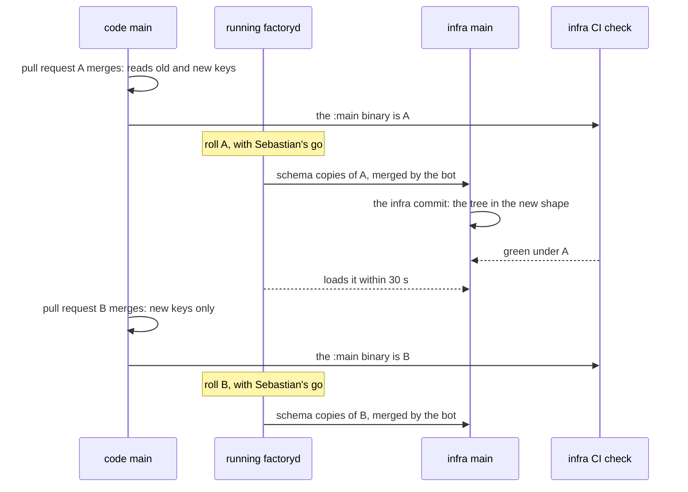

# The Config Says It Once: Implementation Plan

> **For agentic workers:** REQUIRED SUB-SKILL: Use superpowers:subagent-driven-development (recommended) or superpowers:executing-plans to implement this plan task-by-task. Steps use checkbox (`- [ ]`) syntax for tracking.

**Goal:** Every key of the configuration tree has a reader and more than one legal value, every process fact lives either in the file or in Go and never in both, and `factoryd config check` refuses a tree that would fail at run time.

**Architecture:** One batch moves the tree in three ordered steps. Pull request A teaches the loader the new keys beside the old ones and rolls. One infra commit moves the files to the new shape. Pull request B refuses the old keys and rolls. Facts the files restate move out of them (the stage floors and order, the `merge` stage, single-value keys, pairs that must agree). Facts only Go knew move in (the report classes, the model of each purpose, the card size budgets, the risk class flags), each with the check that refuses what Go would refuse later.

**Tech Stack:** Go (policy, factoryd, console, gateway), YAML config with generated JSON Schema, Postgres (one read-only query), Temporal (no workflow decision changes).

**Spec:** None. The evidence in "The situation today" stands in for it.

Every code `file:line` is at code main `c2dddcd67`, relative to the code repository root. Every infra `file:line` is at infra `origin/main` `e4d10c6` and starts with `factory/`. A path in the design repository says so.

## The situation today

### The pieces this plan needs

- **The configuration tree** is the directory `factory/` of the infra repository: one `policy.yaml`, one `processes/<name>.yaml` per process, one `projects/<name>.yaml` per project, `routines/*.md`, `templates/<name>/`, and `schema/` with generated JSON Schema copies. The infra repository has no agents. Every change to it is a human's commit.
- **A process** names its tracks (`direct`, and `plan` for building from a spec), the stages a card's pull request passes, and its merge queue. A **stage** is one gate with one Go implementation per name (`internal/policy/process.go:200-213`). Its `on_findings` says where findings go: `agent` back to the session, `human` to a human, `fail` ends the task.
- **A class** in `policy.yaml` is a capability class: the session mode its tasks run (`code`, `plan` or `report`), the aliases the agent may call, its tools, and today the aliases factoryd calls on the task's account (`internal/policy/policy.go:1005-1047`).
- **A project file** names the repository, the process, who merges (`merge_rule`, `autonomy`), whether agents work there (`agents`), and the seeded identities factoryd uses.
- **A purpose** is why factoryd calls a model: a review, a supervisor call, a check-in, a chat turn, a compaction (`internal/policy/policy.go:1048-1082`). The gateway admits a factoryd call only on the alias its purpose allows.
- **The ladder of models** is the start rung (`small`) and the stronger rung (`big`) of a coding session. The **escalation ladder** is a different thing: rung 0 reads facts, rung 1 is the check-in, rung 2 the factory agent, then the human.

### How factoryd reads the tree

The loader reads infra main every 30 seconds (design repository `docs/architecture.md` section 5.3). `ParseTree` (`internal/policy/tree.go:83-172`) decodes each file strictly, so an unknown key is refused (`decodeOne`, `internal/policy/tree.go:381-399`). It then runs the Go rules of each file, validates the file against the JSON Schema built into the binary, and judges what one file names in another (`checkLinks`, `internal/policy/tree.go:232-326`). `CheckTree` adds one rule: every class a track names must allow the ladder's two models (`internal/factoryd/policy.go:303-312`, `fitsLadder` at `:382-400`). It takes the ladder as a parameter, which each caller reads from the environment.

A refused commit leaves the previous version in force, raises a `config_rejected` alert and files an issue in the infra repository's human lane. Each accepted tree is stored as JSON in `policy_versions`, which is immutable. A stored version decodes leniently, so a key that Go no longer knows is ignored (`internal/policy/store.go:118`). Each task pins the version it started under. Some readers read the pin (limits, bounds, the stage list in the task config), and others read the version in force (factoryd's model aliases, `internal/factoryd/runner.go:2365-2373`, and the card budget at intake).

Defaults live in Go variables: `DefaultWaits`, `DefaultEscalation`, `DefaultChat`, `DefaultBounds`, `DefaultDetectors` and others. A key the file leaves out takes the Go default. This is the Kubernetes pattern, and it is the right one.

### What the check does

`factoryd config check <dir>` (`cmd/factoryd/config.go:74-86`, `checkTree` at `:170-180`) runs the same `ParseTree` and `CheckTree` as the loader, then warns about a schema copy that differs from the binary's. `TestConfigCheckAndLoaderAgree` (`cmd/factoryd/config_test.go:306`) runs every row of the refusal table `policytest.Refusals` (`internal/policy/policytest/refusals.go:42`) through both and requires the same answer. The infra repository's CI runs the check on every push to main, with the factoryd binary copied out of the image `factory-gateway:main` (infra `.forgejo/workflows/config-check.yml`). That image is the newest green code main, which may be newer than the factoryd that runs.

### How a schema change moves between the two repositories

`factoryd schema` generates one JSON Schema per file kind from the Go types and their doc comments (`internal/policy/schema.go:160-228`). The copies in `factory/schema/` name the code commit they come from in `factory/schema/commit`. After a roll, the `SchemaCopier` compares its schemas with infra main's copies (`internal/factoryd/schemasync.go:85-173`). It writes only when its own commit holds the copies' commit, so it never undoes a newer build (`:99-115`). It opens "Schema copies for <build>" from the bot's fork and merges it itself when only its own copies differ (`land`, `:176-188`). Otherwise it files a card for a human.

Both sides decode strictly. So at every moment, infra main must parse under two binaries: the factoryd that runs, and the `:main` binary of infra CI. A key that a file sets cannot leave Go before it leaves the file. A key that old Go requires cannot leave the file before Go stops requiring it. That fixes the order of any change that touches a key a file sets:



A key that no file sets, or a new key with a Go default, needs only a code pull request.

### Every key this plan touches

The table answers one question for each key: where it is set, who reads it, what it may hold, and what this plan does with it. "Never set" means no file at any commit of infra main sets it (`git log -S`).

| Key | Set where | Read where | Legal values | Verdict |
|---|---|---|---|---|
| **Process file** | | | | |
| `stages[]` entry `merge` | `factory/processes/maintenance.yaml:15`, `factory/processes/spec.yaml:22` | No workflow reader: `runStages` returns inside the approval case (`internal/factoryd/workflow_stages.go:235-263`). Only `internal/policy/graph.go:229` | required, last (`internal/policy/process.go:368-376`) | Delete from the file. The loader appends it. |
| `stages[]` entries `policy`, `approval` | both files | `runStages` (`internal/factoryd/workflow_stages.go:230-265`) | required (`internal/policy/process.go:363-370`) | Delete from the file. The loader inserts them. |
| `stages[].enabled` | every stage line of both files, all `true` | `internal/factoryd/workflow_stages.go:639`, `internal/policy/graph.go:213` | `true` or `false`, forced `true` on checks, policy, approval, merge (`internal/policy/process.go:339-341`) | Delete. A listed stage runs. |
| `stages[].when` | screening in both files (`maintenance.yaml:7`, `spec.yaml:14`) | `internal/factoryd/workflow_stages.go:641`, `internal/policy/graph.go:218` | `outsider` only (`internal/policy/process.go:229`) | Delete. The screening runs for outside accounts. |
| `stages[].on_findings` | every stage line | `onFindings` (`internal/factoryd/workflow_stages.go:442-470`) | `agent`, `human`, `fail`, fixed on policy, approval, merge, screening and audit (`internal/policy/process.go:345-351`) | Keep on checks, migration, reproduction and review. Delete on the five fixed stages. |
| `stages[].max_returns` | never set | `internal/factoryd/workflow_stages.go:460`, `internal/policy/graph.go:237` | 1 or more, on an agent stage | Keep. |
| the order of `stages[]` | two orders: checks first in `maintenance.yaml`, the local gates first in `spec.yaml` since `c7d2624` (2026-10-14) | `scheduleBeside` (`internal/factoryd/workflow_stages.go:916-925`) runs the review and the audit beside the checks wait only when no local gate follows the checks | five order rules (`internal/policy/process.go:372-386`), the rest free | Move to Go: one order, and the check refuses another. |
| `dependencies.wait_until`, `.on_failed` | `factory/processes/spec.yaml:12` | No reader of the values. The block's presence is read at `internal/factoryd/deps.go:424` and `internal/console/actions.go:2749` | `done`, `human` (`internal/policy/process.go:177-178`), and the block is required with a plan track and refused without one (`:271-277`) | Delete. The loader sets the wait when the process has a plan track. |
| `merge.groups` | `factory/processes/spec.yaml:23`, `free`, which is the default | `internal/factoryd/queue.go:235` reads `one_at_a_time` only | `free`, `one_at_a_time` | Keep the key. The file drops `groups: free`. |
| new `stages[]` screening `class` | Go only: `policy.ClassAnalyzer` (`internal/policy/policy.go:1131-1133`) | `internal/factoryd/report.go:345` opens the screening's report on it | a class of session `report` | Add, and refuse a missing class at check time. |
| new `tracks.plan.sizing` | Go only: the same constant, through `internal/factoryd/report.go:345` | the sizing step (`internal/factoryd/sizing.go:106`) | a class of session `report` | Add, as above. |
| new `tracks.plan.prover` | Go only: `policy.ClassProver` (`internal/policy/policy.go:1135-1137`) | `internal/factoryd/prover.go:779`, `:866-871` | a class of session `report` whose agent time fits the dry run | Add, as above. |
| **Policy file** | | | | |
| `ai_members` | `factory/policy.yaml:423` | none since `ba2e26434` (2026-11-11). The field is at `internal/policy/policy.go:58` | Forgejo user names | Delete. |
| `bounds.<activity>` | `factory/policy.yaml:434-435`, `GateReproduction: 1800` | `internal/policy/policy.go:897-919`, `internal/factoryd/gatewatch.go:474`, `internal/policy/waits.go:94-97` | 32 Go activity names and `default` (`internal/policy/policy.go:872-878`). `WaitChecks` repeats `waits.checks` | Delete. The reproduction gate's bound comes from its command cap. |
| `classes.<c>.review_model`, `supervisor_model`, `audit_model`, `checkin_model` | `factory/policy.yaml:181-184`, `:232`, `:252-254`, `:278`, every value `big` | `FactoryModel` (`internal/policy/policy.go:1615-1631`), the track checks (`internal/policy/tree.go:263-275`) | any alias | Move to the one map `purposes`. |
| `classes.<c>.session_model` | `factory/policy.yaml:251`, `:277`, both `big` | `internal/policy/policy.go:1729-1737`, `internal/factoryd/policy.go:797` | one of the class's models | Move to `purposes.plan` and `purposes.report`. |
| `classes.<c>.vision_model` | `factory/policy.yaml:187`, `:233`, `:255` | `internal/policy/policy.go:1628-1629` | `vision` only (`internal/policy/policy.go:207`) | Delete. A look always calls the alias `vision`. |
| `chat.model`, `chat.mcp_model`, `chat.wake_model` | `factory/policy.yaml:80-82`: `premium`, `big`, `big` | `internal/console/chat.go:243-252`, `internal/policy/policy.go:1614` | `big`, `small`, `premium` | Move to `purposes.chat`, `.chat_mcp`, `.chat_wake`. |
| `chat.vision_model` | never set | `internal/policy/policy.go:1603` | `vision` only | Delete. |
| Go's own picks | none: `internal/factoryd/operator.go:173` (compact), `:182` (digest), `:194` (research), `:250` (title), `internal/factoryd/followmove.go:450` (digest), `internal/console/chat.go:244-245` and `internal/factoryd/ladder.go:857`, `:882` (rung 2), `internal/policy/policy.go:1599-1612` | | `policy.Small` or `policy.Big` in code | Move to `purposes`. |
| environment `MODEL`, `STRONGER_MODEL` | no manifest in either repository sets them | `cmd/factoryd/config.go:184-189` | any alias | Move to `purposes.start` and `purposes.stronger`. |
| card budget by size | restated in a comment, `factory/policy.yaml:9-12` | `sizeEUR` (`internal/policy/policy.go:1764`) | 4, 5, 10 EUR in code | Add `budget.size_eur` with that default. Delete the comment. |
| `risk.classes[]` `runner` keeps a human | `factory/policy.yaml:354` has no `human` | `HumanClasses` adds `runner` by name (`internal/policy/risk.go:77-84`) | | Set `human: true` in the file. Drop the name. |
| `risk.classes[]` `high` merges on a passed audit | `factory/policy.yaml:361` | `AutoMerge` tests the name (`internal/factoryd/gates.go:295-300`) | | Add `audit_merges: true`. Drop the name. |
| `risk.classes[]` `normal` | `factory/policy.yaml:362` | auto is allowed on `normal` alone (`internal/policy/risk.go:121-122`), and the built-in class `large` goes above `normal` (`:96`) | | Move to construction: auto on any class without `human` or `migration`, and `large` above the first auto class. |
| `waits.merge_retry` | never set | `internal/factoryd/carddigest_flags.go:98`, `:318`, `internal/factoryd/monitor.go:417` | 1m to 7 days | Delete. Its bound is the retries' hour, `maxMergeRetries` times `mergeRetryAfter` (`internal/factoryd/workflow.go:3510-3516`). |
| `escalation.judgment` | never set | `internal/factoryd/ladder.go:957` | `always`, `autonomous_and_above` | Keep. |
| `escalation.pool`, `.card_draw`, `.rung1_runs`, the ten other `waits` keys, `limits.gate_reserve_eur`, `provider_limits.<p>.patterns`, `chat.confirm`, `.parallel_turns`, `.window` | never set. The console's pool action writes `escalation.pool.eur` (`internal/console/pool.go:403-416`) | `internal/factoryd/ladder.go:486`, `internal/factoryd/temporal.go:483`, `internal/gateway/providerlimit.go:108`, `internal/factoryd/activities.go:936`, `internal/console/threads.go:539`, `internal/console/compact.go:50`, `internal/console/chat.go:1579` | ranges | Keep. |
| **Project file** | | | | |
| `agents` | `factory/projects/ai-software-factory-code.yaml:11`, `factory/projects/ai-software-factory-infra.yaml:6` | `Project.Coder` (`internal/factoryd/project.go:104`) and 30 more sites | `coder`, `none`. The check forces `coder` exactly when `process` is set (`internal/policy/tree.go:285-288`) | Delete from the file. The loader derives it. |
| `audit` | `factory/projects/ai-software-factory-code.yaml:14` | `internal/factoryd/activities.go:2418`, `internal/factoryd/audit.go:241`, `internal/policy/tree.go:274`, `:291-294`, `internal/policy/graph.go:222` | `true` or absent, and `true` needs the process's audit stage | Delete. The process's audit stage decides. |
| `merge_rule` | `ai-software-factory-code.yaml:9` (`auto`), `ai-software-factory-infra.yaml:4` (`human`) | `AutonomyState` (`internal/policy/project.go:471-476`), `internal/factoryd/gates.go:259`, `:296`, 26 sites. Written by `internal/console/autonomy.go:324-326` and `internal/console/projects.go:240` | `auto`, `human`, and `auto` needs `autonomy: autonomous` (`internal/policy/project.go:812-814`) | Delete from the file. The loader derives it from `autonomy`. |
| `autonomy` | `ai-software-factory-code.yaml:43` | `internal/policy/project.go:471-476` | `manual`, `assisted`, `autonomous` | Keep, with the fourth state `full auto`. |
| `model` | none since `0333d6f` (2026-10-15) | `internal/factoryd/activities.go:2411` | `stronger` only | Delete. `purposes.start` covers it. |
| `chat.model`, `.mcp_model`, `.wake_model`, `.vision_model` | never set | `ChatOf` over the policy's block | as the policy's | Delete. |
| `chain.mode` | never set | `internal/factoryd/activities.go:3437`, `internal/factoryd/chainpoll.go:829` | `run`, `none`, but a free string in the schema: a typo is found at run time only (`internal/factoryd/chainpoll.go:447-449`, `:821-826`) | Keep. Make it an enum, and refuse it and a negative stall at check time. |
| `tokens.gate`, `tokens.chat` | `ai-software-factory-code.yaml:19`, `ai-software-factory-infra.yaml:13` | `internal/factoryd/forgejo.go:118` | one secret name each (`internal/policy/project.go:885-890`) | Keep. A project holds the seeded identity or does not. |

### What the check accepts and Go refuses later

| A tree that | Passes the check because | Fails at run time with |
|---|---|---|
| renames the class `analyzer` | no rule names it (`internal/policy/tree.go:232-326`) | the first outsider's screening or the first sizing opens a report task on a missing class, whose session mode then reads empty (`internal/factoryd/activities.go:2409`) |
| renames the class `prover`, or gives it too little agent time | no rule names it. The package's own valid fixture has a plan track and no prover class (`internal/policy/testdata/tree/policy.yaml:17-50`) | the prover pass logs "waits for its prover" on every pass and the plan waits (`internal/factoryd/prover.go:770-772`, `:865-876`) |
| sets `chain: {mode: off}` | `mode` is a free string | one log line, and the repository stays unrecorded (`internal/factoryd/chainpoll.go:821-826`). Two test fixtures use exactly this typo to turn the chain off (`internal/factoryd/runner_test.go:886`, `internal/factoryd/pg/helpers_test.go:171`) |
| sets `chat.wake_model: small` | the key is valid | rung 2 still runs and bills on `big` (`internal/console/chat.go:244-245`, `internal/factoryd/ladder.go:857`) |
| renames the risk class `high` or `runner` | the names are free | `high` loses its merge on a passed audit (`internal/factoryd/gates.go:295`), and `runner` loses its human (`internal/policy/risk.go:78`), with no word |
| sets `MODEL=factory/big` on factoryd | the check reads the same variable only where it runs (`cmd/factoryd/config.go:184-189`) | the infra CI's check and the running factoryd hold the tree against different ladders |

## Why this is drift

The first tenet says that files define the exact process, one standard version shipped, with no hardcoded exceptions. The fifth says one way only. The roadmap's first guiding idea says the check "refuses a composition that cannot work" (design repository `docs/roadmap.md` line 9). The tree breaks all three in four ways.

**The surface grew faster than its use.** Between `5d999ad` (2026-10-25) and `e4d10c6` (2026-11-26) the three schemas grew from 175 to 244 keys that hold a value, 39 percent. `policy.schema.json` gained 33 of them, and 21 were never set in any file: 8 under `escalation`, 11 of the 12 `waits` keys, `limits.gate_reserve_eur` and `provider_limits.<p>.patterns`. (The drift review counted 212 to 299 with the blocks themselves included.) A key with a reader and a range is a knob, and keeping it is right. The drift is elsewhere.

**Eight keys allow one value.** The schema's enum table (`internal/policy/schema.go:48-84`) holds eight enums of one value: `SeedTokens.Gate`, `SeedTokens.Chat`, `Stage.When`, `Dependencies.WaitUntil`, `Dependencies.OnFailed`, `ChatConfig.VisionModel`, `Class.VisionModel` and `ProjectConfig.Model`. Of the 27 values in the nine stage lines of `spec.yaml`, the loader forces 13: five `on_findings`, four `enabled` and the four required lines. The `merge` line has no workflow reader at all.

**Five facts are each stored twice.** `agents` repeats whether `process` is set (`internal/policy/tree.go:285-288`). The project's `audit` repeats the process's audit stage (`:291-294`). `merge_rule` and `autonomy` are one dial in two keys, kept in step by a refusal (`internal/policy/project.go:812-814`). `waits.merge_retry` repeats six retries ten minutes apart (`internal/factoryd/workflow.go:3510-3516`), so a file that sets it to 3h changes the flag and not the retries. `bounds.WaitChecks` repeats `waits.checks` (`internal/policy/waits.go:94-97`).

**Process facts live only in Go.** Two class names (`internal/policy/policy.go:1131-1137`), three risk class names (`internal/policy/risk.go:65-72`), eight model picks, two environment variables and the size budget table. Each one lets a tree pass the check and fail later, as the table above shows.

The coupling already shaped a fix. The comment at `internal/factoryd/gatewatch.go:84-88` says that naming an activity in the `bounds` key list "would change the configuration tree's schema, which only an infra commit follows". So the open faults plan's first fault, eight false `gate_bound` alerts for `FollowJudge` and `RoutineRun`, got its fix in Go's `DefaultBounds` on the branch `open-faults` (`df2295b71`, `bd9fb7911`). A config key that names Go functions turns every new activity into a schema question.

The cost is concrete. A renamed class stops the first outsider's card at a human with no hint of the cause. A model setting is billed on another model with no word. A plan waits forever on a prover class that the check never asked for. Each of these is a human's minutes on a fault the check could have refused in a second.

## The trade-off

**What it costs.** Two code pull requests, two rolls with Sebastian's go, one infra commit, and two schema copy pull requests that the bot merges. Pull request A carries about 60 lines of code that read the old keys (inferred), which pull request B deletes. Test fixtures change in about 60 files: `git grep` counts 101 `merge_rule:`, 50 `agents:`, 48 `enabled: true`, 37 class model keys, 16 `bounds:` and 10 `wake_model` in test files and test data. Most of it is a mechanical edit of YAML strings.

**What it risks.** Between roll A and the infra commit, the loader reads both shapes, and an old key and its new home could disagree. Pull request A gives the new key the last word and the old key the fallback, and a test pins it. A card pinned to a version from before the infra commit keeps that version's stage list. The old loader and pull request A's loader produce the same list, and the task config is recorded once per run. A merge approval pinned to such a version reads its human classes from the pin (`internal/factoryd/casefacts.go:371-377`): after pull request B, `runner` would lose its human there. Task 13 waits until no such approval is open.

**What it buys.** The process file says only its choices, in the order the stages run. Go names no class and no risk class. One map names the model of every purpose, so no setting is ignored. The check refuses a renamed class, a prover that cannot fit, a misspelt chain mode and a stage in the wrong place. About 200 non-test Go lines go (inferred).

**What stays, and why.**

- The never-set keys that have a reader stay. Most were added by a fault fix so a human can turn them without a release (`94e14ea06` for `waits.at_human`, `3675e0dba` for the provider patterns, `db5bcf72c` for the gate reserve), and the console writes the pool. Deleting them would make each return an ordered two-repository change.
- `merge.groups` stays. `one_at_a_time` has a reader and is a primitive in the sense of the roadmap's first idea. Only the line that restates its default goes.
- `tokens.gate` and `tokens.chat` stay. Each names the seeded identity a project holds, which is a least-privilege choice per project. The guard test of Task 16 names them as its two exceptions.
- The size scales stay in Go: a small card gets half the agent time and half the draw, and a large card one and a half times (`internal/policy/policy.go:1752-1760`, `internal/policy/escalation.go:165-176`), and the plan's line shares are 0.3, 0.6 and 1.0 of `large_lines` (`internal/factoryd/plan.go:1573-1578`). They define what a size is. Money is a deployment's choice, so only `size_eur` moves.
- The process-tuning constants of the review stay in Go: `imageWait`, `HoldAskAfter`, `longWait`, `cheapAttemptCap`, `minSession`, `checkInQuiet`, `groupRevertSessions` and `MaxRoomSessions`. None repeats a key. A key comes when a run needs another value, not before. The four re-run bounds belong to the plan "The factory's own repository is a project like any", which moves the red-main ladder.
- The criteria gate stays a built-in of the approval stage (`criteriaStage`, `internal/factoryd/workflow_stages.go:382`).
- The workflow's own copy of a stage keeps `Enabled`, `When` and the dependency block, and `scheduleBeside` keeps its sequential branch. Recorded runs carry them. They go with the drain of the plan "Collapse the workflow's history".

**What is the right shape today.** `ParseTree` and `CheckTree` give the loader and the check one judgement, and `TestConfigCheckAndLoaderAgree` holds them to it. The schema copier works: the bot merged infra's copies itself on 2026-11-25 and 2026-11-26 (design repository `docs/plans/2026-11-26-open-faults.md`). `FactoryModel` (`internal/policy/policy.go:1597`) is already the one function for a purpose's alias. The drift is the callers that go around it.

**Alternatives considered.**

- *A check-only fix.* Refuse a tree without classes named `analyzer` and `prover`, and make `chain.mode` an enum. One pull request and no infra commit. It loses because two ways stay to bind a job to a class (the track names the coder and the planner, Go names the other two), and the pairs, the restated floors and the split model picks all stay.
- *One ordered change per key.* The 2026-11-26 plan dropped the `merge.groups` delete as "an ordered change across two repositories for no gain" (design repository `docs/plans/2026-11-26-open-faults.md` line 48). That judgement holds for one key. The fixed cost is two pull requests, two rolls and one infra commit. Paid once for the batch, it buys every row of the table. Paid per key, it would be paid about twelve times.
- *Delete the never-set keys,* as the drift review proposed. It loses for the reason under "What stays".
- *A `beside: checks` key on review and audit,* as the workflow review proposed. It adds a key to name an order that the code can fix.
- *The stages as a mapping keyed by name.* No order could be written wrong. Pull request A would then decode two shapes under one key. See the decisions.
- *All size tables in the file.* It adds six keys that nobody tunes.

## The proposal

### The target shape

A process file lists only the stages it chooses, in the one order they run: screening, migration, reproduction, checks, review, audit. The policy stage, the approval and the merge are built in. An entry carries `on_findings` only where it is a choice. The screening and the plan track name the report classes they use. `spec.yaml` becomes:

```yaml
# yaml-language-server: $schema=../schema/process.schema.json
# Build from a spec: a plan-track card's planner answers a plan, and one
# with no open question files one direct-track card per planned card with
# their dependencies. Each waits for its dependencies, and one pull
# request merges at a time. Plans merge freely, and production waits
# until none is open on main.
tracks:
  direct: {class: coder}
  plan:
    class: planner
    sizing: analyzer
    prover: prover
    plan: {max_cards: 12, min_cards: 1, foundation: true, integration: true}
stages:
  - {name: screening, class: analyzer}
  - {name: migration, on_findings: human}
  - {name: reproduction, on_findings: agent}
  - {name: checks, on_findings: agent}
  - {name: review, on_findings: agent}
  - {name: audit}
merge: {queue: project}
```

The loader expands it into the same nine-stage list the workflow reads today, in today's order and with today's values. No workflow decision changes.

`policy.yaml` gets one map from purpose to alias. Go holds the default of every entry, and the file sets only what differs:

```yaml
# the model class each of factoryd's purposes calls; a purpose the map
# leaves out takes the code's choice, which the schema names
purposes:
  # premium for a human's own chat turns only (Sebastian, 2026-11-03)
  chat: premium
```

The map is named `purposes` because a class already has a `models` list, the aliases its agent may call. Its sixteen entries and their defaults are: `start: small`, `stronger: big`, `plan: big`, `report: big`, `review: big`, `supervisor: big` (also the gate supervisor and a needs-you brief), `audit: big`, `checkin: big` (also rung 1), `chat: big`, `chat_mcp: big`, `chat_wake: big`, `rung2: big`, `compact: small`, `digest: small`, `title: small`, `research: big`. Each takes `small`, `big` or `premium`. A look at an image always calls the alias `vision`. A check-in purpose stays empty for a class of session `report`. No report class names a check-in alias now, so rung 1 never judges a report card's case, and the map keeps it so.

A project file drops `merge_rule`, `agents` and `audit`. `autonomy` takes four states, `manual`, `assisted`, `autonomous` and `full auto`, the four the console's control already offers (`policy.AutonomyStates`, `internal/policy/policy.go:241`). The risk classes carry their rules as flags. The check refuses a chain mode other than `run` or `none`.

### The batch, and why it pays once

Each change below touches a key that a file sets today, or a key that old Go requires. Each therefore needs the ordered move of pull request A, the infra commit and pull request B. One batch pays the fixed cost once.

| Change | In pull request A | In the infra commit | In pull request B |
|---|---|---|---|
| stage entries | floors, `merge`, `enabled`, fixed `on_findings` and `when` become optional, and the loader fills them | `spec.yaml` in the new shape | the old entries refused, one order required |
| `dependencies` | optional, set by the loader with a plan track | line deleted | refused |
| report classes | `class`, `sizing`, `prover` read, absent means today's constant, missing classes refused | named in `spec.yaml` | required |
| `maintenance.yaml` | | deleted | |
| `merge.groups: free` | | line deleted | |
| `agents`, `audit`, `merge_rule`, `full auto` | `agents` and `merge_rule` optional and derived, `audit` unread, `full auto` accepted | deleted, `autonomy: full auto` | refused |
| model keys | `purposes` read, old keys read where the map is silent | old keys deleted, `purposes: {chat: premium}` | old keys refused |
| `bounds`, `ai_members` | unread | deleted | refused |
| risk flags | `audit_merges` read, the names still honoured | `human: true` on runner, `audit_merges: true` on high | names no longer honoured |

These need no ordered move, because no file sets the key or the new key has a Go default: the chain mode enum, `waits.merge_retry`, the project's `model`, the project's chat model keys, `chat.vision_model`, the dead fallbacks after `WaitsOf`, `budget.size_eur` and the guard test.

### Deletions and additions

| Change | Removed | Added | Note |
|---|---|---|---|
| Stage floors, order rules and removed stage keys | about 60 Go lines in `internal/policy/process.go` | about 45 lines of expansion | inferred |
| `dependencies` type and checks | about 30 | 5 | inferred |
| Report classes in the process | 3 constants, `proverUnfit` (15) | about 40 with the checks | inferred |
| Project keys | about 30 | about 15 | inferred |
| One purpose map | 10 class and chat fields, the bypassing picks, the ladder variables, the `CheckTree` ladder parameter: about 120 | about 60 | inferred |
| `bounds`, `BoundActivities`, `defaultBoundActivities` | about 50 | 3 | inferred |
| Risk names | about 15 | about 15 | inferred |
| Chain mode, merge retry, project model, dead fallbacks | about 45 | about 15 | inferred |
| Infra tree | about 70 YAML lines and one file | about 10 | counted from the files |
| Schema copies | 30 value keys | 20 value keys | regenerated |

Net: about 200 non-test Go lines fewer, about 200 test lines more, and 60 YAML lines fewer in the infra tree, inferred.

## Decisions for Sebastian

1. **Delete `maintenance.yaml`, so the factory ships one process.** No project has named it since `0333d6f` (2026-10-15). It keeps the order from before `c7d2624` (2026-10-14), so it alone takes the sequential gate path. The design repository's `docs/architecture.md` section 10 names two shipped processes. Making it the standard instead would take the plan track from the code project, whose build plans run on it. A new project names `spec`, and a small direct card never meets the planner there. Recommendation: delete it.
2. **Keep the keys that have a reader but were never set.** The drift review proposed dropping 21 of them from the schema until a file needs one. They are knobs a human turns without a release, and the console writes one of them. Recommendation: keep them. The plan's rule is a reader and two legal values, not a past setting.
3. **The stage list stays a list, in the one order.** The file lists the stages it chooses in the order they run, and the check refuses another order. The alternative is a mapping keyed by stage name, in which no order can be wrong, at the price of a loader that decodes two shapes under one key during the window. Recommendation: the list. It reads as the run order and moves in one step.

## Global Constraints

- Code work runs in a git worktree off `origin/main` of `~/repos/ai-software-factory-code`. One pull request per task group, from `controller/ai-software-factory-code`, merged as `sebastian` after green CI and an independent review on the most capable model. The groups are: Tasks 1 to 4, Tasks 5 to 10 (pull request A), Tasks 13 to 16 (pull request B).
- `bash check changed` passes before each commit. Go tests run with `go test -race`. Postgres-backed tests run through `scripts/pg-test.sh`.
- A change to workflow code needs a `workflow.GetVersion` change id and a replay test. This plan changes no workflow decision: the loader hands the workflow the same stage list, task config and ladder it reads today. Task 2 changes one constant's expression and keeps its value.
- A fix reaches production only through a roll, and a roll needs Sebastian's go. The infra commit changes the live configuration within 30 seconds, so it needs Sebastian's go too.
- The infra repository has no agents. Its commit is pushed by hand. Before the push, `factoryd config check` of the code at the rolled commit passes on the edited tree.
- Pull request A rolls before the infra commit. The infra commit lands before pull request B merges. No other order keeps both binaries able to parse infra main.
- Tasks 10 and 15 start after the open faults pull request (branch `open-faults`) has merged, and keep its two `DefaultBounds` entries.
- No task id in a text a human reads. A human is a human, never a member or an operator.
- No comments that narrate the change. Tests state hand-derived expectations.
- Every new refusal line is human-read copy in the existing form `<file>: <block>: <reason>`, written by the guide in `internal/writingguide/writing-guide.md`, and its test pins the exact text.

## Review Focus

1. **An old key and its new home disagree in the window.** A tree that sets both `classes.coder.review_model: premium` and `purposes.review: big` must call `big`, and one that sets only the old key must call `premium`. Pinned by `TestThePurposeMapWinsOverAnOldKey` in Task 8.
2. **The expansion differs from today's stage list.** The workflow reads the expanded list from the task config, so a field that differs would change a run. Pinned by `TestSpecExpandsToTodaysStages` in Task 5, which compares every field of all nine entries with the list today's `spec.yaml` gives.
3. **Rung 1 starts judging report cards.** A map default would give an analyzer card a check-in alias that it lacks today. Pinned by `TestCheckinSkipsAReportClass` in Task 8.
4. **The gateway admits more than before.** The purpose map must not widen what the gateway admits on the live tree. Pinned by `TestTheLiveTreeAdmitsTheSameAliases` in Task 8, which compares `FactoryModels` for every class of the live tree before and after with hand-written sets.
5. **A merge approval pinned before the infra commit loses runner's human.** Pinned by the precondition query in Task 13, Step 1, and by `TestRunnerKeepsAHumanByItsFlag` in Task 9.

## Tasks

### Task 1: The check refuses a chain mode other than run or none, and a negative stall

**Files:**
- Modify: `internal/policy/project.go:496-530` (`ChainConfig`, `ChainModeRun`), `:657` onwards (`ProjectConfig.Validate`)
- Modify: `internal/policy/schema.go:48-84` (enum `ChainConfig.Mode`)
- Modify: `internal/factoryd/chainpoll.go:441-455` (delete `chainModeNone`, `chainComplaint`), `:819-827` (its call)
- Modify: `internal/factoryd/runner_test.go:886`, `internal/factoryd/pg/helpers_test.go:171` (`mode: off` becomes `mode: none`)
- Test: `internal/policy/policytest/refusals.go`

**Interfaces:**
- Consumes: `ProjectConfig.Validate(name string) error`.
- Produces: `const ChainModeNone = "none"`, `var ChainModes = []string{ChainModeRun, ChainModeNone}` and `func (c ChainConfig) validate() error` in `internal/policy/project.go`.

- [ ] **Step 1: Write the failing test.** Add two rows to `policytest.Refusals`:

```go
"chain_mode": {Change: in("projects/ai-software-factory-infra.yaml", "tokens:", "chain: {mode: off}\ntokens:"),
	Want: []string{`projects/ai-software-factory-infra.yaml: project ai-software-factory-infra: chain: mode "off", want one of [run none]`}},
"chain_stall": {Change: in("projects/ai-software-factory-infra.yaml", "tokens:", "chain: {stall: -1m}\ntokens:"),
	Want: []string{"projects/ai-software-factory-infra.yaml: project ai-software-factory-infra: chain: stall -1m0s is negative"}},
```

- [ ] **Step 2: Run it and see it fail.** `go test -race -run 'TestProcessRefusals/chain_|TestConfigCheckAndLoaderAgree' ./internal/policy/ ./cmd/factoryd/`. Expected: FAIL with "the tree passes".
- [ ] **Step 3: Implement.** `ChainConfig.validate` refuses a mode outside `ChainModes` and a negative stall, and `ProjectConfig.Validate` calls it. Add the enum. Delete `chainComplaint` and its branch in `serves`, which keeps `chain.Mode != policy.ChainModeRun` (`:829`).
- [ ] **Step 4: Run and see it pass.** The same command, then `go test -race ./internal/policy/ ./internal/factoryd/ ./cmd/factoryd/`. Expected: PASS.
- [ ] **Step 5: Commit.** "policy: the check refuses a chain mode other than run or none and a negative stall, which the chain poller found only at run time"

### Task 2: The merge retry's wait bound is the hour its retries take

**Files:**
- Modify: `internal/policy/waits.go:22-24` (delete `MergeRetry`), `:50-52` (`DefaultWaits`), `:66-71` (`bounds`), `:73-82` (`Bound`)
- Modify: `internal/factoryd/workflow.go:3510-3512` (`maxMergeRetries`)
- Test: `internal/policy/waits_test.go`, `internal/policy/policytest/refusals.go`

**Interfaces:**
- Produces: `const MergeRetryWindow = time.Hour` in `internal/policy/waits.go`. `Waits.Bound("merge_retry")` returns `MergeRetryWindow`.
- Changes: `const maxMergeRetries = int(policy.MergeRetryWindow / mergeRetryAfter)`, which is 6, as today.

- [ ] **Step 1: Write the failing test.** `TestMergeRetryWaitIsTheRetriesHour` in `waits_test.go`: `Tree{}.WaitsOf("sf/repo").Bound("merge_retry") == time.Hour`. Add the refusal row `"merge_retry_removed"`: `in(pol, "waits: {checks: 40m}", "waits: {checks: 40m, merge_retry: 3h}")` with the line `policy.yaml: yaml: unmarshal errors:\n  line 69: field merge_retry not found in type policy.Waits`.
- [ ] **Step 2: Run it and see it fail.** `go test -race -run 'TestMergeRetryWaitIsTheRetriesHour|TestProcessRefusals/merge_retry' ./internal/policy/`. Expected: the refusal row fails with "the tree passes".
- [ ] **Step 3: Implement.** Delete the field and its two entries. `Bound` answers `MergeRetryWindow` for `merge_retry` before its loop. Write the constant expression in `workflow.go`. The schema loses one key.
- [ ] **Step 4: Run and see it pass.** `go test -race ./internal/policy/ ./internal/factoryd/`. Expected: PASS, the replay tests included.
- [ ] **Step 5: Commit.** "policy: the merge retry wait is bound by the hour of its six retries, and no key can disagree with them"

### Task 3: The readers of `WaitsOf` lose the fallbacks it makes dead

**Files:**
- Modify: `internal/factoryd/freezecard.go:1444-1451`, `internal/gateway/server.go:270-274`
- Test: `internal/policy/waits_test.go`

- [ ] **Step 1: Write the test that pins what stays.** `TestWaitsOfFillsEveryBound`: for every key of `Waits.bounds()`, `Tree{}.WaitsOf("sf/repo").Bound(key) > 0`, and `Bound("provider_limit") == 24*time.Hour`, `Bound("provider_recheck") == 15*time.Minute`.
- [ ] **Step 2: Run it.** `go test -race -run TestWaitsOfFillsEveryBound ./internal/policy/`. Expected: PASS. The test pins the guarantee the deletion relies on.
- [ ] **Step 3: Implement.** `providerLimit` returns `w.Current().Tree.WaitsOf(repository).ProviderLimit`. `armClassHold` reads `recheck := pv.Tree.WaitsOf(task.Repository).ProviderRecheck` without its guard.
- [ ] **Step 4: Run.** `go test -race ./internal/factoryd/ ./internal/gateway/`. Expected: PASS.
- [ ] **Step 5: Commit.** "factoryd, gateway: the freeze card and the class hold read their bounds from WaitsOf, which never answers zero"

### Task 4: A project file no longer takes `model: stronger`

**Files:**
- Modify: `internal/policy/project.go:306-310` (`Model`), `:806-808` (its check), the constants `ModelStronger`, `ModelValues`
- Modify: `internal/policy/schema.go:56` (enum)
- Modify: `internal/factoryd/activities.go:2411`
- Test: `internal/policy/policytest/refusals.go`, `internal/factoryd/activities_test.go`

- [ ] **Step 1: Write the failing test.** Refusal row `"project_model_removed"`: `in("projects/linkshort.yaml", "process: spec\n", "process: spec\nmodel: stronger\n")` with `projects/linkshort.yaml: yaml: unmarshal errors:\n  line 8: field model not found in type policy.ProjectConfig`. In `activities_test.go`, `TestTaskConfigStartsOnTheCardsRung`: a card with `Rung: RungCheap` gets `tc.Stronger == false`, one with `Rung: RungFrontier` gets `true`.
- [ ] **Step 2: Run them and see the row fail.** `go test -race -run 'TestProcessRefusals/project_model' ./internal/policy/`. Expected: FAIL, "the tree passes".
- [ ] **Step 3: Implement.** Delete the field, its check, its constants and its enum. `tc.Stronger = tc.Session == policy.SessionCode && t.Rung == RungFrontier`.
- [ ] **Step 4: Run.** `go test -race ./internal/policy/ ./internal/factoryd/`. Expected: PASS.
- [ ] **Step 5: Commit, open the group's pull request, merge after CI and review.** "policy: a project starts its coding cards on the card's own rung, and the file takes no model key"

### Task 5: The loader expands a stage list that holds only choices

This is pull request A. The old list keeps parsing until pull request B.

**Files:**
- Modify: `internal/policy/process.go:9-35` (`Process`), `:86-92` (`Dependencies`), `:108-133` (`Stage`), `:247-299` (`Validate`), `:318-387` (`validateStages`)
- Modify: `internal/policy/tree.go:359-378` (the normalising hook in `parseBody`)
- Test: `internal/policy/process_test.go`, `internal/policy/policytest/refusals.go`

**Interfaces:**
- Consumes: the hook `parseBody` runs before a file's check, today `canonicalTools()` (`internal/policy/tree.go:364-366`).
- Produces: `type StageEntry struct` with the fields `Name string` (`yaml:"name"`), `OnFindings string` (`yaml:"on_findings,omitempty"`), `Class string` (`yaml:"class,omitempty"`), `Enabled *bool` (`yaml:"enabled,omitempty"`), `When string` (`yaml:"when,omitempty"`) and `MaxReturns *int` (`yaml:"max_returns,omitempty"`). `Process.Entries []StageEntry` with `yaml:"stages" json:"-"`. `Process.Stages []Stage` with `yaml:"-" json:"stages"`, as stored today. `var StageOrder = []string{StageScreening, StagePolicy, StageMigration, StageReproduction, StageChecks, StageReview, StageAudit, StageApproval, StageMerge}`. `func (p *Process) expand()`. `Stage` gains `Class string` with `json:"class,omitempty"`.

- [ ] **Step 1: Write the failing tests.** In `process_test.go`:

```go
func TestSpecExpandsToTodaysStages(t *testing.T) {
	want := []Stage{
		{Name: "screening", OnFindings: "human", Enabled: true, When: "outsider", Class: "analyzer"},
		{Name: "policy", OnFindings: "fail", Enabled: true},
		{Name: "migration", OnFindings: "human", Enabled: true},
		{Name: "reproduction", OnFindings: "agent", Enabled: true},
		{Name: "checks", OnFindings: "agent", Enabled: true},
		{Name: "review", OnFindings: "agent", Enabled: true},
		{Name: "audit", OnFindings: "human", Enabled: true},
		{Name: "approval", OnFindings: "human", Enabled: true},
		{Name: "merge", OnFindings: "human", Enabled: true},
	}
	// newSpec is the spec.yaml of "The target shape" above, verbatim.
	// oldSpec is factory/processes/spec.yaml at infra e4d10c6, verbatim.
	for name, file := range map[string]string{"new": newSpec, "old": oldSpec} {
		p, err := parseBody[Process]([]byte(file), kindProcess, Process.Validate)
		if err != nil {
			t.Fatalf("%s: %v", name, err)
		}
		if !reflect.DeepEqual(p.Stages, want) {
			t.Errorf("%s: stages = %+v, want %+v", name, p.Stages, want)
		}
		if p.Dependencies == nil || *p.Dependencies != (Dependencies{WaitUntil: "done", OnFailed: "human"}) {
			t.Errorf("%s: dependencies = %+v", name, p.Dependencies)
		}
	}
}
```

The new spec text has no `tracks.plan.sizing` or `prover` keys until Task 6. Use the target file without those two lines here, and add them in Task 6. The rows `policy_required`, `approval_required`, `merge_required` and `plan_needs_dependencies` stop being refusals in this pull request: delete them. Add refusal rows for the choices that stay checked: `"screening_class_elsewhere"` (`class: analyzer` on the review entry, line `processes/spec.yaml: stages.review: class is allowed on the screening only`) and `"findings_required"` (a review entry without `on_findings`, line `processes/spec.yaml: stages.review: on_findings is required, one of [agent human fail]`).
- [ ] **Step 2: Run them and see them fail.** `go test -race -run 'TestSpecExpandsToTodaysStages|TestProcessRefusals' ./internal/policy/`. Expected: FAIL, the new text is refused for its missing `enabled` and `on_findings`.
- [ ] **Step 3: Implement.** `expand` builds `Stages` from `Entries` in `StageOrder`. A floor the file leaves out (policy, approval, merge) takes its place. A listed entry keeps its position, so the old orders still parse in this pull request. `enabled` absent is `true`. `on_findings` absent on policy (`fail`) and on screening, audit, approval and merge (`human`) takes the fixed value, and absent on any other stage is refused. The screening's `When` is `outsider` and its `Class` is `analyzer` when the file names none. A process with a plan track and no `dependencies` block gets `{done, human}`. The present-key rules of today stay.
- [ ] **Step 4: Run and see them pass.** `go test -race ./internal/policy/ ./internal/factoryd/ ./internal/console/ ./cmd/factoryd/`. Expected: PASS. The test data tree, still in the old shape, passes unchanged.
- [ ] **Step 5: Commit.** "policy: a process file may list only the stages it chooses, and the loader fills in the floors, the fixed findings rules and the dependency wait"

### Task 6: The process names its report classes, and the check refuses one that cannot run

**Files:**
- Modify: `internal/policy/process.go:46-53` (`Track`: `Sizing`, `Prover`), `Validate` (both refused on the direct track)
- Modify: `internal/policy/tree.go:232-326` (`checkLinks`)
- Modify: `internal/factoryd/policy.go:303-312` (`CheckTree`: `fitsProver` beside `fitsLadder`)
- Modify: `internal/factoryd/report.go:335-346` (`reportOf`, `awaitReport`), `internal/factoryd/prover.go:751-781`, `:862-877`
- Modify: `internal/policy/testdata/tree/policy.yaml:40-50` (add a `prover` class of session `report`)
- Test: `internal/policy/policytest/refusals.go`, `internal/factoryd/policy_test.go`, `internal/factoryd/report_test.go`, `internal/factoryd/prover_test.go`

**Interfaces:**
- Produces: `Track.Sizing string` (`yaml:"sizing,omitempty"`) and `Track.Prover string` (`yaml:"prover,omitempty"`). `func (p Process) ReportClass(job string) string` with `job` one of `StageScreening`, `JobSizing = "sizing"`, `JobProofs = "proofs"`: the file's class, or `"analyzer"` and `"prover"` when the file names none. `func fitsProver(t policy.Tree) error` in `internal/factoryd/policy.go`.
- Consumes: `reportTime(agentTime, proverDryRun)` (`internal/factoryd/prover.go:873`), `Document.TimeOf`.

- [ ] **Step 1: Write the failing tests.** Refusal rows: `"screening_class_unknown"` (the screening entry with `class: reader`, line ``processes/spec.yaml: stages.screening: class "reader" is not a class of policy.yaml (classes: analyzer, coder, planner, prover)``), `"screening_class_session"` (`class: coder`, line `processes/spec.yaml: stages.screening: class coder has session code, and the screening needs a class with session report`), `"prover_missing"` (the fixture's `prover` class deleted, line ``processes/spec.yaml: tracks.plan.prover: class "prover" is not a class of policy.yaml (classes: analyzer, coder, planner)``). The row `class_unknown` now lists `analyzer, coder, planner, prover`. The text after each block is human-read copy. The prover's time is judged by `CheckTree`, which `TestProcessRefusals` does not run, so it gets its own test in `internal/factoryd/policy_test.go`: `TestCheckTreeRefusesAProverTooShort`, the fixture tree with the prover's `time: {agent_time: 40m}`, whose error holds the line `processes/spec.yaml: tracks.plan.prover: class prover: agent_time 40m0s leaves the session -10m0s once 50m0s are kept for the work after it: raise the class's agent_time to at least 1h0m0s` (the text of `reportTime`, `internal/factoryd/report.go:204-206`). In `report_test.go`, `TestScreeningOpensOnTheProcessClass`: a process whose screening names `reader` (a report class) opens the report task with `RequiredCapabilities == []string{"reader"}`.
- [ ] **Step 2: Run them and see them fail.** `go test -race -run 'TestProcessRefusals/(screening_class|prover|class_unknown)|TestScreeningOpensOnTheProcessClass|TestCheckTreeRefusesAProverTooShort' ./internal/policy/ ./internal/factoryd/`. Expected: FAIL.
- [ ] **Step 3: Implement.** `checkLinks` judges the screening's class and the plan track's sizing and prover classes: each a class of the policy with session `report`. `fitsProver` refuses an agent time that `reportTime` refuses. `reportOf` and the prover pass read the class from the version in force through `ReportClass`, as the prover pass reads its version today. The run-time check in `proverUnfit` stays until Task 13.
- [ ] **Step 4: Run and see them pass.** `go test -race ./internal/policy/ ./internal/factoryd/ ./cmd/factoryd/`. Expected: PASS.
- [ ] **Step 5: Commit.** "policy: the process names the classes of its screening, sizing and proofs, and the check refuses one that is missing, of the wrong session, or too short for the dry run"

### Task 7: The project file says its autonomy once, and agents and the audit follow the process

**Files:**
- Modify: `internal/policy/project.go:215-236` (`MergeRule`, `Agents`, `Audit` tags), `:469-476` (`AutonomyState`), `:715-723`, `:809-814` (checks), plus `func (p *ProjectConfig) expand()`
- Modify: `internal/policy/policy.go:243-244` (`AutonomyValues`)
- Modify: `internal/policy/tree.go:274`, `:285-294`, `internal/policy/graph.go:222`
- Modify: `internal/factoryd/activities.go:2418`, `internal/factoryd/audit.go:241`
- Modify: `internal/console/autonomy.go:297-330`, `internal/console/projects.go:238-241`
- Test: `internal/policy/project_test.go`, `internal/console/autonomy_test.go` (or the test file of `autonomyEdit`), `internal/factoryd/activities_test.go`

**Interfaces:**
- Produces: `MergeRule` and `Agents` become `yaml:"...,omitempty"`. `expand` sets `Agents` to `coder` when `Process` is set, else `none`. It turns `Autonomy: "full auto"` into `Autonomy: "autonomous"` and `MergeRule: "auto"`, and sets `MergeRule: "human"` when the file names none. `AutonomyValues` gains `AutonomyFullAuto`. The stored JSON keeps every field as today.
- Consumes: `Process.Stage(StageAudit)`.

- [ ] **Step 1: Write the failing tests.** `TestProjectDerivesAgentsAndTheMergeRule` in `project_test.go`, decoding with `parseBody[ProjectConfig]`:

```go
for file, want := range map[string]ProjectConfig{
	"repository: a/b\nobjects: factory\nprocess: spec\nautonomy: full auto\n": {Agents: "coder", Autonomy: "autonomous", MergeRule: "auto"},
	"repository: a/b\nobjects: factory\nprocess: spec\nautonomy: assisted\n":  {Agents: "coder", Autonomy: "assisted", MergeRule: "human"},
	"repository: a/b\nobjects: factory\n":                                     {Agents: "none", MergeRule: "human"},
} { /* compare Agents, Autonomy, MergeRule and AutonomyState(): full auto, assisted, manual */ }
```

`TestAuditFollowsTheProcess` in `activities_test.go`: a project file without `audit` on a process that lists the audit stage gets `tc.NoAudit == false`, and on a process without it gets `true`. `TestTheDialWritesOneKey`: `autonomyEdit("full auto", 0)` on `"repository: a/b\nmerge_rule: auto\nautonomy: autonomous\n"` gives a file with `autonomy: full auto` and no `merge_rule`.
- [ ] **Step 2: Run them and see them fail.** `go test -race -run 'TestProjectDerivesAgentsAndTheMergeRule|TestAuditFollowsTheProcess|TestTheDialWritesOneKey' ./internal/policy/ ./internal/factoryd/ ./internal/console/`. Expected: FAIL.
- [ ] **Step 3: Implement.** `expand` runs from the hook of Task 5. The audit's readers ask the process whether it lists the stage, and `p.Audit` is no longer read. The dial and the new project form write `autonomy` alone and remove a `merge_rule` and an `agents` line they find.
- [ ] **Step 4: Run and see them pass.** `go test -race ./internal/policy/ ./internal/factoryd/ ./internal/console/`. Expected: PASS.
- [ ] **Step 5: Commit.** "policy: a project file may say its autonomy as one of four states, and the loader derives the merge rule, the agents and the audit from it and the process"

### Task 8: One map names the model of every purpose

**Files:**
- Modify: `internal/policy/policy.go:20-88` (`Document.Purposes`), `:140-216` (chat block), `:1005-1047` (`Class`), `:1586-1737` (`FactoryModel`, `PurposeModels`, `HeldClass`, `classModels`, `SessionModel`), `:1109-1119` (`withFallback`)
- Modify: `internal/policy/tree.go:181-229` (`checkSessions`, `checkOutputLimits`), `:258-276` (track model checks)
- Modify: `internal/factoryd/operator.go:168-252`, `internal/factoryd/followmove.go:450`, `internal/factoryd/ladder.go:857`, `:882`, `internal/factoryd/policy.go:382-400` (`fitsLadder`), `:793-804` (`sessionModel`), `internal/factoryd/runner.go:578`, `internal/factoryd/reviewfan.go:166-184`
- Modify: `internal/console/chat.go:239-253`, `internal/console/compact.go:180`, `internal/console/chat_title.go:34`, `internal/console/research.go:81`
- Modify: `internal/gateway/server.go:540-563`
- Modify: `cmd/factoryd/config.go:22-28`, `:124`, `:177`, `:182-189`, `cmd/factoryd/main.go:88`, `:123`, `:186`, `:393`, `:740-743`, `internal/factoryd/policy.go:303-345` (`CheckTree`, `CheckProjectFile`, `CheckChange` lose the ladder parameter), `internal/factoryd/imager.go:94`, `:981`, `cmd/agentdoc/main.go:200`
- Test: `internal/policy/policy_test.go`, `internal/policy/policytest/refusals.go`, `internal/console/chat_test.go`

**Interfaces:**
- Produces in `internal/policy/policy.go`:

```go
type Purposes struct {
	Start, Stronger, Plan, Report, Review, Supervisor, Audit, Checkin string
	Chat, ChatMCP, ChatWake, Rung2, Compact, Digest, Title, Research string
} // yaml keys start, stronger, plan, report, review, supervisor, audit, checkin,
  // chat, chat_mcp, chat_wake, rung2, compact, digest, title, research, each omitempty
var DefaultPurposes = Purposes{Start: Small, Stronger: Big, Plan: Big, Report: Big, Review: Big, Supervisor: Big,
	Audit: Big, Checkin: Big, Chat: Big, ChatMCP: Big, ChatWake: Big, Rung2: Big, Compact: Small, Digest: Small, Title: Small, Research: Big}
func (d Document) PurposesOf() Purposes      // DefaultPurposes, then the old keys, then the file's map
const Vision = "vision"
func CapFallback(alias string) string        // Big for Premium, "" for any other
```

`Document.Purposes *Purposes` with `yaml:"purposes,omitempty"`. Every field's enum is `TextClasses`.
- Changes: `OperatorModel.Compact`, `Digest`, `Research` and `Title` take the alias as their third parameter. `func CheckTree(files map[string][]byte) (policy.Tree, error)`, and `CheckChange` and `CheckProjectFile` the same without the ladder: the tree carries its ladder now.

- [ ] **Step 1: Write the failing tests.**

```go
func TestEveryPurposeReadsTheMap(t *testing.T) {
	d := docWith(t, "purposes: {compact: big, digest: big, title: big, research: small, rung2: small, chat_wake: small, review: premium}")
	for purpose, want := range map[string]string{PurposeCompact: "big", PurposeDigest: "big", PurposeTitle: "big", PurposeResearch: "small", PurposeReview: "premium"} {
		if got := d.FactoryModel([]string{ClassChat, "coder"}, purpose); got != want { t.Errorf("%s = %q, want %q", purpose, got, want) }
	}
	if p := d.PurposesOf(); p.Rung2 != "small" || p.ChatWake != "small" || p.Chat != "big" { t.Errorf("purposes = %+v", p) }
}
func TestThePurposeMapWinsOverAnOldKey(t *testing.T)   // review_model: premium alone gives premium, with purposes.review: big gives big
func TestCheckinSkipsAReportClass(t *testing.T)        // FactoryModel([]string{"analyzer"}, PurposeCheckin) == "" on the live tree, "big" for coder and planner
func TestTheLiveTreeAdmitsTheSameAliases(t *testing.T) // FactoryModels on the e4d10c6 policy, before and after the change:
	// coder, analyzer, planner [big small vision], prover [big small], chat [big premium small vision]
```

`docWith` is the package's `Parse` of `valid` with the line appended. The five sets of `TestTheLiveTreeAdmitsTheSameAliases` are today's `FactoryModels`, read by hand from `FactoryModel` and `PurposeModels` (`internal/policy/policy.go:1597-1714`) on `factory/policy.yaml` at e4d10c6. The prover lists no `analyze_image` and names no vision alias, so it has no `vision`. In `chat_test.go`, `TestACaseWakeRunsOnRung2`: a turn whose actor has `wake` and `birth == EventCaseClimbed` calls `purposes.rung2`. Add the refusal row `"purpose_alias"` (`purposes: {review: huge}` in the fixture's `policy.yaml`, line `policy.yaml: policy: purposes.review "huge", want one of [big small premium]`) and the row `"ladder_outside_class"` (`purposes: {start: premium}`, the coder class keeping `models: [small, big]`, line `policy.yaml: capability class "coder" does not allow the ladder model "premium" (track direct of processes/maintenance.yaml starts it)`). The second row works in `TestProcessRefusals` because the ladder check moves into `checkLinks`.
- [ ] **Step 2: Run them and see them fail.** `go test -race -run 'TestEveryPurposeReadsTheMap|TestThePurposeMapWinsOverAnOldKey|TestCheckinSkipsAReportClass|TestTheLiveTreeAdmitsTheSameAliases|TestACaseWakeRunsOnRung2|TestProcessRefusals/(purpose|ladder)' ./internal/policy/ ./internal/console/`. Expected: FAIL, `purposes` is an unknown key.
- [ ] **Step 3: Implement.** `PurposesOf` starts from `DefaultPurposes`, puts each old key over its entry (the chat block's three, the first class's `review_model`, `supervisor_model`, `audit_model`, `checkin_model`, the plan and report classes' `session_model`), then the file's map. The old keys are read from the classes sorted by name, the first that names one, so the result does not depend on map order. `FactoryModel` reads `PurposesOf`. It answers `Vision` for a look of the chat or of a class that lists `analyze_image`, and `""` for any other look, and it answers `""` for the check-in of a task whose classes all run report sessions. `fitsLadder` moves into `checkLinks` (`internal/policy/tree.go`), where it reads `Start` and `Stronger` from the tree. A class of session plan must list `purposes.plan`, and one of session report `purposes.report`, in its `models`, which replaces the `session_model` rule of `checkSessions`. Every Go pick in the files above calls `FactoryModel` or `PurposesOf` of the version in force. The environment variables go. The gateway, `reviewfan` and `withFallback` call `CapFallback`. The project's chat model keys and the policy's `chat.vision_model` are refused at once, since no file sets them.
- [ ] **Step 4: Run and see them pass.** `go test -race ./internal/policy/ ./internal/factoryd/ ./internal/console/ ./internal/gateway/ ./cmd/...`. Expected: PASS.
- [ ] **Step 5: Commit.** "policy: one purposes map names the model class of every factoryd call, the coding ladder included, with the code's choice for each entry the file leaves out"

### Task 9: The risk classes carry their rules as flags

**Files:**
- Modify: `internal/policy/risk.go:33-46` (`RiskClass.AuditMerges`), `:64-100` (`HumanClasses`, `classes`), `:104-128` (validation)
- Modify: `internal/factoryd/gates.go:295-300` (`AutoMerge`), the `PolicyGate` built at `:629`
- Modify: `internal/policy/risk_test.go:120-165` (the copy `infraRisk` gets the two flags)
- Test: `internal/policy/risk_test.go`, `internal/factoryd/gates_test.go`

**Interfaces:**
- Produces: `RiskClass.AuditMerges bool` with `yaml:"audit_merges,omitempty"`. `PolicyGate.AuditMerges bool`, the class's flag in the pinned version.

- [ ] **Step 1: Write the failing tests.** `TestRiskRulesFollowTheFlags` in `risk_test.go`, on a block with classes `forbidden`, `entry` (`requires_approval`, `human: true`), `protected` (`requires_approval`, `audit_merges: true`) and `low` (`auto`):

```go
if got := r.HumanClasses(); !slices.Equal(got, []string{"entry"}) { t.Errorf("human classes = %v", got) }
if c := r.Classify([]string{"README.md"}, 1200).Class.Name; c != "large" { t.Errorf("a 1200-line change of class low = %s, want large", c) }
```

with `default: low` and `large_lines: 1000`. Today the second check gives `low`: with no class named `normal`, `large` goes last (`internal/policy/risk.go:92-101`), and a large change of an auto class merges as auto. `TestRunnerKeepsAHumanByItsFlag`: the live block with `human: true` on runner gives `HumanClasses()` containing `runner`. In `gates_test.go`, `TestAuditMergesByFlag`: `AutoMerge` with `Policy{Class: "protected", Outcome: "requires_approval", AuditMerges: true, MergeRule: "auto"}` and a clear audit merges, and with `AuditMerges: false` names "the audit must pass" among `unmet`.
- [ ] **Step 2: Run them and see them fail.** `go test -race -run 'TestRiskRulesFollowTheFlags|TestRunnerKeepsAHumanByItsFlag|TestAuditMergesByFlag' ./internal/policy/ ./internal/factoryd/`. Expected: FAIL.
- [ ] **Step 3: Implement.** `AutoMerge` tests `g.Policy.AuditMerges || g.Policy.Class == policy.ClassHigh`, and `HumanClasses` keeps `runner` by name beside the flag, until Task 15. `outcome: auto` is allowed on any class without `human` or `migration`. `large` goes above the first class whose outcome is `auto`, else last. `audit_merges` needs `outcome: requires_approval`, as `human` does (`internal/policy/risk.go:118-120`), and the two flags exclude each other.
- [ ] **Step 4: Run and see them pass.** `go test -race ./internal/policy/ ./internal/factoryd/`. Expected: PASS.
- [ ] **Step 5: Commit.** "policy: a risk class keeps a human or merges on a passed audit by its flags, and the large class goes above the first auto class"

### Task 10: The card size budget is a key, and the reproduction bound follows its command cap

**Files:**
- Modify: `internal/policy/policy.go:975-997` (`Budget.SizeEUR`), `:1762-1806` (`sizeEUR`, `SizeBudget`, `CardBudget`)
- Modify: `internal/policy/policy.go:861-921` (`DefaultBounds`, `PartsBound`), `internal/factoryd/gatewatch.go:462-478`
- Modify: `internal/policy/schema.go:41-46` (minimum 0, map keys `CardSizes`)
- Test: `internal/policy/policy_test.go`, `internal/factoryd/gatewatch_test.go`

**Interfaces:**
- Produces: `Budget.SizeEUR map[string]float64` with `yaml:"size_eur,omitempty"`. `var DefaultSizeEUR = map[string]float64{"small": 4, "medium": 5, "large": 10}`. `func (b Budget) SizeBudget(size string) float64` reads `SizeEUR` over `DefaultSizeEUR`.

- [ ] **Step 1: Write the failing tests.** `TestCardBudgetReadsSizeEUR`: `CardBudget(Budget{TaskDefaultEUR: 5, TaskMaxEUR: 15, SizeEUR: map[string]float64{"large": 6}}, nil, "large", false, 0) == 6`, the same with `"small"` gives 4, and without `SizeEUR` `"large"` gives 10. `TestReproductionBoundIsItsTwoRuns` in `gatewatch_test.go`: for a document without `bounds`, `Bound(ActivityGateReproduction) == 2*MaxReproTimeout`, which is 30 minutes.
- [ ] **Step 2: Run them and see them fail.** `go test -race -run 'TestCardBudgetReadsSizeEUR|TestReproductionBoundIsItsTwoRuns' ./internal/policy/ ./internal/factoryd/`. Expected: FAIL.
- [ ] **Step 3: Implement.** `SizeBudget` and `CardBudget` read the map. `PartsBound` answers `2*MaxReproTimeout` for the reproduction gate, so the constant moves into `internal/policy` and `workflow.go` refers to it with the same value. `PartsBound` and `PinnedBound` stop reading `d.Bounds`, which stays a key the file may hold until Task 15.
- [ ] **Step 4: Run and see them pass.** `go test -race ./internal/policy/ ./internal/factoryd/`. Expected: PASS.
- [ ] **Step 5: Commit, open pull request A, merge after CI and review.** "policy: a card's budget by size is the key budget.size_eur, and the reproduction gate is bound by its two command runs"

### Task 11: Pull request A rolls, and its schema copies land

- [ ] **Step 1: Roll** with Sebastian's go: Deploy now on the roll-held card. Check that the `rolls` table shows code main's head live for all four images.
- [ ] **Step 2: Check the copies.** Within a minute of the roll, infra main's log shows "Schema copies for <build>" merged by `factory-agent`, and `factory/schema/commit` names the rolled commit. If a card asks a human to merge it instead, an approver merges it on that card.
- [ ] **Step 3: Check the loader.** The console's policy page shows the version in force at infra main's head, and no `config_rejected` alert is open.

### Task 12: The infra tree moves to the new shape

**Files (infra repository):**
- Modify: `factory/processes/spec.yaml` (the whole file becomes the target of "The target shape")
- Delete: `factory/processes/maintenance.yaml`
- Modify: `factory/projects/ai-software-factory-code.yaml`: delete lines 9, 11, 13 and 14, line 43 becomes `autonomy: full auto`
- Modify: `factory/projects/ai-software-factory-infra.yaml`: delete lines 4 and 6
- Modify: `factory/policy.yaml`: lines 9-12 name `budget.size_eur` and state no amounts. Lines 17-18 name `purposes.start` and `purposes.stronger`. Lines 57-66 name `purposes.chat`. Delete 77-82 and add the `purposes` block of "The target shape" after the chat block. Delete 176-187, 232-233, 244-246 (the sentence on `session_model`), 251-255, 277-278. Line 354 gains `human: true`. Line 361 gains `audit_merges: true`. Delete 420-423 and 432-440.
- Modify: `README.md:110-121` (the processes paragraph names one process and the new stage entries)

- [ ] **Step 1: Check the edited tree with the rolled code.** In the code repository at the rolled commit: `go run ./cmd/factoryd config check ~/repos/ai-software-factory-infra/factory`. Expected: `.../factory: ok, 2 projects, 1 process, 1 template`, then `open cards per track: checked by the running factoryd only`, and no warning line.
- [ ] **Step 2: Run the shipped-tree tests.** `INFRA_FACTORY_DIR=~/repos/ai-software-factory-infra/factory go test -race -run 'TestShippedTreePasses|TestInfraRiskIsTheCopy' ./internal/policy/`. Expected: PASS.
- [ ] **Step 3: Commit and push** with Sebastian's go. Message: "factory: the process lists only its chosen stages and names its report classes, the projects say their autonomy once, one purposes map names the models, and the risk classes carry their rules as flags". Within 30 seconds the console's policy page shows the new head as the version in force, and the infra CI's config check is green.

### Task 13: The loader refuses the old stage entries and requires the report classes

This is pull request B.

**Files:**
- Modify: `internal/policy/process.go`: `StageEntry` loses `Enabled` and `When`, `Process.Dependencies` becomes `yaml:"-"`, `validateStages` keeps the known names, each once, the findings rules and the one order. Delete `WaitUntilValues`, `OnFailedValues`, the floor and order rules of `:363-386` that the expansion now guarantees.
- Modify: `internal/policy/schema.go:48-84` (delete the enums `Stage.When`, `Dependencies.WaitUntil`, `Dependencies.OnFailed`)
- Modify: `internal/policy/policy.go:1128-1137` (delete `ClassCoder`, `ClassAnalyzer`, `ClassProver`), `internal/factoryd/agentdocloop.go:65-76`, `internal/factoryd/prover.go:862-877` (delete `proverUnfit` and its call at `:770-773`)
- Modify: `internal/policy/testdata/tree/processes/*.yaml` (the new shape, `maintenance.yaml` keeps its name as a direct-only fixture), `internal/policy/policytest/refusals.go`
- Test: `internal/policy/policytest/refusals.go`, `internal/policy/process_test.go`

- [ ] **Step 1: Check the precondition.** In the factory's Postgres database, with `<v>` the id of the infra commit's row in `policy_versions`:

```sql
SELECT count(*) FROM cases
WHERE kind = 'merge_approval' AND status IN ('open', 'at_human')
  AND (facts->>'policy_version')::bigint < <v>;
```

Expected: 0. Until it is 0, pull request B waits. Such an approval reads its human classes from its pin.
- [ ] **Step 2: Write the failing tests.** Replace the rows of rules that no longer exist (`approval_before_merge`, `merge_last`, `merge_findings`, `policy_disabled`, `checks_when`, `review_when`, `screening_findings`, `approval_findings`, `policy_not_fail`, `dependencies_value`, `dependencies_on_failed`, `dependencies_without_plan`) by rows that refuse the old entries: `"floor_listed"` (a `{name: policy}` entry, line `processes/spec.yaml: stages.policy: the policy stage runs for every task: remove its entry`), `"merge_listed"` (the same for `merge`), `"enabled_removed"` and `"when_removed"` (the yaml lines `field enabled not found in type policy.StageEntry` and the same for `when`, at the line the edit puts them on), `"fixed_findings"` (`{name: audit, on_findings: human}`, line `processes/spec.yaml: stages.audit: on_findings is fixed for the audit: remove it`), `"dependencies_removed"` (the yaml line for `dependencies` in `policy.Process`), `"stage_order"` (checks before reproduction, line `processes/spec.yaml: stages: stage checks comes before reproduction: list the stages in the order screening, migration, reproduction, checks, review, audit`), `"screening_class_required"`, `"sizing_required"` and `"prover_required"` (each line names its key and "a class of session report"). Fold `screening_first`, `migration_after_policy` and `audit_order` into the `stage_order` form. The texts after the block are human-read copy.
- [ ] **Step 3: Run them and see them fail.** `go test -race -run TestProcessRefusals ./internal/policy/`. Expected: FAIL on the new rows.
- [ ] **Step 4: Implement.** `expand` places the floors and sets `Enabled`, `When` and `Dependencies` itself. `ReportClass` answers the file's class alone. The fixture tree moves to the new shape with the two report keys on its plan track.
- [ ] **Step 5: Run and see them pass.** `go test -race ./internal/policy/ ./internal/factoryd/ ./internal/console/ ./cmd/factoryd/`, then `INFRA_FACTORY_DIR=~/repos/ai-software-factory-infra/factory go test -race -run TestShippedTreePasses ./internal/policy/`. Expected: PASS.
- [ ] **Step 6: Commit.** "policy: a process file lists only its chosen stages, in the one order they run, and names its report classes, and the loader refuses every entry Go fixes"

### Task 14: The loader refuses `agents`, `audit` and `merge_rule` in a project file

**Files:**
- Modify: `internal/policy/project.go:215-236` (`MergeRule` and `Agents` become `yaml:"-"`, `Audit` goes), `:715-723`, `:812-814`, `internal/policy/tree.go:274`, `:285-294`, `internal/policy/schema.go:53-55`
- Modify: test YAML strings that set the three keys (`git grep -l 'merge_rule:\|agents: \|audit: true' -- '*_test.go' acceptance internal/policy/testdata`)
- Test: `internal/policy/policytest/refusals.go`

- [ ] **Step 1: Write the failing tests.** Rows `"agents_removed"`, `"audit_removed"` and `"merge_rule_removed"`, each the yaml line `field <key> not found in type policy.ProjectConfig` at the line the edit puts it on. Delete the rows `coder_without_process`, `none_with_process` and `audit_stage`.
- [ ] **Step 2: Run them and see them fail.** `go test -race -run TestProcessRefusals ./internal/policy/`. Expected: FAIL.
- [ ] **Step 3: Implement.** The two fields stay in Go as the loader's derived values, read by their 56 sites unchanged. Drop the three keys from every test YAML string, and turn `autonomy: autonomous` beside `merge_rule: auto` into `autonomy: full auto`.
- [ ] **Step 4: Run and see them pass.** `go test -race ./...` in the background, and read the verdict line. Expected: `ok` for every package.
- [ ] **Step 5: Commit.** "policy: a project file says its autonomy once, and the merge rule, the agents and the audit come from it and the process alone"

### Task 15: The loader refuses the old model keys, `bounds` and `ai_members`, and no risk class is special by name

**Files:**
- Modify: `internal/policy/policy.go`: delete `AIMembers` (`:55-58`), `Bounds` (`:59-62`), `BoundActivities` (`:870-878`), the bounds check (`:1427-1430`), the four model fields of `ChatConfig` (`:146-161`), `ChatModels`, `VisionModels`, the six model fields of `Class` (`:1016-1037`), the old keys in `PurposesOf`
- Modify: `internal/policy/risk.go:65-84` (delete `ClassRunner`, `ClassHigh`, `ClassNormal` and their rules), `internal/factoryd/gates.go:295`, `internal/factoryd/faces_copy.go:1823-1825` (the words key on the classes of the live policy)
- Modify: `internal/policy/waits.go:94-97` (`ChecksBound` reads `waits.checks` alone), `internal/factoryd/gatewatch.go:84-95` (delete `defaultBoundActivities`), `:474`, `internal/factoryd/gatewatch_test.go:332` (delete `TestBoundActivitiesAreTheRegisteredOnes`)
- Modify: `internal/policy/schema.go:48-84` (the removed enums)
- Test: `internal/policy/policytest/refusals.go`, `internal/policy/risk_test.go`

- [ ] **Step 1: Write the failing tests.** Rows `"class_model_removed"` (`review_model: big` on the coder class), `"chat_model_removed"`, `"bounds_removed"` and `"ai_members_removed"`, each the yaml line naming its key and type at the line the edit puts it on. Delete the rows `review_model`, `audit_model` and `supervisor_model`. In `risk_test.go`, `TestNoClassIsSpecialByName`: the live block with `runner` renamed `entry` and `high` renamed `protected`, flags kept, gives `HumanClasses()` equal to `[migration entry policy]`, and `AutoMerge` merges `protected` after a passed audit.
- [ ] **Step 2: Run them and see them fail.** `go test -race -run 'TestProcessRefusals|TestNoClassIsSpecialByName' ./internal/policy/ ./internal/factoryd/`. Expected: FAIL.
- [ ] **Step 3: Implement.** Delete the fields, the lists and the name rules. `HumanClasses` reads the flags alone. `AutoMerge` reads `AuditMerges` alone. `DefaultBounds` stays as Go's table, with the open faults branch's two entries.
- [ ] **Step 4: Run and see them pass.** `go test -race ./...` in the background, and read the verdict line. Expected: `ok` for every package.
- [ ] **Step 5: Commit.** "policy: the purposes map is the one place for a model, no key names a Go activity, and no risk class is special by its name"

### Task 16: No enum of the schema holds one value

**Files:**
- Test: `internal/policy/schema_test.go`

- [ ] **Step 1: Write the test.**

```go
// A key with one legal value is a fact the file restates. The two seeded
// identities are a project's choice to hold one or not.
func TestNoEnumHoldsOneValue(t *testing.T) {
	presence := []string{"SeedTokens.Gate", "SeedTokens.Chat"}
	for id, values := range enums {
		if len(values) < 2 && !slices.Contains(presence, id) {
			t.Errorf("enum %s holds %v", id, values)
		}
	}
}
```

- [ ] **Step 2: Run it.** `go test -race -run TestNoEnumHoldsOneValue ./internal/policy/`. Expected: PASS after Tasks 4, 8, 13 and 15. Add `"Stage.When": {"outsider"}` to `enums` locally, see it fail with `enum Stage.When holds [outsider]`, then remove the line.
- [ ] **Step 3: Commit, open pull request B, merge after CI and review.** "policy: a test refuses a schema enum of one value, so no key restates a fact the code fixes"

### Task 17: Pull request B rolls, and its schema copies land

- [ ] **Step 1: Roll** with Sebastian's go, as in Task 11.
- [ ] **Step 2: Check the copies and the loader,** as in Task 11. `factory/schema/policy.schema.json` names `purposes` and no `bounds`, `ai_members` or class model key.
- [ ] **Step 3: Check one run of each changed path.** The next outsider issue, sizing, prover run and chat wake each appear on their card's timeline with the class or model the tree names. Record which of the four the week brought. A path the week did not bring stays unproven live.

### Task 18: The design documents say what the files hold

**Files (design repository):**
- Modify: `docs/architecture.md` section 5.3 (the policy text: the purposes map, the ladder from the tree, the stage list of choices), section 10 rows "Processes" (one shipped process), "Capability classes" (the process names its report classes), "Model routing" (the purposes map)

- [ ] **Step 1: Edit the three rows and the paragraph.** Each text states its decision itself.
- [ ] **Step 2: Run** `node launch/site/evidence.js` once code main has moved. Expected: no missing path.
- [ ] **Step 3: Commit.** "docs: the architecture says the files hold only the choices of a process, and one purposes map names the models"
