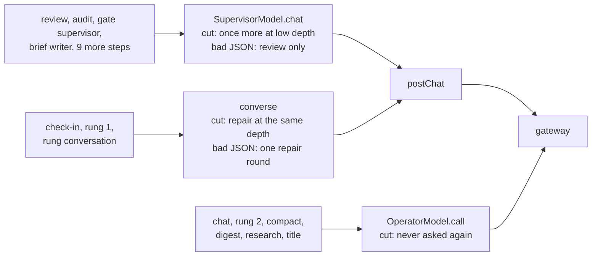

# Finish the General Fix: Implementation Plan

> **For agentic workers:** REQUIRED SUB-SKILL: Use superpowers:subagent-driven-development (recommended) or superpowers:executing-plans to implement this plan task-by-task. Steps use checkbox (`- [ ]`) syntax for tracking.

**Goal:** Move each fault fix that patched one path into the shared function that every sibling path passes, and build the faults still open at main there, so that the 40 items of the table below close where all callers meet.

**Architecture:** Each task changes one shared function and routes the open sibling through it: the model call, the repair of a model's answer, the check-in's reasons, the filing doors, the plan's criteria evidence, the card digest, the alert row, the gateway's money and holds, the heal pass, the console's refusal writers, the readers and the checks. Most tasks reuse a function the code already has (`converse`, `failScan`, `ShownName`, `RefuseWorkflowDirChange`, `CommentOnce`) and delete the copy beside it. No task adds a kind or a flag for one case.

**Tech Stack:** Go (factoryd, console, gateway, policy, agent-worker), Postgres, Temporal, YAML and JSON config in the infra repository, Forgejo workflows, shell.

**Spec:** None. The evidence in "The situation today" stands in for it.

## The situation today

### The pieces this plan touches

- A **card** is one unit of work with its issue. An agent card runs sessions in a sandbox, then its gates. A human card is work only a human does.
- A **gate** judges a card's pull request: the checks, the policy gate, the model review, the security audit, the criteria gate of a plan.
- A **check-in** is a model step that reads a running card at a moment (mid-session, at a gate's return, after a dead session) and answers one of a closed set of decisions.
- A **case** is a stop on a card that needs a decision. It climbs the ladder: rung 0 reads facts and calls no model, rung 1 is a model with read tools, rung 2 is the factory agent, then the human. **Act** is the one function that carries out a case's answer.
- An **ask** is what a human card or a case shows a human. A **face** is the text and controls of an ask on the board.
- **`converse`** (`internal/factoryd/checkin.go:1022`) is the factory's general form for a model step with a structured answer. It posts evidence tools and one forced answer tool with a JSON schema, parses the answer, and gives a refused answer one repair round. The check-in, rung 1 and the rung conversation use it.
- The **heal pass** (`HealPass`, `internal/factoryd/temporal.go:339`) runs every minute and repairs state a lost webhook or a restart left behind.

Paths below without a directory sit in `internal/factoryd/`. Every `file:line` is at code main `c2dddcd67` unless it names a branch.

### How a model answer is made today

A model step reaches the gateway by one of three routes. Each route treats a cut answer and a malformed answer its own way. This is the shape of the largest group of open siblings.



### Fault keys

The audits named each fault by its source document. The keys below appear in the tables.

| Key | Source document |
|---|---|
| Handover N | the fault handovers of 2026-11-01 and 2026-11-02 in this repository's root |
| Register N | entry N of `docs/needs-you-register-2026-11-09.md` |
| Freeze P4 | `docs/plans/2026-11-14-provider-limit-freeze.md` |
| FF-N | fault N of `factory-faults-2026-11-17.md` and `docs/plans/2026-11-17-work-loss-faults.md` |
| NY-N | fault N of `docs/plans/2026-11-17-needs-you-faults.md` |
| MQ-N | task N of `docs/plans/2026-11-16-merge-queue-turn.md` |
| EC | `docs/plans/2026-11-16-every-card-readable.md` |
| FZ | `docs/plans/2026-11-18-freeze-card-atomic.md` |
| CR | `docs/plans/2026-11-20-cap-reset.md` |
| OC-R1, OC-R2, OC-R2b | causes R1 and R2 of `docs/plans/2026-11-24-open-cards-root-causes.md` |
| CG-N | task N of `docs/plans/2026-11-24-cause-gone.md` |
| RT-N | item N of `prompt-cards-retire-2026-11-26.md` and its build notes |
| OF-N | fault N of `docs/plans/2026-11-26-open-faults.md` and its build ledger |

### Every item this plan keeps

Each row below was read at main `c2dddcd67`. The table answers one question: where does each open sibling's fix belong? The last column names the task.

| Fault | What the fix did | Sibling still open (file:line) | Shared place for the fix | Task |
|---|---|---|---|---|
| OC-R1 | 4735ba639 (2026-11-24): a gate's or the brief writer's answer cut at its limit is asked once more at low thinking depth (`supervisor.go:396-410`) | the check-in and rung 1 repair a cut answer at the same depth (`checkin.go:1122-1134`). The chat and rung 2 never ask again and tell the human to send a message (`internal/console/chat.go:1362-1369`) | `postChat` (`supervisor.go:466`) for unstreamed calls and `OperatorModel.call` (`operator.go:267`) for streamed ones | 1 |
| Register 76 | 9fa39ea21 (#1721, 2026-11-10): the check-in posts no output limit (`checkin.go:1224-1238`) | `SupervisorModel` posts `max_tokens` from `TokenBudget` (`supervisor.go:332`, `:382`), set by two environment variables (`cmd/factoryd/main.go:1252-1255`). `OperatorModel` posts 16384 and three smaller caps (`operator.go:42`, `:167`, `:188`, `:238`) | the gateway's limit from `prices.max_output_tokens` (`internal/gateway/server.go:1060-1075`), which the policy load requires (`internal/policy/tree.go:200-222`) | 2 |
| Register 24 | 7559ec315 (#1629, 2026-11-10): the review's answer that does not parse is asked once more with the parse error (`gates.go:1966-2000`, caller `:2240-2258`) | the repair is a second one beside `converse`'s, and no other direct call has one | one repair call in the direct-call client (`SupervisorModel`, `supervisor.go:378`), in the shape of `converse`'s repair round | 4 |
| Register 33 | the same fix, with #1694 and #1705 | the audit turns an answer that does not parse into "no verdict" at once (`audit.go:358-361`). The gate supervisor turns one into an escalation (`gatesupervisor.go:492-496`) that opens a gate stop case (`workflow.go:4272-4280`) | the same repair call | 5 |
| NY-1, OF-5 | none at main. Task 1c of the open-faults branch plans it | the gate-return persona always shows `"repeats":"<id>"` (`checkin.go:543`). The schema offers `repeats` only with earlier findings (`:632-638`). The check-in's conversation sets no `RepairPastCap` (`:907-920`), so a refusal on the forced last call ends the step. Only `rungconv.go:59` sets it | the persona's example built from `momentAnswerSchema` (`checkin.go:617`), and the repair past the cap as `converse`'s own behaviour | 3 |
| NY-4 | the digest relabels the replan step only (`carddigest_timeline.go:125-133`) | the case brief writer makes one call with no tools over facts that hold no plan revision and resolve no `#N` (`brief_case.go:46-60`, `:69-104`) | `converse` over rung 1's `CaseTools` (`rung1.go:382`) | 6 |
| Handover 1b | dc8d918f2 (#1748) and a485d3157 (#1755), 2026-11-11: the case kind `CasePolicyClass` and a rung 0 route to the approval (`actions.go:270`) | every moment's schema offers `policy_class` (`checkReasonKinds`, `checkin.go:586`). A session-moment hand-up on policy has no approval behind it, rung 1 does not run and rung 2 only analyses (`cases.go:189-192`), so it reaches a human | the merge gate, which routes policy through the risk-class table | 7 |
| Register 34 | 5f8f5a03d (#1730, 2026-11-10): a card whose directories all sit under a workflow directory is a human's card in the issue intake (`intake.go:1163-1165`) and in the plan's filer (`plan.go:4217-4226`) | `FileAgentTask` (`intake.go:1476`) and the delegation (`delegate.go:148-158`) file such a card for agents. Both pass `fileEntry` (`tracks.go:97`), and only their bodies can carry a "Directories:" line: the API filer (`cmd/factoryd/main.go:1036`) and an agent's delegation brief | `fileEntry` | 8 |
| NY-3 | none at main. The open-faults plan says `ProofsAtMain` covers it, which does not hold: `ProofsAtMain` dates from 2026-11-04, before the fault, and acts only after a session that pushed nothing (`proofsatmain.go:54-77`) | no check refuses a `kind: test` criterion whose test function main already holds. `criteriaFindings` (`plan.go:843`) reads no repository | the plan's filing door `FilePlan` (`plan.go:3109`, findings at `:3180-3216`) | 9 |
| FF-22 | 71c4a2b61 (2026-11-17): `ProofsAtMain` drops cited invariants (`proofsatmain.go:68-71`) | the criteria gate on main turns every invariant into a `checks: true` run (`criteria.go:147-149`) that main's green checks meet (`criteria.go:320-324`), whether or not the plan's work reached main (`planGateOf`, `verdict.go:961-996`) | one evidence filter beside `gateRuns` (`criteria.go:138`) | 10 |
| Handover 5b | e93c80dd8 and three more (2026-11-02): criteria never judged open a second approval kind `criteria_rerun` (`store.go:1063`, `askRerun` at `verdict.go:2647`) | 40 non-test lines in factoryd, the console and the face fixtures test two kinds, while the spec both carry already lists the unjudged criteria (`CriteriaSpec{Open, Unchecked}`, `verdict.go:1892`) | one `criteria` request whose spec lists say what was never judged | 11 |
| Register 43 | bbaae3097 (#1678, 2026-11-10): the `synchronize` webhook withdraws the merge call (`intake.go:1844-1846`, `withdrawMovedHead` at `:1899`) | no heal pass compares an open merge call's `MergeSpec.HeadSHA` (`gates.go:386`) with the live head, so a webhook lost while factoryd restarts leaves a stale call on the board | `withdrawMovedHead`, called by the webhook and by the heal pass | 12 |
| Freeze P4 | 51ac2c2d3 and d5e99ce58 (2026-11-16, 11-17): two flags skip moments a freeze covers (`carddigest_flags.go:216`, `:234`) | each new flag must repeat the guard through `frozenAt` and `frozenOver` (`carddigest_flags.go:143-166`) | the digest builder, which builds the freeze spans once (`carddigest.go:308`) | 13 |
| Register 4 | 2207b6f38 (#1571) and 24abf52fa (#1708), 2026-11-09 and 11-10: the flag and Act's guard each learned that a filed revision buys a planner's grant | Act's guard `boughtNothing` (`actions.go:1197-1201`) counts a session a freeze emptied as one that bought nothing, which the flag spares. Rung 2's draw is refused on it (`actions.go:945`) | the frozen mark of Task 13, read by the draw facts (`casefacts.go:795-835`) | 13 |
| FF-18 | 2ef9cd378 (2026-11-18): a budget-floor stop after a session that pushed nothing says the work is lost (`faces_copy.go:1018-1020`) | every other stop reads the same facts (`casefacts.go:595-599`) and says only "No change is pushed yet." (`faces_copy.go:1009`) | `leftLine` and its one sentence `lostWorkLine` (`faces_copy.go:970`, `:1043`) | 14 |
| CG-13 | none at main | Done shows the newest factory withdrawal on an ended human card, also one made after the card ended (`internal/console/faceview.go:449-451`, from `ClosedAsks`, `event_store.go:500-531`). The monitor's withdrawal says "the flag no longer holds" for most flags (`monitor.go:272`) | the `ClosedAsks` query, bounded by the card's end | 15 |
| RT-12 | 49c215f6b (2026-11-26): an event alert's card closes once a fact shows its reason gone | the retire keys on three alert names typed in factoryd (`signozwebhook.go:43-45`, switch at `:744-750`) that copy rule names of the infra repository. A second switch on the same names words the card (`humanquestion.go:97-109`) | a `retire` label on the infra rule, read through one table in factoryd | 16 |
| RT-10 | 0524c39b0 (2026-11-26): a CI runner pod that stays Pending files one card per cause through the alert intake | the alert's origin is a fingerprint prefix, tested on 7 lines (`signozwebhook.go:554`, `:940`, `:1087`, `:1259`, `:1261`, `projectalerts.go:175`, `:177`, helpers at `signozwebhook.go:80-93`) and once inline (`:909`) | an `origin` field in the alert row's detail | 17 |
| Handover 3b | c7eebcf65 (2026-11-02): every factoryd and console money figure nets the gateway's holds (`Task.EnforcedSpent`, `store.go:201`) | the gateway's `task_costs` tool answers `BudgetEUR - SpentEUR` with no holds (`internal/gateway/tools.go:1318`, read at `internal/gateway/store.go:153-169`). An agent and the check-in see two remaining figures for one card | one held-spend term in `internal/policy`, read by both stores | 18 |
| RT-14 | 91ab8474e (2026-11-26): a freeze the gateway forgot at a restart ends at the first answered call (`endForgottenHold`, `internal/gateway/server.go:338-353`) | the class hold lives in memory only (`internal/gateway/server.go:198-205`) | the gateway's boot (`NewServer`, `internal/gateway/server.go:210-219`), reading the `class_frozen` and `class_resumed` rows | 19 |
| FZ, no provider | infra 650b9d1: a policy edit named the provider | the policy check accepts a work class with no provider (`internal/policy/policy.go:1388-1394`), and such a class never freezes (`ProviderLimitOf`, `:107-118`) | `Document.Validate` (`internal/policy/policy.go:1333`) | 20 |
| RT-18 | none at main | the heal pass confirms a factory close but moves no status (`healFactoryClose`, `intake.go:986-1018`), so a failed card whose close webhook was lost stays failed with its issue closed | `HealFactoryCloses` (`intake.go:937`), calling the webhook's own close path | 21 |
| Handover 8b | 1a505669c and 6ff46153b (2026-11-02, 11-09): refusals reworded by hand to name the error and the next step | seven chat turn failures show a fixed sentence with no error and no next step (`internal/console/chat.go:336`, `:1280`, `:1409`, `:2119`, `answer.go:182`, `chat_budget.go:164`, `:264`) | the turn's failure writer `turn.fail` (`internal/console/chat.go:308`) | 22 |
| Register 68b | 8416c2e7f (#1695, 2026-11-10): refusals scrubbed one call site at a time (51 `errText` calls in the console) | `Console.fail` writes a refusal unscrubbed (`internal/console/actions.go:283`), and so does the chat tool's `errSentence` (`internal/console/chat.go:1786-1787`). 12 refusals embed a raw error (`actions.go:1118`, `:2068`, `:3213`, `:3606`, `:3646-3650`, `autonomy.go:127`, `pool.go:298`, `routine_tools.go:117`, `watches.go:40`, `:83`) | the two refusal writers | 22 |
| Register 14 | 5201f974d (#1712, 2026-11-10): the "Have the factory do it" branch runs on a detached context (`tailContext`, `internal/console/actions.go:783`, used at `:1826`) | the close branches of the same switch run on the request's context (`:1810-1820`, `:1834`), so a client that leaves mid-press cancels them halfway | `callActWork` (`internal/console/actions.go:2009`), the door every Act answer passes | 23 |
| MQ-5 | 1eef1fc73 (#2137, 2026-11-17): the policy gate counts a moved file by its changed lines | the project agent's `pull_request` read sums Forgejo's file list (`internal/console/chat_reads.go:514-519`) | the gate's own `gate_head` row (`recordGateHead`, `gates.go:475-479`) | 24 |
| OC-R2b | 800568213 (2026-11-24): rung 1's file read names path, ref and short commit (`rung1.go:527`), the check-in's grep names ref and commit (`cmd/agent-worker/checkin.go:429`) | the chat's `file` read names the ref only on a windowed answer and gives a whole file with no header (`internal/console/chat_reads.go:615-657`). Its `grep` names no commit (`:845`) | one header function in factoryd | 25 |
| Register 62 | 2cca2dee8 (#1709, 2026-11-10): the merge call names a red job's failing tests (`failedTests`, `failedtests.go:187`) | the next session and the check-in read `ChecksResult.Findings`, the last 40 lines of each red log (`checksResult`, `activities.go:3063-3094`, `jobLogMaxLines` at `:3172`) | the one log scan `failScan` (`failedtests.go:94-185`) | 26 |
| EC, pod start | 948c122d1 (2026-11-19): a CI pod that cannot pull its image gives its room back after 3 minutes (`pullFailed`, `ci.go:1159-1170`) | a session or gate pod treats a pull failure as final only on "NotFound" or "manifest unknown" (`startStep`, `runner.go:2576-2591`) and waits out 10 minutes otherwise (`gates.go:1169`) | one verdict over `PodWait` and `ContainerState` (`kube.go:520`, `:160`) | 27 |
| Register 12 | ca4d6c164 (#1602, 2026-11-09): the worker messages the session at its first file-change event under a workflow directory (`cmd/agent-worker/main.go:1330-1406`) | a write through the shell raises no file-change event (`supervise.go:254`). The guard's sentence differs from the push rule's (`cmd/agent-worker/main.go:1405` against `pushrules.go:210`) | the push rule `RefuseWorkflowDirChange` (`pushrules.go:199`), run on each 15-second checkpoint's staged tree | 28 |
| Register 19 | 41921e76f (#1612, 2026-11-09): a diff confined to `k8s/` runs `./internal/reproducible/...` alone (`scripts/affected-packages.sh:10-13`, `:22-26`) | 15 test reads of `k8s/` files in `cmd/factoryd` and `internal/factoryd` do not run on such a diff (for example `cmd/factoryd/register_test.go:104`, `alertrules_test.go:93`, `runner_test.go:3926`) | the script's walk, selecting packages by the paths their tests name | 29 |
| Register 41 | fc4017cfd (#1650, 2026-11-10) and 64e17a94a (#1802, 2026-11-12): the format check names the files it fails on | the check lives in three copies with three wordings (`.forgejo/workflows/pr.yml:86-89`, `.forgejo/workflows/ci.yml:112`, `check:44-45`). The testdata template keeps the silent form (`internal/policy/testdata/tree/templates/ts-go/.forgejo/workflows/pr.yml:46`, `ci.yml:45`) | one script beside `.forgejo/gosec.sh` | 30 |
| NY-2 | none at main | the runner's warm step mounts eleven named paths (`Dockerfile.runner:186-191`), and `RUNNER_INPUTS` lists them again in a file agents may not change (`.forgejo/workflows/ci.yml:28`, read at `:101` and `:218`). A new top-level Go directory needs a human | one bind of the build context, with an ignore file outside `.forgejo/` | 31 |
| OF-1 | branch `open-faults` (df2295b71, bd9fb7911): two hand values in `DefaultBounds` | every other long activity with no bound of its own takes the 120-second default (`internal/policy/policy.go:866-868`, `defaultBoundActivities` at `gatewatch.go:85-97`) and raises a false `gate_bound` alert | `PinnedBound` (`gatewatch.go:462`), reading the activity's own timeout | 32 |
| OF-2 | branch `open-faults` reorders two closes so the comment comes first | three more closes still close before they comment, so a failed comment is never made again (`activities.go:3519-3524`, `imager.go:844-849`, `schemasync.go:150-155`) | one Forgejo call that comments once, then closes | 33 |
| OF-3 | branch `open-faults` drops one task id (`deps.go:587`) | four human texts still print a task id or a plan key (`mainfix.go:823`, `toolpark.go:282`, `:290`, `deps.go:344`) | `ShownName` (`act.go:1756`), with a test over the rendered texts | 34 |
| FF-10 | 15792bf81 to c35db4672 (2026-11-17): a human's hold with a release card instead of a dependency across plans | a release card that ends failed or closed strands the hold, and the Poker's notice tells the human outside the ladder (`strandedHolds`, `cardhold.go:102-125`) | the dependency cases `dependency_failed` and `dependency_closed` (`cases.go:158-160`) | 35 |
| Handover 6a | none needed: the gateway's own hold under policy version 971 refused the calls | `docs/card-flow-redesign-2026-11-02.md:35` still says "The month cap of 544 lived in a LiteLLM backstop that only a pod restart could move." | the record | 36 |
| FF-7 | 073dd8ce5 built a case-rename filter for the audit, 569bb1818 deleted it the same day (2026-11-17) | no document records the choice between a rename check in a sandbox pod and none | the audit's section of `docs/architecture.md` | 36 |
| OF-4, OF-6, OF-7 | e9f9a9d7e on branch `open-faults` fixes OF-4. OF-6 and OF-7 have briefs and no commit | open at main: `internal/console/board.go:1756`, `ci.go:1430-1436`, `testdata/README.md` | the open-faults pull request | 36 |

### Items checked at main and not kept

Four rows of the audits do not hold at main as the audit stated them. The plan builds nothing for them.

- **Register 65.** The register said a normal-class change whose audit died merges without a human at `merge_rule` auto. It does not. The audit stage's `on_findings` must be `human` (`internal/policy/process.go:350`), a failed audit becomes a finding (`workflow_stages.go:1173-1180`), and a card with a finding never calls `AutoMerge` (`workflow_stages.go:1290`). The class-high clause (`gates.go:295-300`) serves a project that switched the audit off. A pull request that factoryd wrote (revert, schema copy, template update) merges at full auto whatever its review and audit found, by the design of 2730e173a (2026-10-20).
- **CR.** The audit named the premium and pool resets as siblings that `capLift` does not know. Neither reaches it: `capOpenings` holds the day, month and project caps only (`monthcap.go:48-52`). The shortcut at `activities.go:1042-1053` guards a loop that the cap-waits plan named: the floor's estimate funds a session whose first call the gateway's hold refuses. It stays.
- **Register 4, the report card.** The audit said a report card's session counts as one that bought nothing. No grant reaches a report card: a capped report waits through `awaitCap` (`workflow_stages.go:1674-1675`). The divergence on frozen sessions is real and is row 15 of the table above.
- **Handover 9a.** The tracked record holds. `docs/red-main-revert-plan-2026-11-02.md:40-45` says that the revert merged four minutes after its filing and that a red main pauses the merge queue (`Roller.mainState`, `mainfix.go:168`). Only the untracked handover keeps the claim that merges ride a red main.

### Items other plans of this set take

- Handover 1c, the stop kind parsed from reason text (`CaseKindOf`, `EscalationSource`): plan "One close for every card".
- Register 47 as far as it is a case kind: plan "One close for every card". Its over-bound phrase (`workflow.go:2208`, `activities.go:1443`, `runner.go:1077`): plan "Collapse the workflow's history".
- Monitor M4, the four hand-written pass loops: plan "Collapse the workflow's history".
- Freeze P5, the freeze card's own lifecycle, and FZ's source filter in the shared close retry (`store.go:1747-1751`): plan "One close for every card".
- CG-7, the withdrawal row in each watcher: plan "One close for every card".
- RT-5, the retire statement as prose: plan "One close for every card", which makes `Retires` name rows.
- RT-6, the decision of the cause-gone plan that 63b54a95c reversed: plan "One close for every card".
- OC-R2, both halves: the refusal in the action table (`checksRunRefusal`, `actions.go:575-587`) and the mid-session check-in's offer (`runner.go:1885`), which that plan's task fixes in factoryd. Also 85df157ad, the raise's card close in four callers: plan "One door for every answer".
- Handover 7b (the planner's read rule), MQ-6 (the sandbox line on a tool's reach), EC's wording rules: plan "Prompts carried by construction".
- OF-7's stale `testdata/README.md`, if the open-faults branch does not delete it: plan "Tests and housekeeping".

### What the audit found overall

The two audits read 243 fault rows from 2026-11-01 to 2026-11-26. Most fixes were general. One in seven patched one path.

| Class | Meaning | Rows to 2026-11-15 | Rows from 2026-11-16 | Rows in all |
|---|---|---|---|---|
| A | general fix at the shared place | 70 | 75 | 145 |
| B | one path patched, a sibling still open | 19 | 13 | 32 |
| C | a prompt rule where a tool could carry it | 1 | 2 | 3 |
| D | a flag, field or kind for one case | 3 | 3 | 6 |
| E | not fixed at main, or the record's claim does not hold | 2 | 13 | 15 |
| F | fixed and reworked later | 15 | 6 | 21 |
| n/a | no code fix needed | 21 | 0 | 21 |
| All | | 131 | 112 | 243 |

Of the 222 rows that needed a code fix, 145 fixed the cause where every path passes. 32 rows patched the path the report named and left a sibling with the same fault. The share of B rows fell from 19 of 110 rows that needed a fix before 2026-11-16 to 13 of 112 after it. The E rows grew from 2 to 13. The later window ends on 2026-11-26 with work in progress: 6 of its 13 E rows belong to the open-faults plan of that day, and on 2026-11-27 four of those have a fix on its branch. This plan's own check at main dropped three B rows the audit gave it (Register 65, CR, and the report-card half of Register 4) and narrowed one (Register 34 is open on two callers, not eight).

## Why this is drift

The tenets say a guard sits in the shared function, not in every caller (tenet 5), and that a step's reliability comes from its construction, not from its prompt (tenet 4). A B row breaks the first: the fault was understood, fixed, and left open one call away. The audit's evidence shows the pattern repeating in time.

- The same format check was fixed twice, two days apart, in two files: #1650 on 2026-11-10 in `pr.yml`, #1802 on 2026-11-12 in `ci.yml`. A third copy in `check:44-45` still has its own wording.
- The bought-nothing rule learned about plan revisions twice, in two places: #1571 on 2026-11-09 in the digest flag and #1708 on 2026-11-10 in Act's guard. The two rules disagree today on a frozen session.
- The low-depth retry of 4735ba639 (2026-11-24) fixed a cause that stopped 28 cards in 14 days on the gate and brief path. The check-in and rung 1 meet the same cause and repair at the same depth. No count exists for them, because their cut answers end as "check-in answer unreadable" and the open-cards plan counted gate calls.
- c3b5077db's message says "neither the check-in nor the factory agent replans a card while the checks on its pull request's head run". The mid-session check-in still offers the replan (`runner.go:1885`). On #2273 and #2272 a check-in answered replan for finished work, on a false reading or while the checks still ran. Each replan closed the pull request, started a planner and added a human confirmation. The plan "One door for every answer" builds the fix of this sibling.
- Two fixes route a fault outside the ladder (tenet 2). A malformed gate supervisor answer opens a case with no repair round (`gatesupervisor.go:492-496`). A stranded hold tells the human through the Poker's notice (`cardhold.go:102-125`), outside every rung.

Each open sibling is a fault that has already happened once on another path. Its cost when it happens again is the cost of the first time: a card stopped at a human, a pull request closed by mistake, a stale card on the board, a figure that disagrees with another figure for the same card. The plan does not count human minutes for siblings that have not fired yet. For the rows that did fire, the source documents name the cards.

## The trade-off

The plan costs 36 tasks in 16 pull requests. Most tasks change under 50 lines. The estimate is about 130 non-test lines fewer and about 400 test lines more, inferred from the spans read, not from trial changes.

The largest risk sits in Tasks 4 to 6. Tasks 4 and 5 add one repair call to the direct-call client, which the review, the audit and the gate supervisor pass. A refused answer then costs one more call, which the gate watch must allow for (`oneMoreCall`). The review's fan runs parts in parallel and records per part whether the answer came at low depth (`reviewfan.go:67`), and the repair must keep both. A money refusal must stay without a second call (Review Focus 2). Task 6 moves the case brief writer from one call to a conversation with up to 4 calls, so a brief costs more when the model reads the card.

Task 11 needs a data migration: stored `criteria_rerun` rows become `criteria` rows. Task 16 is an ordered change in two repositories, and the infra repository has no agents, so its labels land by hand first. Tasks 30 and 31 change `.forgejo/`, which agents may not change, so they merge by hand.

What the plan buys: each fault class has one place where its fix lives, and a new caller of that place gets the fix without knowing about the fault. The table above has 41 rows. After the plan, each row's sibling passes the shared place.

What stays as it is, and why:

- `converse`, `failScan`, `ShownName`, `RefuseWorkflowDirChange`, `CommentOnce` and `withdrawMovedHead` are the right shape. The plan routes more callers through them and builds few new functions.
- The review and the audit still run on a factoryd-written pull request at full auto, and their findings are not read there (2730e173a). That costs model calls, not a wrong merge. The plan leaves it.
- LiteLLM's `max_budget` (infra `k8s/platform/litellm/helmrelease.yaml:173`) stays a second number for the month cap at 1.25 times `budget.month_eur`. `scripts/budget-backstop-check` refuses a push that breaks the ratio and names the fix. Deriving the number from the policy file needs a template step in Flux that costs more than the one edit a cap above €1500 needs.
- The cap wait's shortcut in `capLift` stays, for the loop it guards.

Alternatives considered:

- **Patch each sibling where it is.** Each diff is smaller, but the plan would add a second copy for each fault, the shape that caused the B rows.
- **Wait until each sibling fires live.** Each sibling then costs one more stopped card, and the fix comes as one more patch on one more path.
- **Fold the rows into the other seven plans.** Those plans are themed and already large. The rows here share a shape (one guard, one caller away) more than a theme, and most are small enough to review alone.

## The proposal

Every fix lives in the function that all its callers pass. In plain words:

- One rule for a cut answer: the call function of each transport asks once more at low depth when the answer stopped at its limit before it wrote anything. No factoryd client names an output limit. The gateway sets it from policy.
- One repair round for a structured model answer. The direct-call client gives an answer its parser refuses one more call that names the refusal, as `converse` does for a conversation, and `converse` does it also past its call cap. The review's own retry goes. The case brief writer reads the card through rung 1's tools.
- The check-in names no policy reason. The merge gate routes policy.
- The filing door refuses or routes what a session could never do: a workflow-only card goes to a human from every filer, and a plan cannot cite a test main already holds.
- One rule for criteria evidence on main. One criteria request kind.
- The heal pass carries what a lost webhook drops: a moved head's merge call and a failed card's close.
- A frozen step is marked once. The flags and Act's draw guard read the mark.
- An alert row says where it came from and which fact retires it, as fields.
- The gateway and factoryd read one held-spend term. The gateway rebuilds its holds from its rows at boot.
- Each refusal writer scrubs once and takes the error.
- Each reader names what the gate saw: the gate's line count, a file's commit.
- One log scan names failing tests for every consumer. One verdict judges a pod's start. One push rule tells a session about workflow files. One format script. One input list for the runner image.

Deletions, with sizes read at main (inferred where marked):

| What goes | Where | Lines |
|---|---|---|
| `SupervisorModel.chat`'s own once more | `supervisor.go:396-410` | 15 |
| `TokenBudget` on the supervisor, two environment variables, `OperatorTokens` and three caps | `supervisor.go:318`, `:332`, `:382`, `cmd/factoryd/main.go:1252-1255`, `operator.go:42`, `:167`, `:188`, `:238` | about 25 |
| `RepairPastCap` | `checkin.go:972-974`, `rungconv.go:59` | 4 |
| the review's repair family | `gates.go:1633-1635`, `:1674-1684`, `:1966-2000`, `:2240-2258` | about 64 |
| `CasePolicyClass`, `CheckPolicyClass` and their branches (Task 7, on decision) | 12 and 5 non-test lines in 10 files | about 50 |
| `ApprovalCriteriaRerun`, `criteriaKinds`, `askRerun` | `store.go:1059-1063`, `verdict.go:2619-2690`, 40 reader lines | about 70, inferred |
| `frozenAt`, `frozenOver` and the `next` step time | `carddigest_flags.go:143-166`, `:187-190` | about 30 |
| the kind condition of the lost-work line | `faces_copy.go:1018` | 1 |
| the three alert name constants and two switches | `signozwebhook.go:43-45`, `:744-750`, `humanquestion.go:97-109` | about 25 |
| `fromFlux`, `fromSpawner` | `signozwebhook.go:80-93` | 9 |
| `endForgottenHold`, the `known` map | `internal/gateway/server.go:204`, `:338-353` | about 18 |
| the per-site `errText` wraps that feed a refusal | 51 calls in `internal/console` | about 25, inferred |
| `tailContext` and its use | `internal/console/actions.go:781-784`, `:1824-1827` | 8 |
| the chat read's own line sum | `internal/console/chat_reads.go:514-519` | 6 |
| `workflowDirGuard`, `workflowDirOf`, `workflowDirMessage`, the file-event watch | `cmd/agent-worker/main.go:1330-1406` | about 60 of 77 |
| the k8s exception | `scripts/affected-packages.sh:10-13`, `:22-26` | 9 |
| two format copies | `.forgejo/workflows/pr.yml:86-89`, `check:44-45`, part of `ci.yml:112` | 7 |
| the eleven named mounts and `RUNNER_INPUTS`'s list | `Dockerfile.runner:186-191`, `.forgejo/workflows/ci.yml:28` | about 8 |
| three hand bounds after OF-1 | `internal/policy/policy.go:866-868` | 3 entries |
| `strandedHolds` and the Poker's branch (Task 35, on decision) | `cardhold.go:102-125`, `pokes.go:232`, `:354` | about 30 |

Additions: `postChat`'s once more (about 20 lines), a purpose on `converse`'s call (about 5), the repair call in the direct-call client (about 25), a schema for the case brief's answer if the prompts plan has none (about 10), the workflow-only route in `fileEntry` (about 15), the held-test check in `FilePlan` (about 50), the evidence filter (about 12), a migration (about 5), the moved-head heal (about 25), the frozen mark on a digest step (about 10), the retire table (about 20), the origin field (about 10), the shared held-spend term (about 15), the boot read of holds (about 30), a policy refusal (about 6), the heal of a failed card's close (about 8), the scrub in two writers (about 10), one header function (about 10), the failing tests in `checksResult` (about 10), one pod-start verdict (about 25), the guard on checkpoints (about 15), the test-path walk (about 12), one format script (about 10), the bound from an activity's timeout (about 5), one close-with-comment call (about 12), a task-id test (about 15).

## Decisions for Sebastian

### 1. The check-in loses the policy reason

Today a check-in at any moment may hand a card up with the reason kind `policy_class`. At the gate's return with green checks, rung 0 routes it to the approval. At any other moment, nothing routes it: rung 1 does not run on the kind, rung 2 only analyses it, and it reaches you with no approval card behind it (`cases.go:189-192`). That is the shape of card #1347, a policy question asked before an approval could exist.

On 2026-11-01 you leaned to the hard version of handover 1's question 4: on a full-auto project the check-in never preempts the flow on a policy matter, and the gate stays the only router of policy. The build of 2026-11-11 (#1748, #1755) kept the power and added a route for one moment.

- (a) Drop `policy_class` from every moment's answer. A check-in that sees a policy matter answers `reverify` or `handover`, and the merge gate's risk-class table routes policy on every autonomy level. On a manual project you approve every merge anyway. **Recommended.**
- (b) Drop it on full-auto projects only. That adds a branch on autonomy to the check-in's schema.
- (c) Keep it.

Task 7 builds (a). Stored cases of kind `policy_class` need a data step, inferred: the task closes any open one as withdrawn before the kind leaves the table.

### 2. A stranded hold climbs the ladder

On 2026-11-17 you chose a human's hold with a release card over a dependency that crosses plans (fault 10). When the release card ends failed or closed, the hold releases nothing. Today `strandedHolds` writes a row, and the Poker tells you by a notice (`cardhold.go:102-125`, `pokes.go:354`). No rung sees it, so neither rung 0's retry nor the factory agent can act first.

- (a) Keep the hold. A release card's failed or closed end opens `dependency_failed` or `dependency_closed` on each held card, the cases a dependency's end opens today, whose rungs already exist (`retry_dependency`, `impasse`, rung 2). The notice goes. **Recommended:** it keeps your choice and puts the stranded hold on the one ladder.
- (b) Let a dependency cross plans (drop the `GroupOf` refusal, `internal/console/actions.go:2741`) and delete the hold's release half. This deletes more and reopens your choice.
- (c) Keep the notice.

Task 35 builds (a).

### 3. The audit and pure renames

The audit flagged pure case renames as changes (FF-7). A filter was built and deleted the same day, because its type check could neither be bounded nor stopped (569bb1818). The audit reads the raw diff today. Since FF-6 gave a confirmed finding a stable identity, a rename costs one confirmation per checklist item and file. The build ledger asked you to choose, and no document records an answer.

- (a) Record that the audit reads the raw diff and that a rename costs one confirmation per item and file. **Recommended:** no live fault since 2026-11-17.
- (b) Build a rename check that runs in a sandbox pod with its own time bound.

Task 36 writes your choice into the audit's section of `docs/architecture.md`.

## Global Constraints

- Code work runs in a git worktree off `origin/main` of `~/repos/ai-software-factory-code`. One pull request per task group, from `controller/ai-software-factory-code`, merged as `sebastian` after green CI and an independent review on the most capable model.
- `bash check changed` passes before each commit. Go tests run with `go test -race`. Postgres-backed tests run through `scripts/pg-test.sh`.
- A change to workflow code needs a `workflow.GetVersion` change id and a replay test. No task here changes workflow code, as read at `c2dddcd67`. A task that finds it does adds both.
- A fix reaches production only through a roll, and a roll needs Sebastian's go.
- No task id in a text a human reads. A human is a human, never a member or an operator.
- No comments that narrate the change. Tests state hand-derived expectations.
- Before Tasks 3, 32, 33, 34 and 36, read main for the open-faults pull request (branch `open-faults`). Build on what it merged. Do not build what it holds unmerged.
- Task 7 of the plan "Prompts carried by construction" gives every direct call a forced answer tool in `SupervisorModel.Chat`, and its answer shapes. Tasks 4 and 5 here add the repair call on top of `chat` and change no answer shape. Task 6 here moves the case brief writer onto `converse` and reuses that plan's case brief schema when it exists, so that plan's Task 7 leaves the case brief writer out if Task 6 landed first. Whichever lands second adapts to the first.
- Task 16 changes the infra repository first, by hand, since it has no agents.
- Tasks 30 and 31 change `.forgejo/`, which no agent may change: they merge by hand.
- Product copy a human reads is marked in its task and passes `internal/writingguide`.

## Review Focus

1. **A streamed answer that showed text must not be asked again** (Task 1). A second call would print a second answer under the first. Task 1 pins it with `TestStreamKeepsACutAnswerThatShowedText`.
2. **A money refusal of the review must get no repair call** (Task 4). Today `reviewRetry` skips refusals and cut answers (`gates.go:2247-2253`). The new `answer` must skip them the same way. Task 4 pins it with `TestAnswerGivesAGatewayRefusalNoRepair` and `TestReviewRefusalGetsNoRepair`.
3. **A failed read of the live head must withdraw nothing** (Task 12). Task 12 pins it with `TestHealMovedHeadsKeepsTheCallOnAFailedRead`.
4. **A stored `criteria_rerun` request stays answerable after the migration** (Task 11). Task 11 pins it with `TestMigratedRerunRequestTakesMetAndRun` through `scripts/pg-test.sh`.
5. **A scrub run twice changes nothing** (Task 22). A refusal that already passed `errText` passes the writer's scrub again. Task 22 pins it with `TestScrubTextIsIdempotent`.

## Tasks

### Group A: the model call (one pull request)

### Task 1: An answer cut before it wrote anything is asked once more at low depth in each transport

**Closes:** OC-R1.

**Files:**
- Modify: `internal/factoryd/supervisor.go:329-344` (`chatPayload` returns the body map), `:378-411` (`chat` loses its own once more), `:418-431` (`call`), `:466-500` (`postChat`)
- Modify: `internal/factoryd/checkin.go:497-528` (`CheckinResponse.Low`), `:1122-1123` (a cut ends the conversation), `:1224-1260` (`Call`)
- Modify: `internal/factoryd/operator.go:267-308` (`call`)
- Modify: `internal/console/chat.go:1362-1369` (the cut sentence names the limit the gateway gave). Human-read copy: it passes `internal/writingguide`.
- Test: `internal/factoryd/supervisor_test.go`, `internal/factoryd/checkin_test.go`, `internal/factoryd/operator_test.go`

**Interfaces:**
- Consumes: `callTimeout` (`reviewfan.go:140`), `oneMoreCall` (`gatewatch.go:394`), `thinkingLow` (`supervisor.go:374`), `completion.cut` (`supervisor.go:456`)
- Produces: `func postChat(ctx context.Context, client *http.Client, url, token, taskID, purpose string, body map[string]any, timeout time.Duration) (c completion, deployment string, low bool, err error)`. A `timeout` of 0 leaves the bound to `ctx`.
- Produces: `CheckinResponse.Low bool`, `OperatorMessage.Low bool`, `OperatorMessage.Limit int` (the gateway's `HeaderOutputLimit`)

- [ ] **Step 1: Write the failing tests.**

```go
func TestCheckinGatewayAsksACutAnswerOnceMoreAtLowDepth(t *testing.T) {
	ll := &fakeLiteLLM{finishes: []string{"length", "stop"}, contents: []string{`{"`, `{"decision":"continue"}`}}
	g := &checkinGateway{URL: ll.srv(t).URL, Token: "b"}
	resp, err := g.Call(context.Background(), "t1", "big", CheckinRequest{System: "sys", Input: "in"})
	if err != nil || resp.Cut != 0 || !resp.Low || resp.Text != `{"decision":"continue"}` || len(ll.chats) != 2 {
		t.Fatalf("resp = %+v, %v after %d calls; want the second answer at low depth", resp, err, len(ll.chats))
	}
	if ll.chats[0]["reasoning_effort"] != nil || ll.chats[1]["reasoning_effort"] != "low" {
		t.Fatalf("calls = %v; want the model's own depth, then low", ll.chats)
	}
}

func TestStreamAsksAnEmptyCutAnswerOnceMore(t *testing.T) {
	// operatorGateway serves rounds[i] to the i-th request and keeps every request
	g := &operatorGateway{rounds: [][]string{
		{`{"choices":[{"index":0,"delta":{"reasoning_content":"thinking"}}]}`, `{"choices":[{"index":0,"delta":{},"finish_reason":"length"}]}`, `[DONE]`},
		{`{"choices":[{"index":0,"delta":{"content":"Two cards are open."}}]}`, `{"choices":[{"index":0,"delta":{},"finish_reason":"stop"}]}`, `[DONE]`},
	}}
	answer, err := g.start(t).Stream(t.Context(), "t-chat", "big", "", []OperatorMessage{{Role: "user", Content: "what is open?"}}, nil, func(string) {}, nil)
	if err != nil || answer.Content != "Two cards are open." || answer.Cut || !answer.Low || len(g.requests) != 2 || g.requests[1]["reasoning_effort"] != "low" {
		t.Fatalf("answer = %+v, %v after %d requests; want the second answer at low depth", answer, err, len(g.requests))
	}
}

func TestStreamKeepsACutAnswerThatShowedText(t *testing.T) {
	g := &operatorGateway{rounds: [][]string{
		{`{"choices":[{"index":0,"delta":{"content":"Two cards"}}]}`, `{"choices":[{"index":0,"delta":{},"finish_reason":"length"}]}`, `[DONE]`},
	}}
	answer, err := g.start(t).Stream(t.Context(), "t-chat", "big", "", []OperatorMessage{{Role: "user", Content: "what is open?"}}, nil, func(string) {}, nil)
	if err != nil || answer.Content != "Two cards" || !answer.Cut || len(g.requests) != 1 {
		t.Fatalf("answer = %+v, %v after %d requests; want the one cut answer kept", answer, err, len(g.requests))
	}
}
```

Change `TestCheckinGatewayCutAnswerNamesItsLimit` (`checkin_test.go:1499`): the fake answers a cut twice, the outcome stays `RungHandUp` with `CheckUnreadable` and the cause "the model used its whole answer limit of 24576 tokens before it answered", and `len(inputs) == 2`, the second the same input at low depth, with no repair round.

- [ ] **Step 2: Run them and see them fail.** `go test -race -run 'TestCheckinGatewayAsksACutAnswerOnceMoreAtLowDepth|TestStreamAsksAnEmptyCutAnswerOnceMore|TestStreamKeepsACutAnswerThatShowedText|TestCheckinGatewayCutAnswerNamesItsLimit' ./internal/factoryd/`. Expected: FAIL. The check-in makes one call and reports `Cut`. `operatorGateway` has no `rounds` field.

- [ ] **Step 3: Implement.** In `postChat`, post `body`. If the completion is cut, set `body["reasoning_effort"] = thinkingLow`, call `oneMoreCall(ctx, wait)` with `wait` from `callTimeout`, and post once more. Return `low` true for the second answer. `SupervisorModel.call` and `checkinGateway.Call` pass their body maps, and `chat` keeps only its error for a second cut. In `converse`, an answer with `resp.Cut > 0` ends the conversation unreadable at once with the cut named, since the low call already ran. In `OperatorModel.call`, if the streamed answer is cut with empty content and no tool calls, post the body once more with `reasoning_effort` low. The console's sentence names `answer.Limit`.

- [ ] **Step 4: Run them and see them pass.** The Step 2 command, then `go test -race ./internal/factoryd/ ./internal/console/` and `bash check changed`. Expected: PASS.

- [ ] **Step 5: Commit.** `factoryd: an answer cut at its limit before it wrote anything is asked once more at low thinking depth by each transport's one call, for the gates, the check-in, rung 1, the chat and rung 2`

### Task 2: No factoryd client names an output limit

**Closes:** Register 76.

**Files:**
- Modify: `internal/factoryd/supervisor.go:318` (`Budget` field goes), `:329-344` (no `max_tokens`), `:382`
- Modify: `internal/factoryd/reviewfan.go:156` (`unfunded` prices the last call at the alias's `Prices.MaxOutputTokens`)
- Modify: `internal/factoryd/operator.go:42`, `:127`, `:167`, `:188`, `:205`, `:238`, `:257-264` (no `max_tokens`)
- Modify: `cmd/factoryd/main.go:1252-1255` (the two environment variables go)
- Modify: `internal/console/chat.go:1365`, `internal/console/agentdoc_test.go:68-69` (no `OperatorTokens`)
- Test: `internal/factoryd/supervisor_test.go`, `internal/factoryd/operator_test.go`

**Interfaces:**
- Consumes: the gateway's `withOutputLimit` (`internal/gateway/server.go:1060-1075`) and `HeaderOutputLimit`
- Produces: `func chatPayload(alias, system string, user []byte, low bool) map[string]any`, `func (m *OperatorModel) stream(ctx context.Context, purpose, taskID, alias, thread string, messages []OperatorMessage, tools []OperatorTool, text, think func(string)) (OperatorMessage, error)`

- [ ] **Step 1: Write the failing test.**

```go
func TestNoFactorydCallNamesAnOutputLimit(t *testing.T) {
	ll := &fakeLiteLLM{content: `{"verdict":"clear"}`}
	if _, _, err := testSupervisorModel(ll.srv(t).URL).Chat(context.Background(), "t1", "big", policy.PurposeAudit, time.Minute, "sys", map[string]any{}); err != nil {
		t.Fatal(err)
	}
	if _, ok := ll.chats[0]["max_tokens"]; ok {
		t.Fatalf("supervisor call = %v, want no max_tokens", ll.chats[0])
	}
	g := &operatorGateway{chunks: []string{`{"choices":[{"index":0,"delta":{"content":"ok"},"finish_reason":"stop"}]}`, `[DONE]`}}
	m := g.start(t)
	if _, err := m.Title(t.Context(), "t-chat", "th", "hello"); err != nil {
		t.Fatal(err)
	}
	if _, ok := g.request["max_tokens"]; ok {
		t.Fatalf("title call = %v, want no max_tokens", g.request)
	}
}
```

Change `TestChatAsksACutAnswerOnceMoreAtLowThinkingDepth` (`supervisor_test.go:321`): both calls carry no `max_tokens`.

- [ ] **Step 2: Run it and see it fail.** `go test -race -run 'TestNoFactorydCallNamesAnOutputLimit|TestChatAsksACutAnswerOnceMoreAtLowThinkingDepth' ./internal/factoryd/`. Expected: FAIL with `max_tokens` 9000 and 200.

- [ ] **Step 3: Implement.** Delete `max_tokens` from both body builders and the limit parameters that fed them. Keep `TokenBudget` for agent sessions (`opencode.go:39-52`, `runner.go:532`). `cutAnswerError` takes the limit the gateway's header named. `unfunded` reads the alias's `MaxOutputTokens` from the prices it already holds. The title keeps its 60-character cut where the console stores it.

- [ ] **Step 4: Run it and see it pass.** The Step 2 command, then `go test -race ./internal/factoryd/ ./internal/console/ ./cmd/factoryd/` and `bash check changed`. Expected: PASS.

- [ ] **Step 5: Commit.** `factoryd: no model call names an output limit, and the gateway's limit from each alias's prices is the one rule`

### Group B: one repair round for every structured answer (one pull request)

### Task 3: `converse` repairs past the call cap for every caller and names its purpose

**Closes:** NY-1 and OF-5 (the flag half, and the example half if main still lacks it).

**Files:**
- Modify: `internal/factoryd/checkin.go:497-502` (`CheckinRequest.Purpose`), `:960-978` (`RepairPastCap` goes), `:1127-1134` (the repair past the cap), `:1224-1260` (`Call` posts the request's purpose)
- Modify: `internal/factoryd/rungconv.go:59`
- Modify: `internal/factoryd/checkin.go:530-545` (the persona's example from the schema) only if main lacks open-faults Task 1c
- Test: `internal/factoryd/checkin_test.go`

**Interfaces:**
- Produces: `CheckinRequest{System, Input string, Tools []CheckinTool, ToolChoice any, Purpose string}`. An empty `Purpose` is `policy.PurposeCheckin`.

- [ ] **Step 1: Read main.** Run `git log origin/main --oneline -- internal/factoryd/checkin.go` and look for open-faults Task 1c. If it merged, skip the example half of Step 4.

- [ ] **Step 2: Write the failing tests.**

```go
func TestEveryConversationRepairsItsLastCall(t *testing.T) {
	// the forced last call answers an unknown decision, the repair call past the cap answers well
	chat := &scriptedChat{answers: []string{`{"decision":"fly"}`, `{"decision":"continue"}`}}
	end := converse(context.Background(), chat, scriptedTools{}, "t1", "big", conversation{
		System: "sys", Statement: "in", Answer: CheckinTool{Name: CheckinAnswerTool}, CallCap: 1, TimeCap: time.Minute,
		Parse: func(s string) error {
			if !strings.Contains(s, "continue") {
				return errors.New("decision fly is not one of continue")
			}
			return nil
		}})
	if end.Kind != convAnswered || chat.calls != 2 {
		t.Fatalf("end = %+v after %d calls; want answered after one repair past the cap", end, chat.calls)
	}
}

func TestCheckinGatewayPostsItsPurpose(t *testing.T) {
	ll := &fakeLiteLLM{content: `{}`}
	g := &checkinGateway{URL: ll.srv(t).URL, Token: "b"}
	if _, err := g.Call(context.Background(), "t1", "big", CheckinRequest{System: "s", Input: "i", Purpose: policy.PurposeBrief}); err != nil {
		t.Fatal(err)
	}
	if ll.purposes[0] != policy.PurposeBrief {
		t.Fatalf("purpose = %q, want brief", ll.purposes[0])
	}
}
```

If main lacks Task 1c, add `TestGateReturnExampleNamesRepeatsOnlyWithPriors`: `checkinSystemFor` of a gate-return ask with no priors holds no `"repeats"`, and with one prior it holds `"repeats":"<id>"`. Use the scripted chat fake that `checkin_test.go` already has for `converse`. If its name differs from `scriptedChat`, use the existing one.

- [ ] **Step 3: Run them and see them fail.** `go test -race -run 'TestEveryConversationRepairsItsLastCall|TestCheckinGatewayPostsItsPurpose|TestGateReturnExampleNamesRepeatsOnlyWithPriors' ./internal/factoryd/`. Expected: FAIL. The conversation ends unreadable after one call, and the purpose is `checkin`.

- [ ] **Step 4: Implement.** In `converse`, the condition `repairs == 1 || last && !c.RepairPastCap` becomes `repairs == 1`. Delete the field and its one setter. `Call` posts `cmp.Or(in.Purpose, policy.PurposeCheckin)`. If main lacks Task 1c, `checkinSystemFor` renders the answer example from `momentAnswerSchema(ask)`'s properties, so `repeats` appears only when the schema holds it.

- [ ] **Step 5: Run them and see them pass.** The Step 3 command, then `go test -race ./internal/factoryd/` and `bash check changed`. Expected: PASS.

- [ ] **Step 6: Commit.** `factoryd: every conversation gives a refused last answer one repair past its call cap, and a conversation names its purpose`

### Task 4: Every direct model call gives a refused answer one repair call, and the review's own repair goes

**Closes:** Register 24.

**Files:**
- Modify: `internal/factoryd/supervisor.go:360-431` (`answer` beside `chat`)
- Modify: `internal/factoryd/reviewfan.go:26-70` (`reviewCall.Parse`, each part calls `answer` and keeps its `Low`)
- Modify: `internal/factoryd/gates.go:1633-1635`, `:1674-1684`, `:1966-2000`, `:2225-2262` (the review's repair family goes)
- Modify: `internal/factoryd/writers_test.go:56` (the list of writers loses `reviewRetry`)
- Test: `internal/factoryd/supervisor_test.go`, `internal/factoryd/gates_test.go`, `internal/factoryd/claims_test.go:784`

**Interfaces:**
- Produces: `func (m *SupervisorModel) answer(ctx context.Context, taskID, alias, purpose string, timeout time.Duration, system string, input any, parse func(content string) error) (content, deployment string, low bool, err error)`. It calls `chat`. On a parse refusal, or on a call that failed without a gateway refusal, it posts once more with the refused answer as an assistant message and the user message "Your last answer was refused: <refusal>. Answer again." A gateway refusal and a second cut get no second call. If Task 7 of the plan "Prompts carried by construction" has landed, `answer` takes the step's `answer OperatorTool` and passes it to `chat`.
- Produces: `reviewCall.Parse func(content string) error`

- [ ] **Step 1: Write the failing tests.**

```go
func TestAnswerRepairsARefusedAnswerOnce(t *testing.T) {
	ll := &fakeLiteLLM{contents: []string{`{"verdict":"maybe"}`, `{"verdict":"clear"}`}}
	parse := func(s string) error {
		if !strings.Contains(s, "clear") {
			return errors.New("verdict maybe is not one of clear, findings")
		}
		return nil
	}
	got, _, _, err := testSupervisorModel(ll.srv(t).URL).answer(context.Background(), "t1", "big", policy.PurposeAudit, time.Minute, "sys", map[string]any{}, parse)
	if err != nil || got != `{"verdict":"clear"}` || len(ll.chats) != 2 {
		t.Fatalf("answer = %q, %v after %d calls; want the repaired answer after two", got, err, len(ll.chats))
	}
	msgs := ll.chats[1]["messages"].([]any)
	if len(msgs) != 4 || !strings.Contains(fmt.Sprint(msgs[3]), "verdict maybe is not one of clear, findings") {
		t.Fatalf("repair messages = %v; want the refused answer and the refusal", msgs)
	}
}

func TestAnswerGivesAGatewayRefusalNoRepair(t *testing.T) {
	ll := &fakeLiteLLM{status: http.StatusPaymentRequired, decision: "refused_day_cap"}
	_, _, _, err := testSupervisorModel(ll.srv(t).URL).answer(context.Background(), "t1", "big", policy.PurposeReview, time.Minute, "sys", map[string]any{}, func(string) error { return nil })
	var no *policy.Refusal
	if !errors.As(err, &no) || len(ll.chats) != 1 {
		t.Fatalf("err = %v after %d calls; want the refusal after one call", err, len(ll.chats))
	}
}
```

Add `TestReviewRefusalGetsNoRepair` in `gates_test.go`: a review whose one part is refused at the day cap makes one call, and its `Review.Note` names the cap. Change `TestModelReviewAsksAnAnswerThatDoesNotParseOnceMore` and `TestModelReviewAsksAFailedCallOnceMore` (`gates_test.go`, about `:1140-1200`) to expect the repair messages instead of the `answer_retry` field.

- [ ] **Step 2: Run them and see them fail.** `go test -race -run 'TestAnswerRepairsARefusedAnswerOnce|TestAnswerGivesAGatewayRefusalNoRepair|TestReviewRefusalGetsNoRepair|TestModelReview' ./internal/factoryd/`. Expected: FAIL, `answer` undefined.

- [ ] **Step 3: Implement.** `answer` builds the repair body from the first call's messages. The second call reports to the gate watch through `oneMoreCall`, as the low-depth call does. `callAll` calls `answer` with each call's `Parse`. The review's parts set `Parse` from `parseReviewWhy`. Delete `reviewRetry`, `retriedInput`, `answerRetry`, `reviewAnswerBounds`, the `AnswerRetry` fields and the caller block.

- [ ] **Step 4: Run them and see them pass.** The Step 2 command, then `go test -race ./internal/factoryd/` and `bash check changed`. Expected: PASS.

- [ ] **Step 5: Commit.** `factoryd: every direct model call gives an answer its parser refuses one repair call that names the refusal, and the review's own retry goes`

### Task 5: The audit and the gate supervisor answer through the repair call

**Closes:** Register 33.

**Files:**
- Modify: `internal/factoryd/audit.go:329` (each part's `Parse` from `parseAudit`), `:355-361`
- Modify: `internal/factoryd/gatesupervisor.go:174` (calls `answer`), `:488-530` (a parse refusal beside `parseGateDecision`)
- Test: `internal/factoryd/audit_test.go`, `internal/factoryd/gatesupervisor_test.go:366`

**Interfaces:**
- Consumes: `SupervisorModel.answer`, `reviewCall.Parse` (Task 4)
- Produces: `func gateDecisionRefusal(content string, allowed []SupervisorAction, answers []string) string`, the reason `parseGateDecision` would escalate, "" for a valid answer

- [ ] **Step 1: Write the failing tests.**

```go
func TestAuditRepairsAnAnswerThatDoesNotParse(t *testing.T) {
	// one audit part: first answer verdict "maybe", repair answer verdict "clear"
	// want: AuditResult.Verdict AuditClear, two calls, no noVerdict row
}

func TestSuperviseGateRepairsAMalformedAnswerBeforeItEscalates(t *testing.T) {
	// first answer action "fly", repair answer action "retry" with a diagnosis
	// want: GateDecision.Action ActionRetry, two calls
}
```

Change `TestSuperviseGateMalformedAnswerEscalates` (`gatesupervisor_test.go:366`): two malformed answers in a row escalate, and the diagnosis names the second.

- [ ] **Step 2: Run them and see them fail.** `go test -race -run 'TestAuditRepairsAnAnswerThatDoesNotParse|TestSuperviseGate' ./internal/factoryd/`. Expected: FAIL after one call.

- [ ] **Step 3: Implement.** The audit's parts set `Parse` from `parseAudit`'s refusal. The gate supervisor calls `answer` with `gateDecisionRefusal` behind `parse`. An answer that the repair cannot mend keeps today's end: `noVerdict` for the audit, `ActionEscalate` for the gate supervisor.

- [ ] **Step 4: Run them and see them pass.** The Step 2 command, then `go test -race ./internal/factoryd/` and `bash check changed`. Expected: PASS.

- [ ] **Step 5: Commit.** `factoryd: the audit and the gate supervisor give an answer that does not parse one repair call before it counts as no verdict or escalates`

### Task 6: The case brief writer reads the card through rung 1's tools

**Closes:** NY-4.

**Files:**
- Modify: `internal/factoryd/brief_case.go:46-60` (`askCase`), `:149-158` (`parseCaseBrief` behind the conversation's `Parse`)
- Modify: `internal/factoryd/brief.go:79` (the writer gets a `checkinChat`)
- Test: `internal/factoryd/brief_test.go`

**Interfaces:**
- Consumes: `converse`, `CheckinRequest.Purpose` (Task 3), `CaseTools` (`rung1.go:382`, tools `card_facts`, `card_step`, `read_file`, `grep`)
- Produces: `func caseBriefTool() CheckinTool` with `happened` and `left`, each with the `maxLength` that `parseCaseBrief` enforces. If the plan "Prompts carried by construction" built `caseBriefAnswerTool`, use it.

- [ ] **Step 1: Write the failing test.**

```go
func TestCaseBriefReadsThePlanRevisionThroughATool(t *testing.T) {
	// the scripted model first calls card_step for the replan step, then answers
	// want: the brief's happened text names the revision the card_step answer holds,
	// two calls under purpose brief, the first posting the four case tools beside the answer tool
}
```

- [ ] **Step 2: Run it and see it fail.** `go test -race -run 'TestCaseBriefReadsThePlanRevisionThroughATool' ./internal/factoryd/`. Expected: FAIL. The writer posts no tools.

- [ ] **Step 3: Implement.** `askCase` runs `converse` with `CaseTools` for the case's card as evidence, purpose `policy.PurposeBrief`, a call cap of 4 and the supervisor timeout as time cap. `caseFacts` keeps the default context: the digest, the problem and the objective. The `last_refusal` field of the next wake (`brief_case.go:103`) stays for a brief that failed in its conversation.

- [ ] **Step 4: Run it and see it pass.** The Step 2 command, then `go test -race ./internal/factoryd/` and `bash check changed`. Expected: PASS.

- [ ] **Step 5: Commit.** `factoryd: the case brief writer reads the card's steps and files through rung 1's case tools in a conversation`

### Group C: the check-in's reasons (one pull request)

### Task 7: The check-in names no policy reason (on decision 1)

**Closes:** Handover 1b.

**Files:**
- Modify: `internal/factoryd/checkin.go:68`, `:586`
- Modify: `internal/factoryd/cases.go:55`, `:189-192`
- Modify: `internal/factoryd/cases_events.go:323-325`, `actions.go:270`, `ladder.go:122`, `:1914`, `faces_copy.go:482`, `:677`, `brief_case.go:226`, `kinds.go:18`, `pg/pg.go:36`, `:113`, `internal/facefixtures/fixtures.go:886-887`
- Create: `internal/schema/migrations/factoryd/20261201000000_policy_class_cases.sql`
- Test: `internal/factoryd/checkin_test.go`, and the test lines that name the kind: 13 for `CasePolicyClass` in 9 files, 6 for `CheckPolicyClass` in 3 files (`checkin_failed_test.go`, `pg/act_propose_pg_test.go`, `pg/cases_events_pg_test.go`)

**Interfaces:**
- Produces: `checkReasonKinds` without `CheckPolicyClass`

- [ ] **Step 1: Write the failing test.**

```go
func TestNoMomentOffersAPolicyReason(t *testing.T) {
	for _, m := range []string{CheckInSession, CheckInGate, CheckInDead} {
		schema := momentAnswerSchema(&CheckInAsk{Moment: m})
		if strings.Contains(fmt.Sprint(schema), "policy_class") {
			t.Fatalf("moment %s offers policy_class: %v", m, schema)
		}
	}
}
```

- [ ] **Step 2: Run it and see it fail.** `go test -race -run 'TestNoMomentOffersAPolicyReason' ./internal/factoryd/`. Expected: FAIL on every moment.

- [ ] **Step 3: Implement.** Delete the constant, the kind, its table row, its branch in `CaseKindOf`, the exception in `route_approval`, the Took wording, the faces and the fixture. The migration withdraws every open case of kind `policy_class` with the reason "the check-in no longer routes policy: the merge gate does". Delete the tests that pin the kind and keep one that pins a gate-return policy matter reaching the approval through the merge gate.

- [ ] **Step 4: Run it and see it pass.** The Step 2 command, then `go test -race ./internal/factoryd/ ./internal/facefixtures/` and `scripts/pg-test.sh go test -race ./internal/factoryd/pg/` and `bash check changed`. Expected: PASS.

- [ ] **Step 5: Commit.** `factoryd: the check-in names no policy reason at any moment, and the merge gate is the one router of policy`

### Group D: the filing doors (one pull request)

### Task 8: Every agent filer sends a workflow-only card to a human

**Closes:** Register 34.

**Files:**
- Modify: `internal/factoryd/tracks.go:97-107` (`fileEntry`)
- Modify: `internal/factoryd/intake.go:1476-1493` (`FileAgentTask`), `internal/factoryd/delegate.go:148-158` (`fileDelegation`)
- Test: `internal/factoryd/intake_test.go`, the delegation's test file

**Interfaces:**
- Consumes: `workflowOnly` (`intake.go:485`), `askedDirectories` (`intake.go:618`), `WorkflowQuestion` (`intake.go:492`), `FileHumanCard` (`intake.go:1342`)
- Produces: `type WorkflowOnlyError struct{ Title string }` with `Error() string`. `fileEntry` returns it for a card whose objective's directories all sit under a workflow directory.

- [ ] **Step 1: Write the failing tests.** Copy `TestIntakeFilesAWorkflowOnlyCardForAHuman` (`intake_test.go:2922`) as `TestFileAgentTaskFilesAWorkflowOnlyCardForAHuman`: an objective with "Directories: .forgejo/workflows" through `FileAgentTask` gives `Kind == "human"`, the label `LabelHuman`, the face of `WorkflowQuestion(title)`, and no workflow start. Add `TestDelegationRefusesAWorkflowOnlyCard`: `fileDelegation` with the same body returns a `*WorkflowOnlyError` and files no issue.

- [ ] **Step 2: Run them and see them fail.** `go test -race -run 'TestFileAgentTaskFilesAWorkflowOnlyCardForAHuman|TestDelegationRefusesAWorkflowOnlyCard' ./internal/factoryd/`. Expected: FAIL, an agent card filed.

- [ ] **Step 3: Implement.** `fileEntry` checks `workflowOnly(askedDirectories(t.Objective))` first. `FileAgentTask` files a `*WorkflowOnlyError` card through `FileHumanCard` with `WorkflowQuestion`. `fileDelegation` returns the error, whose text says that no agent may change a workflow directory and that a human card carries such work.

- [ ] **Step 4: Run them and see them pass.** The Step 2 command, then `go test -race ./internal/factoryd/ ./cmd/factoryd/` and `bash check changed`. Expected: PASS.

- [ ] **Step 5: Commit.** `factoryd: every filer of an agent card sends a card whose directories all sit under a workflow directory to a human, as the issue intake and the plan already do`

### Task 9: A plan cannot cite as new a test that main already holds

**Closes:** NY-3.

**Files:**
- Modify: `internal/factoryd/plan.go:3180-3216` (`FilePlan`'s findings)
- Test: `internal/factoryd/plan_test.go`

**Interfaces:**
- Consumes: `Forgejo.TreeEntries` (`forgejo.go:1605`), `Forgejo.FileContent` (`forgejo.go:2214`), `BranchHeadSHA`
- Produces: `func (r *Runner) heldTestFindings(ctx context.Context, repo Repo, p Plan) ([]string, error)`

- [ ] **Step 1: Write the failing test.** Copy `TestFilePlanChecksAndStores` (`plan_test.go:3695`) as `TestFilePlanRefusesATestCriterionMainHolds`: a fake repository whose main holds `func TestCardEndsDone(` in `internal/factoryd/x_test.go`, and a plan with a `kind: test` criterion that names `TestCardEndsDone` and is cited by no merged card. Want: one finding "criterion c1 names TestCardEndsDone, which main already holds: file it as an invariant, or name a new test", and the plan stays a draft.

- [ ] **Step 2: Run it and see it fail.** `go test -race -run 'TestFilePlanRefusesATestCriterionMainHolds' ./internal/factoryd/`. Expected: FAIL, the plan files.

- [ ] **Step 3: Implement.** `heldTestFindings` reads main's head, lists the `_test.go` files of the criterion's package directory, and searches each for `func <Name>(`. A read failure is the error, so the filing retries. `FilePlan` appends the findings before `replanFindings`.

- [ ] **Step 4: Run it and see it pass.** The Step 2 command, then `go test -race ./internal/factoryd/` and `bash check changed`. Expected: PASS.

- [ ] **Step 5: Commit.** `factoryd: a plan whose test criterion names a test main already holds is refused at filing with the choice between an invariant and a new test`

### Group E: the plan's criteria (one pull request)

### Task 10: An invariant is no evidence on main until the plan's work reached main

**Closes:** FF-22.

**Files:**
- Modify: `internal/factoryd/criteria.go:138-150` (beside `gateRuns`), `:592-670` (`GateCriteria` at pr 0)
- Modify: `internal/factoryd/proofsatmain.go:68-71`
- Test: `internal/factoryd/criteria_test.go`, `internal/factoryd/proofsatmain_test.go:240`

**Interfaces:**
- Produces: `func evidenceRuns(runs []criterionRun, workOnMain bool) []criterionRun`, which drops runs of kind `CriterionInvariant` when `workOnMain` is false

- [ ] **Step 1: Write the failing test.** Copy `TestGateCriteriaInvariantFollowsGreenChecks` (`criteria_test.go:1920`) as `TestGateCriteriaOnMainNeedsTheWorkThere`: a plan whose only open criterion is an invariant, whose integration card ended without a merge, judged at pr 0 on main's green head. Want: the criterion stays open. A second case with the integration card merged wants it met.

- [ ] **Step 2: Run it and see it fail.** `go test -race -run 'TestGateCriteriaOnMainNeedsTheWorkThere|TestProofsAtMainNeverClosesOnInvariantsAlone' ./internal/factoryd/`. Expected: the first FAILS, met on green checks.

- [ ] **Step 3: Implement.** `GateCriteria` at pr 0 passes its runs through `evidenceRuns` with `workOnMain` from the plan's landed last card (`planGateOf`'s `onMain` from a landed card only, not from an earlier pr 0 row). `ProofsAtMain` calls `evidenceRuns(runs, false)` instead of its inline filter.

- [ ] **Step 4: Run it and see it pass.** The Step 2 command, then `go test -race ./internal/factoryd/` and `bash check changed`. Expected: PASS.

- [ ] **Step 5: Commit.** `factoryd: an invariant counts as evidence on main only once the plan's work merged there, for the card and for the plan by one rule`

### Task 11: One criteria request kind

**Closes:** Handover 5b.

**Files:**
- Modify: `internal/factoryd/store.go:1059-1063`, `verdict.go:2619-2690` (`criteriaKinds`, `askRerun` folds into `openGap`), the 27 factoryd reader lines, the 9 console lines (`internal/console/actions.go:3257`, `:3429`, `:3526`, `:3543`, `:3635`, `approvals.go:214`, `cases.go:253`, `chat_tools.go:1221`, `opened.go:982`), `internal/facefixtures/fixtures.go:1036`, `:1419`, `:1499`, `:1539`
- Create: `internal/schema/migrations/factoryd/20261201000100_criteria_one_kind.sql`
- Test: the 37 test lines in 12 files that name `ApprovalCriteriaRerun`, `internal/factoryd/criteria_ask_ids_migration_test.go`, a new test in `internal/factoryd/pg/`

**Interfaces:**
- Produces: one `ApprovalCriteria` request. Its `CriteriaSpec.Unchecked` names the criteria never judged, `CriteriaSpec.Open` the criteria judged unmet. The face and the action table's `Applies` read the two lists.

- [ ] **Step 0: Read the worktree `criteria-human-verdict`.** Run `git -C ~/repos/ai-software-factory-code worktree list`. If it still exists, ask Sebastian whether its change lands first, since it touches the same Met rule.

- [ ] **Step 1: Write the failing test.** `TestMigratedRerunRequestTakesMetAndRun` in `internal/factoryd/pg/`: insert a `criteria_rerun` request with `Unchecked: ["c2"]`, run the migration, then read the request. Want: kind `criteria`, `Unchecked` `["c2"]`, its case still open, and `run_criteria` offered on it.

- [ ] **Step 2: Run it and see it fail.** `scripts/pg-test.sh go test -race -run 'TestMigratedRerunRequestTakesMetAndRun' ./internal/factoryd/pg/`. Expected: FAIL, no such migration.

- [ ] **Step 3: Implement.** The migration runs `UPDATE approval_requests SET kind = 'criteria' WHERE kind = 'criteria_rerun'` and narrows `approval_requests_kind_check`. `openGap` files one request with both lists. Each reader drops its second kind test.

- [ ] **Step 4: Run it and see it pass.** The Step 2 command, then `go test -race ./internal/factoryd/ ./internal/console/ ./internal/facefixtures/`, `scripts/pg-test.sh go test -race ./internal/factoryd/pg/` and `bash check changed`. Expected: PASS.

- [ ] **Step 5: Commit.** `factoryd, console: a plan's criteria request is one kind whose spec names the criteria never judged beside the criteria judged unmet`

### Group F: the merge call (one pull request)

### Task 12: The heal pass withdraws a merge call whose head moved

**Closes:** Register 43.

**Files:**
- Modify: `internal/factoryd/intake.go:1844-1846`, `:1883-1918` (`withdrawMovedHead` takes the task, the pull request and the head)
- Modify: `internal/factoryd/temporal.go:350` (the heal pass calls the new pass)
- Test: `internal/factoryd/intake_test.go:1594`, `internal/factoryd/temporal_test.go`

**Interfaces:**
- Consumes: `pendingMerge` (`gates.go:3194`), `Forgejo.PullRequestState` (`forgejo.go:1878`), `Store.ListTasksByStatus`
- Produces: `func (in *Intake) withdrawMovedHead(ctx context.Context, taskID string, pr int64, head string) error`, which denies the pending merge approval only when its `MergeSpec.HeadSHA` differs from `head`
- Produces: `func (in *Intake) HealMovedHeads(ctx context.Context) error`

- [ ] **Step 1: Write the failing tests.**

```go
func TestHealMovedHeadsWithdrawsAStaleCall(t *testing.T) {
	// a waiting-human card with PR 9, a pending merge approval at head h1, Forgejo's PR head h2
	// want: the approval denied by FactoryDecider with movedHeadWithdrawn("h2"), one stepMergeMovedHead event
}

func TestHealMovedHeadsKeepsTheCallOnAFailedRead(t *testing.T) {
	// the same card, PullRequestState fails
	// want: the approval still pending, no event, the error logged
}
```

Keep `TestIntakeSynchronizeWithdrawsTheMergeApproval` (`intake_test.go:1594`) passing.

- [ ] **Step 2: Run them and see them fail.** `go test -race -run 'TestHealMovedHeads|TestIntakeSynchronizeWithdrawsTheMergeApproval' ./internal/factoryd/`. Expected: FAIL, `HealMovedHeads` undefined.

- [ ] **Step 3: Implement.** The webhook branch reads the task from the payload and calls `withdrawMovedHead(ctx, taskID, p.PullRequest.Index, p.PullRequest.Head.SHA)`. `HealMovedHeads` walks `waiting-human` cards with a pull request, reads the live head, and calls the same function. `HealPass` calls it after `HealFactoryCloses`.

- [ ] **Step 4: Run them and see them pass.** The Step 2 command, then `go test -race ./internal/factoryd/` and `bash check changed`. Expected: PASS.

- [ ] **Step 5: Commit.** `factoryd: a merge call whose head moved is withdrawn by the webhook or, when the webhook was lost, by the next heal pass, through one function that compares the call's head with the live one`

### Group G: the card digest and the faces (one pull request)

### Task 13: A frozen step is marked once, and the flags and Act's draw guard read the mark

**Closes:** Freeze P4, Register 4.

**Files:**
- Modify: `internal/factoryd/carddigest.go:308` (mark the steps), `carddigest_flags.go:143-166` (delete), `:187-190`, `:216`, `:234`
- Modify: `internal/factoryd/casefacts.go:795-835` (the draw facts read the mark), `actions.go:1197-1201`
- Test: `internal/factoryd/carddigest_test.go:1653`, `:1686`, `internal/factoryd/actions_test.go:815`

**Interfaces:**
- Produces: `DigestStep.frozen bool`, set where a freeze span covers the step's moment or, for a session, the session's whole run
- Produces: `DrawFacts.Frozen bool`, true when every session since the draw is frozen

- [ ] **Step 1: Write the failing test.**

```go
func TestBoughtNothingSparesASessionAFreezeEmptied(t *testing.T) {
	f := CaseFacts{Kind: CaseSessionCap, Head: "h1", Checks: "red", Attempts: 2,
		LastDrawAt: &drawAt, DrawHead: "h1", DrawChecks: "red", DrawFromSessions: 1, DrawFrozen: true}
	if boughtNothing(f) {
		t.Fatal("a draw whose one session a freeze emptied counts as bought nothing")
	}
	f.DrawFrozen = false
	if !boughtNothing(f) {
		t.Fatal("an unfrozen session that moved nothing is no longer weighed")
	}
}
```

Keep `TestDigestQuietInsideFreeze` and `TestCheckinRefusedBeforeTheFreezeFlags` passing unchanged.

- [ ] **Step 2: Run it and see it fail.** `go test -race -run 'TestBoughtNothingSparesASessionAFreezeEmptied|TestDigestQuietInsideFreeze|TestCheckinRefusedBeforeTheFreezeFlags' ./internal/factoryd/`. Expected: FAIL, no `DrawFrozen`.

- [ ] **Step 3: Implement.** Beside `freezeSpans`, mark each step once. The two flags read `s.frozen`. Delete `frozenAt`, `frozenOver` and `next`. Keep the kind test at `:318`: the freeze card owns that wait. The timeline reader in `tripFacts` marks the session steps with the same spans, and `drawFactsAt` sets `Frozen`. `boughtNothing` returns false on a frozen draw.

- [ ] **Step 4: Run it and see it pass.** The Step 2 command, then `go test -race ./internal/factoryd/` and `bash check changed`. Expected: PASS.

- [ ] **Step 5: Commit.** `factoryd: the digest marks a step a freeze covers once, and the flags and the draw guard read that mark, so a session a freeze emptied counts against no grant`

### Task 14: Every stop after a session that pushed nothing says the work is lost

**Closes:** FF-18.

**Files:**
- Modify: `internal/factoryd/faces_copy.go:1018`. Human-read copy: unchanged sentence, more kinds.
- Test: `internal/factoryd/ladder_test.go:463`, `internal/factoryd/faces_story_test.go:20`

- [ ] **Step 1: Write the failing test.** Copy `TestABudgetFloorSaysWhenTheWorkIsLost` (`ladder_test.go:463`) as `TestEveryStopSaysWhenTheWorkIsLost`, a table over `CaseSessionCap`, `CaseDayCap`, `CaseMonthCap` and `CaseAgentTimeCap` with `BranchRead: true`, `BranchHead: ""`, `Attempts: 1`. Want: each face holds `lostWorkLine`'s sentence and not "No change is pushed yet.".

- [ ] **Step 2: Run it and see it fail.** `go test -race -run 'TestEveryStopSaysWhenTheWorkIsLost|TestWorkAsksTellTheirStory' ./internal/factoryd/`. Expected: the first FAILS for four kinds.

- [ ] **Step 3: Implement.** Delete `f.Kind == CaseBudgetFloor &&` at `faces_copy.go:1018`. Check that the fixtures of `TestWorkAsksTellTheirStory` leave `BranchRead` false. If one sets it, the expected text follows the new rule.

- [ ] **Step 4: Run it and see it pass.** The Step 2 command, then `go test -race ./internal/factoryd/ ./internal/facefixtures/` and `bash check changed`. Expected: PASS.

- [ ] **Step 5: Commit.** `factoryd: every stop after a session whose branch holds no work says that the work is lost and that the next session starts from main`

### Task 15: Done shows the reason the card ended

**Closes:** CG-13.

**Files:**
- Modify: `internal/factoryd/event_store.go:500-531` (`ClosedAsks` reads events at or before the card's end)
- Modify: `internal/factoryd/monitor.go:272` (each flag kind names its own withdrawal). Human-read copy: it passes `internal/writingguide`.
- Test: `internal/factoryd/pg/console_store_pg_test.go:720`, `internal/factoryd/monitor_test.go`

**Interfaces:**
- Produces: `func flagGoneReason(flag string) string`, one sentence per flag of the monitor's list

- [ ] **Step 1: Write the failing tests.** Copy `TestClosedAsksNamesTheFactorysNewestClose` (`pg/console_store_pg_test.go:720`) as `TestClosedAsksSkipsAWithdrawalAfterTheCardEnded`: a human card ended done at 10:00 with a withdrawal "the alert cleared" at 09:59, then a flag's withdrawal at 10:05. Want: the reason "the alert cleared". Add `TestEveryFlagNamesWhyItIsGone`: for each flag the monitor raises, `flagGoneReason` is not "the flag no longer holds" and not empty.

- [ ] **Step 2: Run them and see them fail.** `scripts/pg-test.sh go test -race -run 'TestClosedAsksSkipsAWithdrawalAfterTheCardEnded' ./internal/factoryd/pg/` and `go test -race -run 'TestEveryFlagNamesWhyItIsGone' ./internal/factoryd/`. Expected: FAIL.

- [ ] **Step 3: Implement.** Add `w.at <= t.finished_at` to the query's filter. `flagGoneReason` holds one sentence per flag, for example "the card's checks settled" for `wait_over_bound` on checks.

- [ ] **Step 4: Run them and see them pass.** The Step 2 commands, then `go test -race ./internal/factoryd/ ./internal/console/` and `bash check changed`. Expected: PASS.

- [ ] **Step 5: Commit.** `factoryd: Done shows the reason a human card ended, not a later flag's, and each flag names why it no longer holds`

### Group H: the alert cards (one pull request, after the infra commit)

### Task 16: An event rule names the fact that retires its card

**Closes:** RT-12.

**Files:**
- Modify (infra repository, by hand first): `k8s/platform/signoz/alerts/job-failed.json`, `claim-not-provisioned.json`, `helmrelease-failed.json`, `premium-fallback.json` (labels `retire: job_completed`, `claim_bound`, `release_ready`, `none`)
- Modify: `internal/factoryd/signozwebhook.go:43-45`, `:701-756`, `internal/factoryd/humanquestion.go:97-109`
- Test: `internal/factoryd/signozwebhook_test.go:2351`, `:2597`

**Interfaces:**
- Produces: `var eventRetirers = map[string]eventRetirer{...}`, keyed by the `retire` label. `type eventRetirer struct` has two fields: `Gone func(ctx context.Context, i *AlertIntake, row Alert) (bool, string, error)` and `Info string`.

- [ ] **Step 1: Write the failing tests.** Change `TestAJobFailedCardWhoseJobIsGoneClosesOnALaterRun` (`signozwebhook_test.go:2351`) so its alert carries the label `retire: job_completed` and a renamed alert name `job-failed-v2`. Want: the card closes on the later run. Add `TestAnEventRuleWithNoKnownRetireSaysAHumanClosesIt`: label `retire: none`, and the card's info names that a human closes it.

- [ ] **Step 2: Run them and see them fail.** `go test -race -run 'TestAJobFailedCardWhoseJobIsGoneClosesOnALaterRun|TestAnEventRuleWithNoKnownRetireSaysAHumanClosesIt' ./internal/factoryd/`. Expected: FAIL, the renamed alert never closes.

- [ ] **Step 3: Implement.** `CloseGoneEvents` reads `row.Detail["labels"]["retire"]` and looks it up in `eventRetirers`. `AlertQuestion` takes its info sentence from the same entry. Delete the three constants and both switches. A label the table lacks reads like `none`.

- [ ] **Step 4: Run them and see them pass.** The Step 2 command, then `go test -race ./internal/factoryd/` and `bash check changed`. Expected: PASS.

- [ ] **Step 5: Commit.** `factoryd: an event alert's card retires by the fact its rule's retire label names, so a renamed rule keeps its retire and a rule with none says a human closes it`

### Task 17: An alert row says where it came from

**Closes:** RT-10.

**Files:**
- Modify: `internal/factoryd/signozwebhook.go:80-93`, `:472`, `:554`, `:897`, `:909`, `:940`, `:946`, `:1087`, `:1259`, `:1261`, `internal/factoryd/projectalerts.go:175`, `:177`, `internal/factoryd/alerts.go:103-114` (`SigNozAlert.origin`)
- Test: `internal/factoryd/signozwebhook_test.go`

**Interfaces:**
- Produces: four constants `OriginSigNoz`, `OriginFlux`, `OriginSpawner` and `OriginRollout` with the values `signoz`, `flux`, `spawner` and `rollout`, written to `Detail["origin"]` where the fingerprint is built, read by `func alertOrigin(row Alert) string`

- [ ] **Step 1: Write the failing test.** `TestAlertOriginIsAField`: a runner alert whose fingerprint has no `ci/` prefix but `Detail["origin"] == OriginSpawner` routes as a runner card, and a SigNoz alert whose fingerprint starts with `ci/` routes as a SigNoz card.

- [ ] **Step 2: Run it and see it fail.** `go test -race -run 'TestAlertOriginIsAField' ./internal/factoryd/`. Expected: FAIL, routed by prefix.

- [ ] **Step 3: Implement.** The three builders set the origin. Every branch calls `alertOrigin`. Delete `fromFlux`, `fromSpawner` and the inline prefix test. The fingerprint prefixes stay as identity.

- [ ] **Step 4: Run it and see it pass.** The Step 2 command, then `go test -race ./internal/factoryd/` and `bash check changed`. Expected: PASS.

- [ ] **Step 5: Commit.** `factoryd: an alert row names its origin in a field, and every branch reads that field instead of the fingerprint's prefix`

### Group I: the gateway's money and holds (one pull request)

### Task 18: The gateway and factoryd read one held spend

**Closes:** Handover 3b.

**Files:**
- Modify: `internal/policy/holds.go` (gains the held-spend term), `internal/factoryd/store.go:1483` (`heldEURSQL` moves)
- Modify: `internal/gateway/store.go:17-31`, `:153-169` (`Task` reads `HeldEUR`), `internal/gateway/tools.go:1318`
- Test: `internal/gateway/tools_test.go:1602`

**Interfaces:**
- Produces: `const policy.HeldEURSQL`, the subquery of a task's outstanding holds
- Produces: gateway `Task.HeldEUR float64`. `task_costs` answers `policy.Left(task.BudgetEUR, task.SpentEUR+task.HeldEUR)`.

- [ ] **Step 1: Write the failing test.** Copy `TestTaskCostsOwnFigures` (`internal/gateway/tools_test.go:1602`) as `TestTaskCostsNetTheHolds`: budget 5.00, spent 1.25, one open hold of 0.50. Want: remaining 3.25.

- [ ] **Step 2: Run it and see it fail.** `scripts/pg-test.sh go test -race -run 'TestTaskCostsNetTheHolds' ./internal/gateway/`. Expected: FAIL with remaining 3.75.

- [ ] **Step 3: Implement.** Move the subquery into `internal/policy` beside `CountedSQL`. Both stores select it. `task_costs` answers through `policy.Left`.

- [ ] **Step 4: Run it and see it pass.** The Step 2 command, then `scripts/pg-test.sh go test -race ./internal/gateway/ ./internal/factoryd/` and `bash check changed`. Expected: PASS.

- [ ] **Step 5: Commit.** `gateway, policy: the task_costs tool nets the open holds by the same term factoryd reads, so an agent and the check-in see one remaining figure`

### Task 19: The gateway rebuilds its class holds from its rows at boot

**Closes:** RT-14.

**Files:**
- Modify: `internal/gateway/server.go:198-219`, `:338-353`, `:1452`
- Modify: `internal/gateway/store.go:213` (beside `FreezeStands`)
- Test: `internal/gateway/server_test.go:3513`

**Interfaces:**
- Produces: `func (s *Store) FrozenClasses(ctx context.Context) ([]FrozenClass, error)` with `type FrozenClass struct` holding `Class` and `Words` (strings) and `Reset` and `At` (times): the classes whose newest row is `class_frozen`
- Produces: `NewServer` holds each such class until `min(Reset, At + provider_recheck)`

- [ ] **Step 1: Write the failing test.** `TestABootHoldsAClassItsRowsShowFrozen`: a `class_frozen` row for `coder` with a reset in one hour, then `NewServer`. Want: a call on `coder` is refused with `refused_provider_limit` and no upstream call is made. Delete `TestAnAnsweredCallEndsAFreezeARestartForgot` with `endForgottenHold`.

- [ ] **Step 2: Run it and see it fail.** `scripts/pg-test.sh go test -race -run 'TestABootHoldsAClassItsRowsShowFrozen' ./internal/gateway/`. Expected: FAIL, the call goes upstream.

- [ ] **Step 3: Implement.** `NewServer` reads `FrozenClasses` and fills `holds`. Delete the `known` map, `endForgottenHold` and its call.

- [ ] **Step 4: Run it and see it pass.** The Step 2 command, then `scripts/pg-test.sh go test -race ./internal/gateway/` and `bash check changed`. Expected: PASS.

- [ ] **Step 5: Commit.** `gateway: a restart rebuilds each class's freeze from its rows, so no freeze lives in memory only`

### Task 20: The policy check refuses a work class with no provider

**Closes:** FZ, no provider.

**Files:**
- Modify: `internal/policy/policy.go:1388-1394`
- Test: `internal/policy/policy_test.go`

- [ ] **Step 1: Write the failing test.** `TestAWorkClassNamesItsProvider`: a document whose class `coder` has no `provider`. Want: `Validate` returns the error "capability class coder names no provider, so no dated limit can freeze it: name the provider its model runs on".

- [ ] **Step 2: Run it and see it fail.** `go test -race -run 'TestAWorkClassNamesItsProvider' ./internal/policy/`. Expected: FAIL, no error.

- [ ] **Step 3: Implement.** Refuse an empty `Provider` on every work class. Check that every testdata tree names one, and fix any that does not.

- [ ] **Step 4: Run it and see it pass.** The Step 2 command, then `go test -race ./internal/policy/ ./internal/factoryd/` and `bash check changed`. Expected: PASS.

- [ ] **Step 5: Commit.** `policy: a work class that names no provider is refused, since no dated limit could freeze it`

### Group J: the heal pass (one pull request)

### Task 21: The heal pass moves a failed card whose close it confirmed

**Closes:** RT-18.

**Files:**
- Modify: `internal/factoryd/intake.go:986-1018` (`healFactoryClose`)
- Test: `internal/factoryd/temporal_test.go:467`

**Interfaces:**
- Consumes: the webhook's close path for a failed card (`endByClose`, `intake.go:1564`, `closeFailed` at `:1683`)

- [ ] **Step 1: Write the failing test.** Extend `TestHealFactoryCloses` (`temporal_test.go:467`) with a failed card whose `factory_closed` row stands and whose issue Forgejo reads as closed. Want: after one pass the card's status is the one the webhook gives (`closeFailed`'s end), and one close event.

- [ ] **Step 2: Run it and see it fail.** `go test -race -run 'TestHealFactoryCloses' ./internal/factoryd/`. Expected: FAIL, the card stays failed.

- [ ] **Step 3: Implement.** When `healFactoryClose` confirms a close on a card whose status is `failed`, it calls the same function `endByClose` calls. A second pass finds the card ended and does nothing.

- [ ] **Step 4: Run it and see it pass.** The Step 2 command, then `go test -race ./internal/factoryd/` and `bash check changed`. Expected: PASS.

- [ ] **Step 5: Commit.** `factoryd: a failed card whose close webhook was lost ends at the next heal pass by the same path the webhook takes`

### Group K: the console's refusals and answers (one pull request)

### Task 22: Each refusal writer scrubs once, and a chat turn's failure names its error

**Closes:** Handover 8b, Register 68b.

**Files:**
- Modify: `internal/console/actions.go:268-288` (`Console.fail`), `internal/console/chat.go:308` (`turn.fail`), `:1779-1790` (`errSentence`)
- Modify: the seven fixed failures (`chat.go:336`, `:1280`, `:1409`, `:2119`, `answer.go:182`, `chat_budget.go:164`, `:264`) and the `errText` wraps that feed a refusal. Human-read copy: it passes `internal/writingguide`.
- Test: `internal/console/proof_scrub_paths_test.go`

**Interfaces:**
- Produces: `func (t *turn) fail(msg string, err error)`. The sentence is `msg`, then the scrubbed error, then the next step the caller names in `msg`.
- Consumes: `scrubText` (`chat.go:1206`)

- [ ] **Step 1: Write the failing tests.** Copy `TestErrSentenceScrubsEveryArm` and its `leakyError` helper. Add a `*refusal` arm whose message holds a token. Want: the token masked in `errSentence` and in `Console.fail`'s response body. Add `TestScrubTextIsIdempotent`: for each of the helper's leaks, `scrubText(scrubText(s)) == scrubText(s)`. Add `TestATurnFailureNamesItsError`: `turn.fail("The project could not be read", errors.New("dial tcp: refused"))` sends a text that holds "dial tcp: refused".

- [ ] **Step 2: Run them and see them fail.** `go test -race -run 'TestErrSentenceScrubsEveryArm|TestScrubTextIsIdempotent|TestATurnFailureNamesItsError|TestConsoleFailScrubs' ./internal/console/`. Expected: FAIL, the token shows.

- [ ] **Step 3: Implement.** `Console.fail` writes `scrubText(factoryd.ForHuman(no.msg))`. `errSentence`'s refusal arm returns the same. `turn.fail` takes the error. Delete each `errText` wrap whose result only feeds a `refuse` or a `fail`. Keep the wraps that feed a log line or a Forgejo text.

- [ ] **Step 4: Run them and see them pass.** The Step 2 command, then `go test -race ./internal/console/` and `bash check changed`. Expected: PASS.

- [ ] **Step 5: Commit.** `console: the refusal writers and the chat turn's failure scrub once and name the error, so no call site scrubs its own`

### Task 23: Every Act answer runs on one detached, bounded context

**Closes:** Register 14.

**Files:**
- Modify: `internal/console/actions.go:781-784`, `:1810-1836`, `:2009-2030` (`callActWork`)
- Test: `internal/console/actions_test.go`

**Interfaces:**
- Produces: `callActWork` opens with `ctx, cancel := context.WithTimeout(context.WithoutCancel(ctx), actWorkBound)`, `const actWorkBound = time.Minute`

- [ ] **Step 1: Write the failing test.** `TestACloseAnswerOutlivesItsClient`: a human card's Close press whose request context is cancelled after the issue's close call starts. Want: the issue closed and the case resolved.

- [ ] **Step 2: Run it and see it fail.** `go test -race -run 'TestACloseAnswerOutlivesItsClient' ./internal/console/`. Expected: FAIL, the case stays open.

- [ ] **Step 3: Implement.** Detach in `callActWork`. Delete `tailContext` and its use, and each `WithoutCancel` on a step that `callActWork` now covers. If the plan "One door for every answer" has replaced `callActWork` by then, put the detach in its one door.

- [ ] **Step 4: Run it and see it pass.** The Step 2 command, then `go test -race ./internal/console/` and `bash check changed`. Expected: PASS.

- [ ] **Step 5: Commit.** `console: every answer that reaches Act runs on one detached context bound at a minute, so a client that leaves mid-press cancels no step`

### Group L: the readers (one pull request)

### Task 24: The agent's pull request read shows the gate's line count

**Closes:** MQ-5.

**Files:**
- Modify: `internal/console/chat_reads.go:447-520` (`prText`)
- Test: `internal/console/chat_reads_test.go`

**Interfaces:**
- Consumes: the `gate_head` event (`EventGateHead`, `metrics.go:366`) through `c.cfg.Events.TaskEvents`

- [ ] **Step 1: Write the failing test.** `TestPullRequestReadShowsTheGatesCount`: a pull request whose file list sums a moved file at 400 lines and whose newest `gate_head` row records 12 insertions and 3 deletions at the head. Want: the read says 15 changed lines.

- [ ] **Step 2: Run it and see it fail.** `go test -race -run 'TestPullRequestReadShowsTheGatesCount' ./internal/console/`. Expected: FAIL with 400.

- [ ] **Step 3: Implement.** `prText` reads the newest `gate_head` row for the head and prints its `files`, `insertions` and `deletions`. With no row yet, it says the gate has not counted this head. Delete the sum at `:514-519`.

- [ ] **Step 4: Run it and see it pass.** The Step 2 command, then `go test -race ./internal/console/` and `bash check changed`. Expected: PASS.

- [ ] **Step 5: Commit.** `console: the project agent's pull request read shows the line count the policy gate recorded for the head`

### Task 25: Every file read names its path, ref and commit

**Closes:** OC-R2b.

**Files:**
- Modify: `internal/factoryd/rung1.go:527` (uses the shared header), `cmd/agent-worker/checkin.go:429`
- Modify: `internal/console/chat_reads.go:615-657` (`fileText`), `:845` (`grepText`)
- Test: `internal/factoryd/rung1_test.go`, `internal/console/chat_reads_test.go`

**Interfaces:**
- Produces: `func factoryd.ReadHeader(path, ref, sha string) string`, which returns `"<path> at <ref> <sha7>:"`

- [ ] **Step 1: Write the failing test.** `TestChatFileReadNamesItsCommit`: a whole-file read at ref `main` whose head is `abcdef1234`. Want: the answer opens with `x.go at main abcdef1:`. The same for a grep answer.

- [ ] **Step 2: Run it and see it fail.** `go test -race -run 'TestChatFileReadNamesItsCommit|TestChatGrepNamesItsCommit' ./internal/console/`. Expected: FAIL, no header.

- [ ] **Step 3: Implement.** `fileText` resolves the ref to its sha once and opens every answer, whole or windowed, with `ReadHeader`. `grepText` does the same. Rung 1 and the worker's grep call `ReadHeader`.

- [ ] **Step 4: Run it and see it pass.** The Step 2 command, then `go test -race ./internal/console/ ./internal/factoryd/ ./cmd/agent-worker/` and `bash check changed`. Expected: PASS.

- [ ] **Step 5: Commit.** `console, factoryd, agent-worker: every file read and grep answer opens with its path, its ref and the commit it read`

### Group M: the checks and CI (one pull request for Tasks 26 to 29, one by hand for Tasks 30 and 31)

### Task 26: `checksResult` names failing tests from the one log scan

**Closes:** Register 62.

**Files:**
- Modify: `internal/factoryd/failedtests.go:94-185` (a log-level entry to `failScan`), `internal/factoryd/activities.go:3063-3094`
- Test: `internal/factoryd/activities_test.go`, `internal/factoryd/failedtests_test.go`

**Interfaces:**
- Produces: `func scanFailed(job string, log []byte) []FailedTest`, which `failedTests` also uses for each job

- [ ] **Step 1: Write the failing test.** `TestChecksResultNamesFailingTestsAboveTheTail`: a red job whose log holds `--- FAIL: TestCardEndsDone` 200 lines above its end. Want: the finding names `TestCardEndsDone` before the 40-line tail.

- [ ] **Step 2: Run it and see it fail.** `go test -race -run 'TestChecksResultNamesFailingTestsAboveTheTail' ./internal/factoryd/`. Expected: FAIL.

- [ ] **Step 3: Implement.** `checksResult` runs `scanFailed` on each red log it reads and adds one line per failing test, then the tail. `failedTests` calls `scanFailed`. `mainfix.go:462-468` stays for the plan "The factory's own repository is a project like any".

- [ ] **Step 4: Run it and see it pass.** The Step 2 command, then `go test -race ./internal/factoryd/` and `bash check changed`. Expected: PASS.

- [ ] **Step 5: Commit.** `factoryd: the checks result names each red job's failing tests by the one scan the merge call reads, so the next session sees the same names`

### Task 27: One verdict judges a pod's start

**Closes:** EC, pod start.

**Files:**
- Modify: `internal/factoryd/ci.go:1114`, `:1159-1170`, `internal/factoryd/runner.go:2576-2591`
- Test: `internal/factoryd/ci_test.go`, `internal/factoryd/runner_test.go`

**Interfaces:**
- Produces: `func podStartFinal(reason, message string, waited time.Duration) bool`: final at once on "NotFound" or "manifest unknown", final after `pullWait` (3 minutes) on any other `ErrImagePull` or `ImagePullBackOff`, not final otherwise

- [ ] **Step 1: Write the failing test.** `TestPodStartFinal`, a table: `ImagePullBackOff` with "unauthorized" at 1 minute is not final, at 4 minutes final. "manifest unknown" at 0 is final. `ContainerCreating` at 9 minutes is not final.

- [ ] **Step 2: Run it and see it fail.** `go test -race -run 'TestPodStartFinal' ./internal/factoryd/`. Expected: FAIL, undefined.

- [ ] **Step 3: Implement.** `pullFailed` and `startStep` call `podStartFinal`. `startStep` gets the time the pod has waited from `awaitPodStart`.

- [ ] **Step 4: Run it and see it pass.** The Step 2 command, then `go test -race ./internal/factoryd/` and `bash check changed`. Expected: PASS.

- [ ] **Step 5: Commit.** `factoryd: CI, session and gate pods judge a failed image pull by one verdict, final after three minutes`

### Task 28: The workflow-directory guard runs the push rule on each checkpoint

**Closes:** Register 12.

**Files:**
- Modify: `cmd/agent-worker/main.go:147-148`, `:1330-1406`, `:1656-1686` (the checkpoint)
- Test: `cmd/agent-worker/main_test.go`

**Interfaces:**
- Consumes: `factoryd.RefuseWorkflowDirChange` (`pushrules.go:199`), already called at `cmd/agent-worker/main.go:1327`
- Produces: the checkpoint runs `RefuseWorkflowDirChange(own, base, staged)` and messages the session once per refusal text

- [ ] **Step 1: Write the failing test.** `TestCheckpointTellsTheSessionAShellWroteAWorkflowFile`: a workspace where a shell write created `.forgejo/workflows/x.yml` with no file-change event. Want: after one checkpoint the session got one message holding the push rule's refusal text.

- [ ] **Step 2: Run it and see it fail.** `go test -race -run 'TestCheckpointTellsTheSessionAShellWroteAWorkflowFile' ./cmd/agent-worker/`. Expected: FAIL, no message.

- [ ] **Step 3: Implement.** After the checkpoint stages its diff, run the rule against the base. On a new refusal, send it to the session. Delete `workflowDirGuard`, `newWorkflowDirGuard`, `wrap`, `observe`, `workflowDirOf`, `workflowDirMessage` and the `guard.wrap` call.

- [ ] **Step 4: Run it and see it pass.** The Step 2 command, then `go test -race ./cmd/agent-worker/` and `bash check changed`. Expected: PASS.

- [ ] **Step 5: Commit.** `agent-worker: each checkpoint runs the push rule on workflow directories and tells the session the rule's own refusal, for writes through the shell too`

### Task 29: The affected-packages walk selects packages by the paths their tests name

**Closes:** Register 19.

**Files:**
- Modify: `scripts/affected-packages.sh:10-27`, `check` (runs the new script test)
- Create: `scripts/affected-packages_test.sh`

- [ ] **Step 1: Write the failing test.** The script test feeds the changed path `k8s/factoryd.yaml`. Want: the output holds `./cmd/factoryd/...`, `./internal/factoryd/...` and `./internal/reproducible/...`. For `docs/x.md`, which no test names, want the whole suite.

- [ ] **Step 2: Run it and see it fail.** `bash scripts/affected-packages_test.sh`. Expected: FAIL, only `./internal/reproducible/...`.

- [ ] **Step 3: Implement.** For a non-Go changed path, take its top directory and run `git grep -l -e "\"$top/" -e "\"$top\"" -- '*_test.go'`. Select each matching file's package. An input that no test names selects the whole suite. Delete the k8s branch.

- [ ] **Step 4: Run it and see it pass.** The Step 2 command and `bash check changed`. Expected: PASS.

- [ ] **Step 5: Commit.** `scripts: a change outside Go runs the packages whose tests name its directory, and the whole suite when none does`

### Task 30: One format script (merged by hand)

**Closes:** Register 41.

**Files:**
- Create: `.forgejo/gofmt.sh`
- Modify: `.forgejo/workflows/pr.yml:86-89`, `.forgejo/workflows/ci.yml:112`, `check:44-45`
- Modify: `internal/policy/testdata/tree/templates/ts-go/.forgejo/workflows/pr.yml:46`, `ci.yml:45` (run `bash check`, as the infra template does)

- [ ] **Step 1: Write the failing test.** In a scratch copy, add a badly formatted `.go` file. Want: `bash .forgejo/gofmt.sh` exits 1 and prints "gofmt -w these files:" and the file.

- [ ] **Step 2: Run it and see it fail.** `bash .forgejo/gofmt.sh`. Expected: no such file.

- [ ] **Step 3: Implement.** The script runs `gofmt -l` on the tracked Go files and prints the one sentence. `check`, the `vet-and-format` job and main's CI call it.

- [ ] **Step 4: Run it and see it pass.** The Step 1 check, then `bash check changed` on a tree with no format fault. Expected: exit 0.

- [ ] **Step 5: Commit.** `ci: one format script names the files gofmt would change, for bash check, the pull request job and main's CI`

### Task 31: The runner image binds its whole context (merged by hand)

**Closes:** NY-2.

**Files:**
- Create: `Dockerfile.runner.dockerignore`
- Modify: `Dockerfile.runner:186-191`, `.forgejo/workflows/ci.yml:28`, `:101`, `:218`

- [ ] **Step 1: Write the failing test.** In a branch, add a top-level directory `tools/x/` with a package that `cmd/factoryd` imports. Want: `docker build -f Dockerfile.runner .` passes the warm step.

- [ ] **Step 2: Run it and see it fail.** `docker build -f Dockerfile.runner -t ci-runner:test .`. Expected: the warm step fails on the missing package.

- [ ] **Step 3: Implement.** The warm step binds the whole context (`--mount=type=bind,target=/tmp/src`), filtered by `Dockerfile.runner.dockerignore`, which lists `docs/`, `k8s/`, `.forgejo/` and the other paths no Go build reads. The epoch reads `git log -1 --pretty=%ct -- . ` with each ignored path excluded. `RUNNER_INPUTS` goes.

- [ ] **Step 4: Run it and see it pass.** The Step 2 command. Expected: PASS. Then delete the scratch directory.

- [ ] **Step 5: Commit.** `ci: the runner image's warm step binds the build context through one ignore file, so a new Go directory needs no edit under .forgejo`

### Group N: the open-faults siblings (one pull request, after the open-faults pull request merged)

### Task 32: A long activity is bound by its own timeout

**Closes:** OF-1, the general form.

**Files:**
- Modify: `internal/factoryd/gatewatch.go:462-487` (`PinnedBound`)
- Modify: `internal/policy/policy.go:866-868` (the entries for `CopyUpstreamImages`, `FollowJudge` and `RoutineRun` go)
- Test: `internal/factoryd/gatewatch_test.go`

- [ ] **Step 1: Write the failing test.** `TestABoundFollowsTheActivitysTimeout`: an activity context whose `StartToCloseTimeout` is 50 minutes, under a policy with no bound for it. Want: 49 minutes. With a 90-second timeout, want the default 120 seconds.

- [ ] **Step 2: Run it and see it fail.** `go test -race -run 'TestABoundFollowsTheActivitysTimeout' ./internal/factoryd/`. Expected: FAIL with 120 seconds.

- [ ] **Step 3: Implement.** When the policy names no bound of its own and the context is an activity, the bound is `max(bound, StartToCloseTimeout - time.Minute)`. The session branch's grace stays. Delete the three hand entries.

- [ ] **Step 4: Run it and see it pass.** The Step 2 command, then `go test -race ./internal/factoryd/ ./internal/policy/` and `bash check changed`. Expected: PASS.

- [ ] **Step 5: Commit.** `factoryd: an activity with no bound of its own is watched to a minute under its own timeout`

### Task 33: A close that explains itself comments once, then closes

**Closes:** OF-2, the general form.

**Files:**
- Modify: `internal/factoryd/forgejo.go:1729` (beside `ClosePullRequest`)
- Modify: `internal/factoryd/activities.go:3519-3524`, `imager.go:844-849`, `schemasync.go:150-155`, and the two closes the open-faults branch reordered (`mainfix.go:540`, `templateupdate.go:416`)
- Test: `internal/factoryd/forgejo_test.go`, `internal/factoryd/imager_test.go`

**Interfaces:**
- Consumes: `CommentOnce` (`forgejo.go:1834`)
- Produces: `func (f *Forgejo) ClosePullRequestSaying(ctx context.Context, owner, repo string, number int64, comment string) error`

- [ ] **Step 1: Write the failing test.** `TestClosePullRequestSayingCommentsOnceThenCloses`: a fake whose comment call fails once. Want: after the first call the pull request is open with 0 comments, after the second it is closed with 1 comment. A third call adds no comment.

- [ ] **Step 2: Run it and see it fail.** `go test -race -run 'TestClosePullRequestSayingCommentsOnceThenCloses' ./internal/factoryd/`. Expected: FAIL, undefined.

- [ ] **Step 3: Implement.** The function calls `CommentOnce`, then `ClosePullRequest`. The five sites call it.

- [ ] **Step 4: Run it and see it pass.** The Step 2 command, then `go test -race ./internal/factoryd/` and `bash check changed`. Expected: PASS.

- [ ] **Step 5: Commit.** `factoryd: every close that explains itself comments once and then closes, so a failed comment is made again at the next try`

### Task 34: No human text prints a task id

**Closes:** OF-3, the general form.

**Files:**
- Modify: `internal/factoryd/mainfix.go:823`, `toolpark.go:282`, `:290`, `deps.go:344`. Human-read copy: it passes `internal/writingguide`.
- Test: `internal/factoryd/faces_test.go:150`, a new test beside it

- [ ] **Step 1: Write the failing test.** `TestHumanTextsNameNoTaskID` runs the four writers on fixture cards whose ids have the task-id form (`t-` and 12 hex digits). Want: no output matches `t-[0-9a-f]{12}`. Extend `TestFaceContract` (`faces_test.go:150`) with the same regexp over every rendered face.

- [ ] **Step 2: Run it and see it fail.** `go test -race -run 'TestHumanTextsNameNoTaskID|TestFaceContract' ./internal/factoryd/`. Expected: FAIL on the four writers.

- [ ] **Step 3: Implement.** Each writer names the card through `ShownName`. `DepEndedReason` names the dependency by its issue alone.

- [ ] **Step 4: Run it and see it pass.** The Step 2 command, then `go test -race ./internal/factoryd/` and `bash check changed`. Expected: PASS.

- [ ] **Step 5: Commit.** `factoryd: every text a human reads names a card by its issue or its title, and a test refuses a task id in any of them`

### Group O: the hold (one pull request, on decision 2)

### Task 35: A stranded hold opens a dependency case

**Closes:** FF-10.

**Files:**
- Modify: `internal/factoryd/cardhold.go:102-125` (`strandedHolds` opens the case), `internal/factoryd/pokes.go:50`, `:232`, `:354` (the notice goes), `internal/factoryd/event_store.go:69-74`
- Test: `internal/factoryd/cardhold_test.go`, `internal/factoryd/ladder_test.go`

**Interfaces:**
- Consumes: `OpenTrip` (`ladder.go:383`) with `TripInput{Kind: CaseDependencyFailed}` or `CaseDependencyClosed`
- Produces: the case facts of a held card name the release card as its dependency (`DepFact{TaskID, Issue, Status}`)

- [ ] **Step 1: Write the failing test.** `TestAStrandedHoldOpensADependencyCase`: a card held on release card #12, which ends failed. Want: one open `dependency_failed` case on the held card naming #12, no `card_hold_stranded` row, and rung 0's `retry_dependency` offered.

- [ ] **Step 2: Run it and see it fail.** `go test -race -run 'TestAStrandedHoldOpensADependencyCase' ./internal/factoryd/`. Expected: FAIL, a stranded row and no case.

- [ ] **Step 3: Implement.** `strandedHolds` opens the case through `OpenTrip` for each held card, once per hold and end by its identity key. The case's facts read the release card as a dependency. Delete the event kind's Poker branches.

- [ ] **Step 4: Run it and see it pass.** The Step 2 command, then `go test -race ./internal/factoryd/` and `bash check changed`. Expected: PASS.

- [ ] **Step 5: Commit.** `factoryd: a hold whose release card ended failed or closed opens the dependency case on the held card, so the ladder takes it before a human`

### Group P: the records (this repository, committed to master)

### Task 36: The records say what holds

**Closes:** Handover 6a, FF-7, and the check of OF-4, OF-6 and OF-7.

**Files:**
- Modify: `docs/card-flow-redesign-2026-11-02.md:35`
- Modify: `docs/architecture.md`, the audit's section
- Modify: `docs/plans/2026-11-27-finish-the-general-fix.md` (this plan's table)

- [ ] **Step 1: Correct the month-cap sentence.** Replace "The month cap of 544 lived in a LiteLLM backstop that only a pod restart could move." with "On 2026-11-01 the gateway's own hold refused 20 calls under policy version 971 from 23:19 to 23:31, until version 972 activated. LiteLLM's backstop held 680 USD and refused none. The cards' cap wait, which only an answer ended, kept them stopped."
- [ ] **Step 2: Write decision 3 into the audit's section** of `docs/architecture.md` as one sentence that states the choice Sebastian made.
- [ ] **Step 3: Read main for the open-faults pull request.** Run `git -C ~/repos/ai-software-factory-code log origin/main --oneline -- internal/console/board.go internal/factoryd/ci.go testdata/README.md`. For each of OF-4, OF-6 and OF-7, mark its row in this plan's table as closed with the commit, or as open with the line that still shows it.
- [ ] **Step 4: Run the repository's checks.** Run `git diff --check` and the pre-commit hook. Expected: no output.
- [ ] **Step 5: Commit and push.** `docs: the month-cap record names the gateway's hold, the audit's section states the choice on renames, and this plan marks the open-faults rows by what main holds`
