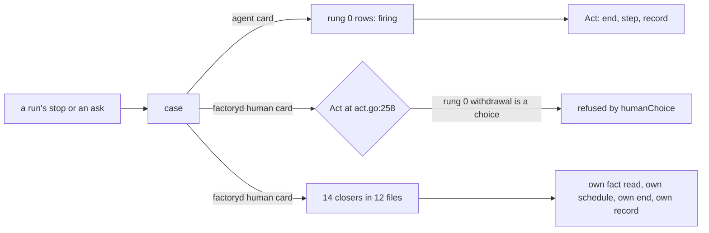

# One Close for Every Card: Implementation Plan

> **For agentic workers:** REQUIRED SUB-SKILL: Use superpowers:subagent-driven-development (recommended) or superpowers:executing-plans to implement this plan task-by-task. Steps use checkbox (`- [ ]`) syntax for tracking.

**Goal:** An ask whose reason is gone closes through one registry of facts, one sweep and one door, and every close leaves one record in one wording.

**Architecture:** Rung 0's resolver table becomes the one registry of the facts that close an ask, with one row for each cause, factoryd's own human cards included. The retake pass becomes the one sweep that runs those rows, and `Act` becomes the one door that ends a human card: one store transaction ends the case and the card and writes the record, and Forgejo follows through the close outbox that exists today. A case's kind travels as a typed value from the run's stop or from the card's source, and the freeze card keeps its state in its case's facts.

**Tech Stack:** Go (factoryd, console), PostgreSQL, Temporal, Markdown (design repository).

**Spec:** None. The evidence in "The situation today" stands in for it.

Every `file:line` is at code main `c2dddcd67` (2026-11-26 19:57 UTC). Code paths are under `internal/factoryd/` unless they start with `cmd/` or `internal/`. A path in the design repository says so.

## The situation today

### The pieces this plan needs

- **A card** is a row of `tasks`. An agent card has a Temporal workflow that runs sessions. A **human card** (`t.Kind == "human"`) has no workflow. It asks a human for a choice or for work, and it waits in `waiting-agent` (out of sight, while the factory agent looks first) or in `waiting-human` (in Needs you) until it ends (`humanCardWaits`, chat_escalation.go:59). factoryd files human cards of its own for causes it cannot fix itself: a cap reached, a model class frozen at the provider's limit, a red main, a failed roll, an alert.
- **A case** is one stop or ask of a card that the escalation ladder works on (`Case`, cases.go:257-280). It has a kind, a state key, facts, steps and a status: `open`, `at_human`, `resolved` or `withdrawn` (cases.go:237-240). The database checks the kind against 39 values (migration `20261129100300_platform_deaths_kind.sql`).
- **An ask** is a `question_asked` row in `events`: the question a human reads. The events writer opens the ask's case in the same transaction (`casesFromEvent`, cases_events.go:27). A run's stop opens its case through `OpenTrip` (ladder.go:383).
- **A rung** is one level of the ladder. Rung 0 is factoryd's own table of rows, which reads facts and calls no model. Rung 1 is the check-in, rung 2 the factory agent, rung 3 the human.
- **A pass** is a periodic function that `passes.Run` starts with an interval and a bound, and reports late in `/readyz` (cmd/factoryd/main.go:425-484).
- **The kind table** (`caseKinds`, cases.go:139-209) says, for each case kind, which rows of rung 0 it tries (`Rung0`), what rungs 1 and 2 do with it, whether its question's choices answer it (`Choices`), and either the fact that retires it (`Retires`) or why only an answer ends it (`Decision`).

### Rung 0's table is a registry already

Rung 0 is one Go slice of rows, `rung0` (ladder.go:112-273). Each row is a `resolver` (ladder.go:94-101):

```go
type resolver struct {
	Name  string
	Needs []string
	Back  func(prior Case, f CaseFacts) bool
	Fire  func(ctx context.Context, r *Runner, c Case, f CaseFacts) (*Resolution, error)
	Took  func(c Case, f CaseFacts, res Resolution) string
	Hold  func(ctx context.Context, r *Runner, c Case) (held bool, err error)
}
```

- `Fire` reads the row's fact and answers the resolution it takes, or nil when the fact does not hold.
- `Needs` names the fact readers the row depends on. A reader that failed keeps only the rows that need it from the case (commit `63b54a95c`).
- `Back` says whether the row may take a stop that came back after rung 0 took the same kind and key before. A row without it takes such a stop never, which bounds every loop.
- `Took` writes what the row found and did, in plain words, for the case's step and the human's record.
- `Hold` serves the two rows that keep a case waiting instead of answering it.

The table holds 13 rows: 11 that fire and 2 that hold. The kind table names the rows each kind tries. One function, `firing` (ladder.go:1338-1379), tries them, and three callers run it:

- `rungZero` (ladder.go:1299) when a stop opens its case,
- `causeGone` (ladder.go:1393) before each climb to the next rung,
- `Monitor.Retake` (monitor.go:172), the pass `case_retake`, once a minute on every case at the human (cmd/factoryd/main.go:466).

A row that fires is carried out by `Act`.

### How `Act` works

`Act` (act.go:171-192) is the one function through which a human, the chat or a rung answers a case.

1. It refuses a decider that answers as another rung: rung 0 is factoryd's alone (act.go:172-181).
2. It takes the card's lock and the case's lock (act.go:194-215), so two answers on one case run one after the other.
3. It refuses an answer on a card that ended (act.go:234).
4. It sorts the answer. On a kind whose question's choices answer it, every action except a note and a hand-back counts as a choice (act.go:258). A choice goes to `humanChoice` (act.go:279). Any other answer reads the case's facts and passes the action table (act.go:287-317).
5. It runs what the answer does outside the run, such as a retry or a replan (act.go:344).
6. It ends the case and writes the step in one transaction (`actWrite`, act.go:411, `ResolveCase`, cases.go:844).
7. It writes the record: a `question_answered` row, or a `question_withdrawn` row when rung 0 takes a case at the human (act.go:431-455). The withdrawal row comes from one builder, `WithdrawnRow` (cases_events.go:98).
8. It signals the card's run, when the card has one (act.go:474).

### Why a human card never reaches a row

Two things keep factoryd's human cards away from rung 0's table.

1. **No kind of a factory card names a row.** The 8 kinds with `Choices` have an empty `Rung0`. So `firesOn` is false for them, the retake pass skips them (monitor.go:201), and `causeGone` returns at once (ladder.go:1394). Their `Retires` text says it in prose: the card's own pass, poll or loader closes the card (cases.go:146, 182, 188, 194, 196, 198, 205, 208).
2. **A row would be refused anyway.** The line that sorts an answer reads:

   ```go
   choice := ChoiceKind(c.Kind) && res.Action != ActNote && res.Action != ActHandBack
   ```

   A withdrawal is neither a note nor a hand-back, so rung 0's withdrawal of a human card's case counts as a choice. `humanChoice` then refuses it: `"%s may not answer a human card: the factory agent and the human may"` (act.go:1074-1075).

The guard keeps a sound rule. A choice such as Merge it, Deploy now or I did it decides something, and since commit `84f9ae06f` (2026-11-03) only the factory agent or the human may decide it. A withdrawal decides nothing. It says that the question is gone. The line at act.go:258 files the withdrawal under "choice", and the guard at act.go:1074 refuses it. That one classification is the root cause of the split.

The retake pass came later (`3eb916d26`, 2026-11-20) and inherited the guard. The cause-gone plan of 2026-11-24 (design repository, `docs/plans/2026-11-24-cause-gone.md`, section "Where the plan departs") names it as the reason for a closer of its own: "`platform_deaths` gets no `Fire` row. Rung 0 may not answer a human card (`humanChoice`, act.go:1066), so the card's own pass closes it, as the seven watchers close theirs." From 2026-11-24 to 2026-11-26 the seven watchers grew to 14 closer functions in 12 files, each in the watchers' shape and none in the table's.



### Every filer and its closer

The table answers which path files each ask and which path closes it once its reason is gone. It groups the 47 filers the review found by family.

| Family | Filers | Filed by | Ask kinds | Closer once the reason is gone | Record of the close |
|---|---|---|---|---|---|
| A run's stop on a fact | 8 | `OpenTrip` (ladder.go:383) | the head kinds, the three caps, `provider_refused`, `no_answer`, `pod_never_started`, `platform_fault`, `dependency_failed` | rung 0's rows `route_approval`, `rerun_checks`, `wait_checks`, `cap_wait`, `provider_answers`, `sessions_run`, `retry_dependency`, `impasse` (ladder.go:118-236) | `Act`: the case's end and step, at the human one `question_withdrawn` row |
| A cap wait the run ends itself | 1 | `OpenTrip` | `day_cap`, `month_cap`, `project_cap` | `awaitCapWait` (workflow.go:4646), then `EndCase` (act.go:943) | `withdrawQuestion` (gatesupervisor.go:296) |
| A monitor flag | 3 | `Monitor.card`, then `OpenTrip` (monitor.go:306) | `monitor_flag` | rows `close_ended`, `expire_step`, and the monitor's own withdrawal (monitor.go:262-292) | `Act`, or `withdrawAtHuman` (monitor.go:317) |
| A hold rung 0 keeps | 2 | `openRequestCase`, `OpenTrip`, `askCase` | `plan_criteria`, `checkin_human`, `agent_escalate` | hold rows `rerun_criteria_gate`, `wait_on_ask` (ladder.go:262-271) | the gate's run, the chat ask's answer |
| The run's image wait | 1 | `OpenTrip` | `image_wait` | `awaitImage` (toolpark.go:697), then `EndCase` | `withdrawQuestion` |
| A newer ask, an ended card, a moved card, a newer revision | 4 | any | most kinds | `withdrawReplaced` (act.go:588), `ReconcileCases` (cases_heal.go:27-83) | `withdrawQuestion`, or `withdrawCase` with no row for "card ended" and "plan revision replaced it" |
| A decided request, a closed plan | 2 | `openRequestCase`, `holdPlanAsk` | `merge_approval`, `plan_criteria`, `plan_held` | `endDecidedMergeCases` (cases_heal.go:92), `endHoldCase` (cases_events.go:596) | the decision itself |
| factoryd's cap and budget cards | 2 | `MonthAlarm.file` (monthcap.go:368), `ChatBudgetCards.File` (chat_budget_card.go:84) | `factory_month_cap`, `judgment_budget` | `closeLifted` (monthcap.go:302), `ChatBudgetCards.Check` (chat_budget_card.go:147) | `WithdrawAsk`, the comment, `closeRow` or `TransitionTask` |
| The freeze card | 1 | `FreezeCard.file` (freezecard.go:1605) | `provider_freeze` | `FreezeCard.close` (freezecard.go:1483) | `WithdrawAsk`, `EndFreezeCard`, its own retry |
| The platform card | 1 | `PlatformCard.Check` (platformcard.go:74) | `platform_deaths` | `closeWhenQuiet` (platformcard.go:156) | `WithdrawAsk`, the comment, `TransitionTask`, no outcome counted |
| The deploy path's cards | 7 | `Runner.FollowFail`, `Roller.stillRed`, `Roller.pause`, `Roller.escalateRolls`, `Roller.refuse`, `ReleaseKeeper.hold`, `ConfigAlarm.Raise` | `human_card`, `red_main`, `roll_held`, `config_refused` | `followTargetGone` (followfail.go:101), `endFixCard` (mainfix.go:495), `retireRolls` (rolltask.go:983), `ReleaseKeeper.keep` (releasekeeper.go:138), `ConfigAlarm.Resolve` (policy.go:918) | `WithdrawAsk`, the comment, the close webhook or `TransitionTask` |
| Alert cards | 4 | `AlertIntake.fileTask` (signozwebhook.go:1109), the CI spawner (ci.go:239) | `human_card` | `CloseCleared` (signozwebhook.go:598), `CloseGoneEvents` (:704), `closeCompletedJob` (:796) | `WithdrawAsk` except for the CronJob card, `CloseClearedCard` |
| Chain cards | 2 | `ChainPoller.askStall`, `ChainPoller.fileRepair` (chainpoll.go:1547, 1705) | `human_card` | `settleChainCards` (chainpoll.go:1571) | the comment only, no row |
| Factory pull request cards | 1 | `FileFactoryPRTask` (intake.go:1511), 6 callers | `human_card` | `WithdrawPRCard` (intake.go:1775), `closeTemplateUpdate` (templateupdate.go:409) | `WithdrawnRow` in the first, no row in the second |
| Cards a human question asks | 5 | the webhook, the lane with no agents, a routine, a plan, the chat's escalate | `human_card` | only the answer | the answer row |
| Decision kinds and the forge's answers | 3 | `holdPlanAsk`, `prDecided` (intake.go:1758), `OpenTrip` | `plan_held`, `human_card`, 8 kinds with a `Decision` | only the answer | the answer row |

The first seven families, 21 filers, follow the ladder's shape or are fair backstops. The next seven, 18 filers, are factoryd's human cards and the 14 closers. The last two, 8 filers, have no fact the factory could read as their end.

### What the 14 closers repeat

Each closer lists its own open cards, reads its own fact, calls `Timeline.WithdrawAsk` (events.go:208), calls `closeIssueAsFactory` (escalation.go:368), ends the card and counts the outcome or not. Each runs on its own schedule. The table answers how the closers end a card once the fact holds.

| How the card ends | Closers | Outcome counted |
|---|---|---|
| `closeRow`, `waiting-human` to `done` (escalation.go:455) | `closeLifted` | when this call moved the row |
| `TransitionTask` to `done` | `ChatBudgetCards.Check`, `closeWhenQuiet`, `ConfigAlarm.Resolve` | always, never for the platform card |
| `EndFreezeCard`, one transaction (freezecard.go:1706) | `FreezeCard.close` | `countHumanEnd` |
| `CloseClearedCard`, `closed` with a reason (alerts.go:279) | `closeQuiet` and `endCard`, `closeCompletedJob` | always |
| the webhook of the issue's close (`finishHumanTask`, intake.go:1707) | `endFixCard`, `retireRolls`, `followTargetGone`, `settleChainCards`, `ReleaseKeeper.keep` | in the webhook |
| `EndClosed` through `endPRCard` | `WithdrawPRCard`, and the release keeper when Forgejo refuses the close for good (releasekeeper.go:613) | in `finishHumanTask` |

`closeRow` swallows `ErrNotFound` and a plain `TransitionTask` does not, so the budget and config closers log a false error when the webhook ended the card first. 65 commits from 2026-10-28 to 2026-11-26 touched the 11 closer files other than intake.go with "close", "retire", "ends" or "withdraw" in their subject (`git log` at `c2dddcd67`). Commits `38d52bc3f` and `841aaeb65` each wrote the rule "a close that failed is tried again by the next poll" for their own closer.

### The record of one close

One builder, `WithdrawnRow`, makes the withdrawal row. Six functions write it: `Act` (act.go:448), `withdrawQuestion` (gatesupervisor.go:321), `Monitor.withdrawAtHuman` (monitor.go:331), the heal pass's `withdrawRecorded` (cases_heal.go:171), `WithdrawPRCard` (intake.go:1788) and `Timeline.WithdrawAsk` (events.go:219), which 10 closers call. Four paths write none:

- `settleChainCards` and `closeChainCard` (chainpoll.go:1571-1602) close the chain cards with a comment only.
- `closeCompletedJob` (signozwebhook.go:796-845) calls `endCard` directly and skips both the withdrawal and the check that a person touched the card.
- `closeTemplateUpdate` (templateupdate.go:409) and the replaced template card (templateupdate.go:156) close a factory pull request card with a comment only.

In each of these cases the heal pass then withdraws the case as "card ended done" or "card ended closed" with no row (cases_heal.go:52-55). The inbox sends no "needs you no more", and Done reads "done".

The same close can carry three wordings. A cleared alert writes the row's reason "the alert cleared at 06:12 UTC", the comment "The alert cleared at 2026-11-25T06:12:58Z. Nobody touched the card, so it closes." and the end reason with the RFC 3339 time (signozwebhook.go:646-648). `withdrawQuestion` writes the close twice, as a timeline step and as the events row (gatesupervisor.go:320-321).

### A third copy of the facts: `conditionGone`

Rung 2 may end a factory card that waits out of sight with `close`, `check_again`, `hold_wait` or `dismiss` only when `conditionGone` (act.go:1210-1250) says the card's condition is gone (`heldRefusal`, act.go:1182). `conditionGone` is a switch on 7 sources with its own reads. It has drifted from the closers:

- An event alert's condition always "stands" there (`row.Detail["event"] != true`, act.go:1247), while `CloseGoneEvents` closes the same card once its claim is bound or its HelmRelease is Ready (commit `49c215f6b`, 2026-11-26).
- The roll cards and the follow failure card have closers since commits `38d52bc3f` and `91ab8474e` (2026-11-26) and no branch here, so rung 2 reads "no code checks card #N's condition" (act.go:1249).
- For a red main it reads the queue's pause (act.go:1227-1229) while `endFixCard` reads a green push run (mainfix.go:487-503).

### The freeze card

freezecard.go was 464 lines when it landed (`3fc9bf479`, 2026-11-17). It is 1879 lines now, after 47 commits in ten days. Beside the shared parts it holds parts of its own:

- **Its own close retry.** `closeOwed` (freezecard.go:588) retries the card's unconfirmed closes from `UnconfirmedFreezeCloses` (freezecard.go:1845). The shared retry, `HealFactoryCloses` (intake.go:937), skips freeze cards by a source test in its query (`AND NOT EXISTS (... t.source = $4)` with `SourceFreezeCard`, store.go:1746-1751).
- **Its own reopen outbox.** After a human's retry press closed the card, a refusal before the provider's reset reopens the same card (freezecard.go:1029-1056). That needs the `factory_reopened` intake row (`IntakeFactoryReopened`, freezecard.go:284), a split marker inside its body (`freezeOwedSplit`, :287), `reopenOwed` (:504), `reopenIssue` (:546), `ReopenFreezeCard` (:1746), `OwedFreezeReopens` (:1837), `SettleFreezeReopen` (:1876) and `findClosedCard` (:1523). The reopen moves the old close record off its issue (`comment_id = 0`), which is why the shared heal query must skip freeze cards. No other human card reopens. The platform card files a new card for each burst.
- **Its state in the card's text.** Each pass rebuilds its view by parsing the card's objective: the class line (`freezeCardClass`, :727), the reset (`freezeFaceReset`, :740), the start (`freezeCardStart`, :55), the closes-itself stamp (`freezeResumeStamp`, :758) and the "tell" sentences such as `freezeResumedSentence` (:30), which `FreezeCardHolds` (:109) and the retry switch (retryswitch.go:55) also read.
- **A shim for older cards.** `askIfAskless` (freezecard.go:643-674) makes a card ask that "an older factoryd filed" without an ask.

The gateway's hold of a frozen class lives in its memory, and a gateway restart probes the provider again by design (internal/gateway/server.go:198-204, `endForgottenHold` :333-352). That is the gateway's model of a provider limit, not the card's, and this plan leaves it as it is.

### The kind of a stop travels as text

`cases.kind` is a typed column. The kind of a run's stop still reaches it as a sentence:

- `TripCase` (ladder.go:1672-1678) takes the kind from `TripInput.Kind` only when it is set, and only the monitor and the plan's failed card set it (monitor.go:306, verdict.go:2583).
- For every other stop, `EscalationSource` (alerts.go:94-131) tests the reason against 20 prefixes, `CaseKindOf` (cases_events.go:306-339) tests it again, and `HumanCardKind` (cases_events.go:228-238) adjusts the result for a human card.
- A restarted run picks its resume path from the stored question's text: `AtSessionCap(st.Question)`, `floorRefused(st.Question)`, `strings.HasPrefix(st.Question, podNeverStarted)` and five more (workflow.go:1645, 1673-1700).
- `git grep` at `c2dddcd67` finds 19 calls of the 12 kind predicates and 16 direct prefix tests on stop reasons outside `EscalationSource`, in 6 files.
- Old wordings stay alive for these readers: `AtSessionCap` matches both `CapReached` and `CapReachedLadder` (workflow_stages.go:88-95), because a change reworded the heading.
- `SourceRerun` is missing from `caseSourceKinds` (cases_events.go:294-301). So the re-run's card of a red main is `human_card`, while the still-red card that the same function closes is `red_main`.
- Nine factoryd sources with distinct causes fall to `human_card`: follow failure, chain stall, chain repair, re-run, failed roll, refused roll, alert, the CI runner cards and the factory pull request cards. The kind `human_card` thus holds two different things: the cards a human question asks, and factory cards with a fact.

### The decision on pods and platform stops

The cause-gone plan refused a rung 0 row for `pod_never_started` and `platform_fault` in its section "Not built and why": "Another card's pod that started does not prove that this card's pod fits, because its requests and its image differ" and "A quiet hour proves nothing" (design repository, `docs/plans/2026-11-24-cause-gone.md`). Commit `63b54a95c` (2026-11-26 17:30 UTC) added the row `sessions_run` for both kinds (ladder.go:192-208): any card's session started since the stop and the platform ended none, and the card resumes, once per card and key. No design entry records the change. The design repository now says both things: `docs/architecture.md:3758-3759` lists the row, and `docs/architecture.md:4803-4807` still says "The ladder takes it: no rung 1, rung 2 first, then the human ... No answer changes the platform."

## Why this is drift

**One process, no special exceptions (tenet 1), and one way only (tenet 5).** The factory closes an ask whose reason is gone by two mechanisms. Rung 0's table serves the agent cards. Fourteen closer functions in 12 files serve factoryd's human cards, each with its own schedule, its own read of its fact, its own end out of six and its own retry. Three of their schedules are copies of one hand-written loop with no bound (monthcap.go:223, freezecard.go:308, chat_budget_card.go:193), and two passes exist only to close cards (`cleared_alerts`, `event_alerts`, cmd/factoryd/main.go:480-481). A third copy of the facts, `conditionGone`, guards rung 2 and has drifted in three places. The shared close retry carries a source exception for one card kind (store.go:1751).

**One ladder (tenet 2).** `causeGone` returns at once for every factory card (ladder.go:1394), so `Climb` hands a red main, a held roll, a refused configuration or an alert card up with no look at its cause. Only the closer's next poll checks it.

**Every close leaves one record (tenet 3).** Four close paths write no withdrawal row today: the chain cards, the CronJob alert card and the two template update closes. The record shows what such a gap costs. Before commit `5327a01b9` (2026-11-24) gave each watcher the row, the cause-gone plan's live query found 6 human cards that a watcher had closed with "card ended done" and no reason. One close can carry three wordings.

**Construction over prose (tenet 4).** The kind of a stop is parsed from its reason in about 35 places, so a reworded sentence changes the kind, the rows rung 0 tries, the face and the closer. The freeze card keeps its state in its own face text and parses it back each pass. The platform card bounds its loop by matching a comment's first words (`strings.HasPrefix(e.Body, platformQuietLead)`, platformcard.go:175) beside the general bound `firing` already has.

**What it costs.**

- About 540 lines of close code in the 14 closers, about 350 lines of the freeze card's own parts, about 140 lines of kind parsing, and 41 lines of `conditionGone`.
- Each new factory card cause so far added a closer, and each fault of a closer was fixed in that closer alone. Case 7513 (2026-11-24) asked "Try the roll again?" about three failed rolls for 1 hour 58 minutes. Commit `38d52bc3f` then wrote one more closer, which ends such a card once a later roll merged.
- Rung 2 cannot end a roll card, a follow card or an event alert card that waits out of sight once its cause is gone, so such a card waits for its closer's next poll or for the human.
- A card whose close writes no row reads "done" in Done, and the human who saw it leave Needs you gets no reason.

**A decision changed without a record (tenet 3).** Commit `63b54a95c` reversed a written refusal. The design repository now contradicts itself on what happens to a platform stop.

## The trade-off

**What the change costs.** It touches 12 closer files, `Act`, the retake pass, the freeze card and the workflow's stop sites. Seven new case kinds need a migration that relabels the live cases of factory cards, and a live case left with its old kind would never close. The typed stop kind changes workflow code, so it needs a version gate, a replay test, and a wait until no run older than the gate is open before the parsers can go. The retake pass reads the facts of every factory card once a minute, which the closers' own passes do today.

**What it buys.** One place to read what closes a card: the kind table names the row, and the row is the one read of its fact. A new cause of a factory card is one row and one line in the kind table, not a closer, a loop, an end and a retry. Every close writes one record in one transaction with one wording. Rung 2's guard and `Climb`'s cause check read the same rows the sweep runs. The freeze card loses its own retry, its own outbox and its text parsing. The kind of a case is a value at every step.

**Alternatives considered.**

- **Patch the gaps and keep the closers.** Give the chain and CronJob cards a `WithdrawAsk` call, add the missing branches to `conditionGone`, and give `SourceRerun` its kind. About 30 lines. It fixes today's faults and keeps the shape that produced them: the next cause gets a fifteenth closer, and `conditionGone` drifts again.
- **One shared end, many closers.** One function `endFactoryCard` writes the record and ends the card, and every closer calls it. It removes the six ends and keeps 14 schedules, 14 fact reads, `conditionGone` and the guard's split. It is half of this plan, and the half that does not stop the growth.
- **End the card through the issue's webhook, as `Act`'s Close does today** (`closeCard`, act.go:1462). Less new code, since `finishHumanTask` already ends a human card on its issue's close. It leaves the card's end to a webhook and a two-minute heal, so the case ends minutes before the card, and a crash between the two leaves a waiting card with no live case. The freeze card's store-first end (`EndFreezeCard`) already shows the better shape: the store moves first, in one transaction, and Forgejo follows through the outbox. This plan takes that shape for every human card.
- **Keep the parsers and pin the wordings with tests.** It guards today's sentences and keeps two sources of truth for one value.

**What is the right shape today, and stays.**

- `WithdrawnRow` is the one builder of the withdrawal row.
- `closeIssueAsFactory` is the one way factoryd closes a card's issue. Its `factory_closed` row is an outbox, and `HealFactoryCloses` is its one retry once the freeze card's exception goes.
- The events writer ends a case in the same transaction as its withdrawal row (cases_events.go:27-81).
- Rung 0's table, `Needs`, `Back` and `firing` are sound. This plan adds rows and changes none of them.
- `capLift` already serves the run's own cap wait and the `cap_wait` row with one check and one set of words.
- The monitor's flags follow the right shape: one predicate per flag in the digest and one withdrawal once it stops holding.
- The heal pass is a fair backstop for cards that ended or moved on.
- A rung 0 resume ends a case `resolved` and a withdrawal ends it `withdrawn` (cases.go:846-849). The two statuses mean two things, an action taken and a question gone, and both stay.
- The kind `wait_expired` has no filer, and its kind table row says so (cases.go:162). It stays as the label of old case rows, which the faces still show. Its source string goes with the parsers.
- The face's last line per kind (`tripNext`, ladder.go:1891-1950) and the shared `humanFace` belong to the face register, not to the close.

**Where this plan meets other plans.**

- The plan "One door for every answer" owns the console's answer doors and the guards in `Act` for console actions, the freeze card's `thaws` (act.go:266-268) among them. This plan changes only act.go:258 and the end of a rung 0 withdrawal.
- The plan "The factory's own repository is a project like any" owns the roll task and `mainfix`. This plan turns the close of their human cards into rows. If that plan moves red main into the chain poller for every project, the row `main_green` goes with the roller and `chain_settled` serves every project.
- The plan "Collapse the workflow's history" owns the hand-written periodic loops and the drain step for old version branches. Where this plan deletes a closer's close half, the filing half and its loop stay, and that plan takes the loop. Task 15 waits for its drain rule.
- The open faults plan (`docs/plans/2026-11-26-open-faults.md`, design repository) reorders the template update's close at templateupdate.go:416-421. Task 8 touches the same function, and whichever lands second rebases.
- The plan "A routine's run shows while it works and says why it failed" adds the kind `routine_failed` and the row `routine_ran` to this registry after Task 9, and its run calls `Runner.Retire`.

## The proposal

### The target shape

1. **The registry.** Each cause of a factory card is one row in `rung0`. Its `Fire` asks the domain that knows the fact, through one method of that domain, and answers `Resolution{Action: ActWithdraw, Note: clause, Moments: said}`. The kind table names each kind's rows, and its `Retires` text names them too.
2. **One kind per cause.** A human card's case takes its kind from the card's source through one map, `cardKinds`. Seven causes that fall to `human_card` today get a kind of their own: `alert`, `chain_stall`, `chain_repair`, `roll_failed`, `roll_refused`, `follow_failed` and `factory_pr`. A re-run's card becomes `red_main`. `human_card` keeps only the cards a human question asks, with a `Decision`.
3. **The one door.** Rung 0's withdrawal is no choice (act.go:258). `Act` ends a human card that rung 0 withdraws in one store transaction, `EndHumanCard`: the case ends withdrawn with its step, the card ends with the clause as its closing reason, the `factory_closed` outbox row holds the comment, the `question_withdrawn` row holds the clause and its moments, and the card's open alerts are judged `unjudged` by factoryd, as an agent card's other end judges them (activities.go:3403). After the commit, the outcome is counted, the issue's state is mirrored, and Forgejo follows through `closeIssueAsFactory`. `HealFactoryCloses` retries what Forgejo did not take.
4. **The one sweep.** The retake pass runs the rows on every live case of a factory card kind, at the human or out of sight, in any repository. `Runner.Retire(ctx, taskID)` runs the same `retake` on one card at once, for the closers whose trigger is an event and whose order matters: the roller before the queue goes on, the release keeper before the promote, the policy loader after a load, the follow routine before its next run, the chain poller, the console's budget raise and the factory's own close of a pull request.
5. **One guard.** `heldRefusal` runs the card's rows (`firing`) instead of `conditionGone`, and refuses with the kind table's own `Retires` words when no row fires.
6. **The freeze card.** Its state lives in its case's facts. A freeze that comes back after a retry press files a new card that names the earlier one. Its close is the row `class_answers` and the shared end. Its own retry, its reopen outbox, its text parsing and the heal query's source exception go.
7. **The typed stop.** The run names each stop's kind in `TripInput.Kind` and reads the open case's kind from `RunState.Kind` on a restart, behind one version gate. Once no run older than the gate is open, `EscalationSource`, `CaseKindOf`'s prefix ladder and the kind predicates go.
8. **The decision.** The design documents state what happens to a stop of `pod_never_started` and `platform_fault`, and the code matches it.

### What goes

| Code | Where | Lines |
|---|---|---|
| `closeLifted` | monthcap.go:295-365 | 71 |
| the close loop of `ChatBudgetCards.Check` | chat_budget_card.go:155-188 | 34 |
| `closeWhenQuiet`, `platformQuietLead` | platformcard.go:153-195 | 43 |
| `CloseCleared`, `closeCleared`, `closeQuiet`, `endCard` | signozwebhook.go:590-687, the touch check kept | about 70 |
| the close parts of `CloseGoneEvents`, `closeWhenGone`, `closeCompletedJob` | signozwebhook.go:704-845, the cluster reads kept | about 60 |
| `CloseClearedCard` | alerts.go:273-305 | 33 |
| the human branch of `endFixCard` | mainfix.go:500-505 | 6 |
| the human-card branch of `retireRolls` | rolltask.go:983-1008 | about 15 |
| `ReleaseKeeper.withdrawAsk`, `closeAsk` | releasekeeper.go:588-617 | 30 |
| the close part of `ConfigAlarm.Resolve` | policy.go:937-950 | 14 |
| the human-card part of `settleChainCards`, `closeChainCard` | chainpoll.go:1571-1602 | about 25 |
| `WithdrawPRCard` | intake.go:1770-1789 | 20 |
| `conditionGone` | act.go:1207-1250 | 44 |
| `Timeline.WithdrawAsk`, `closeRow` | events.go:203-220, escalation.go:450-465 | 34 |
| the passes `cleared_alerts`, `event_alerts` | cmd/factoryd/main.go:480-481 | 2 |
| the freeze card's reopen outbox | freezecard.go:280-287, 504-586, 1523-1537, 1746-1793, 1837-1840, 1876-1879 and the reopen branch of `frozen` | about 180 |
| the freeze card's text parsing | freezecard.go:55-72, 727-770 and the parsing in `rehydrate` | about 100 |
| the freeze card's close retry and the heal query's exception | freezecard.go:588-606, 1845-1852, store.go:1739-1751 | about 30 |
| `EndFreezeCard`, `closedByHuman`, `askIfAskless`, the reopen rule of `countHumanEnd` | freezecard.go:1700-1744, 702-725, 643-674, 918-940 | about 100 |
| `EscalationSource`, `HumanCardKind`, `CaseKindOf`'s prefix ladder, the run-stop entries of `caseSourceKinds` | alerts.go:93-131, cases_events.go:222-238, 293-339 | about 95 |
| the restart predicates and their old wordings | workflow_stages.go:85-190, workflow.go:1673-1700 | about 40, inferred |
| `oldCloseLead`, the timeline copy in `withdrawQuestion` | escalation.go:325-327, gatesupervisor.go:320 | 4 |
| total | | about 1,150 |

### What comes

| Code | Where | Lines, inferred |
|---|---|---|
| 14 rows: `month_lifted`, `budget_raised`, `platform_quiet`, `class_answers`, `alert_cleared`, `object_ready`, `cronjob_ran`, `main_green`, `roll_merged`, `no_open_plan`, `config_loaded`, `follow_target_gone`, `chain_settled`, `pr_closed` | ladder.go, and one fact method in each domain's file | about 240 |
| the exemption, `Runner.withdrawCard`, `PGStore.EndHumanCard`, the after-end routine shared with `finishHumanTask` | act.go, cases.go, intake.go | about 90 |
| `Runner.Retire`, the retake pass's second read | ladder.go, monitor.go | about 30 |
| the freeze card's state as case facts | freezecard.go | about 60 |
| 7 kinds: constants, kind table rows, faces, `cardKinds`, `humanCardKind` | cases.go, kinds.go, faces_copy.go, cases_events.go | about 50 |
| one migration | internal/schema/migrations/factoryd/ | about 15 |
| the typed stop: a kind at the 32 wait sites, `RunState.Kind`, the version gate, the restart switch | workflow.go, workflow_stages.go, plan.go, toolpark.go, deps.go | about 60 |
| total | | about 545 |

The net change is about −600 non-test lines, inferred from the function sizes above. Tests are not counted. The tests of each deleted close half go with it, among them 13 reopen tests in freezecard_test.go, and each row gets its own tests.

## Decisions for Sebastian

1. **Does rung 0 resume a card stopped by `pod_never_started` or `platform_fault` once sessions run again?** Commit `63b54a95c` says yes, once per card and key. The cause-gone plan said no, because another card's started session proves nothing about this card's pod or node.
   - A, keep the row `sessions_run` and record it. A false resume of `pod_never_started` costs one pod start and no model money. A false resume of `platform_fault` costs at most one session's model spend, since the stop that comes back stays with the human (`firing`'s bound). A human's answer cannot change the platform either (design repository, `docs/architecture.md:4807`), and the platform card still tells the human about a node that keeps killing work.
   - B, remove the row until the factory records each session's node and end and each pod's requests and pending reason. Every such stop then waits for rung 2 or the human.
   - Recommendation: A. Task 1 records either answer and, for B, removes the row.
2. **A freeze that comes back after a human's retry press: reopen the pressed card, or file a new one?** Today the same card reopens, so one class keeps one card and one history across the press. The reopen costs about 180 lines, its own outbox, its own close retry and the source exception in the shared heal query, and no other human card reopens. A new card per episode names the earlier card in its first line, so the history stays one click away. Recommendation: a new card. Tasks 11 and 12 depend on this answer.
3. **How does a card end that the factory withdrew because its reason went: `closed` or `done`?** Today 10 closers end it `done`, and the 3 alert closers and the pull request closer end it `closed` with a reason. One end needs one status. `closed` says that the card's work was not done, stores the reason in `closing_reason`, and makes the cards that depend on it ask first. Done shows "needed you no more: <reason>" for both statuses. Recommendation: `closed`. It changes the outcome metric and the `status:` filter for the month cap, budget, freeze, platform, configuration, red main, held production, roll, follow and chain cards.

## Global Constraints

- Code work runs in a git worktree off `origin/main` of `~/repos/ai-software-factory-code`. One pull request per task group, from `controller/ai-software-factory-code`, merged as `sebastian` after green CI and an independent review on the most capable model. The groups are: Tasks 2 and 3, Tasks 4 to 9, Tasks 10 to 12, Task 13, Task 14, Task 15, and for decision B the code part of Task 1.
- Tasks 1 and 16 change the design repository. They commit to `master` and push. Its `.githooks/pre-commit` refuses a ledger path or a cited ruling number.
- `bash check changed` passes before each commit. Go tests run with `go test -race`. PostgreSQL-backed tests run through `scripts/pg-test.sh`.
- A change to workflow code needs a `workflow.GetVersion` change id and a replay test. Only Tasks 14 and 15 change workflow code.
- A change to the `cases` table or its kinds is a migration under `internal/schema/migrations/factoryd/`. A new store method goes into the `Store` interface (store.go:344) and into the fake (store_fake_test.go).
- A fix reaches production only through a roll, and a roll needs Sebastian's go.
- No task id in a text a human reads. A human is a human, never a member or an operator.
- No comments that narrate the change. Tests state hand-derived expectations.
- Every sentence a row writes is human-read product copy. It passes the writing guide's check in `internal/writingguide`.

## Review Focus

1. **A human's answer and the sweep's withdrawal meet on one card in the same second.** The case lock serialises them, and `EndHumanCard` moves the card only from a waiting status. One end and one record result. Pinned by `TestAHumansAnswerAndTheSweepEndTheCardOnce`, added to Task 3.
2. **Forgejo fails after `EndHumanCard` committed.** The card is closed in the store with its record. `HealFactoryCloses` closes the issue two minutes later, and the webhook of that close finds the card final and writes nothing. Pinned by `TestAFailedIssueCloseAfterTheEndIsFinishedByTheHeal`, added to Task 3.
3. **A live case of a factory card keeps the kind `human_card` across the roll.** No row would ever fire on it and no closer would remain. The migration relabels every live case by its card's source. Pinned by the PostgreSQL test `TestTheFactoryCardKindsMigrationRelabelsLiveCases`, added to Task 2, and by the live query in Task 9's last step.
4. **A factory card stands on a repository that no project names.** The per-project loop of the retake pass would never read it. The second read covers every repository. Pinned by `TestRetakeSweepsAFactoryCardOnARepositoryNoProjectNames`, added to Task 4.
5. **A run that started before Task 14's version gate stops after the roll.** Its trip carries no kind, so `OpenTrip` takes the kind from the reason until Task 15. Pinned by `TestOpenTripWithNoKindTakesTheReasonsKind` and the replay test `TestReplayATripRecordedBeforeTheTripKind`, both added to Task 14.

---

### Task 1: The design documents record the decision on pods and platform stops

**Files (design repository):**
- Modify: `docs/architecture.md:4803-4807` (the `platform_fault` paragraph)
- Modify: `docs/architecture.md:3755-3760` (the rung 0 bullet)
- Modify: `docs/plans/2026-11-24-cause-gone.md`, section "Not built and why", the bullets `platform_fault` and `pod_never_started`
- Code, only for decision B: `internal/factoryd/ladder.go:192-208`, `internal/factoryd/cases.go:128`, `:165`, `:206`
- Test, only for decision B: `internal/factoryd/monitor_test.go`

**Interfaces:** none.

- [ ] **Step 1: Read the record.** Run read-only on the live database: `SELECT kind, count(*), count(*) FILTER (WHERE resolution->>'by' = 'factoryd' AND (resolution->>'rung')::int = 0) FROM cases WHERE kind IN ('pod_never_started', 'platform_fault') AND opened_at > '2026-11-26 17:30+00' GROUP BY kind`. Write the counts into the architecture paragraph of Step 2.
- [ ] **Step 2 (decision A): Write the decision.** In `docs/architecture.md:4803-4807`, replace "The ladder takes it: no rung 1, rung 2 first, then the human, and its statement lists the three records." with the rule as built: rung 0 resumes the card once a session of any card started since the stop and the platform ended none since, once per card and key, and a stop that comes back goes to rung 2 and then to the human. Name the date 2026-11-26, the commit `63b54a95c`, the two costs of a false resume from decision 1, and the counts of Step 1. Keep "No answer changes the platform." In the cause-gone plan, add one sentence under each of the two bullets: "Built on 2026-11-26 as the row `sessions_run`, bounded to one try per card and key: see architecture.md sections 5.9 and 6.7."
- [ ] **Step 2 (decision B): Remove the row instead.** Write the failing test `TestAPodStopAtTheHumanStaysAfterSessionsRan` in monitor_test.go: a `pod_never_started` case at the human, 3 `session_started` rows after it and no platform death. After `Monitor.Retake` the case is still `at_human` and no `question_withdrawn` row exists. Run `go test -race -run TestAPodStopAtTheHumanStaysAfterSessionsRan ./internal/factoryd/` and see it fail with the case `resolved`. Delete the row `sessions_run` (ladder.go:192-208) and `sessionsRetire` (cases.go:128), give both kinds a `Decision`, run the test and `TestTheKindTableHoldsEveryKind` and see them pass. Commit in the code repository: "A card stopped by pods that never started or by the platform's ends waits for the factory agent or the human, as rung 0 holds no fact that proves this card's pods run again". Then write the architecture paragraph as it was and add the dated reversal to the cause-gone plan.
- [ ] **Step 3: Check** that `git grep -n "sessions run again" docs/` and the paragraph at :4803 say the same rule, and that `git diff --cached` names no ledger path.
- [ ] **Step 4: Commit** "architecture: a card stopped by pods that never started or by the platform's ends resumes once sessions run again, once per card and stop" (decision A), or "architecture: a stop of pods or of the platform waits for the factory agent or the human, and the row that resumed it is gone" (decision B). Push.

### Task 2: A factory card's case takes its kind from the card's source

**Files:**
- Modify: `cases.go:20-72` (7 new `CaseKind` constants), `cases.go:139-209` (7 new kind table rows, and `human_card` loses its `Retires`)
- Modify: `kinds.go:11-20` (`CaseKinds`)
- Modify: `faces_copy.go:537-544` (the 7 kinds take `humanFace`)
- Modify: `cases_events.go:222-238` (delete `HumanCardKind`), `cases_events.go:262-292` (`CaseFromAsk`), `cases_events.go:293-301` (`caseSourceKinds` loses the six entries keyed by a factory card's source, `SourceChatBudget`, `SourceProductionHeld`, `SourceConfig`, `SourceStillRed`, `SourceFreezeCard` and `SourcePlatformDeaths`, which move to `cardKinds`. `SourceMonthCap` stays there for an agent card's stop at the month cap.)
- Modify: `ladder.go:1672-1678` (`TripCase`)
- Modify: `internal/factoryd/pg/pg.go:108` (aliases of the new kinds, where the pg tests name kinds)
- Create: `internal/schema/migrations/factoryd/20261201100000_factory_card_kinds.sql` (the name is the next free timestamp after `20261129100300`, inferred)
- Test: `cases_events_test.go`, `ladder_test.go`, `internal/factoryd/pg/cases_pg_test.go`

**Interfaces:**
- Produces, each its own line in the `CaseKind` const block:

  ```go
  CaseAlert        CaseKind = "alert"
  CaseChainStall   CaseKind = "chain_stall"
  CaseChainRepair  CaseKind = "chain_repair"
  CaseRollFailed   CaseKind = "roll_failed"
  CaseRollRefused  CaseKind = "roll_refused"
  CaseFollowFailed CaseKind = "follow_failed"
  CaseFactoryPR    CaseKind = "factory_pr"
  ```

- Produces: `var cardKinds = map[string]CaseKind{...}` in cases_events.go: `SourceMonthCap` to `CaseFactoryMonthCap`, `SourceChatBudget` to `CaseJudgmentBudget`, `SourceFreezeCard` to `CaseProviderFreeze`, `SourcePlatformDeaths` to `CasePlatformDeaths`, `SourceProductionHeld` to `CaseRollHeld`, `SourceConfig` to `CaseConfigRefused`, `SourceStillRed` and `SourceRerun` to `CaseRedMain`, `SourceAlert` to `CaseAlert`, `SourceChainStall` to `CaseChainStall`, `SourceChainRepair` to `CaseChainRepair`, `SourceRollFailed` to `CaseRollFailed`, `SourceRollRefused` to `CaseRollRefused`, `SourceFollowFailed` to `CaseFollowFailed`, and `SourceFollow`, `SourceGitHubSync`, `SourceGroupRevert`, `SourceRevert`, `SourceSchemaCopy`, `SourceTemplateUpdate` to `CaseFactoryPR`.
- Produces: `func humanCardKind(t Task) CaseKind`: `cardKinds[t.Source]`, else `CaseHumanCard`.
- Consumes: `CardSources()` (kinds.go).

- [ ] **Step 1: Write the failing tests.**
  - `TestAFactoryCardsCaseTakesItsSourcesKind` in cases_events_test.go. For a human card of each source in the map above, `CaseFromAsk` answers the mapped kind. For a human card of `SourceChat`, `SourceWebhook` and `SourceSizing` it answers `human_card`. For an agent card whose ask row names source `month_cap`, it answers `month_cap`, as today.
  - `TestEveryFactoryHumanCardSourceHasAKind` in ladder_test.go: every source that a call of `EscalateToHuman`, `EscalateToHumanWith`, `fileHumanTask` or `FileFactoryPRTask` passes is a key of `cardKinds`. List the sources by hand from the 26 call sites.
  - `TestTheFactoryCardKindsMigrationRelabelsLiveCases` in the pg tests: before the migration, live `human_card` cases on human cards of sources `alert`, `chain-stall`, `rerun` and `schema-copy`, one ended `human_card` case of source `alert`, and one live `human_card` case of source `webhook`. After it, the live ones read `alert`, `chain_stall`, `red_main` and `factory_pr`, and the ended one and the webhook one read `human_card`.
- [ ] **Step 2: Run** `go test -race -run 'TestAFactoryCardsCaseTakesItsSourcesKind|TestEveryFactoryHumanCardSourceHasAKind' ./internal/factoryd/` and `scripts/pg-test.sh go test -race -p 1 -run TestTheFactoryCardKindsMigrationRelabelsLiveCases ./internal/factoryd/pg/`. Expected: compile errors on the new constants, then the kind `human_card` where the test wants `alert`.
- [ ] **Step 3: Implement.**
  - The migration drops `cases_kind_check`, adds it with the 7 new values, and relabels each live case (`status IN ('open', 'at_human')`) of kind `human_card` on a human card whose source the map names, by one `UPDATE ... FROM tasks` with a `CASE` on the source.
  - In `CaseFromAsk`, a human card's ask with no revision takes `humanCardKind(t)`. An agent card's ask keeps `CaseKindOf` until Task 15.
  - `TripCase` takes `in.Kind` when set, else `humanCardKind(t)` for a human card, else the parsers until Task 15.
  - Each new kind table row copies the row of `CaseRedMain` with its own `Words` and `Retires` text, which names the closer of today until Tasks 4 to 8 name the rows. `human_card` keeps its `Decision` and loses its `Retires`.
- [ ] **Step 4: Run** the tests of Step 2, `TestTheKindTableHoldsEveryKind`, the face register's tests and `go test -race ./internal/factoryd/ ./internal/console/`. Expected: PASS.
- [ ] **Step 5: Commit** "A factory card's case takes its kind from the card's source, and each cause that fell to human_card has a kind of its own".

### Task 3: `Act` ends a human card that rung 0 withdraws, in one transaction

**Files:**
- Modify: `act.go:258` (the exemption), `act.go:405-415` (the branch before `actWrite`)
- Create in act.go: `Runner.withdrawCard`, beside `closeCard` (act.go:1462)
- Modify: `cases.go:835-880` (new `HumanCardEnd` and `PGStore.EndHumanCard` beside `ResolveCase`)
- Modify: `store.go:344` (the interface), `store_fake_test.go` (the fake)
- Modify: `intake.go:1707-1750` (`finishHumanTask` calls the shared after-end routine)
- Test: `act_test.go`, `internal/factoryd/pg/act_pg_test.go`

**Interfaces:**
- Produces:

  ```go
  type HumanCardEnd struct {
  	Task       Task
  	Status     string // "closed" for a withdrawal (decision 3), "done" for the freeze card's press
  	Reason     string // the closing reason and the withdrawal's reason, a clause
  	Comment    string // the factory_closed row's body, the issue's closing comment
  	Face       string // the card's objective after the end, "" keeps it
  	Said       Moments
  	CaseID     int64 // 0 when the case ends otherwise
  	Resolution CaseResolution
  	Step       CaseStep
  	Withdrawn  map[string]any // the question_withdrawn row's detail, nil for none
  }
  func (s *PGStore) EndHumanCard(ctx context.Context, e HumanCardEnd) (moved bool, err error)
  func (r *Runner) withdrawCard(ctx context.Context, t Task, c Case, in ActInput, own int64) (ActResult, error)
  func humanCardEnded(ctx context.Context, m *telemetry.Metrics, tl *Timeline, store Store, forgejo *Forgejo, wf Workflows, t Task, final, why string)
  ```

- Consumes: `WithdrawnRow` (cases_events.go:98), `clause` (events.go:222), `capitalize` (faces_copy.go:1053), `closeIssueAsFactory`, `countOutcome`, `mirrorTaskState`, `taskEnded`.

- [ ] **Step 1: Write the failing tests** in act_test.go, on a fixed clock, 2026-11-01 00:01 UTC.
  - `TestRungZeroWithdrawsAHumanCardAndEndsIt`. A `factory_month_cap` case at the human on card #641 (`waiting-human`, one open alert row with no verdict). `Act` with `Rung: 0`, `By: FactoryDecider`, `Res: Resolution{Action: ActWithdraw, Note: "the UTC month 2026-10 ended, so the cap card closes"}`. Expect: the card `closed` with closing reason "the UTC month 2026-10 ended, so the cap card closes", the case `withdrawn`, exactly 1 `question_withdrawn` row with that reason and the case's id and kind, exactly 1 `factory_closed` row with body "The UTC month 2026-10 ended, so the cap card closes.", the issue closed with exactly 1 comment of that body, and the alert row's verdict `unjudged` by `factoryd`.
  - `TestRungZeroWithdrawsAHeldHumanCardWithNoIssue`. The same on a `waiting-agent` card with no issue: the row carries `held: true`, no Forgejo call is made, and the `factory_closed` row has `comment_id` 0.
  - `TestRungZeroMayStillTakeNoChoiceOnAHumanCard`. `Act` with `Rung: 0` and `ActRetry` on the same kind answers `ErrActRefused("the factory may not answer a human card: the factory agent and the human may")`.
  - `TestAHumansAnswerAndTheSweepEndTheCardOnce` (Review Focus 1). A human's `close` and rung 0's withdrawal run on two goroutines. Exactly 1 of `question_answered` and `question_withdrawn` exists, the card ended once, and the other call answers `ErrCaseEnded`.
  - `TestAFailedIssueCloseAfterTheEndIsFinishedByTheHeal` (Review Focus 2). Forgejo's `CloseIssue` fails once. After `Act` the card is `closed` and the `factory_closed` row is unconfirmed. After `HealFactoryCloses` at the clock plus 3 minutes the issue is closed with 1 comment. The issue-closed webhook then writes no second row and no second end.
  - `TestEndHumanCardIsOneTransaction` in the pg tests. With the events insert failing (a trigger that raises on `question_withdrawn`), `EndHumanCard` answers the error, and the card, the case, the intake rows and the alerts are as before.
- [ ] **Step 2: Run** `go test -race -run 'TestRungZeroWithdrawsAHumanCardAndEndsIt|TestRungZeroWithdrawsAHeldHumanCardWithNoIssue|TestRungZeroMayStillTakeNoChoiceOnAHumanCard|TestAHumansAnswerAndTheSweepEndTheCardOnce|TestAFailedIssueCloseAfterTheEndIsFinishedByTheHeal' ./internal/factoryd/`. Expected: the first fails with `ErrActRefused("the factory may not answer a human card: ...")`.
- [ ] **Step 3: Implement.**
  - act.go:258 becomes `choice := ChoiceKind(c.Kind) && res.Action != ActNote && res.Action != ActHandBack && !(in.Rung == 0 && res.Action == ActWithdraw)`.
  - Before `actWrite`, when `in.Rung == 0 && res.Action == ActWithdraw && t.Kind == "human"`, `Act` returns `r.withdrawCard(ctx, t, c, in, own)`. It builds the clause from `res.Note` (`clause`), the comment as `capitalize(clause) + "."`, the row as `WithdrawnRow(c, clause, res.Moments)` with `held: true` on a `waiting-agent` card, the case's resolution and step as `actWrite` builds them, and calls `EndHumanCard` with `Status: "closed"`. Then it runs `humanCardEnded` and `closeIssueAsFactory(ctx, r.store, r.forgejo, t, comment)`, which meets the recorded row and posts the comment once. A failure there is logged: `HealFactoryCloses` retries.
  - `EndHumanCard` runs in one `commitRows` transaction: `endCase` (cases.go:968) with the step, `changeStatusOn` from `humanCardWaits` to the status with `closing_reason`, the `factory_closed` intake row with `ON CONFLICT DO NOTHING`, the `question_withdrawn` events row (whose insert in the same transaction finds the case already ended and writes nothing more), and the statement of `JudgeOpenTaskAlerts` (alerts.go:244) with `unjudged` by `factoryd`. A card that no longer waits rolls all of it back and answers false.
  - `humanCardEnded` holds the after-end part of `finishHumanTask` (intake.go:1744-1746): count the outcome, mirror the issue's state, `taskEnded`. `finishHumanTask` calls it.
- [ ] **Step 4: Run** the tests of Step 2 and `scripts/pg-test.sh go test -race -p 1 -run TestEndHumanCardIsOneTransaction ./internal/factoryd/pg/`, then `go test -race ./internal/factoryd/`. Expected: PASS.
- [ ] **Step 5: Commit** "Rung 0's withdrawal of a human card is no choice, and Act ends the card, its case and its record in one transaction, with Forgejo following".

### Task 4: The month cap card closes by rung 0's row, through the one sweep

**Files:**
- Modify: `ladder.go:114-273` (row `month_lifted`), `ladder.go:1417-1455` (new `Runner.Retire` after `retake`)
- Modify: `monitor.go:166-200` (`Retake`, its second read)
- Modify: `monthcap.go:243-365` (`Check` stops closing, `closeLifted` becomes `MonthAlarm.Gone`)
- Modify: `runner.go:149` (field `MonthCap *MonthAlarm`), `cmd/factoryd/main.go` (wiring beside :228)
- Modify: `cases.go:145-146` (`Rung0` and `Retires` of `CaseFactoryMonthCap`)
- Test: `monthcap_test.go`, `monitor_test.go`

**Interfaces:**
- Produces: `func (a *MonthAlarm) Gone(ctx context.Context, t Task, now time.Time) (note string, said Moments, err error)`, "" while the cap still binds the card's month. Its switch is the one of `closeLifted` (monthcap.go:325-343), its words clauses: "the UTC month 2026-10 ended, so the cap card closes", "the month cap is 1200.00 EUR in policy version 974, so the cap card closes", "sebastian reset the month's count at 07:30 UTC, so the cap card closes", "LiteLLM's outer guard lets model calls through again: one answered at 07:31 UTC, so the cap card closes".
- Produces: `func (r *Runner) Retire(ctx context.Context, taskID string) (ended bool, err error)`. It reads the card's newest live case (`NewestAskCase`), runs `retake` on it, reads the case again and answers whether it is still live. A card with no live case answers true.
- Produces: `func factoryCardKinds() []CaseKind`, the kinds with `Choices` on which a row fires (`ChoiceKind(k) && firesOn(k)`).

- [ ] **Step 1: Write the failing tests.**
  - `TestTheMonthCapCardClosesWhenItsMonthEnded` in monthcap_test.go. A cap card of 2026-10 waits, the clock is 2026-11-01 00:01 UTC. After `Monitor.Retake` the card is `closed` with reason "the UTC month 2026-10 ended, so the cap card closes". Three more cases in the same table: a raise to 1200 EUR in version 974, a reset by sebastian at 07:30:32 UTC with the moment `{2026-11-24T07:30:32Z, "15:04"}`, and the outer guard with a model call answered at 07:31 UTC.
  - `TestTheMonthAlarmFilesAndClosesNothing`. After `MonthAlarm.Check` on a turned month, the old card still waits and the alarm files the new month's card at 100 percent as today.
  - `TestRetakeSweepsAFactoryCardOnARepositoryNoProjectNames` (Review Focus 4). A month cap card on a repository that no project of the tree names closes in one `Retake`.
  - `TestRetireEndsTheCardsLiveCaseAtOnce`. `Retire` on the card of a turned month answers true, and on the card of the current month answers false with the card waiting.
- [ ] **Step 2: Run** `go test -race -run 'TestTheMonthCapCardClosesWhenItsMonthEnded|TestTheMonthAlarmFilesAndClosesNothing|TestRetakeSweepsAFactoryCardOnARepositoryNoProjectNames|TestRetireEndsTheCardsLiveCaseAtOnce' ./internal/factoryd/`. Expected: the cards stay `waiting-human` after `Retake`, and `Check` closes the old card.
- [ ] **Step 3: Implement.** The row `month_lifted` has no `Needs` and no `Back`. Its `Fire` calls `r.MonthCap.Gone` and answers `rungZeroMay(f, Resolution{Action: ActWithdraw, Note: note, Moments: said})`, and its `Took` answers `res.Note`. `CaseFactoryMonthCap` names it in `Rung0` and `Retires`. `Retake` keeps its per-project loop over cases at the human, then reads `OpenCasesOfKinds(ctx, factoryCardKinds()...)` and runs `m.Runner.retake` on each case its first loop did not take, with no `judgeAgain`. `Check` stops calling `closeLifted`.
- [ ] **Step 4: Run** the tests of Step 2 and `go test -race ./internal/factoryd/`. Expected: PASS.
- [ ] **Step 5: Commit** "The month cap card closes by rung 0's row once its month ended, a raise or a reset lifted it, or calls answer again, through the retake pass, which sweeps every factory card".

### Task 5: The judgment budget card and the platform card close by rung 0's rows

**Files:**
- Modify: `ladder.go:114-273` (rows `budget_raised`, `platform_quiet`)
- Modify: `chat_budget_card.go:142-188` (`Check` keeps its filing, `Gone` and `Retire` come)
- Modify: `platformcard.go:74-195` (`Check` keeps its filing and its face, `Gone` comes, `closeWhenQuiet` and `platformQuietLead` go)
- Modify: `internal/console/chat_budget.go:270-280`, `internal/console/console.go:361-364` (the hook names `RetireChatBudgetCards`)
- Modify: `runner.go` (field `Platform *PlatformCard`), `cmd/factoryd/main.go:227-228`, `:737`
- Modify: `cases.go:186-188`, `:207-208`
- Test: `chat_budget_card_test.go`, `platformcard_test.go`, `internal/console/chat_budget_test.go`

**Interfaces:**
- Produces: `func (c *ChatBudgetCards) Gone(ctx context.Context, t Task, now time.Time) (string, Moments, error)` with the clauses "the UTC month 2026-10 ended, so the card closes" and "the judgment budget is 40.00 EUR for 2026-11, so the card closes".
- Produces: `func (c *ChatBudgetCards) Retire(ctx context.Context, r *Runner) error`, which runs `r.Retire` on each open budget card, for the console's raise.
- Produces: `func (w *PlatformCard) Gone(ctx context.Context, t Task) (string, Moments, error)`, with the quiet rule of `closeWhenQuiet` (24 hours with no counted death, 3 sessions started). Its loop bound reads the newest ended `platform_deaths` card's newest case and answers "" when that case's resolution is `{By: factoryd, Rung: 0, Action: withdraw}`. It reads no comment text.

- [ ] **Step 1: Write the failing tests.**
  - `TestTheBudgetCardClosesOnARaiseOrAMonthsEnd`: the two clauses above after `Monitor.Retake`.
  - `TestTheConsolesRaiseClosesTheBudgetCardAtOnce` in the console's tests: after a raise to 40 EUR the card is `closed` before the handler returns.
  - `TestThePlatformCardClosesAfterAQuietDay`: deaths at 13:50, 13:58 and 14:02 on 23 November, 7 `session_started` rows after 14:02, the clock 2026-11-24 15:00 UTC. After `Retake` the card is `closed` with reason "no platform death since 23 November at 14:02 UTC, while 7 sessions started, so the card closes" and the moment `{2026-11-23T14:02Z, "2 January at 15:04"}`. At 14:01 it stays. With 2 sessions it stays.
  - `TestAPlatformCardAfterAQuietCloseStaysWithTheHuman`: the newest ended platform card's case was withdrawn by factoryd on rung 0. The open card stays after a quiet day, and its `factory_closed` body plays no part.
  - `TestThePlatformCardsCloseIsCounted`: one outcome `closed` is counted.
- [ ] **Step 2: Run** `go test -race -run 'TestTheBudgetCard|TestThePlatformCard|TestAPlatformCardAfterAQuietClose' ./internal/factoryd/` and the console test. Expected: the cards stay after `Retake`.
- [ ] **Step 3: Implement** the two rows as in Task 4. `ChatBudgetCards.Check` and `PlatformCard.Check` lose their close parts. The console's hook calls `ChatBudgetCards.Retire`. The two kind table rows name the rows.
- [ ] **Step 4: Run** the tests of Step 2, `go test -race ./internal/factoryd/ ./internal/console/`. Expected: PASS.
- [ ] **Step 5: Commit** "The judgment budget card and the platform card close by rung 0's rows, the platform's loop bounded by its last card's case and not by a comment's words".

### Task 6: The alert cards close by rung 0's rows, and the two close passes go

**Files:**
- Modify: `ladder.go:114-273` (rows `alert_cleared`, `object_ready`, `cronjob_ran`)
- Modify: `signozwebhook.go:590-845` (`Cleared`, `ObjectReady`, `CronJobRan` keep the reads and the touch check, the closes go)
- Delete: `alerts.go:273-305` (`CloseClearedCard`)
- Modify: `cmd/factoryd/main.go:480-481` (the passes `cleared_alerts` and `event_alerts` go), `runner.go` (field `Alerts *AlertIntake`)
- Modify: `cases.go` (the row of `CaseAlert`)
- Test: `signozwebhook_test.go`, `ci_test.go`

**Interfaces:**
- Produces: `func (in *AlertIntake) Cleared(ctx context.Context, t Task) (string, Moments, error)`: the card's SigNoz alert row has `resolved_at`, is not firing, is no event and nobody touched the card. A touch is marked on the row (`touched: true`), as today, and answers "". The clause: "the alert cleared at 06:12 UTC" on the day of the clear, "the alert cleared at 28 Sep 20:40 UTC" on another day, each with its moment.
- Produces: `func (in *AlertIntake) ObjectReady(ctx context.Context, t Task) (string, Moments, error)` and `func (in *AlertIntake) CronJobRan(ctx context.Context, t Task) (string, Moments, error)`, with the facts and words of `closeWhenGone` and `closeCompletedJob`, the touch check included for both.

- [ ] **Step 1: Write the failing tests.**
  - `TestAClearedAlertsCardClosesWithOneWording`: after `Retake`, the row's reason, the closing reason and the comment's first sentence are the same words, "the alert cleared at 06:12 UTC", the comment "The alert cleared at 06:12 UTC."
  - `TestATouchedAlertCardStays`: a person's comment on the issue keeps the card waiting and marks the row touched. A second `Retake` reads no comment.
  - `TestTheCronJobCardWritesItsRecord`: a later Job of the same CronJob completed. After `Retake` one `question_withdrawn` row names the case with reason "the CronJob backup ran again after the failed Job backup-29012345: Job backup-29012400 completed at 2026-11-25T06:00:00Z", and a touched CronJob card stays.
  - `TestARunnerCardClosesOnceARunnerPodRuns` in ci_test.go: after `RunnerPass` resolves the alert row, the next `Retake` closes the card.
- [ ] **Step 2: Run** `go test -race -run 'TestAClearedAlertsCard|TestATouchedAlertCard|TestTheCronJobCard|TestARunnerCard' ./internal/factoryd/`. Expected: the cards stay after `Retake`.
- [ ] **Step 3: Implement** the three rows, each calling its method on `r.Alerts`. Delete the close functions, `CloseClearedCard` and the two passes.
- [ ] **Step 4: Run** the tests of Step 2 and `go test -race ./internal/factoryd/`. Expected: PASS.
- [ ] **Step 5: Commit** "An alert card closes by rung 0's rows once its alert cleared, its object is ready or its CronJob ran again, with one record in one wording, and the two passes that only closed cards are gone".

### Task 7: The deploy path's cards close by rung 0's rows

**Files:**
- Modify: `ladder.go:114-273` (rows `main_green`, `roll_merged`, `no_open_plan`, `config_loaded`, `follow_target_gone`)
- Modify: `mainfix.go:183-200`, `:487-510` (the roller calls `Retire` on the pause's human card before `ClearQueuePause`, and its human branch of `endFixCard` goes)
- Modify: `rolltask.go:977-1008` (`retireRolls` calls `Retire` on the human cards and keeps the close of failed roll cards, which carry no ask)
- Modify: `releasekeeper.go:138-165`, delete `:588-617` (the keeper calls `Retire` before `EndReleaseHold` and the promote)
- Modify: `policy.go:915-952` (`Resolve` judges the alert real, then calls `Retire` on each open config card)
- Modify: `followfail.go:95-128` (`followTargetGone` becomes `Runner.followGone`, and the routine calls `Retire`)
- Modify: `rolltask.go:495`, `releasekeeper.go:92`, `policy.go:857` (a `Retire func(ctx context.Context, taskID string) (bool, error)` field each), `cmd/factoryd/main.go` (wiring)
- Modify: `cases.go:192-198` and the rows of `CaseRollFailed`, `CaseRollRefused`, `CaseFollowFailed`
- Test: `mainfix_test.go`, `rolltask_test.go`, `releasekeeper_test.go`, `policy_test.go`, `followfail_test.go`, `monitor_test.go`

**Interfaces:**
- Produces: `func (r *Roller) MainGone(ctx context.Context, t Task) (string, Moments, error)`: the newest push run on main is green, read as `mainState` reads it. The clause: "CI run 4512 on main, at commit 1a2b3c4, is green, so the merge queue's pause has ended".
- Produces: `func (r *Roller) RollGone(ctx context.Context, t Task) (string, Moments, error)`: the card is among `RollRetirees`. The clauses are the three of `retireRolls` (rolltask.go:990-996).
- Produces: `func (r *Runner) followGone(ctx context.Context, t Task) (string, Moments, error)`, the read of `followTargetGone` (followfail.go:101-123).
- The rows `no_open_plan` and `config_loaded` read the store inline: `OpenGroups` holds no group of the card's repository, and the card's `config_rejected` alert row is judged or the version in force is newer than its `current` (act.go:1230-1236). Their clauses: "no plan is open on main any more, so production goes ahead" and "the factory loaded commit 9f8e7d6 as version 975, so this rejection is resolved".

- [ ] **Step 1: Write the failing tests.**
  - `TestMainTurningGreenEndsThePauseCardBeforeTheQueueGoesOn`: on a green push run the pause's human card is `closed` with the clause above, and `ClearQueuePause` ran after the card ended. With `Retire` failing, the pause stands for the next poll.
  - `TestAMergedRollClosesTheRollCardsItRetires`: the roll-failed and the roll-refused card close, the failed roll task card's issue closes as today, and each human card has one `question_withdrawn` row.
  - `TestTheKeeperPromotesOnlyAfterTheHeldCardEnded`: with no open plan, the held card is `closed` before `promoteAgain` runs. With `Retire` failing, no promote runs this pass.
  - `TestALoadedCommitResolvesTheRefusedConfigCard`: the alert row is judged real by factoryd with `fixed_by`, then the card is `closed`.
  - `TestAFollowCardWhoseTargetIsGoneClosesAndTheRoutineGoesOn`.
  - `TestRetakeWithdrawsAFactoryCardThatWaitsOutOfSight` in monitor_test.go: a roll-failed card in `waiting-agent` with its case `open` and rung 2's step in progress closes in one `Retake`, its row carries `held: true`, and rung 2's later answer meets `ErrCaseEnded`.
- [ ] **Step 2: Run** `go test -race -run 'TestMainTurningGreen|TestAMergedRoll|TestTheKeeperPromotes|TestALoadedCommit|TestAFollowCard|TestRetakeWithdrawsAFactoryCard' ./internal/factoryd/`. Expected: the closes happen through the old closers or the cards stay.
- [ ] **Step 3: Implement** the five rows and the callers. Each caller keeps its trigger and its order, and its close body becomes one call of `Retire`. The release keeper's `forgejoTerminal` branch goes, because the store ends the card before any Forgejo call.
- [ ] **Step 4: Run** the tests of Step 2 and `go test -race ./internal/factoryd/`. Expected: PASS.
- [ ] **Step 5: Commit** "The red main, roll, held production, refused configuration and follow cards close by rung 0's rows, and each event that knows first retires its card at once and in order".

### Task 8: The chain cards and the factory pull request cards close by rung 0's rows

**Files:**
- Modify: `ladder.go:114-273` (rows `chain_settled`, `pr_closed`)
- Modify: `chainpoll.go:1563-1602` (`settleChainCards` keeps the close of agent repair cards and calls `Retire` on the human cards, `closeChainCard` goes)
- Modify: `intake.go:1770-1790` (`WithdrawPRCard` goes), `intake.go:1812-1830` (`resyncPRCard`'s branch for the bot's close calls `Retire`)
- Modify: `schemasync.go:362-395` (`forgetBuildCard` writes the why fact, closes the pull request, then calls `Retire`), `templateupdate.go:150-158`, `:404-412`
- Modify: `cases.go` (the rows of `CaseChainStall`, `CaseChainRepair`, `CaseFactoryPR`)
- Test: `chainpoll_test.go`, `intake_test.go`, `schemasync_test.go`, the test file of `templateupdate.go`

**Interfaces:**
- The row `chain_settled` reads `ChainHeadRow` (chainpoll.go:279) by the rule of `settleChainCards` (chainpoll.go:1563-1590): a stall card's reason stands while its commit is the head and pending, a human repair card's until a head is green or the head moved on. Its clauses: "the chain of sf/shop concluded green at 1a2b3c4, so this stall no longer stands" and "the head of sf/shop moved on to 5d6e7f8, so the red this card was filed for no longer stands".
- The row `pr_closed` reads `PullRequestState` and `IssueClosedBy` of the card's pull request. It fires when the pull request is closed with no merge and its closer is the bot. Its clause is "the factory closed pull request #412" and, when the case's fact `pr_closed_why` is set, ": <why>" after it.
- Produces: the case fact `pr_closed_why`, written by a factory caller that closes the pull request (`SetCaseFacts` on the card's live case) before it calls `Retire`.

- [ ] **Step 1: Write the failing tests.**
  - `TestAChainStallCardWritesItsRecordWhenTheChainConcludes`: one `question_withdrawn` row with the clause above. The case is not ended by the heal pass as "card ended done".
  - `TestAHumanRepairCardClosesWhenTheHeadMovesOn` and `TestAnAgentRepairCardKeepsItsWorkUntilGreen`.
  - `TestTheFactorysCloseOfAPullRequestEndsItsCard`: after `forgetBuildCard` the card is `closed` with "the factory closed pull request #412: a newer copy replaces it".
  - `TestAReplacedTemplateCardWritesItsRecord` and `TestAClosedTemplateUpdateEndsItsCardWithARecord`.
  - `TestAHumansCloseOfAFactoryPullRequestIsTheirAnswer`: a person closed the pull request on the forge. The row does not fire, and `prDecided` ends the card with the person's answer as today.
- [ ] **Step 2: Run** `go test -race -run 'TestAChainStallCard|TestAHumanRepairCard|TestAnAgentRepairCard|TestTheFactorysCloseOfAPullRequest|TestAReplacedTemplateCard|TestAClosedTemplateUpdate|TestAHumansCloseOfAFactoryPullRequest' ./internal/factoryd/`. Expected: no `question_withdrawn` row for the chain and template cards.
- [ ] **Step 3: Implement** the two rows and the callers.
- [ ] **Step 4: Run** the tests of Step 2 and `go test -race ./internal/factoryd/`. Expected: PASS.
- [ ] **Step 5: Commit** "The chain cards and the factory's pull request cards close by rung 0's rows, each with its record, and a person's close of the pull request stays their answer".

### Task 9: Rung 2's guard reads the same rows, and the closers' shared tails go

**Files:**
- Modify: `act.go:1175-1205` (`heldRefusal`), delete `act.go:1207-1250` (`conditionGone`)
- Delete: `events.go:203-220` (`Timeline.WithdrawAsk`), `escalation.go:450-465` (`closeRow`)
- Modify: `cases.go:139-209` (every factory kind's `Retires` names its rows)
- Modify: `ladder_test.go:499-577` (`TestTheKindTableHoldsEveryKind`)
- Test: `act_test.go`, `ladder_test.go`

**Interfaces:**
- `heldRefusal` reads the case's facts and calls `firing`. When a row fires, rung 2's end passes. When none fires, it refuses with "card #2310's reason stands: " followed by the kind table's `Retires` text, then the hand-up advice it gives today. A kind that tries no row refuses with "card #2310 has no fact the factory reads as its end, so `close` ends nothing: " and the advice.

- [ ] **Step 1: Write the failing tests.**
  - `TestRungTwoMayEndAFactoryCardWhoseRowFires`: an event alert card whose claim is bound, a roll-failed card that a newer merged roll retires, and a follow card whose target is gone each take rung 2's `close`.
  - `TestRungTwoIsRefusedWithTheKindTablesWords`: on a red main card whose newest run is red, rung 2's `close` is refused with "card #2310's reason stands: the newest run on main is green: rung 0 closes the card (main_green)" and the advice.
  - In `TestTheKindTableHoldsEveryKind`: a kind with `Choices` and a `Retires` text must have a row of rung 0 that fires, and its `Retires` names it. `human_card` states a `Decision` and no `Retires`.
- [ ] **Step 2: Run** `go test -race -run 'TestRungTwoMayEndAFactoryCard|TestRungTwoIsRefusedWithTheKindTablesWords|TestTheKindTableHoldsEveryKind' ./internal/factoryd/`. Expected: "no code checks card #N's condition" for the event alert, and the old words for red main.
- [ ] **Step 3: Implement.** Delete `conditionGone`, `Timeline.WithdrawAsk` and `closeRow`, whose callers Tasks 4 to 8 removed. `git grep -n 'WithdrawAsk\|closeRow\|conditionGone' -- '*.go'` returns nothing.
- [ ] **Step 4: Run** `go test -race ./internal/factoryd/ ./internal/console/` and `scripts/pg-test.sh go test -race -p 1 ./internal/factoryd/pg/`. Expected: PASS.
- [ ] **Step 5: Commit** "Rung 2 may end a factory card exactly when a row of rung 0 fires on it, and the refusal quotes the kind table".
- [ ] **Step 6: After the roll, check the record.** Run read-only, a week after the roll of this group: `SELECT c.id, c.kind, t.source FROM cases c JOIN tasks t ON t.id = c.task_id WHERE t.kind = 'human' AND c.kind = 'human_card' AND c.status IN ('open', 'at_human') AND t.source IN ('alert', 'chain-stall', 'chain-repair', 'roll-failed', 'roll-refused', 'follow-failed', 'rerun', 'follow', 'github-sync', 'group-revert', 'revert', 'schema-copy', 'template-update')` returns no row. `SELECT t.id FROM tasks t JOIN cases c ON c.task_id = t.id WHERE t.kind = 'human' AND t.finished_at > :rolled_at AND c.resolution->>'reason' LIKE 'card ended %' AND EXISTS (SELECT 1 FROM intake_events i WHERE i.task_id = t.id AND i.kind = 'factory_closed')` returns no row.

### Task 10: The freeze card keeps its state in its case's facts

**Files:**
- Modify: `freezecard.go:55-72`, `:105-111`, `:607-648`, `:675-678`, `:727-770`, `:1458-1481`, `:1557-1578`, `:1795-1835` (the facts are written with the face and read back, and the parsers go)
- Modify: `retryswitch.go:48-62`, `:93`, `casefacts.go:1151-1160`, `:1197`, `faces.go:425` (they read the case's facts)
- Test: `freezecard_test.go`, `retryswitch_test.go`

**Interfaces:**
- Produces: the case facts `freeze_class`, `freeze_reset` (RFC 3339 or ""), `frozen_at`, `resumed_at` ("" while the class is frozen), `spoke` (bool), written in the same transaction as the face by `FaceFreezeCard` and `AskFreezeCard`, which take `facts map[string]any`.
- Produces: `func FreezeCardHolds(t Task, c Case) bool`: a waiting freeze card whose case's `resumed_at` is "".

- [ ] **Step 1: Check the live record.** Run read-only: `SELECT id, status FROM tasks WHERE source = 'provider_freeze' AND status IN ('waiting-agent', 'waiting-human')`. The task rolls only when it returns no row, since an open card filed before it carries no facts. Record the result and the time.
- [ ] **Step 2: Write the failing tests.**
  - `TestTheFreezeCardRebuildsItsViewFromItsFacts`: a card whose objective holds none of the old lines rebuilds the class, the reset, the start and the resume from its case's facts.
  - `TestARewordedFreezeFaceChangesNoState`: a face whose words changed leaves the view as it was.
  - `TestTheRetrySwitchReadsTheResumeFromTheFacts`.
- [ ] **Step 3: Run** `go test -race -run 'TestTheFreezeCardRebuilds|TestARewordedFreezeFace|TestTheRetrySwitchReads' ./internal/factoryd/`. Expected: the view is empty.
- [ ] **Step 4: Implement.** Delete `freezeCardStart`, `freezeCardClass`, `freezeFaceReset`, `freezeResumeStamp` and every `strings.Contains` on a tell sentence. The faces keep their words for the human.
- [ ] **Step 5: Run** `go test -race ./internal/factoryd/`. Expected: PASS.
- [ ] **Step 6: Commit** "The freeze card keeps its class, its reset, its start and its resume in its case's facts, and reads none of them back from its face".

### Task 11: A freeze that comes back after a retry press files a new card, and the heal pass retries every close

Build this task only for decision 2's recommendation. For the other answer, skip it and keep `closeOwed` and the heal query's exception.

**Files:**
- Modify: `freezecard.go:991-1060` (`frozen`: the branch for a press-closed card files a new card), `freezecard.go:295-305` (`freezeClass.closed` goes), `freezecard.go:918-940` (`countHumanEnd` becomes `countOutcome` at its callers)
- Delete: `freezecard.go:280-287`, `:504-606`, `:1523-1537`, `:1746-1793`, `:1837-1852`, `:1876-1879`
- Modify: `store.go:1737-1753` (`UnconfirmedFactoryCloses` loses its source test and its comment), `intake.go:926-936`, `:953-956` (the comments that name the freeze card's exception)
- Test: `freezecard_test.go`, `internal/factoryd/pg/freezecard_pg_test.go`, `intake_test.go`

**Interfaces:**
- The new card's first line names the earlier card: "The provider's limit holds the class again after the retry press on #640 at 07:12 UTC."

- [ ] **Step 1: Write the failing tests.**
  - `TestAFreezeThatComesBackAfterThePressFilesANewCard`: a press closed card #640 at 07:12, a dated refusal at 07:20 before the reset. One new card stands with the line above, and #640 stays `done` with its issue closed.
  - `TestTheHealPassFinishesAFreezeCardsClose`: a freeze card's close record unconfirmed for 3 minutes is closed by `HealFactoryCloses`.
  - Delete the 13 reopen tests (`TestFreezeCardArmReopensEveryPressClosedCard` and the 12 others that name a reopen), and keep `TestFreezeCardAsksOnceAcrossReArms` with a re-arm of an open card.
- [ ] **Step 2: Run** `go test -race -run 'TestAFreezeThatComesBackAfterThePress|TestTheHealPassFinishesAFreezeCardsClose' ./internal/factoryd/`. Expected: #640 reopens, and the heal pass lists no freeze card.
- [ ] **Step 3: Implement** the new card in `frozen`, and delete the reopen outbox, `closeOwed`, `UnconfirmedFreezeCloses` and the source test.
- [ ] **Step 4: Run** `go test -race ./internal/factoryd/` and `scripts/pg-test.sh go test -race -p 1 ./internal/factoryd/pg/`. Expected: PASS.
- [ ] **Step 5: Commit** "A freeze that comes back after a retry press files a new card that names the earlier one, and the heal pass retries the close of every card".

### Task 12: The freeze card closes by rung 0's row and the shared end

**Files:**
- Modify: `ladder.go:114-273` (row `class_answers`)
- Modify: `freezecard.go:1359-1410` (`tick` keeps the provider-limit ask and stops closing), `freezecard.go:1483-1500` (`close` goes), `freezecard.go:895-916` (`end` calls `EndHumanCard`), `freezecard.go:1246-1270` (`CloseOnRetry` ends the card through `end`)
- Delete: `freezecard.go:1700-1744` (`EndFreezeCard`), `:702-725` (`closedByHuman`, which `Intake.Resync`'s `healClosed`, intake.go:2311-2319, covers), `:643-674` (`askIfAskless`)
- Modify: `cases.go:203-205`
- Test: `freezecard_test.go`

**Interfaces:**
- The row `class_answers` fires when the case's fact `resumed_at` is set and the clock is at or past `resumed_at` plus `freezeResumeHold` (5 minutes). Its clause: "the freeze of the big class ended: the freeze held 2 hours 14 minutes, and the card closes" (`freezeHeld` of the facts).
- `CloseOnRetry` calls `EndHumanCard` with `Status: "done"`, the pressed face and no withdrawal row, since the press is an answer whose row `Act` writes.

- [ ] **Step 1: Check the live record** as in Task 10, Step 1, and for the shim: `SELECT t.id FROM tasks t WHERE t.source = 'provider_freeze' AND t.status IN ('waiting-agent', 'waiting-human') AND NOT EXISTS (SELECT 1 FROM cases c WHERE c.task_id = t.id)`. The task rolls only when both return no row.
- [ ] **Step 2: Write the failing tests.**
  - `TestTheFreezeCardClosesFiveMinutesAfterItsClassResumed`: `resumed_at` 07:00, the clock 07:05. After `Retake` the card is `closed` with the clause above and one row. At 07:04 it stays.
  - `TestAReArmBeforeTheFiveMinutesKeepsTheCard`: the watcher clears `resumed_at` at 07:03, and at 07:06 the card stays.
  - `TestThePressEndsTheFreezeCardDone`: after the retry press the card is `done` with the pressed face, its `factory_closed` row holds the press's sentence, and no `question_withdrawn` row exists.
- [ ] **Step 3: Run** `go test -race -run 'TestTheFreezeCardClosesFiveMinutes|TestAReArmBeforeTheFiveMinutes|TestThePressEndsTheFreezeCardDone' ./internal/factoryd/`. Expected: the card stays after `Retake`.
- [ ] **Step 4: Implement** the row and the deletions.
- [ ] **Step 5: Run** `go test -race ./internal/factoryd/` and `scripts/pg-test.sh go test -race -p 1 ./internal/factoryd/pg/`. Expected: PASS.
- [ ] **Step 6: Commit** "The freeze card closes by rung 0's row five minutes after its class answers again, and its press ends it through the store's one end of a human card".

### Task 13: A withdrawal writes one record in one wording

**Files:**
- Modify: `gatesupervisor.go:296-323` (`withdrawQuestion` drops `r.record(ctx, taskID, "question_withdrawn", detail)` at :320)
- Modify: `escalation.go:325-340` (`oldCloseLead` goes)
- Create, if Step 1 finds rows: `internal/schema/migrations/factoryd/20261201100100_factory_closed_lead.sql`
- Test: `gatesupervisor_test.go`, `escalation_test.go`

**Interfaces:**
- Consumes: `closeBodyReason(body string) string` (escalation.go:333), unchanged in signature.

- [ ] **Step 1: Check the live record.** Run read-only: `SELECT count(*) FROM intake_events WHERE kind = 'factory_closed' AND body LIKE 'factoryd: %'`. With rows, the migration strips the lead from the stored bodies with `regexp_replace(body, '^factoryd: (task \S+ closed: )?', '')`, so no reader needs the shim.
- [ ] **Step 2: Check the readers.** `git grep -n '"question_withdrawn"' -- '*.go'` must show no reader of the session timeline's step. If one shows, the step stays and this task names the reader in its commit.
- [ ] **Step 3: Write the failing tests.** `TestEndCaseWritesOneWithdrawalRecord`: after `EndCase` on a case at the human, the events table holds 1 `question_withdrawn` row and the card's timeline holds no `question_withdrawn` step. `TestCloseBodyReasonTakesTheFirstSentence`: "Main is green. Closing this issue." answers "Main is green.", and the test holds no case with the old lead.
- [ ] **Step 4: Run** `go test -race -run 'TestEndCaseWritesOneWithdrawalRecord|TestCloseBodyReasonTakesTheFirstSentence' ./internal/factoryd/`. Expected: the timeline holds the step.
- [ ] **Step 5: Implement** the two deletions and, with rows, the migration.
- [ ] **Step 6: Run** `go test -race ./internal/factoryd/`. Expected: PASS.
- [ ] **Step 7: Commit** "A withdrawal is recorded once, as its events row, and the reader of a close record reads no older lead".

### Task 14: The run names each stop's kind

**Files:**
- Modify: `workflow.go:4269-4300` (`ask` takes the kind), `workflow.go:4212-4250` (`awaitHuman`, `awaitHumanAgain`, `awaitHumanUntil` take it), the 32 call sites of these waits in workflow.go, workflow_stages.go, plan.go, toolpark.go and deps.go
- Modify: `workflow.go:499-545` (`RunState.Kind CaseKind`), the activity that builds `RunState` (it reads the newest live case's kind)
- Modify: `workflow.go:1660-1705` (the restart switch on `st.Kind`)
- Modify: `ladder.go:34-56` (the comment of `TripInput.Kind`)
- Test: `workflow_test.go`, the replay tests and their corpus in `testdata/`, `ladder_test.go`

**Interfaces:**
- Produces: `const versionTripKind = 1` with change id `"trip-kind"`, read once per run into `t.tripKind`.
- Produces: `func (t *taskRun) ask(kind CaseKind, reason, question string, choices []string) error`. Facts that `CaseKindOf` derives today (`reason_kind`, `gate`) travel in `TripInput.Extra` from the stop site.
- Consumes: `TripCase` takes `in.Kind` when set (ladder.go:1675-1677).

- [ ] **Step 1: Write the failing tests.**
  - `TestEveryStopNamesItsKind` in ladder_test.go: a hand-written table of each reason builder and the kind its stop names. For example `CapReached` to `session_cap`, `TimeCapReached` to `agent_time_cap`, `DayCapReached` to `day_cap`, `podNeverStarted` to `pod_never_started`, `platformEnded` to `platform_fault`, `GateStopped + "checks "` to `gate_stop` with `gate: checks`, `CheckinSpendAsk` to `checkin_share`. Each row runs the stop through a fake trip and reads `TripInput.Kind`.
  - `TestARestartResumesByTheCasesKind`: a `RunState` with `Kind: CaseSessionCap` and a reworded question takes the session cap's resume path.
  - `TestOpenTripWithNoKindTakesTheReasonsKind` (Review Focus 5): a trip with `Kind: ""` and the reason `CapReachedLadder` opens a `session_cap` case.
  - `TestReplayATripRecordedBeforeTheTripKind` (Review Focus 5): a history recorded before the change replays with no nondeterminism and with activity inputs equal to the recorded ones.
- [ ] **Step 2: Run** `go test -race -run 'TestEveryStopNamesItsKind|TestARestartResumesByTheCasesKind|TestOpenTripWithNoKindTakesTheReasonsKind|TestReplayATripRecordedBeforeTheTripKind' ./internal/factoryd/`. Expected: `TripInput.Kind` is "" at every stop.
- [ ] **Step 3: Implement.** At `t.tripKind >= versionTripKind` each stop passes its kind and the restart switch reads `st.Kind`. Below it the run builds today's inputs and takes today's switch.
- [ ] **Step 4: Run** the tests of Step 2, every replay test, and `go test -race ./internal/factoryd/`. Expected: PASS.
- [ ] **Step 5: Commit** "Each stop of a run names its case's kind, and a restarted run resumes by the open case's kind, not by its question's words".

### Task 15: The kind parsers go once no run predates the trip kind

**Files:**
- Delete: `alerts.go:93-131` (`EscalationSource`), the prefix ladder of `CaseKindOf` (cases_events.go:306-339) and the entries of `caseSourceKinds` (cases_events.go:293-301) that only `EscalationSource` produced
- Modify: `ladder.go:1672-1692` (`TripCase` requires `in.Kind`, and `facts["source"]` goes), `ladder.go:2211` (the ask row's `source` goes)
- Modify: `workflow_stages.go:85-190` (the predicates that serve the kind and the old wordings go, the text builders stay), the branches below `versionTripKind` in workflow.go
- Modify: `fixture_export.go:401` (the fixture reads the case's kind)
- Test: `ladder_test.go`, `cases_events_test.go`, the replay tests

**Interfaces:**
- Produces: `TripCase` answers an error for `in.Kind == ""` on an agent card. `CaseFromAsk` keeps a source map only for an ask row that names no case, such as the chat's ask on an agent card (chat.go:1275, source `agent`): its entries `agent`, `author` and `chat` stay, and the entries that only `EscalationSource` produced go.

- [ ] **Step 1: Check the precondition.** The drain rule of the plan "Collapse the workflow's history" decides when an old branch may go. Without it, run `temporal workflow list --query "ExecutionStatus='Running' AND StartTime < '<the roll time of Task 14>'"`. It must list no task workflow. Record the output and its time.
- [ ] **Step 2: Write the failing test.** `TestOpenTripRefusesAStopWithNoKind`: a trip with `Kind: ""` answers an error that names the reason's first line and says that the stop names no kind.
- [ ] **Step 3: Run** `go test -race -run TestOpenTripRefusesAStopWithNoKind ./internal/factoryd/`. Expected: the trip opens a case.
- [ ] **Step 4: Implement** the deletions. Delete `TestOpenTripWithNoKindTakesTheReasonsKind` with the path it pinned, and keep `TestEveryStopNamesItsKind`. Remove the histories recorded before the gate from the replay corpus only under the drain rule.
- [ ] **Step 5: Run** `go test -race ./internal/factoryd/ ./internal/console/`, every replay test and `bash check changed`. Expected: PASS.
- [ ] **Step 6: Commit** "A case's kind comes from its stop or its card's source, and no code reads a kind back from a sentence".

### Task 16: The design documents describe one close

**Files (design repository):**
- Modify: `docs/architecture.md:3745-3797` (section "A card retires itself when its reason goes away": the bullet "The factory's own cards close in their own passes" becomes one paragraph on the one registry, the one sweep and the one end)
- Modify: `docs/spec-driven.md:76-78` when its words no longer match
- Modify: `docs/plans/2026-11-18-freeze-card-atomic.md`, a dated line under its title that the reopen was replaced by a new card per episode, for decision 2's recommendation

**Interfaces:** none.

- [ ] **Step 1: Write** the paragraph after Tasks 2 to 12 are on main: every factory card's cause is one row of rung 0, the kind table names it, the retake pass runs it every minute on every factory card, the event that knows first runs it at once, and the store ends the case and the card and writes the record in one transaction with one sentence. Name the end status of decision 3.
- [ ] **Step 2: Check** `git grep -n -i 'own pass\|own passes\|reopen' docs/architecture.md docs/spec-driven.md` and fix each line that still describes a closer of its own.
- [ ] **Step 3: Commit** "architecture: every card whose reason is gone closes through rung 0's rows, one sweep and one end, with one record" and push.
