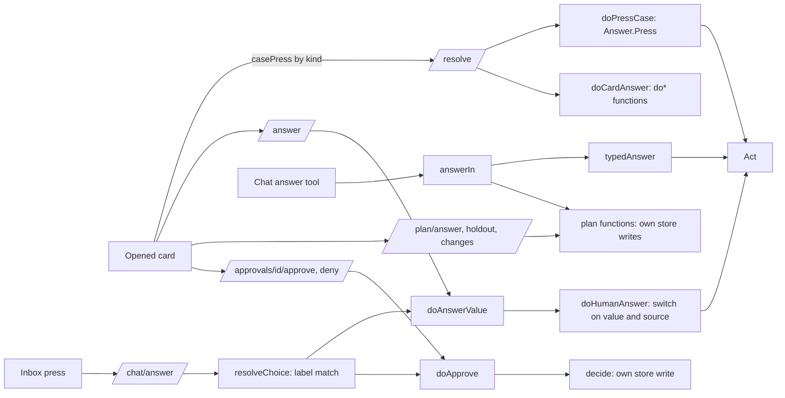
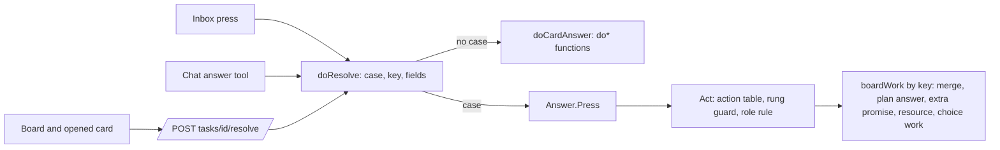

# One Door for Every Answer: Implementation Plan

> **For agentic workers:** REQUIRED SUB-SKILL: Use superpowers:subagent-driven-development (recommended) or superpowers:executing-plans to implement this plan task-by-task. Steps use checkbox (`- [ ]`) syntax for tracking.

**Goal:** Every answer to a card, from the board, the inbox and the chat's `answer` tool, enters through one function, is built by `Answer.Press` from one vocabulary of keys, and is guarded and run by `Act`, and the factory agent reads each card from the sources the human's screen reads.

**Architecture:** `POST /tasks/{id}/resolve` and one console function, `doResolve`, become the one way in. The inbox's press and the chat's `answer` tool call `doResolve` too. Plan questions, extra promises, plan changes and resource requests become rows of the action table whose work the console runs inside `Act`, as `approve_merge` does today, and a human card stores vocabulary keys instead of its own values. The guards that sit in callers move into `Act` or into the one function every caller passes, and the readers that word a card's story again read the face register, the card brief and the card digest.

**Tech Stack:** Go (factoryd, console), Postgres (one data migration, two kind migrations), HTML templates. No task changes workflow code.

**Spec:** None. The evidence in "The situation today" stands in for it.

## The situation today

Every path below is under `internal/` of `ai-software-factory-code` at main `c2dddcd67`, unless it starts with `cmd/` or `scripts/`. Every `file:line` was read at that commit.

### The pieces this plan needs

- A **card** is one task on the board. A **case** is one problem on a card from its opening to its end (`Case`, `factoryd/cases.go:257-280`). A case is `open` while the factory works it and `at_human` once it stands in Needs you. Its `OwnerRung` names the rung that owns its next move.
- A **rung** is one step of the escalation ladder. Rung 0 is factoryd reading facts, rung 1 the check-in, rung 2 the factory agent and rung 3 the human. While rung 2 works a case, the case holds an in-progress step of rung 2 (`StartRungStep`, `factoryd/ladder.go:861`).
- The **console** (`internal/console`) is the web screen and the project agent's chat. Its buttons post forms to 48 POST routes (`postRoutes`, `console/console.go:630-686`).
- The **chat's tools** are the project agent's typed reads and writes: 81 tools in one registry (`console/chat_tools.go:1577`), 35 of them writes. One access table names the role each route and each tool needs (`accessTable`, `console/access.go:72`). Its comment says "No handler or action judges a role itself: both dispatchers read this table" (`access.go:66-71`).
- **`Act`** is factoryd's function for an answer on a case (`factoryd/act.go:171`). Its comment says "Act is the one way a human, the chat or a rung answers a case" (`act.go:153`). It reads the case's facts, refuses what the rung may not do, runs the outside work under the case's lock, ends the case, and writes the step and the event as one record.
- The **action table** (`Actions`, `factoryd/actions.go:237-537`, 29 rows) names every action `Act` runs, the rungs that may pick it and its `Applies` rule (`Action`, `actions.go:70`). Nine are **board actions** whose work the console does inside `Act` through `ActInput.Work` (`boardActions`, `actions.go:730`), for example `approve_merge`. The console's side is `boardWork` (`console/board_actions.go:95-130`).
- A **face** is what a case shows a human: one question, a why line, a story and 2 to 4 answers. The **face register** holds one `FaceSpec` per kind (`factoryd/faces.go:87`). `CaseFaces` covers 42 case kinds (`faces_copy.go:449-552`). The **vocabulary** (`Vocabulary`, `faces_copy.go:105-262`, 79 rows) gives each answer its one key, label, effect line and fields. A key is an action, or an action and a variant such as `retry/roll` (`Answer.Key`, `faces.go:226`). `Answer.Press` (`faces.go:713-755`) turns a pressed answer and its fields into the `Resolution` that `Act` runs.
- A **human card** is a card whose work a human does. Its case is of kind `human_card`, and the case's facts store the question's choices (`storedChoices`, `faces_copy.go:2305-2311`).

### Eight doors and six builders

This table answers which POST route takes which answer, and what it calls.

| Door | Takes | Handler | Calls |
|---|---|---|---|
| `POST /tasks/{id}/resolve` | a case's answer, and the card's own actions | `resolve`, `console/board.go:3053-3095` | `doPressCase` or `doCardAnswer` |
| `POST /tasks/{id}/answer` | a human card's choice, and a human's own words | `answer`, `board.go:3025-3045` | `doAnswerValue` |
| `POST /tasks/{id}/plan/answer` | a plan's question or confirmation | `planAnswer`, `console/buttons.go:16-30` | `doAnswerPlanQuestion` |
| `POST /tasks/{id}/plan/holdout` | keep or drop an extra promise | `planHoldout`, `buttons.go:54-58` | `doDecideHoldout` |
| `POST /tasks/{id}/plan/changes` | a plan's change request | `planChanges`, `buttons.go:62-66` | `doRequestChanges` |
| `POST /approvals/{id}/approve` | a resource request's approval | `approve`, `console/approvals.go:450-460` | `doApprove` |
| `POST /approvals/{id}/deny` | a resource request's refusal | `deny`, `approvals.go:464-471` | `doDeny` |
| `POST /projects/{name}/chat/answer` | an inbox row's button | `chatAnswer`, `console/answer.go:32-86` | `resolveChoice` |

The opened card picks the door by the case's kind in `casePress` (`console/opened.go:687-787`) and `requestForm` (`opened.go:851-871`). The chat's `answer` tool is a ninth entrance with no route: `answerIn` (`chat_tools.go:819-859`) picks among six functions by the arguments the model sent.

Six builders turn an answer into an action, each in its own way:

1. `doPressCase` (`console/actions.go:1337-1345`) runs `Answer.Press` on the case's facts. This is the shape the design names.
2. `doCardAnswer` (`actions.go:1377-1428`) finds the card's own action in `MoreOf` and switches to its `do*` function, which the chat's tool shares.
3. `doAnswerValue` (`actions.go:1184-1250`) reads a choice value or typed words as continue, extend, resume or settle.
4. `typedAnswer` (`actions.go:1525-1546`), behind `doAnswerAs` (`:1310`) and `doAnswerCase` (`:1325`), builds the chat's typed action from its JSON arguments.
5. `resolveChoice` (`console/answer.go:196-240`) matches the inbox's button by its label text, for example `choice == factoryd.LabelOf(factoryd.ActApproveMerge)` (`answer.go:224`), then calls `doApprove`, `doRerun` or `doAnswerValue`.
6. The plan's own functions, `doAnswerPlanQuestion` (`actions.go:868-932`), `doAnswerPlanQuestions` (`:1007-1079`), `doDecideHoldout` (`:1096-1130`) and `doRequestChanges` (`:1136-1163`), and the resource request's `decide` (`:3207-3220`, called from `doApprove` at `:3251`), write their store rows themselves and never reach `Act`.

`Act` refuses every plan answer from an agent except a note (`factoryd/act.go:290-302`), and `answerCase` refuses a plan case with "answer it with `revision` ... and no `case_id`" (`console/actions.go:1458-1462`). A resource request opens no case row (`RequestCase`, `factoryd/cases_events.go:459-468`, and `waitsForFace`, `console/cases.go:250-253`). Its approval records `EventMergeApproved` with `"kind": "resource"` (`actions.go:3255`), a merge's event for a resource.



### A human card's own key space

A human card's choices carry 14 values beside the vocabulary's keys: `AnswerPark`, `AnswerClose`, `AnswerDone`, `AnswerNoted`, `AnswerKeepWaiting` and `AnswerGo` (`factoryd/chat_escalation.go:201-208`), `AnswerRerunAgain`, `AnswerCheckAgain` and `AnswerDismiss` (`:320-322`), `AnswerRetryRoll` (`:326`), `AnswerRetryFollow` (`:330`), and `AnswerHoldWait`, `AnswerReplanOnTop` and `AnswerTakeOffMain` (`factoryd/releasekeeper.go:30-32`). The 14 constants have 67 non-test uses in 10 files.

- `choiceAnswer` (`faces_copy.go:2316-2359`) translates a stored value into a vocabulary key, and `choiceValue` (`:2379-2395`) translates a key back. A stored choice whose label matches no row becomes an answer that "Posts these words as the answer and closes the card" (`:2345`).
- `doHumanAnswer` (`console/actions.go:1643-1845`, 203 lines) runs each choice's work in one switch on the value and on the card's source: `SourceFreezeCard` (`:1692`), `SourceProductionHeld` (`:1697`), `SourceFollow` (`:1796`), and `choiceCard` over four sources (`:1616-1618`).
- `AnswerRetryRoll` and `ActRetry` are both the string `"retry"`. Four places tell them apart by the card's source: `faces_copy.go:2334`, `console/actions.go:1692`, `console/actions.go:2079` and `factoryd/act.go:268`.
- The builders mix both spaces. The stall card's question already stores keys (`factoryd/humanquestion.go:33`), and the roll card stores a value (`factoryd/rolltask.go:1044`).

### Guards that sit in callers

- **Not the human's yet.** Three console guards refuse a human's answer on a case that still climbs: `mergeOnRungs` (`chat_tools.go:1173-1187`), `planOnRungs` (`:1193-1216`) and `heldOnRungs` (`actions.go:1283-1298`). Each has its own wording. `actCase` (`factoryd/act.go:775-796`) checks only that the case is open or at the human. No guard covers a case on an agent card, so the chat's `answer` with `case_id` can answer a stop that a lower rung still holds. The board never shows such a case, so only the chat reaches it.
- **A second role table.** `approverRules` (`console/actions.go:1351-1362`) names the approver's rule of ten actions beside `accessTable`. Two of its rules exist only there: a card's room (`ActExtend`) and the plan's drop of open promises (`AnswerDropAndEnd`). `retryRule` (`:1366-1372`) changes the retry's wording on a freeze card. A button's retry is admitted up to three times: in `doCardAnswer` (`:1397`), then in `callActWork` at rung 3 (`:2018`) and again for a retry on every rung (`:2023`). Commit `1be3f350e` (2026-11-18) added that last admit: "a retry is an approver's in the chat too".
- **The replan while the checks run.** `checksRunRefusal` (`factoryd/actions.go:575-588`) refuses a rung below the human a replan while the head's checks are pending. It runs inside `Action.refusal` (`:884`), so only an answer through `Act` meets it. Commit `c3b5077db` (2026-11-24) added it. The mid-session check-in offers a replan by `cuttable(t, s)` alone (`factoryd/runner.go:1885`), which reads no checks. The check-in reads a pull request's checks only for a plan's card (`checkinPRFacts`, `factoryd/gatetrigger.go:70-98`), and at `t.SHA`, not at the interim push's head (`wipOutcome.head`, `factoryd/wippush.go:33`).
- **The raise's card close.** `closeRaised` (`console/chat_budget.go:274-281`) runs after `doChatFund` in four callers: `board.go:3150`, `capreset.go:93`, `chat_budget.go:243` and `mcp.go:482`. Commit `85df157ad` (2026-11-25) added the four calls. The fifth caller, the chat budget card's own answer (`actions.go:1780`), leaves it out by hand, because there the card closes itself inside `Act`'s lock, and `ChatBudgetCards.Check` (`factoryd/chat_budget_card.go:147`) would withdraw the case that `Act` is ending.

### Text written outside the face register

`tripNext` (`factoryd/ladder.go:1891-1950`), with `noRoom` (`:1787-1810`) and `boardMove` (`:1814-1819`), writes the issue comment's paragraph on what a reply does, one branch per case kind. Its one caller is `ladder.go:551`, which passes it to `Face`, and `AskHuman` appends it to the comment (`:2127`). It reads the stop's reason and the case's facts. The register holds the ask, the why line, the story and the answers (`FaceSpec`, `faces.go:87`), but not this paragraph. `TestEveryFaceMatchesWhatAReplyDoes` (`factoryd/checkin_failed_test.go:558-700`) checks `tripNext`'s paragraph against what a reply does, and despite its name it never reads `CaseFaces`.

### What the agent reads beside what the human reads

- **The card read.** The chat's `card` tool runs `cardText` (`console/chat_reads.go:29-209`, 181 lines). It prints the digest head and then `cardLine` (`chat_tools.go:942-951`), which repeats the number, the status and the spend (`chat_reads.go:61`). It prints the session count twice (`:79`, `:194`), the ask as the raw `bt.Escalation` and `bt.Choices` (`:98`), and the raw `Objective` and `AgentSummary` cut at 2,000 characters (`:203`). The opened card shows the card brief through `ReadCardBrief` and `AgentText` as "The agent's view" (`opened.go:370-375`). No chat read calls either. The face pages the human reads come from `CardPages` (`factoryd/cardpages.go:619`), which the board, the opened card and the inbox call (`answer.go:478`, `cases.go:140`, `faceview.go:279`, `opened.go:332`), and the card read does not.
- **Two board reads.** The `board` tool (`chat_tools.go:1584`) renders `boardWords` (`:1060`): the columns with each card's line, the approvals, the hold and the pool. The `board_digest` tool (`:1636`) renders `BoardDigest.Render` (`factoryd/boarddigest.go:226`): the slots, the queue with its reasons, the plans with their proofs and the caps. Rung 2's wake reads the digest (`factoryd/rung2.go:70`). The prompt says "The factory agent on a case is the same agent" (`factoryd/operator.go:210-214`). The digest prints the raw queue reason `project month cap` (`boarddigest.go:257-262`, `QueueMonthCap` at `factoryd/bounded.go:66`), where the screen says "waits for the project's month cap to rise" (`console/faceview.go:523`).
- **The life fold renders twice.** The opened card fills `Life.Runs` from `lifeOf` (`opened.go:419`), which calls `runsOf` (`console/life.go:111-256`, 146 lines) on the raw timeline as `map[string]any`. The same fold loads `GET /tasks/{id}/digest` on toggle (`templates/opened.html:38`), which renders `CardDigest.Life()` (`factoryd/carddigest_render.go:111`) from factoryd's typed timeline. The digest carries no runs today: a `DigestStep` holds the time, offset, kind, actor, outcome and cost of one step.
- **Each renderer words the same facts again.** About 14 renderers read four sources: the stored ask face, the card brief, the card digest, and raw task and timeline fields. The ask face has one writer and many readers. These facts do not:

| Fact | Its wordings |
|---|---|
| Merge queue wait | `console/faceview.go:502` and `factoryd/carddigest_render.go:60`, the same sentence from two sources |
| Dependencies | `factoryd/faces.go:541`, `factoryd/carddigest.go:387`, `factoryd/carddigest_detail.go:111`, `console/chat_reads.go:93`, `factoryd/cardbrief_read.go:344`, `console/opened.go:996` |
| Spend | `carddigest_render.go:54`, `cardLine` (`chat_tools.go:948`), `factoryd/rung1.go:93`, `faces_copy.go:955-962`, `factoryd/pokes.go:348`, the receipt (`console/board.go:3279`), `lifeLine` (`console/life.go:261-286`) |
| Plan name | `carddigest_render.go:49`, `carddigest_detail.go:103`, `cardbrief_read.go:299`, `rung1.go:125`, `faceview.go:315`, `opened.go:413`. `PlanWords` (`faces_copy.go:1665`) exists and serves 4 other renderers. |
| Stop reason cut | `failureClause` (`console/board.go:1998-2010`, 80 runes), `board.go:1518` (120 runes), `firstLineCut` (`factoryd/carddigest.go:770`, 120 runes), `factoryd/pokes.go:337` (no cut) |

### Two implementations of one action

- **Deploy now.** The board's held-production panel posts `/projects/{name}/deploy-now` (`buttons.go:76-79`) to `doDeployNow` (`console/actions.go:3730-3752`). The held-production card's "Deploy now" runs `deployNow` inside `Act` (`factoryd/act.go:1358-1378`). Both call `ReleaseKeeper.DeployNow` (`factoryd/releasekeeper.go:519`). Each maps the errors and writes the success sentence on its own, and the two sentences differ: "main of %s at %s" (`actions.go:3751`) against "main of %s at commit %s" (`act.go:1376`). The panel's press writes no step on the card's case. Its label is a literal in `templates/board.html:52`. The panel needs its own door because the release keeper files the card only after `HoldAskAfter`, 6 hours (`releasekeeper.go:19-21`), unless a fix merged (`:213`).
- **The document write.** The editor's save runs `doSaveDoc` (`console/docs_write.go:154-249`, 96 lines). The chat's `write_doc` runs `doWriteDoc` (`console/autonomy.go:642-712`, 71 lines). Each has its own lock, current-file read, empty check, size check, roadmap check (`docs_write.go:208`, `autonomy.go:685`) and commit. The save commits with the human's session (`docs_write.go:230`). The chat's write commits with the service token `c.cfg.DocsToken` (`autonomy.go:699`), so Forgejo names no human. Commit `d259cb1e5` (2026-10-14) introduced it and states no reason. The save records a third `via` value, `console` (`docs_write.go:93`).

### Screen actions and chat tools

The GET route table names each route's tool or the reason it has none, and `TestEveryConsolePageIsAChatTool` (`console/chat_pages_parity_test.go:47`) enforces it. `postRoute` (`console/console.go:622-626`) has no such field. Four screen actions have no tool and no stated reason: a resource request's "Approve it" and "Refuse it" (`approvals.go:450`, `:464`), the intake switch (`autonomy.go:237-259`, its logic inline with no `do*` function), removing the GitHub export (`projects.go:1005`, `doRemoveGithubExport` at `:959-977`), and a routine's "Give it to me" (`routines.go:42-49`). The factory cap's reset states in a comment that no tool has it (`capreset.go:18-19`).

Two more doors repeat what another door does. `tell_card` (`console/tell_card.go`, 209 lines) routes a text by the card's state: a steer on a running card, a denial with changes requested at the approval gate, an answer on a waiting card. `routeAnswer` (`actions.go:1260-1278`) already steers a running card's words (`:1268`). `describe` (`chat_tools.go:509-722`, 214 lines) builds each proposal's line with 13 `if tool.name ==` branches, and its `new_card` branch repeats four of the run's checks (`:527-541`). The filing flags (`filingFlags`, `console/filing_flags.go:88`) run in `createTask` (`board.go:2999`) and in the chat's `refuseCard` (`chat_tools.go:484-489`), not in `doFileCard` (`actions.go:445`). A human's "File the cause as its own card" runs `fileFromCase` (`board_actions.go:150-184`) without them.

### Dead code and vocabulary splits

- **`wait_expired`** has no filer. The kind table says only a case from before carries it (`factoryd/cases.go:162`). Its 9 non-test references are `cases.go:39` and `:162`, `cases_events.go:298`, `faces_copy.go:496` and `:684`, `kinds.go:15`, `ladder.go:1942`, `pg/pg.go:265` and `facefixtures/fixtures.go:839`. Five test lines and 12 migration constraints name it. Whether the live database holds an open case of the kind is not checked.
- **`GET /projects/{name}/events`** (`console.go:604`, `projectEvents` at `events.go:154`) has no caller but three tests (`events_test.go:423`, `:450`, `:461`) and the lab script (`scripts/console-lab/check.js:1449`, `:1463`). Its reason says "an event feed fragment", but it answers JSON. `feedRow` (`events.go:141`) also serves the stream (`:346`).
- **The `gallery` template** (`templates/gallery.html`) runs only in `lab_test.go:278`, yet ships in the production template set.
- **`Config.HTTP`** (`console.go:393`) is set by tests alone. `cmd/factoryd` never sets it.
- **The criteria verdict** is `waive` in the vocabulary and the tool, and `waived` in `doDecide` (`actions.go:3514-3531`). `criteriaVerdicts` (`:3535`) maps it one way, and a loop in `boardWork` maps it back (`board_actions.go:115-120`).
- **The helper steps** have two name tables: `helperWords` (`console/faceview.go:384`, "writing the proofs") and `stepNames` (`factoryd/faces.go:782`, "the proof writing").

## Why this is drift

**One way only (tenet 5).** The design says "One route answers a card from the board, the inbox and the chat's `answer` tool" (`docs/architecture.md` 5.7). The code has 8 POST doors, a ninth entrance in the tool, and 6 builders. The spans that route answers hold 1,230 lines, shared helpers among them: `buttons.go:12-66`, `board.go:3025-3095`, `approvals.go:447-497`, `actions.go:868-1345`, `actions.go:1525-1845`, `answer.go:196-240` and `opened.go:687-895`. Plan answers and resource requests bypass `Act`, whose own comment says it is "the one way". Commits `ed59c927c` and `3a1e66ced` (both 2026-11-19) moved the merge, the criteria and the re-run to the case's door, so the direction is set. Plan questions, extra promises, changes, resource requests, human card choices and the inbox remain.

**No special exceptions (tenet 1).** A human card answers in its own key space, and the console's work switches on the card's source in 4 places. Each new kind of factory card adds a value, a translation and a branch: `d115c7c01` (2026-11-26) added `AnswerRetryFollow` and its branch for the follow routine's failure card. A key that means two things caused a fault: `1be3f350e` (2026-11-18) records that "the chat's retry on a freeze card" ran "the human card's close beside the press".

**A guard in the shared function, not in every caller (tenet 5).** "Not the human's yet" has 3 wordings in 3 places and none for an agent card's case. The replan rule while checks run sits in the action table, and the check-in that reaches the same replan another way still offers it, so a check-in can close a pull request whose checks run. That is the fault `c3b5077db` fixed on one path. The raise's close sits in 4 callers, and the next raise path that forgets it leaves the judgment budget card standing for up to a minute, the fault `85df157ad` fixed. A second role table holds two rules the access table lacks, against the access table's own comment.

**One register with an entry per kind (5.9).** The issue's "what happens next" lives in a 60-line switch outside `FaceSpec`, so the card and its issue can say different things about one ask, and the test that guards it does not read the register.

**Transparency (tenet 3).** The factory agent explains a card to the human from a text the human does not see: no face, no answers with their labels and effects, no card brief. The board has two reads that word the same queue apart. The panel's Deploy now leaves no step on the case. The chat's document commits name no human, against 5.7: "with that human's Forgejo token, so Forgejo and the audit trail name the human". A resource approval records a merge's event.

**What it costs.** 1,230 lines in the routing spans, a value switch of 203 lines, and 14 renderers' worth of repeated wording. Three faults in nine days came from a path that one door would have covered: `1be3f350e`, `c3b5077db` and `85df157ad`. Human minutes lost to them were not measured.

## The trade-off

**What the change costs and risks.** The change touches the press path of every card kind, so a regression would show on the board at once. A live human card's stored offers need a one-time rewrite at the roll. Plan answers start passing `Act`, so they gain a step row and its refusals, and a plan answer that `Act` refuses where today's door accepted it would stall a plan. The chat's `answer` tool changes shape: it takes a case and a key instead of `revision`, `question`, `holdout` and `decision`, so the project agent's habits from its tool description change on the first turn after the roll. Each risk has its test in the owning task and its item in "Review Focus".

**What it buys.** One function and one builder for every answer, so a guard written once covers every door. One record per answer, including plan answers and resource requests. One key space, so a new factory card adds a vocabulary row and its work, not a value, a translation and a branch. The agent reads the faces, the brief and the digest the human reads. The estimated net is about 1,200 fewer non-test lines.

**What stays as it is, and why.**

- `doCardAnswer` and the card's own actions stay. Each of the 9 actions in `MoreOf` already shares its `do*` function with its chat tool (`faces.go:587`). The one door calls `doCardAnswer` for an answer with no case.
- The chat's identity checks stay: `planActor`, `humanWord` and `humanAnswerLine` (`chat_tools.go:1246-1288`) settle whose word a turn carries, which a button never needs.
- The face register keeps its shape, and the fixtures stay tests over the kind lists, not snapshots.
- The inbox keeps its route `POST /projects/{name}/chat/answer` for ask rows, bound asks and pokes, and for the two thread rows a press writes. Only its escalation branch changes: it calls `doResolve`.
- The held-production panel keeps its door, because the card files 6 hours after the hold starts. Both doors call one factoryd function.
- `give_room` stays a writer's tool. `TestTheWakerAsAWriterGivesRoomFromThePool` (`console/act_test.go:1220`) pins that the factory agent in a writer's venue gives room within rung 2's bounds.
- "Answer in my words" labels three rows and "Noted" two. Each action keeps one label, and no face shows two rows of one label (`TestFaceContract`, `factoryd/faces_test.go:150`, checks unique labels). The labels stay.
- The board's own words on an agent's question go to the human's chat turn (`answerInChatTurn`, `console/wake.go:249`). That is the effect of the key `continue/own_words` from a button, and it stays as that key's work.

**Alternatives considered.**

- **Keep the doors and test that each reaches `Act`.** It loses because the six builders stay, and so do three wordings of one guard.
- **Make every human card choice a row of the action table.** `Act` already has one path for a human card's choice (`humanChoice`, `act.go:1072`), which checks the stored offers and runs the console's work. The drift is the second key space and the switch on the source, not that path. Converting every choice to a table row would grow the table by about 12 rows for no new guard.
- **Let the inbox post to `/tasks/{id}/resolve` directly.** The inbox's press must write the human's row and the factory's row into the thread. A second thread writer behind `/resolve` would be a special case in the board's door.
- **Keep `tripNext` and test it against the register.** Two places per kind would remain.
- **Give rung 2 the console's `boardWords`.** Rung 2's wake runs in factoryd and cannot call the console, so the one board read must be factoryd's.

## The proposal

**The target shape.** A board press, an inbox press and the chat's `answer` tool each call `doResolve(ctx, a, id, caseID, key, values)`. With a case, `doResolve` builds the resolution with `Answer.Press` on the case's facts and answers through `Act`. With no case, it calls `doCardAnswer`. Every key is a vocabulary key. A plan's question, confirmation and extra promise, a plan's change request and a resource request are rows of the action table, and their work runs inside `Act` from `boardWork`, as `approve_merge` does. The plan's own answer row ends its case, and the request's decision ends a resource request's case, as a merge's does. A human card stores the key of each choice. `boardWork` runs a choice's work by its key, so no work reads the card's source. `Act` refuses an answer on a case that a lower rung still holds, for every kind. One table holds every role rule.



**Deletions and additions, by task.** All sizes are inferred from the spans of the code, not from a trial change.

| Task | Deletes | Adds | Net |
|---|---|---|---|
| 1 Rung guard in `Act` | `mergeOnRungs`, `heldOnRungs`, `routeAnswer`'s held branch | one refusal in `act` | about -25 |
| 2 Check-in and the checks | nothing | one predicate, the check-in's head read | about +10 |
| 3 Raise closes its card | four `closeRaised` calls | one call, one lock skip in `Check` | about 0 |
| 4 Resolution carries its variant | nothing | `Resolution.Variant`, `Resolution.Key` | about +10 |
| 5 Human cards store keys | 10 value constants, `choiceValue`, the source switches, most of `doHumanAnswer` | work by key in `boardWork`, one data migration | about -200 |
| 6 One role table | `approverRules`, `retryRule`, one admit | 11 access entries | about -15 |
| 7 Plan answers through `Act` | three plan doors, `planOnRungs`, the batch, the plan branches of `answerIn` and `casePress` | 5 action rows, their work | about -140 |
| 8 Resource requests through `Act` | two approval doors, `requestPress`, `requestForm`, `approverOnly`, the resource branches | one case kind, two action rows | about -40 |
| 9 The one door | `POST /tasks/{id}/answer`, `doAnswerValue`, `typedAnswer`, `doAnswerAs`, `doAnswerCase`, `resolveChoice`'s matches | `doResolve` | about -160 |
| 10 `tell_card` and `describe` | `tell_card.go`, the repeated checks | one `check` per tool | about -230 |
| 11 Filing flags in `doFileCard` | the callers' checks | the checks in `doFileCard` | about 0 |
| 12 The card read | `cardLine`, the hand-built lines | the faces and the brief | about -45 |
| 13 The reply paragraph in the register | `tripNext` | `FaceSpec.Next` per kind | about -10 |
| 14 The life fold | `runsOf`, `lifeOf`, `lifeLine` | runs in the digest | about -160 |
| 15 One board read | `boardWords`, `board_digest` | the columns in `BoardDigest` | about -70 |
| 16 One wording per fact | the repeated wordings | 4 factoryd functions | about -30 |
| 17 Deploy now | the two error maps and sentences | one factoryd function | about -15 |
| 18 One document writer | `doWriteDoc`'s checks and commit | the passage's apply | about -45 |
| 19 POST parity | nothing | `tool` and `none` on 48 routes, 2 tools, the test | about +60 |
| 20 Two vocabulary splits | `criteriaVerdicts`, `helperWords` | nothing | about -20 |
| 21 `wait_expired` | the kind and its uses | one migration | about -40 |
| 22 Dead route, template, seam | `projectEvents`, `gallery.html`, `Config.HTTP` | nothing | about -60 |

The total is about -1,200 non-test lines. The tests change with the code and are not counted. No task keeps a compatibility path or a flag for the old behaviour.

**Seams with other plans.**

- "One close for every card" makes `Act` the one place that ends a human card and removes the freeze card's own retry. If it lands first, Task 4 drops its `thaws` step, and Task 3's call in `doChatFund` triggers rung 0's retake of the chat budget cards instead of `Check`.
- "Finish the general fix" lists the replan rule while checks run and the raise's close among its 32 one-path fixes. Whichever plan builds first carries Tasks 2 and 3, and the other drops them.
- "Prompts carried by construction" owns the size of the tools' descriptions. Task 9 changes the `answer` tool's parameters, and its description follows that plan's rules.
- "Tests and housekeeping" owns the console's `AGENTS.md` rules. Task 22 deletes the one seam that breaks the rule on test-only fields.

## Decisions for Sebastian

1. **Does a human's role bound the factory agent's own answer?** Today the human's role is judged on the agent's answer for one action only, the retry (`console/actions.go:2022-2026`, commit `1be3f350e`). The other nine approver actions are judged on the human's own answer alone, at rung 3. Option A: judge every approver action on the agent's answer too, which reads 5.7's "the approvers list ... hold whichever door it came through" literally. Its risk: a wake runs in the inbox of the first login of the project's notify list (`factoryd/wakes.go:333-343`), who may be a writer, so the factory agent's merges in that project's wakes would be refused. Option B: judge no approver action on the agent's answer. Rung 2 stays bounded by the action table, the project's autonomy and its draw bounds, as `TestTheWakerAsAWriterGivesRoomFromThePool` already pins for room. A human's explicit word in the chat stays rung 3, which the role rule judges. **Recommended: B.** It keeps the agent's authority in policy files, where tenet 1 puts it, and it reverses `1be3f350e`'s retry admit on the record. Task 6 builds either option with one line.
2. **As whom does the chat's document write commit?** Today with the docs service token, so Forgejo names no human. Proposal: as every other chat write to Forgejo does (`posterOf`, `console/actions.go:939`): the human's session when the human's word carries the write, the project agent's own token when the agent decided it. The docs token stays for document reads. The risk: a human with no write right on the document repository loses `write_doc` in their thread for writes their word carries, as they already lack the editor's save. **Recommended: yes.**
3. **Does the intake switch get a chat tool?** The UX baseline says anything a human does by hand on the screen can be said in the chat. The intake switch decides whether the project agent files its own cards, so a tool would let the agent open its own intake. **Recommended: no tool. The route table states the reason: "the human's switch over the agent's own filings".** Task 19 adds the tools for removing the export and a routine's "Give it to me", which carry no such conflict.

## Global Constraints

- Code work runs in a git worktree off `origin/main` of `~/repos/ai-software-factory-code`. One pull request per task group, from `controller/ai-software-factory-code`, merged as `sebastian` after green CI and an independent review on the most capable model. The groups are Tasks 1 to 3, Tasks 4 to 6, Tasks 7 to 11, Tasks 12 to 16, Tasks 17 and 18, and Tasks 19 to 22.
- `bash check changed` passes before each commit. Go tests run with `go test -race`. Postgres-backed tests run through `scripts/pg-test.sh go test -race -p 1 ./internal/factoryd/pg/`.
- No task changes workflow code. If a change reaches workflow code, it needs a `workflow.GetVersion` change id and a replay test.
- A new migration file goes under `internal/schema/migrations/factoryd/` after `20261129100500_task_moments.sql`, named by the same timestamp pattern.
- A fix reaches production only through a roll, and a roll needs Sebastian's go.
- No task id in a text a human reads. A human is a human, never a member or an operator.
- Human-read product copy that a task changes passes the writing guide in `internal/writingguide`. Each such step says so.
- No comments that narrate the change. Tests state hand-derived expectations.

## Review Focus

1. **Two replan offers on one held-production ask share the key `replan/held`.** Each press must replan its own plan. Task 5's `TestEachHeldReplanOfferReplansItsOwnPlan` pins that the press of the second offer replans the second plan and not the first.
2. **A plan answer through `Act` must end its case once.** The plan's answer row ends the case (`resolvePlanCase`, `cases_events.go:382`), and `Act` must keep it open, or the case ends twice with two records. Task 7's `TestAPlanAnswerThroughActEndsItsCaseOnce` pins one resolution and one step.
3. **The board's "Give more room" posts the readout's guard fields.** The one door must keep passing `MoneyTouched` and `RoomGuard` (`board.go:3087-3091` today), or a room the human did not see could be given. Task 9's `TestTheOneDoorKeepsTheRoomReadoutGuard` pins the refusal of a press whose guard fields disagree with the card.
4. **Rung 2 may now answer from a human's thread a case that rung 2 holds.** The three console guards refused that outside the wake. The wake's answer after the thread's must find the case ended and write nothing. Task 1's `TestASecondRungTwoAnswerFindsTheCaseEnded` pins one step on the case.
5. **An inbox row can outlive its face.** A press of a label that the card's stored offers no longer hold must be refused, naming the card's current answers, not answered with the label as words. Task 9's `TestAnInboxPressOfAWithdrawnAnswerNamesTheCurrentOnes` pins it.

---

### Task 1: An answer on a case that a lower rung holds is refused in `Act`

**Files:**
- Modify: `internal/factoryd/act.go:237-243` (`act`, after `ownStep`)
- Modify: `internal/console/chat_tools.go:1155-1187` (`mergeRequest`, delete `mergeOnRungs`)
- Modify: `internal/console/actions.go:1252-1298` (`routeAnswer`'s held branch, delete `heldOnRungs`)
- Test: `internal/factoryd/act_test.go`, `internal/console/wake_test.go:583`, `internal/console/rung2_test.go:360`

**Interfaces:**
- Consumes: `Case.Status`, `Case.OwnerRung`, `(*Runner).ownStep` (`act.go:852`), `ShownName` (`act.go:1756`)
- Produces: `func climbRefusal(c Case, rung int, own int64, card string) string` in `internal/factoryd/act.go`

- [ ] **Step 1: Write the failing test** `TestAnAnswerOnACaseThatClimbsIsRefusedInAct` in `act_test.go`, on `newFactsRig(t)` with `g.card()` and `g.timeline(t)`:

```go
g.store.cases = append(g.store.cases, Case{ID: 41, TaskID: "t1", Kind: CaseSessionCap, Status: CaseOpen, OwnerRung: 1})
human := ActInput{TaskID: "t1", CaseID: 41, By: "sebastian", Via: ViaButton, Rung: 3, Res: Resolution{Action: ActClose}}
agent := ActInput{TaskID: "t1", CaseID: 41, By: ChatUser, Via: ViaChat, Rung: 2, Res: Resolution{Action: ActClose}}
wantHuman := "Case 41 of card #12 is open at rung 1: the factory decides it or hands it up, and it is yours only once it stands in Needs you."
wantAgent := "Case 41 of card #12 is open at rung 1: the factory agent answers it once the case reaches rung 2."
if _, err := g.r.Act(ctx, human); err == nil || err.Error() != wantHuman {
	t.Errorf("the human's answer on an open case = %v, want %q", err, wantHuman)
}
if _, err := g.r.Act(ctx, agent); err == nil || !strings.Contains(err.Error(), wantAgent) {
	t.Errorf("rung 2's answer before it holds the case = %v, want %q", err, wantAgent)
}
g.store.cases[len(g.store.cases)-1].OwnerRung = 2
g.store.caseSteps[41] = []CaseStep{{ID: 9, CaseID: 41, Rung: 2, Actor: ChatUser, Outcome: StepInProgress}}
if _, err := g.r.Act(ctx, agent); err != nil {
	t.Errorf("rung 2's answer on the case it holds = %v, want it taken", err)
}
```

  Human-read copy: `wantHuman` passes `internal/writingguide`.
- [ ] **Step 2: Write the failing test** `TestASecondRungTwoAnswerFindsTheCaseEnded` beside it: the same case held by rung 2, two `Act` calls with the agent's `ActClose`. The first is taken. The second returns `ErrCaseEnded`, and `g.store.caseSteps[41]` holds exactly 1 step with `Outcome == StepResolved`.
- [ ] **Step 3: Run and see them fail.** `go test -race -run 'TestAnAnswerOnACaseThatClimbsIsRefusedInAct|TestASecondRungTwoAnswerFindsTheCaseEnded' ./internal/factoryd/`. Expected: FAIL, the human's answer is taken where the refusal is wanted.
- [ ] **Step 4: Implement** `climbRefusal(c Case, rung int, own int64, card string) string` in `act.go`. It answers "" unless `c.Status == CaseOpen` and either `rung == 3`, or `rung == 2 && own == 0`. Call it in `act` right after `ownStep` and return its sentence as `ErrActRefused`. Rung 0 and rung 1 keep their rules (rung 1's `own == 0` refusal at `act.go:241-243` stays).
- [ ] **Step 5: Delete the console guards.** Delete `mergeOnRungs` and its call in `mergeRequest`. Delete `heldOnRungs` and the branch `t.Kind == "human" && t.Status == "waiting-agent" && !a.caseWake()` in `routeAnswer`. Keep `climbing` (`console/cases.go:258`) for the card read until Task 12. `planOnRungs` stays until Task 7, because plan answers do not reach `Act` before it.
- [ ] **Step 6: Change the expected text** of `TestAClimbingMergeTakesNoDecisionInTheChat` and `TestAHeldHumanCardTakesOnlyRungTwosAnswerBeforeItsFace` to the sentences of Step 1, with each fixture's case number, rung and card. Derive each by hand from the fixture.
- [ ] **Step 7: Run and see them pass.** `go test -race ./internal/factoryd/ ./internal/console/`. Expected: PASS.
- [ ] **Step 8: Commit.** `An answer on a case that a lower rung still holds is refused in Act, whichever door it came through`

### Task 2: The mid-session check-in offers no replan while the head's checks run

**Files:**
- Modify: `internal/factoryd/actions.go:571-588` (`checksRunRefusal`)
- Modify: `internal/factoryd/gatetrigger.go:65-98` (`checkinPRFacts`)
- Modify: `internal/factoryd/runner.go:1883-1914` (`checkinLive`)
- Test: `internal/factoryd/gatetrigger_test.go` (create beside the file if it has none), `internal/factoryd/actions_test.go`

**Interfaces:**
- Consumes: `ChecksState` and `ChecksPending` (`factoryd/workflow.go:602-611`), `wipOutcome.head` (`wippush.go:33`), `cuttable` (`runner.go:1866`)
- Produces: `func checksPending(prOpen bool, checks string) bool` in `actions.go`, read by `checksRunRefusal` and by `checkinLive`. `func (r *Runner) checkinPRFacts(ctx context.Context, t Task, head string) (*CheckInPRFacts, error)`, reading the checks of every card with a pull request at `head`, else at `t.SHA`.

- [ ] **Step 1: Write the failing test** `TestTheSessionCheckInOffersNoReplanWhileTheChecksRun`: a direct card on a project with a plan track and an open pull request, a fake forge whose combined status at the interim head `w1` is `pending` and at `t.SHA` is `success`. `r.checkinPRFacts(ctx, t, "w1")` returns `Checks == ChecksPending`, and `sessionReplan(t, s, pr)` is false. With the status at `w1` `success`, it is true. With no pull request, `checkinPRFacts` returns nil and `sessionReplan` is true.
- [ ] **Step 2: Run and see it fail.** `go test -race -run TestTheSessionCheckInOffersNoReplanWhileTheChecksRun ./internal/factoryd/`. Expected: FAIL to compile, `checkinPRFacts` takes no head and `sessionReplan` is undefined.
- [ ] **Step 3: Implement.** Add `checksPending` and have `checksRunRefusal` call it for its `f.Checks == "pending"` arm. In `checkinPRFacts`, read the gate trigger for a plan's card alone and the checks for every card with `t.PRNumber != 0`, at `cmp.Or(head, t.SHA)`. Add `func sessionReplan(t Task, s sessionSpec, pr *CheckInPRFacts) bool` that answers `cuttable(t, s) && (pr == nil || !checksPending(true, string(pr.Checks)))`. In `checkinLive`, pass `wip.head`, and set `ask.Replan = sessionReplan(t, s, pr)` after the read at `runner.go:1906-1914`, in place of `cuttable(t, s)` at `:1885`.
- [ ] **Step 4: Run and see it pass.** `go test -race ./internal/factoryd/`. Expected: PASS, with `TestGateCriteriaInvariantHeldOnPendingChecks` and the check-in tests green.
- [ ] **Step 5: Commit.** `The mid-session check-in offers a replan only while no checks run on the pull request's newest head`

### Task 3: Every raise of the judgment budget closes the lifted card in `doChatFund`

**Files:**
- Modify: `internal/console/actions.go:2104-2142` (`doChatFund`)
- Modify: `internal/console/board.go:3150`, `internal/console/capreset.go:93`, `internal/console/chat_budget.go:242-244`, `internal/console/mcp.go:481-483` (delete the calls), `internal/console/chat_budget.go:270-273` (the comment)
- Modify: `internal/factoryd/chat_budget_card.go:147-190` (`Check`), `cmd/factoryd/main.go:737` (wire the lock)
- Test: `internal/factoryd/chat_budget_card_test.go`, `internal/console/chat_fund_test.go`

**Interfaces:**
- Consumes: `(*Runner).TryLockCase(id int64) (func(), bool)` (`factoryd/act.go:614`), `Store.NewestAskCase`
- Produces: field `TryLockCase func(id int64) (unlock func(), ok bool)` on `ChatBudgetCards`, nil in tests that hold no `Runner`

- [ ] **Step 1: Write the failing test** `TestChatBudgetCardsSkipACaseAnAnswerHolds` in `chat_budget_card_test.go`: a chat budget card whose chat task's budget was raised past the card's, its case 5 locked by a `TryLockCase` fake that answers false for 5. `Check` leaves the card `waiting-human` and writes no `question_withdrawn` row. With the fake answering true, `Check` closes it, as `TestChatBudgetCards` expects today.
- [ ] **Step 2: Write the failing test** `TestEveryRaiseRunsTheCardsCheckOnce` in `chat_fund_test.go`: a `Config.CheckChatBudgetCards` that counts its calls. The panel's fund, the Reset, Fund and go on, the MCP `chat_fund` and the chat budget card's own answer each raise once. Each leaves the count at exactly 1 more than before.
- [ ] **Step 3: Run and see them fail.** `go test -race -run 'TestChatBudgetCardsSkipACaseAnAnswerHolds' ./internal/factoryd/` and `go test -race -run TestEveryRaiseRunsTheCardsCheckOnce ./internal/console/`. Expected: FAIL, `TryLockCase` is no field, and the card's own answer counts 0.
- [ ] **Step 4: Implement.** In `Check`, read each card's live ask case and skip the card when `TryLockCase` answers false, unlocking when it answers true. Call `closeRaised(ctx)` once at the end of `doChatFund`, after the event. Delete the four calls in the callers and the comment's sentence on the card's own answer. Wire `chatBudgetCards.TryLockCase = runner.TryLockCase` in `cmd/factoryd/main.go`.
- [ ] **Step 5: Run and see them pass.** `go test -race ./internal/factoryd/ ./internal/console/`. Expected: PASS, with `TestChatBudgetCardsCloseOnceUnderRace` and `TestTheChatBudgetCardAddsMoneyToTheChat` green.
- [ ] **Step 6: Commit.** `Every raise of the judgment budget closes the card it lifted, and the card being answered closes by its own answer`

### Task 4: A resolution carries the variant of the answer pressed

**Files:**
- Modify: `internal/factoryd/actions.go:56-66` (`Resolution`)
- Modify: `internal/factoryd/faces.go:742` (`Answer.Press`)
- Test: `internal/factoryd/faces_test.go`

**Interfaces:**
- Produces: field `Variant string \`json:"variant,omitempty"\`` on `Resolution`. `func (r Resolution) Key() string`, which answers `r.Action`, or `r.Action + "/" + r.Variant` when the variant is set.

- [ ] **Step 1: Write the failing test** `TestPressCarriesTheAnswersVariant`: for the keys `retry/thaw`, `retry/roll`, `close/dismiss` and `extend`, `AnswerOf(key)` pressed with `Facts{}` and no values gives a resolution whose `Key()` equals the key.
- [ ] **Step 2: Run and see it fail.** `go test -race -run TestPressCarriesTheAnswersVariant ./internal/factoryd/`. Expected: FAIL to compile, `Resolution` has no method `Key`.
- [ ] **Step 3: Implement** the field and `Key`. In `Press`, set `Variant: a.Variant` unless the variant is `sayVariant` or `variantPlan`, whose keys carry words.
- [ ] **Step 4: Run and see it pass.** `go test -race ./internal/factoryd/`. Expected: PASS, and stored resolutions with no variant read as before.
- [ ] **Step 5: Commit.** `A resolution names the vocabulary key of the answer that was pressed`

### Task 5: A human card stores vocabulary keys, and its work runs by key

**Files:**
- Modify: `internal/factoryd/chat_escalation.go:195-208` and `:314-330` (delete the value constants), `:266-269` (`QuestionChoice`)
- Modify: `internal/factoryd/releasekeeper.go:26-33` (delete the held-production values) and its question builder
- Modify: `internal/factoryd/faces_copy.go:20-43` (the answer names `AnswerGo`, `AnswerRerunAgain`, `AnswerCheckAgain` move here), `:2316-2395` (`choiceAnswer` reads the key, delete `choiceValue`)
- Modify: `internal/factoryd/act.go:139`, `:268`, `:1096`, `:1146`, `:1175-1191` (keys instead of values), `internal/factoryd/rolltask.go:1044`, `internal/factoryd/pg/pg.go:80-86`, the follow failure card's and the freeze card's builders
- Modify: `internal/console/actions.go:1610-1868` (delete `choiceCard`, `isReplanChoice`, the switch of `doHumanAnswer`), `:2079` (`actErr`), `internal/console/board_actions.go:95-130` (`boardWork` by key), `internal/console/opened.go:776`
- Create: `internal/schema/migrations/factoryd/20261130100000_choice_keys.sql`
- Test: `internal/factoryd/faces_test.go`, `internal/console/realact_test.go:332`, `internal/console/actions_test.go`, `internal/factoryd/pg/cases_pg_test.go`

**Interfaces:**
- Consumes: `Resolution.Key` (Task 4), `AnswerOf`, `boardWork`, `(*Runner).humanChoice` (`act.go:1072`)
- Produces: field `Args map[string]any \`json:"args,omitempty"\`` on `QuestionChoice`. Key constants `KeyDismiss`, `KeyDone`, `KeyNoted`, `KeyRetryRoll`, `KeyRetryFollow`, `KeyThaw`, `KeyHeldReplan`, `KeyOffMainReplan` beside `KeyPark` (`faces_copy.go:47`). `func (c *Console) choiceWork(ctx context.Context, a actor, t factoryd.Task, k factoryd.Case, res factoryd.Resolution) (work func(context.Context) (int64, error), note *string, err error)` in `board_actions.go`, one `switch res.Key()`.
- The plan "A routine's run shows while it works and says why it failed" adds the key `retry/routine` and its `choiceWork` arm when it builds.

- [ ] **Step 1: Write the failing test** `TestEveryHumanCardChoiceIsAVocabularyKey` in `faces_test.go`: for every builder of a human card's question (the stall card, the failed roll, the follow failure, the freeze card, the held production, the month cap, the chat budget, `EscalateToHuman`'s choices), every stored `QuestionChoice.Value` passes `AnswerOf(value)` with `ok == true`.
- [ ] **Step 2: Write the failing test** `TestEachHeldReplanOfferReplansItsOwnPlan` in `console/actions_test.go`: a held-production card whose two offers are `replan/held` with `Args` `{"task_id": "p1"}` and `{"task_id": "p2"}`. The press of the second offer, with `replan/held.task_id = p2`, calls `doReplan` for `p2` alone, and the note names plan #2's issue. A press with `task_id = p3` is refused by `Act` as a choice the question does not offer.
- [ ] **Step 3: Write the failing test** `TestTheChoiceKeysMigrationRewritesLiveOffers` in `pg/cases_pg_test.go`: a live `human_card` case whose `facts->'offers'` hold the values `park`, `dismiss`, `retry` on a roll card, `retry` on a freeze card and `replan_on_top:p1`, and an ended case with `park`. After the migration, the live case's offers are `note/park`, `close/dismiss`, `retry/roll`, `retry/thaw` and `replan/held` with `args.task_id = p1`, and the ended case is unchanged.
- [ ] **Step 4: Run and see them fail.** `go test -race -run 'TestEveryHumanCardChoiceIsAVocabularyKey' ./internal/factoryd/`, `go test -race -run TestEachHeldReplanOfferReplansItsOwnPlan ./internal/console/`, and `scripts/pg-test.sh go test -race -p 1 -run TestTheChoiceKeysMigrationRewritesLiveOffers ./internal/factoryd/pg/`. Expected: FAIL, the builders store values and the migration does not exist.
- [ ] **Step 5: Implement the keys.** Each builder stores the key of its row. A replan offer stores `KeyHeldReplan` or `KeyOffMainReplan` with the plan's id in `Args["task_id"]`, and its answer's `task_id` field defaults to that id. `choiceAnswer` reads the key through `AnswerFor` and keeps its effect rewrite for a named plan. Delete `choiceValue`, the source test at `faces_copy.go:2334`, and the fallback "Posts these words as the answer and closes the card": a stored choice no row knows is refused by `Act` as a choice the question does not offer. `humanChoice` matches a resolution to a stored offer by `res.Key()` and its `task_id` argument. `keepsWaiting` becomes `{KeyPark, AnswerRerunAgain}`. `thaws` becomes `res.Key() == KeyThaw`, and `actErr`'s freeze sentence reads the same key.
- [ ] **Step 6: Implement the work by key.** Move each arm of `doHumanAnswer`'s switch into `choiceWork` under its key: `AnswerRerunAgain`, `KeyDismiss`, `KeyRetryRoll`, `KeyRetryFollow`, `AnswerFundChat`, `ActApproveMerge` and `ActDenyMerge` on a card with a pull request, `ActClose`, `KeyPark`, `AnswerGo`, `KeyHeldReplan` and `KeyOffMainReplan`, and the default close. No arm reads `t.Source`. The follow card's rule "merges only the judged head" reads the judged head from the offer's `Args["head"]`, which the follow card's builder stores, so the rule follows the offer and not the source. `doHumanAnswer` keeps the case read, the note fallback and the call to `actOnWork`.
- [ ] **Step 7: Write the migration.** It updates `cases.facts` of live `human_card` cases only, mapping each offer's value by the table of Step 3, `keep_waiting` and `hold_wait` to `note/park`, `done` to `close/done`, `noted` to `close/noted`, and `retry_follow` to `retry/follow`. It reads the card's `source` from `tasks` to tell a roll's `retry` from a freeze card's. It rewrites no event row: the `question_asked` rows stay the record of what was asked.
- [ ] **Step 8: Run and see them pass.** `go test -race ./internal/factoryd/ ./internal/console/` and `scripts/pg-test.sh go test -race -p 1 ./internal/factoryd/pg/`. Expected: PASS, with `TestEveryHumanCardChoiceMeetsTheRealAct`, `TestEveryChoiceFitsTheActionTable` and `TestFaceContract` green.
- [ ] **Step 9: Commit.** `A human card's choices are vocabulary keys, and each key names its own work`

### Task 6: One table holds every role rule

**Files:**
- Modify: `internal/console/access.go:72-200` (`accessTable`)
- Modify: `internal/console/actions.go:1347-1400` (delete `approverRules` and `retryRule`, `doCardAnswer`'s admit), `:2003-2028` (`callActWork`)
- Modify: `internal/console/opened.go:890-895` (`mayAnswer`)
- Test: `internal/console/access_test.go`, `internal/console/freezeretry_test.go`

**Interfaces:**
- Consumes: `Resolution.Key` (Task 4), `(*Console).admit`
- Produces: entries `"answer <key>"` in `accessTable` for `retry`, `retry/thaw` (what: "end a provider freeze"), `replan`, `hand_back`, `extend`, `approve_merge`, `grant_criteria`, `confirm_criteria`, `answer_criteria`, `run_criteria` and `drop_promises`. `func answerRule(res factoryd.Resolution) (accessRule, bool)`, which reads `accessTable["answer "+res.Key()]`, else `accessTable["answer "+res.Action]`, and treats a room beside another action as `"answer extend"`.

- [ ] **Step 1: Write the failing test** `TestEveryAnswerRuleIsInTheAccessTable` in `access_test.go`: for each of the 11 keys above, `answerRule` finds an entry whose `need` holds `approver`. A writer's press of `extend` on the board is refused with "give a card room", and a writer's press of `retry/thaw` with "end a provider freeze".
- [ ] **Step 2: Write the failing test** `TestTheAgentsRetryIsBoundByTheTableAlone` in `freezeretry_test.go` (Decision 1, option B): the project agent's own retry at rung 2 in a writer's thread reaches `Act` with no role refusal. Under option A the test asserts the refusal "retry a card" instead.
- [ ] **Step 3: Run and see them fail.** `go test -race -run 'TestEveryAnswerRuleIsInTheAccessTable|TestTheAgentsRetryIsBoundByTheTableAlone' ./internal/console/`. Expected: FAIL, `answerRule` is undefined.
- [ ] **Step 4: Implement.** Add the entries and `answerRule`. `doCardAnswer`, `callActWork` and `mayAnswer` read `answerRule` and nothing else. `callActWork` admits at rung 3. Under option B, delete the admit at `:2022-2026`. Under option A, admit at rungs 2 and 3. Delete `approverRules` and `retryRule`. A press whose `do*` reaches `Act` is judged twice by one entry with one result, because retry, replan, steer, edit, colour, hold and release do not all reach `Act`.
- [ ] **Step 5: Run and see them pass.** `go test -race ./internal/console/`. Expected: PASS, with `TestAccessTableRefusesEveryWrite`, `TestChatAnswerNeedsAnApprover` and `TestTheWakerAsAWriterGivesRoomFromThePool` green.
- [ ] **Step 6: Commit.** `The access table holds every role rule of an answer, and each door reads it there`

### Task 7: A plan's answers are actions of the table, run by `Act`

**Files:**
- Modify: `internal/factoryd/actions.go:237-537` (5 rows), `:730` (`boardActions`), `:744` (`requestEnds`), `:822-884` (`Action.refusal`), `internal/factoryd/casefacts.go` (the revision's off-main fact)
- Modify: `internal/factoryd/act.go:290-302` (delete the plan block)
- Modify: `internal/console/board_actions.go:95-130` (`boardWork`), `internal/console/actions.go:868-1163` (the plan functions become work), `:1458-1462` (`answerCase`'s plan refusal)
- Modify: `internal/console/opened.go:723-760` (`casePress`'s plan branches), `internal/console/chat_tools.go:819-884` and the `answer` tool's parameters at `:1846-1875`
- Delete: `internal/console/buttons.go:12-66`, the routes at `console.go:649-651`, the entries at `access.go:120-122`, `planOnRungs` (`chat_tools.go:1189-1216`), `doAnswerPlanQuestions` (`actions.go:1001-1094`), `Config.AnswerPlanQuestions` (`console.go:250-252`, `:735-736`), `factoryd.AnswerPlanQuestions` (`plan.go:1686-1708`), `PGStore.AnswerPlanQuestions` (`plan.go:1984-2033`) and the helpers only they use, the store interface's entry (`store.go:892-895`), the wiring at `cmd/factoryd/main.go:687-688`
- Test: `internal/factoryd/pg/act_pg_test.go`, `internal/console/plan_questions_test.go`, `internal/console/holdout_test.go`, `internal/console/press_test.go`

**Interfaces:**
- Consumes: `PlanAnswerRefusal`, `HoldoutRefusal`, `RevisionTakesOffMain`, `c.cfg.AnswerPlan`, `c.cfg.DecideHoldout`, `boardAct`
- Produces: rows of `Actions` for `AnswerConfirmPlan`, `AnswerRevisePlan`, `AnswerPlanChoice`, `AnswerKeepHoldout` and `AnswerDropHoldout`, each at rungs 2 and 3. `func (c *Console) planWork(ctx context.Context, a actor, t factoryd.Task, k factoryd.Case, res factoryd.Resolution) (string, error)` in `board_actions.go`.

- [ ] **Step 1: Write the failing test** `TestAPlanAnswerThroughActEndsItsCaseOnce` in `pg/act_pg_test.go`: a plan question case at the human, answered through `Act` with `plan_answer` and the note "60 seconds" and its work. The case ends once, resolved by the human with action `answer`, and `case_steps` holds exactly 1 step of rung 3 for it. The plan question's row holds the answer "60 seconds".
- [ ] **Step 2: Write the failing test** `TestAPlanIsAnsweredThroughTheCasesDoor` in `plan_questions_test.go`: the board's press of a question's choice posts `/tasks/{id}/resolve` with `case_id`, and the chat's `answer` with `case_id` and `action` `confirm` answers the confirmation. Both reach `Act` once. The chat's `answer` with an `answers` list of two `{case_id, action, text}` runs both, one after the other.
- [ ] **Step 3: Write the failing test** `TestAClimbingPlanQuestionIsRefusedInAct`: the chat's answer on a plan question case open at rung 1 is refused with Task 1's sentence. It replaces `TestAClimbingPlanQuestionTakesNoAnswerInTheChat`.
- [ ] **Step 4: Run and see them fail.** `scripts/pg-test.sh go test -race -p 1 -run TestAPlanAnswerThroughActEndsItsCaseOnce ./internal/factoryd/pg/` and `go test -race -run 'TestAPlanIsAnsweredThroughTheCasesDoor|TestAClimbingPlanQuestionIsRefusedInAct' ./internal/console/`. Expected: FAIL, `plan_answer` is no action of the table.
- [ ] **Step 5: Implement factoryd.** Add the 5 rows. `Action.refusal` refuses a plan answer at rung 2 by `PlanAnswerRefusal`, and an extra promise's answer by `HoldoutRefusal`, reading the off-main fact that `FactsAtCase` reads for a plan case. Add the 5 names to `boardActions` and to `requestEnds`, whose comment becomes "the actions whose own record ends the case". Delete the block at `act.go:290-302` but its rule for a note.
- [ ] **Step 6: Implement the console.** `planWork` reads the revision and index from the case's facts, and the extra promise's index from the page's part, and runs the bodies of `doAnswerPlanQuestion`, `doDecideHoldout` and `doRequestChanges` with their error mapping. `boardWork` calls it for the 5 names. `casePress` posts every plan answer to `/resolve` with `case_id`. The `answer` tool drops `revision`, `question`, `holdout` and `decision`, and its `answers` list holds `{case_id, action, text}`. Delete what the Files list deletes.
- [ ] **Step 7: Run and see them pass.** `go test -race ./internal/factoryd/ ./internal/console/` and `scripts/pg-test.sh go test -race -p 1 ./internal/factoryd/pg/`. Expected: PASS, with `TestRung2ConfirmsAPlanOnceItsHoldoutsAreDecided`, `TestPlanHoldoutClicksDecideTheRound` and `TestAnAgentsPlanAnswerRecordsTheAgentAndItsWake` green after their posts move to `/resolve`.
- [ ] **Step 8: Commit.** `A plan's question, confirmation, extra promise and change request are answered through Act at the case's door`

### Task 8: A resource request opens a case at the human, and `Act` runs its answer

**Files:**
- Modify: `internal/factoryd/cases.go:39` and `:162` (kind `resource_request` and its row), `internal/factoryd/kinds.go`, `internal/factoryd/cases_events.go:459-468` (`RequestCase`), `:505-530` (`openRequestCase`), `:643-655` (`decideRequestCase`), `internal/factoryd/cases_heal.go:198-212` (`openMissedMerges` takes resource requests), `internal/factoryd/cardpages.go:638-649` and `:741-745` (the resource branches)
- Modify: `internal/factoryd/actions.go` (rows `AnswerApprove`, `AnswerDeny`, rung 3 alone, in `boardActions` and `requestEnds`), `internal/factoryd/faces_copy.go` (`CaseFaces[CaseResourceRequest]` is today's `ApprovalFaces` resource spec)
- Modify: `internal/console/board_actions.go:95-130`, `internal/console/actions.go:3245-3263` and `:3413-3435` (the resource arms become work), `internal/console/cases.go:248-253`
- Delete: `internal/console/approvals.go:447-497`, the routes at `console.go:656-657`, the entries at `access.go:127-128`, `requestPress`, `approverOnly` and `requestForm` (`opened.go:833-871`), `opened.go:697-702`
- Create: `internal/schema/migrations/factoryd/20261130100100_resource_request_kind.sql`
- Test: `internal/factoryd/pg/cases_events_pg_test.go`, `internal/console/approval_card_test.go:649`, `internal/console/cases_test.go:567`

**Interfaces:**
- Consumes: `decide` (`console/actions.go:3207`), `boardAct`
- Produces: `CaseResourceRequest CaseKind = "resource_request"`. `func (c *Console) resourceWork(ctx context.Context, a actor, k factoryd.Case, res factoryd.Resolution) (string, error)`.

- [ ] **Step 1: Write the failing test** `TestAResourceRequestOpensItsCaseAtTheHuman` in `pg/cases_events_pg_test.go`: a pending resource request opens one case of kind `resource_request` at the human, with `facts.approval` its id. The approval as the human through `Act` ends the case once with action `approve`, decides the request `approved`, and records `question_answered`, not `merge_approved`.
- [ ] **Step 2: Write the failing test** `TestTheChatAnswersAResourceRequestByItsCase` in `approval_card_test.go`: the chat's `answer` with the case's `case_id` and `action` `deny` and a reason denies the request, and a writer's `approve` is refused with "authorize spend". It replaces `TestTheRequestDoorTakesAResourceRequestAlone`.
- [ ] **Step 3: Run and see them fail.** `scripts/pg-test.sh go test -race -p 1 -run TestAResourceRequestOpensItsCaseAtTheHuman ./internal/factoryd/pg/` and `go test -race -run TestTheChatAnswersAResourceRequestByItsCase ./internal/console/`. Expected: FAIL, the kind does not exist.
- [ ] **Step 4: Implement.** Add the kind, its row ("only an answer ends it: a resource costs money that only a human authorises") and its face. `RequestCase` gives a resource request its kind at the human, and `openRequestCase` and `openMissedMerges` take resource requests, so the heal pass opens a case for each request pending at the roll. `decideRequestCase` ends it with `approve` or `deny`. `resourceWork` runs `decide` and nothing else. Add `"answer approve"` (approver, "authorize spend") to `accessTable`. Delete what the Files list deletes. The migration adds `resource_request` to `cases_kind_check`.
- [ ] **Step 5: Run and see them pass.** `go test -race ./internal/factoryd/ ./internal/console/` and `scripts/pg-test.sh go test -race -p 1 ./internal/factoryd/pg/`. Expected: PASS, with `TestEveryKindHasAFace` and `TestFaceContract` green for the new kind.
- [ ] **Step 6: Commit.** `A resource request asks through a case at the human, and its approval and refusal run through Act`

### Task 9: Every press posts one door, and one function builds every answer

**Files:**
- Modify: `internal/console/board.go:3047-3095` (`resolve` calls `doResolve`), `internal/console/opened.go:687-787` (`casePress` posts `/resolve` alone)
- Modify: `internal/console/answer.go:62-70` and `:196-240` (the inbox's escalation press), `internal/console/chat_tools.go:819-859` (`answerIn`), `:1846-1875` (`answer`'s parameters)
- Modify: `internal/console/actions.go:1254-1278` (`routeAnswer` keeps the steer and the human card's route)
- Delete: `internal/console/board.go:3022-3045` (`answer`), the route at `console.go:646`, the entry at `access.go:117`, `doAnswer`, `doAnswerValue`, `doAnswerAs`, `doAnswerCase`, `typedAnswer` and `answerArgs` (`actions.go:1165-1332`, `:1521-1546`)
- Test: `internal/console/act_test.go`, `internal/console/answer_test.go`, `internal/console/chat_test.go`

**Interfaces:**
- Consumes: `doPressCase`, `doCardAnswer`, `answerCase`, `answerInChatTurn`, the stored offers of a case (`AskOffer`, `factoryd/actionform.go:10`)
- Produces: `func (c *Console) doResolve(ctx context.Context, a actor, id string, caseID int64, key string, values map[string]string) (string, error)` in `actions.go`

- [ ] **Step 1: Write the failing test** `TestEveryEntranceBuildsOneResolution` in `act_test.go`: a session cap case at the human answered with `extend` and `sessions = 2` three ways: the board's post to `/resolve`, the chat's `answer` with `case_id`, `action` `extend` and `fields` `{"sessions": "2"}`, and an inbox row's press of "Give more room". A recording `Config.Act` receives three `ActInput`s whose `Res` are equal: action `extend`, args `sessions` 2 and `money` true.
- [ ] **Step 2: Write the failing test** `TestTheOneDoorKeepsTheRoomReadoutGuard`: a press of `extend` whose `extend.room_guard` disagrees with the card's facts is refused by `Act`'s `shownRefusal`, through `/resolve` and through the chat alike.
- [ ] **Step 3: Write the failing test** `TestAnInboxPressOfAWithdrawnAnswerNamesTheCurrentOnes` in `answer_test.go`: an escalation row whose label "Run the chain again" the case's stored offers no longer hold. The press lands the factory's row "The answer did not land: card #7 no longer offers “Run the chain again”. It offers “Look again” and “End the card”." and calls no `Act`. Human-read copy: the sentence passes `internal/writingguide`.
- [ ] **Step 4: Run and see them fail.** `go test -race -run 'TestEveryEntranceBuildsOneResolution|TestTheOneDoorKeepsTheRoomReadoutGuard|TestAnInboxPressOfAWithdrawnAnswerNamesTheCurrentOnes' ./internal/console/`. Expected: FAIL, `doResolve` is undefined.
- [ ] **Step 5: Implement `doResolve`.** With `caseID == 0` it calls `doCardAnswer`, whose refusal of a key that is no card action names the card's live asks by `case_id` (`noLiveCase`). With a case, it runs `answersLiveAsk`, `AnswerOf(key)`, the room's guard fields, and `doPressCase`. A button's `continue/own_words` with a chat configured goes to `answerInChatTurn`, as the board's own words go today. Move `resolve`'s body into it.
- [ ] **Step 6: Route every entrance through it.** `casePress` posts `/resolve` with `case_id` and the key for every kind, a human card's choice included. The inbox's escalation press finds the pressed label among the live case's stored offers and calls `doResolve` with that offer's key, and a label it does not find meets the refusal of Step 3. `resolveChoice` keeps only its settle check. The chat's `answer` takes `task_id`, `case_id`, `action` (a key), `fields` and `text`, and calls `doResolve`. Its refusal of `extend` names `give_room`, which carries the readout. Delete what the Files list deletes.
- [ ] **Step 7: Run and see them pass.** `go test -race ./internal/console/`. Expected: PASS, with `TestChatAnswerRow`, `TestChatAnswerRowEndsAnAgentCard`, `TestChatAnswerCarriesItsAction` and `TestAHumanCardsWayOutAndItsPullRequest` green after their posts move.
- [ ] **Step 8: Commit.** `The board, the inbox and the chat's answer tool answer a card through one function that presses the face's answer by its key`

### Task 10: `tell_card` goes, and each chat tool has one check

**Files:**
- Delete: `internal/console/tell_card.go`, `internal/console/tell_card_test.go`, the tool's entries in the registry and in `accessTable`
- Modify: `internal/console/chat_tools.go:209-224` (`chatTool` gains `check`), `:505-722` (`describe`), `:1807-1826` (`new_card`'s run)
- Test: `internal/console/chat_test.go:4624`, `internal/console/filing_flags_test.go:230`

**Interfaces:**
- Produces: field `check func(t *turn, in *toolInput) error` on `chatTool`, which `describe` and `call` both run before the proposal and before the run

- [ ] **Step 1: Write the failing test** `TestAToolsCheckRunsOnTheProposalAndTheRun`: `new_card` with a flagged title is refused with the same sentence on the proposal and on the run, and `refuseTrack`, `pinnedImage`, `refuseCard` and `cardBrief` each run once per call.
- [ ] **Step 2: Write the failing test** `TestTheChatHasNoTellCard`: the registry names no `tell_card`, and `answer` with text on a running card is refused naming `steer` (`wrongState`, `fitting`).
- [ ] **Step 3: Run and see them fail.** `go test -race -run 'TestAToolsCheckRunsOnTheProposalAndTheRun|TestTheChatHasNoTellCard' ./internal/console/`. Expected: FAIL.
- [ ] **Step 4: Implement.** Move `describe`'s repeated checks into each tool's `check`, and have `describe` keep the proposal's wording alone. Delete `tell_card`.
- [ ] **Step 5: Run and see them pass.** `go test -race ./internal/console/`. Expected: PASS, with `TestDenyMergeDefaultsToRequestChanges` moved to `chat_test.go` and green.
- [ ] **Step 6: Commit.** `Each chat tool runs one check for its proposal and its run, and the chat routes a text by the tool the model picks`

### Task 11: The filing flags run in `doFileCard`

**Files:**
- Modify: `internal/console/actions.go:445` (`doFileCard`), `internal/console/board.go:2997-3005` (`createTask`), `internal/console/chat_tools.go:474-489` (`refuseCarry`, `refuseCard`)
- Test: `internal/console/filing_flags_test.go`, `internal/console/board_actions_test.go`

**Interfaces:**
- Consumes: `filingFlags(title, body string) []filingFlag`, `refuseCarry(title, body string, carry int64) error`, `factoryd.AsWritten`

- [ ] **Step 1: Write the failing test** `TestAFiledCauseMeetsTheFilingFlags`: the human's "File the cause as its own card" with a title that `filingFlags` flags is refused with the flag's sentence, as the New task form refuses it, and files once `as_written` is set.
- [ ] **Step 2: Run and see it fail.** `go test -race -run TestAFiledCauseMeetsTheFilingFlags ./internal/console/`. Expected: FAIL, the card files.
- [ ] **Step 3: Implement.** `doFileCard` runs `filingFlags` and `refuseCarry` unless the try is written as is. Delete both calls from `createTask` and `refuseCard`.
- [ ] **Step 4: Run and see it pass.** `go test -race ./internal/console/`. Expected: PASS, with `TestFilingFlags` and `TestNewTaskFilesFlaggedTextAsWritten` green.
- [ ] **Step 5: Commit.** `Every door that files a card meets the filing flags in the one filing function`

### Task 12: The chat's card read is the card the human reads

**Files:**
- Modify: `internal/console/chat_reads.go:29-209` (`cardText`)
- Delete: `cardLine` (`internal/console/chat_tools.go:940-951`)
- Test: `internal/console/chat_reads_test.go:286` and its neighbours

**Interfaces:**
- Consumes: `factoryd.DigestText` (`carddigest_render.go:172`), `factoryd.CardPages` (`cardpages.go:619`), `Store.ReadCardBrief`, `factoryd.AgentText`, the console's case set (`cases.go:140`)

- [ ] **Step 1: Write the failing test** `TestTheCardReadShowsTheFaceAndTheAgentsView`: for a session cap card with one case at the human, the read holds the digest's head once, the face's ask, why line and each answer as `label (key): effect`, and the card brief as `AgentText` renders it. It holds no second "sessions:" line and no raw objective.
- [ ] **Step 2: Run and see it fail.** `go test -race -run TestTheCardReadShowsTheFaceAndTheAgentsView ./internal/console/`. Expected: FAIL.
- [ ] **Step 3: Implement.** `cardText` writes `DigestText`, then each page `CardPages` gives with its answers' keys, then `AgentText` of the card's brief. Delete `cardLine`, the second session line and the hand-built lines for the dependencies, the question and the objective. The keys let the agent call Task 9's `answer` with what it read.
- [ ] **Step 4: Run and see it pass.** `go test -race ./internal/console/`. Expected: PASS, with `TestChatCardInFull` and its neighbours rewritten to the new layout, each expectation derived by hand from its fixture.
- [ ] **Step 5: Commit.** `The project agent reads a card as its digest, its faces with their answers, and the agent's view the human sees`

### Task 13: The paragraph on what a reply does lives in the face register

**Files:**
- Modify: `internal/factoryd/faces.go:87-95` (`FaceSpec.Next`), `internal/factoryd/faces_copy.go:449-552` (each entry's `Next`)
- Modify: `internal/factoryd/ladder.go:551` (reads `CaseFaces`), delete `tripNext` (`:1891-1950`)
- Modify: `internal/factoryd/checkin_failed_test.go:558-700` (rename and read the register)
- Test: `internal/factoryd/faces_test.go:19`

**Interfaces:**
- Consumes: `faceOf(c Case) (reason string, choices []string)` (`ladder.go:975`), `noRoom`, `boardMove`, `replyNext`, `flagNext`
- Produces: field `Next func(Facts) string` on `FaceSpec`, and `func NextOf(c Case) string`, which runs the kind's `Next` on the case's facts

- [ ] **Step 1: Write the failing test** `TestEveryKindSaysWhatAReplyDoes`, renamed from `TestEveryFaceMatchesWhatAReplyDoes`: its table rows stay, and each row asserts `NextOf(Case{Kind, Facts})` holds `want`. Extend `TestEveryKindHasAFace` to fail a kind whose entry has no `Next`.
- [ ] **Step 2: Run and see it fail.** `go test -race -run 'TestEveryKindSaysWhatAReplyDoes|TestEveryKindHasAFace' ./internal/factoryd/`. Expected: FAIL to compile, `NextOf` is undefined.
- [ ] **Step 3: Implement.** Move each arm of `tripNext` into its kind's entry, sharing one function where a shared spec (`humanFace`, `modelStop`, `capFace`, `limit`) serves several kinds. A `Next` that needs the stop's reason reads it with `faceOf(f.Case)`. Delete `tripNext`.
- [ ] **Step 4: Run and see it pass.** `go test -race ./internal/factoryd/`. Expected: PASS, with the `tripNext` tests in `case_words_test.go`, `casefacts_test.go`, `face_drive_test.go`, `monitor_test.go` and `rung1_test.go` moved to `NextOf`.
- [ ] **Step 5: Commit.** `Each kind's face says what a reply on its issue does, and the issue comment reads it there`

### Task 14: The opened card's life fold renders the digest alone

**Files:**
- Modify: `internal/factoryd/carddigest.go` (`CardDigest.Runs`), `internal/factoryd/carddigest_render.go:111` (`Life`)
- Modify: `internal/console/opened.go:419-420`, `internal/console/templates/opened.html:38-45`
- Delete: `internal/console/life.go` but `runKind` (`:70`), which moves to `internal/console/refs.go`
- Test: `internal/factoryd/carddigest_test.go`, `internal/console/digest_handler_test.go:21`

**Interfaces:**
- Produces: `type DigestRun struct` with the fields `Stage string`, `Start time.Time`, `Minutes int`, `CostEUR float64` and `Note string`, and field `Runs []DigestRun` on `CardDigest`, built from the typed timeline in `carddigest_timeline.go`

- [ ] **Step 1: Write the failing test** `TestTheDigestCarriesEachRunsStageMinutesAndCost`: a timeline of a sizing run of 3 minutes, a build of 41 minutes at 1.20 EUR and a review of 6 minutes gives three runs with those stages, minutes and costs.
- [ ] **Step 2: Run and see it fail.** `go test -race -run TestTheDigestCarriesEachRunsStageMinutesAndCost ./internal/factoryd/`. Expected: FAIL to compile.
- [ ] **Step 3: Implement.** Build `Runs` from the same parse that builds the steps. The fold renders the bars from `CardDigest.Runs` and the log from `CardDigest.Life()`. Delete `runsOf`, `lifeOf`, `lifeLine`, `sizingNote` and the run methods.
- [ ] **Step 4: Run and see it pass.** `go test -race ./internal/factoryd/ ./internal/console/`. Expected: PASS, with `TestRunsOfACardsLife`'s cases moved to the digest test and `TestDrawerFoldsTheCardsLifeLazily` green.
- [ ] **Step 5: Commit.** `The life fold renders a card's runs and log from the card digest alone`

### Task 15: The project agent has one board read

**Files:**
- Modify: `internal/factoryd/boarddigest.go:120-300` (the columns, the approvals, the hold and the pool), `internal/console/chat_tools.go:1584` (`board` returns the digest)
- Delete: `boardWords` (`chat_tools.go:1057-1100` and its helpers `boardLine`, `endWords` where nothing else reads them), the `board_digest` tool (`:1636`) and its access entry (`access.go:157`)
- Test: `internal/factoryd/boarddigest_test.go`, `internal/console/chat_test.go:2244`

**Interfaces:**
- Produces: `BoardDigest.Render` writes, per open column, each card's line with its title and its wait in the words `queueWait` uses (`faceview.go:516-523`), then the approvals waiting, the hold, the pool, the queue, the plans and the caps

- [ ] **Step 1: Write the failing test** `TestTheBoardDigestReadsAsTheBoard`: a board with one card queued at the project's month cap renders "waits for the project's month cap to rise" and the card's title, and no raw "project month cap".
- [ ] **Step 2: Run and see it fail.** `go test -race -run TestTheBoardDigestReadsAsTheBoard ./internal/factoryd/`. Expected: FAIL.
- [ ] **Step 3: Implement.** Move `queueWait`'s words into factoryd as `func QueueWords(reason string) string` and have `faceview.go` and the digest call it. Extend the digest by what `boardWords` showed. The `board` tool renders it. Delete what the Files list deletes. `find_cards` keeps `foundWords`.
- [ ] **Step 4: Run and see it pass.** `go test -race ./internal/factoryd/ ./internal/console/`. Expected: PASS.
- [ ] **Step 5: Commit.** `The project agent reads one board, the digest rung 2 reads, in the words the screen uses`

### Task 16: Each repeated fact has one wording

**Files:**
- Modify: `internal/factoryd/faces_copy.go:1665` (`PlanWords` stays the plan's one wording), `internal/factoryd/carddigest_render.go:49-60`, `internal/factoryd/carddigest_detail.go:103-116`, `internal/factoryd/cardbrief_read.go:299`, `internal/factoryd/rung1.go:93` and `:125`, `internal/console/faceview.go:315`, `:327` and `:502-505`, `internal/console/opened.go:413` and `:996`, `internal/console/board.go:1518` and `:1998-2010`, `internal/factoryd/pokes.go:337`
- Test: `internal/factoryd/faces_test.go`

**Interfaces:**
- Produces, in `internal/factoryd/facts_words.go` (create): `func MergeWaitWords(behind int64, more int) string`, `func DepsWords(deps []DepFact) string`, `func SpendWords(budget, spent, held float64) string`, `func StopClause(reason string) string` (one cut of 120 runes on the first line). `PlanWords` serves the plan name.

- [ ] **Step 1: Write the failing test** `TestEachFactHasOneWording`: hand-derived outputs of the four functions for fixed inputs, for example `MergeWaitWords(12, 2)` is "waits to merge behind #12 and 2 more cards", and `StopClause` of a 200-rune first line is its first 120 runes.
- [ ] **Step 2: Run and see it fail.** `go test -race -run TestEachFactHasOneWording ./internal/factoryd/`. Expected: FAIL to compile.
- [ ] **Step 3: Implement** the functions from today's console wording, and have each renderer in the Files list call them. `failureClause` keeps its refusal of a reason with a task id, and cuts by `StopClause`. Human-read copy: the wordings pass `internal/writingguide`.
- [ ] **Step 4: Run and see it pass.** `go test -race ./internal/factoryd/ ./internal/console/`. Expected: PASS, with each renderer's own tests green on the shared words.
- [ ] **Step 5: Commit.** `The board, the digest, the brief, the rungs and the inbox word a card's queue, dependencies, spend, plan and stop reason with one function each`

### Task 17: Deploy now has one implementation

**Files:**
- Modify: `internal/factoryd/releasekeeper.go:519` (`DeployNow` words its result and its refusals), `internal/factoryd/act.go:1358-1378` (`deployNow`), `internal/console/actions.go:3730-3752` (`doDeployNow`), `internal/console/templates/board.html:52`
- Test: `internal/console/hold_test.go:164`, `internal/factoryd/releasekeeper_test.go:850`

**Interfaces:**
- Produces: `func (k *ReleaseKeeper) DeployNow(ctx context.Context, repository, by, via, decider string) (string, error)` answers the one success sentence, and `ErrActRefused` for `ErrNotHeld` and `ErrMainRed` with the sentence the human reads

- [ ] **Step 1: Write the failing test** `TestTheTwoDeployNowDoorsSayOneThing`: the panel's press and the card's answer on the same held production answer the same sentence, "Deploy now: main of demo-app at commit abc1234 goes to production. A merge after it waits for the open plans again.", and the same refusal on a red main. With the held-production card standing, the panel's press writes one step on its case. Human-read copy: the sentence passes `internal/writingguide`.
- [ ] **Step 2: Run and see it fail.** `go test -race -run TestTheTwoDeployNowDoorsSayOneThing ./internal/console/`. Expected: FAIL, "at %s" against "at commit %s".
- [ ] **Step 3: Implement.** Move both error maps and the sentence into `DeployNow`. `doDeployNow` answers the card's case through `Act` when the card stands, else calls `DeployNow` alone. The panel's label reads `LabelOf(ActDeployNow)`.
- [ ] **Step 4: Run and see it pass.** `go test -race ./internal/factoryd/ ./internal/console/`. Expected: PASS.
- [ ] **Step 5: Commit.** `Deploy now words its result once, and the panel's press answers the held-production card when the card stands`

### Task 18: The chat's document write is the editor's save

**Files:**
- Modify: `internal/console/autonomy.go:630-712` (`doWriteDoc` applies its passage and calls `doSaveDoc`), `internal/console/docs_write.go:93` (`via`), `:154-249`
- Test: `internal/console/docs_test.go:234`, `:710`

**Interfaces:**
- Consumes: `doSaveDoc(ctx context.Context, a actor, docRepo, project, docPath string, save docSave) (*docSaved, error)`, `posterOf`

- [ ] **Step 1: Write the failing test** `TestTheChatsDocumentWriteCommitsAsItsDecider` (Decision 2): the chat's `write_doc` in a human's turn on the human's word commits through the human's session, and on the agent's own decision through the project agent's token. The commit is never the docs token's. The event's `via` is `chat`, and the editor's save records `button`.
- [ ] **Step 2: Run and see it fail.** `go test -race -run TestTheChatsDocumentWriteCommitsAsItsDecider ./internal/console/`. Expected: FAIL, the commit carries the docs token.
- [ ] **Step 3: Implement.** `doWriteDoc` reads the current text, applies `old` to `new` once (or takes `content` for a new file), keeps its refusals of a passage found 0 or 2 times, and calls `doSaveDoc` with `posterOf(a)` and the current hash as the base. Delete its lock, its empty, size and roadmap checks and its commit. The save records `factoryd.ViaButton`.
- [ ] **Step 4: Run and see it pass.** `go test -race ./internal/console/`. Expected: PASS, with `TestDocsReadAndEdit`, `TestDocsConcurrentWritesBothLand` and `TestDocWrittenForEveryDoorWrite` green.
- [ ] **Step 5: Commit.** `The chat writes a document through the editor's save, as the human or the project agent who decided it`

### Task 19: Every POST route names its chat tool or why it has none

**Files:**
- Modify: `internal/console/console.go:622-686` (`postRoute` gains `tool` and `none`)
- Modify: `internal/console/chat_tools.go` (tools `remove_github_export` and `routine_needs_me`), `internal/console/access.go`
- Test: `internal/console/chat_pages_parity_test.go:47`

**Interfaces:**
- Consumes: `doRemoveGithubExport` (`projects.go:959`), `doRoutineNeedsMe` (`routines.go:97`)
- Produces: `postRoute` with two more fields, `tool string` and `none string`, beside `pattern`, `handler` and `when`, and tools `remove_github_export {project}` and `routine_needs_me {project, name}`, both writes that confirm by default

- [ ] **Step 1: Write the failing test** `TestEveryConsoleWriteIsAChatTool` beside `TestEveryConsolePageIsAChatTool`: every POST route names a registered tool or a reason, and no route names both. The intake switch's reason is "the human's switch over the agent's own filings" (Decision 3).
- [ ] **Step 2: Run and see it fail.** `go test -race -run TestEveryConsoleWriteIsAChatTool ./internal/console/`. Expected: FAIL, 48 routes name neither.
- [ ] **Step 3: Implement.** Fill `tool` or `none` on every route from the list in "Screen actions and chat tools". Move the intake switch's inline logic into `doSetIntake` in `autonomy.go`. Add the two tools. Move the cap resets' reason from `capreset.go:18-19` into their routes' `none`.
- [ ] **Step 4: Run and see it pass.** `go test -race ./internal/console/`. Expected: PASS, with `TestNoAgentToolResets` green.
- [ ] **Step 5: Commit.** `Every console write names the chat tool that does the same, or the reason it has none, and a test holds the two lists together`

### Task 20: One verdict spelling and one table of helper step names

**Files:**
- Modify: `internal/console/actions.go:3514-3535` (`doDecide` takes `waive`), `internal/console/board_actions.go:115-120`, `internal/console/chat_tools.go:2011`
- Modify: `internal/console/faceview.go:384-427` (`helperWords` goes, `factoryd.HelperStep` serves)
- Test: `internal/console/verdict_card_test.go:236`, `:649`, `internal/console/faceview_test.go`

- [ ] **Step 1: Change the tests first.** `verdict_card_test.go:236` and `:649` call `doDecide` with `waive`. Add `TestAHelpersStepHasOneName`: the board's small card and the opened card name the proof writer's step "the proof writing", as `HelperStep` does. Human-read copy: the name passes `internal/writingguide`.
- [ ] **Step 2: Run and see them fail.** `go test -race -run 'TestAHelpersStepHasOneName|TestVerdict' ./internal/console/`. Expected: FAIL.
- [ ] **Step 3: Implement.** Delete `criteriaVerdicts` and the loop in `boardWork`. `criterionVerdict` compares against `waive`. Delete `helperWords` and read `factoryd.HelperStep`.
- [ ] **Step 4: Run and see them pass.** `go test -race ./internal/console/`. Expected: PASS.
- [ ] **Step 5: Commit.** `The criteria verdict is spelt waive everywhere, and a helper's step has one name`

### Task 21: The dead case kind `wait_expired` goes

**Files:**
- Modify: `internal/factoryd/cases.go:39`, `:162`, `internal/factoryd/cases_events.go:298`, `internal/factoryd/faces_copy.go:496`, `:684`, `internal/factoryd/kinds.go:15`, `internal/factoryd/ladder.go:1942` (or the kind's `Next` after Task 13), `internal/factoryd/pg/pg.go:265`, `internal/facefixtures/fixtures.go:839`, `internal/factoryd/temporal.go:764` (the comment)
- Create: `internal/schema/migrations/factoryd/20261130100200_drop_wait_expired.sql`
- Test: `internal/factoryd/pg/cases_pg_test.go`, the five test lines that name the kind

- [ ] **Step 1: Read the live database.** With Sebastian's go, run `SELECT id, task_id, status, opened_at FROM cases WHERE kind = 'wait_expired' AND status IN ('open', 'at_human')`. Record the count in this plan's progress ledger.
- [ ] **Step 2: Write the failing test** `TestNoCaseOfAnEndedKindStaysLive`: after the migration, a live case of kind `wait_expired` is withdrawn with the reason "the kind of this ask is gone: a newer stop asks again", and an insert of the kind is refused by `cases_kind_check`. Human-read copy: the reason passes `internal/writingguide`.
- [ ] **Step 3: Run and see it fail.** `scripts/pg-test.sh go test -race -p 1 -run TestNoCaseOfAnEndedKindStaysLive ./internal/factoryd/pg/`. Expected: FAIL.
- [ ] **Step 4: Implement.** The migration withdraws the live cases of the kind, writing a resolution as `withdrawCase` does, and drops the kind from the constraint. Delete the constant and every use. `TestEveryKindHasAFace` keeps the kind lists in step.
- [ ] **Step 5: Run and see it pass.** `go test -race ./internal/factoryd/ ./internal/console/` and `scripts/pg-test.sh go test -race -p 1 ./internal/factoryd/pg/`. Expected: PASS.
- [ ] **Step 6: Commit.** `The factory has no wait_expired kind, and the migration withdrew the asks that still carried it`

### Task 22: The dead route, the test-only template and the test-only seam go

**Files:**
- Delete: `GET /projects/{name}/events` (`internal/console/console.go:604`), `projectEvents` (`internal/console/events.go:154`), its access entry, its three tests (`events_test.go:423`, `:450`, `:461`), `internal/console/templates/gallery.html`, `Config.HTTP` (`console.go:393`, `:784-786`)
- Modify: `internal/console/oauth.go:172`, `:397` (a client built in `New`), `internal/console/lab_test.go:278`, `scripts/console-lab/check.js:1449-1463` (count `doc_written` from the stream or the card's digest)
- Test: `internal/console/events_test.go:366`, the tests that set `HTTP` (they set the transport of the console's own client through one test helper)

- [ ] **Step 1: Write the failing test** `TestTheEventStreamStillWritesFeedRows`: the stream's rows are `feedRow`'s JSON for a recorded event.
- [ ] **Step 2: Run and see it pass first.** `go test -race -run TestTheEventStreamStillWritesFeedRows ./internal/console/`. Expected: PASS before and after the delete. It pins what stays.
- [ ] **Step 3: Implement.** Delete what the Files list deletes. The console's HTTP client is a field `New` sets with the 15-second timeout, and tests replace its transport through one helper in a test file, so no `Config` field exists for tests alone. The lab's gallery moves to a test template under `testdata/`.
- [ ] **Step 4: Run and see it pass.** `go test -race ./internal/console/` and `bash check changed`. Expected: PASS.
- [ ] **Step 5: Commit.** `The console ships no route, template or config field that only tests use`
