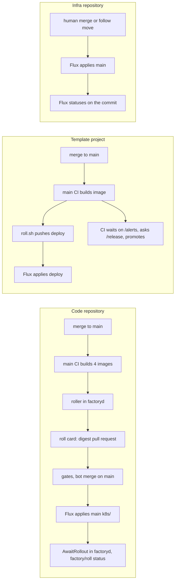
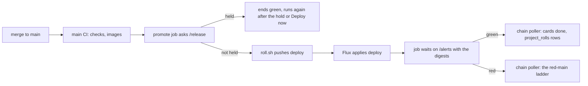
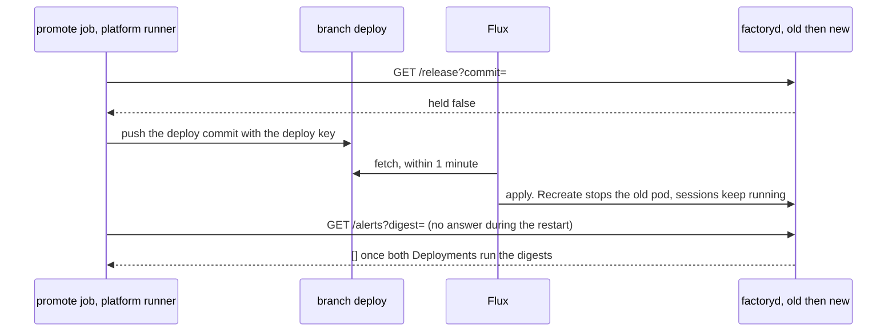

# The Factory's Own Repository Is a Project Like Any: Implementation Plan

**Status:** decided, not built. It waits for Sebastian's go.

> **For agentic workers:** REQUIRED SUB-SKILL: Use superpowers:subagent-driven-development (recommended) or superpowers:executing-plans to implement this plan task-by-task. Steps use checkbox (`- [ ]`) syntax for tracking.

**Goal:** The factory's code repository deploys itself and heals a red main through the same primitives as every other project, and the second deploy engine, the second red-main engine and the checks that name the code repository go.

**Architecture:** The code repository's main CI writes its live state onto a branch `deploy` with a deploy key, as a template project's CI does, and Flux applies that branch instead of `main`. The chain poller runs the red-main ladder that `mainfix.go` runs today for one repository, for every project. Then the roller, the roll task, the roll watcher, the Flux switch and the own-repository branches of the release keeper and the metrics are deleted, and four smaller pieces that hold the code repository by name or by layout follow: the bump pass's file list, the unused companions, one table for the factory's pull-request sources, and the host and namespace literals. The shared deploy contract names no stack: a project's CI writes its live state to its `deploy` branch and Flux applies it. Nothing in it names Go, a Dockerfile layout or the ts-go template's jobs.

**Tech Stack:** Go (factoryd, console, policy), Postgres, Temporal, Forgejo Actions YAML and shell, Flux, YAML config.

**Spec:** None. The evidence in "The situation today" stands in for it.

All `file:line` references are at code main `c2dddcd67` and infra `origin/main` `e4d10c6`. A path under `factory/`, `clusters/` or `scripts/` without a repository named is in the infra repository. Every other path is in the code repository unless it says otherwise.

## The situation today

### The pieces this plan needs

- A **card** is a task row with an issue on Forgejo. An agent card runs in a Temporal **task workflow** that walks the **stages** of its project's **process file**: screening, checks, policy, migration, reproduction, review, audit, approval and merge. A human card asks a human one question.
- The **merge rule** says who approves a merge: `auto` lets the gate bot approve what the gates passed, `human` needs a human. The code project sets `merge_rule: auto` and `autonomy: autonomous`, which the console shows as full auto (`factory/projects/ai-software-factory-code.yaml:9`, `:43`).
- A **roll** is today's word for the factory deploying its own code: a card of source `roll` whose one commit bumps the image digests under `k8s/` of the code repository. Only the code repository has rolls.
- A **template project** is a project seeded from `factory/templates/ts-go`. Its main CI deploys it with `.forgejo/roll.sh` onto a branch `deploy` that Flux tracks.
- The **chain block** is a project file's `chain:` entry. It tells the **chain poller** (`internal/factoryd/chainpoll.go`) how to judge main's head: every push run of the head must be green, and so must each commit status context listed under `requires`. A merged card ends done only when a green head carries its commit. The code project sets `chain: {requires: [factory/roll], stall: 24h, test_context: "ci / test (push)"}` (`factory/projects/ai-software-factory-code.yaml:46`).
- A **red main** is a head of main whose push run or required status failed.
- The **production hold** keeps main out of production while a plan's group of cards is open on main. The **release keeper** (`internal/factoryd/releasekeeper.go`) keeps the hold's clock, asks a human after 6 hours (`releasekeeper.go:21`), and offers **Deploy now**, which releases main's newest commit (`releasekeeper.go:513-547`). A template project's CI asks `GET /projects/{name}/release?commit=` before it promotes (`internal/factoryd/releaseapi.go:28-79`).

### How the code repository deploys: the roll task

1. Main CI (`.forgejo/workflows/ci.yml`) builds and signs four images: `factory-gateway` (factoryd and the gateway both run it), `opencode-worker`, `sandbox-base` and `ci-runner`. Flux's GitRepository `factory-code` tracks the code repository's `main`, and the Kustomization `flux-system/factory` applies `./k8s` with the kustomize-controller's own service account (`clusters/sf/factory.yaml`). Whatever `main` pins under `k8s/` runs.
2. The **roller** reads main's push runs every 15 seconds (`cmd/factoryd/main.go:506-509`, `internal/factoryd/rolltask.go:482-547`). For a run whose three image jobs are green (`rolltask.go:883-901`), it compares each image's linux/amd64 manifest with the one `k8s/` pins (`rolltask.go:1276-1347`), refuses an image that main CI's cosign key did not sign, and files a card of source `roll` (`rolltask.go:1099-1183`). The five targets, their manifest files and their Deployments are a Go list, `RollTargets` (`roll.go:30-40`).
3. The roll card writes one commit on the bot's fork that bumps the digests and `FACTORY_COMMIT` (`RollCommit`, `rolltask.go:1586`), opens a pull request, and runs the task workflow. Go changes the process for it in 12 places (`workflow_stages.go:289`, `:305`, `:448`, `:643`, `:923`, `workflow.go:1593`, `:2715`, `:2729`, `:3261`, `:3281`, `:5055`, `queue.go:411`). The policy gate checks that the roll touches only `k8s/` (`gates.go:279-287`, computed for every pull request at `gates.go:622`), the review makes no model call (`gates.go:2102-2107`), and the gate supervisor sends a roll's gate trip to a human (`gatesupervisor.go:160-165`). At full auto the gate bot merges the roll, because `mechanicalSource` lets `AutoMerge` ignore class and review (`intake.go:1311-1313`, `gates.go:279`). Below full auto a human approves each roll card.
4. A newer green commit folds into the open roll. A failed roll is tried again up to 3 times, 10 minutes apart (`rolltask.go:925-930`). Then the roller files a human card of source `roll-failed` (`rolltask.go:942-981`).
5. After the merge, Flux applies `main` and factoryd restarts. Its Deployment uses the Recreate strategy (`k8s/factoryd.yaml:571`). The workflow's last wait, `AwaitRollout` (`rolltask.go:2047`, called from `finish` at `workflow.go:5055-5057`), runs in the new factoryd and ends the card done when every changed image runs.
6. The roller posts the commit status `factory/roll` (`rolltask.go:909-921`) on each commit. The chain block requires it, so a merged card ends done only once its change runs.
7. While a plan is open on main, only Deploy now's commit rolls (`markHeld`, `rolltask.go:713`). The roller also suspends the Kustomization `flux-system/factory`, so that a `k8s/` change in a merged plan card does not go live at its merge (`setFlux`, `rolltask.go:756-787`). factoryd holds a Role to patch that Kustomization (`k8s/factoryd.yaml:231-258`).
8. A separate **roll watcher** (`roll.go:144-387`) writes one `rolls` row per image with its push, apply and live times, and emits `factory.roll.duration`, `.apply` and `.ready`.

Sessions survive the restart. A session's pod keeps running, and the new factoryd reattaches it from its `live_sessions` row (`runner.go:833`). The roll once waited for a gap between sessions. That hold and its table are gone (migration `20261120110000_drop_roll_holds.sql`).

### How a template project deploys

The template's main CI (`factory/templates/ts-go/.forgejo/workflows/ci.yml`) builds the image by digest. Its `staging` job runs `bash .forgejo/roll.sh staging <digest>` (`ci.yml:101-116`). `roll.sh` copies `deploy/staging` and `deploy/base` of the built commit onto the branch `deploy`, sets the digest, and pushes over SSH with the project's deploy key, with the host key pinned (`roll.sh:22-48`, `:49-83`). Only the deploy key may push `deploy`, and Flux tracks `deploy`. A run that main has moved past leaves the roll to the newer run (`roll.sh:51-54`). A roll that changes nothing pushes nothing (`roll.sh:79`).

The job then polls `GET /projects/{name}/alerts?namespace=&digest=&commit=` until every Deployment of the namespace runs the digest and is rolled out (`ci.yml:117-142`, `internal/factoryd/projectalerts.go:88-150`, `:162-209`). That confirmation writes one `project_rolls` row (`projectalerts.go:216-225`), which the metrics page reads as deploys and lead time (`metrics.go:995-1015`). The `promote` job asks `/release`. When production is not held, it waits 15 minutes on staging, checks for alerts, and rolls prod the same way (`ci.yml:165-223`). When production is held, it ends green, and the release keeper runs it again once the hold ends or Deploy now is pressed (`releasekeeper.go:442-487`).

Registration keeps the deploy key, the `deploy` branch's protection and the Actions secrets `DEPLOY_KEY`, `FACTORY_READ_TOKEN` and `FACTORY_SSH_HOST_KEY` for every factory project (`register.go:576`, `:592-603`, `:811-876`, `:994-1020`).

No template project is registered today. Infra commit `0333d6f` (2026-10-15) removed the eleven toy projects, and the projects directory holds only the code project and the infra project. So this path was proven live on `scratch12` and `linkshort` in Stage 12 and has not run since.

### How the infra repository deploys

Flux's own GitRepository tracks infra's `main` (`clusters/sf/flux-system/gotk-sync.yaml:11`). A change lands by a human's merge (`merge_rule: human`) or by the follow routine, which moves the pins of the project file's `parts:` and merges a move itself where the part's lane is `alone` (`followmove.go:276`). Flux posts its commit statuses on the commit it applied, and the infra project's chain block requires them: `chain: {requires: [flux/flux-system, flux/platform]}`.

### The three deploy paths side by side

| | Code repository: the roll task | Template project: `roll.sh` | Infra repository: Flux on main |
|---|---|---|---|
| Writes the live state | factoryd, a pull request on `main` that bumps the pins under `k8s/` | main CI, a commit on `deploy` by the deploy key | a human's merge, or the follow routine's merge of a pin move |
| Flux tracks | `main`, path `./k8s` | `deploy` | `main` |
| A card per deploy | yes, source `roll`, through the task workflow | no | no for a human's merge, a move workflow for a follow move |
| While a plan is open on main | the roller holds the roll and suspends Flux | the promote job asks `/release` and ends green | no hold |
| Rollout confirmed by | `AwaitRollout` inside factoryd | the CI job's wait on `/alerts?digest=` | Flux's commit statuses |
| Record | a `rolls` row per image, a `roll_requests` row, the card | a `project_rolls` row | Flux's statuses, the move's events |
| Chain block | `requires: [factory/roll]` | none needed | `requires: [flux/flux-system, flux/platform]` |
| Code that serves only it | 2,578 non-test lines (`rolltask.go` 2,148, `roll.go` 387, `rollwait.go` 43) | the template's `ci.yml` and `roll.sh` | none: the follow routine reads `parts:` |

### How a red main is handled: two engines

The code repository's red main goes to `mainfix.go`, which runs inside the roller's poll (`rolltask.go:630`). Every other project's red main goes to the chain poller, which skips the code repository by name: `fileRepair` returns at once for `p.Own` (`chainpoll.go:1705-1708`), with the comment "mainfix owns a red push run there and the roll task a red roll".

| | `mainfix.go`, on the roller's poll | The chain poller |
|---|---|---|
| Serves | the code repository only (`cmd/factoryd/main.go:506`) | every project with a chain block, the code repository's red head skipped |
| Trigger | main's newest push run failed or was cancelled, or a run is blocked behind a red job for 5 minutes (`mainfix.go:168-226`, `:313-338`) | the head's verdict is failure: a red run or a red required status (`chainpoll.go:1462-1464`) |
| Merge queue | paused through `queue_pauses` (`mainfix.go:353-366`), which `queue.go:195-205` reads for every project | not paused |
| Re-run | each failed job once (`mainfix.go:379-389`) | none on red. On a stall past the bound: the stuck runs once (`chainpoll.go:1506-1545`) |
| Card | a fix-forward agent card of source `mainfix` with the failed jobs' last log lines, outside the work bound (`tracks.go:64-68`), or a human re-run card when every failed job lost its runner | one repair card of source `chain-repair`: an agent card, or a human card on a project without agents (`chainpoll.go:1705-1764`) |
| Revert | after 2 hours (`mainfix.go:42`, `:683`) | none |
| Remedy merged and main still red | a human card of source `still-red` (`mainfix.go:243-293`) | the repair card stays |
| Main green again | the pause ends, its cards close, the queue's heads wake (`mainfix.go:193-205`) | the repair card closes (`chainpoll.go:1571-1592`) |
| Size | 894 non-test lines, 1,772 test lines | the repair part of `chainpoll.go`, about 110 lines |

### Other places that name the code repository

- `cmd/factoryd/main.go:330-334` finds the own project by namespace and sets `store.SelfRepository`. `main.go:498-509` binds `CIRuns`, the roll watcher and the roller to it alone. `main.go:510` and `main.go:1287-1291` give the chain poller `Own` for the skip above.
- The release keeper keeps the own repository's row whether or not its CI asked `/release` (`releasekeeper.go:112-116`). It returns before it runs a promote job again for the own repository, "Own's roll is the roller's" (`:136`, `:162`). `Hold` answers for the own repository without an ask (`:494`).
- The metrics swap in `metricSelfDeploys` and `metricSelfLeadTime` for the own repository (`metrics.go:1848-1851`). Every project's metrics page also shows the factory's own deploys from the `rolls` table, "self-deploys / week" (`metrics.go:1211`, `:1332-1347`, `:1922`, `internal/console/templates/metrics.html:40`).
- `CIRuns` writes `ci_runs` for the own repository alone (`main.go:498`). The CI-time panel reads `ci_runs` for every project (`metrics.go:1461-1462`), so every other project's panel stays empty.
- The SigNoz intake reads `RollTargets` to find the factory's Deployments for its restart window (`signozwebhook.go:1026-1045`).
- The source `roll` is tested by name in `revert.go:282`, `tracks.go:58`, `intake.go:1312`, `activities.go:2434`, `internal/console/actions.go:3378` and `internal/console/opened.go:398`.

### The bump pass

The routine `weekly-bump` runs `pass: bump` (`factory/projects/ai-software-factory-code.yaml:23-34`). The pass reads the files of `bump.Files` from main and fails on the first one missing (`internal/factoryd/bumppass.go:34-38`). That list is the code repository's layout: `upstream-images.txt`, `upstream-files.txt`, three Dockerfiles, `go.mod`, `go.sum`, `factory/images.yaml` and the plugin's two package files (`internal/bump/bump.go:20-21`). The check accepts `pass: bump` on any project with agents (`internal/policy/project.go:833-847`, `internal/policy/routine.go:143-145`). So a ts-go project file with a bump routine passes `factoryd config check` and fails every Monday.

### Companions

A project file may list `companions`: repositories the project reads beside its own (`internal/policy/project.go:339-343`, `:456-465`). A plan's filing stamps each companion's default-branch head on its cards (`plan.go:2836-2857`, `:3152-3171`). Each gate pass of every card reads the stamped pins live (`workflow_stages.go:784-791`, `gates.go:904-935`), the chain poller wakes held cards whose pins read met (`chainpoll.go:692`, `:706-745`), and a sandbox may clone a companion read-only (`runner.go:617-627`, `:3033-3042`, `cmd/agent-worker/main.go:780-785`). Seven commits on 2026-11-01, `852fabe49` to `b0e8e3a4d`, added 1,297 lines with tests. No project file sets `companions` at any commit (`git log -S'companions:' origin/main -- factory/projects` is empty). The pin is the head at the filing, and the gate is met while the companion's branch still holds that commit (`gates.go:904-910`). On a branch that only moves forward, the gate cannot fail.

### Two merge paths and two source lists

`LandPullRequest` merges a pull request that factoryd wrote, as the bot, after its checks and outside the task workflow (`land.go:22-29`). Its three callers all target the infra repository: the schema copy (`schemasync.go:166-182`), a follow move (`followmove.go:276`) and a follow retry (`followfail.go:177`). The roll, the revert, the template update and a schema copy that did not land run as cards through the task workflow.

Two lists name factoryd's pull requests. `factoryPRSources` says factoryd opened the pull request: GitHub sync, schema copy, template update, revert and follow (`intake.go:1303-1305`). `mechanicalSource` says factoryd wrote every line: roll, revert, schema copy and template update (`intake.go:1311-1313`). These are two facts. A GitHub sync is opened by factoryd but written by humans on GitHub. They live in two hand lists that a new source must update in step.

### Host and namespace in Go

- `internal/follow/follow.go:295` tests for the literal `git.aisoftwarefactory.world/sf/`.
- `pins.go:31` builds `StoreGeneric` on the same host. `buildvm.go:188` and `imagegen.go:41` read it through `StoreURL`.
- `imager.go:167` names the organisation `sf/` for every sandbox image.
- `ci.go:71-73` defaults `RegistryHost` to the host, while `cmd/factoryd/secrets.go:72-89` already holds the one default table for every endpoint.
- `runner.go:3308` (the sandbox's egress to the gateway) and `incidents.go:31-34` name the namespace `factory`. `cmd/factoryd/register.go:136` reads it from `FACTORY_NAMESPACE`, and `main.go:330` reads the pod's own namespace from `kube.Namespace()` (`runner.go:3619-3625`).
- `kube.go:1276-1279` defaults the jobs listing to `platform`, `factory` and `forgejo`, which the two project files already list.

### Template update ownership

`templateupdate.go:70-90` decides in Go which template paths factoryd owns: `.forgejo/` always, `deploy/smoke.sh` when main lacks it, `deploy/` when main has none.

## Why this is drift

**Tenet 1, no hardcoded special exceptions.** The code repository is found by namespace and then served by its own deploy engine, its own red-main engine, its own release-keeper branches and its own metrics. Every other project gets the general primitives. The process file of the code project says nothing of this: 12 Go branches rewrite its stages for a roll.

**Tenet 5, one way only.** The factory has two deploy implementations, two red-main implementations and three re-run rules (the roll's 3 attempts, mainfix's one re-run per failed job, the chain poller's one re-run per stalled head). The evidence:

- 3,472 non-test lines serve one repository: `rolltask.go` 2,148, `roll.go` 387, `rollwait.go` 43, `mainfix.go` 894. 8,948 test lines serve them: `rolltask_test.go` 3,508, `mainfix_test.go` 1,772, `rollhold_test.go` 1,001, `workflow_roll_test.go` 769, `roll_test.go` 579, `rolltask_store_test.go` 431, `rolltask_retry_store_test.go` 419, `rolltask_retry_test.go` 305, `rollbranch_forgejo_test.go` 164.
- The special path grew in the six weeks from 2026-10-28 to 2026-11-26. `rolltask.go` went from 1,455 to 2,148 lines over 78 commits. `mainfix.go` went from 372 to 894 lines over 40 commits. The release keeper was written in the window (`0f365684d`, 2026-10-30) with an own-repository branch from its first commit.
- Faults the special path caused: `38d52bc3f` (2026-11-26) closed failed roll cards that never retired, after three failed rolls asked "Try the roll again?" and waited 1 h 58 min. `841aaeb65` (2026-11-26) made a failed close of a red-main pause card try again. `docs/architecture.md` records that on 2026-11-26 a roll card waited ten hours with green checks, because a price read that it did not need failed. A roll rides the task workflow, so every gate's fault reaches the deploy.
- Human minutes: `docs/manual/operations.md:589-621` asks a human to scale factoryd to 0 before a hand suspend of a Kustomization, because the roller resets the suspend every 15 seconds. When factoryd is down during a hold, a manifest fix needs a hand `flux resume`.
- The general path has no user. Since `0333d6f` (2026-10-15) no template project is registered, so the path every project takes is the one no live run exercises.

The smaller pieces show the same drift. `pass: bump` looks general and fits one layout. Companions are 1,297 lines that no configuration switches on. Seven Go sites name the reference host or namespace, so a re-seed on another host needs a code change.

## The trade-off

**What the change costs and risks.**

- The code repository becomes the first live user of the deploy-branch path since 2026-10-15. The cutover therefore keeps the roll task running until the deploy branch carries production, and each step checks the live state before the next (Tasks 7 to 13).
- The cutover needs four infra commits by hand (Tasks 6, 8, 12 and the infra half of Task 16). Task 8 must land during one CI run, so Sebastian is at the keyboard for it.
- Lost: the per-deploy card and pull request, the push-to-apply split of `factory.roll.*`, the `rolls` history table (saved before the drop), the "self-deploys / week" line on other projects' pages, the per-deploy approval below full auto.
- The images lose buildx's provenance attestation, so that an unchanged build keeps its digest (Task 7). No code reads the attestation (`git grep -i attestation` finds no reader).

**What it buys.**

- About 3,300 non-test and 8,050 test lines go, about 2,900 and 7,300 net of what the tasks add (estimate, table below).
- factoryd loses its patch right on the Kustomization that deploys it (`k8s/factoryd.yaml:231-258`).
- The waiter moves out of factoryd. Today `AwaitRollout` dies with the factoryd it restarts and resumes in the next one. The CI job keeps polling through the restart.
- A broken factoryd no longer blocks the next deploy. Main CI writes `deploy` on the platform's runner, so a human's revert on main reaches production with no factoryd step except the `/release` ask. Today the revert needs a working roller or a hand edit of `main`'s pins.
- Every project gets the queue pause, the re-run of failed jobs, the fix card's log lines and the revert.
- The Flux paragraph of the operations manual goes.

**Alternatives considered.**

- **A process file `roll.yaml` for the roll task** (the workflow review's proposal). It removes about 30 lines of stage branches. It keeps 2,500 lines of roll machinery, the Flux switch and two deploy paths. It loses.
- **Template projects deploy through a roll task too.** One path, but factoryd writes every project's deploy commit, every deploy waits on factoryd, and a broken factoryd stops every project's deploy. It loses.
- **Flux image automation** (ImagePolicy and ImageUpdateAutomation write digests to Git). It is Flux's own tool, but it resolves tags from the registry, which brings back the tag substitution the roll's signature check guards against. It needs two more controllers, and `:<sha7>` tags have no order it can sort. It loses.
- **Main CI writes `deploy`, as the template does.** Chosen.

**What stays as it is, and why.**

- The release keeper's hold, `/release` and Deploy now are general and the right shape. Only their own-repository branches go.
- The chain poller's verdict and stall ladder are the right shape.
- `mainfix.go`'s ladder is the right shape with the wrong owner. It moves as it is. Its rule for a run blocked behind a red job (`stalledMain`) and the chain poller's stall rule answer two different states, so both stay.
- `queue_pauses` is already keyed by project and read for every project.
- `OwnProject` (`main.go:330`) stays for the roles only the factory's own repository can hold: the source of the schema copy (`main.go:343`), the builder of project images (`main.go:393`), the dependency probe (`main.go:527`) and the console's factory-level writers (`main.go:915-947`).
- `LandPullRequest` stays. Its three callers target the infra repository, which runs no agent card (`agents: none`). Moving them into the task workflow would put an agents-none repository through a workflow built around a session, against infra's `merge_rule: human`.
- The template update's ownership rule stays in Go. One template exists, with three rules and one reader. A template manifest would add a schema and a loader for one set of values.
- The infra repository's deploy stays. Flux on main with Flux's statuses on the chain is general, and the follow routine reads `parts:`.

## The proposal

### The target shape

Every project that deploys does so the same way, and the contract names no stack. Main CI builds, asks `/release`, writes its live state onto `deploy` with the deploy key, and waits on `/alerts` until the namespace runs the digests. Flux applies `deploy`. The chain poller judges main's head for every project. On a red head it runs one ladder: pause the merge queue, re-run each failed job once, file one fix card, revert the red commit after 2 hours, and ask a human when a remedy merged and main stays red. factoryd writes no deploy commit and keeps no deploy state of its own.

### What carries each thing the roll task does

| The roll task does | Carried by | New piece |
|---|---|---|
| Writes the digests onto the branch Flux reads, as a pull request on `main` (`RollCommit`) | the promote job of main CI writes `deploy` with `.forgejo/roll.sh` | the code repository's own `roll.sh` and `pins.sh` (Task 7), about 90 shell lines |
| A human approves each deploy below full auto (the roll card's approval) | the merge rule gates the change. The plan hold with Deploy now gates production through `/release` | none |
| Deploy now while a plan is open (`markHeld`) | `/release` answers held, the promote job ends green, and the release keeper runs `promote` again after the hold or Deploy now (`releasekeeper.go:442-487`) | the own-repository branches of the release keeper go (Task 10) |
| Keeps a merged plan card's `k8s/` change out of production (`setFlux`) | Flux reads `deploy`, which only the promote job writes, after `/release` | none. The suspend and its Role go |
| Waits for a session gap | gone since `20261120110000_drop_roll_holds.sql` | none |
| Confirms the rollout (`AwaitRollout`) | the promote job's wait on `/alerts?digest=` | `/alerts` takes several digests and finds a digest in an env value (Task 3) |
| One `rolls` row per image | one `project_rolls` row per digest | the metrics count deploys by commit (Task 3) |
| The `factory/roll` status on the chain | the push run itself, since the promote job is a job of the run | the chain block drops `requires` (Task 12) |
| Retries a failed roll 3 times, then a human card | the red-main ladder: one re-run of the failed job, the fix card, the revert | the ladder for every project (Task 1) |
| Reverts a red main | the same ladder | Task 1 |
| Skips a commit that changed no image | reproducible digests and `roll.sh`'s "already runs" | `--provenance=false` on the four builds (Task 7) |
| Folds newer commits into one open roll | `roll.sh`'s supersede check (`roll.sh:51-54`) and main CI's `concurrency: ci-main` | none |
| Refuses an unsigned image | the promote job verifies each digest against main CI's cosign key before its push | about 4 shell lines in the promote job (Task 7) |
| Sets `FACTORY_COMMIT` | `pins.sh` sets it when a digest moved | Task 7 |
| Each card tracks its own deploy | the chain poller's carried rows (`chainpoll.go:1140-1187`) | none |
| The deploy key, `FACTORY_READ_TOKEN`, `FACTORY_SSH_HOST_KEY` | registration, for factory projects | the reconcile keeps the read token for every project (Task 4), the seed keeps the rest for the code repository (Task 6) |

### How factoryd restarts itself from its own deploy branch

- **The writer is outside factoryd.** The promote job runs on the platform's runner (`runs-on: ubuntu-latest`, served by the `forgejo-runner` HelmRelease in `k8s/platform/forgejo/runner-helmrelease.yaml`), never on a runner that factoryd's CI spawner starts. So a factoryd that does not start cannot stop the deploy of its own fix.
- **The restart is today's.** Flux fetches within a minute (`clusters/sf/factory.yaml`, `interval: 1m`). The Recreate strategy stops the old pod first, with 150 seconds of grace in which running sessions push their work (`k8s/factoryd.yaml:571-587`). The sessions' pods keep running, and the new factoryd reattaches them. Temporal workflows resume on the new code.
- **The wait polls through the gap.** A refused connection or a 502 keeps the loop polling until its 10-minute deadline, as the template's loop does (`ci.yml:124-141`). The measured rolls took 61 to 161 seconds from push to ready (`docs/architecture.md` section 7, "Roll-to-live").
- **A broken new factoryd.** The wait goes red after 10 minutes, and the cluster collector's rule `roll-not-live-factoryd` fires (`k8s/alerts/roll-not-live-factoryd.json`). A human reverts on main, and CI deploys the revert. Today the same broken roll needs a human too.
- **One writer of the live state at each moment.** Task 7 writes `deploy` while Flux still reads `main`. Task 8 moves Flux to `deploy` during that first run. Task 9 deletes the roller once Flux reads `deploy`. Task 13 deletes the roll workflow once no roll card is open.

### The red-main ladder for every project

`mainfix.go`'s methods move from `Roller` to `ChainPoller` with their behaviour unchanged. The chain poller already reads each project's main runs (`chainpoll.go:1051-1066`). It calls the ladder from `watch` on every verdict, where it calls `repair` today. The trigger becomes the chain's verdict, so a red required status with green runs (infra's Flux statuses) files a card at once with no re-run. The repair card and the fix-forward card become one card of source `mainfix`: an agent card where the project has agents, a human card (`RepairQuestion`) where it has none. It carries the failed jobs' log lines and the cards whose change the head carried. `SourceChainRepair` goes. On a project with `agents: none`, such as infra, each rung files a human card and the revert is a pull request that a human merges or closes. The ladder names no language, Dockerfile layout or CI job: it reads the chain's verdict and the failed jobs' names. A project that deploys nothing has no deploy and no red-main ladder beyond its checks.

### The bump routine names its files

A pull-request routine of `pass: bump` lists the files it reads and writes under `paths:`. The pass reads exactly those. `bump.Files` goes. Go keeps its per-format rewriters and applies each to the listed files of its format. The check refuses a bump routine whose `paths` lack `upstream-images.txt` or `upstream-files.txt`, the lists the pass moves. The code project's file names its ten paths. The brief `factory/routines/weekly-bump.md` keeps its text, since it describes this project's layout.

### Companions go

The feature is deleted. No project file sets it and the factory is the only project today. The workflow's call of `GateCompanion` sits behind a new change id, `companions-gone`, because every card's gate pass schedules it today.

### Smaller pieces

- **One table of factory sources.** `factoryPRSources` and `mechanicalSource` read one map from source to "factoryd wrote every line". The values stay as today's lists minus the roll.
- **Host and namespace from one place.** Every Go literal reads `REGISTRY_HOST` through `daemonURLs` or the pod's namespace through `kube.Namespace()`. The sandbox images' organisation is the own repository's owner. `FACTORY_NAMESPACE` and the duplicate default in `ci.go` go.
- **CI times for every project.** `CIRuns` polls every active project's main runs with that project's actions token.

### Deletions and additions

| Piece | Non-test lines removed | Lines added | Test lines removed | Test lines added |
|---|---|---|---|---|
| The ladder in the chain poller (Tasks 1, 2) | about 110 | about 60 | none, `mainfix_test.go` is adapted | about 200 |
| The deploy contract for the code repository (Tasks 3 to 5) | none | about 70 Go, 8 YAML | none | about 150 |
| Main CI writes `deploy` (Task 7) | none | about 60 YAML, 90 shell | none | about 80 |
| The roller, the roll watcher, the Flux switch (Task 9) | about 1,600 (inferred split of `rolltask.go` and `roll.go`) | about 20 | about 4,800 | about 40 |
| Release keeper, metrics, CI times (Tasks 10, 11) | about 70 | about 30 | about 150 | about 100 |
| The roll task's workflow path (Task 13) | about 900 | about 10 (migration) | about 2,400 | about 40 |
| One table of factory sources (Task 14) | about 10 | about 10 | none | about 10 |
| Bump paths (Task 16) | about 5 | about 30 Go, 12 YAML | none | about 40 |
| Companions (Task 17) | about 600 (estimate from the commit stats) | about 15 | about 700 | about 30 |
| Host and namespace (Task 18) | about 10 | about 15 | none | about 30 |
| **Total** | **about 3,300** | **about 430** | **about 8,050** | **about 720** |

Net: about −2,900 non-test lines and −7,300 test lines. The sizes are inferred from the files' lengths and the functions each task moves or deletes.

## Decisions

1. **The shared deploy contract is stack-free.** Not every project is Go or has the same CI. A project's CI writes its live state to its `deploy` branch and Flux applies it. Nothing in the contract names Go, a Dockerfile layout or the ts-go template's jobs. A project that deploys nothing has no deploy and no red-main ladder beyond its checks. The code repository's own `roll.sh`, `pins.sh` and image list (Task 7) are its own files, not part of the contract.
2. **The per-deploy roll card goes.** The merge rule gates the change, and the plan hold with Deploy now gates production, at every autonomy level, as for any project. No card asks for each deploy. At today's full auto this changes nothing.
3. **A factoryd that does not answer `/release`.** Default: the code repository's promote job asks `/release` for 5 minutes. With no answer it goes ahead and writes "factoryd did not answer for 5 minutes, so no hold is in force" in the job's log. A 400 or a 401 is an answer and stops the deploy. A 200 with `held: true` holds. The reason: a silent factoryd is most often the factoryd that the next deploy must fix, and the hold has no keeper while it is down. Veto line: fail closed as a template project does (`ci.yml:182-186`).
4. **The roller goes with its check.** The promote job verifies each digest against main CI's cosign key with `cosign verify --key k8s/cosign.pub` before its push, about 4 lines, so no unsigned image goes live. Main CI's signing step stays. Security has no half measures.
5. **One red-main ladder for every project, infra included.** Template projects and the infra repository get the queue pause, one re-run of each failed job, the fix card with log lines, and a revert pull request after 2 hours. On infra (`agents: none`, `merge_rule: human`) each rung files a human card, and the revert is a pull request that a human merges or closes.
6. **Companions are deleted.** The factory is the only project today, no project file sets `companions`, and dev mode keeps no backward compatibility. This removes about 600 non-test and 700 test lines and adds one change id, `companions-gone`, whose old branch stays until the drain that the plan "Collapse the workflow's history" builds. The docs clone (`chat.doc_repo`) shows the pattern if a read-only clone is needed later.

## Global Constraints

- Code work runs in a git worktree off `origin/main` of `~/repos/ai-software-factory-code`. One pull request per task group, from `controller/ai-software-factory-code`, merged as `sebastian` after green CI and an independent review on the most capable model.
- The task groups are: A (Tasks 1, 2), B (Tasks 3 to 5), C (Task 7), D (Tasks 9 to 11), E (Tasks 13 to 15), F (Task 16), G (Task 17), H (Task 18). Tasks 6, 8 and 12 and the infra half of Task 16 are infra commits that Sebastian makes. The infra repository's changes stay human commits.
- Group A starts after the open-faults plan's pull request merged, since it changes `mainfix.go:535-545` and `templateupdate.go`.
- `bash check changed` passes before each commit. Go tests run with `go test -race`. Postgres-backed tests run through `scripts/pg-test.sh`.
- A change to workflow code needs a `workflow.GetVersion` change id and a replay test. Task 13 deletes only branches that a roll workflow takes, so it needs no change id. It proves this by replaying the corpus without the roll history and by a store query that finds no open roll card. Task 17 adds the change id `companions-gone`. Task 13 deletes the change id `roll-nothing` with the path it guards, and the plan "Collapse the workflow's history" drops it from its list.
- Until Task 8, a change reaches production only through a roll card. From Task 8 on, it reaches production only through main CI's promote job. Either way this plan's changes go live only with Sebastian's go.
- No task id in a text a human reads. A human is a human, never a member or an operator.
- No comments that narrate the change. Tests state hand-derived expectations.
- Human-read product copy that a task changes must pass the writing guide in `internal/writingguide`.

## Review Focus

1. **The ladder must act once per red head, however often the poller ticks.** The chain poller ticks every 15 seconds and on each webhook nudge. Task 1's `TestChainPollerRerunsEachFailedJobOnce` runs three ticks and two nudges on one red head and expects one re-run call per failed job and one card.
2. **A red required status with green runs must still file a card.** Infra's chain is red through Flux's statuses while its runs are green, and `mainState` read only runs. Task 1's `TestChainPollerFilesAHumanCardOnARedRequiredStatus` pins one human card at the first tick and no re-run call.
3. **The rollout wait must not confirm before an env-only change is applied.** When only the worker image moves, the gateway digest is unchanged and the old ReplicaSet reads rolled out. Task 3's `TestAlertsWaitForADigestInAnEnvValue` pins `rollout_not_ready` until factoryd's env carries the new worker digest.
4. **A commit that changes no image must not restart factoryd.** `FACTORY_COMMIT` would otherwise change on every deploy and restart the pod. Task 7's `TestPinsKeepAnUnchangedBuild` pins no file change, and Task 7's live step compares two runs' digests on one commit.
5. **The release keeper must run the code repository's promote job again.** Today it returns early for the own repository. Task 10's `TestKeeperRunsTheOwnPromoteJobAgain` pins one re-run of job `promote` after the hold ends and one after Deploy now.

---

### Task 1: The chain poller runs the red-main ladder for every project

**Files (code repository):**
- Modify: `internal/factoryd/mainfix.go:153-850` (`mainState`, `humanPauseCard`, `stillRed`, `stalledMain`, `pause`, `failedLogs`, `endPauseCard`, `endFixCard`, `endRevertCard`, `closeRevertPR`, `lostRunners`, `revert`, `replaceFix`: receiver `*Roller` becomes `*ChainPoller`, `r.Repo` and `r.Token` become the project's repository and `p.Forgejo.Access(proj).Actions`, the roller's `conflicted` and `stall` fields become maps keyed by repository), `:868-882` (`MainFixCard` takes the carried issues)
- Modify: `internal/factoryd/chainpoll.go:403-435` (`ChainStore` takes the ladder's store methods), `:488-529` (`ChainPoller` gains `Scrub`, loses `Own`), `:1430-1472` (`watch` calls the ladder on every verdict, `case "failure"` keeps the alert), `:1682-1689` (`repair` raises the alert only)
- Delete: `internal/factoryd/chainpoll.go:1705-1791` (`fileRepair`, `RepairCard`, the skip)
- Modify: `internal/factoryd/rolltask.go:630-632` (the roller no longer calls `mainState`), `:436-474` (`RollerStore` loses the ladder's methods)
- Modify: `cmd/factoryd/main.go:510`, `:1287-1291`
- Test: `internal/factoryd/mainfix_test.go`, `internal/factoryd/chainpoll_test.go`

**Interfaces:**
- Consumes: `func (p *ChainPoller) mainRuns(ctx context.Context, proj Project) ([]ActionRun, error)` (oldest first), `func (p *ChainPoller) headVerdict(...) (verdict string, findings []string, stuck []ActionRun, err error)`.
- Produces: `func (p *ChainPoller) mainState(ctx context.Context, proj Project, head ActionRun, verdict string, findings []string, runs []ActionRun) error` (runs newest first), `ChainPoller.Scrub *redact.Scrubber`, `func MainFixCard(index int64, sha, failed, runURL string, since time.Time, carried []int64) (BriefText, Moments)`.

- [ ] **Step 1: Write the failing tests** in `chainpoll_test.go`. `TestChainPollerPausesAndRerunsARedProject`: project `sf/linkshort` with agents, head run red with job `test` failed at attempt 1. After one tick: one `queue_pauses` row for `sf/linkshort` with the run's id, one `RerunActionJob` call for `test`, no card. After a second tick with `test` failed at attempt 2: one card of source `mainfix` whose body holds the job's last log line. `TestChainPollerRerunsEachFailedJobOnce`: three ticks and two `Nudge` calls on one red head with jobs `test` and `image` failed at attempt 1, expected exactly one re-run call each and no card. `TestChainPollerFilesAHumanCardOnARedRequiredStatus`: project with `agents: none` and `requires: [flux/platform]`, runs green, status `flux/platform` failure, expected one human card of source `mainfix` at the first tick and zero re-run calls. `TestChainPollerRevertsAfterTheBound`: a pause since 2 h 1 min with a fix card, expected one card of source `revert`. A second case on a project with `agents: none`: the revert is a pull request and its card is a human card. `TestChainPollerServesTheOwnRepository`: the poller's own repository red, expected a pause and a re-run.
- [ ] **Step 2: Adapt `mainfix_test.go`** so each test builds a `ChainPoller` with the same fakes. Keep every expected value as it is.
- [ ] **Step 3: Run and see the new tests fail.** `go test -race -run 'TestChainPoller(PausesAndReruns|RerunsEachFailedJob|FilesAHumanCard|RevertsAfter|ServesTheOwn)' ./internal/factoryd/`. Expected: FAIL, for example "no queue pause for sf/linkshort".
- [ ] **Step 4: Implement.** Move the methods with the receiver change. In `mainState`, read the head's state from `verdict` (`success`, `failure`, `pending`) instead of the newest run's status, and keep `stalledMain` on the runs. Where the project has no agents, `pause` files `RepairQuestion` as a human card of source `mainfix` instead of the agent card, and `revert` opens a pull request that a human merges or closes. Nothing in the ladder names a language, a Dockerfile layout or a job of the ts-go template.
- [ ] **Step 5: Run and see them pass.** `go test -race ./internal/factoryd/` and `scripts/pg-test.sh ./internal/factoryd/pg/`. Expected: PASS.
- [ ] **Step 6: Commit.** "The chain poller runs the red-main ladder for every project: a red head pauses its merge queue, re-runs each failed job once, files one fix card and reverts after two hours".

### Task 2: One card source for a red main

**Files (code repository):**
- Delete: `internal/factoryd/chainpoll.go:27` (`SourceChainRepair`) and its readers: `release.go:63`, `act.go:1216-1223`, `console_store.go:542`, `pokes.go:603`, `kinds.go:30`, `source_briefs.go:75`, `humanquestion.go:52`, `pg/pg.go`, `internal/facefixtures/fixtures.go:571-573`, `:1662`, `:1705`
- Modify: `internal/factoryd/chainpoll.go:1571-1592` (`settleChainCards` loops over `SourceChainStall` alone, since `endPauseCard` closes the `mainfix` card)
- Test: `internal/factoryd/release_test.go`, `internal/factoryd/kinds_test.go`

**Interfaces:**
- Consumes: Task 1's `mainfix` card for every project.
- Produces: `var fixSources = []string{SourceAlert, SourceMainFix}`.

- [ ] **Step 1: Check the precondition on the live database.** `SELECT id, repository, status FROM tasks WHERE source = 'chain-repair' AND status NOT IN ('done', 'failed', 'closed')`. Expected: 0 rows. A row that stands is closed by a human before this task merges.
- [ ] **Step 2: Write the failing test** `TestAFixOnATemplateProjectAsksAtOnce`: a held template project, a merged card of source `mainfix` since the hold's start, expected `FixesMergedSince` to return that card, so the keeper asks at once.
- [ ] **Step 3: Run and see it pass or fail.** `go test -race -run TestAFixOnATemplateProjectAsksAtOnce ./internal/factoryd/`. It passes already if `fixSources` holds `mainfix`. It pins the behaviour that stays.
- [ ] **Step 4: Implement.** Delete the constant and each reader. `TestEveryCardSourceHasAFace` and the face fixtures lose the `chain-repair` rows.
- [ ] **Step 5: Run.** `go test -race ./internal/factoryd/ ./internal/console/ ./internal/facefixtures/` and `bash check changed`. Expected: PASS.
- [ ] **Step 6: Commit.** "A red main files one kind of card on every project, of source mainfix".
- [ ] **Step 7: Roll group A** with Sebastian's go. Check on the next red head of any project that `queue_pauses` holds its row and that `events` holds one `rerun` per failed job.

### Task 3: The rollout wait confirms every digest of a deploy

**Files (code repository):**
- Modify: `internal/factoryd/projectalerts.go:88-150` (the handler reads every `digest` parameter), `:162-209` (`namespaceAlerts` takes the list), `:216-225` (one row per digest)
- Modify: `internal/factoryd/kube.go:1627-1636` (`DeploymentState.Env`), `:1660-1700` (`Deployments` fills it)
- Modify: `internal/factoryd/metrics.go:995-1015` (deploys and lead time per commit)
- Test: `internal/factoryd/projectalerts_test.go`, `internal/factoryd/metrics_test.go`, `internal/factoryd/pg/`

**Interfaces:**
- Produces: `func namespaceAlerts(ctx context.Context, alerts AlertRowReader, deploys DeploymentLister, ns string, digests []string) (list []ProjectAlert, confirmed bool, err error)`, `DeploymentState.Env []string` (the pod template's env values in spec order).
- Rule: with digests D, a namespace lags when it holds no Deployment, when a Deployment's container image ends in no digest of D, when a digest of D is carried by no Deployment as an image or an env value, or when a Deployment that carries one is not rolled out. With one digest this is today's rule.

- [ ] **Step 1: Write the failing tests.** `TestAlertsWaitForADigestInAnEnvValue`: namespace `factory` with Deployment `factoryd` (image `…/factory-gateway@sha256:aa…`, env value `…/opencode-worker@sha256:b0…`) and Deployment `factory-gateway` (image `…@sha256:aa…`), both rolled out. Ask digests `sha256:aa…` and `sha256:b1…`. Expected: one `rollout_not_ready` entry whose summary names `factoryd` and `sha256:b1…`, no row recorded. With factoryd's env at `sha256:b1…` and rolled out: expected `[]` and two `project_rolls` rows. `TestDeploysCountCommitsNotDigests`: three rows of commit `c1` and one of commit `c2` in one week, expected deploys 2.
- [ ] **Step 2: Run and see them fail.** `go test -race -run 'TestAlertsWaitForADigestInAnEnvValue' ./internal/factoryd/` and the metrics test through `scripts/pg-test.sh`. Expected: FAIL.
- [ ] **Step 3: Implement.** `metricDeploys` counts `DISTINCT COALESCE(NULLIF(commit, ''), digest)`. `metricLeadTime` takes each commit's latest `ready_at`.
- [ ] **Step 4: Run.** The template tests of `projectalerts_test.go` pass unchanged. Expected: PASS.
- [ ] **Step 5: Commit.** "The rollout wait confirms every digest a deploy pins, in an image or an env value, and the metrics count deploys by commit".

### Task 4: Every project's CI holds a FACTORY_READ_TOKEN

**Files (code repository):**
- Modify: `internal/factoryd/register.go:456-493` (`seed` keeps the read token), `:994-1020` (`readToken` takes the writer of the secret)
- Create: in `internal/factoryd/forgejoproject.go` beside `AdminAddCollaborator` (`:301`), `AdminPutActionSecret` and `AdminActionSecretNames`
- Test: `internal/factoryd/register_test.go`

**Interfaces:**
- Consumes: `func adminAuth(ctx context.Context, openBao SecretReader) (AdminAuth, error)` (`register.go:1572`).
- Produces: `func (f *Forgejo) AdminPutActionSecret(ctx context.Context, a AdminAuth, repo Repo, name, value string) error`, `func (f *Forgejo) AdminActionSecretNames(ctx context.Context, a AdminAuth, repo Repo) ([]string, error)`.

- [ ] **Step 1: Write the failing test** `TestSeedProjectGetsAReadToken`: a seed project whose row has no `ReadTokenHash`. After `Reconcile`, the fake Forgejo received `PUT …/actions/secrets/FACTORY_READ_TOKEN` with the site admin's basic auth, and the row's hash is the sha256 hex of that value. A second `Reconcile` sends no request to Forgejo for the secret and reports `unchanged`.
- [ ] **Step 2: Run and see it fail.** `go test -race -run TestSeedProjectGetsAReadToken ./internal/factoryd/`. Expected: FAIL.
- [ ] **Step 3: Implement.** The seed path reads the admin's login only when the row has no hash, as registration does, and drops it after the call.
- [ ] **Step 4: Run.** `go test -race ./internal/factoryd/`. Expected: PASS.
- [ ] **Step 5: Commit.** "The reconcile keeps FACTORY_READ_TOKEN on every project, a seed project's through the site admin's login".

### Task 5: factoryd admits the platform runner on its API port

**Files (code repository):**
- Modify: `k8s/factoryd.yaml:826-864` (`factoryd-ingress`)

- [ ] **Step 1: Read the runner pods' labels.** `kubectl -n forgejo get pods -l app.kubernetes.io/instance=forgejo-runner --show-labels`. The label selector is inferred from the HelmRelease's name. Use the labels the command shows.
- [ ] **Step 2: Add the rule.** `fromEndpoints` with those labels and `"k8s:io.kubernetes.pod.namespace": forgejo`, to port 8080, with the comment "the code repository's main CI asks /release and /alerts".
- [ ] **Step 3: Commit.** "The platform's CI runner reaches factoryd's API port, so the code repository's main CI can ask for its release and its rollout".
- [ ] **Step 4: Roll group B** with Sebastian's go. Then check from a shell in a runner pod: `curl -s -o /dev/null -w '%{http_code}' http://factoryd.factory.svc.cluster.local:8080/projects/ai-software-factory-code/release?commit=0000000` with no token. Expected: `401`. A timeout means the runner's own egress refuses the call: read the network policies of namespace `forgejo` and extend them in the infra repository first.

### Task 6: The code repository's deploy key and secrets (infra, by hand)

**Files (infra repository):**
- Modify: `scripts/seed-secrets.sh` (beside the cosign secrets at `:261-283`)

- [ ] **Step 1: Write the seed step.** For the code repository: when it has no deploy key titled `factory-roll` or no Actions secret `DEPLOY_KEY`, make an ed25519 pair, add the public half as a write deploy key, and put the private half into `DEPLOY_KEY`. Put Forgejo's SSH host key, as `ssh-keyscan -t ed25519 forgejo-ssh.forgejo.svc.cluster.local` reads it, into `FACTORY_SSH_HOST_KEY` on every run. Follow the rules of `register.go:841-876`.
- [ ] **Step 2: Run the seed step** and check: `GET /repos/sf/ai-software-factory-code/keys` lists one key `factory-roll` that is not read-only. `GET …/actions/secrets` lists `DEPLOY_KEY`, `FACTORY_SSH_HOST_KEY` and, from Task 4, `FACTORY_READ_TOKEN`.
- [ ] **Step 3: Commit** to infra's `main`: "The seed keeps the code repository's deploy key and the Forgejo host key its main CI pins".

### Task 7: Main CI writes the deploy branch

**Files (code repository):**
- Create: `.forgejo/pins.sh`, `.forgejo/roll.sh`
- Modify: `.forgejo/workflows/ci.yml:113-242` (each image job writes its digest as an output and builds with `--provenance=false`), a new job `promote`
- Test: `internal/reproducible/pins_test.go`

**Interfaces:**
- Produces: `bash .forgejo/pins.sh DIR COMMIT NAME=DIGEST...`. For each name, it rewrites the one reference `<host>/<owner>/<name>@sha256:<64 hex>` in each file of DIR that holds one, and refuses a file with two (the rule of `pinnedRef`, `roll.go:44-51`). It sets `FACTORY_COMMIT` to COMMIT only when a digest moved, and prints `moved NAME` for each. `bash .forgejo/roll.sh NAME=DIGEST...` copies `k8s/` of `GITHUB_SHA` onto `deploy`, carries the deploy branch's pins and `FACTORY_COMMIT` into the copy, calls `pins.sh`, and commits "Roll to <sha7>" with main's commit and the four references in the body. It pushes with the deploy key, with the host key pinned and three attempts, as the template's script does (`roll.sh:22-48`, `:81-83`). It writes `superseded=true` to `GITHUB_OUTPUT` when main moved past `GITHUB_SHA`.

- [ ] **Step 1: Write the failing tests** in `internal/reproducible/pins_test.go`, each on a temporary copy of `k8s/`. `TestPinsKeepAnUnchangedBuild`: the four digests the copy pins, expected no file change and no `moved` line. `TestPinsMoveOneImage`: a new `opencode-worker` digest, expected exactly two changed lines, `WORKER_IMAGE`'s value and `FACTORY_COMMIT`, and the output `moved opencode-worker`. `TestPinsRefuseTwoReferences`: a file with two references to `ci-runner`, expected exit 1 and "2 digest-pinned references to ci-runner, want exactly 1".
- [ ] **Step 2: Run and see them fail.** `go test -race -run TestPins ./internal/reproducible/`. Expected: FAIL, no such file `.forgejo/pins.sh`.
- [ ] **Step 3: Write `pins.sh` and `roll.sh`.**
- [ ] **Step 4: Write the job `promote`** in `ci.yml`: `needs: [image, image-sandbox, image-runner]`, `runs-on: ubuntu-latest`, checkout with `fetch-depth: 0`. First it asks `$FACTORY_URL/projects/ai-software-factory-code/release?commit=$GITHUB_SHA` with `FACTORY_READ_TOKEN`, every 10 seconds for up to 5 minutes. With no answer it goes ahead and writes "factoryd did not answer for 5 minutes, so no hold is in force" in the log. A 400 or a 401 stops the job. Held: it ends green. Not held: it verifies each digest as Step 5 says, then runs `bash .forgejo/roll.sh` with the four `name=digest` pairs. Unless superseded, it then waits on `/projects/ai-software-factory-code/alerts?namespace=factory&digest=<each>&commit=$GITHUB_SHA` for 10 minutes, as the template's loop does. The job is named `promote`, the name the release keeper runs again (`releasekeeper.go:49`).
- [ ] **Step 5: Check the signature line.** The promote job runs `cosign verify --key k8s/cosign.pub` on each of the four digests before `roll.sh` pushes, with the cosign binary that the signing step already builds. About 4 lines. A digest that fails stops the job red before any push. Run the line on a digest that main CI did not sign. Expected: the job fails and `deploy` is unchanged.
- [ ] **Step 6: Run.** `go test -race ./internal/reproducible/` and `bash check changed`. Expected: PASS.
- [ ] **Step 7: Commit.** "Main CI pins its images on the branch deploy with the deploy key, after it asks whether production is held and verifies each digest's signature, and waits until factory runs them".
- [ ] **Step 8: Merge with Sebastian at hand for Task 8.** The pull request's own main run is the first. When its `promote` job has pushed `deploy`, Task 8 runs within its 10-minute wait.
- [ ] **Step 9: Check the reproducible digests.** Re-run the image jobs of the same run. Expected: the four digests equal the first run's. If they differ, stop: every deploy would restart factoryd. Find what still varies in the build before Task 9.
- [ ] **Step 10: Check the mirror.** `git ls-remote github deploy` in the code repository shows the same commit as `origin`.

### Task 8: Flux applies the deploy branch (infra, by hand)

**Files (infra repository):**
- Modify: `clusters/sf/factory.yaml` (`ref: {branch: deploy}`)
- Modify: `scripts/setup-factory-merge.sh` (protect `deploy` of the code repository with the settings of `DeployProtection`, `register.go:815-820`)

- [ ] **Step 1: Precondition.** Task 7's first `promote` job has pushed `deploy` and waits.
- [ ] **Step 2: Commit and push** to infra's `main`: "Flux applies the code repository's deploy branch, which only its main CI's deploy key pushes". Run the protection step.
- [ ] **Step 3: Check.** `flux get source git factory-code -n flux-system` shows `deploy@<commit>`. `kubectl -n factory get deploy factoryd -o jsonpath='{.spec.template.spec.containers[0].image}'` equals the deploy branch's pin. The `promote` job ends green. `SELECT digest, commit FROM project_rolls WHERE repository = 'sf/ai-software-factory-code'` shows the run's digests. A push to `deploy` with a human's account is refused.

### Task 9: The roller, the roll watcher and the Flux switch go

**Files (code repository):**
- Delete: in `internal/factoryd/rolltask.go`, the `Roller` and its methods (`:436-1585`), `RetryRoll` (`:1053-1097`), the sources `roll-refused` and `roll-failed` (`:35`, `:40`) and the store methods only the roller calls. Keep `ShortSHA` (`:1895`), `runsPage` (`:570`) and `StandingQuestion` (`:347`) by moving them to the files of their callers.
- Delete: `internal/factoryd/roll.go:144-387` (`RollWatcher`, `Roll`, `RollStore`). Move `Deployment`, `DeploymentReader` and the methods `carries`, `applied` and `live` (`roll.go:53-134`) to `kube.go`, since the gateway and the SigNoz intake read them.
- Delete: `internal/factoryd/kube.go:1344-1362` (`SuspendKustomization`, `fluxNamespace`, `factoryKustomization`), `k8s/factoryd.yaml:231-258` (Role and RoleBinding `factoryd-flux`), the env `COSIGN_PUB` and the configMap `image-signing` (`k8s/factoryd.yaml`, `k8s/kustomization.yaml`), while the file `k8s/cosign.pub` stays for the promote job, `cmd/factoryd/main.go:500-509`, `:1190` (`COSIGN_PUB`)
- Delete: the retry answer of the failed-roll card (`internal/factoryd/chat_escalation.go:325-326`, `faces_copy.go:2334`, `:2390`, `internal/console/actions.go:1617`, `:1746-1748`, `internal/console/console.go:315-318`, `:761-762`), the face fixtures of `roll-refused` and `roll-failed`
- Modify: `internal/factoryd/signozwebhook.go:1026-1045` (the restart window reads the Deployments of its namespace through `Deployments(ctx, ns)`)
- Test: `internal/factoryd/signozwebhook_test.go`

**Interfaces:**
- Consumes: `func (k *InClusterKube) Deployments(ctx context.Context, namespace string) ([]DeploymentState, error)`.
- Keeps: the workflow's roll path, `RollCommit`, `AwaitRollout`, `RollTargets` and `SourceRoll`, until Task 13, so a roll card that is open when this code goes live ends on it.

- [ ] **Step 1: Check the preconditions.** Flux reads `deploy` (Task 8). `SELECT id, source FROM tasks WHERE source IN ('roll-refused', 'roll-failed') AND status NOT IN ('done', 'failed', 'closed')` returns 0 rows, or a human closes the rows first.
- [ ] **Step 2: Write the test that pins what stays** `TestRestartWindowHoldsTheFactorysDeployments`: namespace `factory` with Deployments `factoryd` and `factory-gateway`, an alert `restarts-factoryd` that fires 30 seconds after factoryd's apply. Expected: the alert is held as in a rollout's window. Run it before the change. Expected: PASS.
- [ ] **Step 3: Delete** the pieces above.
- [ ] **Step 4: Run.** `go build ./...`, `go test -race ./...` in the background, then read the verdict line, and `bash check changed`. Expected: PASS.
- [ ] **Step 5: Commit.** "factoryd no longer rolls its own code or suspends Flux: main CI's promote job deploys the code repository as any project's deploys".

### Task 10: The release keeper and the metrics read the own repository like any project

**Files (code repository):**
- Modify: `internal/factoryd/releasekeeper.go:85-127` (`Own` goes, `Pass` keeps the rows that asked), `:128-165` (`keep` returns no earlier for any repository), `:489-512` (`Hold` answers only for a repository that asked)
- Delete: `internal/factoryd/release.go:129-132` and `store.go:787-789` (`ClearDeployNow`, whose one caller was the roller), `store.go:1105-1108` and `cmd/factoryd/main.go:334` (`SelfRepository`), `metrics.go:1211`, `:1332-1347`, `:1848-1851`, `:1922`, `:754` (`SelfDeploys`)
- Modify: `internal/console/templates/metrics.html:13` (the tooltip loses "the factory's own project counts its rolls"), delete `:40` (human-read copy, checked against `internal/writingguide`)
- Modify: `cmd/factoryd/main.go:426`
- Test: `internal/factoryd/releasekeeper_test.go`, `internal/factoryd/metrics_test.go`

**Interfaces:**
- Produces: `type ReleaseKeeper struct { Store ReleaseStore; Forgejo *Forgejo; Timeline *Timeline; Now func() time.Time }`.

- [ ] **Step 1: Write the failing test** `TestKeeperRunsTheOwnPromoteJobAgain`: the code repository's row told held at commit `c1`, no group open on main, the newest push run of `c1` finished with job `promote`. After `Pass`: one `RerunActionJob` call for that job, and `ToldHeld` empty. A second case with a group open and Deploy now at `c1`: one call.
- [ ] **Step 2: Write the test** `TestOwnDeploysReadProjectRolls`: two `project_rolls` rows of the code repository in one week, expected `Deploys` 2 on the code project's report.
- [ ] **Step 3: Run and see them fail.** `go test -race -run TestKeeperRunsTheOwnPromoteJobAgain ./internal/factoryd/` and the metrics test through `scripts/pg-test.sh`. Expected: FAIL, zero calls.
- [ ] **Step 4: Implement** the deletions above.
- [ ] **Step 5: Run.** `go test -race ./internal/factoryd/ ./internal/console/`. Expected: PASS.
- [ ] **Step 6: Commit.** "The release keeper and the metrics treat the factory's own repository as any project: it holds production while it asks, and its deploys are its project_rolls rows".

### Task 11: CI times for every project

**Files (code repository):**
- Modify: `internal/factoryd/cimetrics.go:1-180` (`CIRuns` reads the active projects and keeps its floors by repository), `cmd/factoryd/main.go:498`
- Test: `internal/factoryd/cimetrics_test.go`

**Interfaces:**
- Produces: `type CIRuns struct { Forgejo *Forgejo; Projects ChainProjects; Metrics *telemetry.Metrics; Runs CIRunRecorder }`.

- [ ] **Step 1: Write the failing test** `TestCIRunsRecordEveryProject`: two active projects, each with one finished main run. Expected: two `ci_runs` rows, one per repository, each read with its project's actions token.
- [ ] **Step 2: Run and see it fail.** `go test -race -run TestCIRunsRecordEveryProject ./internal/factoryd/`. Expected: FAIL.
- [ ] **Step 3: Implement.** One poll walks the projects. A project's failed read logs once and the others go on.
- [ ] **Step 4: Run.** `go test -race ./internal/factoryd/`. Expected: PASS.
- [ ] **Step 5: Commit.** "factoryd records the CI runs of every project, so each project's metrics page shows its CI time".
- [ ] **Step 6: Roll group D** with Sebastian's go: the promote job of its merge deploys it. Task 12 follows within the hour.

### Task 12: The code project's chain block drops `factory/roll` (infra, by hand)

**Files (infra repository):**
- Modify: `factory/projects/ai-software-factory-code.yaml:44-46`

- [ ] **Step 1: Read the run time.** `SELECT percentile_cont(0.95) WITHIN GROUP (ORDER BY duration_ms) FROM ci_runs WHERE repository = 'sf/ai-software-factory-code' AND pushed_at > now() - interval '14 days'`.
- [ ] **Step 2: Write the block.** `chain: {stall: <twice the p95, rounded up to the hour>, test_context: "ci / test (push)"}`. Replace the comment above it with one line: the head is green when the run, its deploy job included, is green.
- [ ] **Step 3: Commit and push** to infra's `main`: "The code project's chain is green when its main run, deploy included, is green".
- [ ] **Step 4: Check.** The next merged card of the code project ends done after its run's `promote` job is green, and no head row stays pending on `factory/roll`.

### Task 13: The roll task goes

**Files (code repository):**
- Delete: the rest of `internal/factoryd/rolltask.go` (`RollCommit` and its helpers `:1586-2033`, `AwaitRollout` and `rolloutConfirmed` `:2034-2145`, `SourceRoll`, the roll request states and their store methods), `internal/factoryd/roll.go:20-51` (`RollTarget`, `RollTargets`, `pinnedRef`), `internal/factoryd/rollwait.go:11-16` (`rollPoll` and `rollWaitSlack`, while `Clock` and `pause` stay)
- Modify: the 12 `t.rolling` sites (`workflow_stages.go:289`, `:305`, `:448-452`, `:643-644`, `:923`, `workflow.go:1589-1594`, `:2711-2747`, `:3261-3263`, `:3281-3283`, `:5055-5057`, `queue.go:410-415`), `SignalRollFolded`, the change id `roll-nothing` (`workflow.go:2728`)
- Modify: `gates.go:279-287`, `:622`, `:2102-2107`, `gatesupervisor.go:160-165` and `:209` (`rollChecksLine`), `intake.go:1312`, `tracks.go:58`, `revert.go:282`, `activities.go:2434`, `internal/policy/policy.go:876` (`RollCommit`), `gatewatch.go:91` (`ActivityAwaitRollout`), `internal/console/actions.go:3378`, `internal/console/opened.go:398-402`, `source_briefs.go`, `kinds.go:29`, `faces_copy.go`, `internal/facefixtures/fixtures.go:551`, `:647-649`
- Modify: `internal/console/templates/metrics.html:16` ("chat and roll cards" becomes "chat cards", human-read copy)
- Modify: `k8s/factoryd.yaml` and `k8s/deployment.yaml` on `main`: each pin becomes `sha256:` and 64 zeros, `FACTORY_COMMIT` 40 zeros, as the template's `main` holds (`factory/templates/ts-go/deploy/staging/kustomization.yaml`)
- Create: `internal/schema/migrations/factoryd/<timestamp>_drop_rolls.sql` (`DROP TABLE roll_requests`, `DROP TABLE rolls`)
- Delete: `internal/factoryd/testdata/devserver-roll-commit-failed.json`, its entry in `workflow_removed_changes_test.go:27`, `workflow_roll_test.go`, `rolltask_test.go`, `rolltask_store_test.go`, `rolltask_retry_test.go`, `rolltask_retry_store_test.go`, `rollbranch_forgejo_test.go`, `roll_test.go`, `rollhold_test.go`
- Test: `internal/factoryd/workflow_replay_test.go`, `internal/console/opened_test.go`

- [ ] **Step 1: Check the precondition.** `SELECT id, status FROM tasks WHERE source = 'roll' AND status NOT IN ('done', 'failed', 'closed')` returns 0 rows on the live database. No roll card is filed since Task 9, so the last one ends within its rollout cap.
- [ ] **Step 2: Save the history.** Copy `roll_requests` and `rolls` as JSON lines into the sessions bucket under `archive/rolls-<date>.jsonl`, and record the object key in the pull request's text.
- [ ] **Step 3: Write the test that pins what stays** `TestAFinishedRollCardStillOpens`: a done card of source `roll` in the store. Expected: the drawer renders with the generic factory-card face and no error. Run it before the change. Expected: PASS.
- [ ] **Step 4: Delete** the pieces above. `factoryPRSources` and `mechanicalSource` lose the roll.
- [ ] **Step 5: Run the replay.** `go test -race -run 'Replay' ./internal/factoryd/`. Expected: every history of the corpus replays. A failure means a non-roll history took a deleted branch: stop and read which.
- [ ] **Step 6: Run.** `go test -race ./...` in the background, then read the verdict line. `scripts/pg-test.sh` for the migration. `bash check changed`. Expected: PASS.
- [ ] **Step 7: Commit.** "The factory has no roll card: its deploy is main CI's promote job, and main's pins under k8s/ are placeholders as a template project's are".

### Task 14: One table of factory sources

**Files (code repository):**
- Modify: `internal/factoryd/intake.go:1300-1313`
- Test: `internal/factoryd/intake_test.go`

**Interfaces:**
- Produces: `var factorySources = map[string]bool{SourceGitHubSync: false, SourceSchemaCopy: true, SourceTemplateUpdate: true, SourceRevert: true, SourceFollow: false}` (the value: factoryd wrote every line), `func factoryPRSources(source string) bool`, `func mechanicalSource(source string) bool`.

- [ ] **Step 1: Write the test that pins today's values** `TestFactorySourcesKeepTheirFacts`: for each of the five sources and for `routine`, the two functions answer as today's lists (sync opened but not written, follow opened but not written, `routine` neither). Run it. Expected: PASS before and after.
- [ ] **Step 2: Implement** the map and the two one-line functions.
- [ ] **Step 3: Run.** `go test -race ./internal/factoryd/`. Expected: PASS.
- [ ] **Step 4: Commit.** "One table says which pull requests factoryd opened and which of them it wrote".

### Task 15: The documents say how the factory deploys itself

**Files:**
- Modify (code repository): `docs/manual/operations.md:359` (`factory.roll.*`), `:589-621` (the Flux paragraph goes), `:623-755` (Ship: main CI's promote job, the deploy branch, the hold, the rollback by a revert on main), and the roll lines of `docs/manual/console.md`, `gates.md`, `policy.md`, `tasks.md` (`git grep -n -i roll -- docs/manual`)
- Modify (this repository): `docs/architecture.md` section 7, the deploy paragraph (`:4938-4944`), "Roll-to-live" and "The roll as a factory task" (`:4946-5000`), section 5.6's "Roll cards" bullet (`:2454`), and each present-tense claim about the roll task that `grep -n "roll task\|the roller" docs/architecture.md` finds. Dated history ("rolled 2026-09-28") stays.

- [ ] **Step 1: Rewrite** each passage to say what the code does after Task 13.
- [ ] **Step 2: Check** that no present-tense sentence names the roller, the roll task, `factory/roll` or the Flux suspend: `grep -n -i "the roller\|roll task\|factory/roll\|suspend" docs/manual/operations.md`. Expected: only dated history.
- [ ] **Step 3: Commit** in each repository. Code: "The manual says that main CI's promote job deploys the factory onto its deploy branch". Design: "docs: the factory deploys itself as a template project does, and one red-main ladder serves every project".

### Task 16: The bump routine names its files

**Files:**
- Modify (code repository): `internal/policy/routine.go:34-71` (`Routine.Paths []string`), `:143-145` (the check), `internal/policy/project.go:833-847`, `internal/factoryd/bumppass.go:34-46`, `internal/bump/bump.go:20-23` (`Files` and `dockerfiles` go, `Bump` applies each rewriter to the listed files of its format)
- Modify (infra repository): `factory/projects/ai-software-factory-code.yaml:23-34`
- Test: `internal/policy/routine_test.go`, `internal/factoryd/bumppass_test.go`, `internal/bump/bump_test.go`

**Interfaces:**
- Produces: `Routine.Paths []string` (`yaml:"paths,omitempty"`), `func Bump(ctx context.Context, w *Web, files map[string]string) (map[string]string, Report)` reads the formats by base name: `upstream-images.txt`, `upstream-files.txt`, `Dockerfile*`, `go.mod`, `go.sum`, `factory/images.yaml`, `package.json` and `package-lock.json`.

- [ ] **Step 1: Write the failing tests.** `TestBumpRoutineNeedsItsLists`: a project file with `pass: bump` and `paths: [go.mod]`. Expected: the check refuses with "routine "weekly-bump": pass bump moves upstream-images.txt and upstream-files.txt, and paths lists neither". `TestBumpPassReadsItsPaths`: a routine whose paths omit `opencode-plugin/package.json`, a main without that file. Expected: the pass runs and reads no such file.
- [ ] **Step 2: Run and see them fail.** `go test -race -run 'TestBumpRoutineNeedsItsLists|TestBumpPassReadsItsPaths' ./internal/policy/ ./internal/factoryd/`. Expected: FAIL.
- [ ] **Step 3: Implement**, with the check refusing a missing list only once Step 6 landed. Until then a bump routine without `paths` reads the ten files of today's code project. This order is the migration of one key, and Step 7 deletes the fallback.
- [ ] **Step 4: Run.** `go test -race ./internal/policy/ ./internal/factoryd/ ./internal/bump/`. Expected: PASS.
- [ ] **Step 5: Commit, merge and deploy** group F. The schema copy brings `paths` to infra's schema.
- [ ] **Step 6: Infra commit:** the routine lists its ten paths. "The weekly bump lists the files it moves".
- [ ] **Step 7: Code commit:** the check refuses a bump routine without `paths`, and the fallback goes. "A bump routine names the files it moves, and the check refuses one that names neither upstream list".

### Task 17: Companions go

**Files (code repository):**
- Delete: `internal/policy/project.go:339-343`, `:456-465`, `internal/factoryd/project.go:59-61`, `:152`, `plan.go:283-297`, `:2836-2857`, `:3152-3171`, `gates.go:134-166`, `:269-277`, `:871-935` except the stub below, `chainpoll.go:518`, `:692`, `:696-745`, `runner.go:617-627`, `:667-669`, `:3033-3042`, `activities.go:1148-1155`, `forgejo.go:616-690`, `opencode.go:765-770`, `internal/harness/types.go:63-65`, `cmd/agent-worker/main.go:327`, `:633-638`, `:667`, `:780-785`, `:849-870`, `workflow.go:71-74`, `:2802-2808`, `:3270`, `:3287-3288`, `workflow_stages.go:1342-1345`
- Modify: `workflow_stages.go:784-791` behind `workflow.GetVersion(t.ctx, "companions-gone", workflow.DefaultVersion, versionCompanionsGone)`. The old branch schedules `ActivityGateCompanion` and drops its result.
- Keep: `func (r *Runner) GateCompanion(ctx context.Context, taskID string) ([]json.RawMessage, error)` returning nil, registered for old histories, with the comment that the drain removes it.
- Test: `internal/factoryd/workflow_replay_test.go`, `internal/factoryd/workflow_companions_gone_test.go`

- [ ] **Step 1: Write the failing test** `TestNewCardsScheduleNoCompanionGate`: a card's gate pass at `versionCompanionsGone` schedules no `GateCompanion` activity. `TestOldHistoriesStillScheduleTheCompanionGate`: `OnGetVersion("companions-gone", …)` returning `DefaultVersion` schedules it once per gate pass.
- [ ] **Step 2: Run and see the first fail.** `go test -race -run 'TestNewCardsScheduleNoCompanionGate|TestOldHistoriesStillSchedule' ./internal/factoryd/`. Expected: the first FAIL, the second PASS.
- [ ] **Step 3: Delete** and version as above. The schema copy removes `companions` from infra's schema.
- [ ] **Step 4: Run the replay and the suite.** `go test -race -run Replay ./internal/factoryd/`, then `go test -race ./...` in the background. Expected: PASS.
- [ ] **Step 5: Commit.** "Projects declare no companion repositories: no gate pass reads one, and old histories replay through a no-op gate".

### Task 18: The host and the namespace come from one place

**Files (code repository):**
- Modify: `internal/follow/follow.go:294-300` (`ownDigest` takes the own prefix), `pins.go:29-45` (`StoreURL(host string)`), `buildvm.go:188`, `internal/imagegen/imagegen.go:41`, `imager.go:167` (`imageRepository(owner, project, image string)`), `ci.go:71-73` (the default goes), `runner.go:3308`, `incidents.go:31-34` (`WatchedServices(namespace string)`), `cmd/factoryd/register.go:136` (`kube.Namespace()`), `kube.go:1276-1279` (the caller passes the project files' namespaces), `cmd/factoryd/main.go:716`
- Test: `internal/follow/follow_test.go`, `internal/factoryd/imager_test.go`, `internal/factoryd/incidents_test.go`, `pins_test.go`

**Interfaces:**
- Produces: `func (f File) StoreURL(host string) string`, `func WatchedServices(namespace string) []WatchedService`.

- [ ] **Step 1: Write the failing test** `TestAnotherHostAndNamespace`: host `git.example` and namespace `factory2`. Expected: `StoreURL` starts with `https://git.example/api/packages/upstream/generic/`, `ownDigest` takes `git.example/acme/x@sha256:…` as own, `imageRepository("acme", "p", "i")` is `acme/sandbox-p.i`, and the watched factoryd service's namespace is `factory2`.
- [ ] **Step 2: Check that `register-project` runs inside the pod**, where `kube.Namespace()` answers (`docs/manual/operations.md`, the registration section). If it also runs outside the cluster, keep the namespace as a flag of that command alone.
- [ ] **Step 3: Run and see it fail.** `go test -race -run TestAnotherHostAndNamespace ./...`. Expected: FAIL.
- [ ] **Step 4: Implement.** Every caller passes `daemonURL("REGISTRY_HOST")`, the own repository's owner or `kube.Namespace()`.
- [ ] **Step 5: Run.** `go test -race ./...` in the background, then read the verdict line. Expected: PASS.
- [ ] **Step 6: Commit.** "factoryd reads the store's host, the factory's organisation and its namespace from its environment, so a re-seed on another host changes no code".
