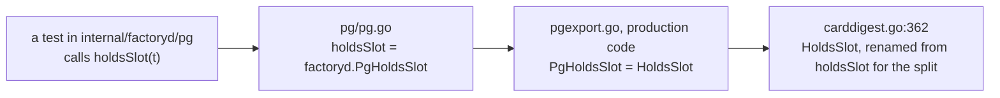

# Tests Share One Fake, and the Repositories Lose Their Leftovers: Implementation Plan

**Status:** decided, not built. It waits for Sebastian's go.

> **For agentic workers:** REQUIRED SUB-SKILL: Use superpowers:subagent-driven-development (recommended) or superpowers:executing-plans to implement this plan task-by-task. Steps use checkbox (`- [ ]`) syntax for tracking.

**Goal:** The code repository's tests keep one copy of each test and one fake Forgejo, production files carry no code that only tests reach, and both repositories drop the files, notes and rules that no longer say what is true.

**Architecture:** The Postgres-backed tests return to package `factoryd`, where they skip when no database is present, and this deletes the 888-line export shim and the 132 copied test functions and helpers. One in-memory Forgejo in a new test-support package replaces 37 hand-written fakes. Everything else is deletion, and each deletion that could come back gets a check that refuses it: staticcheck in CI, a test that every console `Config` field is wired, a test that no refusal row accepts two status codes, a test that every exported function has an outside caller, and a pre-commit check that every plan carries a status line.

**Tech Stack:** Go (factoryd, console, acceptance, cmd/factoryd), Postgres through `scripts/pg-test.sh`, `net/http/httptest` with the method patterns of `http.ServeMux`, staticcheck, Markdown and a shell pre-commit hook in the design repository.

**Spec:** None. The evidence in "The situation today" stands in for it.

## The situation today

### The scan's numbers

A scan of code main `c2dddcd67` on 2026-11-27 counted the leftovers below. The table answers how large each kind of leftover is. The right column says what a second read of the code found for this plan.

| Category | Count | Lines | Second read |
|---|---|---|---|
| Hand-written fake Forgejo servers in tests | 41 | 4,604 | Holds. 8 of them are 4 copied pairs from the pg split. 1 speaks git's HTTP protocol, not the REST API. |
| Test functions and helpers in both `internal/factoryd` and `internal/factoryd/pg` | 132 pairs (66 identical, 66 drifted) | 1,814 | Holds. 10 are `Test` functions, 122 are helpers. |
| Export shim for the pg tests (`pgexport*.go`, `pg/pg.go`) | 9 files | 888 | Holds: 8 `pgexport` files with 465 lines of production code, and `pg/pg.go` with 423. |
| Non-test functions that only tests reach | 136 | 1,504 | Holds. A further dead path, `AppendFactOnce`, is not on the list. |
| Functions dead even with tests | 16 | 135 | Holds. |
| staticcheck findings | 42 | not counted | Holds: 25 U1000, 9 SA4006, 8 others. |
| Identical non-test function bodies | 9 groups | 65 | Holds. 5 groups are copies, 4 are the right shape. |
| Hand-written `rows.Next` loops beside `queryAll[T]` | 108 in 37 files | not counted | Holds: 98 in `internal/factoryd`. `queryAll` has 5 callers, not 4. |
| Exported `internal/factoryd` names unused outside the package | 628 of 1,905 | not counted | Holds. |
| Exported `internal/factoryd` names used outside only by tests | 568 of 1,905 | not counted | Holds. 120 of them are used only by `internal/factoryd/pg`. |
| Testdata files nothing reads | 11 | 455 | Does not hold. `acceptance/face_conformance_test.go:41` and two console tests read the ten `board-*.json` fixtures. Only `opencode-run-error.jsonl` (1 line) is unread. |
| Docs naming an identifier that no longer exists | 3 | not counted | Holds. |
| Dated notes in the code repository's `docs/` | 6 | 387 | Holds. factory-agent wrote all six. Five are linked from nowhere, one only from another of the six. |
| Tombstone files | 3 | 67 | Holds. |
| `scripts/` entries nothing calls | 2 | 68 | Holds. |
| Stale worktrees, merged local branches | 2, 1 | not counted | Holds on 2026-11-27. |

Three rows of the scan belong to other plans: the 11 hand-written periodic loops and the 32 functions over 150 lines (plan "Collapse the workflow's history"), and the dead config keys (plan "The config says it once").

### The pieces

`internal/factoryd` is the control plane. Its test files sit in the package itself: 305 files with 201,868 lines and 4,637 `Test` functions. A Postgres-backed test opens its database through `schematest.DSN` (`internal/schema/schematest/schematest.go:72`), which skips the test when `FACTORYD_TEST_DATABASE_URL` is unset (`:79-82`). `scripts/pg-test.sh` starts a throwaway Postgres 17 and sets that variable (`scripts/pg-test.sh:64-65`). 61 test files of package `factoryd` use it, and 16 of package `pg`.

Tests run in four ways. A pull request's CI runs the affected packages in parallel, without the race detector (`.forgejo/workflows/pr.yml:71-77`). Main's CI runs `go test -race ./...` (`.forgejo/workflows/ci.yml:112`). `make test` runs one package at a time (`Makefile:2`, `-p 1`). `bash check changed` runs two at a time (`check:55`). Inside one package the tests run one after another: no test in `internal/factoryd` or `internal/factoryd/pg` calls `t.Parallel()`.

The criteria gate proves a plan's test criteria in a pod with no agent. Each entry is one `bash check test <suite> <name>` (`cmd/agent-worker/repro.go:614`), bounded by `REPRO_TIMEOUT`, which production sets to 15 minutes (`k8s/factoryd.yaml:601-602`, ceiling `MaxReproTimeout` at `internal/factoryd/workflow.go:3586`). A test criterion must name one test (`internal/factoryd/prover.go:222-223`). Since commit `1e49892ea` (2026-11-17), an invariant criterion runs no pod: its verdict is the head's required CI checks (`internal/factoryd/criteria.go:125-130`). When a named test moved to another directory, `movedTest` runs it where it now stands (`cmd/agent-worker/repro.go:631-653`).

A fake Forgejo is an `httptest` server in a test file that answers the REST routes of factoryd's client `Forgejo` (`internal/factoryd/forgejo.go:41`). The client has 138 methods in `forgejo.go` and `forgejoproject.go` and calls about 70 route patterns.

### The pg split

Between 2026-11-15 and 2026-11-18, seven merged pull requests (#2012, #2057, #2086, #2105, #2141, #2195, #2224) exported the names the moved tests reach and moved the `*_pg_test.go` files out of package `factoryd` into a new package `internal/factoryd/pg`. The planner's card gave the reason: one unsplit `./internal/factoryd` run took 733.6 seconds on a 2-CPU sandbox, the pg tests nearly all of it, against the gate's 900-second cap per entry. At main the package holds 43 test files with 19,783 lines and 405 `Test` functions.

A test in another package cannot reach unexported names, so two layers bridge the gap. This diagram shows the path of one call.



- `internal/factoryd/pgexport.go` and seven more `pgexport*.go` files hold 465 lines of wrappers and aliases in package `factoryd`. They ship in the production binary. One of them, `PgRunner` (`pgexport.go:29`), builds a `Runner` without the defaults and checks of `NewRunner` (`internal/factoryd/runner.go:507`, `:545-549`).
- `internal/factoryd/pg/pg.go` holds 396 aliases: 369 give an exported name its bare form, and 27 map an old unexported name to a `Pg` wrapper. The file calls itself an alias shim (`pg/pg.go:1-3`).
- The export preparation also renamed names in place: `internal/factoryd/pg_export_notes.txt:15` lists 130 of them.

The move copied the helpers the tests needed instead of sharing them. 132 names exist in both packages. 66 are byte-identical (928 lines) and 66 have drifted (886 lines). Ten are `Test` functions. Five of those run twice with identical bodies, for example `TestExpireStepsHandsUp` at `internal/factoryd/case_waits_test.go:161` and `internal/factoryd/pg/case_waits_pg_test.go:161`, 91 lines each. The other five are one store contract, run against the in-memory store in `store_fake_test.go` and against Postgres in `pg/store_pg_test.go`, edited on one side since.

The copies drift because a fix lands in one of them. The fake `tripForge` shows it. The copy in `internal/factoryd/pg/helpers_2d_test.go:313` gained a `mainHead` field and answers `GET /branches/main` (`:347`), `GET` on the comments (`:363`) and `PATCH` on a comment (`:371`). The copy in `internal/factoryd/ladder_fixtures_test.go:33` answers 404 for all three (`:88`). A test written against one copy fails against the other.

### The fake Forgejo servers

41 test types answer Forgejo's API, 4,604 lines together. Each one answers the same routes in its own way. These two excerpts answer the same call, a new comment on an issue.

`tripForge.serve`, `internal/factoryd/ladder_fixtures_test.go:70-77`:

```go
case r.Method == http.MethodPost && r.URL.Path == issue+"/comments" && f.failComment:
	f.failComment = false
	w.WriteHeader(http.StatusInternalServerError)
case r.Method == http.MethodPost && r.URL.Path == issue+"/comments":
	b, _ := io.ReadAll(r.Body)
	f.comments = append(f.comments, string(b))
	w.WriteHeader(http.StatusCreated)
	fmt.Fprintf(w, `{"id": %d}`, 500+len(f.comments))
```

`refusalForgejo.serve`, `internal/factoryd/refusal_test.go:68-75`:

```go
case strings.HasSuffix(p, "/comments") && r.Method == http.MethodPost:
	var in struct{ Body string }
	json.NewDecoder(r.Body).Decode(&in)
	f.comments = append(f.comments, fjComment{"factory-agent", in.Body})
	w.WriteHeader(http.StatusCreated)
	io.WriteString(w, `{"id":1}`)
default:
	t.Errorf("unexpected forgejo call %s %s", r.Method, p)
```

The first stores the raw JSON body, numbers comments from 501, can fail once, and answers 404 for a route it does not know. The second decodes the body, keeps the author, answers id 1 every time, and fails the test on a route it does not know.

The table answers how alike the 41 fakes are. Line similarity is `difflib`'s ratio over trimmed lines, and a switch is a field whose name says fail, down, off, refuse, deny, gone, stuck or a status code (both inferred measures).

| Class | Fakes | Lines | What the shared fake needs |
|---|---|---|---|
| Plain state, no switch | 20 | 1,302 | its model of repositories, issues and pull requests |
| One or two switches (fail the next call, a route that is down) | 11 | 918 | the model and its `Fail` option |
| Three to eleven switches, with sequences or delays | 9 | 2,339 | the model, `Fail`, and `Handle` for the routes only that test needs |
| Git's smart HTTP protocol (`cmd/agent-worker/push_refusal_test.go:49`) | 1 | 45 | nothing: it stays |

8 of the 41 are byte-near copies: the 4 pairs from the pg split, `forgejoHub` (similarity 1.00), `monitorForge` (0.96), `tripForge` (0.84) and `chainForgejo` (0.61). No other two fakes pass 0.67. So the other 33 are one concept written 33 times, not copies. 31 of the 41 hold at most two switches, which one `Fail` option covers.

These handlers are what the 41 fakes answer between them, with the number of fakes whose code names each route (inferred from the string literals in each fake).

| Model part | Routes | Fakes |
|---|---|---|
| Issues and comments | issues (list, create, read, edit), comments (list, create, edit, delete), timeline, dependencies | 29, 28 |
| Labels | repository labels, issue labels (read, replace, add, remove) | 22 |
| Branches and files | repository, branches (list, read, create, delete), raw file, contents (read, write) | 27, 13, 11 |
| Commits and statuses | commits list, git commit, git tree, compare, combined status, create status | 23, 14, 7, 6, 19 |
| Pull requests | list, create, read, edit, `.diff`, files, commits, merge, reviews, update | 22 |
| Forks | fork, forks list, `sync_fork` | 7 |
| Actions | runs, run jobs, job logs, rerun of a run and of a job, tasks, workflow dispatch | 8 |
| Identity | user tokens (list, create, delete), the user, the OAuth login with PKCE | 13, 5 |
| Registration only | orgs, teams, members, hooks, deploy keys, collaborators, admin users, migrate, version, mirrors | 1 or 2 |

### Test-only code in production files

21 non-test functions of `internal/factoryd` (172 lines) have no caller but tests. The table answers who calls each, and so where it belongs.

| Callers | Functions | Lines | Verdict |
|---|---|---|---|
| Only `factoryd`'s own tests | `metricNamedWeeksTotals` (`metrics.go:859`), `SessionEndFact.detail` (`metrics.go:228`), `proofFindings` (`prover.go:153`), `AgentDocDirectIDs` (`agentdoc.go:35`), `SessionEndFact.identity` (`metrics.go:237`), `killedBySignal` (`killedcheck.go:35`), `Waker.Drain` (`wakes.go:195`) | 36 | Move into the test file that calls each, or go |
| The in-memory board stores of five test rigs | `FinishedPage` (`console_store.go:571`), `DeployLive` (`:614`), `byFinish` (`:598`), `HelpersOf` (`:304`), `SortBoardTasks` (`:559`) | 64 | Become one named in-memory board read |
| A test-support package or another package's tests | `LoadFixture` (`fixture.go:274`), `CardSources` (`kinds.go:25`), `MonitorFlags` (`kinds.go:55`), `SaDirForTest` (`kube.go:58`), `FreezePressedFace`, `FreezeRefusedFace` (`freezecard.go:89`, `:94`), `ApprovalKinds` (`kinds.go:49`), `AskOrAnswer` (`settle.go:24`), `ToolCard` (`toolpark.go:574`) | 72 | Stay: each has an outside caller |

The board reads are a second implementation of the SQL in `PGStore.BoardTasks` and `FinishedTasks`. Five test rigs read the board in memory: `fakeStore` (`internal/factoryd/store_test.go:2410`), `fakeTasks` (`internal/console/console_test.go:832`) and three acceptance rigs (`acceptance/batch_answer_test.go:232`, `acceptance/console_rig_test.go:1013`, `acceptance/costs_date_window_test.go:284`). Each writes the filter again. The SQL leaves helper tasks off the board (`reportSourcesSQL` in `PGStore.BoardTasks`), and so do the two factoryd and console rigs (`console_test.go:836`). The three acceptance rigs show them. Two parity tests pin the Go order against the SQL on one fixture each (`internal/factoryd/console_store_test.go:371-377`, `:443-445`).

A second dead path sits beside the event rows. `Timeline.AppendFactOnce` (`internal/factoryd/metrics.go:494`) writes a fact as a timeline step through the `StepFact` interface (`:209`), and its doc comment (`:204`) says the step payloads record through it. No production code calls it: production records each fact as an event row through `RecordFactRow` (`gates.go:2354-2356`, `metrics.go:506`). Only `TestTimelineFactIdentities` (`metrics_test.go:920`) calls it. `deadcode` does not list it, so the scan's 136 undercount.

### Dead code, staticcheck and copied helpers

`deadcode -test ./...` lists 16 functions dead even with tests. 15 are test helpers. Most are originals the pg move left behind: their copies in `internal/factoryd/pg` are in use (`rungRig`, `posting`, `storedOffers`, `offerValues`, `caseStore`, `flagCases`, `assertQueueCase`). The one non-test function is `OpenCriteria` (`verdict.go:1247`), a one-line wrapper of `openCriteria` that production does not call.

`staticcheck ./...` exits 1 with 42 findings: 25 U1000 (unused), 9 SA4006 (a value never used), and SA1019, S1011, S1017, S1023, S1024, ST1018 and two ST1005 once each. Nothing in `bash check` or CI runs staticcheck, so the findings grow unseen. A cold run took 46 seconds on 2 CPUs with a peak of 2.7 GB (measured on 2026-11-27 with `taskset -c 0,1` and an empty `STATICCHECK_CACHE`).

Nine groups of identical non-test bodies exist. Five are copies: `fenceTicks` (`console/filing_flags.go:208`) of `fenceRun` (`sanitize/sanitize.go:105`), two `mapKeys` (`cmd/factoryd/follow.go:115`, `internal/follow/follow.go:270`) copying `maps.Keys`, `cmpOr` (`console/board_actions.go:132`) and `orElse` (`follow/rewrite.go:275`) copying `cmp.Or`, `messageTokenHash` (`factoryd/message.go:25`) beside `HashToken` (`factoryd/project.go:180`) in the same package, and the two `OpenStore` (`factoryd/store.go:1149`, `gateway/store.go:140`), which open and migrate the same way for two store types. The other four are the right shape: `agentDocJSON` and `marshalled` sit in two packages and are seven lines each, `Collector.now` and `Cloud.now` are each type's own clock, `caseEnded` and `ignoreNotFound` drop two different `ErrNotFound` sentinels, and `cardRefs.stop` and `botRefs.fail` are methods of two types. `plural` in `factoryd/deployment_health.go:332` writes what `textutil.Plural(n, one, one+"s")` writes.

`for rows.Next()` appears 108 times in 37 non-test files, 98 of them in `internal/factoryd`. `queryAll[T]` (`internal/factoryd/cases_heal.go:241`) reads every row through a scan function and has 5 callers. Eleven hand loops are near copies of each other: `PlansBetweenRounds` (`groups.go:223`), `PlansWithoutProver` (`holdout.go:472`), `CriteriaVerdictTasks` (`verdict.go:224`), `Alerts` (`alerts.go:167`), `ChatTokensOf` (`chat_tokens.go:56`), `ApprovalRequests` (`store.go:3257`), `events` (`event_store.go:449`), `routineStates` (`routine_store.go:103`), `tasks` (`store.go:2791`), `RecentlyFinishedTasks` (`store.go:2812`) and `UnsettledTasks` (`store.go:2875`).

### Exports

The table answers how the exported names of `internal/factoryd` are used today, and what each pg choice leaves. The counts cover top-level functions, types, variables and constants, not methods or fields.

| | Today | After the move back | If the split stays |
|---|---|---|---|
| Exported names | 1,905 | 1,861 (the 44 `Pg` names go) | 1,905 |
| Unused outside the package | 628 | 704 (78 names lose their only users, the pg tests) | 628 |
| Used outside only by tests | 568 | 448 | 568 |
| Used by non-test code outside | 709 | 709 | 709 |

The 448 names that other packages' tests use are legitimate: `internal/facefixtures` uses 235 of them, `internal/console` tests 192, `acceptance` 157, `cmd/factoryd` tests 9 (a name can have several users). Among the 704 names unused outside after the move, 95 are functions and 29 are variables. Unexporting them touches 1,291 references in the package (counted without comments), and for 26 of them the lowercase name is already taken. Of the exported functions, variables and constants, 4 have no use at all beyond their declaration: `PgBriefTerminal` and `PgConsoleApproved`, which go with the shim, and the constants `EventAlertVerdict` (`event_store.go:36`) and `TripShutdown` (`supervise.go:29`). No Go or SQL file holds their values either.

### Stale artefacts in the code repository

The table answers which files no longer say what is true.

| File | What is stale |
|---|---|
| `internal/factoryd/testdata/README.md:3` | It says a `history-*.json` live run exists and that the replay test reads it. None exists. |
| `internal/factoryd/workflow_test.go:1853-1854` | `TestWorkflowReplaysDevServerHistories` still globs `testdata/history-*.json`. |
| `internal/factoryd/testdata/opencode-run-error.jsonl` | No Go file reads it. `cmd/agent-worker/telemetry_test.go:25` names the pattern in a comment only. |
| `docs/manual/gates.md:718-719` | It names `TestWorkflowReplaysLiveHistories`, gone since `e7e95613e` (2026-11-11), and says it replays histories recorded on the cluster. |
| `docs/manual/gates.md:769` | It names `ValidatePlan`. `readPlan` judges a plan now (`plan_test.go:40-44` wraps it as `validatePlan`). |
| `docs/plan-audit-1837.md`, `docs/review-gate-eof-incident-2026-11-14.md`, `docs/flake-hunt-2026-10-17.md`, `docs/factoryd-flake-2026-11-09.md`, `docs/end-push-needs-a-diff-2026-11-16.md`, `docs/criteria-gate-merges-verdicts-2026-11-17.md` | Six dated notes, 387 lines, written by factory-agent between 2026-10-17 and 2026-11-17. The first cites deleted tests and the deleted `decide.go`. |
| `internal/factoryd/pulse_test.go` | Only a package line and a comment about tests that went with `pulse.go` on 2026-10-17. |
| `internal/factoryd/face_stop_test.go` | `face_stop.go` went on 2026-11-18 (`10e7453ac`). The file holds live helpers, `teeEvents` and `askedRow`. Only its name is stale. |
| `scripts/console-lab/ev-clear.js`, `scripts/console-lab/ev-level.js` | One-off evidence shots of 2026-10-17 and 2026-10-21. Nothing calls them. |
| `.worktrees/register-check`, `.worktrees/t4-n104-pod-memory`, branch `criteria-human-verdict` | The first holds no change and sits at `c2dddcd67`. The second holds commit `3b0bb8c7e`, which main lacks. The branch is merged, but its worktree holds 4 uncommitted changes. Five more local branches hold commits main lacks: `exp-ci-memory`, `pr-1450`, `pr1408`, `t319-export`, `t4-n104-pod-memory`. |

### The console's `AGENTS.md`

`internal/console/AGENTS.md` holds seven test rules in 18 lines. No test enforces any of them, and no test reads the file. The table answers whether each rule holds today and whether a test can carry it.

| Rule | State | Can a test carry it? |
|---|---|---|
| One owner per contract: extend a table-driven test or a rig before adding a file | 54 console test files were added in six weeks. The console has 115 test files with 62,073 lines. | No, it needs judgement |
| No test re-asserts a production table that a behaviour test drives | No break found | No |
| Expected wording is a literal, never the formatter's output | Followed (`chat_test.go:5100`) | No |
| Every refusal row asserts its exact status code | Broken at `projects_test.go:281`, `:1191`, `screen_test.go:980`, `console_test.go:3672`: each accepts 404 or 405 | Yes, a syntax check |
| Fakes mirror the store's guards exactly | Not checkable by reading | No |
| A `Config` field production never wires is a test-only seam | Broken: `Config.HTTP` (`console.go:393`). 102 of the 103 fields are set in the literal at `cmd/factoryd/main.go:640`, `HTTP` is not. Only `chat_tokens_test.go:354` sets it. | Yes, a struct and literal comparison |
| Tests of `internal/factoryd` symbols belong there | Broken: `chat_inbox_test.go:238` tests `factoryd.SettleLine` and `:389` tests `factoryd.SettleOf`, which `factoryd/settle_test.go` tests | No, a console test may call factoryd to build a value |

### The design repository

The design repository holds 92 plans in three places: 65 in `docs/plans/`, 22 dated `docs/*-plan-*.md`, and 5 in `docs/superpowers/plans/`. Of the 65 in `docs/plans/`, 34 have every checkbox unticked, 2 every box ticked, 1 a mix, and 28 no boxes. Four of the unticked are built on code main: the blind proofs (`fcc436533`, 2026-11-04), the cap reset (`edbba1f27`, 2026-11-24), a running card put on hold (merge `15d8ec3ef`, 2026-11-24) and the cluster facts (`aa0cc0547`, 2026-11-24). Four plans already carry a status line under their title, for example `docs/plans/2026-11-24-cause-gone.md:5`. Other tracked files name 50 of the 65, in 171 file-to-plan references.

`docs/` holds 78 documents. 57 are dated, 21 are not. No other file names 14 of the dated documents (2,121 lines): 9 of them are plans and 5 are notes.

The root holds 27 untracked entries: 25 notes, the folder `card-flow-2026-11-02/` and `.vscode/`. Tracked documents link two of them, and a plan of this review names a third, so GitHub shows broken links: `docs/card-flow-redesign-2026-11-02.md:7` links `card-flow-2026-11-02/README.md`, and `docs/stuck-card-faults-spec-2026-11-01.md:95` links `needs-you-analysis-2026-11-01.md`. The decisions below list every entry.

## Why this is drift

**One way only (tenet 5).** The tests keep two copies of 132 functions, and 66 of them drifted within nine days of the move. The board's in-memory read is written five times beside its SQL, and three of the five drifted from it. A fact is recorded as an event row in production and as a timeline step in one test. Five helper pairs copy each other or the standard library, which the code calls elsewhere (`cmp.Or` 619 times). 41 fakes answer one API in 41 ways, so a test proves its fake, not the client's contract.

**Reliability by construction (tenet 4).** The split was a construction answer to a gate entry that ran a whole package for up to 15 minutes. That cause went away by construction on 2026-11-17 at 00:13 UTC, when `1e49892ea` made an invariant criterion read the head's CI checks and run no pod. Three of the move's pull requests landed after it: #2141 (07:03 UTC that day), #2195 (20:41 UTC) and #2224 (2026-11-18 09:49 UTC). The console's seven test rules are prose that no test reads, and three broke. The 42 staticcheck findings have no check that stops the 43rd.

**Transparency (tenet 3).** A reader of the design repository cannot tell an open plan from a built one without opening each of 92 files, and four of four sampled unticked plans are built. Two tracked documents link files that exist only on one machine. The agent map names the alias shim as the place of `factoryd.Spec` and `factoryd.PlanCriterion` (`docs/agents/delta-planner.md:182`, `docs/agents/holdout-proposer.md:127`, `docs/agents/review-behaviours.md:120` point at `internal/factoryd/pg/pg.go`), not their declarations.

**What it costs.**

- Faults. Card #2093 spent three sessions on a size finding that the move itself caused, then stopped at its session cap (`docs/plans/2026-11-16-merge-queue-turn.md:30`). A criterion whose test moved stopped at a human until `movedTest` was built (fault 12 of `docs/plans/2026-11-17-work-loss-faults.md:19`). Three acceptance rigs show helper tasks on the board, which production never does, so a board test there passes on a board that cannot exist.
- Work. The split took seven merged pull requests, and 115 commits have touched `internal/factoryd/pg` since. Every later fix to a copied helper must be made twice or drifts.
- Lines. About 5,200 lines in the code repository (inferred, see the proposal's table).
- Production. The 465 lines of the shim and 37 test-only functions (212 lines) ship in factoryd's binary, among them a `Runner` constructor that skips `NewRunner`'s checks.
- Human minutes. Not measured. Each open-or-built question about a plan costs Sebastian a file read.

## The trade-off

### The pg tests

The table answers what each choice costs. The local times come from 21 runs of other sessions on the 32-CPU workstation between 2026-11-24 and 2026-11-27, logged without their flags: `internal/factoryd` took 428 to 498 seconds (median 437), `internal/factoryd/pg` 65 to 118 seconds (median 92, one outlier at 290).

| | A: the tests return to package `factoryd` | B: the split stays, with shared support |
|---|---|---|
| CI wall time of the two packages | about 530 s locally, one binary (inferred: the sum) | about 437 s locally, two binaries in parallel |
| `make test` and the full `bash check` (`-p 1`) | the same total | the same total |
| A gate entry naming one former pg test | compiles factoryd's test files too, as every factoryd criterion already does (not measured on the gate's pod) | compiles 19,783 test lines and links factoryd |
| Export shim | 0 lines | 888 lines, which grow with each pg test that reaches an unexported name |
| Copied functions | 0 after the merge | 122 helpers and 5 contract tests stay copied. Go refuses an import cycle in tests: `factoryd`'s own tests cannot import a support package that imports `factoryd`, so only helpers that never touch a factoryd type can be shared (the Forgejo fake). 5 identical tests and 4 fake pairs can go. |
| Export rule | holds: a test lives in its package | cannot hold: 120 names stay exported for the package's own tests |

A costs about 90 seconds on the longest package of every CI run, about 20 percent of that package (inferred from the local medians). A buys the deletion of 888 shim lines, about 1,400 lines of copies, and the one mechanism that exports names for tests. B keeps the 90 seconds and keeps every cost listed under "Why this is drift" except four fakes and five tests. A build tag (`//go:build pg`) was considered for A and loses: the gate's `bash check test` would need the tag to compile a tagged test, and `schematest.DSN` already skips without a database, so a tag adds a second way to run tests for no gain. Parallel Postgres tests (`t.Parallel()` with a database per test through `schematest.Scratch`) would win the 90 seconds back, but tests that share a database name truncate each other's rows today, so that is its own change.

### One fake Forgejo

The shared fake is about 800 lines (inferred) with its own contract test. It turns 37 fakes into setup of state, a few lines each, and keeps the domain routes of registration and of the console's login in the tests that need them. The risk is a fake that answers a route the way real Forgejo does not, and every test then passes on a path production never sees. The contract test pins that: it drives factoryd's real client over every route the fake serves. An unknown route fails the test, as 24 of today's fakes already do. 12 others answer 404 and 5 answer a default body, so the client goes on past a call the test never meant (inferred from each fake's last branch). 183 inline `httptest` handlers sit in test files that name an `/api/v1` path, some of them for other services. They stay: a handler that answers one or two routes is not longer than the shared fake's setup.

### Test-only code

Moving a function into a test file works only when every caller is in that package. The board reads have callers in three packages, so they cannot move into a test file. They become one named in-memory board read in package `factoryd` (`memboard.go`), which all five rigs call. A test-support package `internal/factoryd/factorydtest` was considered and loses: `factoryd`'s own `fakeStore` could not import it. Moving the console and acceptance rigs onto the real Postgres store would delete the copy outright, but it makes 115 console test files depend on a database, a larger change than this plan's. The nine functions with outside callers in test-support packages stay: they are the right shape.

### Exports

The rule is: export a name for a caller in another package, never for a test of the package itself. After the move back, the package's tests live in the package and need no export. The plan applies the rule to functions and variables (124 names, 1,291 references) and pins it with a test. It leaves constants and types: unexporting 322 constants touches about 3,740 references for no change of behaviour, and a type can be needed because an exported function returns it. The two unused constants go, and the two unused `Pg` names go with the shim.

### Checks that keep the deletions

staticcheck in CI costs 46 seconds cold on 2 CPUs and a peak of 2.7 GB. That peak is why it runs in CI only, not in `bash check`, which runs in a 4 GiB sandbox (`check:18-19`). `deadcode -test` was measured too (11 seconds, 4.2 GB) and loses: staticcheck's U1000 already reports unused unexported code, and the export test covers exported functions. No check is proposed for the manual's test names: it names four tests, one stale. No check is proposed for the six notes factory-agent wrote into `docs/`: six in six weeks do not pay for a path rule.

### The design repository

A status line under each plan's title keeps the 171 references into `docs/plans/` valid and follows the four plans that already carry one. An archive directory would show only open plans in a directory listing, but it breaks those references and leaves the 27 plans outside `docs/plans/` as they are. A pre-commit check guarantees that a plan has a status line, not that the line is current: the session that finishes a plan's last task sets it, as `docs/plans/2026-11-24-cause-gone.md:5` shows. An index document was not considered: the brief excludes it.

## The proposal

The target shape: one package per suite, one copy of each test, one fake Forgejo, one in-memory board read, production files that hold only what production or an outside caller reaches, exports only for outside callers, no staticcheck finding in CI, no stale file in either repository, and a plan whose first lines say whether it is built.

The table answers what goes and what comes, by task. Sizes marked inferred are estimates from spans, not from a trial change.

| Task | Deletes | Adds | Net |
|---|---|---|---|
| 1. The Postgres tests return | shim 888, `pg_export_notes.txt` 46, identical copies 928, half of the drifted copies (inferred 450) | none | about -2,300 |
| 2. One fake Forgejo | none | `internal/forgejotest` about 800, its test about 150 | about +950 |
| 3 to 5. 37 fakes use it | 4,327 lines of fakes | setup about 550, kept domain routes about 700 | about -3,050 |
| 6. Test-only code leaves production | step path and its test about 85, five board functions 64, rig filters about 50 | `memboard.go` about 60 | about -140 |
| 7. Dead code and staticcheck | 16 dead functions 135, the other findings about 55 | `staticcheck.conf`, a CI step, a pin, about 15 | about -175 |
| 8. Copied helpers and the row-loop sample | about 150 | `schema.Open`, `scanString`, about 20 | about -130 |
| 9. Exports for a caller | 2 unused constants | the export test, about 90 | about +85 |
| 10. Stale artefacts | 6 notes 387, testdata 1, `pulse_test.go` 15, two scripts 68, a dead glob 2 | none | about -473 |
| 11. The console's rules become tests or go | `AGENTS.md` 18, `Config.HTTP` 4, copied assertions about 6 | two tests, about 70 | about +40 |
| Code repository | | | about -5,200 (inferred) |
| 12. The design repository | up to 346 lines of absorbed notes, the 23 root entries deleted | about 88 status lines, about 10 hook lines | about -250, plus the four notes kept |

No compatibility path stays: no alias for a moved name, no second fake beside the shared one, no flag that keeps an old fake.

## Decisions

1. **The Postgres tests return to package `factoryd`.** Tests share fixtures, and the split's cause is gone: it was made so a gate entry over the whole package fit 15 minutes, and since `1e49892ea` no gate entry runs a whole package. The move deletes the 888-line shim and about 1,400 lines of copies and costs about 90 seconds on CI's longest package. Go's import cycle rule would keep 122 helper copies if the split stayed. The tests skip when no database is present, as `schematest.DSN` already does.
2. **staticcheck runs in CI only.** Default: a pinned binary in the runner image (as `gosec` is pinned in `upstream-files.txt:30`) and a step in `pr.yml` and `ci.yml`, 46 seconds cold and 2.7 GB peak. It is not in `bash check`, which runs in a 4 GiB sandbox. Veto line: also in `bash check`.
3. **A built plan gets a status line under its title.** Default: the line reads `open`, `built, code main <hash>, <date>` or `dropped, <reason>`, and the pre-commit hook refuses a plan without one. It keeps 171 references and needs no move of the 27 plans outside `docs/plans/`. Veto line: an archive directory for built plans.
4. **Four of the 27 untracked root entries are committed and 23 are deleted.** The four go under `docs/notes/` with their names unchanged: `card-flow-2026-11-02/`, `factory-faults-2026-11-17.md`, `needs-you-analysis-2026-11-01.md` and `prompt-cards-retire-2026-11-26.md`. A plan of this review cites the last one, so it joins the three that tracked documents link or name. The 23 deletions cannot be undone because git never held them. The board-loop note of 2026-11-09 is among them, since it names where the credential files live and the repository is pushed to GitHub. Its two citations, in `docs/needs-you-register-2026-11-09.md` and `docs/superpowers/plans/2026-11-10-local-rebuild.md`, become one sentence each. The table gives each entry's fate:

   | Entry | What it holds | Decision |
   |---|---|---|
   | `.vscode/` | an editor settings file holding `{}` | delete |
   | `card-flow-2026-11-02/` | seven files, 1,440 lines: the card flow of 2026-11-02 and every place a card or the board can stop | commit, `docs/card-flow-redesign-2026-11-02.md:7` links it |
   | `dogfood-log-2026-10-31.md` | 987 lines: what broke when the factory built its new chat tools on 2026-10-31 | delete, nothing names it |
   | `factory-faults-2026-11-17.md` | 553 lines: the faults found while needs-you cards were answered by hand, for a fixing session | commit, two plans name it as their spec (`docs/plans/2026-11-17-ai-first-ladder.md:13`, `docs/plans/2026-11-17-work-loss-faults.md:11`) |
   | `handover-fault01-checkin-2026-11-01.md` | handover: the check-in process | delete |
   | `handover-fault03-unpayable-sessions-2026-11-01.md` | handover: sessions the task budget cannot pay for | delete |
   | `handover-fault04-five-part-stops-2026-11-01.md` | handover: every human stop carries the five parts | delete |
   | `handover-fault05-build-2026-11-02.md` | handover: build fault 5's refused-review fixes | delete |
   | `handover-fault05-refused-review-2026-11-01.md` | handover: the review that vanished for money, and the plan that cannot close | delete |
   | `handover-fault06-frozen-month-cap-2026-11-01.md` | handover: the month cap only a restart can raise | delete |
   | `handover-fault07-build-session-digest-2026-11-02.md` | handover: build fault 7's session digest | delete |
   | `handover-fault07-planner-read-set-2026-11-01.md` | handover: the planner that dies on a big spec's read set | delete |
   | `handover-fault08-answer-tool-failure-2026-11-01.md` | handover: the chat's answer tool that failed twice on plan questions | delete |
   | `handover-fault09-red-main-queue-2026-11-01.md` | handover: the red-main revert card that waited behind the queue | delete |
   | `handover-fault10-scripted-chat-door-2026-11-01.md` | handover: no scripted door into the chat | delete |
   | `handover-fault11-rename-policy-tree-2026-11-01.md` | handover: the rename the running factoryd cannot load | delete |
   | `needs-you-analysis-2026-11-01.md` | 499 lines: nine needs-you complaints sorted, each code claim checked | commit, `docs/stuck-card-faults-spec-2026-11-01.md:95` links it |
   | `prompt-cards-retire-2026-11-26.md` | the prompt for the session that made a needs-you card retire itself, built in design commit `5b0fd4b` | commit, `docs/plans/2026-11-27-finish-the-general-fix.md:61` cites it |
   | `prompt-fund-cards-ahead-2026-11-19.md` | the prompt for the design of a card's room, which `docs/plans/2026-11-21-card-room.md` holds | delete |
   | `session-notes-2026-11-01-pool1426.md` | card #1426 landed, the replan watch of #1399 | delete |
   | `session-notes-2026-11-02-card1472.md` | card #1472 and the six faults behind it | delete |
   | `session-notes-2026-11-03-blind-proofs.md` | the build session of the blind proofs plan | delete |
   | `session-notes-2026-11-03-board-clear.md` | clearing the board and putting every off-factory commit live | delete |
   | `session-notes-2026-11-03-checkin-roll.md` | the check-in timeout and the stalled roll | delete |
   | `session-notes-2026-11-09-board-loop.md` | the board loop of 2026-11-09, which names where the credential files live | delete, and do not commit it: the repository is pushed to GitHub. Its two citations become one sentence each |
   | `session-notes-2026-11-16-needs-you.md` | root causes of the needs-you cards of 2026-11-16 | delete |
   | `session-notes-2026-11-17-disk.md` | disk evictions of agent sessions, fixed by pull request #2157 | delete |

## Global Constraints

- Code work runs in a git worktree off `origin/main` of `~/repos/ai-software-factory-code`. One pull request per task group, from `controller/ai-software-factory-code`, merged as `sebastian` after green CI and an independent review on the most capable model. The groups are Task 1, Task 2, each of Tasks 3 to 5, Tasks 6 to 8 together, Task 9, and Tasks 10 and 11 together.
- Start after the pull request of the plan "Open Faults Before the Next Autonomous Run" merges. It edits `rolltask_test.go`, `templateupdate_test.go`, `mainfix_test.go` and `console_test.go`, which hold fakes this plan replaces.
- Task 1 runs first. Tasks 3 to 5 run after Task 2. Task 9 runs after Tasks 1 and 7.
- `bash check changed` passes before each commit. Go tests run with `go test -race`. Postgres-backed tests run through `scripts/pg-test.sh`.
- A change to workflow code needs a `workflow.GetVersion` change id and a replay test. The one workflow edit here, the redundant `return` at `internal/factoryd/workflow.go:4474`, emits no command and needs none. `TestWorkflowReplaysDevServerHistories` passes after it.
- A fix reaches production only through a roll, and a roll needs Sebastian's go. No task changes behaviour in production, so the changes ride the next roll.
- No task id in a text a human reads. A human is a human, never a member or an operator.
- No comments that narrate the change. Tests state hand-derived expectations, and a migrated test keeps its assertions as they are.
- Design repository work commits to `master` and pushes. No ruling number and no ledger path in a tracked file. Of the untracked root notes, four are committed and 23 deleted,, as the decisions say.

## Review Focus

1. **A test lost or run twice by the move.** Task 1 Step 1 records the 5,032 distinct `Test` names of both packages, and Step 7 checks that `internal/factoryd` declares exactly those, each once.
2. **A stored proof whose file sits under `internal/factoryd/pg/`.** Such a proof file is `package pg` and does not compile once the shim goes. Task 1 Step 2 counts open plans' proof rows with that path in the live database before the move. `movedTest` covers named tests with no file, not these.
3. **A shared fake that answers unlike Forgejo.** Task 2's contract test drives factoryd's real client over every route the fake serves, and an unknown route fails the test (`TestAnUnknownRouteFailsTheTest`).
4. **A migrated test that loses its switch and passes for the wrong reason.** Tasks 3 to 5 each carry a step that removes the `Fail` call of every migrated test that had a switch and sees that test fail.
5. **A `Config` check that passes because it found nothing.** Task 11's test fails when `cmd/factoryd/main.go` holds no `console.Config` literal, and a table row checks the comparison itself on a struct with an unset field.

---

### Task 1: The Postgres tests run in package `factoryd` again

**Files (code repository):**
- Move: the 43 files `internal/factoryd/pg/*_test.go` to `internal/factoryd/`, names unchanged (no file name collides at `c2dddcd67`)
- Delete: `internal/factoryd/pg/pg.go`, `internal/factoryd/pgexport.go`, `pgexport_faces.go`, `pgexport_freezecard.go`, `pgexport_pg_split_move_2d.go`, `pgexport_pg_split_move_3d.go`, `pgexport_pg_split_move_3e.go`, `pgexport_pg_split_move_3f.go`, `pgexport_pg_split_move_3g.go`, `internal/factoryd/pg_export_notes.txt`
- Create: `internal/factoryd/store_contract_test.go` (replaces `store_fake_test.go` and the moved `store_pg_test.go`)
- Modify: `internal/factoryd/queue_reason_test.go` (takes the moved `queue_reason_pg_test.go`), `internal/factoryd/fixture_replay_test.go:1155,1157,1180,1187,1189,1197,1209`, `internal/factoryd/checkin_failed_test.go:579`, `internal/factoryd/act_pg_shared_test.go`, `ladder_fixtures_test.go:135-233`, `monitor_fixtures_test.go:170-229`, `casestore_test.go`, `offers_test.go`
- Test: the whole of `./internal/factoryd/`

**Interfaces:**
- Consumes: `schematest.DSN(t testing.TB, name string) string`
- Produces: none. Removes the 44 `Pg` names, `(*PGStore).DB() *sql.DB` and `(*PGStore).PgInsertTask`.

- [ ] **Step 1: Pin the test list and the times.** `cd internal/factoryd && grep -h -o -E '^func Test[A-Za-z0-9_]+' *_test.go pg/*_test.go | sort -u > /tmp/tests-before.txt` gives 5,032 names (4,637 plus 405, less the 10 both declare). In the background: `scripts/pg-test.sh go test -race -count=1 ./internal/factoryd/ ./internal/factoryd/pg/ > /tmp/pg-before.log 2>&1`, and `/usr/bin/time -v go test -race -c -o /dev/null ./internal/factoryd/` for the compile's maximum resident size.
- [ ] **Step 2: Count the proofs that would break.** On the live database, SELECT only: `SELECT p.task_id, p.path FROM plan_proofs p JOIN tasks t ON t.id = p.task_id WHERE p.path LIKE 'internal/factoryd/pg/%' AND t.status NOT IN ('done','failed','closed')`. Expected: no row. With a row, stop and show Sebastian the rows: their plans must close or file their proofs again first.
- [ ] **Step 3: Move and compile.** `git mv` the 43 files. In each, `package pg` becomes `package factoryd`, the import of `internal/factoryd` goes, and the 175 `factoryd.` qualifiers go. Delete the ten files above. Run `go vet ./internal/factoryd/`: it lists each name declared twice and each bare name `pg.go` used to alias.
- [ ] **Step 4: Resolve each name the compiler lists.** An identical pair keeps one copy (61 helpers, 5 tests). A drifted helper pair keeps the version with more fields and routes, and the tests of both still pass on it (`tripForge` and `monitorForge` keep the moved copy). A drifted pair whose shapes conflict keeps both under two names: the moved `chainForgejo` (`helpers_3d_test.go:270`, `runs` a slice) becomes `chainNoteForgejo` beside `chainpoll_test.go:461` (`runs` a map), and Task 5 replaces both. A bare alias name becomes the name it aliased (`holdsSlot` becomes `HoldsSlot`). A `Pg` call becomes what it wraps (`PgRunner(s, o, c)` becomes `&Runner{store: s, objects: o, cfg: c}`). A dead test helper that `deadcode -test` lists in `internal/factoryd` (12 at the scan, among them `rungRig.afterRung2`, `posting` and `storedOffers`) goes where its moved copy is the one in use. Task 7 takes the rest.
- [ ] **Step 5: Merge the store contract.** `store_contract_test.go` holds `TestCountAdmittedFreesTheApprovalAndDependencyWaits`, `TestResumeWaitHoldsNoSlotAndListsOldestFirst`, `TestTaskByIssuePrefersTheLiveCard` and `TestACardEndsClosedWithWhy` once each, each ranging over `fakeStores` and then `pgStores`. Take each body from the side edited last (`git log -1` of each file), and keep every assertion of both sides. `TestSetQueueReasonKeepsTheFirstRefusalTime` gets the same treatment in `queue_reason_test.go`.
- [ ] **Step 6: The registers name the package's own tests.** The seven `replayCoverage` rows that read `"internal/factoryd/pg TestX"` become `"TestX"`, the form of every in-package row (`fixture_replay_test.go:1153`). The `driveIn` entry at `checkin_failed_test.go:579` names a drive in another package and goes, since the drive is in the package again.
- [ ] **Step 7: Run and compare.** `grep -h -o -E '^func Test[A-Za-z0-9_]+' internal/factoryd/*_test.go | sort > /tmp/tests-after.txt`, then `diff /tmp/tests-before.txt /tmp/tests-after.txt` prints nothing and `sort -u /tmp/tests-after.txt | wc -l` equals `wc -l < /tmp/tests-after.txt`, 5,032. `scripts/pg-test.sh go test -race -count=1 ./internal/factoryd/ > /tmp/pg-after.log 2>&1` in the background: `ok`, and the time near the sum of Step 1's two (about 530 s, inferred). Record the compile's maximum resident size again. With the cache emptied and two CPUs, `taskset -c 0,1 env GOCACHE=$(mktemp -d) CHECK_REPORT=/tmp/r.xml bash check test ./internal/factoryd TestExpireStepsHandsUp` finishes: record its time. If it passes 600 seconds, two thirds of the gate's cap, stop and report.
- [ ] **Step 8: The skip holds.** With `FACTORYD_TEST_DATABASE_URL` unset, `go test -race -count=1 ./internal/factoryd/` skips every moved test and fails none. `go test -race -count=1 -v -run TestACardEndsClosedWithWhy ./internal/factoryd/` prints `SKIP` for its `pgStores` run. Expected: no `FAIL`.
- [ ] **Step 9: Commit and open the pull request,** with the four measured times and the two resident sizes in its description. Message: `factoryd's Postgres tests run in package factoryd again, each once, and no name is exported for them`.

### Task 2: One in-memory Forgejo for every test

**Files (code repository):**
- Create: `internal/forgejotest/forgejotest.go` (about 800 lines, inferred), `internal/forgejotest/forgejotest_test.go`

**Interfaces:**
- Consumes: `net/http`, `net/http/httptest`, `testing`. The package imports no package of this module, so `factoryd`'s own tests can import it.
- Produces:

```go
func New(t testing.TB) *Server
type Server struct{ URL string }
func (s *Server) Repo(fullName string) *Repo
func (s *Server) Fail(route string, status, times int) // times < 0: every call
func (s *Server) Handle(route string, h http.HandlerFunc)
func (s *Server) Calls() []Call
func (s *Server) User(login string)
type Call struct{ Method, Path, Query, Auth, Body string }

func (r *Repo) SetBranch(name, sha string)
func (r *Repo) SetFile(ref, path, content string)
func (r *Repo) AddCommit(c Commit)
func (r *Repo) SetStatus(sha string, st ...Status)
func (r *Repo) AddIssue(i Issue) int64
func (r *Repo) AddPull(p Pull) int64
func (r *Repo) AddRun(run Run)
func (r *Repo) Issue(n int64) Issue
func (r *Repo) Comments(n int64) []Comment
func (r *Repo) Pull(n int64) Pull
type Issue struct{ Number int64; Title, Body, State, Poster string; Labels []string }
type Comment struct{ ID int64; Body, Poster string }
type Pull struct{ Number int64; Title, Body, Head, Base, State, Diff string; Merged bool; Files []string }
type Status struct{ Context, State, TargetURL string }
type Commit struct{ SHA, Message, Committer string; Parents []string }
type Run struct{ ID, Index int64; Status, HeadSHA string; Jobs []Job }
type Job struct{ ID int64; Name, Status, Log string; Attempt int }
```

A `route` is an `http.ServeMux` pattern, for example `"POST /api/v1/repos/{owner}/{repo}/issues/{index}/comments"`.

- [ ] **Step 1: Write the failing test** `TestTheClientReadsWhatTheFakeServes` in `forgejotest_test.go`, package `forgejotest_test`, which imports `internal/factoryd`. Set up `s := forgejotest.New(t)`, `r := s.Repo("sf/r")`, `r.SetBranch("main", "c1")`, `r.SetFile("main", "README.md", "hello")`, `r.SetStatus("c1", forgejotest.Status{Context: "ci / test", State: "success"})`, and a client `f := &factoryd.Forgejo{BaseURL: s.URL, BotUser: "factory-agent", BotPassword: "pw"}`. Assert: `f.CreateIssue(ctx, "sf", "r", "A title", "A body")` returns `Number` 1. `f.CreateIssueComment(ctx, "sf", "r", 1, "first")` returns no error, and `f.ListIssueComments(ctx, "sf", "r", 1)` returns one comment with `Body` "first" and login "factory-agent". `f.ReplaceIssueLabels(ctx, "sf", "r", 1, []string{"agent"})` then `f.IssueLabels(...)` returns `["agent"]`. `f.BranchHeadSHA(ctx, "sf", "r", "main")` returns "c1". `f.FileAt(ctx, "sf", "r", "main", "README.md")` returns "hello". `f.CombinedStatus(ctx, "sf", "r", "c1")` returns `State` "success". `f.CreatePullRequest(ctx, "sf", "r", "b", "main", "T", "B")` returns `Number` 2, the next index of the repository's shared issue count, as Forgejo numbers them. `f.CloseIssue(ctx, "sf", "r", 1)` then `r.Issue(1).State` is "closed". Add one assertion each for `PullRequestDiff`, `MergePullRequest`, `ActionRuns`, `ActionRunJobs` and `ActionJobLog` on a run added with `r.AddRun`.
- [ ] **Step 2: Write three tests of the options.** `TestFailAnswersTheNextCallsWithTheStatus`: after `s.Fail("POST /api/v1/repos/{owner}/{repo}/issues/{index}/comments", 500, 1)`, the first `CreateIssueComment` returns an error and the second returns id 1. `TestHandleTakesOverOneRoute`: a `Handle` on the branch route answers its own body, and the other routes still answer from the model. `TestAnUnknownRouteFailsTheTest`: with a recording `testing.TB`, a `GET /api/v1/nothing` records one `Errorf` naming `GET /api/v1/nothing` and answers 404.
- [ ] **Step 3: Run and see them fail.** `go test -race ./internal/forgejotest/`. Expected: `no Go files` or `undefined: forgejotest.New`.
- [ ] **Step 4: Implement.** One `http.ServeMux` with method patterns, one mutex over the model, and a wrapper that records each call and answers a pending `Fail` by `r.Pattern` before the model's handler. Lists page by `page` and `limit` as `servePage` does (`internal/factoryd/forgejo_test.go:727`). A missing resource on a known route answers 404 with `{"message":"Not Found"}`. An unknown route calls `t.Errorf` and answers 404. The OAuth routes check the PKCE verifier against the challenge, as `acceptance/costs_date_window_test.go:1081-1091` does, and `GET /api/v1/user` answers the login of `User`. The registration routes (orgs, teams, members, hooks, keys, collaborators, admin users, migrate, version, mirrors) are not in the model: their one test adds them with `Handle`.
- [ ] **Step 5: Run and see them pass.** `go test -race ./internal/forgejotest/` and `bash check changed`. Expected: PASS.
- [ ] **Step 6: Commit.** `forgejotest serves an in-memory Forgejo that factoryd's client reads as it reads the real one`.

### Task 3: factoryd's 19 small fakes use the shared one

**Files (code repository):** Modify the test files that hold, after Task 1, `templateForgejo` (`templateupdate_test.go:88`), `schemaForgejo` (`schemasync_test.go:59`), `histForgejo` (`history_test.go:57`), `chainNoteForgejo` (`helpers_3d_test.go`), `bumpForge` (`bumppass_test.go:39`), `refusalForgejo` (`refusal_test.go:31`), `replayForge` (`fixture_replay_test.go:86`), `requestInfoForgejo` (`workflow_intake_test.go:439`), `fakeForgejo` (`github_test.go:92`), `labelsForgejo` (`tracks_test.go:387`), `healAskForgejo` (`heal_ask_pg_test.go:29`), `mirrorForgejo` (`mirror_test.go:222`), `forgejoHub` (`runner_test.go:692`), `cardForgejo` (`schemacard_test.go:66`), `groupForgejo` (`grouprevert_test.go:151`), `gitForgejo` (`gates_test.go:4621`), `tripForge` (`helpers_2d_test.go`), `monitorForge` (`monitor_pg_test.go`), `actForge` (`act_pg_test.go:65`). Together 1,525 lines. Delete `servePage`, `isWriterRead` and `serveWriters` (`forgejo_test.go:727`, `intake_test.go:1207`, `:1215`) once nothing calls them.

**Interfaces:** Consumes Task 2's `forgejotest` API. Produces none.

- [ ] **Step 1: Record the tests that use each fake,** with `grep -l` on the type name, and run them: `scripts/pg-test.sh go test -race -run '<their names>' ./internal/factoryd/`. Expected: PASS.
- [ ] **Step 2: Replace each fake** with `forgejotest.New(t)` and the state its tests set. A switch becomes `Fail` (`tripForge.failComment` becomes `Fail(<comments route>, 500, 1)`). A recorded call list becomes `Calls()`. The test's assertions stay as they are.
- [ ] **Step 3: See each switch matter.** In each test that set a switch, delete its `Fail` call and run the test. Expected: FAIL with the test's own message. Put the call back.
- [ ] **Step 4: Run.** `scripts/pg-test.sh go test -race ./internal/factoryd/` and `bash check changed`. Expected: PASS.
- [ ] **Step 5: Commit.** `factoryd's small fakes of Forgejo are the one in-memory Forgejo`.

### Task 4: The acceptance and console fakes use the shared one

**Files (code repository):** Modify `acceptance/backends_test.go:44`, `interim_push_test.go:94`, `empty_answer_keeps_ask_test.go:69`, `costs_date_window_test.go:1078`, `recut_merge_press_test.go:78`, `batch_answer_test.go:1525`, `divide_ledger_test.go:692`, `proof_tests_test.go:140`, `receipt_facts_from_records_test.go:51`, `console_rig_test.go` (its login handler), and `internal/console/console_test.go:168` (`fakeForgejo`, 301 lines). Together 764 lines.

**Interfaces:** Consumes Task 2's API, its OAuth routes and `User`.

- [ ] **Step 1: Run the tests that use the ten fakes.** `scripts/pg-test.sh go test -race ./acceptance/ ./internal/console/`. Expected: PASS.
- [ ] **Step 2: Replace each fake** as in Task 3 Step 2. The console fake's grants, refresh, revoke and probe routes that the model lacks are added with `Handle` in `console_test.go`.
- [ ] **Step 3: See each switch matter,** as in Task 3 Step 3 (`recutForgejo.down`, the console fake's `failEdit`, `failReview`, `failDeps`, `failAssets` and `failAPI`).
- [ ] **Step 4: Run** the two packages again and `bash check changed`. Expected: PASS.
- [ ] **Step 5: Commit.** `The acceptance rigs and the console's tests log in and read issues through the one in-memory Forgejo`.

### Task 5: factoryd's eight large fakes use the shared one

**Files (code repository):** Modify `register_test.go:100` (`forgejoState`, 421 lines), `rolltask_test.go:464` (`rollForgejo`, 399), `activities_test.go:109` (`prForgejo`, 332), `imager_test.go:101` (`imagerForgejo`, 245), `plan_test.go:918` (`planForgejo`, 178), `chainpoll_test.go:461` (`chainForgejo`, 178), `gates_test.go:95` (`gateForgejo`, 151), `followpass_test.go:180` (`infraForge`, 134). Together 2,038 lines. One pull request per two fakes keeps each reviewable.

**Interfaces:** Consumes Task 2's API with `Handle` for the routes only one test needs.

- [ ] **Step 1: Run the tests that use the fake** (as Task 3 Step 1). Expected: PASS.
- [ ] **Step 2: Replace the fake.** The model carries what it can. A sequence (`gateForgejo.headReads`, `cardForgejo.statusSeq`) becomes a state change between the test's steps or a `Handle` that reads the next value. A delay (`gateForgejo.diffDelay`) and a gate channel (`forgejoState.migrateGate`) stay in a `Handle`. The registration routes of `forgejoState` stay in `Handle`s in `register_test.go`.
- [ ] **Step 3: See each switch matter,** as in Task 3 Step 3, for every switch the fake held.
- [ ] **Step 4: Run** `scripts/pg-test.sh go test -race ./internal/factoryd/` and `bash check changed`. Expected: PASS. Then `grep -c 'httptest.NewServer' ` over the eight files is lower by one for each replaced fake.
- [ ] **Step 5: Commit** per pull request, for example `The roll's and the pull request activities' tests read the one in-memory Forgejo`.

### Task 6: Test-only code leaves the production files

**Files (code repository):**
- Modify: `internal/factoryd/metrics.go:204-212` (the doc sentence and `StepFact`), `:228-239` (`SessionEndFact.detail`, `.identity`), `:310-312` (`ReviewAttemptFact.identity`), `:490-499` (`AppendFactOnce`), `:514-539` (`stepHoldsIdentity`, `holdsIdentity`)
- Delete: `TestTimelineFactIdentities` (`metrics_test.go:920-966`)
- Move into the test file that calls each: `metricNamedWeeksTotals` (`metrics.go:859`) into `metrics_divide_test.go`, `proofFindings` (`prover.go:153`) into `prover_test.go`, `AgentDocDirectIDs` (`agentdoc.go:35`) into `agentdoc_test.go`, `Waker.Drain` (`wakes.go:195`) into the moved `helpers_3d_test.go`
- Delete: `killedBySignal` (`killedcheck.go:35`): `activities_test.go:5016` calls `killMarker(log) != ""`
- Create: `internal/factoryd/memboard.go`
- Delete from `console_store.go`: `HelpersOf` (`:302-313`), `SortBoardTasks` (`:554-563`), `FinishedPage` (`:565-594`), `byFinish` (`:596-608`), `DeployLive` (`:610-627`)
- Modify: `internal/factoryd/store_test.go:2407-2425`, `internal/console/console_test.go:832-880`, `:922`, `acceptance/batch_answer_test.go:230-260`, `acceptance/console_rig_test.go:1013-1045`, `acceptance/costs_date_window_test.go:282-305`, `internal/factoryd/console_store_test.go:368-377`, `:441-445`

**Interfaces:**
- Produces, in `memboard.go`, the in-memory board read the test rigs share:

```go
func MemBoardTasks(tasks []BoardTask, repository string) []BoardTask
func MemFinishedTasks(tasks []BoardTask, q FinishedQuery) ([]BoardTask, int)
func MemBoardTask(tasks []BoardTask, id string) (BoardTask, bool)
```

- [ ] **Step 1: Write the failing test** `TestMemBoardReadsAsTheStoreDoes` in `console_store_test.go` (Postgres-backed). On the fixture of the existing parity test plus one helper task `h1` of card `q0`, assert that `MemBoardTasks(all, "sf/r")` ids equal `PGStore.BoardTasks` ids, `["q2", "waiter", "q0"]`, with `h1` on `q0`'s `Helpers` and not on the board. Assert that `MemFinishedTasks(all, q)` equals `FinishedTasks`, `["roll", "unstamped", "older"]`, and `MemBoardTask(all, "q0")` carries the helper `h1`.
- [ ] **Step 2: Run and see it fail.** `scripts/pg-test.sh go test -race -run TestMemBoardReadsAsTheStoreDoes ./internal/factoryd/`. Expected: `undefined: MemBoardTasks`.
- [ ] **Step 3: Implement** the three functions in `memboard.go` from the five they replace: the filter of `PGStore.BoardTasks` (repository, not chat, not final, not a helper task), then helpers, then the order. The five rigs call them under their own locks, and `fakeStore` then adds its hold view. Delete the five old functions and the two old parity asserts. Delete the step path and move the seven helpers as listed.
- [ ] **Step 4: Run.** `scripts/pg-test.sh go test -race ./internal/factoryd/ ./internal/console/ ./acceptance/` and `bash check changed`. Expected: PASS. An acceptance test that counted a helper task as a board card fails: it asserted a board production cannot show, and its expected value changes to the card count without the helper, derived by hand from its fixture.
- [ ] **Step 5: Commit.** `Every test rig reads the board through one in-memory read that matches the store's, and production files hold no step-fact path and no test helper`.

### Task 7: No dead code, and staticcheck finds none

**Files (code repository):**
- Modify: the files of the findings that remain after Tasks 1 and 6 (`staticcheck ./...` lists them). At `c2dddcd67` they are the 25 U1000 and 9 SA4006 lines of the scan, `internal/console/console_test.go:1692` (S1011), `internal/console/metrics.go:239` (S1017), `internal/factoryd/workflow.go:4474` (S1023), `internal/console/chat_tokens_test.go:162` (S1024), `internal/factoryd/upstream_pod_test.go:971` (SA1019), `internal/factoryd/namer_test.go:215` (ST1018, the literal U+202E becomes `‮`)
- Delete: `OpenCriteria` (`internal/factoryd/verdict.go:1247`), `acceptTasks.add` (`acceptance/costs_date_window_test.go:384`), `accWholeCents` (`acceptance/console_rig_test.go:1316`), the field `redChecks` (`acceptance/write_seams_test.go:35`)
- Create: `staticcheck.conf` at the repository root: `checks = ["inherit", "-ST1005"]`. The refusal at `internal/console/mcp.go:478` is a sentence the agent reads, so a capital and a full stop are right there.
- Modify: `upstream-files.txt` (one line for the staticcheck release, as `gosec` at `:30`), `Dockerfile.runner` (`ARG STATICCHECK_VERSION` and its `ADD`, as `GOSEC_VERSION` at `:4`, `:25`), `.forgejo/workflows/pr.yml` and `ci.yml` (a step `staticcheck ./...` before the tests)

**Interfaces:** Consumes the staticcheck binary of the runner image. Produces none.

- [ ] **Step 1: The failing check.** `staticcheck ./...`. Expected: exit 1 and the remaining findings, each with its file and line.
- [ ] **Step 2: Fix each finding.** An unused declaration goes. A value never used becomes `_` or its line goes. The deprecated `runtime.GOROOT()` becomes `go env GOROOT` read once in the test.
- [ ] **Step 3: Run.** `staticcheck ./...` exits 0. `deadcode -test ./...` prints nothing. `scripts/pg-test.sh go test -race ./...` in the background ends `ok` for every package, and `TestWorkflowReplaysDevServerHistories` passes after the S1023 edit.
- [ ] **Step 4: Add the CI step.** Open the pull request with one deliberate unused function in a scratch commit, see `pr / test` fail on its U1000 line, then drop the commit.
- [ ] **Step 5: Commit.** `CI refuses dead and unused code, and the tree holds none`.

### Task 8: Copied helpers go, and eleven row loops read through `queryAll`

**Files (code repository):**
- Modify: `internal/sanitize/sanitize.go:105` (`fenceRun` becomes `FenceRun`), `internal/console/filing_flags.go:205-216` (`fenceTicks` goes, its three callers call `sanitize.FenceRun`)
- Modify: `cmd/factoryd/follow.go:115-123`, `internal/follow/follow.go:270-278` (`mapKeys` goes for `maps.Keys`)
- Modify: `internal/console/board_actions.go:132-137`, `internal/follow/rewrite.go:275-280` (`cmpOr` and `orElse` go for `cmp.Or`)
- Modify: `internal/factoryd/message.go:23-28` (`messageTokenHash` goes for `HashToken`)
- Modify: `internal/factoryd/deployment_health.go:332-337` (`plural`'s body becomes `return textutil.Plural(n, one, one+"s")`)
- Create: `func Open(ctx context.Context, databaseURL string) (*sql.DB, error)` in `internal/schema` (opens, migrates, closes on a failed migration). Modify: `internal/factoryd/store.go:1149-1160`, `internal/gateway/store.go:140-151` (each `OpenStore` wraps it)
- Modify: `internal/factoryd/cases_heal.go:241` (add `scanString` beside `queryAll`), and the eleven functions of "Dead code, staticcheck and copied helpers"

**Interfaces:**
- Produces: `sanitize.FenceRun(s string) (n int, ch byte, ok bool)`, `schema.Open(ctx context.Context, databaseURL string) (*sql.DB, error)`, `scanString(r rowScanner) (string, error)`

- [ ] **Step 1: Write the failing test** `TestOpenMigratesTheSchema` in `internal/schema`: `db, err := Open(ctx, schematest.DSN(t, "open"))` returns no error, and `SELECT count(*) FROM tasks` on `db` returns 0. Run `scripts/pg-test.sh go test -race -run TestOpenMigratesTheSchema ./internal/schema/`. Expected: `undefined: Open`.
- [ ] **Step 2: Implement** `schema.Open` and the merges above. Each of the eleven functions becomes one `queryAll` call with its scan function: `PlansBetweenRounds` becomes `return queryAll(ctx, s.db, <its query>, nil, scanString)`. The rule for the 87 other loops of `internal/factoryd`: a read of every row into a slice calls `queryAll`, and a loop that streams, stops early or fills a map stays. This plan migrates the eleven only, so a reviewer judges the shape on them.
- [ ] **Step 3: Run** `scripts/pg-test.sh go test -race ./internal/schema/ ./internal/factoryd/ ./internal/gateway/ ./internal/console/ ./internal/follow/ ./internal/sanitize/ ./cmd/factoryd/` and `bash check changed`. Expected: PASS, the existing tests of each function unchanged.
- [ ] **Step 4: Commit.** `One function each opens a store, finds a code fence, picks the first set string and reads a list of rows`.

### Task 9: factoryd exports a function or a variable only for an outside caller

**Files (code repository):**
- Create: `internal/factoryd/exports_test.go`
- Modify: the declarations and references of the names the test lists (124 at the scan, inferred: 95 functions, 29 variables)
- Delete: the constants `EventAlertVerdict` (`internal/factoryd/event_store.go:36`) and `TripShutdown` (`internal/factoryd/supervise.go:29`), which nothing uses

**Interfaces:**
- Produces: `TestEveryExportedFunctionAndVariableHasAnOutsideUser(t *testing.T)`

- [ ] **Step 1: Write the failing test.** It walks the module from `../..` with `go/parser`, skipping `.worktrees`, `testdata` and dot directories. It collects the exported top-level functions and variables of `internal/factoryd`'s non-test files, and every `factoryd.Name` selector in any other package's Go files, test files included: another package's test is a caller. It fails with the sorted list of names no other package uses. A table row runs the same comparison on a two-file fixture where one exported function has no user, and expects that one name.
- [ ] **Step 2: Run and see it fail.** `go test -race -run TestEveryExportedFunctionAndVariableHasAnOutsideUser ./internal/factoryd/`. Expected: FAIL, listing about 124 names, among them `CapDecision`, `ResetStamp` and `HoldsSlot`.
- [ ] **Step 3: Implement.** Rename each listed name to its lowercase form with `gopls rename`, one name at a time. Where the lowercase name is taken (26 at the scan), pick another name. Then run `staticcheck ./...` and delete what U1000 lists, since an unexported name used nowhere is now visible to it.
- [ ] **Step 4: Run.** The test passes. `scripts/pg-test.sh go test -race ./...` in the background ends `ok` for every package. `staticcheck ./...` exits 0.
- [ ] **Step 5: Commit.** `factoryd exports a function or a variable only when another package uses it`.

### Task 10: The code repository holds no stale file

**Files (code repository):**
- Modify: `internal/factoryd/testdata/README.md:3` (the `history-*.json` sentence goes), `internal/factoryd/workflow_test.go:1853-1854` (the dead glob goes)
- Modify: `docs/manual/gates.md:718-719`, `:769`. Read by humans and agents: the sentences follow the house writing guide.
- Delete: `internal/factoryd/testdata/opencode-run-error.jsonl`, the six notes in `docs/`, `internal/factoryd/pulse_test.go`, `scripts/console-lab/ev-clear.js`, `scripts/console-lab/ev-level.js`
- Rename: `internal/factoryd/face_stop_test.go` to `internal/factoryd/tee_events_test.go`

- [ ] **Step 1: The behaviour that stays.** `go test -race -run TestWorkflowReplaysDevServerHistories ./internal/factoryd/` passes before and after, and with `testdata/devserver-*.json` moved aside it fails with "no dev server histories". If the open-faults pull request already changed `testdata/README.md`, leave the README to it.
- [ ] **Step 2: Edit the manual.** Line 718-719 reads: `` `TestWorkflowReplaysDevServerHistories` replays histories recorded on a local dev server under stub activities (`internal/factoryd/testdata`). `` Line 769 names `readPlan` in place of `ValidatePlan`.
- [ ] **Step 3: Delete and rename** the files above. `git grep -n -E 'ev-clear|ev-level|opencode-run-error|plan-audit-1837|review-gate-eof|flake-hunt|factoryd-flake|end-push-needs|criteria-gate-merges'` prints nothing but comments that name the pattern.
- [ ] **Step 4: The worktrees and branches.** Apply the rule of the open-faults plan's Task 3 Step 2 to what is left when this task starts: for each worktree and branch, read `git log origin/main..<branch> --oneline` and `git status`. Remove one whose change main holds. Show Sebastian a change main lacks in one line before its delete (`3b0bb8c7e` on `t4-n104-pod-memory`, and the commits of `exp-ci-memory`, `pr-1450`, `pr1408`, `t319-export`). Leave `criteria-human-verdict` until its session says it is done with the four uncommitted changes.
- [ ] **Step 5: Run** `bash check changed`. Commit: `The code repository's docs, testdata and scripts name only what exists`.

### Task 11: The console's test rules are tests or gone

**Files (code repository):**
- Create: `cmd/factoryd/console_config_test.go`, `internal/console/status_codes_test.go`
- Modify: `internal/console/console.go:393` (`HTTP` goes), `:784-786`, `internal/console/oauth.go:172`, `:397` (a package-level `var forgejoHTTP = &http.Client{Timeout: 15 * time.Second}`), `internal/console/chat_tokens_test.go:354`
- Modify: `internal/console/projects_test.go:281`, `:1191`, `internal/console/screen_test.go:980`, `internal/console/console_test.go:3672`
- Modify: `internal/console/chat_inbox_test.go:238`, `:389`, and `internal/factoryd/settle_test.go` where a case is missing
- Delete: `internal/console/AGENTS.md`

**Interfaces:**
- Produces: `TestEveryConsoleConfigFieldIsSetInProduction(t *testing.T)`, `TestNoRefusalRowAcceptsTwoStatusCodes(t *testing.T)`

- [ ] **Step 1: Write the failing tests.** `TestEveryConsoleConfigFieldIsSetInProduction` reads the fields of `console.Config` by `reflect` and the keys of the `console.Config{...}` literal in `main.go` by `go/parser`. It fails on a field the literal does not set, and fails when it finds no literal. A table row runs the comparison on a two-field struct and a one-key literal and expects the missing name. `TestNoRefusalRowAcceptsTwoStatusCodes` parses the console's `*_test.go` files and fails on a condition `X.Code != A && X.Code != B` with one `X`, naming file and line.
- [ ] **Step 2: Run and see them fail.** `go test -race -run TestEveryConsoleConfigFieldIsSetInProduction ./cmd/factoryd/`. Expected: FAIL naming `HTTP`. `go test -race -run TestNoRefusalRowAcceptsTwoStatusCodes ./internal/console/`. Expected: FAIL naming the four lines.
- [ ] **Step 3: Implement.** Delete `Config.HTTP` and its default. The two OAuth calls use `forgejoHTTP`. `chat_tokens_test.go:354` drops `HTTP: srv.Client()`, since its server is plain HTTP. Each of the four rows asserts one code, derived from the route table in `console.go`: a path that another method still serves answers 405, a path no pattern serves answers 404. The two `factoryd` assertions of `chat_inbox_test.go` move into `factoryd/settle_test.go` as table rows where that file lacks them. Delete `AGENTS.md`. If the plan "One door for every answer" removed `Config.HTTP` first, this step only adds the test.
- [ ] **Step 4: Run** `go test -race ./cmd/factoryd/ ./internal/console/ ./internal/factoryd/` and `bash check changed`. Expected: PASS.
- [ ] **Step 5: Commit.** `Two tests carry the console's test rules that a program can check, and the prose file is gone`.

### Task 12: Every plan says whether it is built, and the root holds no untracked note

**Files (design repository):**
- Modify: `.githooks/pre-commit`
- Modify: the 88 plans without a status line in `docs/plans/`, `docs/*-plan-*.md` and `docs/superpowers/plans/`
- Delete: those of the 5 unlinked dated notes (`docs/phase-2a-known-gaps-2026-11-04.md`, `docs/architecture-health-seeds-2026-11-04.md`, `docs/human-not-member-card-2026-10-31.md`, `docs/planfilingfact-and-criteria-closeout-spec-2026-10-31.md`, `docs/intake-hold-spec-2026-10-31.md`) whose decisions an undated document or a plan states
- Create: `docs/notes/`, holding the four committed root notes: `card-flow-2026-11-02/`, `factory-faults-2026-11-17.md`, `needs-you-analysis-2026-11-01.md` and `prompt-cards-retire-2026-11-26.md`. The other 23 root entries are deleted.
- Modify: `docs/card-flow-redesign-2026-11-02.md:7`, `docs/stuck-card-faults-spec-2026-11-01.md:95`, `docs/press-returns-fast-plan-2026-11-01.md:22`, `docs/needs-you-register-2026-11-09.md:12`, `docs/superpowers/plans/2026-11-10-local-rebuild.md:229`, `docs/plans/2026-11-17-ai-first-ladder.md:13`, `docs/plans/2026-11-17-work-loss-faults.md:11`, `docs/plans/2026-11-27-finish-the-general-fix.md:61`

- [ ] **Step 1: Write the failing check.** In a scratch clone, stage a new `docs/plans/x.md` with a title and no status line, and run `.githooks/pre-commit`. Expected today: exit 0, which is the gap.
- [ ] **Step 2: Implement.** The hook refuses a staged file under `docs/plans/` or `docs/superpowers/plans/`, or named `docs/*-plan-*.md`, without a line starting `**Status:** ` in its first 15 lines. Its refusal names the file and the three forms: `**Status:** open.`, `**Status:** built, code main <hash>, <date>.`, `**Status:** dropped, <reason>.` Run Step 1 again. Expected: exit 1 and that message. With a status line: exit 0.
- [ ] **Step 3: Give every plan its line.** For each plan, read its Goal and find the commit on code main that built it (`git log --grep`, the plan's named files). Write `built` with the commit and date when it holds, `dropped` with the plan that replaced it when one did, else `open`. The drift-review plans of 2026-11-27 are `open`.
- [ ] **Step 4: Delete the absorbed notes.** For each of the five, name the undated document or plan that states its decisions, in the commit message. A note that nothing absorbed stays.
- [ ] **Step 5: The root notes.** Commit the four under `docs/notes/` with their names unchanged and point the links above at the new paths. Delete the other 23. At `docs/needs-you-register-2026-11-09.md:12` and `docs/superpowers/plans/2026-11-10-local-rebuild.md:229`, replace the citation of `session-notes-2026-11-09-board-loop.md` with one sentence each that says the board loop of 2026-11-09 produced the entries, without naming the file. Then `git status --short | grep '^??'` prints nothing, `ls docs/notes` lists the four, and `grep -rn 'board-loop' docs` prints nothing but this plan.
- [ ] **Step 6: Commit** to `master` and push, one commit per step: `plans: each plan says under its title whether it is open, built or dropped, and the hook refuses one that does not`.
