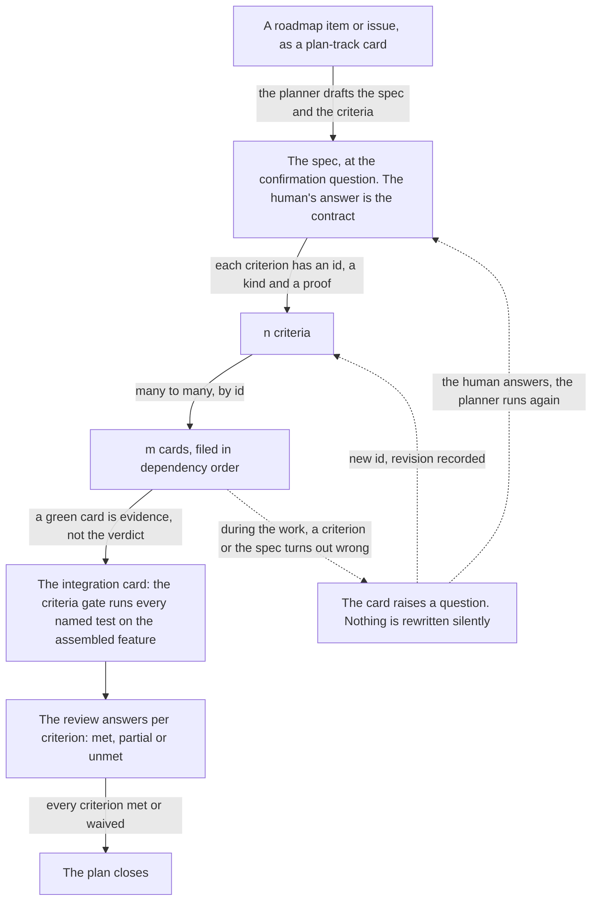
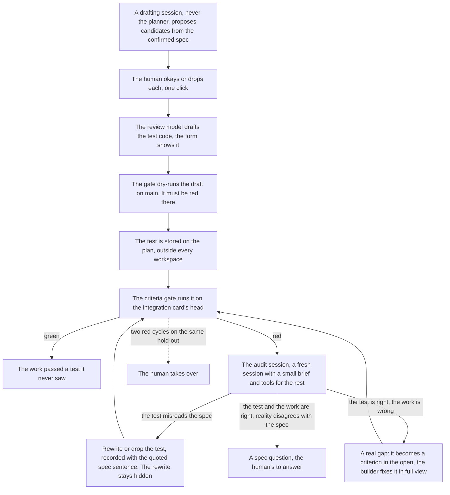
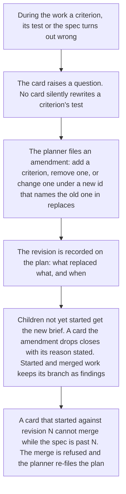

# The spec-driven process, in short

This is how the factory turns a roadmap item into merged code. One spec becomes criteria whose proofs are named before any work starts, the criteria map to cards, the cards build, and one gate at the end runs every named proof on the assembled feature. All of it is built and running, roadmap items 285 to 291. This file brings a reader up to speed or serves as a reminder. The full design, the market research and every source sit in [the concept](spec-intake-concept-2026-10-16.md).

## The model in one picture

Two refinements the picture needs:

1. A criterion is not done when its card closes. A green card that cites a criterion is evidence. The verdict comes once, on the integration card, because most criteria are only testable on the assembled feature.
2. Foundation cards cite no criterion. They build the contracts the other cards build on.

## Who settles a criterion

Every criterion says who settles it. There are four kinds:

| Kind | Who settles it | The proof |
|---|---|---|
| test | The criteria gate, a plain program | A named test with inputs and expected numbers, run under the project's own check command |
| invariant | The criteria gate, a plain program | A named suite green, for example every test in `./...` passes |
| judgement | The review's model, on every review run | The claim, fixed inputs and a pinned prompt. The verdict quotes its reason and records the model and the prompt |
| human | The approver, at approval | A recorded decision on the evidence the review gathered |

The line between judgement and human is fuzzy and the human draws it. The planner drafts the cheap judgement by default, and the human can move a criterion between the two kinds at any time. A flip of kind alone keeps the criterion's id.

## A change, end to end

1. A roadmap item becomes a plan-track card.
2. The planning session, the planner, reads the repository and drafts the spec: the outcome, a glossary, the criteria. It then attacks its own draft once, looking for contradictions, ambiguity and missing edge cases, and turns each finding into a question.
3. The confirmation question shows the spec and the criteria to the human. They answer, amend the wording, or comment and start another round. In the same form's second zone they okay or drop hold-out candidates. The criteria are fixed at the answered revision.
4. The planner files the plan: foundation cards first, the integration card last. A plan bigger than one round of cards (`max_cards`) files the first round and keeps the rest as an outline. When a round's cards are done, the planner plans the next on top of what they built, and the integration card comes in the last. Every criterion is cited by at least one card, every non-foundation card cites at least one, and the integration card cites every criterion, its acceptance items the criteria's tests by id. Validation refuses a broken or incomplete plan before any work starts.
5. The children file as cards with their dependencies and the planning card closes itself.
6. The cards run their stages: sessions, policy, checks, review, approval, merge. After every card only cheap checks run. Nothing reads the whole repository, nothing calls a model.
7. On the integration card the criteria gate looks up every named test, runs it under check and requires it passed. It also materialises the hold-outs, stored tests no workspace ever held. The review then answers per criterion, and unmet findings loop back to the card's sessions.
8. The approver settles the human criteria on the review's evidence and approves. The bot merges. The plan closes with every criterion met or waived. A waiver is a recorded decision that names the criterion and the reason.

## Hold-outs: graded blind, resolved in the open

A hold-out is a criterion the planner and the builders never see. It is proposed from the confirmed spec by a drafting session that is not the planner, and it grades the work once, at the end.

The blindness is construction, not a rule about behaviour. No brief carries the test and no sandbox holds it, the file is simply not there. After the first red the grade has fired, so everything opens: a real gap becomes a normal criterion, and the builder works it in full view. One blind attempt, then total transparency. The worst case is a delay, never a wrong merge.

## When the spec changes

Criterion ids never change after the criteria are fixed. An id that changed its definition would make every record that cites it a lie, so a change is always a new id that names the old one in replaces, and the revision is visible on the plan.

## What the factory does that others do not

Other spec-driven tools leave the spec as text a model reads against the code, once, at the end. The factory does four things differently, and each has a reason.

**The criteria are data, not prose.** Each criterion carries an id, a kind and a test name with inputs and expected numbers. So programs do the bookkeeping: validation refuses a plan that forgets a criterion, and the gate proves each named test exists, runs and passes. A program cannot forget a test, skip a run or invent a result. A model asked the same question can.

**The proof is named before the code exists.** The criteria with their tests are fixed at the confirmation question, before any builder works. A test written after the code bends to whatever the code happens to do and proves nothing beyond itself. Named first, it is a claim made in public, at the cheapest moment to challenge it.

**Hidden tests come with a resolution loop.** Hold-outs are graded blind, by construction, and a red one never lands on the card or pings the human. It goes to an audit session with the full picture and three verdicts: wrong test, real gap or spec question. Hidden tests without that loop go wrong in the open: the one large deployment of them, SWE-bench Verified, rejected correct solutions and was abandoned. One blind attempt, then total transparency.

**Nothing is rewritten silently.** Ids never change, revisions are recorded, and a stale card cannot merge. Rewriting a test quietly is how a spec dies: the code drifts, the spec text follows it, and no record says it happened.

Four smaller moves follow from the same shape:

- The human confirms, never writes. The planner drafts because it sees the repository and costs a fraction of a human minute. The human answers one question, okays hold-outs and approves merges. A human minute buys the most at the spec, before any code exists.
- Verdicts and catches are data. The review's per-criterion verdicts are rows on the task, and every catch names its finder on the plan: the self-attack's findings, the confirmation edits, questions, revisions, hold-out failures, audit verdicts and delta cards. One query over a week of plans says which criteria fail at integration and whether hold-outs earn their place.
- No spec tax. A medium change takes the spec path as one card that is its own integration, and the small stuff pays nothing: a bug fix's spec is the report plus the reproduction gate, a dependency bump's spec is the test suite.
- Construction over prompts. Every guarantee lives in the schema, the validation, the gate and the routing. Prompts draft, they never enforce. A step that is too large is split by rule, not by asking the agent to be careful.

## The limits

- A wrong test the work can satisfy without a fight goes green and grades nothing. The dry run on main is the earlier catch, telemetry after merge is the backstop.
- Whether the criteria cover the spec is a judgement no check makes. Hold-outs and the review's behaviour notes are the watch on it.
- A proof the sandbox cannot run does not exist here: no browser in the default image (a card can run on a project image that has one, roadmap 281, but criteria stay in-process under `check`), no external database, no model call inside check. Such a want becomes a human criterion that names the weakness, or waits as a note.

## Reading further

- [The concept](spec-intake-concept-2026-10-16.md): the full design, the market research, every ruling and source.
- [roadmap.md](roadmap.md), items 285 to 291: the build, step by step.
- [architecture.md](architecture.md): where the pieces sit in the factory's planes.
