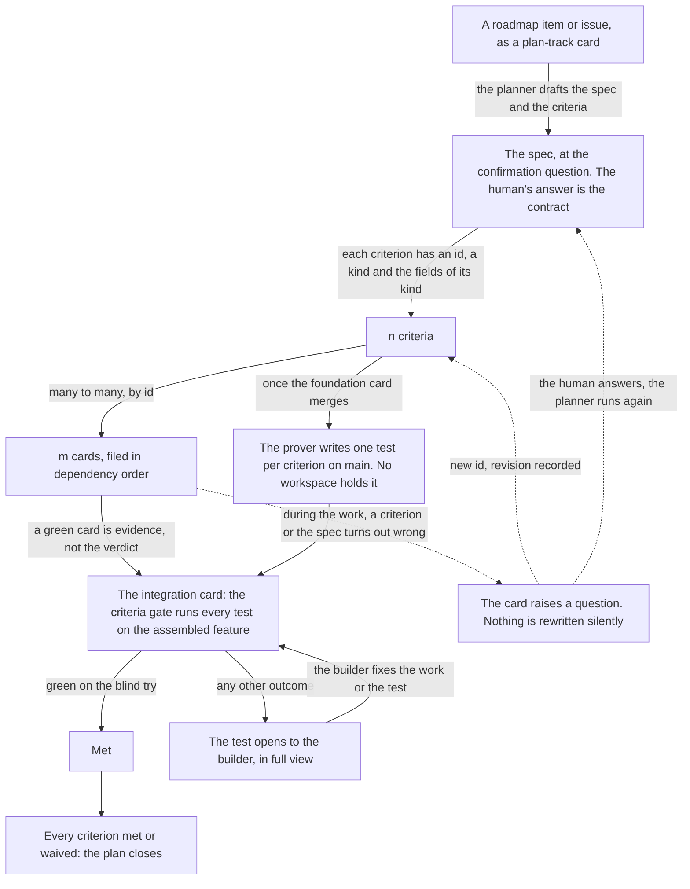
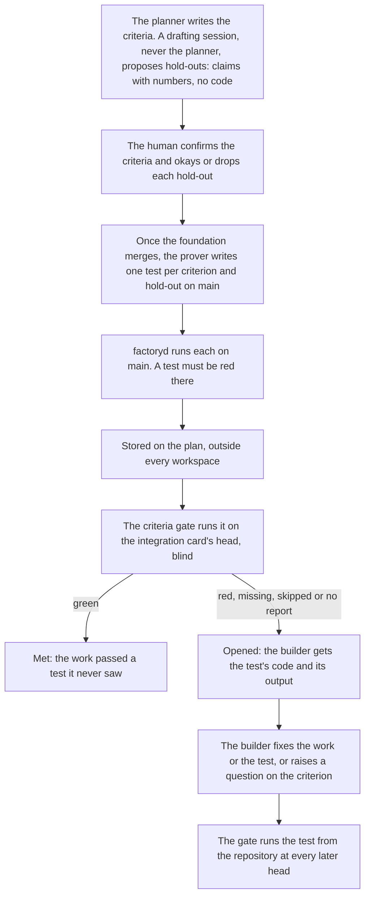
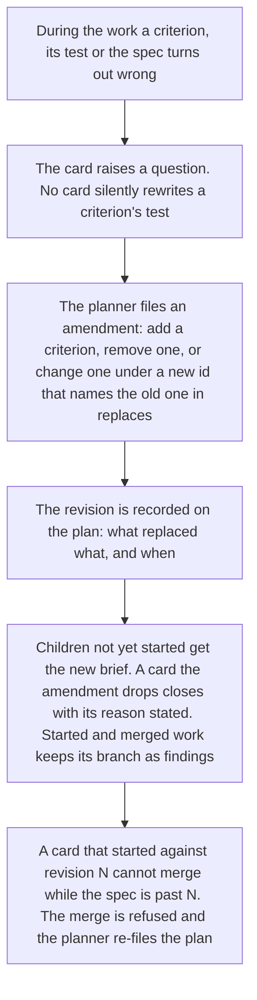

# The spec-driven process, in short

This is how the factory turns a roadmap item into merged code. One spec becomes criteria whose claims and numbers are fixed before any work starts. The criteria map to cards. A session the builders never meet writes each criterion's test. The cards build. One gate at the end runs every test on the assembled feature, the first run blind. It is built, roadmap items 285 to 291 and the blind proofs of [blind-proofs-plan-2026-11-03.md](blind-proofs-plan-2026-11-03.md), which replaced the hold-out audit and the review's verdicts on test criteria. This file brings a reader up to speed or serves as a reminder. The full design, the market research and every source sit in [the concept](spec-intake-concept-2026-10-16.md).

## The model in one picture

Two refinements the picture needs:

1. A criterion is not done when its card closes. A green card that cites a criterion is evidence. The verdict comes once, on the integration card, because most criteria are only testable on the assembled feature. A card whose session ends without a push closes on the proofs of the criteria it cites, run at main. That run settles the card, never a criterion, and opens no test.
2. Foundation cards cite no criterion. They build the contracts the other cards build on.

## Who settles a criterion

Every criterion says who settles it. There are four kinds:

| Kind | The proof | Who makes it | Who settles it | When |
|---|---|---|---|---|
| test | one test, written blind, stored outside every workspace until it ran once | the prover session | the runner, from the test's report | at the integration card's gate, and at a no-push session end |
| invariant | a test suite the repository already has, for example every test under `./...`; the proof is that it stays green | nobody, the suite is there | the runner, from the suite's report | the same |
| judgement | an artifact a blind test writes, and a pinned prompt | the prover writes the test, the planner the prompt | one model call over the artifact | at the integration card's gate |
| human | an artifact a blind test writes, or the evidence the criterion names | the prover, or the planner's text | the approver, one row on the Needs you card | before the integration card's merge |

A test criterion carries a claim, inputs and expected numbers and no test name, and the prover decides how. An invariant carries its suite. A judgement carries its claim, what its artifact must show and a pinned prompt. A human criterion carries its claim and the evidence the approver reads. Validation refuses a criterion without a field of its kind.

The line between judgement and human is fuzzy and the human draws it. The planner drafts the cheap judgement by default, and the human can move a criterion between the two kinds at any time. A flip of kind alone keeps the criterion's id.

## A change, end to end

1. A roadmap item becomes a plan-track card.
2. The planning session, the planner, reads the repository and drafts the spec: the outcome, a glossary, the criteria. It then attacks its own draft once, looking for contradictions, ambiguity and missing edge cases, and turns each finding into a question.
3. The confirmation question shows the spec and the criteria to the human. They answer, amend the wording, or comment and start another round. In the same form's second zone they okay or drop hold-out candidates, extra criteria the list misses, each a claim with inputs and expected numbers and no code. The criteria are fixed at the answered revision.
4. The planner files the plan: foundation cards first, the integration card last. A plan bigger than one round of cards (`max_cards`) files the first round and keeps the rest as an outline. When a round's cards are done, the planner plans the next on top of what they built, and the integration card comes in the last. Every criterion is cited by at least one card, every non-foundation card cites at least one, and the integration card's acceptance items cite every criterion by id. Validation refuses a broken or incomplete plan before any work starts.
5. The children file as cards with their dependencies and the planning card closes itself.
6. The prover runs once the foundation card merges, at the confirmation for a plan without one: one test per test, judgement and human criterion and per okayed hold-out, on main. The prover runs each with `bash check test` and files the set through `file_proofs`, three filings at most. factoryd runs every filed test on main: a test of kind test must be red there, a judgement or human test must write its artifact, and what stays green or unrunnable is stored flagged and opens without a blind try. The tests live in the database alone.
7. The cards run their stages: sessions, policy, checks, review, approval, merge. After every card only cheap checks run. Nothing reads the whole repository, nothing calls a model. A card whose session ends without a push closes on the proofs of the criteria it cites, run at main.
8. On the integration card the criteria gate runs every stored test and every invariant on the head, in one sandbox, through `bash check test`, and reads each JUnit report. A green stored test meets its criterion, blind. Any other outcome opens the test: the next session gets its code and its output, commits it at its path, and fixes the work or the test, or raises a question on the criterion. From then on the test in the repository is the proof. A model judges each judgement criterion's artifact with its pinned prompt, and the review reads the diff for the feature's behaviours alone, with the opened tests' original code.
9. The human settles each human criterion on its row of the Needs you card: Met, Not met with words that go back to the builder, or Waive with a reason. Approve opens once every criterion has a verdict, the bot merges, and the plan closes with every criterion met or waived.

## Blind proofs: one blind try, then the blindfold comes off

A hold-out is a criterion the spec's list missed. It is kept out of the plan, the briefs and the cards until its test ran once, and it is public after.

The blindness is construction, not a rule: no brief carries a test and no sandbox holds it before its run. One blind try, then the blindfold comes off, whatever the outcome. There is no audit session and no hidden rewrite. A test will sometimes be wrong and the work will sometimes drift for good reason, and the builder, the review and the human answer which in the open. The review gets each opened test's original code, so a weakened test is a finding unless the builder's summary says why, and the card's drawer shows the original beside the repository's version. Each met row records blind or open.

## When the spec changes

Criterion ids never change after the criteria are fixed. An id that changed its definition would make every record that cites it a lie, so a change is always a new id that names the old one in replaces, and the revision is visible on the plan.

## What the factory does that others do not

Other spec-driven tools leave the spec as text a model reads against the code, once, at the end. The factory does four things differently, and each has a reason.

**The criteria are data, not prose.** Each criterion carries an id, a kind and the fields of the kind. So programs do the bookkeeping: validation refuses a plan that forgets a criterion, and the gate runs each test and reads its report. A program cannot forget a test, skip a run or invent a result. A model asked the same question can.

**The claim is fixed before the code exists, and the test is written blind.** The claims and numbers are fixed at the confirmation. The tests come from the prover on main before the feature exists, and each must fail there. A test the builder writes after its own code bends to that code.

**One blind try, then full view.** The tests are blind by construction, and one that is red, missing or skipped opens to the builder with its code and its output, in full view. A test kept hidden with no way to answer it goes wrong in the open: the one large deployment of hidden tests, SWE-bench Verified, rejected correct solutions and was abandoned. One blind try, then full view.

**Nothing is rewritten silently.** Ids never change, revisions are recorded, and a stale card cannot merge. Rewriting a test quietly is how a spec dies: the code drifts, the spec text follows it, and no record says it happened. An opened test the builder changes shows in the review beside its original and in the drawer.

Four smaller moves follow from the same shape:

- The human confirms, never writes. The planner drafts because it sees the repository and costs a fraction of a human minute. The human answers one question, okays hold-outs, settles the human criteria one row each and approves merges. A human minute buys the most at the spec, before any code exists.
- Verdicts and catches are data. Every verdict is a row with its source: the gate's blind or open, the model's with its prompt's hash, the approver's. Every catch names its finder on the plan: the self-attack's findings, the confirmation edits, questions, revisions, the prover's refusals, the opened tests and delta cards. One query gives the share of met criteria the blind try settled, which says whether the prover earns its session.
- No spec tax. A medium change takes the spec path as one card that is its own integration, and the small stuff pays nothing: a bug fix's spec is the report plus the reproduction gate, a dependency bump's spec is the test suite.
- Construction over prompts. Every guarantee lives in the schema, the validation, the gate and the routing. Prompts draft, they never enforce. A step that is too large is split by rule, not by asking the agent to be careful.

## The limits

- A wrong test the work can satisfy without a fight goes green and grades nothing. The dry run on main is the earlier catch, telemetry after merge is the backstop.
- Whether the criteria cover the spec is a judgement no check makes. Hold-outs and the review's behaviour notes are the watch on it.
- A proof the sandbox cannot run does not exist here: no browser in the default image (a card can run on a project image that has one, roadmap 281, but criteria stay in-process under `check`), no external database, no model call inside check. A judgement is one model call over what a test wrote, never over the diff, and any other want becomes a human criterion that names the weakness, or waits as a note.
- One blind try per test. A test that opens red because it is wrong, or because a contract moved, costs the builder a session with the test in hand, about what writing it would have cost, and the blind share of met criteria says whether that pays.

## Reading further

- [The concept](spec-intake-concept-2026-10-16.md): the full design, the market research, every ruling and source.
- [blind-proofs-plan-2026-11-03.md](blind-proofs-plan-2026-11-03.md): the blind proofs, the runner, the four kinds' checks and the account that led to them.
- [roadmap.md](roadmap.md), items 285 to 291: the build, step by step.
- [architecture.md](architecture.md): where the pieces sit in the factory's planes.
