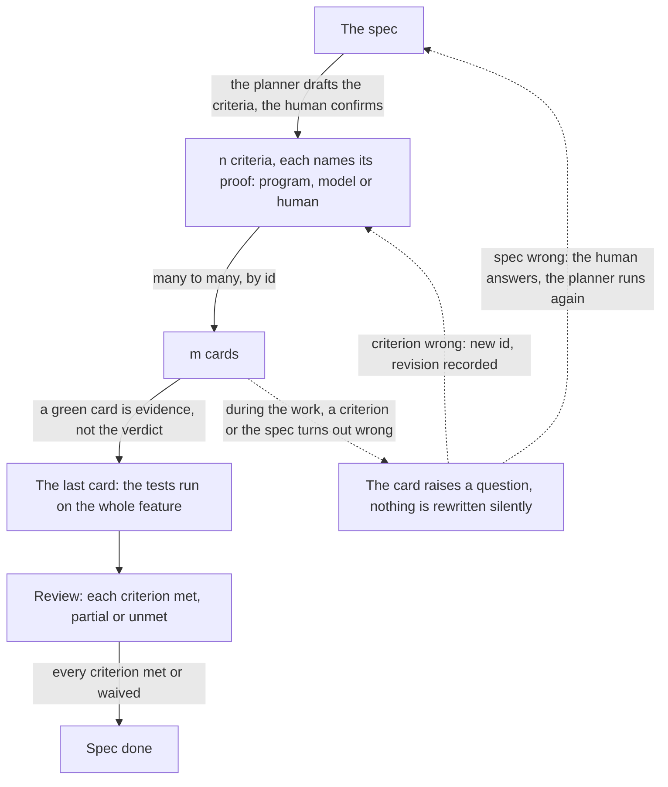

# Spec-driven intake: a concept

Written 2026-10-16. Intake means the step where new work becomes cards. This file turns the design discussion of that day into a concept: the model in one picture, the needs, the challenge, what other tools do, where interpretation happens, the current state, and the pieces that close the loop. Status: concept. Nothing here is built or a roadmap item.

## 1. The model in one picture

One spec makes n criteria. The criteria map to m cards, many to many: one criterion can span several cards, one card can serve several criteria. The cards build and close. On the last card every test runs against the whole assembled feature, the review judges each criterion, the approver settles the human ones, and when every criterion is met or waived the spec is done.



Three refinements, the places a simple model usually breaks:

1. **A criterion is not done when its card closes.** A working card that cites a criterion and closes green is evidence. The verdict comes once, at the end, on the last card. The reason: most criteria are only testable on the assembled feature. The schedule test needs the store, the engine and the page together.
2. **The spec does not write the criteria by itself.** The planner drafts them, an interpretation, and the human confirms them at the confirmation question. Section 5 maps every judgement of this kind.
3. **Some criteria name no test.** A want like "the confirmation message reads friendly" has no deterministic test. It becomes a criterion of kind judgement: the claim, fixed inputs, a pinned prompt, and the review's model judges it every time the review runs, with the model and the prompt recorded. When the claim matters too much for a model, the criterion becomes kind human: the approver decides it at approval, on the evidence the review gathered, and the decision is recorded. The boundary between the two is fuzzy and the human draws it. The planner drafts the cheap judgement by default, and at confirmation or by a later revision the human moves a criterion between the two kinds either way. No proof is perfect. The point of the kinds is that every criterion says who settles it, and the human can change that at any time.

The special case rides the same picture, the dotted lines: during the work a card finds a criterion or the spec itself wrong. The card raises a question, nothing is rewritten silently, and section 5 carries the full rule. Foundation cards cite no criterion, they build the contracts the other cards need. And a spec can also close on recorded waivers, an approver's decision that names the criterion and the reason.

## 2. Needs

Work enters the factory as roadmap items today, written by Sebastian. Later, users will add issues on GitHub, and both sources will exist side by side. Whatever the source, the questions are the same: what exactly should be built, and how do we know it is done when the cards close? Five needs drive this concept:

1. **An agreed outcome before work starts.** A roadmap item says what and why ([roadmap.md](roadmap.md), "How to read an item"). Nothing today turns it into a concrete outcome with acceptance criteria before building starts. The market research states the gap: "Spec-driven intake does not exist yet: tasks come from issues, not from specifications with acceptance criteria" ([00-our-vision.md:54](market-research/00-our-vision.md#L54)).
2. **The cheapest place to catch a wrong outcome is the spec.** A wrong outcome caught as spec text costs a rewritten page. The same error caught at review costs a thrown-away branch. Human attention is scarce, and its best value per minute is reading a spec before any code exists.
3. **Closed cards must add up to the spec.** A spec will often split into several cards, and each card builds part of it. That is the design, not a problem. The need: when every card has closed green (passed all its gates), the spec as a whole must be reached too. If a part is missing, the gap must be visible as work that someone owns. It must not surface later as a discovery in production.
4. **No spec tax.** Bug fixes, dependency bumps, renames and configuration changes pay nothing. The change itself is the spec: a bug fix's spec is the report plus the reproduction gate, a bump's spec is the test suite. Ceremony before work scales with the size of the change. The checks after work never scale down.
5. **Construction over prompts.** Every guarantee comes from process shape, checks and gates. Prompts draft, they never enforce. This is the project's own design rule: reliability comes from how a step is built, not from its prompt.

## 3. The challenge

- **Interpretation cannot be engineered out.** An LLM turns the item into a spec, the spec into criteria, the criteria into tests. Each of those steps can get it wrong, and a wrong test can also surface only during the work. The design's answer is not to remove the LLM. It is to name each judgement, give it an owner with the right context, and make every revision of a judgement visible. Section 5 maps them.
- **A spec that no gate reads is dead text.** The first time the code conflicts with it, the code wins. Every piece of this concept must be read by a check, a gate or a tool. Otherwise it is cut.
- **Criteria and cards cross.** One criterion can need changes in several cards. One card can serve several criteria. So a rule like one card per criterion cannot work. What is needed instead: a list that says, for every criterion, which cards work on it. Then a check can see when a criterion has no card at all.
- **The bookkeeping around the tests must be program work.** A criterion names the test that should prove it, with inputs and expected numbers. Whether that test exists in the repository and passes is a plain fact. A program should establish it, because a model asked the same question can forget a test, skip a run or invent a result. Whether the test really proves the criterion is a judgement, and it stays with the steps that can judge.
- **The cost rule limits what runs after each card.** After every card the factory runs only cheap checks: the project's own test command, the policy gate on the changed files, the reproduction. Nothing that reads the whole repository, nothing that calls a model ([layers.md](layers.md), section 2). Running all of a spec's tests is not that cheap. So that run happens once, at the end, on the last card, not after every card on the way.
- **The stage minimum holds on every path.** A process file may add stages, it may not remove these four: checks, policy, approval, merge. Screening, when present, runs first. Merge runs last. The layers doc calls this the floor. This concept does not touch it.
- **The existing machinery should carry the weight.** The planning session, the plan JSON and its validation, the question machinery, the creation of child cards, the task dependencies and the review stage already exist. The concept adds rules to them. It does not build a second system beside them.

## 4. What the competition does

Six spec-driven tools are catalogued in the market research. The question put to each: how does it make sure the whole spec is met when the work is split into tasks? Where a whole-spec check exists at all, it is a closing pass: a model re-reads the spec against the aggregate diff (Spec Kit, BMAD, Superpowers), the agent re-runs tests it linked itself (Tessl), or nothing enforces it (OpenSpec, Kiro past its tags and optional tier).

| Tool | Whole-spec check | Who judges | What we take |
|---|---|---|---|
| Kiro | Requirement tags on tasks, checkpoint tasks, optional property tests from criteria | The model. Tests only in the optional tier | The EARS phrasing for criteria, the requirement tag, the property idea |
| Spec Kit | `converge` diffs code against spec and appends the gap as new tasks | The same agent grades itself | Delta findings become new cards, not a re-plan |
| BMAD | `bmad-retrospective` re-runs review lenses over the whole epic's diff | Model review lenses | A named closing check, separate from per-change review |
| Tessl | Each requirement carries an inline `[@test]` link, the closing pass re-runs all linked tests | The agent reports the runs. A script checks only that the links resolve | The machine-checkable link from criterion to test |
| Superpowers | Task reviewer plus whole-branch reviewer | Model reviewers, human at the end | The whole-branch shape of the closing review |
| OpenSpec | An optional `/opsx:verify` agent read, nothing enforced, drift admitted | Humans at propose and archive | The cautionary example |

None of them separates the bookkeeping from the judgement. Tessl comes nearest on bookkeeping: a script checks that every requirement's test link points to a file that exists. It stops there. No tool runs the linked tests and requires them green, and in the other five the requirement names no test at all, so a model reads spec against code and the answer is only as good as that model.

The factory can split the two, because its acceptance items already are tests: a name, inputs, expected numbers. When a criterion names its test in a field, a program can establish the facts: the test exists, it runs, it passes. Everything that needs understanding stays with interpretation, mapped in the next section.

## 5. Where interpretation happens

This concept does not remove the LLM from spec work. No process can. What it does: every judgement in the chain gets a named owner, a moment, and a check that catches a wrong one. The map:

| Judgement | Who makes it | What catches a wrong one |
|---|---|---|
| What the item means | The planner, when it drafts the spec and criteria | The planner's own attack round, then the human at the confirmation question |
| That a criterion can be proven by the named test, with these inputs and numbers | The planner, at drafting | The human reads the test names and numbers at confirmation. What slips through surfaces during the work, as a question |
| That the spec is what is wanted | The human who answers the confirmation question | Nothing above it. This answer is the contract |
| That the test code tests the criterion | The builder who writes the test | The review stage reads test against criterion, with the whole feature's diff |
| That a judgement criterion is met, say a post reads positive | The review's model, on the criterion's fixed inputs, every review run | The verdict quotes its evidence, and a revision re-runs it. No deterministic check sits above it |
| That a human criterion is met, say the page looks calm | The approver, at approval, on the evidence the review gathered | The decision is recorded with its reason, the same recording a waiver uses |
| That a hold-out tests what the member meant | The member, at the drafted test on the form, and again whenever one fails | The draft sits beside the criterion at confirmation, and a failure lands on the member with the test and its output |
| That an unmet criterion needs a delta card or a spec change | The planner, from the review's finding | The criterion row stays visible until the criterion is met, waived or revised |
| That the criteria together cover the spec | The planner | The completeness check covers criteria against cards, not the spec against the criteria. That gap is judged by the review's behaviour notes and by hold-outs |

Why the judgements sit where they sit:

- **The human confirms instead of writing.** The planner drafts because it sees the repository and costs a fraction of a human minute. The human answers because need 2 says the scarce minute buys the most at the spec. The planner's draft is a proposal. The human's answer is the contract.
- **The test is named before the code exists.** This is the TDD move, and the reason is the failure mode it prevents. A test written after the code bends to whatever the code happens to do and proves nothing beyond itself. A test named first is a claim made in public, at the cheapest moment to challenge it. The claim can still be wrong, and the next paragraph carries that case.
- **The gate does bookkeeping, nothing else.** It proves the named tests exist and pass. It does not prove the spec is met. A program is put on this step because a program cannot forget a test, skip a run or invent a result. The believing stays with the owners in the table.

**When a test turns out wrong.** Implementation is where the guess meets reality. Inputs turn out unrealistic. The expected number rests on a wrong assumption. The criterion itself turns out ambiguous, or wrong. The rule: no card silently rewrites a criterion's test. The card raises a question, the criterion is revised under a new id, the revision is recorded, and the staleness rules of piece 10 apply to the cards below. Revising a test in the open is normal work. Rewriting it silently is how a spec dies.

## 6. Current state

Two processes ship: `maintenance`, the fix-and-improve flow, and `spec`, which builds an application from a written spec ([target-architecture.md](target-architecture.md), section 6). The spec path works like this:

- A plan-track card starts a planning session on a stronger model. The planner reads the repository and the spec text, writes no code, and answers with one JSON plan of 2 to 12 cards, twelve the shipped bound. Each card in the plan has a key, a role (`foundation`, `feature` or `integration`), a short brief, guidance directories, dependencies, acceptance items and a size. Each acceptance item is a test by name with its inputs and expected numbers ([architecture.md](architecture.md), the planner and the plan card).
- A validation step refuses a plan with a broken shape. factoryd, not the model, adds the ordering: foundation cards first, the integration card last.
- The planner can ask the writers questions, with choices. A writer's comment starts another planner round. A stale-revision check exists. "Plans do not nest".
- When no question is open, the planning card files its children: one issue and one task row per card, in dependency order. A child's brief carries the spec, the plan's summary and the featureGuide, which asks for one test per acceptance item. A child that waited on others starts from main with their merged work.
- The human's spec today is the card body. Whoever files the card writes the spec text by hand, or there is no spec at all.

Ruling 225 ([the lane-collapse plan](plans/2026-10-14-lane-collapse.md), decided 2026-10-14) settles the shape this concept is written against. Every card gets a track when it is filed. Track `plan` means a planner session splits the work into cards first. Track `direct` means the card goes straight to a builder. The lanes on the board (backlog, plan, ready) go away, the plan settings move into the track's config in the process file, and the accept and Start-plan clicks go: a plan-track card whose questions are all answered files its children and closes on its own.

What is missing, against the needs:

1. Nothing at intake writes the spec. The filer writes the card body by hand, or there is no spec. That is gap 1 of section 2.
2. The criteria are sentences in a document. There is no list of criteria a program could read, so nothing can check coverage.
3. No completeness check. The validation refuses broken shapes. It does not refuse a plan that forgets a criterion.
4. The integration card's acceptance items are whatever the planner chose. Nothing requires them to be the spec's own criteria, run against the whole assembled feature.
5. Nothing checks that a criterion's test exists and passes. A card can close green with a named test never written.
6. The review reads the brief, the diff and the gate results. Nothing asks: is the spec met?
7. No hold-out. The planner sees every criterion it will be graded on. (A hold-out is a criterion added after planning, kept away from the planner.)
8. The planner must answer at least two cards. A medium technical item cannot take the spec path as one card.
9. architecture.md section 10 reserves a place for hold-out scenarios, hidden from the step being graded. This concept's hold-out zone fills it.

## 7. The concept

Ten pieces. The three-layers doc requires every new idea to name its layer first: the factory's code, the process file, or the prompts ([layers.md](layers.md), section 1). The table does that. Then the pieces in order.

| Piece | Layer | What changes |
|---|---|---|
| 1. Criteria block | Factory, plan schema | The plan carries the criteria as data: id, kind, test name, inputs, expected numbers |
| 2. Ids on acceptance items | Factory, plan schema | Every acceptance item cites the criterion it works on |
| 3. Completeness and coverage | Factory, ValidatePlan | Every criterion cited by a card. Every non-foundation card cites |
| 4. The criteria gate | Factory, a gate activity | On the integration card: every criterion's test exists and passes |
| 5. Spec drafting | Factory session mode, prompts for content | The planning session drafts the spec from the card body before planning |
| 6. Hold-outs | Factory, the question machinery | Criteria added at confirmation, unseen by planner and builders |
| 7. Spec verdict in review | Factory guides and schema | Per criterion: met, partial or unmet, as data |
| 8. Plan close | Factory | The plan closes with every criterion met or waived by an approver |
| 9. One-card plans | Factory, track config | The plan minimum is one card, its own integration |
| 10. Staleness and revision | Factory | Criterion ids never change. A revision is visible, and every card below it is checked against it |

1. **Criteria block.** The plan JSON gains a criteria list. Each criterion has an id, a kind, and for kind `test` a test name with its inputs and expected numbers, the house format. A criterion of kind `invariant` names a test suite and carries no inputs, for example "every test in `./...` passes". A criterion of kind `judgement` names what a model judges: the claim, fixed inputs, a pinned prompt, and no test. "Did the post read positive" is such a criterion, with the post's text as its input. Its proof is the review's verdict, which runs every time the review runs, and the verdict records the model and the prompt. A criterion that states a quantity or a limit becomes a property-style test with generated inputs, ordinary repository code like any other test. The named test is a guess, made early on purpose: this is how we think the criterion can be proven. Section 5 carries what happens when the guess turns out wrong. One rule governs the test and invariant kinds: the test must run under the project's own `check` command in the sandbox, against in-process fakes and the store's test harness. No browser, no external database, no device. Those need a stage kind that does not exist yet, the before-and-after screenshots candidate named in [layers.md](layers.md). Cards already follow this rule today: "no card asks for a check `bash check` does not run". The criteria inherit it. A model call has no place inside `check`: it would bill every card run, the sandbox's egress forbids it, and a model verdict is not stable, the same input can score differently on a re-run. That is why judgement criteria ride the review, a model call the factory already makes once. A criterion of kind `human` names a claim only a person settles, with the evidence the approver will see. Its proof is the approver's recorded decision at approval, the same recording piece 8 builds for waivers. The line between judgement and human is fuzzy and the human draws it: the planner drafts the cheap judgement by default, and at confirmation or by a later revision the human moves a criterion between the two kinds either way. A flip of kind alone keeps the criterion's id, the claim is untouched, and the revision records the flip. Wants that no code and no model can check become human criteria and stay in the list: a look needs a picture the factory cannot take yet, a real third-party service needs the real world. Only production behaviour falls out entirely: latency under real load cannot be proven before merge, not even by a person. Telemetry after merge watches it and feeds signals.
2. **Ids on acceptance items.** Every acceptance item in every card cites the criterion it works on. One criterion can be cited by several cards, one card can cite several criteria. Which cards work on a criterion is simply the sum of their items' citations, so no second list is needed that could drift out of step. This is Kiro's requirement tag and Tessl's test link, in one field. A foundation card need not cite any criterion: its items are the contracts the other cards build on, though it may cite one.
3. **Completeness and coverage.** The plan validation gains three rules. First, every criterion is cited by at least one card. Second, every card that is not a foundation card cites at least one criterion. Third, the last integration card cites every criterion, and its own acceptance items are the criteria's tests, verbatim by id, run against the whole assembled feature. A judgement criterion has no test, so it reaches the integration card as an item that names the claim, and the review answers it. The same holds for a human criterion: it arrives as an item that names the claim, the review gathers the evidence, and the approver settles it at approval. Hold-outs are linked to the integration card when the children are filed, so the first rule holds for them without extra work. A plan that forgets a criterion now fails before any work starts, the cheapest moment to fail. What the rules cannot see: a card that cites a criterion but does not really work on it. The integration card's criteria are the backstop, and a mismatch shows there as a review finding. These rules check criteria against cards. Whether the criteria cover the spec is a judgement, the last row of the table in section 5.
4. **The criteria gate.** One new gate, on the integration card only, in the place the reproduction gate fills for a bug card. For every criterion of kind test, it looks up the named test in the repository, runs it under `check`, and requires it passed. For every invariant criterion, it requires the named suite green. Judgement and human criteria are outside the gate. They have no test to look up, their proof is the review's verdict or the approver's decision. The gate also materializes the plan's hold-outs, the stored tests no workspace ever held, and runs them under `check` on the integration card's head. The gate is a plain program doing bookkeeping: these tests exist, these tests pass. It does not judge the spec, the owners in section 5 do that. It runs once, at the end, on one card. That is how the cost rule holds. A criterion whose test is missing or fails is a finding, like any other gate finding. A gate that runs and reports nothing does not pass. The existing rule that such silence lands on a human's card covers this gate too.
5. **Spec drafting.** Today the filer writes the spec into the card body by hand. Under this concept the planning session drafts it first: the outcome in a few sentences, a glossary that names each component once, then the criteria in the house format. The planner then attacks its own draft once, a fixed section in its guide: look for contradictions, ambiguity and missing edge cases, and turn each finding into a question on the card. The confirmation question shows the spec to the writers. They answer it in Needs you, amend the text, or send a comment that starts another round. The criteria are fixed only when the question is answered, so a late answer cannot leave old numbers in place. Kiro runs requirement analysis as a separate second pass. That stays a later option. Measure this single-round version first. Templates ship a spec skeleton with standing criteria, the invariants every project wants anyway, and the planner drafts into it.
6. **Hold-outs.** The confirmation form has two zones. The answer zone goes to the planner and starts its next round, the existing machinery. The hold-out zone takes criteria in the house format, name and inputs and expected numbers, and never reaches the planner's brief. A routing rule in the form makes that true by construction. The form offers candidates, the project's past revert reasons and failed integration findings, one click each. The member types the criterion, the review model drafts the test code from it against the repository, and the member sees the draft beside the criterion on the same form, in case the draft misses the point. When the children are filed, factoryd links each hold-out to the integration card, and the card's brief and acceptance items never carry it. The drafted test is stored on the plan, outside every workspace: no brief shows it, no sandbox holds it. The zone hides the criterion from the planner and from the builder, blindness by construction, the file is simply not there. No anti-cheat rule is needed for it: roadmap 64 guards the other side, the criteria tests the builders write themselves. A hold-out that fails, or cannot run against the repository as it now stands, is not a finding for the card. It lands on the member who wrote it, with the test and its output, for one judgement: a real gap or a wrong test. A real gap goes back to the integration card described in the words of the spec, the test stays hidden and the member decides how much to tell. A wrong test is rewritten or dropped by the member, recorded like any criteria revision. A spec revision reopens the hold-out zone at its confirmation round: the member re-checks every hold-out against the changed spec. This is the stronger form of architecture.md section 10, and it ships here, not behind a roadmap item.
7. **Spec verdict in review.** The integration card's brief already carries the spec. The new part is the fixed criteria with their ids. The review stage reads the brief and the whole feature's diff, and answers for every criterion: met, partial or unmet, with the test name and numbers as evidence, or, for a judgement criterion, the judge's verdict on its fixed inputs and the quoted reason. A human criterion the review does not settle: it gathers the evidence, and the approver's recorded decision at approval is the verdict. It also notes behaviour the code shows that the spec does not state, one note per behaviour. The verdict is data on the task, so later analysis can say which criteria fail at integration and whether hold-outs catch real gaps. Unmet criteria loop back to the card's sessions, as findings do today. A fix that changes files outside the card's guidance directories, or that reopens a merged card's acceptance items, is too large for the card. The finding goes to the planner, and piece 8 carries what it does. Who did the fix stays visible, the diff and the audit trail show it belongs to the integration card's task. A behaviour note lands as a comment on the issue. It becomes work only when a human files it: a note owes no work, the plan promised none.
8. **Plan close.** The plan closes when every criterion is met or waived. A waiver is an approver's recorded decision that names the criterion and the reason. A human criterion's proof is the same recording, a yes instead of a waiver. When a criterion is unmet and the fix is too large for the card, the finding goes to the planner: it drafts a delta card under the open plan, citing the criterion, and the card files like any child, per ruling 225. When the fix needs a change to the spec, the planner raises the question instead, and the human answers it. The human judges the spec, the machine files the cards, that is the escalation rule. When the plan's cards run out of sessions with a criterion still unmet, the plan shows it, and an approver has two options: grant one more bounded card or session, or waive the criterion. A silent gap under green cards cannot happen, the gap is a criterion row, visible and owned.
9. **One-card plans.** The plan minimum drops from two cards to one. A medium technical change, say a storage migration, then takes the spec path without being split: its invariants become the criteria, one card cites them all, and that card is its own integration. The validation rules hold, the card cites every criterion.
10. **Staleness and revision.** Criterion ids never change after the criteria are fixed. An amendment adds a criterion, changes one under a new id, or removes one. A removal fails validation until the card citing it is removed too. A card that started against revision N cannot merge while the current spec is past N. The stale-revision check that exists today for the planner round is extended to the merge. A test that turns out wrong takes the same path, as section 5 describes: the card raises a question, the criterion is revised under a new id, and the revision is recorded. No card silently rewrites a criterion's test. Under ruling 225, a child whose work shows the plan wrong raises a question like any card. The plan is a document, not a contract. The answer starts the planner again. This concept adds the rules for that restart: the new revision re-runs the checks, replaces the briefs of children not yet started, leaves started children their branch as findings, and never reopens a merged card.

What does not change: the stage minimum on every path. The label routing and the intake rule stay in code. The cost rule holds, the only new model reads are the same review, once, on a bigger diff. The merge authority stays. The planner keeps its 30 minutes with no check-in, drafting and the self-attack round happen inside that budget, and the bound moves only when measurements show misses. The reproduction gate stays the bug fix's spec.

Cost: the planner drafts inside its existing session, one comment round deeper than today. The criteria gate is a plain program and runs once. The integration card's review reads a larger diff than a feature card's, and judgement criteria add their judge reads inside that same review. Human criteria add no model spend, only approver attention at a stage that already exists. Hold-outs add tests to one card. A delta card costs one planner round when a plan missed something. No new per-feature-card model spend.

Rollout, each step ships on its own:

1. Criteria list, item ids, completeness and coverage. Works with a human-written criteria list in the card body until drafting lands.
2. One-card minimum.
3. The criteria gate.
4. Spec drafting, the confirmation question, the spec skeleton in templates.
5. Hold-outs.
6. The spec verdict as data and the plan-close rule.
7. The staleness extension.

One recording rule spans the steps: every hole catch names its finder on the plan, the self-attack's findings, the member's confirmation edits, questions, criteria revisions, behaviour notes, hold-out failures and delta cards. One query over a week of plans then gives the self-attack's catch count and miss count, the numbers the second-session question of section 11 waits on. The confirmation edits count every change, taste included, so the miss count reads high. The churn question joins records that already exist: every revision names the old id, the new id and the time, and card states at that moment and every session after it sit in the audit trail. The join counts the sessions each restart rule caused, and the integration findings on revised criteria show what merged-never-reopens let through. A week of real plans answers both.

Later, not v1: the discovered-requirements ledger (unclaimed behaviours collected on the plan feed the next item's drafting), checkpoint cards mid-plan for large plans, file-glob targets on criteria, Kiro's separate Analyze pass, full property-test machinery with shrinking. Wild ideas, recorded for honesty: factoryd mutates criteria inputs to synthesise hold-out candidates for the approver to pick. And shadow drafts, where the planner drafts even when a human wrote the spec, and the disagreement diff grades both.

### The three guiding ideas

The roadmap's three ideas govern every item ([roadmap.md](roadmap.md), the guiding ideas). This concept against each:

- **Primitives, not a process.** The concept adds no stage and no dependency or merge key. Its pieces are plan-schema data, factory checks and gate activities, shared by every process that uses the plan machinery. The one knob a project sees is a track-config value, `min_cards`, a plan bound. The completeness check stands in the same class as `factoryd config check` refusing a cycle: the machine refuses a composition that cannot work, here a plan that misses a criterion.
- **Fewer manual steps than the competition, with enough security.** Ruling 225 removes the accept and Start clicks. This concept adds one human moment, the confirmation question, and that question replaces heavier work: the filer writes the spec by hand today. The stage minimum stays untouched, every path keeps checks, policy, approval and merge, and the criteria gate is a gate, not a trust decision.
- **Limited scope, full context, simple prompts.** The planner drafts inside its session with the repository in reach. The integration card gets the fixed spec in its brief, the full context for its goal. The criteria gate is bookkeeping, a plain program. The self-attack round is self-correction over prevention. The only prompt content is drafting guidance, and every enforcement lives in a schema, a check or a gate. A step that arrives too large, a hold-out fix outside the card's directories, is routed out by rule, not by asking the agent to be careful.

Each rollout step above lands as its own roadmap item and primitive, composable per the first idea.

## 8. The process file gains one value

The process is configuration: four blocks with fixed keys ([target-architecture.md](target-architecture.md), Processes as configuration). This concept adds no stage, no dependency key and no merge key. Its one process-file change is a plan bound: ruling 225 moves the plan bounds into the track's config in the process file, and piece 9 sets `min_cards: 1` beside `max_cards` there. Every other piece lives in the plan schema, the plan validation, the question machinery, the gate activities and the review guide, which belong to the factory. The shipped file, the best example of the shape:

```yaml
# factory/processes/spec.yaml, as shipped
lanes:
  - {name: backlog}
  - name: plan
    class: planner
    moved_by: writers
    plan: {max_cards: 12, foundation: true, integration: true}
  - {name: ready, class: coder, moved_by: writers}
dependencies: {wait_until: done, on_failed: human}
stages:
  - {name: screening, on_findings: human, enabled: true, when: outsider}
  - {name: policy, on_findings: fail, enabled: true}
  - {name: migration, on_findings: human, enabled: true}
  - {name: reproduction, on_findings: agent, enabled: true}
  - {name: checks, on_findings: agent, enabled: true}
  - {name: review, on_findings: agent, enabled: true}
  - {name: audit, on_findings: human, enabled: true}
  - {name: approval, on_findings: human, enabled: true}
  - {name: merge, on_findings: human, enabled: true}
merge: {queue: project}
```

Under ruling 225 the lanes block goes and the plan bounds move to the track's config. The stage minimum never changes: checks, policy, approval and merge always present, screening first, merge last.

## 9. A feature through the process, step by step

A made-up project, not part of the factory: **greenhouse**, a watering scheduler for a school greenhouse, from the `ts-go` template. The roadmap item: "Water the greenhouse from a schedule. Teachers edit schedules on a web page. A wet soil sensor pauses watering."

1. A member promotes the item as a plan-track card, body as above. Item 205's promotion rule applies: the item is promotable without asking, its Priority filled and a concept doc backing it.
2. The planning session starts. It reads the template and the card body, drafts the spec, attacks it once as the guide requires, and answers the card's questions plus its own: zones, two or four?
3. The confirmation question appears in Needs you with the spec attached. The outcome: the greenhouse waters each zone from its schedules, teachers manage schedules on a web page, a wet sensor pauses that zone. The criteria:
   - `schedule_test`, criterion 1, kind test: three schedules across two zones, one day, expected four watering events. The rule engine runs as a pure function.
   - `edit_test`, criterion 2, kind test: rename a schedule through the page's model, expected the list shows the new name.
   - `sensor_pause_test`, criterion 3, kind test: a reading posted wet through the API in-process, expected zero watering events in that zone while wet.
   - `api_test`, criterion 4, kind test: GET /schedules on a seeded in-memory store, expected three entries.
   - `friendly_empty_state`, criterion 5, kind judgement: the schedule page's empty state, no schedules yet, reads friendly to a teacher. The judge reads the rendered string, there is no test.
   - The template's standing invariant comes too: every test in `./...` passes.
4. The member answers on one form with two zones. The answer zone says two zones, amends one wording, and starts the planner's next round. The hold-out zone adds `overlap_test`: two overlapping schedules in one zone, expected one watering event, the second delayed, never doubled. The review model drafts the test code, the member glances at the draft on the same form, and the test is stored on the plan, outside every workspace. The hold-out never reaches the planner's brief or a builder's sandbox. The member also flips criterion 5 from judgement to human, the school's wording matters, so the approver decides it personally. The flip keeps the id and the revision records it. The criteria are fixed at this answered revision.
5. The planner, re-run with the answer and not the hold-out, files the plan: five cards. F1 foundation, the store, the schema and the HTTP API, naming the contracts, its items citing criterion 4, with the exemption meaning its other contracts need no criterion. F2 the rule engine, items citing criteria 1 and 3. F3 the web page's model and screens, citing criteria 2 and 5. F4 the sensor input, citing criterion 3. I1 integration, citing every criterion, the five from the spec and the standing invariant. The validation checks the shape, completeness (1 to 5 each cited), no orphans, coverage (I1 cites every criterion). factoryd adds the ordering, F1 first, I1 last.
6. No question is open, so the planning card files its children as direct-track cards with their dependencies and closes done, per ruling 225. The hold-out is linked to I1 at filing, after the planner's session ended. I1's brief and acceptance items never show it.
7. F1 runs first: sessions, policy, migration to a human, for it creates the store's schema, checks, review, audit, approval, merge. Screening does not run, it applies to cards from outside contributors. F2, F3 and F4 run as slots free, each starting from main with F1 merged, migration n/a for them. The planner's guide keeps cards that share directories dependent, so the three do not collide on one router file.
8. I1 starts last, from main with everything merged. Its builder writes the four criteria tests as end-to-end tests against the running app in-process, all green, and asks for review. The criteria gate materializes `overlap_test` on I1's head: it fails, the rule engine doubles the overlapping window. The failure lands on the member with the test and its output, not on the card. The member judges a real gap and sends I1 one line in the words of the spec: two overlapping schedules in one zone water once, the second waits its turn. I1's next session fixes the merge logic in the same branch. The fix touches F2's merged code, inside the directories I1's plan names, so it stays I1's finding, attributed to I1's task, and F2's card stays closed with its own green history. Had the fix reached outside those directories, the finding would have gone to the planner for a delta card. Suppose instead the builder had found `sensor_pause_test` untestable as stated, say the wet sensor posts readings only every ten minutes: that is the wrong-test case of section 5, a question, a revised criterion under a new id, not a silent rewrite.
9. The criteria gate runs again on I1's new head: criteria 1 to 4 pass under `check`, the hold-out passes on the fixed head, and the standing suite is green. Criterion 5, kind human since the flip, has no test for the gate to run, its proof is the approver's decision at approval. A plain program, no model.
10. I1's review reads the brief with the fixed spec and the whole feature's diff. Verdict: criteria 1 to 5, the hold-out and the standing invariant met, the tests with their names and numbers, criterion 5 settled by the approver's recorded decision on the review's quoted evidence. One behaviour note: the page polls every 10 seconds, the spec said nothing, the note lands as a comment on the issue. The approver approves, the bot merges.
11. The plan closes: every criterion met, nothing waived. Spec reached.

## 10. A one-card technical change

The demo project, the link shortener: "count clicks in Postgres, not in memory." The criteria are one invariant and one test: the invariant, every existing test in `./...` passes unchanged, and `persist_test`, kind test: seed 412 clicks, restart the store through its harness, read the counter, expect 412. One card cites both and is its own integration, so the validation rules hold. The schema change still goes through the migration stage to a human, as the shipped process runs it. The card merges with the migration approved, and the spec was two lines of invariants the planner drafted in the same session.

## 11. Open questions

- **A separate requirements analysis versus the self-attack round.** Before a human sees a spec draft, something should hunt for holes in it: contradictions, vague words, missing cases. The concept's way is cheap, the same planner session attacks its own draft once. Kiro's way costs a second session, a separate run whose only job is to find problems, and its finder did not write the text and is not attached to it. Is the extra session worth its cost? Nobody knows, because nobody has measured how much the cheap version catches. Ship the self-attack round and its catch record, the rollout section names the records and the query. One week of plans gives the catch count and the miss count. If humans keep finding holes it missed, the second session pays. Measure first, buy second.
- **Criteria whose tests need more than the sandbox.** Today every criterion's test runs in the sandbox under one command, no browser, no external database. Some wants break that rule: "the page looks right after the change" needs a picture, "it survives a database outage" needs a database. A picture solves nothing on its own, it is evidence, not a verdict: the screenshots door is an evidence gatherer, not a new criterion kind. "The page looks right" becomes a judgement or human criterion whose fixed inputs are picture pairs, and the review's model or the approver compares them. Gathering the pictures is system testing: start the whole stack in the sandbox, drive it, capture. It stays the exception by construction, because it rides the one moment the factory already runs the whole stack, the integration card, never a feature card. What the door hinges on: a browser inside the sandbox that reaches only the locally started app, the store's test harness standing in for externals, the egress rules unchanged. What the pictures show differs per project, the gatherer does not, so the gathering is stage machinery and the claim stays on the criterion. The database-outage want needs the second door, a tool door to one named real thing, a heavier lift. When a real spec asks for either door, the criteria format gains a field naming the door, not a new kind. Until then it waits.
- **How much rework a revised criterion causes.** The wrong-test rule gives a wrong criterion a new id, records the change, and checks every card below against the new one. Some started cards will need rework. That is churn, and it has a cost. Piece 10's restart rules, not started gets a new brief, started keeps its branch and gets findings, merged never reopens, are reasoning, not data. Too strict reworks cards for nothing. Too loose lets a card count as passing a criterion it never really met. Every revision is recorded, and the rollout section names the join that turns a week of revisions into the churn count per rule: sessions after a revision on started branches, and integration findings on revised criteria for what merged-never-reopens let through. Until that week, the rules are a stated guess.

## Sources

The design discussion of 2026-10-16. [architecture.md](architecture.md) sections 5.1, 5.6, 5.7 and 10. [target-architecture.md](target-architecture.md) sections 6 and 8. [layers.md](layers.md). [roadmap.md](roadmap.md). [The lane-collapse plan](plans/2026-10-14-lane-collapse.md). The shipped process file `factory/processes/spec.yaml` and the stage vocabulary in `internal/policy/process.go`, both in the sibling code repositories. The market research: [kiro](market-research/projects/kiro/report.md), [spec-kit](market-research/projects/spec-kit/report.md), [bmad-method](market-research/projects/bmad-method/report.md), [tessl](market-research/projects/tessl/report.md), [superpowers](market-research/projects/superpowers/report.md), [openspec](market-research/projects/openspec/report.md). Reviewed after drafting by an adversarial pass, a curious pass, a brainstorming pass and a claim-by-claim verification pass. Then rewritten three times on Sebastian's reads: once for plain language, once to map where interpretation happens and to carry the wrong-test case, once to open with the model in one picture and to write the open questions from the ground up. A fourth pass added the judgement kind, criteria a model checks once, on his sentiment example. A fifth pass made the human a criterion kind, the approver decides what only a person can, on his three-checks summary. A sixth pass, on five of his reads in one round: the hold-out went blind to the builder by construction, the planner took over filing delta cards, the week-one records for the self-attack and churn decisions were named, and the beyond-sandbox question became the system-test door. The adversarial pass caught a false headline claim, a misquoted process file and a stage list that broke the stage minimum, all fixed.
