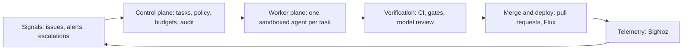
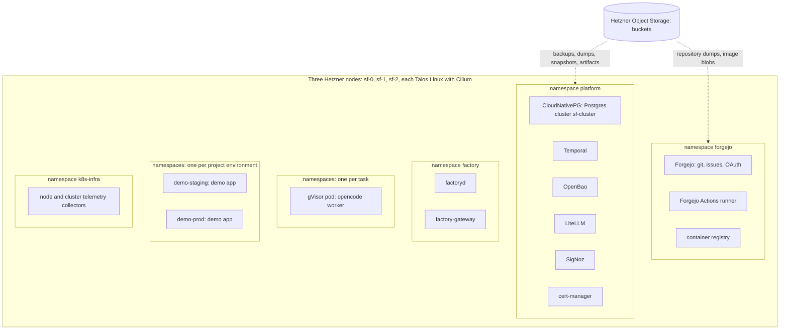
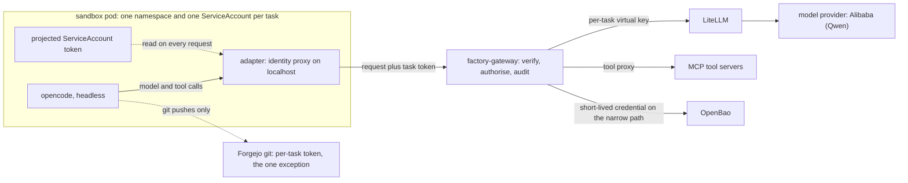
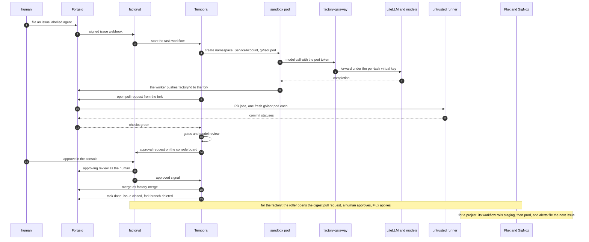

# Software factory: target architecture guide

This document holds the target architecture of the software factory and nothing else: what runs, where it runs, and how one task travels through the system. It is written for someone new to the topic, so every section explains the concepts it uses, and the glossary at the end collects them. The reasoning behind each choice, the options that lost and the decision history live in [architecture.md](architecture.md). The build tasks live in [2026-09-24-build-plan.md](plans/2026-09-24-build-plan.md).

Status: current target. When the design changes, this file changes with it. The build plan's Stages 0 to 11 are built: Stage 9, in which the factory works on its own repositories, closed on 2026-09-29, Stage 10, hardening, and Stage 11, building software from a spec, closed on 2026-09-30.

## 1. What the factory is

The factory is a largely autonomous system in which agents turn specifications, issues and telemetry into tested, reviewed and deployed software changes. Human involvement is a tool call the agents raise as seldom as possible. An approval is a workflow state, not a meeting.

The project exists to show that a lone developer can run an enterprise-grade agentic setup. Four constraints follow from that and shape every component:

- **Re-seedable.** Deleting the whole installation and rebuilding it from Git, object storage and one small offline bundle must always work.
- **Commodity hardware.** Three rented cloud servers plus S3-compatible object storage. No vendor-specific service anywhere.
- **Best-of-breed open source.** Known tools over obscure ones, each with an escape hatch in case its maintainers gate needed features away.
- **Security without half measures.** Agents get capabilities, never raw credentials. Spending has hard limits. Everything runs in sandboxes with controlled network access.

## 2. Five planes in a loop

The architecture is five planes in a loop. Signals put work in, telemetry from running software closes the loop.



- **Signals** bring work in: issues and pull request comments from Forgejo, alerts on the demo application's telemetry, and human escalations raised by agents.
- **The control plane** owns state and policy: the task registry, capability rules, budgets, approvals and the audit trail.
- **The worker plane** runs one disposable agent in one sandbox per task. The agent works on a branch, reaches models and tools only through a gateway, and opens a pull request.
- **Verification** grades evidence by strength. Continuous integration (CI) first, workflow gates next, a model review last.
- **Merge and deploy** is an ordinary pull request merge. GitOps deploys the result, and the running software produces the telemetry that becomes the next signal.

Three principles hold across all five planes. Policy lives outside the model, in code and network rules. Identity belongs to the task, not the machine. Agents exchange artifacts, not chat, and Git is the coordination mechanism.

## 3. The substrate

Which machines run the factory, and what runs on them?

Three Hetzner Cloud servers, type cpx42 (eight shared vCPU, 16 GB of memory, 320 GB disk, 69.49 EUR per month each), all three in one location. Each server runs both control-plane duties and workloads. Node-to-node traffic rides a private Hetzner network. A reserved public IPv4 address is the Kubernetes API endpoint, so the address survives node replacement.

Each machine boots **Talos Linux** 1.14 from a project snapshot, built from a Talos Image Factory schematic that bakes in the gVisor system extension. Talos is a minimal operating system that runs nothing but Kubernetes. It has no shell, no SSH and no package manager. The whole machine configuration is one declarative document delivered as server user-data, and management is API-only through `talosctl`. Every node also runs **KubePrism**, a small load balancer that serves the Kubernetes API on localhost port 7445 on the node itself.

**Cilium** 1.20 is the network layer. It replaces kube-proxy, the built-in service proxy, so the cluster runs kube-proxy-free. It enforces network policies with default deny, and it terminates inbound HTTP through the Kubernetes-standard **Gateway API**. Its proxy binds ports 80 and 443 on each node's public address.

**OpenTofu** (the open source fork of Terraform) creates the three servers, the firewalls and the reserved address from declarative configuration. **Flux** deploys every workload from Git: the cluster converges to what the repository says, a pattern called GitOps.

Two firewall layers protect the nodes, both generated from the same OpenTofu values. The outer layer is the Hetzner Cloud firewall: the Kubernetes and Talos API ports accept one home address only, ports 80 and 443 accept the world, everything else drops. The inner layer is Talos's own nftables firewall with the same rules plus the node-to-node ports. The outer layer stays editable from the Hetzner console even when a node is unreachable, so a mistyped home address is a console fix rather than a rescue operation.

One hardware limit shapes sandbox design. Cloud servers expose no `/dev/kvm`, so gVisor, the isolation layer of the worker sandbox (section 7), runs on its systrap platform, which intercepts system calls in user space, instead of its faster KVM platform.

### What runs where



The namespaces, in the order of the diagram:

- `platform` holds the shared services: CloudNativePG, Temporal, OpenBao, LiteLLM, SigNoz and cert-manager. The operator namespaces `cnpg-system` and `local-path-storage` support them. It carries the label of the infra repository's project, like `forgejo`, so an alert there reaches a human (section 9).
- `forgejo` holds the git server, its container registry and the trusted Actions runner, which builds and publishes images from protected `main` only; its dind sidecar is privileged, so nothing an agent wrote reaches it unreviewed. Agent pull requests are checked elsewhere, by untrusted runners factoryd starts one per job (section 8).
- `factory` holds the two self-written services, factoryd and factory-gateway. It carries the label of the code repository's project, so an alert there starts an agent task like any project's (section 9). The three infra-owned namespaces also carry a mark that keeps factoryd's admission policy out of them.
- `factory-agents` holds one namespace per running agent session, each with one gVisor pod, and one namespace per untrusted CI job, named `factory-agents-ci-<job>`.
- One namespace per environment of each registered project, labelled `factory/project=<name>`: `demo-staging` and `demo-prod` hold the demo application, deployed by Flux from the project's own repository (section 6).
- `k8s-infra` holds the collectors that scrape the nodes and the cluster for SigNoz. It is the one namespace allowed host paths, so `platform` stays under the baseline pod security profile.

### Re-seedability

No node holds state that Git, S3 and the seed bundle do not describe. Teardown and rebuild are the same drill:

1. `tofu destroy` removes the three servers. Billing stops at once.
2. `tofu apply` creates new servers, which boot from the same committed Talos configurations.
3. Flux reinstalls every workload from Git.
4. Restore Postgres from its S3 backups, Forgejo from its repository dump, and OpenBao from its S3 snapshot. The unseal key comes from the seed bundle.
5. Point the services at the object storage buckets.

The full rebuilds of September 2026 took 21 to 47 minutes from empty servers to a task running end to end, because the recipe in the infra repository already solves every trap the earlier drills hit. Three former hand steps are now CronJobs that Flux runs every 10 minutes and that change nothing when all is in place: the OpenBao configuration, the push mirrors to GitHub, and the console's login application in Forgejo. The OpenBao job logs in with its own narrow role, which a one-time bootstrap with the root token creates, so the root token never enters the cluster. The unseal stays a hand step. Two traps are handled in the recipe: Let's Encrypt issues at most 5 certificates per exact set of names in 7 days, so the shutdown backups take the edge certificates and the rebuild restores them before cert-manager starts, and Flux reverts a manual restart of a Deployment it owns, so a restart deletes the pod instead. A changed home address locks the operator out of both management APIs; the way back is the Hetzner firewall's value in OpenTofu plus a throwaway host in the cluster's private network that patches the Talos rule. A plan that replaces a node is never applied: a replaced node starts with an empty disk.

The recovery also works without the last backups. When the Stage 9 close lost its nodes before the shutdown backups ran, the database came back from the continuous archive alone, the last base backup plus the write-ahead log shipped every five minutes, and with it every task, audit row, ledger row, and Forgejo's issues and pull requests, since Forgejo keeps them in Postgres. Only Forgejo's git storage was lost. The recipe re-creates an empty repository for each database row, pushes every repository back from the operator's machine and from GitHub, restores the references of merged pull requests from their merge commits, and lets a project's own CI start its deploy branch again. OpenBao, with no snapshot newer than the seed's tokens, starts fresh and is re-seeded.

Step zero exists because of one circular dependency: Flux deploys everything from Git, but the Git server is itself deployed by Flux. The bootstrap applies the first slice, the database operator and Forgejo, by hand, restores the repositories, and leaves everything else to Flux.

### The seed bundle

Three sources restore the world: Git holds all configuration, S3 holds the data, and the seed bundle holds what neither can. The bundle contains the Hetzner API token, the S3 access keys, the Namecheap account access for the domain, the model provider API keys, and the OpenBao unseal key. It lives in an offline password manager plus a printed copy. No secret the seed holds ever enters Git.

## 4. Storage and state

Which state exists, where does it live, and how is it backed up?

The design runs no shared storage layer. Stateful services replicate themselves on local disks, blobs such as backups and artifacts go straight to object storage, and everything else is rebuilt from Git.

**Local disks.** The local-path provisioner issues local volumes, the default `StorageClass` `local-path`, from a 200 GB user volume carved on each node at install time. A local volume is fast because no network hop sits in the path, and it is bound to its node.

**PostgreSQL.** CloudNativePG runs one Postgres cluster, `sf-cluster`, with three members, one per node, each on a local volume. The members stay current through streaming replication: Postgres writes each change to its write-ahead log before touching the data files, and the replicas replay that log continuously. If a node dies, the operator promotes a replica on a surviving node. Backups go to object storage. One Postgres database per service.

**Forgejo.** Repositories are plain files on a local volume. A nightly dump copies them to object storage. The factory's configuration is Git state too: the infra repository's `factory/` directory (section 6).

**OpenBao.** Encrypted snapshots go to object storage.

**SigNoz.** Telemetry lives in ClickHouse on a local volume for 7 days, then moves to the bucket `signoz-cold` until it is deleted at 30 days. ClickHouse keeps the cold data's index on the local volume, so a rebuild loses SigNoz's history. That is the one accepted loss.

**Object storage.** Hetzner Object Storage speaks the S3 API, the standard that every backup tool, registry and analytics tool already speaks. It holds backups, artifacts, session records, log archives and container image blobs. The buckets: `aisoftwarefactory-forgejo` for Forgejo object data, `aisoftwarefactory-backups` with the prefixes `cnpg/`, `forgejo-dumps/` and `openbao/`, and `signoz-cold` for telemetry older than 7 days, whose objects expire after 31 days. The S3 API is the escape hatch: any other compatible provider takes a new endpoint and credentials, nothing more.

Each data service has exactly one backup path. There is no cluster-wide backup tool.

## 5. Platform services

Which shared services run on the cluster, and what does each do for the factory?

| Concern | Component | What it does here |
|---|---|---|
| Relational database | CloudNativePG | Three-member Postgres, streaming replication, S3 backups |
| Durable execution | Temporal | Workflow state survives crashes, restarts and three-day waits |
| Secrets | OpenBao | Stores secrets, mints short-lived credentials |
| Model routing | LiteLLM | One OpenAI-compatible endpoint over all model providers, with budgets and virtual keys |
| Observability | SigNoz | Logs, metrics and traces in one store, with alerting |
| Telemetry routing | OpenTelemetry Collector | Services and agents emit OpenTelemetry (OTel), the collector routes it |
| Certificates | cert-manager | Obtains and renews TLS certificates from Let's Encrypt |
| Version control and more | Forgejo | Git hosting, issue tracking, pull requests, Actions CI and container images in one server |

Four of these deserve a closer look.

**Temporal** runs the task lifecycle as workflow code. Durable execution means a workflow's state and history live in a database, not in a process. A workflow can sleep for three days waiting for a human approval at no cost, resume after a crash, or retry an attempt with a stronger model while the previous attempt's artifacts stay in place.

**OpenBao** is the secrets store, the Linux Foundation fork of HashiCorp Vault with the same API. It holds the service credentials and hands out short-lived copies. It has no key management service for auto-unseal, so a full restart needs a human to enter the unseal key from the seed bundle. Its configuration converges from a CronJob. OpenBao 2.6.3 rejects a multi-share split with threshold one, so the bundle holds exactly one key. Node reboots are rare on Talos, so that price is accepted.

**LiteLLM** fronts the chat models with one OpenAI-compatible API. Today one provider serves them all, Alibaba, because one account is simpler to fund and watch; the design does not depend on it. LiteLLM groups models into tiers, so no role names a model and a provider switch, or a second provider, is one file. Membership in a tier is a quality bar, and measured latency and cost only order the models inside it. The high tier holds Qwen 3.8 Max, the middle tier Qwen 3.7 Plus and the low tier Qwen 3.8 Flash, one model each; with a single model per tier, a failed call is retried with backoff rather than taking the tier out of service. A tier never falls to a weaker tier, so a review that can merge a change never moves to a weaker model without a trace. Four aliases name the roles: `coding-cheap` on the low tier, where every task starts, `coding-frontier` on the high tier, where a retry climbs, `review-frontier` for the model review and `supervisor` for the supervisors, both on the high tier. Agents cannot call the last two. The audit row names the model that answered, and the price of an alias is the dearest model of its tier, so a reservation covers whichever answers. factoryd calls them through the gateway like any other model call, so each call is audited and booked to its task. LiteLLM also holds a monthly budget for the whole proxy, a backstop behind the factory's own month cap. Paid capabilities that are not chat models, Replicate, Firecrawl and fal.ai, enter as tools with per-task request and euro caps.

**SigNoz** stores traces, logs and metrics in one ClickHouse database, with dashboards and alerting on top. factoryd, the gateway, the agent worker and the projects' applications emit OpenTelemetry, and the k8s-infra collectors add node metrics, pod logs and Kubernetes events. Logs of agent and CI namespaces stay out, since they carry agent and job output. Dashboards, alert rules and retention settings are files in Git that a CronJob applies. A project's own alert rules live in its repository, and the factory's own are no exception: the rules for factoryd and the gateway (error rate, restarts, a roll not live, the CI queue) live in the code repository, those for the platform (ClickHouse disk, a Postgres member down, Forgejo errors, a failed Job) in the infra repository. One platform rule fires when a Job fails and clears 15 minutes later by itself. Its alert webhooks feed the signals intake (section 9).

### Public endpoints, DNS and TLS

The domain is `aisoftwarefactory.world`, registered at Namecheap, with DNS hosted there too. A handful of A records, made by hand in the dashboard, point at the node addresses. They change once per re-seed.

Certificates come from Let's Encrypt through the HTTP-01 challenge: cert-manager proves control of a hostname by serving a token on port 80 through the cluster's own Gateway. No DNS API is involved. There is one certificate per public hostname, for example `git.aisoftwarefactory.world` for Forgejo, and renewal is automatic.

One refinement keeps traffic inside the cluster: CoreDNS rewrites `git.aisoftwarefactory.world` for in-cluster clients to the Gateway service, so pods do not route out to the node's own public address and back.

A project's public hostnames, such as `demo.aisoftwarefactory.world` and `demo-staging.aisoftwarefactory.world`, are one commit to the infra repository: a Gateway listener and a certificate per name, plus the A records. Project registration prints that commit's content. Flux owns the Gateway, so factoryd could not keep a change of its own there, and the commit doubles as the human's approval of each project.

## 6. The control plane

What owns tasks, policy and money?

One Go module produces two binaries.

**factoryd** holds everything that remembers:

- **Intake.** Forgejo webhooks arrive here, signed with a shared secret that factoryd checks before it reads the body. Every bug gets fixed, whoever reports it: an issue labelled `bug` or `agent`, or with no label at all, starts an agent task at once, even from an account without write access, because reporting bugs is how such users steer the software. An issue labelled `human` becomes a task in the human lane. An issue labelled only `improvement` waits as a suggestion until a writer starts it. Two issue templates, `bug` and `improvement`, set those labels. Labels that only writers may use are removed from an outside account's new issue, and each task records whether its author could write. Callers that are not Forgejo use an authenticated API, which files the issue itself, so every task is an issue. SigNoz alerts and agent escalations arrive the same way. An improvement gets a write-up first: an analyzer agent, which reads and never codes, comments how the change may work, and a writer decides whether it starts. A bug report from an outside account passes a screening stage before any coding starts (section 8). On a project whose settings allow no agents, the infra repository, every issue goes to the human lane.
- **Projects.** A project is a repository the factory builds software for, and the factory's own repositories are projects too, with no special status: the same settings and flows, and two settings where they differ. One says who creates the repository objects, registration or the infra repository with the seed; the factory's own are seeded. The other says whether agents work there: the code repository takes agents, the infra repository none. No repository name is written into the code. The project owns its CI/CD, its environments and its promotion as code in its own repository. The factory owns identity and hardware. Registration is one factoryd action, and factoryd keeps every object it made in step with the project's row in Postgres: its own Forgejo organisation with one repository, a CI user that may write packages in that organisation only, tokens limited to the repository, a webhook, protection on `main`, a deploy key, and a `deploy` branch that holds the rolled state Flux applies and that only the deploy key may push. In the cluster the project gets one namespace per environment with a resource quota and a default-deny network policy that reaches outside the cluster only to the hosts the project's file lists, plus a Flux Kustomization per environment that runs under a namespaced account, so a merged change to the project's manifests can reach only its own namespaces. Per-project settings are a file per project in the infra repository: the merge rule, `auto` or `human`, the list of people an information request mentions, the namespaces, the resource envelope and the in-cluster quota. factoryd reconciles every project at boot, on each configuration change and every hour, so a hand edit in Forgejo is set back and a person taken off the approvers list leaves the repository. A project's promotion asks one factory endpoint whether an alert fires in a namespace. The demo app, a Go link shortener with Postgres, is the first project: its own workflow rolls staging, waits 15 minutes and rolls prod only if no alert fires.
- **The task registry.** Each task carries a priority, required capabilities, a risk class and a cost ledger.
- **The Temporal worker.** factoryd runs it itself. One workflow per task: link the issue, run the agent sessions, open the pull request, run the workflow's stages (checks, gates and a model review, section 8), file an approval request, then wait at no cost for a person to approve, close or ask for changes. After a human's approval, the bot `factory-merge` merges (section 8). The session cap, three by default, is the bound on rounds: when a task runs out of sessions, for whatever reason, it goes to a human with every finding so far instead of failing. Only the cap on the agent's working time fails a task by itself. factoryd keeps exactly one `state/*` label on the task's issue (queued, running, waiting-human, in-review, done, failed), and every step lands in a timeline record. A heal pass at boot and every minute starts any workflow that is missing, files a task for any labelled issue that has none, and re-reads Forgejo for anything a webhook missed.
- **The console.** A server-rendered Go interface with htmx for operators and approvals, served at `console.aisoftwarefactory.world` through the Gateway. Humans log in through Forgejo OAuth2 with PKCE and an explicit scope list, and only users with write access get in, checked on every request. Settings are read-only in the console, each linked to its file in Git, since a change is a commit. The login state travels in a signed cookie, so an anonymous visitor leaves no state on the server, and the human's tokens never reach the browser. Actions such as a new task, an answer or a review go to Forgejo through the human's own token, so Forgejo records the human as their author. Only the users on the policy's `approvers` list may authorise spend: approve a resource or a merge, including a roll of the factory itself, and make a resource standing. Every POST carries a CSRF token. Its main view is a kanban board. Its first columns are the lanes of the projects' processes, backlog, plan and ready, where a human moves a card with a button or by dragging it. Then agent tasks move by themselves through columns derived from their state: running, waiting on a human, in review, done, failed. A separate lane holds human tasks: approvals, escalations and tasks you file for yourself. A new-task button files a Forgejo issue labelled `agent` or `human`, so every task has one record with its discussion, and factoryd mirrors state onto issue labels. Forgejo's own kanban boards cannot serve yet: a card's column is separate from the issue's state, and the API has no endpoint to add or move a card, so factoryd could not keep a board current. Forgejo has no plugin system, and a source patch would mean our own fork. When the upstream projects API lands, its groundwork merged in September 2026, factoryd mirrors columns onto a Forgejo project as well. The console also lists every commissioned cloud resource by project and task with its cost so far, every project with its settings, and every alert with its verdict. Each card names the gate its task waits in and for how long, and a task's page shows the duration of every gate and every CI job. An approval card shows every earlier model review beside the current one, the security audit's verdict and findings, and every reason a human is needed.
- **Cost aggregation.** Model spend from LiteLLM, tool spend from the gateway and resource spend from the collector, each a row in an append-only ledger, summed per task and per day and shown in the console.
- **Telemetry.** factoryd traces every workflow activity and every request to its API and console, and measures the pipeline: CI job and run durations, the time jobs wait for a runner, build VM lifetime, ready time and cost, the time from a push to a live roll, each gate's duration, and the age of the oldest running activity. A roll of the factory's two services took 61 to 73 seconds from push to ready.
- **Analytics.** Four measures per task feed the self-improvement loop: its outcome with the model and the number of attempts, its cost, the model review's verdicts per round, and every human intervention by kind. A daily pass marks a task reverted when a later pull request undid its change or its alert fired again within 14 days. Four dashboard panels show them. Humans read the panels and change routing, bounds and prompts by commit.
- **The roller.** When main CI publishes new images for a commit of the code repository, factoryd opens a roll task: a pull request that bumps the image digests in the deployment manifests, with no agent and no model call. It passes the checks, its card opens because manifests rank high, a human approves, the bot merges, Flux applies it, and factoryd records a roll row per image. A newer commit folds into the open roll, so one card covers both. So the factory's own deployment carries the same audit trail as any change: issue, pull request, approval, merge and roll row. The roller reads the new images with a token that can read packages and nothing else.

**factory-gateway** is the enforcement point. Every model call and every tool call an agent makes passes through it:



For each request the gateway:

1. Verifies the pod's ServiceAccount token against the cluster's OpenID Connect (OIDC) issuer.
2. Maps the service account `task-<id>` to the task row in Postgres.
3. Checks capability, budget and approval state.
4. Forwards a model call to LiteLLM under a per-task virtual key, or proxies a tool call to its MCP (Model Context Protocol) server, or mints a short-lived credential from OpenBao for the narrow case where the agent must connect itself.
5. Writes an audit row for the decision, and the same row as a log record in SigNoz, scrubbed of credentials.

The sandbox holds no key material. The gateway mints LiteLLM virtual keys through LiteLLM's own API and never hands them out, which replaces LiteLLM's token authentication for outside callers, an enterprise-only feature. factoryd's own model calls, the model review and the supervisors, take the same path with factoryd's token and a header that names the task and the purpose. The gateway admits only the model the task's class names for that purpose. factoryd's calls use a key of their own per task, which the clean-up after each agent session leaves alive; when LiteLLM reports a key blocked, the gateway mints a new one and retries once. Only the sandbox pods and factoryd may reach the gateway at all. Every workflow step takes plain values and mints or reads its credentials inside itself, so the durable workflow history, which outlives the task, never holds a token; a test scans a whole task's history for them.

### Configuration and policy

The factory's configuration is a set of human-readable files in the infra repository's directory `factory/`: `policy.yaml` for the capability policy and every limit, one file per project, one file per process, and the templates a new project's repository starts from. factoryd reads the directory straight from Git every 30 seconds, through a read-only token. No Kubernetes object carries it: Kubernetes provides the pods, namespaces and network rules, and the factory's own files use none of its vocabulary. A human authors every change in a commit, and Git holds the history. The commit is the version: factoryd stores each new tree as an immutable version in Postgres, the gateway enforces the current version, every audit row names it, and every task keeps the caps and bounds of the version it started under. A JSON Schema generated from the factory's own types gives an editor completion and checks for every field and its allowed values, and a check on every push to the infra repository runs the same judgement factoryd applies. A refused commit keeps the old version and files an issue for a human. Runtime decisions such as approvals, leases and promotions stay database rows. The policy file holds the budgets, the limits (sessions per task, agent time, supervisor calls and timeout, the returns before a stronger model, the harness's step cap, and when to nudge an agent that repeats itself), the capability classes with their models and tools and the models factoryd may call for them, the security audit's model among them, the tool prices, the risk classes of changed paths with their merge outcomes, the default resource envelope, a new project's defaults, the spend approvers, the time bound of each workflow step, and the thresholds of the supervisor's progress check. Enforcement is code in the gateway. It refuses a model the task's classes do not allow, and any routing override in the request body that could reach another model. Network policy makes bypass unreachable: a sandbox pod can reach only the gateway and Forgejo git, plus a package registry named per toolchain.

**Processes as configuration.** The factory ships no fixed development process. A process is a file of four blocks with fixed keys and enumerated values, and a project names one. `lanes` says where a card waits and where it starts: in the backlog a card does not start, a card entering ready starts a coding agent, and a card entering plan starts a planner. Each starting lane says who may move a card into it, writers or approvers. `dependencies` makes a card wait until the cards it depends on are done, and brings a human in when one fails. `stages` is the ordered list of verification stages (section 8). `merge` says whether the project's pull requests merge through a queue, one at a time. A check that uses no model, shared by the loader and the CI check, refuses a composition that cannot work: a missing class, a lane without what it needs, a path that reaches neither done nor a human, a cycle without a cap, or a process that lowers the floor, such as a merge without green checks or without an approval stage. A command prints the path a card takes through a process, from the same graph the check reads. Two processes ship: `maintenance`, the fix-and-improve flow above, and `spec`, which builds an application from a written spec. Later blocks, such as triggers or user-defined lanes, will be new blocks, never new syntax.

**Building from a spec.** On a project that follows `spec`, a spec card in the plan lane starts a planner, a capability class that reads the repository and the spec, writes nothing and answers a plan: two to twelve cards, a foundation first and an integration card last, each sized for one session, with its dependencies and acceptance items. The human comments until satisfied, and an approver accepts. factoryd, not the model, then files one card per planned card in the backlog with its dependencies, and one "Start plan" click moves them all to ready, where each starts by itself once its dependencies are done. A new project comes from a console button: it opens a pull request on the infra repository that adds the project's file, and after the merge, registration commits a template as the empty repository's first commit, the CI files agents may not write among them.

Stricter wins: a project's file may only tighten what the policy file sets, its quota, envelope and standing resources included, and the loader and the CI check refuse a looser one. A deny beats an allow at every level: a tool the task's classes may not call is left out of the tool list the agent sees and out of its brief, and a call to it is still refused and audited. The policy file also names the hosts that links in agent-written text may point to.

The first capability class is `coder`: repository read, branch write, model aliases and allowlisted tools, nothing else. The tools are web scraping and search, Replicate and fal models, the escalation tool and the commissioning tools, each capped by requests and euros. The second is `analyzer`: repository read, no branch write, web search and scraping, the question and escalation tools, and no commissioning. It writes up improvements and screens outside accounts' bug reports. Further classes, such as integration tester and release agent, arrive with the loops that need them; the release of the factory itself is the roller's code, not an agent. If rules ever multiply beyond what plain Go code reads well, an Open Policy Agent sidecar is the reserved upgrade. Policy never lives in a prompt.

### Budgets

The gateway enforces hard caps on the call itself. LiteLLM checks a key's budget only before a call, so one call could run past it. So the gateway prices each call's worst case, clamps the output length so that worst case fits the free headroom, and takes a hold for it under a database lock before the call. Concurrent calls therefore cannot share the same headroom. After the call it books the real cost, in full even above the hold, and the next call is refused. A call cut mid-flight books its whole hold, because a cut stream's reported cost is no upper bound of the provider's charge. So while a task runs, a cut call books more than LiteLLM recorded. After the task finishes, factoryd settles the model total to what LiteLLM recorded: upward within two hours, as LiteLLM's figures arrive late, and then once to LiteLLM's final figure, down as well as up. The ledger is the one record, and the task's total is always the sum of its ledger rows. Tool calls take holds the same way and book the provider's real charge. A tool whose cost the gateway cannot bound up front is refused. On top of the per-task and per-day caps sits a month cap, 50 EUR today, over all variable spend of every project and the factory together; a task that meets it stops and waits at a human card, alerts go out at half and at four fifths of the cap, and only a commit raises it. LiteLLM's own monthly budget stands behind it. Hetzner offers no hard per-project spend cap, so this ledger is the real spend limit.

Agents may also commission cloud resources through gateway tools: servers with their IPv4 and volumes. Buckets are left out, because Hetzner's Object Storage keys reach every bucket of a project, so a per-task bucket would put a shared key in the agent's reach. The resources live in a separate Hetzner project whose token only the gateway holds, and the gateway calls the provider itself. The policy's default envelope (today 10 EUR a month, cx23 or cx33, two servers, four hours, 20 GB) is each project's envelope unless the project's file names its own, and a change is a commit. A request beyond it becomes an approval card. The gateway writes a hold and a registry row with task, project and lease before each create and labels the resource the same way. Cost comes from the provider's own price list: Hetzner's API returns every price in one call, so a one-hour cx23 with its IPv4 reserves 0.0096 EUR, and the collector books each started hour. Task completion deletes a task's resources. If an agent dies, the lease still ends and a garbage collector deletes the resource at its last pass before the lease ends, so no extra hour is billed. It also deletes anything in the agent project the registry does not know. It deletes nothing when it sees a cluster node's address or another project's label, since the token would then open the wrong project. Resources come in two kinds with one envelope and one approval process. A task resource is leased, requested by an agent and booked to its task. A standing resource is a project's environment: it has no lease, only the project's registration or a human requests it, and it shows as a fixed monthly line. Each kind has its own limits, and agents get no SSH to standing servers. A server admits SSH only from the cluster nodes, and only with a short-lived certificate from OpenBao whose principal names that one server. Its outbound traffic is open on ports 53, 80 and 443, because it holds no factory credential and its lease, the envelope and the task's cap bound it. Resources priced by usage, such as functions, will get an estimate cap and be reconciled against the provider's billing data afterwards.

## 7. The worker plane

How does an agent run, and what can it touch?

One task gets one namespace, one ServiceAccount named `task-<id>`, and one pod.

**The sandbox.** The pod runs under gVisor, a user-space kernel that intercepts the container's system calls, so a hostile program never reaches the host kernel. The container is non-root with dropped capabilities and a read-only root filesystem. Cilium enforces default-deny egress: only the gateway, Forgejo git, the Go module proxy and checksum database, and `storage.googleapis.com`, where the proxy redirects module downloads, answer. The one other address is the telemetry collector, to which the worker sends its own traces and metrics. DNS resolves only these names, and the cloud metadata endpoint is unreachable. While a commissioned server's lease lives, its address on port 22 joins the list. The image carries the Go toolchain, so the agent can run the same tests its pull request checks will run; a package registry joins the list by name only together with a toolchain that needs it. It has no C compiler, no database and no server access, so race tests and database tests run in the pull request's checks. The container may use 4 GiB of memory. The only port open into it is the message port (below), and only factoryd reaches it. The module proxy is a known narrow leak, since an agent could encode data in a module path it requests, and it is accepted because the sandbox holds no secret worth leaking. Each task namespace has a resource quota, and factoryd, which creates these namespaces, is confined by an admission policy to exactly this shape; factoryd itself runs under default-deny egress too. The reserved stronger tier is microVMs, Kata Containers or Firecracker: one small virtual machine with its own kernel per pod. They need `/dev/kvm`, which cloud servers lack, so they arrive with bare-metal nodes once the build volume pays for them (section 8).

**The harness.** The coding agent inside the sandbox is opencode, driven headless. factoryd knows nothing about harnesses, only a Go interface:

```go
type Harness interface {
        Prepare(ctx context.Context, env SandboxEnv, brief TaskBrief) error
        Run(ctx context.Context, brief TaskBrief, emit func(Event)) Result
        Message(ctx context.Context, text string) error
}
```

`TaskBrief` is the whole task as data: objective, repository and commit, issue context, findings from parent sessions and artifact paths. Capabilities are policy, enforced by the gateway; the brief only names the factory tools the task may call, so the agent does not reach for tools it would be refused. `Message` puts text into the running session as the next user turn. opencode runs as a small server inside the pod for this: the worker starts it on the pod's loopback address, drives the session through its API and reads its event stream, and exposes one port on which factoryd, and nothing else, posts a message with a bearer drawn for that session. A message sent mid-turn reaches the model's next call. A harness without such a mode answers "not supported", and factoryd falls back to what it did before: it stops the session and starts a fresh one with the text as a finding.

opencode's own configuration is locked down for headless use: its question tool is hidden, because nobody sits at the terminal and the gateway's information and escalation tools are the only ways to ask; each session has a step cap from the policy file, at which opencode asks the model to summarise and stop, while the agent-time cap stays the hard stop; and a refused permission reaches the model as an error instead of ending its turn. `Event` is the normalised stream: model calls with alias and cost, tool calls with status, file changes, commands with exit codes, checkpoints and the final result. The git diff and the artifact store are the ground truth, the event stream serves observability and audit.

A harness fits the factory if it meets four requirements: it runs headless, it accepts a configurable model endpoint so its traffic routes through the gateway, it takes configurable tools so tools route through the gateway too, and its session output is machine-readable. Codex CLI is the named successor behind the same interface. A swap is one adapter file plus one container image, and nothing else changes.

**The identity proxy.** A harness makes its own model and tool calls, but it cannot attach the pod's projected ServiceAccount token, a file the kubelet rotates. So the adapter listens on localhost inside the pod, the harness points its provider configuration at it, and on each request the adapter reads the current token file and forwards the call to factory-gateway. Model and tool traffic never leaves this path, and no model key material ever enters the sandbox.

**The git exception.** Git is the one path outside the gateway, and the agent still never holds its credential, nor does it push or open a pull request itself: the worker commits and pushes at the session's end, and factoryd opens the pull request. The work guide in the brief says so. For every session factoryd mints two Forgejo tokens and revokes both at the end: one reads the upstream repository, the other writes only to a fork owned by the `factory-agent` account. The worker process in the pod clones from upstream before the agent starts, keeps both tokens out of the agent's environment and repository config, and after the agent finishes kills every other process in the pod and pushes the branch `factory/<id>` to the fork from a clean repository of its own. It pushes one commit of its own with the session's tree, under a subject cleaned by the sanitiser (section 8), so the agent's commit messages, which could close issues or mention people on merge, never reach the fork; a commit the agent pulled from `main` stays `main`'s, so the diff shows only the agent's change. A token inside the agent's repository would leak through git hooks and lingering processes. The pull request then goes from the fork into the upstream repository, which matters for CI: Forgejo gives the checks of a fork pull request a read-only token, while a pull request from a branch of the same repository gets a token that can write to it. A pull request's workflow files come from the branch itself, so the worker refuses to push any change to the `.forgejo`, `.gitea` or `.github` directories, comparing the directories as git trees rather than file names, and factoryd checks again before it opens the pull request. Every exchange with the world stays attributable: model and tool calls by the task identity, git pushes by the task tokens.

**Report sessions.** An analyzer runs the same sandbox with a read token only and no push. Its last message becomes a comment on the issue, and the task ends there.

**Session records.** The sandbox streams its session out while it lives: prompts, tool calls, output, files touched, commits and cost. Full history goes to object storage, a compact restart state to Postgres. A dead session resumes as a new pod that receives the findings and the parent session id, not as a resurrected process. **Supervision.** An agent that circles rarely repeats itself word for word, so no fixed rule catches every circle. Cheap detectors in factoryd catch the traces a circle leaves in the event stream: a stall, tool calls without file changes, the same command failing with the same error again and again, the same tool call repeated, a file flipping back to earlier content, many edits while the diff stops growing, and a task past half its time or budget, once per task. The same-failure check compares the command and its output with timestamps and other noise stripped, and it does not trust the exit code of a command such as `make test; echo $?`, which always succeeds. Any trip calls the supervisor inside the running session: the strongest model available, under its own `supervisor` alias. It reads the brief, the session record and a progress digest of commands, outcomes, files and errors over time, the same view a human reviewer would use, and answers in strict JSON with one action: continue, redirect with guidance, retry on a stronger model, or stop and escalate to a human. A session gets at most three supervisor calls, and each call takes a hold on the task's own remaining budget like any model call. A stop is graceful: the worker pushes the work in progress first, so the next session starts from it. The agent can also escalate by itself through the `escalate_to_human` tool, which stops the session the same way without a supervisor call. An escalation moves the task to waiting-human and comments on the issue. A trusted person's reply, in Forgejo or in the console, may grant a bounded slice of extra time. The same trouble twice, a supervisor redirect after the same detector trip, sends the next session to the stronger model. Before the repeated-call detector trips, factoryd nudges: after three identical calls in a row it sends one message into the running session, "you repeated the same call three times, change approach, then continue", and trips only if the agent repeats it again. The count comes from the session's own event stream, because the harness's built-in tools, the shell among them, never pass the gateway. A human may raise a cap that way, the supervisor never. The replies go into the next session's brief in their own section, newest first, each tagged with its question, and the workflow keeps every reply of the task across attempts, so the agent never asks the same question twice. One more detector catches an agent that keeps working without writing: an agent event 5 minutes after its last file write. The Temporal workflow enforces heartbeat and wall-clock timeouts, where the wall clock counts the agent's working time across attempts, so a stuck agent is visible instead of silent.

**Gate supervision.** The machine steps get the same watch, so no step waits in silence. Each workflow step has a time bound in the policy, for example 10 minutes for the checks and 90 seconds for a merge. A step that runs past its bound raises an alert. For the five long steps, the agent session, the check wait, the reproduction, the model review and the merge, the gate supervisor then reads a bundle that factoryd assembles, with credentials scrubbed: the task, the step's input and last error, and the step's own state, such as the commit statuses, the sandbox pod's log or the pull request's merge state. It answers with one action: wait once more, retry the step, cancel the task, or escalate to a human, who can let the step run again. The short steps would time out before an answer arrives, so their alert is their record. The supervisor may take 6 minutes, a limit in the policy file, since the model once answered in 5 against an earlier 4-minute timeout. The model review may take 6 minutes too, after a correct review of a 100-line diff took 3.5.

**Alerts and their verdicts.** Every alert the factory raises about itself, a step past its bound, a detector trip, an escalation, an information request, a refused configuration commit, a suspect screening or a SigNoz alert, is a row in one alerts table with a verdict: a real problem, or noise. The supervisor's action sets it for a machine alert, one click by an approver sets it for an escalation, and a task's outcome sets it for an alert from telemetry. An escalation or question nobody judged is marked unjudged when its task ends. SigNoz counts the alerts per kind and verdict, and a dashboard panel shows the share of real ones per week, so the bounds can be tuned from data.

## 8. Verification and delivery

What must a change survive before it merges?

Evidence ranks by strength, cheap deterministic gates first, the expensive model last. The workflow is an ordered list of stages in the project's process file (section 6), and each stage has one setting for what its findings do: go back to the agent for another session, go to the human's card, or fail the task. By default the checks, the reproduction and the model review send their findings back to the agent, a forbidden path fails the task, and a migration, the approval and the merge go to a human. A repeat from the same stage moves the agent to the stronger model, and the session cap bounds the rounds: a task at its cap goes to the card with every finding so far. A stage can be switched off or limited to outside accounts, except the checks, the policy gate, the approval and the merge; the model review can only be switched off. A stage that ran and gave no verdict, such as a review whose call failed, puts that fact on the human's card as a finding: silence never passes a gate. Red checks on a commit the agent left unchanged run once more before they go back to the agent, since a build machine's network failure looks the same as a real defect from outside.

**Screening** comes first, for a bug report from an outside account: before the coder starts, an analyzer on the stronger model reads the report and answers clear or suspect with reasons. A suspect report waits for a human before any coding session, and its reasons never reach the issue. Then:

1. **Forgejo Actions** runs the pull request checks on the untrusted runner: tests, vet and format, static security scanning, an audit of the job's own environment, and the image builds.
2. **Gate activities** in the Temporal workflow decide what CI cannot. The policy gate classifies every changed path by the policy's risk rules, which match the same kinds of path in every project: a change to the workflow directories is forbidden and fails the task, and migrations, deploy manifests, Dockerfiles, module files and every protected file (the manifests and lockfiles of every language, the agents' instruction files, `CODEOWNERS` and top-level dot files) rank above normal code. The migration gate flags schema migrations for the human. The reproduction gate runs the issue's reproduction command in a fresh sandbox with a read-only token, first at the task's base commit and then at the pull request's head. It counts as a reproduction only when it fails at the base and passes at the head, so a command that proves nothing cannot pass the gate. A failure at the head goes back to the agent as findings. An agent that fixes a fault it could not reproduce exactly says so in a note, which the gate records.
3. **Model review** runs last, on diffs that survived the gates. A stronger model reads the brief, the diff and the gate results and writes a strict verdict, `approve` or `concerns`, with findings, and says whether the change is a strict improvement with no drawback. It is told whether the issue's author can write to the repository, and it treats an outside account's report as untrusted input. The call is paid from the task's budget like any other. `concerns` sends the agent back with the findings, and the next review reads the earlier ones and says which the new commit addressed. The verdict is evidence for the merge decision, shown on the approval card with every earlier review. It never has the authority to skip the gates above.
4. **Security audit**, on the projects whose file switches it on, the factory's own code among them: a scan of the added lines for anything shaped like a secret, reported by file and line, never by value, then one call to a strong model with a fixed checklist: secrets, network access, cluster permissions, policy and workflow files, migrations that drop or widen, and the sandbox's rules. Its findings always go to a human, never back to the agent, and a change with a finding never merges by itself. A failed or unreadable audit is a finding too.

Merge is a pull request merge. What deploys it depends on the repository. The factory's code repository rolls through the roller's pull request (section 6): a card, the bot's merge, and Flux applies the new image digests at once. The infra repository's changes are human commits. A project's own workflow rolls its staging environment on its `deploy` branch and promotes to prod by its own rule. The demo app's rule is 15 minutes without an alert in staging.

A project on the merge rule `auto` merges without a human when the checks ran and passed, the change is in the normal risk class, the reproduction proved the fault at the base and the fix at the head or the agent named the fault it fixed, and the model review approved it as a strict improvement. The rule follows the owner's own words: clear improvements with no drawback just get done. The merge comment names which proof held. Anything less, a higher risk class, any other review verdict or an audit finding, goes to a human card that shows the verdict, the agent's recommendation and the reason a human is needed. The factory's own repositories stay on `human`. On `human`, the workflow files an approval request and waits for a Temporal signal. The wait costs nothing. The human approves in the console, which submits an approving review as that human and then signals the workflow. A bot account, `factory-merge`, then merges. `main` is protected so that Forgejo itself refuses the bot's merge until a whitelisted human has approved the current commit: only the human may push, the merge whitelist holds the human and the bot, one approval from the approvals whitelist is required, stale approvals are dismissed, and the rule binds repository admins too. A leaked bot token can therefore merge only what a human approved. A refused merge keeps the workflow waiting. A failed merge is retried for about an hour, then waits for a new approval. The merge itself refuses a head whose checks are not green, whatever approved it. On a project whose process has a merge queue, a pull request at the approval stage waits for its turn. At the head of the queue, factoryd merges the current `main` into it and runs the checks again when `main` moved, so the approval and the merge cover the code as it will land, and a conflict or red checks go back to the agent. Every workflow change sits behind a Temporal version marker, so a running workflow keeps the path it started on.

**The untrusted runner.** Forgejo's runner has no Kubernetes mode that starts a fresh pod per job, so factoryd does it. Its CI spawner watches the queue of waiting pull request jobs of every project that takes agents, the factory's code repository included, registers a one-job runner scoped to that repository for each, and starts it in a namespace of its own as one gVisor pod: non-root, no service-account token, and egress only to Forgejo, the Go module proxy and the image registries the builds pull from. The runner takes its job, exits, and the namespace is deleted. The module proxy's downloads come from `storage.googleapis.com`, which joins the list by name. The registrations come from a dedicated Forgejo account, `factory-ci`. Forgejo's runner API answers only the repository's owner, so the account is an organisation owner, but its token reaches the code repository alone and `main` refuses its pushes. Because agent pull requests come from a fork, each job's token is read-only and no Actions secrets reach it. A check in every run proves that the token cannot push, and that the job cannot request an identity token from Forgejo. A project's `main` jobs run on the same one-job runners, with the project's own secrets, never on the privileged runner, whose registration covers only the factory's organisation.

**The build VM.** Building container images needs root somewhere, and no rootless BuildKit mode works under gVisor, which also offers no overlay filesystem, so every layer was copied in full. A job that builds images therefore gets a throwaway Hetzner Cloud server, a build VM, in a Hetzner project kept for CI. factoryd creates it for the job and deletes it seconds after the job ends. The VM runs BuildKit on an ordinary kernel and answers only the cluster nodes, over mutual TLS with certificates made for that one VM. It holds no token and no credential, only the build context the job sends it, and nothing it builds is published: publishing stays with the trusted runner on `main`. Its outbound traffic is open on ports 53, 80 and 443, because provider firewalls cannot filter by name, and the VM holds nothing but code the agent already had. At most two build VMs run at once. A collector, the same one that watches agent resources, deletes any VM whose job died with it. A pull request that builds no image gets no VM. The runner pod waits until the VM's BuildKit answers, and that moment is the VM's measured ready time: 38.289 seconds in the live proof, for a VM that lived 59.655 seconds and cost 0.0096 EUR.

**The build cache.** Builds read a cache that only the trusted `main` builds write. It is a small registry in the cluster, and a Cilium rule lets the build jobs' runner pods send only read requests to it. The runner pod fetches the cache and streams it to the VM, so the VM never reaches the cache. A missing cache means a cold build, not a failure.

**Build speed, and the road to microVMs.** The image builds of one pull request took 25 to 30 minutes in gVisor pods. Now only the images a pull request changes are built, in parallel, on build VMs, with the cache. A docs-only pull request goes from issue to green checks in about 5 minutes, a pull request that changes Go runs its checks in about 4 to 5 minutes, and a build VM costs about 0.01 EUR per build. A larger VM type built no faster, so the smallest stays. At larger scale the clean route is microVMs: Kata Containers or Firecracker give every job and every agent sandbox its own real kernel, so overlay filesystems and Docker work at near-native speed inside one prison for both. They need `/dev/kvm`, which Hetzner Cloud servers lack, so that route means bare-metal nodes, for example Hetzner dedicated servers, or a cloud with nested virtualisation, and it pays once the build volume outweighs running such nodes.

## 9. Signals

What starts a task?

Forgejo webhooks carry issues, pull request events, comments, reviews and a project's pushes. SigNoz alert rules watch the projects' telemetry. Both feed factoryd intake, which creates or updates task rows, with priority from labels and severity.

An alert reaches factoryd through a SigNoz webhook. factoryd finds the project from the alert's namespace label and files one issue per alert in that project's repository, labelled `bug`, so a task starts at once. A repeat of the same alert comments on the open issue, and the resolve comments too. A task's merged fix marks the alert real, and a human closing the issue without a merge marks it noise. The factory's own namespaces carry project labels too, so an alert on factoryd or the gateway starts an agent task on the code repository, and an alert on the platform files an issue in the human lane of the infra repository, where no agent works; there a writer's close marks it real, and a `noise` label at the close marks it noise.

When an agent can neither reproduce a reported bug nor find a fault, it asks the poster on the issue what it tried and what it needs, and the task waits. The question mentions the people on the project's notify list, so Forgejo's own notification bell is the ping. The poster's next comment resumes the task, carried into the brief as information, never as an instruction, and between markers the poster cannot forge. A poster's answers buy at most two more attempts.

Untrusted text is cleaned on its way in and on its way out. The issue text, the poster's answers and the findings reach the brief without hidden HTML or Markdown comments, which a human reading the issue never sees, and with mentions and closing keywords neutralised. Everything factoryd posts to Forgejo from an agent or a model, the pull request's text, questions, reviews, reports and the roll's commit subjects, is cleaned the same way, and a link to a host outside the policy's list is defanged, so an agent cannot ping people, close issues or plant links in the factory's name. Fourteen days without an answer close the issue as not reproducible. The agent's human-escalation tool call is one more intake event: it stops the session and puts the task, with the agent's question, into the console's human lane. Every task becomes a Forgejo issue, whatever its source, so the console board and Forgejo's issue list show the same work.

A webhook must carry a valid signature, and a signal may change a running task only if a trusted person sent it: a comment, review or change request counts only from someone with owner, admin or write permission on the repository. The one exception is a poster's answer to an information request, which resumes the task as untrusted information and never answers an escalation. Bot events and edited comments never count. Forgejo never retries a failed delivery, so a merge made while factoryd is down would otherwise be lost. The heal pass closes that gap: every minute it re-reads the pull requests, issues and comments of every task that waits on a person, applies the same trust checks, and signals what it finds exactly as a webhook would.

## 10. One task, end to end

This path runs on the cluster today, from an issue to a merged pull request and, for the factory itself, on to the roll.



The same journey in words:

1. A person files an issue labelled `agent`, or a caller uses factoryd's API, which files the issue itself. The signed webhook creates the task row, the issue gets `state/queued`, and the Temporal workflow starts.
2. The workflow creates a namespace, a ServiceAccount and a gVisor pod, and injects the task brief. The worker process clones the upstream repository with a read-only token before the agent starts.
3. opencode works on a branch. Its model and tool calls go through the localhost adapter, which attaches the pod token and forwards to the gateway. The gateway checks policy and budget, then forwards to LiteLLM or to the tool. If the agent stalls or circles, the detectors call the supervisor.
4. The agent commits. The worker kills the agent's processes, refuses any change to the workflow directories, and pushes `factory/<id>` to the fork from its own clean repository. The workflow opens a pull request from the fork and labels the issue `state/in-review`.
5. The spawner runs each check in a fresh untrusted runner pod with a read-only job token. Red checks send the next attempt to a stronger model with the failures as findings.
6. With green checks the workflow runs the gates and the model review, sending findings back to the agent where the stage says so, files an approval request and waits, at no cost, for a person. A trusted change request runs another session. An approval in the console submits the human's review and signals the workflow, and `factory-merge` merges. The merge finishes the task `done`: credentials revoked, spend settled to what LiteLLM recorded, the issue closed with `state/done`, the fork branch deleted.
7. Every step lands in the task's timeline in object storage, from intake through each session, supervisor decision, pull request and signal to the final state, readable through factoryd's API beside the full session records.

For the factory's own code repository the path goes on through the roller: its pull request bumps the image digests, a human approves the card, the bot merges and Flux applies it. For a project the path goes on through its own workflow: it rolls the merge to staging and, with no alert for 15 minutes, to prod, and an alert from its telemetry files the next issue. On the merge rule `auto`, a qualifying change merges without the human's approval in step 6.

## 11. The security model in one place

Ten rules, all enforced by code rather than by instruction:

- **Identity belongs to the task.** A pod carries a projected ServiceAccount token, short-lived and audience-scoped, rotated by the kubelet. No shared machine identity exists. SPIFFE/SPIRE, the workload identity standard that reaches beyond one cluster, is the reserved upgrade.
- **No credentials in the agent's reach.** Model calls ride virtual keys the gateway holds, tool calls ride the gateway, and git rides two per-session tokens, read on the upstream repository and write on the agent's fork only, that only the worker process uses, before the agent starts and after it is killed.
- **Policy lives outside the model.** Capability rules, limits and the workflow's steps are files in the infra repository, stored as versions in the database and enforced in code. A prompt cannot grant a capability. Every model call the factory itself makes goes through the same gateway.
- **The network forbids by default.** A sandbox pod reaches the gateway, Forgejo git, the Go module proxy and the telemetry collector, and resolves only their names. Nothing else, including the cloud metadata endpoint. factoryd and every CI pod run under default-deny egress as well, and only sandbox pods and factoryd reach the gateway.
- **Untrusted code never reaches a privileged builder.** CI with privileged docker-in-docker runs only on protected `main`. Nothing merges there without a whitelisted human's approval: the merge bot's merge is refused by Forgejo until that approval exists, and the rule binds repository admins too. Agent pull requests come from a fork and run on untrusted runners: one fresh gVisor pod per job, a read-only job token, no secrets, and image builds on a throwaway build VM that holds no credential. Agents cannot change what those runners execute, because the worker refuses to push changes to the workflow directories, factoryd checks again, and the policy gate fails such a pull request. An admission policy confines every pod factoryd creates: no privileged containers, no host namespaces or host paths, no added capabilities, non-root everywhere.
- **Only trusted people steer a running task.** Webhooks must carry a valid signature, and comments, reviews and escalation answers count only from people with write access or more. Anyone may report a bug, but an outside account's report is screened before an agent codes, and its text reaches the agent and the model review marked as untrusted information. Only the policy's approvers may authorise spend in the console. The supervisor may stop or redirect an agent but never raise a cap. Only a human's answer can grant more time, and only a bounded slice.
- **Spending has hard caps.** Per task, per day, per month across everything, and per project envelope. Each call and each resource takes a hold for its worst case before it runs, and a call without headroom is refused.
- **Projects are fenced.** Each project has its own Forgejo organisation, so its CI user can write only its own packages. Its manifests apply under an account that reaches only its own namespaces, and each namespace denies network traffic by default. Its CI runs on one-job gVisor runners, never on the privileged one. The factory's own namespaces carry project labels for alert routing, and a mark keeps factoryd's project rights out of them.
- **Untrusted text stays inert.** Hidden text is stripped and mentions, closing keywords and foreign links are neutralised in both directions, into the agent's brief and out to Forgejo. Changes to what installs, builds or instructs an agent rank high, and a security audit whose findings only a human reads checks every change to the factory's own code.
- **Everything is audited.** The gateway writes an audit row for every decision, to Postgres and, scrubbed of credentials, to SigNoz, and session records preserve what each agent did. No credential ever enters the durable workflow history.

## 12. Repositories and build order

Which repositories carry the work, and in what order does it land?

| Repository | Holds | Character |
|---|---|---|
| `ai-software-factory-infra` | OpenTofu, Talos machine configs, Flux bootstrap and kustomizations, and the factory's configuration in `factory/` | Changes rarely, human-only by its project setting, agents never write here |
| `ai-software-factory-code` | The Go module with both binaries, the harness adapters, tests and deploy manifests | Changes often, the repository the factory's agents work on; its rolls are roll tasks |
| `demo-app/demo-app` | The demo app, a Go link shortener with Postgres and its own CI/CD, the first project | Its own Forgejo organisation. Agents change it through the same gates, and its merge rule is `auto` |

Forgejo is the primary remote and the one Flux reads. GitHub is the off-site copy: Forgejo push-mirrors both repositories to it on every commit, so a bot merge reaches it without a human push, and humans push to both remotes as well. While Forgejo is down, pushes reach GitHub only, so a restore is followed by a fast-forward push of every repository back to Forgejo.

Build order, seven phases:

1. **Ranch.** The Talos cluster, the platform services and the re-seed drill.
2. **First loop.** Gateway v0, sandbox and opencode adapter: intake to merged pull request.
3. **Teeth.** Capability policy, budgets, approvals, verification gates and the cost ledger.
4. **Customer.** The demo application live in staging and prod, its telemetry feeding signals.
5. **Self.** The factory works on its own repositories under full policy. Built: on 2026-09-29 the factory's agents fixed five of its own open defects, each through the checks, the review, a human's card and a roll task.
6. **Hardening.** The security audit, message-in with the loop nudge, the sanitiser, protected files and the recovery without a repository dump, one model provider and a month cap. Built on 2026-09-30: the factory's own lane merged 25 fixes through the card.
7. **Building from a spec.** Processes composed from blocks, lanes, a planner, dependencies between cards, a merge queue and a new project from the console. Built on 2026-09-30: a spec card on an empty board became a link shortener running in staging, with four agents at once at the peak, though the human had to refile 17 cards. What comes next is in the [roadmap](roadmap.md): first the follow-ups of that run, then the board work and a second harness.

## 13. Running costs

What does the factory cost?

The cluster is three servers at 69.49 EUR per month, about 210 EUR per month, plus object storage and model spend. The demo app's two small Postgres instances take about 300 MiB of memory each inside the cluster, under the project's quota. Servers bill hourly and deletion stops the meter. `tofu destroy` is the off-switch, and the re-seed drill is the way back. The throwaway build VMs bill the same way, by the started hour and only while a build runs, so a pull request's build costs about 0.01 EUR. They live in a separate CI project and are tracked in the same registry as every commissioned resource. The model spend of a task on the factory's own code repository was EUR 0.07 to 0.59 in Stage 9, the dearest ones after several sessions. In Stage 10 a merged bug fix cost EUR 0.01 to 0.22, most in one session on the cheap model, and the whole round, rebuild, proofs and 28 bug-lane tasks included, spent about EUR 6 on models.

## 14. Glossary

| Term | Meaning |
|---|---|
| ACME | The protocol Let's Encrypt uses to issue certificates. HTTP-01 proves control of a domain over port 80 |
| ACP | Agent Client Protocol, one way a client drives a coding agent over stdin and stdout |
| Analyzer | The capability class that reads and writes up, never codes: it writes up improvements and screens outside accounts' bug reports |
| Approvers | The policy's list of Forgejo users who may authorise spend in the console |
| Alert verdict | Whether an alert was a real problem or noise, set by the supervisor's action, a human's click or the task's outcome |
| Bound | The time a workflow step may run before it raises an alert |
| Build cache | The in-cluster registry that `main` builds write and pull request builds only read |
| Build VM | A throwaway cloud server that runs one pull request job's image builds, holding no credential, deleted after the job |
| CI | Continuous integration, automated build and test runs on every pull request |
| CNI | Container network interface, the cluster's network layer. Cilium here |
| Deploy branch | A project's branch `deploy`, which holds the rolled state that Flux applies. Only the project's deploy key pushes to it |
| Configuration tree | The directory `factory/` in the infra repository with the policy, one file per project, one per process and the repository templates. The commit is the version |
| Envelope | The resource and euro allowance per project for commissioned cloud resources, from the project's file or the policy default |
| factory-ci | The Forgejo account that registers the one-job untrusted runners |
| factory-merge | The Forgejo bot that merges an agent pull request once a whitelisted human has approved it |
| Fork pull request | A pull request from the `factory-agent` account's fork into the upstream repository. Its CI jobs get a read-only token and no secrets |
| Gate supervisor | The supervisor model called when a long workflow step passes its bound. It chooses wait, retry, cancel or escalate |
| Gateway API | The Kubernetes-standard way to describe inbound HTTP routing |
| GitOps | The cluster converges to what the Git repository says. Flux does this here |
| gVisor | A user-space kernel that intercepts container system calls, stronger isolation than a plain container |
| Heal pass | factoryd's check at boot and every minute that restarts missing workflows and re-reads Forgejo for anything a webhook missed |
| Hold | A reservation of a call's or a resource's worst-case cost, taken before it runs and replaced by the real cost |
| Job token | The token Forgejo Actions gives each CI job. Writable on a pull request from the same repository, read-only on one from a fork |
| JWT | JSON Web Token, a signed short-lived token. The pod's identity for API calls |
| Kata | Containers inside lightweight virtual machines, the strongest isolation tier |
| KubePrism | The small Kubernetes API load balancer each Talos node runs on localhost |
| Lease | The expiry every commissioned resource and build VM carries. The garbage collector deletes the resource at its last pass before the lease ends |
| MCP | Model Context Protocol, how agents call tools and data sources |
| Model tier | A group of equivalent models from several providers behind one name in LiteLLM; the role aliases map onto tiers |
| Merge rule | A project's setting, `auto` or `human`: whether a qualifying change merges without a person |
| MicroVM | A small virtual machine with its own kernel per pod or job, from Kata or Firecracker. Needs `/dev/kvm`, so bare-metal servers or nested virtualisation |
| OIDC | OpenID Connect, the identity protocol the cluster uses to issue and verify pod tokens |
| Operator | A controller plus custom object types that runs a piece of software on Kubernetes |
| OTel | OpenTelemetry, traces, metrics and logs in one vendor-neutral format |
| Principal | The name an SSH certificate is valid for. A commissioned server accepts only its own |
| Project | A repository the factory builds software for, with its settings in a file, its own Forgejo organisation, namespaces and quota. The factory's own repositories are projects too |
| Revert mark | A task's mark when a later pull request undid its change or its alert fired again within 14 days |
| Roll task | The task factoryd opens for new images of the code repository: a pull request that bumps the digests, a card, the bot's merge |
| Screening | The stage in which an analyzer reads an outside account's bug report before an agent codes |
| Security audit | The stage after the model review that checks a change for secrets and risky edits; its findings always go to a human |
| Loop nudge | The message factoryd sends into a running session when the agent repeats one call three times in a row |
| Sanitiser | The one place that strips hidden text and neutralises mentions, closing keywords and foreign links in untrusted text, in and out |
| Protected files | Files that decide what installs, builds or instructs an agent; a change to them always waits for a human |
| Stricter wins | A project's settings may only tighten the policy's defaults and caps, never loosen them |
| Month cap | The limit on all variable spend of every project and the factory in one calendar month; a task that meets it waits for a human |
| Push mirror | Forgejo's push of every commit to the GitHub copy of a repository |
| PV and PVC | Persistent volume, a disk the cluster offers, and persistent volume claim, a pod's request for one |
| ServiceAccount | A Kubernetes identity for a pod, not for a person |
| Stage | One step of a process's stage list, from screening to merge, with one setting for what its findings do |
| Process | A file of blocks, lanes, dependencies, stages and merge, that a project names. A check refuses one that cannot work |
| Lane | Where a card waits or starts: the backlog does not start, ready starts a coding agent, plan starts a planner |
| Planner | The capability class that turns a spec into a plan of cards, never code |
| Merge queue | A project's order of pull requests at approval: one merges at a time, each checked again on the current `main` |
| Standing resource | A project's environment server, with no lease, requested by registration or a human and billed as a fixed monthly line |
| Streaming replication | Postgres replicas replaying the write-ahead log of the primary as it is written |
| Supervisor | The strongest model available, called inside the session when a detector trips or a task passes half its cap. It chooses continue, redirect, retry or escalate, and never raises a cap |
| Talos Linux | The minimal operating system that runs only Kubernetes on each node |
| Temporal | The durable execution engine: workflow state and timers live in a database |
| Timeline | A task's step-by-step record in object storage, from intake to its final state |
| Virtual key | A LiteLLM key scoped to one task, carrying its budget and allowed models |
| WAL | Write-ahead log, the change log Postgres writes before touching data files |
