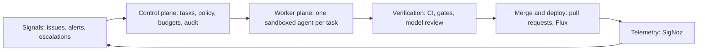
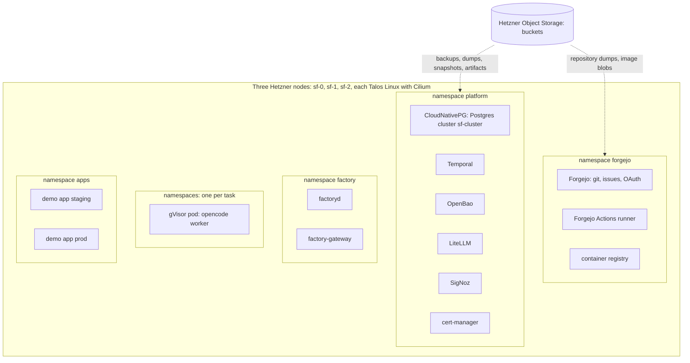
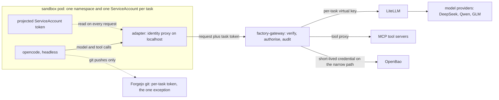
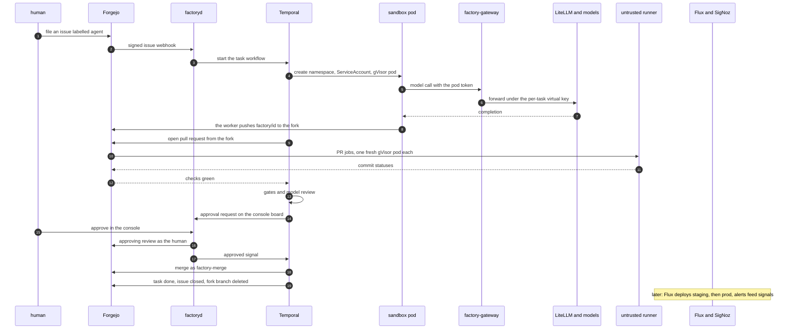

# Software factory: target architecture guide

This document holds the target architecture of the software factory and nothing else: what runs, where it runs, and how one task travels through the system. It is written for someone new to the topic, so every section explains the concepts it uses, and the glossary at the end collects them. The reasoning behind each choice, the options that lost and the decision history live in [architecture.md](architecture.md). The build tasks live in [2026-09-24-build-plan.md](plans/2026-09-24-build-plan.md).

Status: current target. When the design changes, this file changes with it.

## 1. What the factory is

The factory is a largely autonomous system in which agents turn specifications, issues and telemetry into tested, reviewed and deployed software changes. Human involvement is a tool call the agents raise as seldom as possible. An approval is a workflow state, not a meeting.

The project exists to show that a lone developer can run an enterprise-grade agentic setup. Four constraints follow from that and shape every component:

- **Re-seedable.** Deleting the whole installation and rebuilding it from Git, object storage and one small offline bundle must always work.
- **Commodity hardware.** Three rented cloud servers plus S3-compatible object storage. No vendor-specific service anywhere.
- **Best-of-breed open source.** Known tools over obscure ones, each with an escape hatch in case its maintainers gate needed features away.
- **Security without half measures.** Agents get capabilities, never raw credentials. Spending has hard limits. Everything runs in sandboxes with controlled network access.

## 2. Five planes in a loop

The architecture is five planes in a loop. Signals put work in, telemetry from running software closes the loop.



- **Signals** bring work in: issues and pull request comments from Forgejo, alerts on the demo application's telemetry, and human escalations raised by agents.
- **The control plane** owns state and policy: the task registry, capability rules, budgets, approvals and the audit trail.
- **The worker plane** runs one disposable agent in one sandbox per task. The agent works on a branch, reaches models and tools only through a gateway, and opens a pull request.
- **Verification** grades evidence by strength. Continuous integration (CI) first, workflow gates next, a model review last.
- **Merge and deploy** is an ordinary pull request merge. GitOps deploys the result, and the running software produces the telemetry that becomes the next signal.

Three principles hold across all five planes. Policy lives outside the model, in code and network rules. Identity belongs to the task, not the machine. Agents exchange artifacts, not chat, and Git is the coordination mechanism.

## 3. The substrate

Which machines run the factory, and what runs on them?

Three Hetzner Cloud servers, type cpx42 (eight shared vCPU, 16 GB of memory, 320 GB disk, 69.49 EUR per month each), all three in one location. Each server runs both control-plane duties and workloads. Node-to-node traffic rides a private Hetzner network. A reserved public IPv4 address is the Kubernetes API endpoint, so the address survives node replacement.

Each machine boots **Talos Linux** 1.14 from a project snapshot, built from a Talos Image Factory schematic that bakes in the gVisor system extension. Talos is a minimal operating system that runs nothing but Kubernetes. It has no shell, no SSH and no package manager. The whole machine configuration is one declarative document delivered as server user-data, and management is API-only through `talosctl`. Every node also runs **KubePrism**, a small load balancer that serves the Kubernetes API on localhost port 7445 on the node itself.

**Cilium** 1.20 is the network layer. It replaces kube-proxy, the built-in service proxy, so the cluster runs kube-proxy-free. It enforces network policies with default deny, and it terminates inbound HTTP through the Kubernetes-standard **Gateway API**. Its proxy binds ports 80 and 443 on each node's public address.

**OpenTofu** (the open source fork of Terraform) creates the three servers, the firewalls and the reserved address from declarative configuration. **Flux** deploys every workload from Git: the cluster converges to what the repository says, a pattern called GitOps.

Two firewall layers protect the nodes, both generated from the same OpenTofu values. The outer layer is the Hetzner Cloud firewall: the Kubernetes and Talos API ports accept one home address only, ports 80 and 443 accept the world, everything else drops. The inner layer is Talos's own nftables firewall with the same rules plus the node-to-node ports. The outer layer stays editable from the Hetzner console even when a node is unreachable, so a mistyped home address is a console fix rather than a rescue operation.

One hardware limit shapes sandbox design. Cloud servers expose no `/dev/kvm`, so gVisor, the isolation layer of the worker sandbox (section 7), runs on its systrap platform, which intercepts system calls in user space, instead of its faster KVM platform.

### What runs where



The namespaces, in the order of the diagram:

- `platform` holds the shared services: CloudNativePG, Temporal, OpenBao, LiteLLM, SigNoz and cert-manager. The operator namespaces `cnpg-system` and `local-path-storage` support them.
- `forgejo` holds the git server, its container registry and the trusted Actions runner, which builds and publishes images from protected `main` only; its dind sidecar is privileged, so nothing an agent wrote reaches it unreviewed. Agent pull requests are checked elsewhere, by untrusted runners factoryd starts one per job (section 8).
- `factory` holds the two self-written services, factoryd and factory-gateway.
- `factory-agents` holds one namespace per running agent session, each with one gVisor pod, and one namespace per untrusted CI job, named `factory-agents-ci-<job>`.
- `apps` holds the demo application in staging and prod, deployed by Flux.

### Re-seedability

No node holds state that Git, S3 and the seed bundle do not describe. Teardown and rebuild are the same drill:

1. `tofu destroy` removes the three servers. Billing stops at once.
2. `tofu apply` creates new servers, which boot from the same committed Talos configurations.
3. Flux reinstalls every workload from Git.
4. Restore Postgres from its S3 backups, Forgejo from its repository dump, and OpenBao from its S3 snapshot. The unseal key comes from the seed bundle.
5. Point the services at the object storage buckets.

The last full rebuild, in September 2026, took about 21 minutes from empty servers to a task running end to end, because the recipe in the infra repository already solves every trap the earlier drills hit.

Step zero exists because of one circular dependency: Flux deploys everything from Git, but the Git server is itself deployed by Flux. The bootstrap applies the first slice, the database operator and Forgejo, by hand, restores the repositories, and leaves everything else to Flux.

### The seed bundle

Three sources restore the world: Git holds all configuration, S3 holds the data, and the seed bundle holds what neither can. The bundle contains the Hetzner API token, the S3 access keys, the Namecheap account access for the domain, the model provider API keys, and the OpenBao unseal key. It lives in an offline password manager plus a printed copy. No secret the seed holds ever enters Git.

## 4. Storage and state

Which state exists, where does it live, and how is it backed up?

The design runs no shared storage layer. Stateful services replicate themselves on local disks, blobs such as backups and artifacts go straight to object storage, and everything else is rebuilt from Git.

**Local disks.** The local-path provisioner issues local volumes, the default `StorageClass` `local-path`, from a 200 GB user volume carved on each node at install time. A local volume is fast because no network hop sits in the path, and it is bound to its node.

**PostgreSQL.** CloudNativePG runs one Postgres cluster, `sf-cluster`, with three members, one per node, each on a local volume. The members stay current through streaming replication: Postgres writes each change to its write-ahead log before touching the data files, and the replicas replay that log continuously. If a node dies, the operator promotes a replica on a surviving node. Backups go to object storage. One Postgres database per service.

**Forgejo.** Repositories are plain files on a local volume. A nightly dump copies them to object storage.

**OpenBao.** Encrypted snapshots go to object storage.

**SigNoz.** Telemetry lives in ClickHouse on a local volume, with retention tiered to object storage. Losing recent local history in a node failure is the one accepted loss.

**Object storage.** Hetzner Object Storage speaks the S3 API, the standard that every backup tool, registry and analytics tool already speaks. It holds backups, artifacts, session records, log archives and container image blobs. Two buckets: `aisoftwarefactory-forgejo` for Forgejo object data, and `aisoftwarefactory-backups` with the prefixes `cnpg/`, `forgejo-dumps/` and `openbao/`. The S3 API is the escape hatch: any other compatible provider takes a new endpoint and credentials, nothing more.

Each data service has exactly one backup path. There is no cluster-wide backup tool.

## 5. Platform services

Which shared services run on the cluster, and what does each do for the factory?

| Concern | Component | What it does here |
|---|---|---|
| Relational database | CloudNativePG | Three-member Postgres, streaming replication, S3 backups |
| Durable execution | Temporal | Workflow state survives crashes, restarts and three-day waits |
| Secrets | OpenBao | Stores secrets, mints short-lived credentials |
| Model routing | LiteLLM | One OpenAI-compatible endpoint over all model providers, with budgets and virtual keys |
| Observability | SigNoz | Logs, metrics and traces in one store, with alerting |
| Telemetry routing | OpenTelemetry Collector | Services and agents emit OpenTelemetry (OTel), the collector routes it |
| Certificates | cert-manager | Obtains and renews TLS certificates from Let's Encrypt |
| Version control and more | Forgejo | Git hosting, issue tracking, pull requests, Actions CI and container images in one server |

Four of these deserve a closer look.

**Temporal** runs the task lifecycle as workflow code. Durable execution means a workflow's state and history live in a database, not in a process. A workflow can sleep for three days waiting for a human approval at no cost, resume after a crash, or retry an attempt with a stronger model while the previous attempt's artifacts stay in place.

**OpenBao** is the secrets store, the Linux Foundation fork of HashiCorp Vault with the same API. It holds the service credentials and hands out short-lived copies. It has no key management service for auto-unseal, so a full restart needs a human to enter the unseal key from the seed bundle. OpenBao 2.6.3 rejects a multi-share split with threshold one, so the bundle holds exactly one key. Node reboots are rare on Talos, so that price is accepted.

**LiteLLM** fronts all chat model providers with one OpenAI-compatible API. The upstreams are DeepSeek, Qwen and GLM (z.ai). Four aliases name the tiers: `coding-cheap` for the DeepSeek and Qwen tier, where every task starts, `coding-frontier` for the GLM frontier tier, where a retry climbs, `review-frontier` for the model review, and `supervisor` for the strongest configured model, used only by the supervisor. Anthropic and OpenAI are deliberately absent at the start: the factory runs on the providers its owner uses daily. Paid capabilities that are not chat models, Replicate, Firecrawl and fal.ai, enter as tools with per-task request and euro caps.

**SigNoz** stores traces, logs and metrics in one ClickHouse database, with dashboards and alerting on top. Services and agents emit OpenTelemetry, and SigNoz's own collector scrapes the cluster. Its alert webhooks feed the signals intake.

### Public endpoints, DNS and TLS

The domain is `aisoftwarefactory.world`, registered at Namecheap, with DNS hosted there too. A handful of A records, made by hand in the dashboard, point at the node addresses. They change once per re-seed.

Certificates come from Let's Encrypt through the HTTP-01 challenge: cert-manager proves control of a hostname by serving a token on port 80 through the cluster's own Gateway. No DNS API is involved. There is one certificate per public hostname, for example `git.aisoftwarefactory.world` for Forgejo, and renewal is automatic.

One refinement keeps traffic inside the cluster: CoreDNS rewrites `git.aisoftwarefactory.world` for in-cluster clients to the Gateway service, so pods do not route out to the node's own public address and back.

## 6. The control plane

What owns tasks, policy and money?

One Go module produces two binaries.

**factoryd** holds everything that remembers:

- **Intake.** Forgejo webhooks arrive here, signed with a shared secret that factoryd checks before it reads the body. An issue labelled `agent` becomes an agent task, one labelled `human` a task in the human lane. Callers that are not Forgejo use an authenticated API, which files the issue itself, so every task is an issue. SigNoz alerts and agent escalations will arrive the same way.
- **The task registry.** Each task carries a priority, required capabilities, a risk class and a cost ledger.
- **The Temporal worker.** factoryd runs it itself. One workflow per task: link the issue, run up to three agent sessions, open the pull request, wait for the checks, run the gates and a model review, file an approval request, then wait at no cost for a person to approve, close or ask for changes. After a human's approval, the bot `factory-merge` merges (section 8). factoryd keeps exactly one `state/*` label on the task's issue (queued, running, waiting-human, in-review, done, failed), and every step lands in a timeline record. A heal pass at boot and every minute starts any workflow that is missing, files a task for any labelled issue that has none, and re-reads Forgejo for anything a webhook missed.
- **The console.** A server-rendered Go interface with htmx for operators and approvals, served at `console.aisoftwarefactory.world` through the Gateway. Humans log in through Forgejo OAuth2 with PKCE and an explicit scope list, and only users with write access get in, checked on every request. The login state travels in a signed cookie, so an anonymous visitor leaves no state on the server, and the human's tokens never reach the browser. Actions such as a new task, an answer or a review go to Forgejo through the human's own token, so Forgejo records the human as their author. Only the users on the policy's `approvers` list may authorise spend: approve a resource or a merge, edit an envelope, promote a resource. Every POST carries a CSRF token. Its main view is a kanban board. Agent tasks move through columns derived from their state: queued, running, waiting on a human, in review, done, failed. A separate lane holds human tasks: approvals, escalations and tasks you file for yourself. A new-task button files a Forgejo issue labelled `agent` or `human`, so every task has one record with its discussion, and factoryd mirrors state onto issue labels. Forgejo's own kanban boards cannot serve yet: a card's column is separate from the issue's state, and the API has no endpoint to add or move a card, so factoryd could not keep a board current. Forgejo has no plugin system, and a source patch would mean our own fork. When the upstream projects API lands, its groundwork merged in September 2026, factoryd mirrors columns onto a Forgejo project as well. The console also lists every commissioned cloud resource by project and task with its cost so far.
- **Cost aggregation.** Model spend from LiteLLM, tool spend from the gateway and resource spend from the collector, each a row in an append-only ledger, summed per task and per day and shown in the console.

**factory-gateway** is the enforcement point. Every model call and every tool call an agent makes passes through it:



For each request the gateway:

1. Verifies the pod's ServiceAccount token against the cluster's OpenID Connect (OIDC) issuer.
2. Maps the service account `task-<id>` to the task row in Postgres.
3. Checks capability, budget and approval state.
4. Forwards a model call to LiteLLM under a per-task virtual key, or proxies a tool call to its MCP (Model Context Protocol) server, or mints a short-lived credential from OpenBao for the narrow case where the agent must connect itself.
5. Writes an audit row for the decision.

The sandbox holds no key material. The gateway mints LiteLLM virtual keys through LiteLLM's own API and never hands them out, which replaces LiteLLM's token authentication for outside callers, an enterprise-only feature.

### Policy

Capability policy is data: a YAML document in the infra repository, applied by Flux as a ConfigMap. A human authors every change in a commit, and Git holds the history. factoryd stores each new content as an immutable version in Postgres, the gateway enforces the current version, and every audit row names it. An invalid file is rejected and the old version stays. Runtime decisions such as envelopes, approvals and promotions are database rows a human edits in the console. The document holds the budgets, the capability classes with their models and tools, the tool prices, the risk classes of changed paths, the default resource envelope and the spend approvers. Enforcement is code in the gateway. It refuses a model the task's classes do not allow, and any routing override in the request body that could reach another model. Network policy makes bypass unreachable: a sandbox pod can reach only the gateway and Forgejo git, plus a package registry named per toolchain.

The first capability class is `coder`: repository read, branch write, model aliases and allowlisted tools, nothing else. The tools are web scraping and search, Replicate and fal models, the escalation tool and the commissioning tools, each capped by requests and euros. Further classes, such as analyzer, integration tester and release agent, arrive one per phase with the loops that need them. If rules ever multiply beyond what plain Go code reads well, an Open Policy Agent sidecar is the reserved upgrade. Policy never lives in a prompt.

### Budgets

The gateway enforces hard caps on the call itself. LiteLLM checks a key's budget only before a call, so one call could run past it. So the gateway prices each call's worst case, clamps the output length so that worst case fits the free headroom, and takes a hold for it under a database lock before the call. Concurrent calls therefore cannot share the same headroom. After the call it books the real cost, in full even above the hold, and the next call is refused. A call cut mid-flight books its whole hold, because a cut stream's reported cost is no upper bound of the provider's charge. After the task finishes, factoryd settles the model total upward to what LiteLLM recorded. Tool calls take holds the same way and book the provider's real charge. A tool whose cost the gateway cannot bound up front is refused. Hetzner offers no hard per-project spend cap, so this ledger is the real spend limit.

Agents may also commission cloud resources through gateway tools: servers with their IPv4 and volumes. Buckets are left out, because Hetzner's Object Storage keys reach every bucket of a project, so a per-task bucket would put a shared key in the agent's reach. The resources live in a separate Hetzner project whose token only the gateway holds, and the gateway calls the provider itself. The policy's default envelope (today 10 EUR a month, cx23 or cx33, two servers, four hours, 20 GB) becomes each project's envelope, which a human edits in the console. A request beyond it becomes an approval card. The gateway writes a hold and a registry row with task, project and lease before each create and labels the resource the same way. Cost comes from the provider's own price list: Hetzner's API returns every price in one call, so a one-hour cx23 with its IPv4 reserves 0.0096 EUR, and the collector books each started hour. Task completion deletes a task's resources. If an agent dies, the lease still ends and a garbage collector deletes the resource at its last pass before the lease ends, so no extra hour is billed. It also deletes anything in the agent project the registry does not know. It deletes nothing when it sees a cluster node's address or another project's label, since the token would then open the wrong project. A human can promote a resource to project-owned. A server admits SSH only from the cluster nodes, and only with a short-lived certificate from OpenBao whose principal names that one server. Its outbound traffic is open on ports 53, 80 and 443, because it holds no factory credential and its lease, the envelope and the task's cap bound it. Resources priced by usage, such as functions, will get an estimate cap and be reconciled against the provider's billing data afterwards.

## 7. The worker plane

How does an agent run, and what can it touch?

One task gets one namespace, one ServiceAccount named `task-<id>`, and one pod.

**The sandbox.** The pod runs under gVisor, a user-space kernel that intercepts the container's system calls, so a hostile program never reaches the host kernel. The container is non-root with dropped capabilities and a read-only root filesystem. Cilium enforces default-deny egress: only the gateway, Forgejo git, the Go module proxy and checksum database, and `storage.googleapis.com`, where the proxy redirects module downloads, answer. DNS resolves only their names, and the cloud metadata endpoint is unreachable. While a commissioned server's lease lives, its address on port 22 joins the list. The image carries the Go toolchain, so the agent can run the same tests its pull request checks will run; a package registry joins the list by name only together with a toolchain that needs it. The module proxy is a known narrow leak, since an agent could encode data in a module path it requests, and it is accepted because the sandbox holds no secret worth leaking. Each task namespace has a resource quota, and factoryd, which creates these namespaces, is confined by an admission policy to exactly this shape; factoryd itself runs under default-deny egress too. The reserved stronger tier is microVMs, Kata Containers or Firecracker: one small virtual machine with its own kernel per pod. They need `/dev/kvm`, which cloud servers lack, so they arrive with bare-metal nodes once the build volume pays for them (section 8).

**The harness.** The coding agent inside the sandbox is opencode, driven headless. factoryd knows nothing about harnesses, only a Go interface:

```go
type Harness interface {
        Prepare(ctx context.Context, env SandboxEnv, brief TaskBrief) error
        Run(ctx context.Context, brief TaskBrief, emit func(Event)) Result
}
```

`TaskBrief` is the whole task as data: objective, repository and commit, issue context, findings from parent sessions and artifact paths. Capability hints stay out of the brief: capabilities are policy, enforced by the gateway. `Event` is the normalised stream: model calls with alias and cost, tool calls with status, file changes, commands with exit codes, checkpoints and the final result. The git diff and the artifact store are the ground truth, the event stream serves observability and audit.

A harness fits the factory if it meets four requirements: it runs headless, it accepts a configurable model endpoint so its traffic routes through the gateway, it takes configurable tools so tools route through the gateway too, and its session output is machine-readable. Codex CLI is the named successor behind the same interface. A swap is one adapter file plus one container image, and nothing else changes.

**The identity proxy.** A harness makes its own model and tool calls, but it cannot attach the pod's projected ServiceAccount token, a file the kubelet rotates. So the adapter listens on localhost inside the pod, the harness points its provider configuration at it, and on each request the adapter reads the current token file and forwards the call to factory-gateway. Model and tool traffic never leaves this path, and no model key material ever enters the sandbox.

**The git exception.** Git is the one path outside the gateway, and the agent still never holds its credential. For every session factoryd mints two Forgejo tokens and revokes both at the end: one reads the upstream repository, the other writes only to a fork owned by the `factory-agent` account. The worker process in the pod clones from upstream before the agent starts, keeps both tokens out of the agent's environment and repository config, and after the agent finishes kills every other process in the pod and pushes the branch `factory/<id>` to the fork from a clean repository of its own. A token inside the agent's repository would leak through git hooks and lingering processes. The pull request then goes from the fork into the upstream repository, which matters for CI: Forgejo gives the checks of a fork pull request a read-only token, while a pull request from a branch of the same repository gets a token that can write to it. A pull request's workflow files come from the branch itself, so the worker refuses to push any change to the `.forgejo`, `.gitea` or `.github` directories, comparing the directories as git trees rather than file names, and factoryd checks again before it opens the pull request. Every exchange with the world stays attributable: model and tool calls by the task identity, git pushes by the task tokens.

**Session records.** The sandbox streams its session out while it lives: prompts, tool calls, output, files touched, commits and cost. Full history goes to object storage, a compact restart state to Postgres. A dead session resumes as a new pod that receives the findings and the parent session id, not as a resurrected process. **Supervision.** An agent that circles rarely repeats itself word for word, so no fixed rule catches every circle. Cheap detectors in factoryd catch the traces a circle leaves in the event stream: a stall, tool calls without file changes, the same command failing with the same error again and again, the same tool call repeated, a file flipping back to earlier content, many edits while the diff stops growing, and a task past half its time or budget, once per task. The same-failure check compares the command and its output with timestamps and other noise stripped, and it does not trust the exit code of a command such as `make test; echo $?`, which always succeeds. Any trip calls the supervisor inside the running session: the strongest model available, under its own `supervisor` alias. It reads the brief, the session record and a progress digest of commands, outcomes, files and errors over time, the same view a human reviewer would use, and answers in strict JSON with one action: continue, redirect with guidance, retry on a stronger model, or stop and escalate to a human. A session gets at most three supervisor calls, and each call takes a hold on the task's own remaining budget like any model call. A stop is graceful: the worker pushes the work in progress first, so the next session starts from it. The agent can also escalate by itself through the `escalate_to_human` tool, which stops the session the same way without a supervisor call. An escalation moves the task to waiting-human and comments on the issue. A trusted person's reply, in Forgejo or in the console, may grant a bounded slice of extra time. A human may raise a cap that way, the supervisor never. The replies go into the next session's brief in their own section, newest first, each tagged with its question, and the workflow keeps every reply of the task across attempts, so the agent never asks the same question twice. The Temporal workflow enforces heartbeat and wall-clock timeouts, where the wall clock counts the agent's working time across attempts, so a stuck agent is visible instead of silent.

## 8. Verification and delivery

What must a change survive before it merges?

Evidence ranks by strength, cheap deterministic gates first, the expensive model last:

1. **Forgejo Actions** runs the pull request checks on the untrusted runner: tests, vet and format, static security scanning, an audit of the job's own environment, and the image builds.
2. **Gate activities** in the Temporal workflow decide what CI cannot. The policy gate classifies every changed path by the policy's risk rules: a change to the workflow directories is forbidden and fails the task, and migrations, deploy manifests, Dockerfiles and module files rank above normal code. The migration gate flags schema migrations for the human. The reproduction gate runs the issue's reproduction command against the pull request in a fresh sandbox with a read-only token, and a failure goes back to the agent as findings.
3. **Model review** runs last, on diffs that survived the gates. A stronger model reads the brief, the diff and the gate results and writes a strict verdict, `approve` or `concerns`, with findings. The call is paid from the task's budget like any other. The verdict is evidence for the merge decision, shown on the approval card. It never has the authority to skip the gates above.

Merge is a pull request merge. Flux deploys the merged commit to the staging namespace, then to prod on the promotion rule. Every risk class still needs a human, so the workflow files an approval request and waits for a Temporal signal. The wait costs nothing. The human approves in the console, which submits an approving review as that human and then signals the workflow. A bot account, `factory-merge`, then merges. `main` is protected so that Forgejo itself refuses the bot's merge until a whitelisted human has approved the current commit: only the human may push, the merge whitelist holds the human and the bot, one approval from the approvals whitelist is required, stale approvals are dismissed, and the rule binds repository admins too. A leaked bot token can therefore merge only what a human approved. A refused merge keeps the workflow waiting. A failed merge is retried for about an hour, then waits for a new approval. Every workflow change sits behind a Temporal version marker, so a running workflow keeps the path it started on.

**The untrusted runner.** Forgejo's runner has no Kubernetes mode that starts a fresh pod per job, so factoryd does it. Its CI spawner watches the queue of waiting pull request jobs, registers a one-job runner scoped to the code repository for each, and starts it in a namespace of its own as one gVisor pod: non-root, no service-account token, and egress only to Forgejo, the Go module proxy and the image registries the builds pull from. The runner takes its job, exits, and the namespace is deleted. The module proxy's downloads come from `storage.googleapis.com`, which joins the list by name. The registrations come from a dedicated Forgejo account, `factory-ci`. Forgejo's runner API answers only the repository's owner, so the account is an organisation owner, but its token reaches the code repository alone and `main` refuses its pushes. Because agent pull requests come from a fork, each job's token is read-only and no Actions secrets reach it; a check in every run proves that the token cannot push.

**The build VM.** Building container images needs root somewhere, and no rootless BuildKit mode works under gVisor, which also offers no overlay filesystem, so every layer was copied in full. A job that builds images therefore gets a throwaway Hetzner Cloud server, a build VM, in a Hetzner project kept for CI. factoryd creates it for the job and deletes it seconds after the job ends. The VM runs BuildKit on an ordinary kernel and answers only the cluster nodes, over mutual TLS with certificates made for that one VM. It holds no token and no credential, only the build context the job sends it, and nothing it builds is published: publishing stays with the trusted runner on `main`. Its outbound traffic is open on ports 53, 80 and 443, because provider firewalls cannot filter by name, and the VM holds nothing but code the agent already had. At most two build VMs run at once. A collector, the same one that watches agent resources, deletes any VM whose job died with it. A pull request that builds no image gets no VM.

**The build cache.** Builds read a cache that only the trusted `main` builds write. It is a small registry in the cluster, and a Cilium rule lets the build jobs' runner pods send only read requests to it. The runner pod fetches the cache and streams it to the VM, so the VM never reaches the cache. A missing cache means a cold build, not a failure.

**Build speed, and the road to microVMs.** The image builds of one pull request took 25 to 30 minutes in gVisor pods. Now only the images a pull request changes are built, in parallel, on build VMs, with the cache. A docs-only pull request goes from issue to green checks in about 5 minutes, a pull request that changes Go runs its checks in about 4 to 5 minutes, and a build VM costs about 0.01 EUR per build. A larger VM type built no faster, so the smallest stays. At larger scale the clean route is microVMs: Kata Containers or Firecracker give every job and every agent sandbox its own real kernel, so overlay filesystems and Docker work at near-native speed inside one prison for both. They need `/dev/kvm`, which Hetzner Cloud servers lack, so that route means bare-metal nodes, for example Hetzner dedicated servers, or a cloud with nested virtualisation, and it pays once the build volume outweighs running such nodes.

## 9. Signals

What starts a task?

Forgejo webhooks carry issues, pull request events, comments and reviews. SigNoz alert rules watch the demo application's telemetry. Both feed factoryd intake, which creates or updates task rows, with priority from labels and severity. The agent's human-escalation tool call is one more intake event: it stops the session and puts the task, with the agent's question, into the console's human lane. Every task becomes a Forgejo issue, whatever its source, so the console board and Forgejo's issue list show the same work.

A webhook must carry a valid signature, and a signal may change a running task only if a trusted person sent it: a comment, review or change request counts only from someone with owner, admin or write permission on the repository. Bot events and edited comments never count. Forgejo never retries a failed delivery, so a merge made while factoryd is down would otherwise be lost. The heal pass closes that gap: every minute it re-reads the pull requests, issues and comments of every task that waits on a person, applies the same trust checks, and signals what it finds exactly as a webhook would.

## 10. One task, end to end

This path runs on the cluster today, from an issue to a merged pull request. The steps marked as later join it in the Customer phase.



The same journey in words:

1. A person files an issue labelled `agent`, or a caller uses factoryd's API, which files the issue itself. The signed webhook creates the task row, the issue gets `state/queued`, and the Temporal workflow starts.
2. The workflow creates a namespace, a ServiceAccount and a gVisor pod, and injects the task brief. The worker process clones the upstream repository with a read-only token before the agent starts.
3. opencode works on a branch. Its model and tool calls go through the localhost adapter, which attaches the pod token and forwards to the gateway. The gateway checks policy and budget, then forwards to LiteLLM or to the tool. If the agent stalls or circles, the detectors call the supervisor.
4. The agent commits. The worker kills the agent's processes, refuses any change to the workflow directories, and pushes `factory/<id>` to the fork from its own clean repository. The workflow opens a pull request from the fork and labels the issue `state/in-review`.
5. The spawner runs each check in a fresh untrusted runner pod with a read-only job token. Red checks send the next attempt to a stronger model with the failures as findings.
6. With green checks the workflow runs the gates and the model review, files an approval request and waits, at no cost, for a person. A trusted change request runs another session. An approval in the console submits the human's review and signals the workflow, and `factory-merge` merges. The merge finishes the task `done`: credentials revoked, spend settled to what LiteLLM recorded, the issue closed with `state/done`, the fork branch deleted.
7. Every step lands in the task's timeline in object storage, from intake through each session, supervisor decision, pull request and signal to the final state, readable through factoryd's API beside the full session records.

Later on the same path: Flux deploying the merge to staging and prod, whose telemetry reaches SigNoz and becomes the next signal.

## 11. The security model in one place

Eight rules, all enforced by code rather than by instruction:

- **Identity belongs to the task.** A pod carries a projected ServiceAccount token, short-lived and audience-scoped, rotated by the kubelet. No shared machine identity exists. SPIFFE/SPIRE, the workload identity standard that reaches beyond one cluster, is the reserved upgrade.
- **No credentials in the agent's reach.** Model calls ride virtual keys the gateway holds, tool calls ride the gateway, and git rides two per-session tokens, read on the upstream repository and write on the agent's fork only, that only the worker process uses, before the agent starts and after it is killed.
- **Policy lives outside the model.** Capability rules are database rows enforced in gateway code. A prompt cannot grant a capability.
- **The network forbids by default.** A sandbox pod reaches the gateway, Forgejo git and the Go module proxy, and resolves only their names. Nothing else, including the cloud metadata endpoint. factoryd and every CI pod run under default-deny egress as well.
- **Untrusted code never reaches a privileged builder.** CI with privileged docker-in-docker runs only on protected `main`. Nothing merges there without a whitelisted human's approval: the merge bot's merge is refused by Forgejo until that approval exists, and the rule binds repository admins too. Agent pull requests come from a fork and run on untrusted runners: one fresh gVisor pod per job, a read-only job token, no secrets, and image builds on a throwaway build VM that holds no credential. Agents cannot change what those runners execute, because the worker refuses to push changes to the workflow directories, factoryd checks again, and the policy gate fails such a pull request. An admission policy confines every pod factoryd creates: no privileged containers, no host namespaces or host paths, no added capabilities, non-root everywhere.
- **Only trusted people steer a running task.** Webhooks must carry a valid signature, and comments, reviews and escalation answers count only from people with write access or more. Only the policy's approvers may authorise spend in the console. The supervisor may stop or redirect an agent but never raise a cap. Only a human's answer can grant more time, and only a bounded slice.
- **Spending has hard caps.** Per task, per day and per project envelope. Each call and each resource takes a hold for its worst case before it runs, and a call without headroom is refused.
- **Everything is audited.** The gateway writes an audit row for every decision, and session records preserve what each agent did.

## 12. Repositories and build order

Which repositories carry the work, and in what order does it land?

| Repository | Holds | Character |
|---|---|---|
| `ai-software-factory-infra` | OpenTofu, Talos machine configs, Flux bootstrap and kustomizations | Changes rarely, human-only, agents never write here |
| `ai-software-factory-code` | The Go module with both binaries, the harness adapters, tests and deploy manifests | Changes often, first repository the agents work on |
| `demo-app` | A small real product with real telemetry | Arrives in the Customer phase |

Forgejo is the primary remote and the one Flux reads. GitHub is the off-site copy: Forgejo push-mirrors both repositories to it on every commit, so a bot merge reaches it without a human push, and humans push to both remotes as well. While Forgejo is down, pushes reach GitHub only, so a restore is followed by a fast-forward push of every repository back to Forgejo.

Build order, five phases:

1. **Ranch.** The Talos cluster, the platform services and the re-seed drill.
2. **First loop.** Gateway v0, sandbox and opencode adapter: intake to merged pull request.
3. **Teeth.** Capability policy, budgets, approvals, verification gates and the cost ledger.
4. **Customer.** The demo application live in staging and prod, its telemetry feeding signals.
5. **Self.** The factory works on its own repositories under full policy.

## 13. Running costs

What does the factory cost?

The cluster is three servers at 69.49 EUR per month, about 210 EUR per month, plus object storage and model spend. Servers bill hourly and deletion stops the meter. `tofu destroy` is the off-switch, and the re-seed drill is the way back. The throwaway build VMs bill the same way, by the started hour and only while a build runs, so a pull request's build costs about 0.01 EUR. They live in a separate CI project and are tracked in the same registry as every commissioned resource.

## 14. Glossary

| Term | Meaning |
|---|---|
| ACME | The protocol Let's Encrypt uses to issue certificates. HTTP-01 proves control of a domain over port 80 |
| ACP | Agent Client Protocol, one way a client drives a coding agent over stdin and stdout |
| Approvers | The policy's list of Forgejo users who may authorise spend in the console |
| Build cache | The in-cluster registry that `main` builds write and pull request builds only read |
| Build VM | A throwaway cloud server that runs one pull request job's image builds, holding no credential, deleted after the job |
| CI | Continuous integration, automated build and test runs on every pull request |
| CNI | Container network interface, the cluster's network layer. Cilium here |
| Envelope | The resource and euro allowance per project for commissioned cloud resources, copied from the policy default and edited by a human in the console |
| factory-ci | The Forgejo account that registers the one-job untrusted runners |
| factory-merge | The Forgejo bot that merges an agent pull request once a whitelisted human has approved it |
| Fork pull request | A pull request from the `factory-agent` account's fork into the upstream repository. Its CI jobs get a read-only token and no secrets |
| Gateway API | The Kubernetes-standard way to describe inbound HTTP routing |
| GitOps | The cluster converges to what the Git repository says. Flux does this here |
| gVisor | A user-space kernel that intercepts container system calls, stronger isolation than a plain container |
| Heal pass | factoryd's check at boot and every minute that restarts missing workflows and re-reads Forgejo for anything a webhook missed |
| Hold | A reservation of a call's or a resource's worst-case cost, taken before it runs and replaced by the real cost |
| Job token | The token Forgejo Actions gives each CI job. Writable on a pull request from the same repository, read-only on one from a fork |
| JWT | JSON Web Token, a signed short-lived token. The pod's identity for API calls |
| Kata | Containers inside lightweight virtual machines, the strongest isolation tier |
| KubePrism | The small Kubernetes API load balancer each Talos node runs on localhost |
| Lease | The expiry every commissioned resource and build VM carries. The garbage collector deletes the resource at its last pass before the lease ends |
| MCP | Model Context Protocol, how agents call tools and data sources |
| MicroVM | A small virtual machine with its own kernel per pod or job, from Kata or Firecracker. Needs `/dev/kvm`, so bare-metal servers or nested virtualisation |
| OIDC | OpenID Connect, the identity protocol the cluster uses to issue and verify pod tokens |
| Operator | A controller plus custom object types that runs a piece of software on Kubernetes |
| OTel | OpenTelemetry, traces, metrics and logs in one vendor-neutral format |
| Principal | The name an SSH certificate is valid for. A commissioned server accepts only its own |
| Push mirror | Forgejo's push of every commit to the GitHub copy of a repository |
| PV and PVC | Persistent volume, a disk the cluster offers, and persistent volume claim, a pod's request for one |
| ServiceAccount | A Kubernetes identity for a pod, not for a person |
| Streaming replication | Postgres replicas replaying the write-ahead log of the primary as it is written |
| Supervisor | The strongest model available, called inside the session when a detector trips or a task passes half its cap. It chooses continue, redirect, retry or escalate, and never raises a cap |
| Talos Linux | The minimal operating system that runs only Kubernetes on each node |
| Temporal | The durable execution engine: workflow state and timers live in a database |
| Timeline | A task's step-by-step record in object storage, from intake to its final state |
| Virtual key | A LiteLLM key scoped to one task, carrying its budget and allowed models |
| WAL | Write-ahead log, the change log Postgres writes before touching data files |
