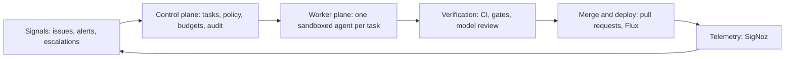
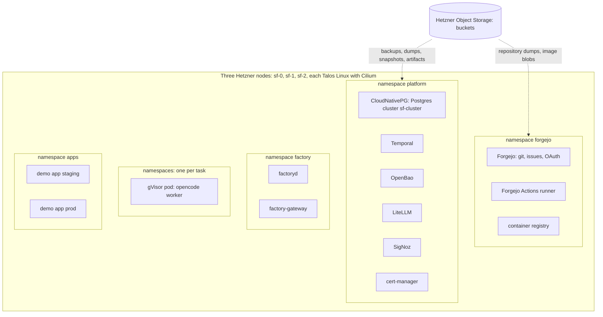
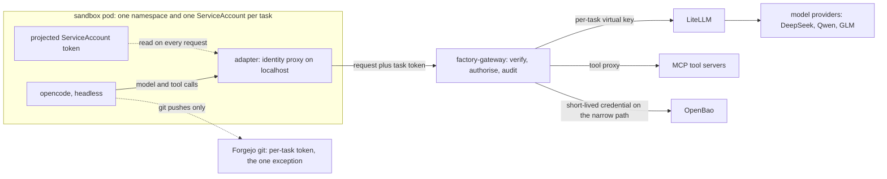
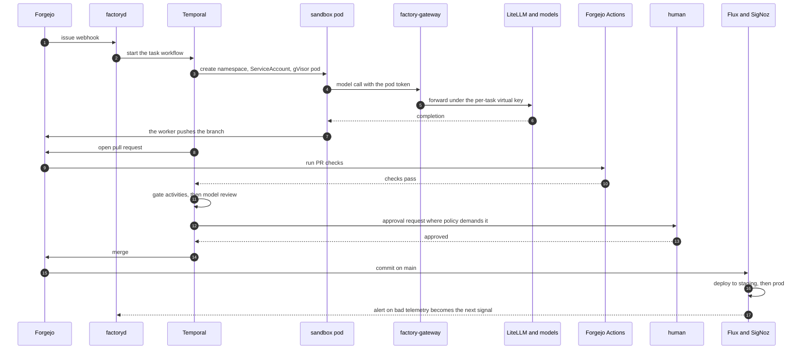

# Software factory: target architecture guide

This document holds the target architecture of the software factory and nothing else: what runs, where it runs, and how one task travels through the system. It is written for someone new to the topic, so every section explains the concepts it uses, and the glossary at the end collects them. The reasoning behind each choice, the options that lost and the decision history live in [architecture.md](architecture.md). The build tasks live in [2026-09-24-build-plan.md](plans/2026-09-24-build-plan.md).

Status: current target. When the design changes, this file changes with it.

## 1. What the factory is

The factory is a largely autonomous system in which agents turn specifications, issues and telemetry into tested, reviewed and deployed software changes. Human involvement is a tool call the agents raise as seldom as possible. An approval is a workflow state, not a meeting.

The project exists to show that a lone developer can run an enterprise-grade agentic setup. Four constraints follow from that and shape every component:

- **Re-seedable.** Deleting the whole installation and rebuilding it from Git, object storage and one small offline bundle must always work.
- **Commodity hardware.** Three rented cloud servers plus S3-compatible object storage. No vendor-specific service anywhere.
- **Best-of-breed open source.** Known tools over obscure ones, each with an escape hatch in case its maintainers gate needed features away.
- **Security without half measures.** Agents get capabilities, never raw credentials. Spending has hard limits. Everything runs in sandboxes with controlled network access.

## 2. Five planes in a loop

The architecture is five planes in a loop. Signals put work in, telemetry from running software closes the loop.



- **Signals** bring work in: issues and pull request comments from Forgejo, alerts on the demo application's telemetry, and human escalations raised by agents.
- **The control plane** owns state and policy: the task registry, capability rules, budgets, approvals and the audit trail.
- **The worker plane** runs one disposable agent in one sandbox per task. The agent works on a branch, reaches models and tools only through a gateway, and opens a pull request.
- **Verification** grades evidence by strength. Continuous integration (CI) first, workflow gates next, a model review last.
- **Merge and deploy** is an ordinary pull request merge. GitOps deploys the result, and the running software produces the telemetry that becomes the next signal.

Three principles hold across all five planes. Policy lives outside the model, in code and network rules. Identity belongs to the task, not the machine. Agents exchange artifacts, not chat, and Git is the coordination mechanism.

## 3. The substrate

Which machines run the factory, and what runs on them?

Three Hetzner Cloud servers, type cpx42 (eight shared vCPU, 16 GB of memory, 320 GB disk, 69.49 EUR per month each), all three in one location. Each server runs both control-plane duties and workloads. Node-to-node traffic rides a private Hetzner network. A reserved public IPv4 address is the Kubernetes API endpoint, so the address survives node replacement.

Each machine boots **Talos Linux** 1.14 from a project snapshot, built from a Talos Image Factory schematic that bakes in the gVisor system extension. Talos is a minimal operating system that runs nothing but Kubernetes. It has no shell, no SSH and no package manager. The whole machine configuration is one declarative document delivered as server user-data, and management is API-only through `talosctl`. Every node also runs **KubePrism**, a small load balancer that serves the Kubernetes API on localhost port 7445 on the node itself.

**Cilium** 1.20 is the network layer. It replaces kube-proxy, the built-in service proxy, so the cluster runs kube-proxy-free. It enforces network policies with default deny, and it terminates inbound HTTP through the Kubernetes-standard **Gateway API**. Its proxy binds ports 80 and 443 on each node's public address.

**OpenTofu** (the open source fork of Terraform) creates the three servers, the firewalls and the reserved address from declarative configuration. **Flux** deploys every workload from Git: the cluster converges to what the repository says, a pattern called GitOps.

Two firewall layers protect the nodes, both generated from the same OpenTofu values. The outer layer is the Hetzner Cloud firewall: the Kubernetes and Talos API ports accept one home address only, ports 80 and 443 accept the world, everything else drops. The inner layer is Talos's own nftables firewall with the same rules plus the node-to-node ports. The outer layer stays editable from the Hetzner console even when a node is unreachable, so a mistyped home address is a console fix rather than a rescue operation.

One hardware limit shapes sandbox design. Cloud servers expose no `/dev/kvm`, so gVisor, the isolation layer of the worker sandbox (section 7), runs on its systrap platform, which intercepts system calls in user space, instead of its faster KVM platform.

### What runs where



The namespaces, in the order of the diagram:

- `platform` holds the shared services: CloudNativePG, Temporal, OpenBao, LiteLLM, SigNoz and cert-manager. The operator namespaces `cnpg-system` and `local-path-storage` support them.
- `forgejo` holds the git server, its container registry and two Actions runners. The trusted runner builds and publishes images from protected `main` only; its dind sidecar is privileged, so nothing an agent wrote reaches it unreviewed. The untrusted runner checks agent pull requests without privilege, registry or repository credentials.
- `factory` holds the two self-written services, factoryd and factory-gateway.
- `factory-agents` holds one namespace per running task, each with one gVisor pod.
- `apps` holds the demo application in staging and prod, deployed by Flux.

### Re-seedability

No node holds state that Git, S3 and the seed bundle do not describe. Teardown and rebuild are the same drill:

1. `tofu destroy` removes the three servers. Billing stops at once.
2. `tofu apply` creates new servers, which boot from the same committed Talos configurations.
3. Flux reinstalls every workload from Git.
4. Restore Postgres from its S3 backups, Forgejo from its repository dump, and OpenBao from its S3 snapshot. The unseal key comes from the seed bundle.
5. Point the services at the object storage buckets.

Step zero exists because of one circular dependency: Flux deploys everything from Git, but the Git server is itself deployed by Flux. The bootstrap applies the first slice, the database operator and Forgejo, by hand, restores the repositories, and leaves everything else to Flux.

### The seed bundle

Three sources restore the world: Git holds all configuration, S3 holds the data, and the seed bundle holds what neither can. The bundle contains the Hetzner API token, the S3 access keys, the Namecheap account access for the domain, the model provider API keys, and the OpenBao unseal key. It lives in an offline password manager plus a printed copy. No secret the seed holds ever enters Git.

## 4. Storage and state

Which state exists, where does it live, and how is it backed up?

The design runs no shared storage layer. Stateful services replicate themselves on local disks, blobs such as backups and artifacts go straight to object storage, and everything else is rebuilt from Git.

**Local disks.** The local-path provisioner issues local volumes, the default `StorageClass` `local-path`, from a 200 GB user volume carved on each node at install time. A local volume is fast because no network hop sits in the path, and it is bound to its node.

**PostgreSQL.** CloudNativePG runs one Postgres cluster, `sf-cluster`, with three members, one per node, each on a local volume. The members stay current through streaming replication: Postgres writes each change to its write-ahead log before touching the data files, and the replicas replay that log continuously. If a node dies, the operator promotes a replica on a surviving node. Backups go to object storage. One Postgres database per service.

**Forgejo.** Repositories are plain files on a local volume. A nightly dump copies them to object storage.

**OpenBao.** Encrypted snapshots go to object storage.

**SigNoz.** Telemetry lives in ClickHouse on a local volume, with retention tiered to object storage. Losing recent local history in a node failure is the one accepted loss.

**Object storage.** Hetzner Object Storage speaks the S3 API, the standard that every backup tool, registry and analytics tool already speaks. It holds backups, artifacts, session records, log archives and container image blobs. Two buckets: `aisoftwarefactory-forgejo` for Forgejo object data, and `aisoftwarefactory-backups` with the prefixes `cnpg/`, `forgejo-dumps/` and `openbao/`. The S3 API is the escape hatch: any other compatible provider takes a new endpoint and credentials, nothing more.

Each data service has exactly one backup path. There is no cluster-wide backup tool.

## 5. Platform services

Which shared services run on the cluster, and what does each do for the factory?

| Concern | Component | What it does here |
|---|---|---|
| Relational database | CloudNativePG | Three-member Postgres, streaming replication, S3 backups |
| Durable execution | Temporal | Workflow state survives crashes, restarts and three-day waits |
| Secrets | OpenBao | Stores secrets, mints short-lived credentials |
| Model routing | LiteLLM | One OpenAI-compatible endpoint over all model providers, with budgets and virtual keys |
| Observability | SigNoz | Logs, metrics and traces in one store, with alerting |
| Telemetry routing | OpenTelemetry Collector | Services and agents emit OpenTelemetry (OTel), the collector routes it |
| Certificates | cert-manager | Obtains and renews TLS certificates from Let's Encrypt |
| Version control and more | Forgejo | Git hosting, issue tracking, pull requests, Actions CI and container images in one server |

Four of these deserve a closer look.

**Temporal** runs the task lifecycle as workflow code. Durable execution means a workflow's state and history live in a database, not in a process. A workflow can sleep for three days waiting for a human approval at no cost, resume after a crash, or retry an attempt with a stronger model while the previous attempt's artifacts stay in place.

**OpenBao** is the secrets store, the Linux Foundation fork of HashiCorp Vault with the same API. It holds the service credentials and hands out short-lived copies. It has no key management service for auto-unseal, so a full restart needs a human to enter the unseal key from the seed bundle. OpenBao 2.6.3 rejects a multi-share split with threshold one, so the bundle holds exactly one key. Node reboots are rare on Talos, so that price is accepted.

**LiteLLM** fronts all chat model providers with one OpenAI-compatible API. The upstreams are DeepSeek, Qwen and GLM (z.ai). Three aliases name the tiers: `coding-cheap` for the DeepSeek and Qwen tier, `coding-frontier` for the GLM frontier tier, and `review-frontier` for the strongest of the three. Anthropic and OpenAI are deliberately absent at the start: the factory runs on the providers its owner uses daily. Paid capabilities that are not chat models, Replicate, Firecrawl and fal.ai, enter as tools with per-task request and euro caps.

**SigNoz** stores traces, logs and metrics in one ClickHouse database, with dashboards and alerting on top. Services and agents emit OpenTelemetry, and SigNoz's own collector scrapes the cluster. Its alert webhooks feed the signals intake.

### Public endpoints, DNS and TLS

The domain is `aisoftwarefactory.world`, registered at Namecheap, with DNS hosted there too. A handful of A records, made by hand in the dashboard, point at the node addresses. They change once per re-seed.

Certificates come from Let's Encrypt through the HTTP-01 challenge: cert-manager proves control of a hostname by serving a token on port 80 through the cluster's own Gateway. No DNS API is involved. There is one certificate per public hostname, for example `git.aisoftwarefactory.world` for Forgejo, and renewal is automatic.

One refinement keeps traffic inside the cluster: CoreDNS rewrites `git.aisoftwarefactory.world` for in-cluster clients to the Gateway service, so pods do not route out to the node's own public address and back.

## 6. The control plane

What owns tasks, policy and money?

One Go module produces two binaries.

**factoryd** holds everything that remembers:

- **Intake.** Forgejo webhooks, SigNoz alerts and escalation events arrive here and create or update task rows.
- **The task registry.** Each task carries a priority, required capabilities, a risk class and a cost ledger.
- **The Temporal worker.** It runs the task lifecycle workflow: intake, sandbox, agent run, verification, pull request, approval, merge.
- **The console.** A server-rendered Go interface with htmx for operators and approvals, served at `console.aisoftwarefactory.world` through the Gateway. Humans log in through Forgejo OAuth2. Its main view is a kanban board. Agent tasks move through columns derived from their state: queued, running, waiting on a human, in review, done, failed. A separate lane holds human tasks: approvals, escalations and tasks you file for yourself. A new-task button files a Forgejo issue labelled `agent` or `human`, so every task has one record with its discussion, and factoryd mirrors state onto issue labels. Forgejo's own kanban boards cannot serve yet: a card's column is separate from the issue's state, and the API has no endpoint to add or move a card, so factoryd could not keep a board current. Forgejo has no plugin system, and a source patch would mean our own fork. When the upstream projects API lands, its groundwork merged in September 2026, factoryd mirrors columns onto a Forgejo project as well. The console also lists every commissioned cloud resource by project and task with its cost so far.
- **Cost aggregation.** Model spend from LiteLLM plus tool spend from the gateway, summed per task and per day.

**factory-gateway** is the enforcement point. Every model call and every tool call an agent makes passes through it:



For each request the gateway:

1. Verifies the pod's ServiceAccount token against the cluster's OpenID Connect (OIDC) issuer.
2. Maps the service account `task-<id>` to the task row in Postgres.
3. Checks capability, budget and approval state.
4. Forwards a model call to LiteLLM under a per-task virtual key, or proxies a tool call to its MCP (Model Context Protocol) server, or mints a short-lived credential from OpenBao for the narrow case where the agent must connect itself.
5. Writes an audit row for the decision.

The sandbox holds no key material. The gateway mints LiteLLM virtual keys through LiteLLM's own API and never hands them out, which replaces LiteLLM's token authentication for outside callers, an enterprise-only feature.

### Policy

Capability policy is data: rows in Postgres, edited through the console or API, versioned in Git. Enforcement is code in the gateway. Network policy makes bypass unreachable: a sandbox pod can reach only the gateway and Forgejo git, plus a package registry named per toolchain.

The first capability class is `coder`: repository read, branch write, model aliases and allowlisted tools, nothing else. Further classes, such as analyzer, integration tester and release agent, arrive one per phase with the loops that need them. If rules ever multiply beyond what plain Go code reads well, an Open Policy Agent sidecar is the reserved upgrade. Policy never lives in a prompt.

### Budgets

The gateway enforces hard caps by refusing the next call. It books each model call's own cost into the task the moment the call ends, and after the task finishes factoryd settles the total to what LiteLLM recorded. LiteLLM tracks model spend per virtual key, the gateway tracks tool spend per call, and factoryd aggregates both per task and per day. Hetzner offers no hard per-project spend cap, so this ledger is the real spend limit. Agents may also commission cloud resources through gateway tools. They live in a separate Hetzner project whose token only the gateway holds, and the gateway calls the provider itself. A human sets each project's resource envelope from a standard default, and a request beyond it becomes an approval card. The gateway writes a registry row with task, project and lease before each create and labels the resource the same way. Task completion deletes a task's resources. If an agent dies, the lease still expires and a garbage collector deletes the resource, along with anything in the agent project the registry does not know. A human can promote a resource to project-owned. Cost comes from the provider's own price list: Hetzner's API returns every price in one call, so the gateway prices each request before it creates anything and the registry accrues the real cost per hour. Resources priced by time are known in full up front. Resources priced by usage, such as functions, get an estimate cap and are reconciled against the provider's billing data afterwards.

## 7. The worker plane

How does an agent run, and what can it touch?

One task gets one namespace, one ServiceAccount named `task-<id>`, and one pod.

**The sandbox.** The pod runs under gVisor, a user-space kernel that intercepts the container's system calls, so a hostile program never reaches the host kernel. The container is non-root with dropped capabilities and a read-only root filesystem. Cilium enforces default-deny egress: only the gateway and Forgejo git answer, DNS resolves only their names, and the cloud metadata endpoint is unreachable. A package registry joins the list by name when the sandbox image carries a toolchain that needs it. Each task namespace has a resource quota, and factoryd, which creates these namespaces, is confined by an admission policy to exactly this shape. Kata microVMs, one small virtual machine per pod, are the reserved stronger tier.

**The harness.** The coding agent inside the sandbox is opencode, driven headless. factoryd knows nothing about harnesses, only a Go interface:

```go
type Harness interface {
        Prepare(ctx context.Context, env SandboxEnv, brief TaskBrief) error
        Run(ctx context.Context, brief TaskBrief, emit func(Event)) Result
}
```

`TaskBrief` is the whole task as data: objective, repository and commit, issue context, findings from parent sessions and artifact paths. Capability hints stay out of the brief: capabilities are policy, enforced by the gateway. `Event` is the normalised stream: model calls with alias and cost, tool calls with status, file changes, commands with exit codes, checkpoints and the final result. The git diff and the artifact store are the ground truth, the event stream serves observability and audit.

A harness fits the factory if it meets four requirements: it runs headless, it accepts a configurable model endpoint so its traffic routes through the gateway, it takes configurable tools so tools route through the gateway too, and its session output is machine-readable. Codex CLI is the named successor behind the same interface. A swap is one adapter file plus one container image, and nothing else changes.

**The identity proxy.** A harness makes its own model and tool calls, but it cannot attach the pod's projected ServiceAccount token, a file the kubelet rotates. So the adapter listens on localhost inside the pod, the harness points its provider configuration at it, and on each request the adapter reads the current token file and forwards the call to factory-gateway. Model and tool traffic never leaves this path, and no model key material ever enters the sandbox.

**The git exception.** Git is the one path outside the gateway, and the agent still never holds its credential. factoryd mints a Forgejo token at task start, scoped to branch write on the task's repository, and revokes it at task end. The worker process in the pod clones with it before the agent starts, keeps it out of the agent's environment and repository config, and after the agent finishes kills every other process in the pod and pushes from a clean repository of its own. A token inside the agent's repository would leak through git hooks and lingering processes. Every exchange with the world stays attributable: model and tool calls by the task identity, git pushes by the task token.

**Session records.** The sandbox streams its session out while it lives: prompts, tool calls, output, files touched, commits and cost. Full history goes to object storage, a compact restart state to Postgres. A dead session resumes as a new pod that receives the findings and the parent session id, not as a resurrected process. **Supervision.** An agent that circles rarely repeats itself word for word, so no fixed rule catches every circle. Cheap detectors in factoryd catch the traces a circle leaves in the event stream: a stall, tool calls without file changes, the same command failing with the same error again and again, the same tool call repeated, a file flipping back to earlier content, many edits while the diff stops growing, and a task past half its time or budget. Any trip calls the supervisor: the strongest model available, under its own `supervisor` alias. It reads the brief, the session record and a progress digest of commands, outcomes, files and errors over time, the same view a human reviewer would use, and picks one action: continue, redirect with guidance, retry on a stronger model, or stop and escalate to a human. It never raises a cap. The Temporal workflow enforces heartbeat and wall-clock timeouts, so a stuck agent is visible instead of silent.

## 8. Verification and delivery

What must a change survive before it merges?

Evidence ranks by strength, cheap deterministic gates first, the expensive model last:

1. **Forgejo Actions** runs the pull request checks in pods on the cluster: build, tests, lint and static security scanning.
2. **Gate activities** in the Temporal workflow decide what CI cannot: a reported failure now reproduces or not, a schema migration reads correctly, the policy evaluation returns allow.
3. **Model review** runs last, on diffs that survived the gates. A stronger model reads the diff and writes a review verdict. The verdict is evidence for the merge decision. It never has the authority to skip the gates above.

Merge is a pull request merge. Flux deploys the merged commit to the staging namespace, then to prod on the promotion rule. Where policy demands a human, the workflow waits as a Temporal signal. The wait costs nothing.

## 9. Signals

What starts a task?

Forgejo webhooks carry issues, pull request comments and reviews. SigNoz alert rules watch the demo application's telemetry. Both feed factoryd intake, which creates or updates task rows, with priority from labels and severity. The agent's human-escalation tool call is one more intake event: it raises an approval task and pings the console. Every task becomes a Forgejo issue, whatever its source, so the console board and Forgejo's issue list show the same work.

## 10. One task, end to end



The same journey in words:

1. An issue arrives, factoryd records the task and the Temporal workflow starts.
2. The workflow creates a namespace, a ServiceAccount and a gVisor pod, and injects the task brief. The worker process clones with the per-task git token before the agent starts.
3. opencode works on a branch. Its model and tool calls go through the localhost adapter, which attaches the pod token and forwards to the gateway. The gateway checks policy and budget, then forwards to LiteLLM or to the tool.
4. The agent commits. The worker kills the agent's processes, pushes the branch from its own clean repository, and the workflow opens a pull request. Forgejo Actions runs the checks on the unprivileged runner. If the agent stalls or circles on the way, the supervisor steps in.
5. The workflow runs its gate activities and then the model review.
6. Where policy demands it, the workflow sends the approval request and sleeps.
7. The pull request merges. Flux deploys staging, then prod. The application's telemetry reaches SigNoz, whose alert rules watch for the next signal.

## 11. The security model in one place

Seven rules, all enforced by code rather than by instruction:

- **Identity belongs to the task.** A pod carries a projected ServiceAccount token, short-lived and audience-scoped, rotated by the kubelet. No shared machine identity exists. SPIFFE/SPIRE, the workload identity standard that reaches beyond one cluster, is the reserved upgrade.
- **No credentials in the agent's reach.** Model calls ride virtual keys the gateway holds, tool calls ride the gateway, and git rides a per-task token scoped to one repository and one permission that only the worker process uses, before the agent starts and after it is killed.
- **Policy lives outside the model.** Capability rules are database rows enforced in gateway code. A prompt cannot grant a capability.
- **The network forbids by default.** A sandbox pod reaches the gateway and Forgejo git, and resolves only their names. Nothing else, including the cloud metadata endpoint.
- **Untrusted code never reaches a privileged builder.** CI with privileged docker-in-docker runs only on protected `main`, which only a human merges into.
- **Spending has hard caps.** Per task and per day, enforced by refusing the next call.
- **Everything is audited.** The gateway writes an audit row for every decision, and session records preserve what each agent did.

## 12. Repositories and build order

Which repositories carry the work, and in what order does it land?

| Repository | Holds | Character |
|---|---|---|
| `ai-software-factory-infra` | OpenTofu, Talos machine configs, Flux bootstrap and kustomizations | Changes rarely, human-only, agents never write here |
| `ai-software-factory-code` | The Go module with both binaries, the harness adapters, tests and deploy manifests | Changes often, first repository the agents work on |
| `demo-app` | A small real product with real telemetry | Arrives in the Customer phase |

Forgejo is the primary remote and the one Flux reads. GitHub is the off-site mirror, pushed after every commit. While Forgejo is down, pushes reach GitHub only, so a restore is followed by a fast-forward push of every repository back to Forgejo.

Build order, five phases:

1. **Ranch.** The Talos cluster, the platform services and the re-seed drill.
2. **First loop.** Gateway v0, sandbox and opencode adapter: intake to merged pull request.
3. **Teeth.** Capability policy, budgets, approvals, verification gates and the cost ledger.
4. **Customer.** The demo application live in staging and prod, its telemetry feeding signals.
5. **Self.** The factory works on its own repositories under full policy.

## 13. Running costs

What does the factory cost?

The cluster is three servers at 69.49 EUR per month, about 210 EUR per month, plus object storage and model spend. Servers bill hourly and deletion stops the meter. `tofu destroy` is the off-switch, and the re-seed drill is the way back.

## 14. Glossary

| Term | Meaning |
|---|---|
| ACME | The protocol Let's Encrypt uses to issue certificates. HTTP-01 proves control of a domain over port 80 |
| ACP | Agent Client Protocol, one way a client drives a coding agent over stdin and stdout |
| CI | Continuous integration, automated build and test runs on every pull request |
| CNI | Container network interface, the cluster's network layer. Cilium here |
| GitOps | The cluster converges to what the Git repository says. Flux does this here |
| gVisor | A user-space kernel that intercepts container system calls, stronger isolation than a plain container |
| Gateway API | The Kubernetes-standard way to describe inbound HTTP routing |
| JWT | JSON Web Token, a signed short-lived token. The pod's identity for API calls |
| Kata | Containers inside lightweight virtual machines, the strongest isolation tier |
| KubePrism | The small Kubernetes API load balancer each Talos node runs on localhost |
| MCP | Model Context Protocol, how agents call tools and data sources |
| OIDC | OpenID Connect, the identity protocol the cluster uses to issue and verify pod tokens |
| Operator | A controller plus custom object types that runs a piece of software on Kubernetes |
| OTel | OpenTelemetry, traces, metrics and logs in one vendor-neutral format |
| PV and PVC | Persistent volume, a disk the cluster offers, and persistent volume claim, a pod's request for one |
| ServiceAccount | A Kubernetes identity for a pod, not for a person |
| Streaming replication | Postgres replicas replaying the write-ahead log of the primary as it is written |
| Supervisor | The strongest model available, called when a detector trips or a task passes half its cap. It chooses continue, redirect, retry or escalate, and never raises a cap |
| Envelope | The resource and euro allowance a human sets per project for commissioned cloud resources |
| Lease | The expiry every commissioned resource carries. The garbage collector deletes what outlives it |
| Talos Linux | The minimal operating system that runs only Kubernetes on each node |
| Temporal | The durable execution engine: workflow state and timers live in a database |
| Virtual key | A LiteLLM key scoped to one task, carrying its budget and allowed models |
| WAL | Write-ahead log, the change log Postgres writes before touching data files |
